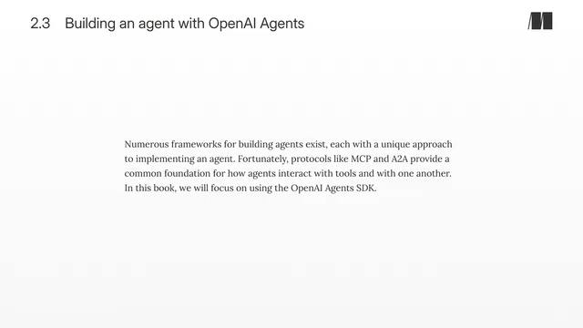
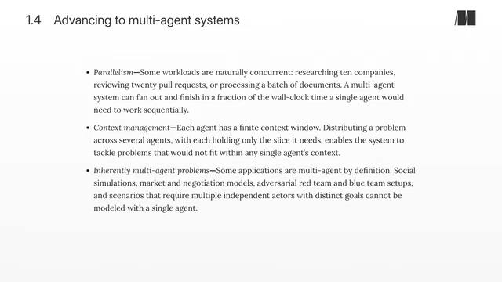
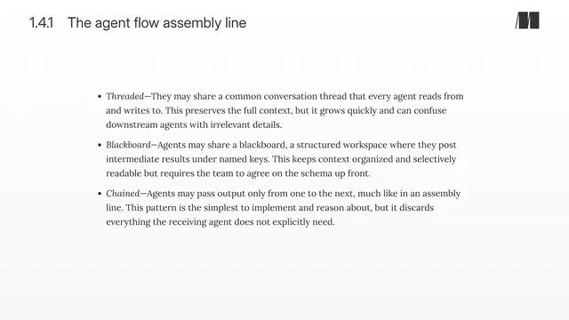
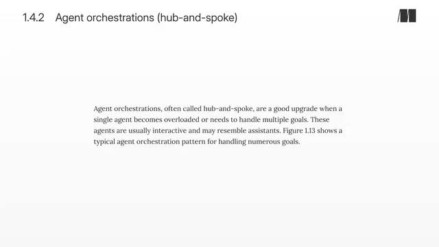
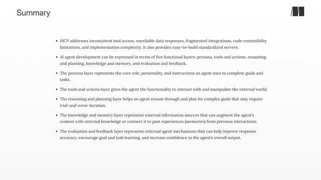
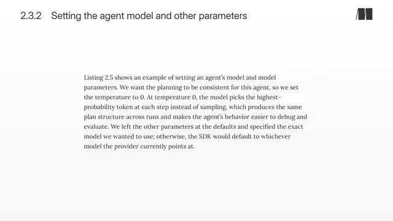
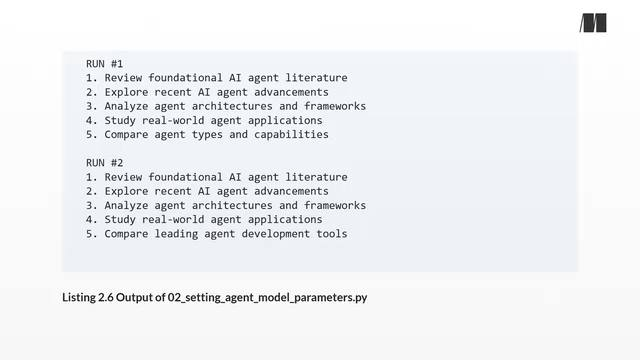
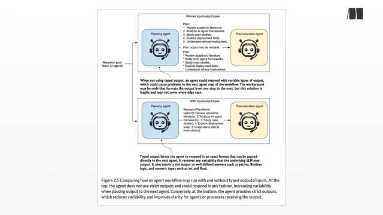
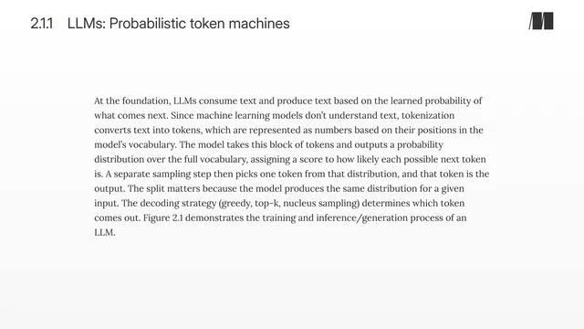
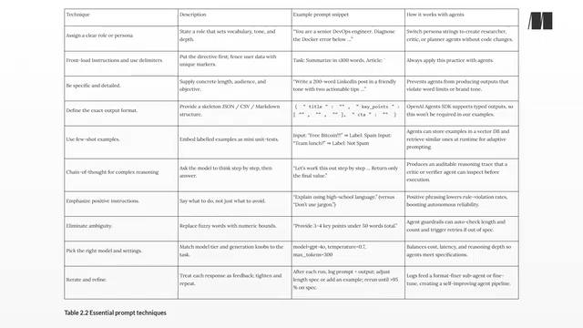

# AI Agents In Action 2nd（multi-agent）P4–P9 复现文档：从多智能体模式到最小研究规划 Agent

> 适用范围：本文覆盖 P4–P9。P4–P8 主要是多智能体模式、LLM/token、Prompt 工程的概念讲解；P9 开始进入 OpenAI Agents SDK，但逐字稿只描述了 Listing 2.3、2.5、2.7、2.9 的作用和报错，**没有贴出完整源码**。因此第 4 节的代码是“按逐字稿描述补成的可运行复现样例”，不是对讲师原码的逐字复制；凡课里没给的字段、版本、模型名，我会明确标注。

---

## 1. 这一节做什么

这一节的目标不是把“多智能体”四个字讲一遍，而是把 P4–P9 拼成一条能跑起来的最小路线：

1. 先按 P4 的三种模式选协作方式：**Agent Flow 装配线、Hub-and-Spoke 编排、Agent Collaboration 团队协作**。
2. 按 P5 的路线理解后续五层：persona、tools/actions、reasoning/planning、knowledge/memory、evaluation/feedback。本文只覆盖 P4–P9，所以五层不展开实现。
3. 按 P7 理解 LLM 的 token 预测、采样参数和成本意识。
4. 按 P8 写一个结构化 Prompt：静态 instructions 放前面，动态主题放后面。
5. 按 P9 用 OpenAI Agents SDK 做一个**最小研究规划 Agent**：输入主题，输出五步计划；`temperature=0` 降低波动；用 Pydantic 做 typed output；用 tracing 看执行记录。

最终你会得到这样一个项目：

```text
multi-agent-lab/
├── .env
├── .env.example
├── requirements.txt
└── planning_agent.py
```

运行后，终端输出一份 JSON 格式的五步研究计划。P4 里讲的多智能体模式，在这一节先落成“设计决策表”；真正可运行的是 P9 的最小 Agent。课里没有给出完整多智能体流水线源码，所以我不伪造一套“讲师原版多智能体代码”。



---

## 2. 讲师原话

下面按主题摘录，不按 P 号流水账排列。

关于“为什么要多智能体”，讲师说：

> "专业化。一个智能体即使加载了所有工具、领域知识和指令，表现通常也不如多个各司其职、各自把一件事做好的智能体。"
> —— p004 [00:00]

> "并行。有些工作负载天然适合并发处理，例如调研 10 家公司、审查 20 个拉取请求，或处理一批文档。"
> —— p004 [00:00]

关于装配线模式和三种协调方式：

> "智能体通过以下三种方式之一进行协调：线程式……黑板式……链式。"
> —— p004 [02:21]

> "上下文并非总是越多越好；除非有证据表明智能体需要进一步向上游查看，否则流水线形式通常就是合适的默认选择。"
> —— p004 [03:18]

关于 Hub-and-Spoke：

> "中心智能体充当枢纽或编排器，将任务分派给执行智能体。"
> —— p004 [04:16]

关于协作模式的代价：

> "这类系统通信频繁且重复，导致其达成目标的效率低得多，成本也可能过高。"
> —— p004 [06:11]

P6 的总结页把三种模式压成一句话：

> "智能体流模式，也就是顺序流水线，是最直接的多智能体实现方式。"
> —— p006 [02:48]

P7 解释 LLM 的本质：

> "大语言模型接收文本，并依据学到的下一个词出现概率生成文本。"
> —— p007 [01:49]

P8 解释 Prompt 工程不是玄学：

> "提示词工程能让智能体行为可预测、产出高效，同时降低成本并避免意外行为。"
> —— p008 [00:00]

P9 开始落地 Agent，并给出两个关键点：

> "当温度设为零时，模型在每一步选择概率最高的词元，而不是进行采样；这样每次运行都会生成相同的计划结构，也使智能体的行为更易于调试和评估。"
> —— p009 [01:52]

> "已启用严格 JSON Schema，但输出类型无效。要么把输出类型设为严格模式，要么向智能体传入 output_schema_strict=False。"
> —— p009 [05:35]

Tracing 默认开启：

> "使用 OpenAI Agents SDK 和 OpenAI API 时，追踪功能默认启用。"
> —— p009 [07:26]

---

## 3. 从零复现

### 3.1 先选模式：不要一上来就做“团队协作”

P4 给的判断顺序很实用：**能用装配线就用装配线；中心调度能解决就用 Hub-and-Spoke；只有复杂问题需要互相批评、反复反馈时，才上 Collaboration。**

| 需求 | 首选模式 | 理由 | 什么时候换 |
|---|---|---|---|
| 固定五步研究计划、内容生产 | Agent Flow 装配线 | 顺序清楚，最容易实现和推理 | 下游需要看上游大量上下文时，考虑 blackboard/threaded |
| 客服分诊、多目标任务分派 | Hub-and-Spoke | 所有输入输出经过中心代理，控制力强 | worker 需要主动反馈、互相评价时，考虑 collaboration |
| 代码评审、产品需求互评 | Agent Collaboration | 代理之间可以来回批评、补充 | 成本高、轮次多，必须设预算和停止条件 |
| 批量研究 10 家公司 | 并行 fan-out | 课里说这类工作天然并发 | 课里没讲实现；在 Node 里直觉是 `Promise.all`，但会撞 rate limit 和预算，需要限流/队列 |

对应到前端/Node 的类比（课里没有用这些词，这是我给前端读者的翻译）：

- threaded：像所有组件读写同一个全局 store，上下文全，但很快变脏。
- blackboard：像按 key 存的 Redux/JSON workspace，结构清楚，但团队要先约定 schema。
- chained：像 `a -> b -> c` 的纯函数管道，最简单，但下游拿不到上游不需要的细节。









### 3.2 建目录和 Python 环境

课里没有给 Python 版本和依赖版本。下面给可执行流程，版本以 `openai-agents` 安装要求为准；安装后用 `pip freeze` 锁定你实际拿到的版本。

```bash
mkdir multi-agent-lab
cd multi-agent-lab

python -m venv .venv
source .venv/bin/activate          # Windows: .venv\Scripts\activate

python -m pip install -U pip
python -m pip install -U openai-agents pydantic python-dotenv
python -m pip freeze > requirements.lock.txt
```

### 3.3 配置环境变量

`.env` 不要提交到 Git。`OPENAI_API_KEY` 是 OpenAI SDK 读取的变量；`MODEL_NAME` 和 `RESEARCH_TOPIC` 是复现样例自己加的，不是课程指定。

```bash
cp .env.example .env
```

然后编辑 `.env`，填入你的 key 和账号可用的模型名。

### 3.4 写最小 Agent

完整代码见第 4 节。核心顺序是：

1. 用 Pydantic 定义 `ResearchPlan` 和 `PlanTask`。
2. 用 markdown 写 `INSTRUCTIONS`，把角色、目标、规则、输出约束写清楚。
3. 创建 `Agent
` 时指定 `model`、`model_settings` 和 `output_type`。模型名从环境变量读，不要依赖 SDK 的默认模型；P9 明确提醒过：“Otherwise, the SDK would default to whichever model the provider currently points at.”（p009 [02:21]）。
4. 用 `Runner.run(...)` 执行 Agent，拿 `result.final_output`。
5. 用 `trace("research_planning_agent")` 给这次执行命名，方便在 OpenAI Traces 页面里找到。
6. 把 `final_output` 按 JSON 打印出来。

### 3.5 先跑通“无类型输出”，再加类型

P9 的推进顺序是：先跑 Listing 2.3 的最小 Agent，看到一段自然语言计划；再在 Listing 2.5 设置 `temperature=0`；最后在 Listing 2.7/2.9 加 typed output。复现时也照这个顺序，不要一上来就写最复杂版本。否则一旦报错，你分不清是 API key、模型名、SDK 版本，还是 JSON schema 的问题。

可以先在 `planning_agent.py` 里把 `output_type=ResearchPlan` 注释掉，运行一次，确认能拿到自然语言输出；再把 `output_type` 加回来。这样 P9 讲的那个 strict JSON 报错才有对照。



### 3.6 复现 strict JSON 报错，但不要用“关闭严格模式”绕过

P9 的 Listing 2.8 报错原文是：

```text
Exception has occurred. User error. Strict JSON schema is enabled, but the output type is not valid.
Either make the output type strict or pass output schema strict equals false to your agent.
```

讲师对原因的解释是：类型没有严格定义，底层 JSON 结构可以被修改；具体到那个例子，是 `dict of int to string` 允许额外属性，破坏了 strict JSON 的要求（p009 [05:35]–[06:29]）。

复现时建议单独建一个 `strict_demo.py`，用一个带 `dict[int, str]` 字段的 Pydantic 模型做 `output_type`。如果报同样的错，说明你撞上了同一类 schema 问题；如果你的 SDK 版本没有报错，说明 strict 检查规则已经变化，以实际输出为准。**不要**为了让它跑通就设 `output_schema_strict=False`，P9 明确说“Avoid disabling strict JSON”，因为这会打开难查的 bug（p009 [06:57]）。

正确修法是像 Listing 2.9 那样，把“允许额外属性”的类型换成严格可描述的类型，例如把 `dict[int, str]` 换成 `list[PlanTask]`，每个 `PlanTask` 只包含固定的 `int`/`str` 字段。本文第 4 节的主代码直接采用修正后的模型。



### 3.7 tracing 怎么看

P9 说 tracing 在“OpenAI Agents SDK + OpenAI API”组合下默认开启（p009 [07:26]）。运行主程序后：

1. 打开 OpenAI API 网站的 Traces 页面。
2. 找到名为 `research_planning_agent` 的 workflow/trace。
3. 点进去，能看到对底层 LLM 的调用，包括输入、模型、token、instructions 和输出。
4. 因为 Agent 内部输出的是类型化对象，trace 里看到的 response output 是 JSON，再由 SDK 转成 `ResearchPlan` 模型（p009 [09:20]）。

如果你用的不是 OpenAI API 模型，这个页面不会出现对应记录；P9 也提醒“You must use the OpenAI API for your agent models to see results on this page.”（p009 [08:23]）。这时需要外部 tracing 工具，但课里只列了名字，没有给接入代码，本文不展开。



---

## 4. 完整代码

以下文件按顺序保存，目录结构如下：

```text
multi-agent-lab/
├── .env                  # 本地填写，不要提交
├── .env.example
├── .gitignore
├── requirements.txt
├── planning_agent.py     # 主程序：最小研究规划 Agent
└── strict_demo.py        # 可选：复现 strict JSON 报错
```

### 4.1 `.env.example`

```bash
# 复制为 .env 后填写。.env 不要提交到 Git。
# OpenAI Agents SDK 默认读取 OPENAI_API_KEY。
OPENAI_API_KEY=sk-your-key-here

# 课程没有指定模型名。必须换成你的账号实际可用的模型。
MODEL_NAME=your-model-name-here

# 可选：不改就用代码里的默认研究主题。
RESEARCH_TOPIC=multi-agent systems in production
```

### 4.2 `.gitignore`

```gitignore
.venv/
__pycache__/
.env
*.pyc
requirements.lock.txt
```

### 4.3 `requirements.txt`

```text
# 课程没有给出依赖版本号。
# 下面只声明包名，安装后用 `pip freeze > requirements.lock.txt` 锁定你实际拿到的版本。
openai-agents
pydantic>=2
python-dotenv
```

> 版本说明：P4–P9 的逐字稿没有出现任何 `pip install` 命令，也没有出现版本号。这里不能凭空写 `openai-agents==x.y.z`。复现时以安装当天解析到的版本为准，并把 `pip freeze` 的结果保存下来。若你的环境里 Pydantic 还是 v1，`model_dump_json` 会不可用，见第 7 节。

### 4.4 `planning_agent.py`（主程序，完整文件）

```python
import asyncio
import os

from dotenv import load_dotenv
from pydantic import BaseModel

from agents import Agent, ModelSettings, Runner, trace


load_dotenv()

MODEL_NAME = os.environ["MODEL_NAME"]
RESEARCH_TOPIC = os.environ.get(
    "RESEARCH_TOPIC",
    "multi-agent systems in production",
)


class PlanTask(BaseModel):
    """A single step in the research plan.

    Keep every field a plain int/str so the generated JSON schema stays strict.
    Do not add dict[...] fields that allow extra properties.
    """

    step: int
    title: str
    details: str
    done_when: str


class ResearchPlan(BaseModel):
    """Typed output for the research planning agent."""

    topic: str
    assumptions: list[str]
    tasks: list[PlanTask]


INSTRUCTIONS = """
# Role
You are a research planning agent. You turn a research topic into a short,
actionable plan that another agent or a human researcher can execute.

# Goal
Given the user's research topic, produce a five-step research plan.

# Rules
1. Produce exactly five tasks.
2. Each task must be actionable: say what to do, not just what to know.
3. Each task must have a concrete "done_when" completion check.
4. Do not invent sources, URLs, statistics, or citations.
5. Keep "title" under 80 characters and "details" under 400 characters.
6. Put unknown or assumed constraints in "assumptions".
7. The user message is the research topic. Do not ask follow-up questions.

# Output
Return a ResearchPlan object that follows the provided JSON schema exactly.
Do not wrap the JSON in markdown fences.
""".strip()


planning_agent = Agent(
    name="Research Planning Agent",
    instructions=INSTRUCTIONS,
    model=MODEL_NAME,
    model_settings=ModelSettings(temperature=0),
    output_type=ResearchPlan,
)


async def main() -> None:
    with trace("research_planning_agent"):
        result = await Runner.run(planning_agent, RESEARCH_TOPIC)

    plan = result.final_output
    print(plan.model_dump_json(indent=2))


if __name__ == "__main__":
    asyncio.run(main())
```

### 4.5 `strict_demo.py`（可选，复现 strict JSON 报错）

> 说明：这不是讲师原码。逐字稿只说“用了 `dict of int to string`，允许额外属性，导致 strict JSON 不合法”，没有贴出那段源码。下面按这个描述重建一个最小触发形态。不同 SDK 版本可能不再报同样的错，**以你终端实际输出为准**。

```python
import asyncio
import os

from dotenv import load_dotenv
from pydantic import BaseModel

from agents import Agent, Runner


load_dotenv()

MODEL_NAME = os.environ["MODEL_NAME"]


class BadPlanTask(BaseModel):
    # 这个 dict 字段是关键：按 P9 的描述，它允许额外属性，
    # 可能触发 "Strict JSON schema is enabled, but the output type is not valid."
    step: int
    details: dict[int, str]


class BadResearchPlan(BaseModel):
    topic: str
    tasks: list[BadPlanTask]


bad_agent = Agent(
    name="Strict Schema Demo Agent",
    instructions="Return a BadResearchPlan for the user's topic.",
    model=MODEL_NAME,
    output_type=BadResearchPlan,
)


async def main() -> None:
    result = await Runner.run(bad_agent, "multi-agent systems")
    print(result.final_output.model_dump_json(indent=2))


if __name__ == "__main__":
    asyncio.run(main())
```

修法不是加 `output_schema_strict=False`，而是把 `BadPlanTask.details` 换成固定字段，例如：

```python
class FixedPlanTask(BaseModel):
    step: int
    title: str
    details: str
    done_when: str
```

这正是主程序 `PlanTask` 的写法。

### 4.6 启动命令

```bash
cd multi-agent-lab
source .venv/bin/activate          # Windows: .venv\Scripts\activate

# 确认 .env 已填好
python planning_agent.py
```

预期输出是一个 JSON 对象。字段名来自你在 `ResearchPlan` 里定义的 `topic`、`assumptions`、`tasks`，以及 `PlanTask` 里的 `step`、`title`、`details`、`done_when`。下面只是**结构示意**，具体文字每次会不同，不是课程原输出：

```json
{
  "topic": "multi-agent systems in production",
  "assumptions": [
    "The researcher has access to the course materials and public documentation."
  ],
  "tasks": [
    {
      "step": 1,
      "title": "Clarify the production constraints",
      "details": "List latency, cost, reliability, and observability requirements.",
      "done_when": "A one-page constraints list exists."
    }
  ]
}
```

实际运行会输出五个 `tasks` 元素。若只输出一段自然语言，说明 `output_type` 没生效或你注释掉了；若报 strict JSON 错误，看第 7 节。

### 4.7 P4 多智能体模式的设计决策表（不是可运行代码）

P4 只讲模式，没有给多智能体流水线源码。下面把讲师的设计判断落成一张表，方便你后面自己实现时不再拍脑袋。**这不是课程代码，是设计产物。**

| 设计项 | Agent Flow 装配线 | Hub-and-Spoke 编排 | Agent Collaboration |
|---|---|---|---|
| 控制中心 | 无，顺序传递 | 一个 hub 统一收口 | 无固定中心，可有 manager 代理 |
| 代理关系 | 上下游 | 主从/委派 | 同伴/互相批评 |
| 默认协调方式 | chained，必要时 blackboard | hub 与 worker 之间传任务和结果 | 代理之间多轮消息 |
| 最适合 | 定义清楚的多步骤任务 | 单代理过载、多目标分派 | 复杂问题、需要互相验证 |
| 主要风险 | 下游缺上下文 | worker 被限制，不能主动反馈 | chatty、重复、成本高 |
| 什么时候不要用 | 需要大量回溯上游 | 需要 worker 互相评价 | 简单任务、预算敏感 |
| 课程态度 | “often the right default” | 单代理升级时的好选择 | 只用于否则解不了的复杂问题 |

对应讲师原话：装配线“often the right default until you see evidence that agents need to look further upstream”（p004 [03:18]）；Hub-and-Spoke 的缺点是 worker “tightly restricted and cannot provide feedback, evaluation, or other forms of collaboration”（p004 [04:44]）；Collaboration 的缺点是“chatty and repetitive... potentially overly costly”（p004 [06:11]）。

---

## 5. 逐行解释

### 5.1 环境与模型名

```python
load_dotenv()
MODEL_NAME = os.environ["MODEL_NAME"]
```

`load_dotenv()` 把 `.env` 里的键值读进进程环境。`os.environ["MODEL_NAME"]` 用方括号而不是 `get`，是为了**缺变量时立刻报 `KeyError`**。这比悄悄用 SDK 默认模型好：P9 说 SDK 会默认到“provider 当前指向的模型”（p009 [02:21]），这个默认值会随账号和时间变化，复现实验时不可控。

`RESEARCH_TOPIC` 用 `get` 并给默认值，因为它只是输入内容，缺了不影响程序结构。

### 5.2 为什么 `PlanTask` 的字段全是 `int`/`str`

```python
class PlanTask(BaseModel):
    step: int
    title: str
    details: str
    done_when: str
```

P9 的教训是：typed output 的 JSON schema 必须严格。`dict[int, str]` 这种“键不固定、还可能带额外属性”的结构，在 strict JSON 模式下容易不合法。把字段固定成 `step/title/details/done_when`，模型能生成的形状就被锁死了。

这里没有用 `Field(min_length=...)` 之类的约束，是有意保守：不同 SDK/模型对 JSON schema 关键字的支持不完全一样，复现文档优先保证能跑。需要长度约束时，先写进 instructions，再逐步加 schema 约束并观察是否报 strict 错误。

`done_when` 是给“完成标准”用的。P8 讲 Prompt 要具体、不要假设读者知道（p008 [02:47]）；一个任务如果没有完成标准，下游 Agent 无法判断该不该继续。这个字段不是课程强制要求，是复现样例为了可执行性加的。

### 5.3 `ResearchPlan` 为什么是“主题 + 假设 + 任务列表”

```python
class ResearchPlan(BaseModel):
    topic: str
    assumptions: list[str]
    tasks: list[PlanTask]
```

`topic` 让输出自带上下文；`assumptions` 把模型隐含的假设显式化，避免它把猜测当事实；`tasks` 是五步计划。P9 说 typed output 的好处是“outputs can feed into another agent without the risk of response variability breaking the workflow”（p009 [04:13]）。如果下一步是研究 Agent，它可以直接读 `tasks`，不需要解析自然语言。

`list[PlanTask]` 而不是 `dict[int, str]`，就是第 4.5 节说的修法：固定对象数组比“键可变的字典”更容易满足 strict schema。

### 5.4 instructions 的结构

```python
INSTRUCTIONS = """
# Role
...
# Goal
...
# Rules
...
# Output
...
""".strip()
```

P8 说 prompt 用 markdown 和分隔符会增加 token，但结构带来的稳定输出更值（p008 [01:24]）。这里的 `# Role / # Goal / # Rules / # Output` 就是最便宜的“分隔符”。

几条规则分别对应课程里的点：

- “Produce exactly five tasks” 对应 Listing 2.3 的“concise five-step plan”。
- “Do not invent sources” 是防止模型编造。P7 说 LLM 本质是预测下一个 token，不是查表（p007 [04:38]），所以它完全可能生成看起来像来源的字符串。
- “Do not ask follow-up questions” 是为了让 Agent 一次跑完。P8 说 Agent 会一直循环到满意或判定不可达（p008 [04:42]）；在最小示例里，不应该让它停下来反问。
- “Return a ResearchPlan object... Do not wrap the JSON in markdown fences” 是因为已经有 `output_type`，格式由 schema 管，prompt 里不要再重复描述字段格式。P9 说这也是 typed output 的好处：不用在 prompt 里严格解释输出格式（p009 [06:57]）。

### 5.5 `Agent(...)` 的参数

```python
planning_agent = Agent(
    name="Research Planning Agent",
    instructions=INSTRUCTIONS,
    model=MODEL_NAME,
    model_settings=ModelSettings(temperature=0),
    output_type=ResearchPlan,
)
```

- `name` 是给 tracing 和日志看的。P9 的自定义 trace 示例就是为了在 Traces 页面里认出工作流（p009 [08:52]）。
- `instructions` 是 persona/基础指令层。P5 把 persona 列为五层之一（p005 [00:00]），P8 说 prompt engineering 就是把这一层做对（p008 [00:28]）。
- `model=MODEL_NAME` 显式指定模型，对应 Listing 2.5 的“specified the exact model we wanted to use”（p009 [01:52]）。
- `model_settings=ModelSettings(temperature=0)` 对应 Listing 2.5 的 temperature 设置。P9 的原话是：temperature 0 时模型每一步选最高概率 token，而不是采样，所以计划结构跨运行更一致，便于调试和评估（p009 [01:52]）。
- `output_type=ResearchPlan` 是 typed output 的入口。P9 说这样输出可以喂给下一个 Agent，降低响应变化破坏工作流的风险（p009 [04:13]）。

如果你在 Node/TypeScript 里做类似的事，直觉是把 `output_type` 想成 zod schema，把 `model_settings` 想成调用参数对象；但 OpenAI Agents SDK 是 Python 包，课里没有讲 JS 版本，别把两类 API 混着抄。

### 5.6 `trace` 与 `Runner.run`

```python
with trace("research_planning_agent"):
    result = await Runner.run(planning_agent, RESEARCH_TOPIC)
```

`trace(...)` 给这次执行一个名字。P9 说可以“set a trace in your code to see more specific tracing, including the name of your workflow”（p009 [08:52]）。不包这一层也能跑，因为 tracing 默认开启；包这一层是为了在 Traces 页面里好找。

`Runner.run` 是异步的，所以用 `await`。在 Node 里这相当于 `await someAgent.run(topic)`；区别是 Python 需要 `asyncio.run(main())` 启动事件循环。`result.final_output` 是 Agent 的最终输出；因为指定了 `output_type`，它在这里是 `ResearchPlan` 实例，而不是字符串。

### 5.7 `model_dump_json`

```python
plan = result.final_output
print(plan.model_dump_json(indent=2))
```

`model_dump_json` 是 Pydantic v2 的方法，把模型转成 JSON 字符串。它不是课程 API，逐字稿没有出现这个方法；这里只是为了让终端输出可读。若你的 Pydantic 是 v1，改用 `plan.json(indent=2)`，或者升级到 v2。课里没有讲 Pydantic 版本，这是复现时会撞上的差异。

### 5.8 为什么 temperature=0 仍可能每次不一样

P9 明确说：temperature 0 减少变化，但不等于永远相同；Listing 2.6 里前四个任务几乎一样，第五个任务略有差异（p009 [03:15]）。原因在 P7：模型输出的是概率分布，采样只是其中一步；即使每步选最高概率，底层数值计算、模型版本、上下文长度等仍可能带来细微差异（p007 [02:15]）。

所以复现检查时不要用“两次输出必须逐字相同”当成功标准。正确标准是：**JSON 结构合法、五个任务、字段齐全、没有编造来源**。需要更严格的确定性时，P9 提到 `seed` 参数：相同 seed、prompt、参数会返回相同输出，适合调试和评估（p009 [10:17]）。但课里没有给 Agents SDK 里设置 seed 的代码，本文不猜字段名。

### 5.9 P4 的模式选择为什么不能省

P9 的最小 Agent 是**单 Agent**，不是多智能体。P4 的价值在于：当你把这个规划 Agent 扩展成“规划 → 研究 → 写作”时，先决定协调方式。

- 选 chained：规划 Agent 输出 `ResearchPlan`，研究 Agent 只接收 `tasks`，写作 Agent 只接收研究结果。实现最简单，但写作 Agent 看不到规划时的假设。
- 选 blackboard：把 `topic/assumptions/tasks/results` 按 key 放进共享工作区，下游按需读。需要先约定 schema，正好对应本文的 Pydantic 模型。
- 选 threaded：所有 Agent 读写同一段对话。上下文最全，但 token 增长快，下游容易被无关细节干扰。
- 选 Hub-and-Spoke：保留一个 orchestrator，把研究、写作当 worker。控制力强，但 worker 不能主动提反馈。
- 选 Collaboration：研究和写作互相批评。P4 说这类系统 chatty、重复、可能很贵，只在复杂问题时用。

这张判断表比“先写五个 Agent 再连起来”更重要。P4 的原话是“More context is not always better”（p004 [03:18]），不是“上下文越多越智能”。





---

## 6. 复现检查清单

按顺序打勾，哪一步失败就停在哪一步，不要跳。

### 6.1 环境

- [ ] 已创建 `multi-agent-lab/` 目录。
- [ ] 已创建虚拟环境 `.venv` 并激活。Windows 用 `.venv\Scripts\activate`。
- [ ] `python --version` 能正常输出。
- [ ] `pip install -U openai-agents pydantic python-dotenv` 成功。
- [ ] `pip freeze > requirements.lock.txt` 已执行，版本已留档。
- [ ] `.env` 已从 `.env.example` 复制，且没有被提交到 Git。
- [ ] `OPENAI_API_KEY` 已填。
- [ ] `MODEL_NAME` 已填，且是你的账号实际可用的模型；不是照抄本文的占位符。

### 6.2 第一次运行

- [ ] `python planning_agent.py` 没有报 `KeyError: 'MODEL_NAME'`。
- [ ] 没有报 401/403 一类鉴权错误。
- [ ] 没有报模型不存在。
- [ ] 终端输出是 JSON，不是一段带 markdown 围栏的自然语言。
- [ ] JSON 里有 `topic`、`assumptions`、`tasks`。
- [ ] `tasks` 正好五个。
- [ ] 每个 task 都有 `step`、`title`、`details`、`done_when`。
- [ ] 没有出现编造的 URL、引用、统计数字。

### 6.3 类型化输出与 strict JSON

- [ ] 把 `output_type=ResearchPlan` 临时注释掉，能拿到自然语言输出；加回来后能拿到 JSON。两种模式都跑过。
- [ ] 跑 `python strict_demo.py`，观察是否出现 strict JSON 报错；记录你实际看到的完整报错。
- [ ] 没有用 `output_schema_strict=False` 绕过错误。
- [ ] 如果 `strict_demo.py` 没报错，说明你的 SDK 版本检查规则不同；不要把它当成“主程序一定没问题”的证明，主程序仍要实际跑。

### 6.4 tracing

- [ ] 打开 OpenAI API 网站的 Traces 页面。
- [ ] 能看到名为 `research_planning_agent` 的 trace。
- [ ] 点进去能看到底层 LLM 调用。
- [ ] 能看到输入、模型、token、instructions、输出这些信息中的至少一部分；具体字段以页面实际显示为准。
- [ ] 确认你用的是 OpenAI API 模型；用其他 provider 时此页面可能没有记录。

### 6.5 成本与行为

- [ ] 连续运行两次，记录两次输出差异。不要要求逐字相同。
- [ ] 检查输出长度是否合理；P9 提醒长输出更容易漂移（p009 [03:43]）。
- [ ] 没有把 API key、用户隐私、内部文档粘进 prompt 或 trace。
- [ ] 知道输出 token 通常比输入 token 贵；P7 说不同 provider 是 2–5 倍（p007 [06:57]）。不要用“多跑几次看看”当调试手段。

### 6.6 多智能体设计

- [ ] 能说出你的场景为什么选装配线，而不是 Hub-and-Spoke 或 Collaboration。
- [ ] 如果选装配线，已决定用 chained、blackboard 还是 threaded。
- [ ] 如果选 blackboard，已写出共享字段的 schema；本文的 `ResearchPlan` 可以作为起点。
- [ ] 知道 P4–P9 没有给多智能体流水线的完整源码；不要把本文的单 Agent 当成多智能体实现。

---

## 7. 课里没讲但你会撞上的

### 7.1 SDK 版本与 API 名称会变

逐字稿没有给 `openai-agents` 的版本，也没有给完整 import 列表。本文用的是 `Agent / ModelSettings / Runner / trace` 这一组常见入口；如果你的版本里某个名字不存在，先 `python -c "import agents; print(agents.__file__)"` 找到包，再看实际导出。不要因为一个 import 失败就认定课程代码错了，先确认版本。

### 7.2 `MODEL_NAME` 没有标准答案

P9 说“specified the exact model we wanted to use”，但没有说模型名。本文强制你从环境变量填，就是为了不把某个具体模型写死。你账号没有某个模型权限时，会直接报模型不存在或无权限；换成你有权限的模型即可。

### 7.3 Pydantic v1 与 v2 的差异

本文用 `model_dump_json`，这是 Pydantic v2 的写法。Pydantic v1 用 `.json()`，且 `list[PlanTask]` 这类写法在旧版本上可能有差异。课里没有讲 Pydantic 版本；如果你的环境是 v1，要么升级，要么把输出改成 `.json(indent=2)`。这不会影响 Agent 的推理，只影响你打印结果。

### 7.4 strict JSON 报错不是“模型笨”

P9 的报错是 **schema 不合法**，不是模型不会输出 JSON。错误信息里已经写了 “the output type is not valid”。所以不要靠改 prompt 来修，应该改 `output_type` 对应的 Pydantic 模型。优先把 `dict[...]`、`Any`、允许额外属性的嵌套结构换成固定字段的对象数组。P9 明确不推荐 `output_schema_strict=False`（p009 [06:57]）。

### 7.5 tracing 默认开启，但不等于“什么都能看到”

P9 说 tracing 默认开启，但前提是“with the OpenAI API”（p009 [07:26]）。如果你换成别的 provider，或者用本地模型，OpenAI Traces 页面可能没有记录。课里列了 Langsmith、Langfuse、Arize Phoenix、Weights and Biases Weave 等外部工具（p009 [07:56]），但没有给接入代码，本文不编。

另外，trace 会记录输入和输出。不要把 API key、用户隐私、未公开的内部文档放进 prompt。课里没有展开隐私和合规，这是你自己的责任。

### 7.6 并行不是免费加速

P4 说有些工作天然并发，比如研究 10 家公司、审查 20 个 PR（p004 [00:00]）。但课里没有给并行实现。真做的时候你会撞上：

- API rate limit：同时发太多请求会被限流。
- 成本：并行不会降低 token 总量，反而可能因为重试而增加。
- 失败处理：一个子任务失败，是整体失败还是部分成功？课里没讲。
- 顺序依赖：有些任务必须等前一个结果，不能盲目 `Promise.all`。

在 Node 里，直觉是 `Promise.all`；在 Python 里可能是 `asyncio.gather`。但这两者都不会自动帮你限流。需要自己加并发上限、重试和预算。课里没有这些代码。

### 7.7 `temperature=0` 不是确定性保证

P9 已经说了第五个任务可能略有不同（p009 [03:15]）。所以你写测试时，不要断言“两次输出完全相等”。应该断言结构：五个任务、字段类型正确、没有空字符串、没有编造 URL。需要更强确定性时，P9 提到 `seed`，但没给 SDK 里的设置代码；字段名请以实际 SDK 文档为准。

### 7.8 reasoning effort 不要默认拉满

P9 说 routine agent 的步骤通常小而明确，高 reasoning effort 会增加延迟和 token 成本而不改变答案；建议 routine 步骤设 none/minimal，把高推理留给规划、复杂工具选择、调试卡住的循环（p009 [02:21]）。但逐字稿没有给 Agents SDK 里设置 reasoning effort 的具体字段名，本文不猜。你可以在实际 SDK 里查 `ModelSettings` 支持的参数；不确定就保持默认，先跑通。

### 7.9 多智能体没有“标准库”

P4 给了三种模式，P6 做了总结，但 P4–P9 没有给一个完整的多智能体项目。P9 的 Agent 是单 Agent。你如果直接搜“multi-agent framework”，会看到很多课里没提的工具和协议；不要因为本文没写就以为课程讲过。本文只对讲师明确说过的模式做设计表，不补造实现。

### 7.10 Windows 与编码

Windows 上虚拟环境激活命令不同；如果终端输出中文乱码，可能是代码页问题。本文的 JSON 输出默认可能把中文转义，这是 JSON 序列化的正常行为，不影响数据。需要可读中文时，在 `model_dump_json` 后自行处理，但课里没有讲这部分。

### 7.11 `.env` 与密钥

`.env` 不要提交。本文给了 `.gitignore`，但课里没有讲 Git 安全。已经提交过的 key 要立刻轮换，不要只删文件。API key 不要写进 `planning_agent.py`，也不要贴进 trace 或聊天记录。

### 7.12 输出 token 的成本会累积

P7 说 provider 分别计输入和输出 token，输出通常贵 2–5 倍（p007 [06:57]）；P4 说协作模式 chatty、重复、可能很贵（p004 [06:11]）。最小 Agent 只输出五个任务，成本可控；一旦你扩展成多智能体，每轮批评和返工都会增加输出 token。P4 的建议是“the cheapest one that meets the requirement, not the most powerful”（p004 [07:08]）。先把单 Agent 跑通，再决定要不要加 Agent。

---

**最后一句复现原则**：P4–P8 给你的是判断依据，P9 给你的是第一个能跑的落点。先把 `planning_agent.py` 跑出合法 JSON，再回头用第 4.7 节的表决定下一个 Agent 怎么加。不要反过来——先搭五个 Agent，再发现 strict JSON、模型名、成本和 tracing 都没跑通。