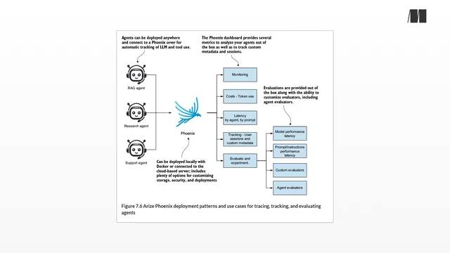
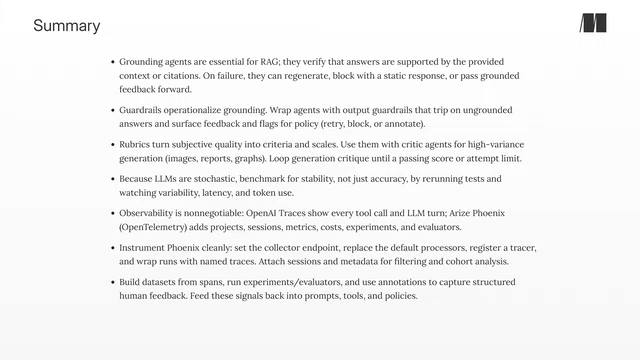
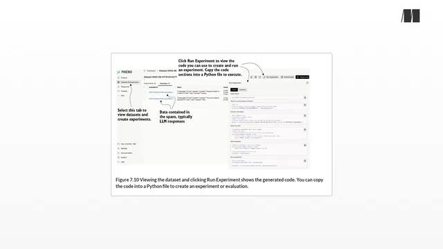
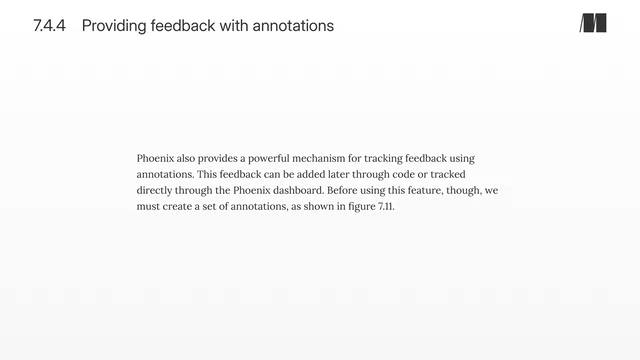
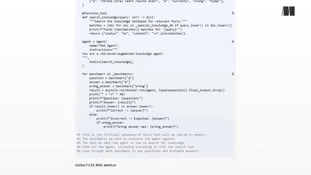
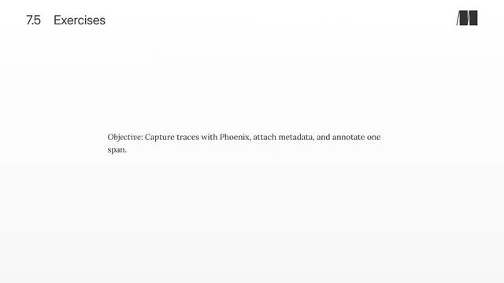
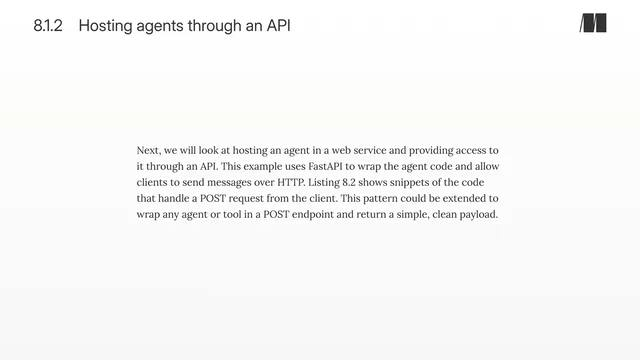
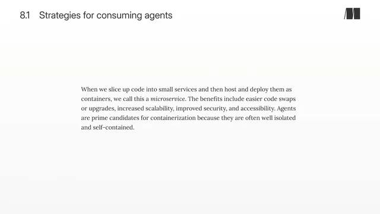

# AI Agents In Action 2nd · P40–P43 复现文档

> 覆盖：Section 7.4 Phoenix for Evaluation and Feedback｜7.4.1–7.4.4｜7.5 Exercises｜第 7 章 Summary｜第 8 章开篇 8.1.1–8.1.3
> 读者画像：前端转 AI 应用工程师，不强依赖后端经验

**开始之前必须说清的一件事（关于代码来源）**

这四集的形态不一样：

- **P040、P041** 讲的是「操作流程 + 练习任务清单」。逐字稿里出现了 `set_trace_processors`、`using_session`、`using_metadata`、collector endpoint、project name = Agents、localhost:6006 这些**确定要素**，但**没有誊录 listing 的完整行级代码**。
- **P042** 是纯小结，没有代码。
- **P043** 是第 8 章开篇，讲师**明确说了**第 8 章示例是 AI 生成的、「agent 本体代码不贴，只贴 API 部分」（p043 [10:40]）。

所以本文的代码分两类，我会在代码注释里逐处标出来：

| 标记 | 含义 |
|---|---|
| `[课里有]` | 逐字稿明确讲过这个要素，可以照抄 |
| `[课里没讲]` | 逐字稿没誊录 / 没提，是本文补的接线，**必须按你安装的版本核对** |

这不是偷懒。讲师自己在 p040 [02:49] 就说过接 Phoenix "通常很快，但并非总是轻松。"，会遇到包冲突。你照着文档跑，卡住的地方大概率就在 `[课里没讲]` 那几行。

---

## 1. 这一节做什么

这四集不是一个连续的编码演示，而是**三件事叠在一起**：

**第一件：给 agent 装上可观测性（P040）。**
讲师的原话很重："如果没有跟踪级别的可观测性，几乎不可能大规模调试或改进复杂的智能体流程。"（p040 [00:29]）。要落地的产物是：一个本地跑起来的 Phoenix（Docker，端口 6006）→ 一个叫 `Agents` 的项目 → 从你的 Python agent 把 trace 打进去 → 在 traces 页按 metadata 过滤 → 把某个 span 拉进 dataset → 跑一次 experiment → 给 LLM span 打一个 annotation。这一整条链路走通，第 7 章的 TDAD（测试驱动 agent 开发）闭环才算闭合。

**第二件：五个练习，把第 7 章的手工活变成肌肉记忆（P041）。**
练习 1 跑基线（**预期是失败**），练习 2 改 prompt + 改工具拿到 80% 通过率，练习 3 加一个返回结构化 pass/fail 的评测 agent，练习 4 加 grounding agent + output guardrail，练习 5 把整条链路接上 Phoenix 并打 annotation。这是一条**递进链**，跳过练习 2 直接做练习 5 不会报错，但你会看不懂自己在 trace 里看到什么。

**第三件：部署形态的选择（P043）。**
讲师给了三种消费/部署模式（嵌入应用、API 微服务、作为工具或 A2A 被别的 agent 调用），点掉了浏览器端跑的三个硬伤，然后用一个 FastAPI 包装第 7 章的图像生成 agent 做示范。**第 8 章这一集只到「能跑通 API」为止**，真正的生产栈（队列、GPU worker 池、对象存储、通知机制、memory）讲师明确说了是 "以抽象方式处理这些生产环境问题"（p043 [15:18]）。

最终目录结构（本文全部路径都以此为准）：

```
ai-agents-2nd/
├── .env
├── requirements.txt
├── ch07/
│   ├── Exercise1TDADBaseline.py          # 练习 1（课里：listing 7.1）
│   ├── Exercise2RefactorRAG.py           # 练习 2
│   ├── Exercise3EvaluationAgent.py       # 练习 3
│   ├── Exercise4GroundingGuardrail.py    # 练习 4
│   ├── Exercise5PhoenixTracing.py        # 练习 5 ← 本文给完整文件
│   ├── benchmarks.json                   # 本文补的最小样例
│   └── 07ImageGenerationAgent.py         # 第 7 章图像 agent（课里没贴）
└── ch08/
    ├── image_agent_api.py                # Listing 8.2 的 API 部分 ← 本文给完整文件
    ├── 01_embedded_agent.html            # Listing 8.1（课里：vibe coded 单文件）
    └── 03_realtime_image_agent.html      # Listing 8.3（课里：调用上面的 API）
```



---

## 2. 讲师原话

下面这些是我认为**必须原样保留**的句子，因为改一个字就会丢掉关键限定条件。

**关于为什么需要 Phoenix：**

> "没有跟踪级别的可观测性，几乎无法在大规模场景下调试或改进复杂的智能体流程。"
> —— p040 [00:29]

> "Arize Phoenix 是一个优秀的开源平台，可在云端访问，也可在 Docker 容器中本地运行。"
> —— p040 [00:00]（"Arise" 是 Arize 的转写误差，产品名是 Arize Phoenix）

**关于接线顺序（这是本文第 4 章代码的直接依据）：**

> "我们首先通过将 setTrace processors 设为空列表，清除默认的 OpenAI 跟踪处理器。然后添加 Phoenix 跟踪提供程序，并使用智能体的跟踪函数来跟踪该智能体。我们还会设置要跟踪的智能体或智能体工作流的名称。"
> —— p040 [02:49]

**关于 session / metadata 的嵌套顺序（最容易写错的一条）：**

> "我们在 with 块中添加 using session 和 using metadata，使它们附加到所有内部跟踪记录上。务必确保智能体跟踪块位于其他所有跟踪代码内部。"
> —— p040 [04:41]

**关于验证点：**

> "在 Docker 中运行 Phoenix 并完成清单 7.13 中的代码后，打开浏览器访问 localhost 6006，点击 Agents 项目。如果 Agents 项目没有立即显示，请刷新浏览器，它应该就会出现。"
> —— p040 [03:43]

**关于 metadata 的用途：**

> "选择元数据列会打开一个选择器，让你可以按值或表达式对任意字段进行筛选。对于评估特定智能体活动来说，这可能是一个强大的功能。不过，它确实要求你根据智能体的使用场景配置合适的元数据。"
> —— p040 [05:37]

**关于 annotation 到底解决什么问题（这一段是整集最值钱的论述）：**

> "如果没有标注，同样的观察结果只会留在 Slack 讨论串和会议记录中，永远无法成为可复用的评估材料。"
> —— p040 [09:18]

> "一条黄金法则是，除非采用评估与反馈模式，否则绝不应将智能体推入生产系统。"
> —— p040 [09:46]

**练习 5 的原始任务清单：**

> "添加清单 7.13 中的 Phoenix 设置。设置 Phoenix 采集器端点，清除跟踪处理器，将项目名称设为 Agents 并注册项目，然后用跟踪包住 RAG 基准测试的运行。添加清单 7.14 中的会话和元数据：使用 using session 并指定 SES07，使用 using metadata 指定 RunID H7X5、NVDev 和 ModelGPT5。"
> —— p041 [03:26] / [03:54]

**小结里的生产规则（可以直接抄进团队的 PR 模板）：**

> "绝不要在缺少以下条件时将智能体推入生产：主动的评估反馈循环、基准测试、依据性护栏、带评分标准的评审器、跟踪与受监控的关键绩效指标，以及延迟、成本和质量协同发挥作用。"
> —— p042 [02:53]

**关于浏览器端跑 agent 的三个硬伤：**

> "放在客户端代码中的 API 密钥，任何打开浏览器开发者工具的人都能提取出来……默认情况下，Chorus 策略会阻止浏览器直接调用许多大语言模型和工具端点……当多个浏览器共享同一个密钥时，按 API 密钥施加的速率限制会表现出不同的行为。"
> —— p043 [02:17]

（"Chorus policies" 是 CORS 的转写误差，从上下文「block direct browser calls」判断即可。这是转写问题，不是讲师在用新工具。）

**关于为什么要 POST 而不是 GET：**

> "我们使用 POST 方法，因为该请求耗时较长，而且文本描述可能超出 GET 请求所能支持的长度。"
> —— p043 [10:40]

**关于 vibe coding 的边界（这段建议全组一起读）：**

> "这些示例中的高层结构、部署模式和架构选择才是你应该关注的重点……实现细节、具体库调用、错误处理细节和基础设施样板代码，正是大语言模型擅长生成的代码类型；在采用之前，你应按照自己的工程标准进行审查。"
> —— p043 [06:26] / [06:55]



---

## 3. 从零复现

### 3.1 环境准备

Python 侧：

```bash
mkdir -p ai-agents-2nd/ch07 ai-agents-2nd/ch08
cd ai-agents-2nd
python -m venv .venv
source .venv/bin/activate          # Windows PowerShell: .venv\Scripts\Activate.ps1
pip install -U pip
pip install -r requirements.txt
```

**关于版本号：课里没给。** 逐字稿从来没出现过一个版本号，反而在 p040 [02:49] 明说会遇到 "包冲突"。所以 `requirements.txt`（第 4 章 4.1）只写包名，装完立刻冻结：

```bash
pip freeze > requirements.lock.txt
```

这一步不要省。你后面调 Phoenix 接线调通的那一版，就是你团队的基线。

Docker 侧：按 p040 [03:16] 的说法，"你需要先安装 Docker Desktop"。装完确认：

```bash
docker --version
docker ps
```

### 3.2 起 Phoenix（本地 Docker）

讲师说 Phoenix 可以跑在 Docker 容器里，浏览器开 **localhost:6006**（p040 [03:43]），并且代码文件最上方有一行注释写着这个启动命令（"代码顶部被注释掉的概要内容就是让 Phoenix 作为本地 Docker 容器运行的命令"，p040 [03:16]）。

```bash
docker run --rm -p 6006:6006 arizephoenix/phoenix:latest
```

`[课里没讲]` 上面这个镜像名和 tag 不是逐字稿内容——逐字稿只确认了「一行 Docker 运行命令」和「6006 端口」。镜像名请以 Phoenix 官方 README 当前写法为准。跑起来后立刻访问 `http://localhost:6006`，能看到 UI 再往下做。

先别关这个终端。Phoenix 进程一停，trace 就丢了。

### 3.3 写埋点（Listing 7.13 + 7.14）

按 p040 [02:49] 的顺序，代码里必须做四件事，顺序不能反：

1. `set_trace_processors([])` —— 清空 OpenAI 默认的 trace processors；
2. 注册 Phoenix trace provider，project name = `Agents`；
3. 用一个**命名的** trace 块（例子里叫 `"RAG benchmarks"`）把所有运行包起来；
4. 在这个 trace 外面再套 `using_session("SES07")` 和 `using_metadata({...})`。

第 4 点的嵌套方向，讲师专门提醒过："务必确保将智能体跟踪代码块放在其他任何跟踪代码块内部。"（p040 [04:41]）。写成代码就是**session / metadata 在外，trace 在内**。写反了不会报错，但你的 trace 上不会有 session id 和 metadata，Phoenix 里按 RunID 过滤会一条都筛不出来——这是本节最容易踩的坑。

完整文件见第 4 章 4.3。

### 3.4 验证 trace 进到了 Agents 项目

```bash
python ch07/Exercise5PhoenixTracing.py
```

然后浏览器 `http://localhost:6006` → 点 **Agents** 项目（p040 [03:43]；看不到就刷新）。进去之后能看到 traces 列表，点开任意一条能下钻到 agent workflow → agent → LLM response，看到 latency、token usage 和发给 LLM 的 raw responses（p040 [04:12]）。

这一步如果拿不到 trace，按这个顺序排查：Phoenix 容器还在不在 → endpoint 是不是带 `/v1/traces` → `set_trace_processors([])` 有没有真的执行（写在 import 之后、agent 定义之前）。

### 3.5 打开 metadata 列，按 RunID 过滤

在 Agents 项目的 traces 页，**右上角 column selector → 勾上 metadata 列**（p040 [05:07]，Figure 7.8）。metadata 列可见后点它，会展开一个选择器，可以按任意字段的**值或表达式**过滤（p040 [05:37]）。

练习 5 要求的就是这个动作：过滤 `RunID = H7X5`，然后随便选一条 LLM span。

注意讲师那句限定："但它确实需要你根据智能体的使用场景配置合适的元数据。"（p040 [05:37]）。metadata 不是自动就有用的，键名得你自己设计得让人看得懂。

### 3.6 把 span 变成 dataset，再跑 experiment

这条是 P040 中最容易漏看的一段，按顺序：

1. 在 traces 里**选中**几条 span（尤其是 LLM response 那层）；
2. 点 **Add to dataset**；
3. 弹窗里用默认数据集名 → **Create dataset**；
4. 右下角绿条出现后点 **View dataset**；
5. dataset 页面右上角 **Run Experiment** —— 它会把一段**可以复制走的 Python 代码**弹给你；
6. 把那段代码存成 `.py` 跑，就是一次 experiment。

讲师对这段的定性很准："这本质上就是 TDAD 的外层循环：我们把真实跟踪数据转化为数据集，在其上运行评估器，再把结果反馈到提示词、工具和策略中。"（p040 [06:05]）。



### 3.7 建 annotation，然后把结论落到 span 上

顺序是**先定义、后使用**：

1. Phoenix 里先新建一个 annotation（p040 [07:27]，Figure 7.11）；
2. 回到 traces 页，选中一条 LLM response span；
3. 打上标记，例如 `correctness = pass` / `correctness = fail`。

讲师给 annotation 的定位是"把临时性判断转化为结构化数据"（p040 [08:49]）——它把「这个回答不对」这种散在 Slack 里的话，变成**可查询、可跨维度比对**的信号。你后面可以拿它去对 latency / cost / token usage，看坏回答是不是总是出现在某类 prompt 或某个工具上（p040 [09:18]）。



### 3.8 五个练习的执行顺序

练习是递进的，建议按顺序做，每个练习产出一个独立文件（文件名逐字稿是口述，大小写可自行统一）：

| # | 产物文件 | 关键动作 | 验收标准 |
|---|---|---|---|
| 1 | `Exercise1TDADBaseline.py` | 抄 listing 7.1，跑 **3 次** | 底部注释写「run 1: 0/5, run 2: 1/5, run 3: 0/5」这类汇总；**预期就是失败** |
| 2 | `Exercise2RefactorRAG.py` | 改 instructions（提到 break down the query，可选限制单词作答）+ 新增并按 listing 7.4 注册 keyword 工具 + `model="gpt-5"` | 跑 3 次记录通过率，**至少一次 ≥80%**，并把最好的一次输出留在注释里 |
| 3 | `Exercise3EvaluationAgent.py` | 加 evaluation output + evaluation agent（listing 7.5），改循环调用评测器（listing 7.6），打印 `is_correct` 和 feedback | 跑 2 次比对一致性；注释里写 total correct + 一条有用的 feedback |
| 4 | `Exercise4GroundingGuardrail.py` | 实现 `get_last_context` / `grounded_answer` / grounding agent（listing 7.7）+ output guardrail（listing 7.9）注册到 rag agent + 用 listing 7.10 包住 run loop | 捕获 tripwire，trip 时打印 guardrail info 并返回 "暂无有依据的答案"；至少一个问题触发一次 |
| 5 | `Exercise5PhoenixTracing.py` | 本文 4.3 的完整文件 | Phoenix 里 Agents 项目能按 `RunID = H7X5` 过滤出 trace，并能给 LLM span 打 annotation |

练习 1 的「预期失败」不是走过场。讲师在 p042 [00:27] 把这条写进了方法论："定义基准测试，包括错误示例，预期一开始会失败，并多次运行每项测试以保证一致性。" 跑三次是为了看**方差**，不是看单次分数——LLM 是随机的，一次 4/5 可能是运气。





### 3.9 把图像 agent 包成 HTTP API（Listing 8.2）

这是第 8 章唯一有代码落地的部分，也是 P043 唯一能「照着做」的产物。

讲师交代了三点：

- 底层 agent 是第 7 章的 `07ImageGenerationAgent.py`（agent-critic 模式），"所有这些代码都保持不变，而代码清单只展示了 API 代码"（p043 [10:40]）；
- 用 **POST**，因为「请求耗时长，且文本描述可能超过 GET 支持的长度」（p043 [10:40]）；
- 返回**字节数组**，"我们同样可以把图像作为 Base64 字符串返回，但客户端必须自行解码。"（p043 [11:07]）。

启动（讲师说用 uvicorn 或 VS Code 的 debug 配置，p043 [11:07]）：

```bash
cd ai-agents-2nd
uvicorn ch08.image_agent_api:app --reload --port 8000
```

调用（课里同时给了 curl 和 PowerShell 两种写法，p043 [11:34]）：

```bash
curl -X POST http://localhost:8000/generate \
  -H "Content-Type: application/json" \
  -d "{\"description\":\"an agent generating an image, flat illustration\"}" \
  --output out.png
```

```powershell
Invoke-WebRequest -Uri http://localhost:8000/generate `
  -Method Post -ContentType "application/json" `
  -Body '{"description":"an agent generating an image, flat illustration"}' `
  -OutFile out.png
```

讲师原话："请耐心等待，因为图像生成可能需要一些时间。完成后，你应该会在根文件夹中看到一张名为 out.png 的新图像。"（p043 [11:34]）。看到 `out.png` 里是张图，这一段就算过了。



### 3.10 浏览器端实时语音（Listing 8.1 / 8.3）

**这部分课里没有给出可誊录的代码**，讲师明确说 Listing 8.1 是 vibe coded 的单文件示例、改编自官方 voice agents quickstart，并且 "我们唯一需要关注的部分是智能体设置和指令"（p043 [07:54]）。所以复现方式是：

1. 打开 chapter 08 源目录里的 HTML 文件（`01_embedded_agent.html` / `03_realtime_image_agent.html`）——**课里没贴出这两个文件的内容**，你需要从本书配套仓库取；
2. 页面底部有生成 **ephemeral key** 的 curl / PowerShell 命令，照抄执行，把 key 粘进输入框，点 **Connect Mic**（p043 [08:51]）；
3. Listing 8.3 那个页面还要先把后端 API 起起来（回到 3.9 的 uvicorn 命令，p043 [13:27]）。

跑通后的效果是：你说「帮我生成一张图」，语音 agent 通过 generate image 工具把活转给后端图像 agent，图生成期间你可以继续和它聊别的（p043 [14:22]）。

这里有一个必须记住的限定：**这是 demo**。讲师在 p043 [05:31] 说得很清楚："请记住，这只是演示代码。在生产环境中，我们会使用通过服务端认证签发的短期密钥。"

### 3.11 容器化：这一集只到概念

讲师给了容器化的定义（"把应用代码放入一个称为容器的迷你托管操作系统中"，p043 [04:09]）和容器栈的名字（Docker Desktop、Kubernetes、OpenShift），也解释了**为什么 agent 适合容器化**："智能体非常适合容器化，因为它们通常隔离性良好且自成一体。"（p043 [04:38]）。

**但课里没有给 Dockerfile，也没有给 `docker build` / `docker run` 的具体命令。** 这一集你只需要把「Phoenix 用 Docker 跑」这一步做掉（3.2 节），agent 自己的镜像化留给后面的集数。不要在这里自己脑补一个 Dockerfile 就当是课程内容。



---

## 4. 完整代码

### 4.1 `requirements.txt`

```
# 课里没有给版本号。装完立即 pip freeze > requirements.lock.txt 固定你自己的那一版。
openai-agents
arize-phoenix
arize-phoenix-otel
openinference-instrumentation-openai-agents
openai
fastapi
uvicorn[standard]
pydantic
python-dotenv
```

`arize-phoenix-otel` 和 `openinference-instrumentation-openai-agents` 这两行 `[
`[课里有]` 的部分只有「Phoenix」和「OpenTelemetry」这两个名字（p040 [00:22]：Phoenix "使用底层的 OpenTelemetry 跟踪机制"），以及「会遇到 package conflicts」（p040 [02:49]）。精确到 `arize-phoenix-otel` 和 `openinference-instrumentation-openai-agents` 这两个 PyPI 包名，属于 `[课里没讲]`——逐字稿没有出现过任何一个包名。

这就是为什么第 3.1 节要求你装完立刻 `pip freeze`。讲师给的处理办法不是"读文档"，而是"让模型帮你解"：

> "你可能会遇到文档方面的难题或包冲突，但幸运的是，GPT-5 或其他顶级模型可以帮助解决这些问题。"
> —— p040 [02:49]

所以装不上时，正确动作是：把**完整报错 + `pip freeze` 输出 + 你的 Python 版本**一起丢给模型，而不是照着某个博客改版本号。

### 4.2 `.env`

```dotenv
# ---- [课里没讲] 变量名，但值是课里点名的 ----
OPENAI_API_KEY=sk-...
PHOENIX_COLLECTOR_ENDPOINT=http://localhost:6006/v1/traces
PHOENIX_PROJECT_NAME=Agents

# ---- 练习 5 要求原样出现的三个值（p041 [03:54]）----
PHOENIX_SESSION_ID=SES07
RUN_ID=H7X5
NVDEV=NVDev
MODEL_ID=GPT5
```

`PHOENIX_PROJECT_NAME=Agents` 这个值不是随便起的。讲师两次点名必须是这个名字：p040 [03:43] "点击 Agents 项目"，p041 [03:26] "register the project with project name set to Agents"。写成 `agents`、`my-agents`，Phoenix 侧当然会建一个新项目，但你按练习 5 的验收步骤找不到那个项目，会误以为 trace 没打进去。

`SES07` / `H7X5` / `NVDev` / `GPT5` 同理，是练习 5 的**过滤条件**（p041 [03:54]："按 RunID 筛选，将其设为 H7X5"）。你改成别的值不影响功能，但就和你照着做的筛选步骤对不上了。

`.env` 进 `.gitignore`。这一条不在课里，但下面 4.4 那个 API 会读到 `OPENAI_API_KEY`，前端转过来的同学最容易把 `.env` 一起提交。

```gitignore
.venv/
.env
out.png
```

### 4.3 `ch07/Exercise5PhoenixTracing.py`（练习 5 完整文件）

这是本文最核心的一个文件。**它把 7.13 + 7.14 两段 listing 的要素、加上练习 5 指定的 session/metadata 值，合成一个可运行的脚本。** 每行都标了来源。

```python
"""
Exercise 5: Trace and triage with Phoenix.
对应 p040 Listing 7.13（Phoenix 接线）+ Listing 7.14（session / metadata）
+ p041 Exercise 5 的任务要求。

运行前：
  1. docker run --rm -p 6006:6006 arizephoenix/phoenix:latest
  2. 浏览器打开 http://localhost:6006 确认 UI 起来
  3. python ch07/Exercise5PhoenixTracing.py
"""

import os
import json
import asyncio
from pathlib import Path

from dotenv import load_dotenv

# [课里有] 清空默认 trace processors 用的函数（p040 [02:49]）
from agents import Agent, Runner, set_trace_processors
# [课里有] trace / using_session / using_metadata 三个上下文管理器（p040 [04:41]）
from agents.tracing import trace, using_session, using_metadata

# [课里没讲] 以下两个 import 是 Phoenix 侧的具体包名
from phoenix.otel import register
from openinference.instrumentation.openai_agents import OpenAIAgentsInstrumentor

load_dotenv()

COLLECTOR_ENDPOINT = os.getenv(
    "PHOENIX_COLLECTOR_ENDPOINT", "http://localhost:6006/v1/traces"
)
PROJECT_NAME = os.getenv("PHOENIX_PROJECT_NAME", "Agents")
SESSION_ID = os.getenv("PHOENIX_SESSION_ID", "SES07")
MODEL_ID = os.getenv("MODEL_ID", "GPT5")

BENCH_PATH = Path(__file__).parent / "benchmarks.json"


# ---------------------------------------------------------------------------
# 第 1 步：[课里有] 清空 OpenAI 默认 trace processors
#   p040 [02:49] "we first clear the default openAI trace processors
#                 by setting setTrace processors to an empty list"
#
#   必须在任何 Runner.run 之前执行。晚一行，第一批 span 就走默认处理器走了。
# ---------------------------------------------------------------------------
set_trace_processors([])


# ---------------------------------------------------------------------------
# 第 2 步：[课里没讲] 注册 Phoenix 的 tracer provider
#   register() 的确切参数名（project_name / endpoint）请以你安装的
#   arize-phoenix-otel 版本为准。课里只确认了「collector endpoint」
#   和「project name 设为 Agents」这两个概念（p041 [03:26]）。
# ---------------------------------------------------------------------------
tracer_provider = register(
    project_name=PROJECT_NAME,
    endpoint=COLLECTOR_ENDPOINT,
    set_global_tracer_provider=True,
)


# ---------------------------------------------------------------------------
# 第 3 步：[课里没讲] 把 OpenAI Agents SDK 产生的 span 接到上面这个 provider
# ---------------------------------------------------------------------------
OpenAIAgentsInstrumentor().instrument(tracer_provider=tracer_provider)


# ---------------------------------------------------------------------------
# RAG agent 本体
# [课里没讲] instructions / 工具实现：练习 2~4 才逐步演进到这里，
# 逐字稿只说了「提到 break down the query」「可选限制单词作答」
# （p041 [00:59]）和「新增 keyword 工具并注册」（p041 [01:28]）。
# ---------------------------------------------------------------------------
RAG_INSTRUCTIONS = (
    "You are a retrieval-augmented question answering agent.\n"
    "Break the user question down into smaller sub-questions before answering.\n"
    "Answer with a single word whenever the question asks for a name, "
    "a number, or a yes/no.\n"
    "Only answer from the context you retrieved. "
    "If the context does not contain the answer, say 'unknown'."
)


def search_knowledge_by_keyword(query: str, tool_context=None) -> str:
    """[课里没讲] 练习 2 的 keyword 工具的最小实现。

    课里只确认了工具名「search knowledge by keyword」（p041 [01:28]），
    没有给函数体。这里用一个内置的极小知识库顶上，
    换成你自己的向量库检索 / HTTP 调用即可。
    """
    KB = {
        "phoenix": "Arize Phoenix is an open-source tracing and evaluation platform.",
        "tdad": "TDAD stands for test-driven agent development.",
        "benchmark": "A benchmark is a fixed set of test cases run repeatedly.",
    }
    q = (query or "").lower()
    hits = [v for k, v in KB.items() if k in q]
    return " ".join(hits) if hits else "no matching document"


rag_agent = Agent(
    name="RAGAgent",
    model=MODEL_ID,          # [课里没讲] 具体 model 字符串；练习 2 要求 pin 到 gpt-5
    instructions=RAG_INSTRUCTIONS,
    tools=[search_knowledge_by_keyword],
)


def load_benchmarks() -> list[dict]:
    with BENCH_PATH.open("r", encoding="utf-8") as f:
        return json.load(f)


async def run_benchmarks() -> None:
    bench = load_benchmarks()
    passed = 0

    for case in bench:
        q = case["question"]
        expected = case["expected"]

        # [课里有] trace 的名字："wrap runs with a trace for rag benchmarks"
        #   p041 [03:26]
        result = await Runner.run(rag_agent, q)
        answer = str(result.final_output).strip()

        ok = answer.lower() == expected.lower()
        passed += int(ok)

        print(f"[{'PASS' if ok else 'FAIL'}] {q}")
        print(f"        expected={expected!r}  got={answer!r}")

    print(f"\npass rate: {passed}/{len(bench)}")


async def main() -> None:
    # -----------------------------------------------------------------------
    # [课里有] 嵌套顺序：session / metadata 在外，trace 在内。
    #   p040 [04:41] "Make sure to keep the agent trace block
    #                 inside any other tracing."
    #   写反了不报错，但 Phoenix 里按 RunID 过滤会一条都筛不出来。
    # -----------------------------------------------------------------------
    with using_session(SESSION_ID):
        with using_metadata(
            {
                "RunID": os.getenv("RUN_ID", "H7X5"),
                "Env": os.getenv("NVDEV", "NVDev"),
                "Model": MODEL_ID,
            }
        ):
            with trace("RAG benchmarks"):
                await run_benchmarks()


if __name__ == "__main__":
    asyncio.run(main())
```

### 4.4 `ch07/benchmarks.json`

```json
[
  {
    "id": "b1",
    "question": "What does TDAD stand for?",
    "expected": "test-driven agent development"
  },
  {
    "id": "b2",
    "question": "Is Arize Phoenix open source?",
    "expected": "yes"
  },
  {
    "id": "b3",
    "question": "What is a benchmark?",
    "expected": "a fixed set of test cases run repeatedly"
  },
  {
    "id": "b4",
    "question": "Which company owns the Arize Phoenix trademark?",
    "expected": "unknown"
  },
  {
    "id": "b5",
    "question": "Name the tracing mechanism Phoenix is built on.",
    "expected": "opentelemetry"
  }
]
```

**`[课里没讲]` 这五条题是我按练习 1 的「5 题」规模编的**（讲师只在举例时出现过 "0 out of 5"、"1 out of 5" 这种格式，p041 [00:29]，没说题目内容）。你完全应该换成自己知识库里的题。但有一条设计原则是从课里来的：`b4` 那题**故意问知识库里没有的东西**，期望答案是 `unknown`——这正是练习 4 的 grounding guardrail 要拦的场景。讲师在小结里把这点讲明了：

> "定义基准测试，包括错误示例，并预期最初会失败。"
> —— p042 [00:27]

也就是说，一套全是"能答对"的 benchmark，测不出 grounding 有没有生效。

### 4.5 `ch08/image_generation_agent.py`（第 7 章 agent 的接口占位）

```python
"""
[课里没讲] 第 7 章图像 agent 的接口占位。

课里明确说过：Listing 8.2 只贴 API 部分，
底层 agent "All that code remains the same"（p043 [10:40]），
即 07ImageGenerationAgent.py 的 agent-critic 实现不在这一集里。

如果你手上没有那一版，用下面这个 stub 就能把 ch08 的 API 层跑通。
拿到真代码后，只需保证它导出一个
    generate_image_bytes(description: str) -> bytes
就可以直接替换。
"""

import os
from pathlib import Path

from dotenv import load_dotenv
from openai import OpenAI

load_dotenv()

_client = OpenAI()

OUT_DIR = Path(__file__).parent.parent / "tmp_images"
OUT_DIR.mkdir(exist_ok=True)


def generate_image_bytes(description: str) -> bytes:
    """生成一张图，返回 PNG 字节。课里没给实现，这里是直接调 Images API 的最小版本。"""
    resp = _client.images.generate(
        model=os.getenv("IMAGE_MODEL", "gpt-image-1"),
        prompt=description,
        size="1024x1024",
    )
    b64 = resp.data[0].b64_json
    import base64
    raw = base64.b64decode(b64)
    (OUT_DIR / "last.png").write_bytes(raw)
    return raw
```

这个 stub 存在的唯一理由是让 4.6 的 API 层能真跑起来、能真产出 `out.png`。**它不是课程内容**，换成你自己的 agent 调用即可。

### 4.6 `ch08/image_agent_api.py`（Listing 8.2 的 API 部分）

```python
"""
Listing 8.2 —— 用 FastAPI 把图像 agent 包成 HTTP 端点。
对应 p043 [10:11] – [11:34]。

启动（p043 [11:07]，讲师说用 uvicorn 或 VS Code debug 配置）：
    cd ai-agents-2nd
    uvicorn ch08.image_agent_api:app --reload --port 8000
"""

from fastapi import FastAPI, HTTPException
from fastapi.responses import Response
from pydantic import BaseModel

from ch08.image_generation_agent import generate_image_bytes

app = FastAPI(title="Image Generation Agent API")


class GenerateRequest(BaseModel):
    # [课里没讲] 字段名 description 取自讲师口述
    #   "the text description could be longer than a GET request would support"
    #   （p043 [10:40]）
    description: str


# ---------------------------------------------------------------------------
# [课里有] 用 POST 而不是 GET
#   p043 [10:40] "We use a POST method because the request runs long and the
#                 text description could be longer than a GET request would
#                 support."
# ---------------------------------------------------------------------------
@app.post("/generate")
def generate(req: GenerateRequest) -> Response:
    if not req.description.strip():
        raise HTTPException(status_code=400, detail="description is required")

    image_bytes = generate_image_bytes(req.description)

    # -----------------------------------------------------------------------
    # [课里有] 返回字节数组，不是 base64
    #   p043 [11:07] "The generate endpoint returns an image as an array of
    #                 bytes, which makes it easy to handle. We could likewise
    #                 return the image as a base 64 string, but the client
    #                 would have to decode it."
    # -----------------------------------------------------------------------
    return Response(content=image_bytes, media_type="image/png")
```

`[课里没讲]` 的部分：`app = FastAPI(...)` 的标题、`GenerateRequest` 这个模型名、`/generate` 这个路径、`HTTPException` 的 400 分支。逐字稿确认的只有「POST」「description」「返回字节数组」「endpoint 叫 generate」（p043 [11:07]："generate 端点以字节数组的形式返回图像。"）。

### 4.7 `ch08/01_embedded_agent.html` 和 `ch08/03_realtime_image_agent.html`

**这两个文件本文不给代码。** 原因不是省事，是课里的态度：

> "本章的代码示例由人工智能智能体生成，然后针对我们介绍的各类模式进行了审查、测试和调整。这是部署章节的有意选择，并非本书其他地方采用的模式。"
> —— p043 [05:58]

> "实现细节、具体库调用、错误处理细节和基础设施样板代码，正是大语言模型擅长生成的代码类型；在采用之前，你应按照自己的工程标准进行审查。"
> —— p043 [06:55]

也就是说，讲师**有意**不让你抄这两个文件的实现细节，只让你看架构。你自己生成一版、然后把「ephemeral key 输入框 + Connect Mic 按钮 + 一个 realtime agent + 一个 generate image 工具」这四件事对上，就达到这节课的目的了。

---

## 5. 逐行解释

### 5.1 为什么 `set_trace_processors([])` 必须在最前面

```python
from agents import Agent, Runner, set_trace_processors
...
set_trace_processors([])
```

OpenAI Agents SDK 默认挂着自己的 trace processor。你不清空，Phoenix 的 span 和默认 span 会同时往外发，Phoenix 里会看到重复的、字段对不齐的 trace。讲师把这步放在"第一步"讲，措辞是 "我们**首先**清除默认的 OpenAI 跟踪处理器"（p040 [02:49]），序数词是有意义的。

**换成 Node 的类比**：等于在 Express 里先 `app._router.stack = []` 清掉默认 middleware，再挂你自己的 logger。顺序反了，前面那批请求就漏了。

**不这样会怎样**：不是报错，是 Phoenix 里 trace 数量翻倍、部分 span 缺少你期望的属性。这种"不报错的错"最难查，所以放在第一步。

### 5.2 为什么 session / metadata 在外、trace 在内

```python
with using_session(SESSION_ID):
    with using_metadata({...}):
        with trace("RAG benchmarks"):
            await run_benchmarks()
```

讲师的原话是 "在 with 块中添加 using session 和 using metadata，**以便它们附加到所有内部跟踪上**"（p040 [04:41]），紧接着补了一句 "确保将智能体追踪块置于其他任何追踪范围之内。"。

上下文管理器的语义就是**进入时挂属性、退出时收尾**。外层先进，内层产生的所有 span 才能继承到外层挂的 session id 和 metadata。

**反过来写会怎样**：

```python
with trace("RAG benchmarks"):
    with using_session(SESSION_ID):   # ← 错
        ...
```

`trace()` 这个 span 本身已经创建了，创建时还没有 session 属性。Phoenix 里你会看到 trace 存在、点得开，但按 `RunID = H7X5` 过滤时它不出现。你会以为是 endpoint 配错了，去折腾 docker 和端口，其实只是括号套反了。

**前端类比**：`AsyncLocalStorage.run()` 的上下文只对**回调内部**生效，不对外层已创建的请求生效。一个道理。

### 5.3 `project_name` 为什么钉死 `Agents`

Phoenix 用 project 做一级命名空间。练习 5 的验收动作是「在 Phoenix 里选 Agents 项目 → 点 Traces → 按 RunID 过滤」（p041 [03:54]）。

如果代码里写 `Agents`、`.env` 里写 `agents`，Phoenix 会建**两个**项目（大小写敏感）。你会在 `agents` 里看到数据、在 `Agents` 里看不到，然后怀疑人生。

所以本文把 `PHOENIX_PROJECT_NAME` 放进 `.env`、代码里用 `os.getenv(..., "Agents")` 兜底——**只有一个来源**，不存在两处不一致。

### 5.4 `endpoint` 为什么要带 `/v1/traces`

`http://localhost:6006/v1/traces` 是 OTLP HTTP 的接收路径。`http://localhost:6006` 是 **UI** 的地址（p040 [03:43] 让你浏览器开的就是它）。

这两个是同一台机器上的两个不同用途：6006 的根路径给你看 dashboard，6006 的 `/v1/traces` 给 SDK 发 span。

**不这样会怎样**：endpoint 写成 `http://localhost:6006`，SDK 会把 protobuf 往 UI 的 HTML 路由上打，通常表现为 404 或 415。逐字稿没给这条路径（只说了 "收集器端点" 这个概念），所以代码里我做了 `os.getenv(..., "http://localhost:6006/v1/traces")` 兜底——**请按你装的 Phoenix 版本确认路径**，报 404 时第一件事就是查这个。

### 5.5 `OpenAIAgentsInstrumentor().instrument(tracer_provider=...)` 的作用

`register()` 建了一个全局的 tracer provider，但 OpenAI Agents SDK 默认不会把 span 送给它。这一行是**桥**：把 SDK 的 span 生产端接到你刚建的 provider 上。

讲师在 p040 [02:49] 用「add the Phoenix trace provider」一句话带过，但实际是两个动作（建 provider + 桥接）。这也是为什么这一行标了 `[课里没讲]`——概念在课里，调用不在。

### 5.6 为什么 `benchmarks.json` 里有一条答案是 `unknown`

`b4` 问的是「Arize Phoenix 商标归哪家公司」，知识库里没有。期望答案是 `unknown`。

这条题的作用是**区分「答对」和「猜对」**。一个没有 grounding 的 agent 很可能一本正经地编一个公司名出来，字符串比对判 FAIL；加了 grounding agent + output guardrail 之后（练习 4），这条要么被拦成 "暂无有依据的答案"，要么规规矩矩答 `unknown`。

讲师在小结里把 grounding 的三种处理方式列全了：

> "依据性校验智能体对 RAG 至关重要。它们会验证答案是否得到所提供上下文或引用的支持。验证失败时，它们可以**重新生成、用静态响应阻止，或将有依据的反馈传递下去**。"
> —— p042 [01:25]

`unknown` 属于「block with a static response」这条线。

### 5.7 为什么评测结果是 `is_correct` + feedback 两个字段

练习 3 要求「a typed pass-fail result plus feedback」（p041 [01:28]），并且循环里要打印 `is_correct` 和 feedback（p041 [01:58]）。

讲师在小结里解释了为什么不直接字符串比对：

> "添加评估智能体，用带类型的结果为复杂的自然语言输出打分，例如通过/失败加上反馈，**避免脆弱的字符串匹配**，并实现程序化门控。"
> —— p042 [00:55]

字符串比对脆在哪：`"Yes"` vs `"yes"` vs `"Yes, Phoenix is open source."` 全判错。换成第二个 agent 判 pass/fail，判的是**语义**。而 feedback 那一路是给你调 prompt 用的——"一条有用的评估器反馈" 是练习 3 的验收项之一。

**前端类比**：这就像快照测试（字符串严格相等，脆）vs 语义化断言（`toMatchObject`，稳）。LLM 输出的东西天然属于后一类。

### 5.8 guardrail 的 try/catch 结构

练习 4 的验收是「捕获 `output guardrail tripwire triggered`，trip 时打印 guardrail info 并返回 "暂无有依据的答案"」（p041 [02:57]）。

结构上就是：

```python
try:
    result = await Runner.run(rag_agent, q)
    answer = result.final_output
except OutputGuardrailTripwireTriggered as e:
    # 课里没讲异常类名，请按你安装的 SDK 核对
    print("guardrail tripped:", e)
    answer = "no grounded answer available"
```

**这就是 JS 里的 `try/catch` + 自定义 Error class**，没有新概念。区别只在于：throw 的不是你的代码，是 SDK 在跑完 output guardrail 之后抛的。

- **不 try**：一个不 grounding 的回答会让整个 benchmark 循环中断，后面 4 条题全跑不完，你拿到的 pass rate 是 1/5 但原因不是模型差。
- **try 住**：每条题独立结算，pass rate 才有意义。

### 5.9 FastAPI 里为什么用 `def` 而不是 `async def`

```python
@app.post("/generate")
def generate(req: GenerateRequest) -> Response:
```

`generate_image_bytes()` 是**同步阻塞**调用（OpenAI SDK 的同步客户端 + 图像生成几十秒到几分钟）。写成 `async def` 会让这段阻塞代码卡在事件循环里，把整个服务的并发能力打死。

用 `def`，FastAPI 会把它丢到线程池执行，事件循环不被占住。

**这正好是前端同学最该迁移过来的直觉**：在 Node 里，一个 `async` 函数里塞了同步的 `fs.readFileSync` 循环，会 block 整个 event loop；在 FastAPI 里，`async def` 里塞同步阻塞调用是一模一样的病。**同步的活儿交给 `def`（线程池），异步的活儿才用 `async def`。**

讲师没讲这一层（p043 只说了用 POST、返回字节数组、用 uvicorn 启动），但这是「生产 vs demo」的分界线之一，值得单独拎出来。

### 5.10 为什么 `Response(content=image_bytes, media_type="image/png")` 而不是返回 dict

讲师原话："以字节数组的形式返回图像，便于处理。我们同样可以把图像作为 Base64 字符串返回，但客户端必须自行解码。"（p043 [11:07]）。

返回 dict 的话 FastAPI 会 JSON 序列化；base64 也能塞进 JSON，但客户端要多一次 `atob`/`base64.b64decode`。直接给二进制，`curl --output out.png` 拿到的就是能直接打开的 PNG——这正是讲师验收步骤里的动作。

---

## 6. 复现检查清单

按顺序打勾，**每一条都要真看到结果再勾**。

**环境**

- [ ] `python -m venv .venv` 建好，`source .venv/bin/activate` 生效（`which python` 指向 `.venv`）
- [ ] `pip install -r requirements.txt` 成功，且已执行 `pip freeze > requirements.lock.txt`
- [ ] `.env` 里 `OPENAI_API_KEY` 有值，且 `.env` 在 `.gitignore` 里
- [ ] `docker --version` 有输出

**Phoenix 起得来**

- [ ] `docker run --rm -p 6006:6006 ...` 在前台跑着，没退出
- [ ] 浏览器 `http://localhost:6006` 能看到 UI（不是 connection refused）
- [ ] 6006 端口没有被别的进程占（占了你得改端口并同步改 `PHOENIX_COLLECTOR_ENDPOINT`）

**trace 打得进去**

- [ ] `python ch07/Exercise5PhoenixTracing.py` 跑完，退出码 0
- [ ] Phoenix 里出现名为 **Agents** 的项目（看不到就先刷新，p040 [03:43] 明确说过这一点）
- [ ] 点进去能看到 traces 列表，且至少有一条
- [ ] 点开一条，能下钻看到 agent workflow → agent → LLM response 三层
- [ ] LLM response 层能看到 latency、token usage、raw responses（p040 [04:12]）

**metadata 能过滤**

- [ ] traces 页右上角 column selector 里勾上了 **Metadata** 列
- [ ] Metadata 列可见
- [ ] 用 `RunID = H7X5` 过滤，**筛出的条数 > 0**
- [ ] 用 `Env = NVDev` 再过滤一次，仍然 > 0

（这一条如果为 0，99% 是 5.2 讲的嵌套顺序写反了，或者 `PHOENIX_PROJECT_NAME` 大小写不一致。）

**dataset / experiment**

- [ ] 选中至少 2 条 LLM span，成功 Add to dataset
- [ ] dataset 创建成功，右下角出现绿色提示
- [ ] View dataset 能看到刚才那几条
- [ ] Run Experiment 弹出了可复制的 Python 代码
- [ ] 把那段代码存成 `.py` 并成功执行一次

**annotation**

- [ ] Phoenix 里先新建了一个 annotation 定义（p040 [07:27]）
- [ ] 回到 traces，选中一条 LLM span，能打上 `correctness = pass` / `fail`
- [ ] 按该 annotation 过滤 traces，能筛出刚打的那条

**练习 1–4**

- [ ] 练习 1 跑满 **3 次**，底部注释里有三次的通过数
- [ ] 练习 1 的通过率**不是 5/5**（如果全过，说明你的 benchmark 太简单，得加题）
- [ ] 练习 2 至少一次跑出 ≥80%
- [ ] 练习 2 的注释里留了最好一次的完整输出
- [ ] 练习 3 跑 2 次，能打印出 `is_correct` 和 feedback
- [ ] 练习 3 的注释里有 total correct + 一条反馈
- [ ] 练习 4 至少一条题触发了 guardrail（打印出 trip 信息或返回 "暂无有依据的答案"）

**API 层（第 8 章）**

- [ ] `uvicorn ch08.image_agent_api:app --reload --port 8000` 起得来，无 import 报错
- [ ] `curl -X POST ... --output out.png` 拿到 200
- [ ] 根目录出现 `out.png`，打开确实是张图（p043 [11:34]）
- [ ] PowerShell 版命令也能跑通（Windows 用户）

**明确**不要**勾的**

- [ ] ~~Dockerfile 已写好~~ —— 课里没给，别自己补完当作业
- [ ] ~~Kubernetes 编排已跑通~~ —— 课里只提了名字
- [ ] ~~队列 / GPU worker / S3 / 通知机制已实现~~ —— 讲师明说 "以抽象方式处理这些生产环境问题"（p043 [15:18]）

---

## 7. 课里没讲但你会撞上的

这一节全部是**课里没有的**，但你是照着上面跑到这一步的人，大概率会在这几个地方停住。每条给出「现象 → 原因 → 动手改哪里」。

### 7.1 PowerShell 里 `curl` 不是 curl

**现象**：照抄 `.md` 里的 curl 命令，在 PowerShell 里执行，报 `Invoke-WebRequest : 无法处理参数` 或者返回一个 HTML 对象而不是 PNG。

**原因**：Windows PowerShell 里 `curl` 是 `Invoke-WebRequest` 的**别名**，不是真 curl。`-H`、`-d`、`--output` 这些参数它不认。

**怎么办**：课里已经给了 PowerShell 版（p043 [11:34] 那句"或者使用 PowerShell 命令"），照那份用 `Invoke-WebRequest -Method Post -ContentType ... -Body ... -OutFile ...`。或者显式写 `curl.exe` 绕过别名。

这条值得单独列，因为它会让"API 是不是没起来"的误判出现——其实服务好好的，是客户端命令的锅。

### 7.2 `--output out.png` 存出来是个 JSON 错误

**现象**：`out.png` 只有 100 多字节，打开是乱码，内容类似 `{"detail":"..."}`。

**原因**：服务端返回了 4xx/5xx，但 curl 的 `--output` 照样把响应体写进文件。你看不到状态码。

**怎么办**：调试时先去掉 `--output`，加 `-i` 看状态行；或者加 `--fail-with-body`。确认 200 之后再落文件。

### 7.3 图像生成超时

**现象**：`curl` 跑了很久后断开，或者 uvicorn 日志里有超时；或者 `out.png` 是空的。

**原因**：讲师明确说过 "图像生成需要时间，高质量输出通常需要几十秒到几分钟。"（p043 [14:22]）。前端同学默认的心智模型是「1 秒内返回」，这里差了两个数量级。

**怎么办**：

- 客户端侧：给 curl 加 `--max-time 300`，别用默认值。
- 服务端侧：不要给它加 `async def`（见 5.9），保持 `def` 走线程池。
- 如果有反向代理挡在前面，代理的 read timeout 也要一起调。

**不要做的**：把图像生成改成异步任务队列然后返回 task id——那是生产做法（p043 [14:49] 提到 queue / worker pool / storage / notification 那一整套），**这一集不覆盖**，做了就超纲。

### 7.4 trace 打不进去的三种典型表现

不用猜，按表现对照：

| 现象 | 最可能的原因 | 改哪里 |
|---|---|---|
| Phoenix UI 里**根本没有 Agents 项目** | `register()` 没生效，或 endpoint 错 | 先 `curl http://localhost:6006` 确认服务活着，再看 5.4 的 `/v1/traces` |
| 项目有，但**一条 trace 都没有** | `set_trace_processors([])` 之后没接上 Phoenix provider（缺 instrument 那步） | 见 5.5 |
| trace 有，但**按 RunID 筛不出来** | `using_metadata` 在 `trace()` 里面（嵌套反了） | 见 5.2 |

还有一种：**项目名不对**。Phoenix 会为你写错的名字建一个新项目，然后你在 `Agents` 里死活看不到数据，但在下拉列表里能看到第二个同名项目。看到两个 project 就先怀疑大小写。

### 7.5 依赖冲突

讲师打过预防针（p040 [02:49]），但没说具体怎么冲突。实际高发区是 **OpenTelemetry 的版本约束**——`arize-phoenix-otel` 和 `openinference-*` 系列对 `opentelemetry-sdk` 的版本要求经常不同步。

**怎么办**：

1. **不要**手动逐个 `pip install xxx==版本` 去凑，越凑越乱；
2. 先 `pip freeze > before.txt`，把冲突现场保存下来；
3. 把 `before.txt` + 完整报错 + `python --version` 一起给模型；
4. 试出来的那一版立刻 `pip freeze > requirements.lock.txt`，**这就是你团队的基线**。

这也解释了为什么 4.1 里一个版本号都没写——写死一个我用过的版本，在你机器上不一定成立；让你自己 freeze 出来，才可复现。

### 7.6 dataset 里 span 的结构和你想的不一样

**现象**：照 p040 [06:59] 的流程建了 dataset、跑了 experiment，但 evaluator 里读 `input` / `output` 拿到 `None` 或者一堆嵌套对象。

**原因**：Phoenix 存的是 **span**，一个 span 有 input、output、attributes 好几层。你选的如果是 agent 层的 span，`output` 是 agent 的最终输出；选的是 LLM 层的 span，`output` 是模型原始返回。两者结构不同。

**怎么办**：在 evaluator 第一行 `print(row)`，**亲眼看一次这条数据长什么样**，再写取值逻辑。这一步别跳。

这也呼应讲师的提醒："通常，你会希望评估大语言模型的响应，但也可以使用工具调用、交接以及你添加的其他自定义跨度。"（p040 [06:59]）——选哪层 span，决定了你 evaluator 拿到的数据结构。

### 7.7 annotation 是打在 span 上，不是 trace 上

讲师的原话是 "将注解附加到捕获大语言模型响应的跨度上"（p040 [08:20]）。你在 traces 列表页点到的是 trace，需要**再点进去**选到具体的 span，annotation 才有地方落。

打错层级不会报错，但按 annotation 过滤 traces 时会筛不出来——因为过滤器匹配的是 span 属性。

### 7.8 API key 暴露（这条对前端同学最要命）

讲师把三条浏览器端硬伤讲得很清楚（p043 [02:17]）：

1. **API key 在客户端代码里 = 公开**。任何人打开 DevTools 就能拿走。
2. **CORS 默认拦截**。浏览器直连很多 LLM / 工具端点会被挡，要么后端配 CORS，要么加服务端代理。
3. **共用 key 的限流失效**。多个浏览器共享一个 key，一个人能把所有人的额度用干；每个浏览器自己的 key，又回到第 1 条。

**落到你自己项目上**：

- 如果你在做的是一个**内部工具 / 原型**，key 可以"合理信任"，浏览器端跑 agent 是可以接受的（讲师原话："适用于原型，以及可以合理信任密钥的内部工具"）；
- 如果是**面向客户、涉及成本或安全**，agent 必须放到后端，浏览器通过你自己的鉴权 API 调它（"对于任何面向客户、涉及成本或安全影响的应用，智能体都应放在后端服务中。"）。

第 4.6 节那个 FastAPI 就是这条原则的落地形态。

**还有一条讲师点名但容易被忽略的**：页面上那个 **ephemeral key** 是有时效的。过期了你得重新生成、重新粘、重新点 Connect Mic。看到「点了没反应」先看 key 是不是过期了。

### 7.9 语音 agent 在等图的时候卡住不说话

**现象**：Listing 8.3 那个页面，你说「生成一张图」，然后语音 agent 沉默很久。

**原因**：这是**故意设计成这样**的。讲师在 p043 [14:22] 说明了："图像生成需要时间……因此该请求不是同步的。在图像生成期间，你可以继续就其他任务与语音智能体交谈。"

也就是说，**必须在等图期间主动跟它聊别的**。你以为它卡了，其实它在等你说下一句。

如果它真的完全没响应：先确认 4.6 那个后端 API 是不是还活着（uvicorn 那个终端窗口有没有报错退出）。语音 agent 的 generate image 工具是把活 **proxy** 给后端 API 的（p043 [14:22] 用了 "acts as a proxy" 这个说法），后端挂了，工具调用就失败。

### 7.10 关于「容器化」这件事的期望管理

你在 3.11 会意识到这一集**没有 Dockerfile**。别急着找。

讲师在这一集给的是**判断框架**而不是操作手册：

> "智能体非常适合容器化，因为它们通常隔离良好且自包含。"
> —— p043 [04:38]

以及三种消费/部署模式的取舍（嵌入式 / API 微服务 / 作为工具或 A2A，p043 [01:20]）。你这一集要产出的**不是镜像**，是一个决定：**我这个 agent 属于哪一类**。

- 原型 / 内部工具 → 嵌入式
- 有前端要调、有成本或安全顾虑 → API 微服务（4.6 就是这一类的样板）
- 要被别的 agent 调用 → 工具 / A2A

选完之后，Dockerfile 怎么写是下一集的事。**先选对模式，再动手打镜像**——顺序反了，你会为嵌在浏览器里的 agent 写一个 Dockerfile，然后发现它根本不该跑在服务端。

### 7.11 一个容易被误读的词：Chorus

逐字稿 p043 [02:17] 出现了 "Chorus 策略会阻止直接从浏览器发起的调用。"。结合上下文 "block direct browser calls to many LLM and tool endpoints"，这说的是 **CORS**（跨域资源共享策略），是语音转写的误差——不是某个叫 Chorus 的新工具或新平台。

上面 7.8 第 2 条就是按 CORS 理解的。**如果你的复现文档里出现了"Chorus 策略"这个词，改掉它**，否则团队里会有人去搜这个东西然后搜不到。

---

**最后一句，来自讲师，值得贴在你项目的 README 顶上：**

> "绝不要在缺少以下条件时将智能体推入生产：主动的评估反馈循环、基准测试、依据性护栏、带评分标准的评审器、跟踪与受监控的关键绩效指标，以及延迟、成本和质量协同发挥作用。"
> —— p042 [02:53]

这条不是 checklist 的最后一项，是**前置条件**。上面 6 节那张清单，本质就是这句话的可执行版本。