# AI Agents In Action 2nd（multi-agent）P44–P45 复现文档：把 Agent 容器化、用 Compose 编排、并做生产部署决策

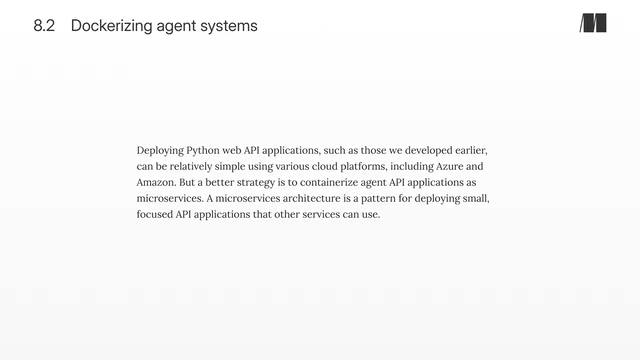

## 1. 这一节做什么

这两讲分成两个阶段，目标完全不同，但前后咬合。

**第一阶段（P044，Section 8.2）是“把东西跑起来”**：你前面已经写好了 FastAPI 的 image generation service 和 real-time voice browser app，现在要把它们从“本机 `uvicorn` 跑着玩”变成“一个容器一个服务”的形态。具体做三件事：

1. 给单个 agent 应用写 `Dockerfile`，构建镜像，用 `docker run` 跑起来，通过 `localhost:8000` 访问，并用 `curl` 验证。
2. 用 `docker-compose.yml` 把三个容器——`real-time voice web`、`real-time web agent`、`real-time image agent`——编成一个 stack，一条命令起停。
3. 用 `localtunnel` 把本地 8000 端口临时暴露到公网，并理解这件事为什么只能用于 demo，不能用于生产。

**第二阶段（P045，Section 8.3）是“上生产前先想清楚”**：讲师不再写代码，而是给出一套决策框架——agent 该跑在哪（edge / 同步 API / 事件驱动 worker）、用什么线通信（WebRTC-WebSocket / HTTP+SSE-MCP / message bus）、多 agent 用什么拓扑（front door agent）、状态和幂等怎么做、发布怎么加门禁、可观测性看哪三类指标、可靠性怎么兜底、成本怎么按“成本/价值比”来管。

**这一节的最终产物**是你本地能 `docker compose up` 起来的一套多 agent stack，以及一份能直接拿去和团队对齐的部署决策清单。注意：讲师明确说 Kubernetes 和云上部署 **outside the scope of this book**，所以本文也不假装教你上 K8s。

---

## 2. 讲师原话（带页码）

关于为什么要容器化，讲师在第一分钟就给了判断：

> "更好的策略是将智能体 API 应用容器化为微服务。微服务架构是一种部署小型、专注的 API 应用的模式，供其他服务使用。"
> —— p044 [00:00]

> "多数情况下，每个容器只托管一个智能体，但也可以将多个智能体工作流容器化，让它们以流程、编排或协作的方式运行。"
> —— p044 [00:54]

关于容器化这件事的难度变化，讲师给了一个很实际的观察：

> "过去，容器化服务曾是一个复杂且耗时的过程……如今，情况已经改变，部分原因在于 GPT 5.2、Claude Opus 4.5 和 Gemini 等能力出色的编程大语言模型。"
> —— p044 [01:51]

> "我们可以把网页应用交给大语言模型，让它生成 Dockerfile。"
> —— p044 [02:21]

关于生产环境不要无脑用镜像：

> "在生产环境中，你始终需要评估、精简或修改正在构建的 Docker 镜像。"
> —— p044 [02:48]

关于 Compose 的价值：

> "它提供了一种声明式的统一方式，用于启动和停止整个多智能体技术栈，比手动运行并连接各个容器要容易得多。"
> —— p044 [05:10]

关于隧道工具的风险，讲师说得很重：

> "只要知道网址，任何人都能访问该端点。只要隧道仍在运行，本地机器就会暴露在公共互联网上……如果不加谨慎地让隧道一直运行，本地智能体能够访问的生产数据、API 密钥以及任何敏感资源都会暴露。"
> —— p044 [08:54]

> "对于任何接近生产用途的场景……正确做法是进行云部署，而不是使用隧道。"
> —— p044 [09:23]

进入 P045 后，讲师先给运行时选择的总原则：

> "通常，你应选择能满足延迟目标和工具要求的最简单运行时。若有疑问，可先采用 API，将热路径迁移到边缘/浏览器，并把重型工具卸载到事件驱动的工作智能体。"
> —— p045 [02:25]

关于状态和幂等：

> "应将工具的使用方式，以及像工具一样行动的智能体，设计为幂等的。这意味着每次工具调用都是自包含的，并且可以被缓存，以降低延迟并提升性能。"
> —— p045 [06:12]

> "幂等意味着，一个操作无论以相同输入调用一次还是多次，都会产生相同结果。天气查询是幂等的，发送电子邮件则不是。"
> —— p045 [06:42]

关于“agent 也是软件”：

> "至关重要的是要记住，智能体也是软件。请把它们当作软件来对待。"
> —— p045 [07:12]

关于可观测性：

> "你无法修复自己看不见的问题。OpenAI Agents SDK 支持 OpenTelemetry 追踪和日志记录，你应该使用它。"
> —— p045 [08:38]

关于成本，讲师反对脱离价值谈绝对成本：

> "每次交互花费 50 美分的智能体，如果取代的是一次 0.10 美元的查询，那就很贵；如果取代的是一次 50 美元的人工客服通话，那就很便宜。"
> —— p045 [12:53]

---

## 3. 从零复现

### 3.0 先明确“哪些东西课程没给全文”

逐字稿里，讲师多次说 “See these commands”、“See this command”、“shown in listing 8.5”，但**具体命令字面、Dockerfile 全文、compose 文件全文并没有被念出来**，它们只出现在书页或屏幕里。所以复现时你要区分两类东西：

- **讲师明确口述过的参数**：端口 `8000`、容器名 `image-gen`、`--rm`、OpenAI API key 注入、三个容器名、`localhost:8000`、`npx` 单命令启动 tunnel。这些必须照做。
- **课程仓库里的文件全文**：逐字稿没有给出 repo URL（只说 “this link”），也没有贴出 Dockerfile 和 compose 的完整内容。本文第 4 节给的是**按讲师口述参数写出的最小可运行复现版**，不是课程仓库原文；如果你有课程仓库，以仓库为准。

### 3.1 前置环境

| 依赖 | 要求 | 课程是否讲了 |
|---|---|---|
| Docker Desktop | 已安装并处于 running 状态 | 讲了，p044 [02:21] 明确要求 |
| Node.js | 已安装，`npx` 可用（localtunnel 用） | 讲了，p044 [10:16] |
| OpenAI API Key | 可用，且有图像生成权限 | 讲了，p044 [03:16] 要求把 key 写进命令 |
| 课程仓库 | Chapter 08 目录 + Agents Microservices 目录 | 讲了 clone，但没念 URL |

检查 Docker 是否真的在跑（这条命令课程没念，但你必须先确认，否则后面全部报 `Cannot connect to the Docker daemon`）：

```bash
docker version
docker info
```

### 3.2 拿到项目文件

讲师的原话步骤是：

1. Make sure Docker Desktop is running.
2. Clone the repository to your local machine.
3. Navigate to the **Agents Microservices** folder using a terminal, bash or PowerShell.
4. Follow the top of the `readme.md` to set up and run the compose file.

对应命令：

```bash
git clone <课程仓库地址>
cd <课程仓库根目录>/Chapter08/AgentsMicroservices
```

> 仓库地址逐字稿只说了 “this link”，没有念出字符串，**课里没给 URL**。请从课程页面或书里的链接复制。目录名 `Chapter08` / `AgentsMicroservices` 来自讲师口述的 “Chapter 08” 和 “Agents Microservices folder”，具体大小写和层级以你 clone 下来的实际结构为准。

进去之后先看结构，不要急着 build：

```bash
ls -la
cat readme.md
```

你应该能看到至少一个 `Dockerfile`（讲师说 Chapter 08 “already contains a Dockerfile”）和一个 compose 文件。

### 3.3 第一步：构建单个 agent 镜像

讲师说 “build the image that will run as a container in Docker Desktop”，并强调生产环境要 `evaluate, prune, or modify` 镜像。构建命令（tag 名 `image-gen` 是从后面 `--name image-gen` 反推的，讲师没有单独念 tag）：

```bash
cd <image-gen 应用目录>
docker build -t image-gen .
```

这一步会花一些时间，讲师原话：“This will take some time.” 构建完成后确认镜像存在：

```bash
docker images | grep image-gen
```

### 3.4 第二步：运行容器并注入 API Key

讲师明确要求 “making sure to copy your OpenAI API key into the command”，并说跑起来后服务在本地 `8000` 端口。前台运行、退出即删的版本：

```bash
docker run --rm -p 8000:8000 -e OPENAI_API_KEY="sk-你的key" image-gen
```

如果你希望容器留在 Docker Desktop 里可以随时 start/stop，讲师给的方式是命名容器、并且**不要**让它退出就删除：

```bash
docker run -d --name image-gen -p 8000:8000 -e OPENAI_API_KEY="sk-你的key" image-gen
```

> 这里要指出逐字稿的一处口误。原文是 “assigning a name, dash dash name image gen, and not removing the container after it runs, dash dash RM”。语义上应该是“**不加** `--rm`”，因为加了 `--rm` 容器一退出就被删掉，Docker Desktop 里就管不了了。以效果为准：要长期管理，就不要 `--rm`，并用 `-d` 放后台。

### 3.5 第三步：验证服务真的通了

讲师说 “You can test that everything is working by using a curl command like we used earlier.” 具体路径课里没念，用你应用实际的路由。以第 4 节的复现版为例：

```bash
curl -s http://localhost:8000/health
curl -s -X POST http://localhost:8000/generate-image \
  -H "Content-Type: application/json" \
  -d '{"prompt":"a red fox in snow"}'
```

如果 `curl` 返回连接被拒，先看容器日志，不要盲改代码：

```bash
docker logs image-gen
```

### 3.6 第四步：用 Compose 起整套 stack

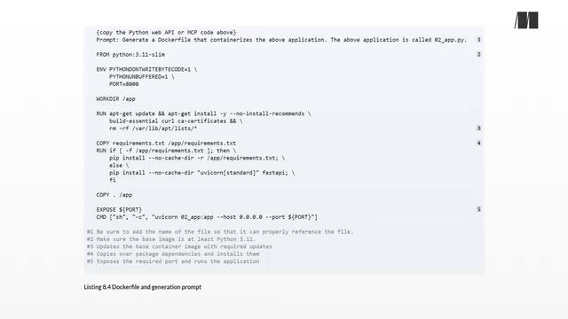

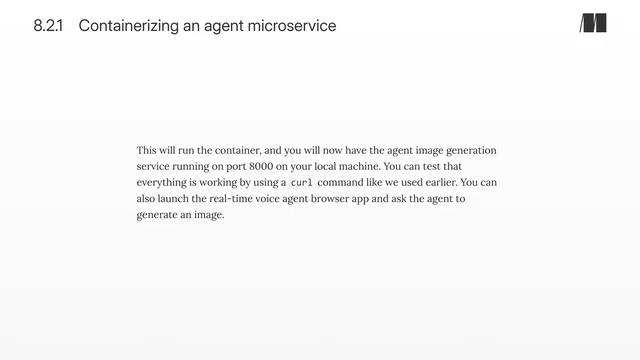

讲师在 8.2.2 说的核心是：不要一个个 `docker run`，用 Compose 声明式地起停整套多 agent。他描述的三个容器是：

- `real-time voice web`（浏览器前端，对用户暴露 8000）
- `real-time web agent`（负责网页搜索）
- `real-time image agent`（负责图像生成）

先准备环境变量文件，避免把 key 写进 compose：

```bash
cat > .env <<'EOF'
OPENAI_API_KEY=sk-你的key
EOF
```

然后起 stack。讲师说 “The final Docker command builds all the Docker containers and orchestrates all microservices”，具体 flag 课里没念全，复现用：

```bash
docker compose up --build
```

第一次构建会很慢。起来之后：

- 浏览器打开 `http://localhost:8000`
- 你应该能看到和之前一样的 voice agent 页面，并且多了“搜索网页”和“生成图片”的能力（讲师原话：“Now you also have the option to search the web and create images.”）

查看状态和日志：

```bash
docker compose ps
docker compose logs -f realtime-voice-web
```

停止并清理：

```bash
docker compose down
```

### 3.7 第五步：用 localTunnel 临时暴露到公网

讲师说 localTunnel 是 “an open-source HTTP tunneling option that can be run using a single node command”，前提是装了 Node.js。命令：

```bash
npx localtunnel --port 8000
```

终端会输出一个 `https://xxxx.loca.lt` 之类的 URL。讲师说把 URL 粘到浏览器后，“This will take you to a password authorization page. The default password is the IP address you are using to connect to the client.”

也就是说：**页面会先要密码，密码是你访问外网时用的那个公网 IP**。输入后就能看到 voice agent 页面，可以继续用语音下指令生成图片、搜索网页。

> 注意讲师紧接着的警告：这套东西 “you likely wouldn't want to expose this to multiple users”，只适合 proof of concept、demo、personal use。用完**立刻 Ctrl+C 关掉**，不要让 tunnel 挂着过夜。

### 3.8 清理

```bash
# 停掉并删除命名容器
docker stop image-gen && docker rm image-gen

# 停掉 compose 整套
docker compose down

# 如果还想删镜像
docker rmi image-gen
```

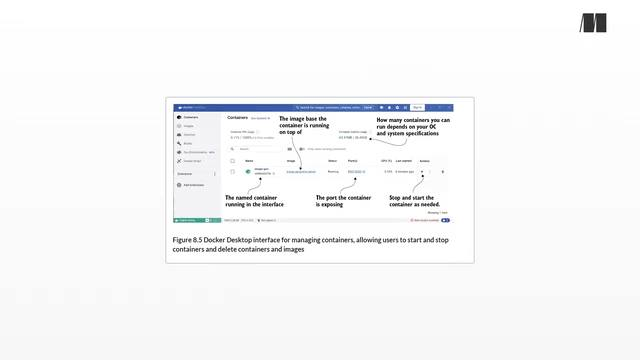

---

## 4. 完整代码

> **重要声明**：以下文件是**按讲师口述参数复现的最小可运行版本**，用于让你在没有课程仓库的情况下也能把容器和 compose 跑通。它不是课程仓库原文——逐字稿没有贴出 Dockerfile、compose、app.py 的全文。业务逻辑（真正的 voice agent、web search agent）请用你前面章节的代码替换。

### 4.1 目录结构

```text
chapter08-repro/
├── image-gen/
│   ├── app.py
│   ├── requirements.txt
│   └── Dockerfile
├── web/
│   ├── app.py
│   ├── requirements.txt
│   └── Dockerfile
├── web-agent/
│   ├── app.py
│   ├── requirements.txt
│   └── Dockerfile
├── image-agent/
│   ├── app.py
│   ├── requirements.txt
│   └── Dockerfile
├── docker-compose.yml
├── .env
└── .env.example
```

### 4.2 `image-gen/Dockerfile`

```dockerfile
FROM python:3.12-slim

ENV PYTHONDONTWRITEBYTECODE=1 \
    PYTHONUNBUFFERED=1

WORKDIR /app

COPY requirements.txt .
RUN pip install --no-cache-dir -r requirements.txt

COPY app.py .

EXPOSE 8000

CMD ["uvicorn", "app:app", "--host", "0.0.0.0", "--port", "8000"]
```

### 4.3 `image-gen/requirements.txt`

```text
fastapi==0.115.6
uvicorn[standard]==0.34.0
openai==1.59.6
```

> 版本号是复现用的示例，**课里没有指定版本**。生产请用 `pip freeze` 锁死你自己的环境。

### 4.4 `image-gen/app.py`

```python
import os

from fastapi import FastAPI
from pydantic import BaseModel
from openai import OpenAI

app = FastAPI(title="image-gen")
client = OpenAI(api_key=os.environ["OPENAI_API_KEY"])


class ImageRequest(BaseModel):
    prompt: str


@app.get("/health")
def health() -> dict:
    return {"status": "ok"}


@app.post("/generate-image")
def generate_image(req: ImageRequest) -> dict:
    result = client.images.generate(
        model="gpt-image-1",
        prompt=req.prompt,
        size="1024x1024",
        n=1,
    )
    return {"image": result.data[0].b64_json}
```

> 模型名只是为了让容器能跑通，**课程没有指定图像模型**；换成你有权限的模型即可。

### 4.5 `docker-compose.yml`

```yaml
# 讲师说 compose 文件顶部是 version；新版 Docker Compose 会提示 obsolete，可删
version: "3.9"

services:
  realtime-voice-web:
    build: ./web
    ports:
      - "8000:8000"
    environment:
      - OPENAI_API_KEY=${OPENAI_API_KEY}
      - WEB_AGENT_URL=http://realtime-web-agent:8001
      - IMAGE_AGENT_URL=http://realtime-image-agent:8002
    depends_on:
      - realtime-web-agent
      - realtime-image-agent

  realtime-web-agent:
    build: ./web-agent
    environment:
      - OPENAI_API_KEY=${OPENAI_API_KEY}
    expose:
      - "8001"

  realtime-image-agent:
    build: ./image-agent
    environment:
      - OPENAI_API_KEY=${OPENAI_API_KEY}
    expose:
      - "8002"
```

> 服务名按讲师口述的 `real-time voice web` / `real-time web agent` / `real-time image agent` 命名。内部端口 8001/8002 课里没讲，按你的实现改；`expose` 只对 compose 内部网络可见，不占宿主机端口。

### 4.6 `.env.example`

```text
OPENAI_API_KEY=sk-replace-me
```

### 4.7 幂等缓存工具（对应 Listing 8.6 的复现版）

```python
import hashlib
import json
import time
from functools import wraps

_CACHE: dict[str, dict] = {}


def idempotent(ttl_seconds: int = 300):
    def decorator(fn):
        @wraps(fn)
        def wrapper(*args, **kwargs):
            key_src = json.dumps(
                {"fn": fn.__name__, "args": args, "kwargs": kwargs},
                sort_keys=True,
                default=str,
            )
            key = hashlib.sha256(key_src.encode()).hexdigest()

            now = time.time()
            hit = _CACHE.get(key)
            if hit is not None and hit["expires_at"] > now:
                return hit["value"]

            value = fn(*args, **kwargs)
            _CACHE[key] = {"value": value, "expires_at": now + ttl_seconds}
            return value

        return wrapper

    return decorator


@idempotent(ttl_seconds=600)
def weather_lookup(city: str) -> dict:
    # 真正调用天气 API 的地方
    return {"city": city, "temp_c": 21}
```

> 讲师只演示了“用 key 做缓存”的核心思路，函数名和存储后端以书里 Listing 8.6 为准。课里没有讲多线程/多进程共享缓存的问题，这个内存字典只在单进程内有效。

### 4.8 Phoenix tracing 初始化（对应 Listing 8.7 的复现版）

```python
import os

from opentelemetry import trace
from phoenix.otel import register

tracer_provider = register(
    project_name=os.getenv("PHOENIX_PROJECT", "agents-in-action"),
    auto_instrument=True,
)

tracer = trace.get_tracer(__name__)


def run_turn(session_id: str, user_id: str) -> None:
    with tracer.start_as_current_span("agent.turn") as span:
        # 课里说要带 session、user 等 metadata，但没规定属性键名
        span.set_attribute("session.id", session_id)
        span.set_attribute("user.id", user_id)
        # 这里调用你的 agent
```

> 课里只说了两件事：注册 project name、给 trace 附加 session/user/metadata。具体函数签名以你安装的 `phoenix` / `openai-agents` 版本为准。

---

## 5. 逐行解释

### Dockerfile

- `FROM python:3.12-slim`：`slim` 比完整镜像小很多，构建和推拉都快。生产环境讲师说要 `evaluate, prune, or modify`，就是从这一行开始评估的。
- `PYTHONDONTWRITEBYTECODE=1`：不生成 `.pyc`，容器里没必要。
- `PYTHONUNBUFFERED=1`：让 `print` 和日志立刻刷出来。不设这个，你在 Docker Desktop 里看日志会延迟甚至看不到，排障很痛苦。
- `WORKDIR /app`：后面所有相对路径都基于它。
- 先 `COPY requirements.txt` 再 `RUN pip install`，最后才 `COPY app.py`：这是利用 Docker 层缓存。你改业务代码时，依赖层不用重装；反过来写，每次改一行 Python 都要重装一遍依赖。
- `EXPOSE 8000`：**只是文档声明**，真正把端口映射到宿主机的是 `docker run -p` 或 compose 的 `ports`。不写 `EXPOSE` 也能跑。
- `CMD` 里的 `--host 0.0.0.0` 是关键：容器内如果监听 `127.0.0.1`，宿主机通过 `-p` 映射进来会连不上。**这个坑课里没讲，但几乎每个人第一次都会踩。**
- 在 JS/Node 里对应什么：Node 服务同理，`app.listen(8000, '0.0.0.0')`，不能只写 `app.listen(8000)` 就以为万事大吉。

### `docker run` 参数

- `-p 8000:8000`：左边是宿主机端口，右边是容器端口。写成 `-p 3000:8000` 就是你访问 `localhost:3000`。
- `-e OPENAI_API_KEY=...`：把 key 注入容器环境变量。缺点是会留在 shell history 和 `ps` 里；更稳的做法是 `--env-file .env`，**课里没讲**。
- `--rm`：容器退出即删除。适合一次性测试。
- `-d --name image-gen`：后台运行并命名，这样 Docker Desktop 里能看到、能 start/stop。讲师说的“能在 Docker Desktop 里管理多个版本的同一个 agent”，前提就是有名字且没被删。
- `docker logs image-gen`：看容器 stdout/stderr。`curl` 失败时第一件事看这个，而不是改代码。

### Compose 文件

- `version: "3.9"`：讲师说文件顶部是 compose version。新版 Compose 会提示这个字段 obsolete，删掉不影响运行。
- `services` 下每个 key 就是一个容器。讲师说“each representing a container that will run as a microservice”。
- `ports` vs `expose`：`ports` 对宿主机开放，`expose` 只在 compose 内部网络可见。前端 web 用 `ports`，两个后端 agent 用 `expose`，避免把内部服务直接暴露到宿主机。
- `environment` 里的 `OPENAI_API_KEY=${OPENAI_API_KEY}`：从宿主机环境或 `.env` 读取。**不要**把 key 硬编码进 YAML 再提交 git。
- `depends_on`：只保证启动顺序，**不保证对方已经 ready**。真正要等健康检查，需要 `healthcheck` + `condition: service_healthy`，**课里没讲**。
- `WEB_AGENT_URL=http://realtime-web-agent:8001`：compose 会给每个服务一个 DNS 名，服务之间用服务名互访，不是 `localhost`。**在容器里写 `localhost` 指的是容器自己**，这是第二个高频坑。

### 幂等函数

- `key_src` 把函数名、位置参数、关键字参数一起序列化，`sort_keys=True` 保证同样的参数顺序不同也能命中同一个 key。
- `hashlib.sha256` 把可能很长的参数压成固定长度 key。
- `hit["expires_at"] > now` 是 TTL 判断。讲师说的“weather lookup 可以缓存，发邮件不行”，落到代码上就是：**只有确定性、可重复调用无副作用的函数才配加这个装饰器**。
- 课里没说这个字典在多 worker 下会失效。生产要换成 Redis，key 和 TTL 逻辑不变。
- 在 JS/Node 里对应什么：就是一个 `Map` 或 Redis 的 `get/set`，key 用 `JSON.stringify(args)` 的 hash，TTL 用 `setTimeout` 或 Redis `EX` 参数。

### Phoenix tracing

- `register(project_name=...)`：讲师说“At the top of the code, we register the project name that the agents will use to push traces.”
- `span.set_attribute("session.id", ...)`：对应讲师说的“include additional data, such as the session, user, and other metadata. Within Phoenix, we can quickly filter on all these extra attributes.”
- 课里没有规定属性键名，`session.id` / `user.id` 是示例，团队内部统一即可。

---

## 6. 复现检查清单

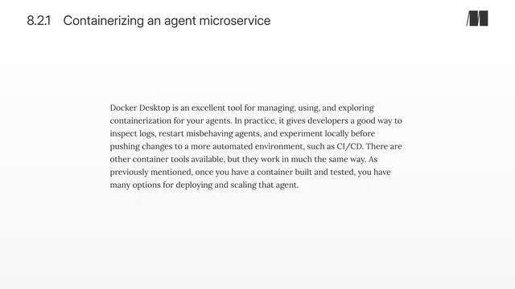

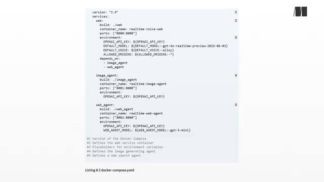

- [ ] `docker version` 能正常输出，Docker Desktop 图标是 running 状态
- [ ] `node -v` 和 `npx -v` 有输出
- [ ] `OPENAI_API_KEY` 已准备，且你的账号有图像生成权限
- [ ] 已 clone 课程仓库，能找到 Chapter 08 和 Agents Microservices 目录
- [ ] `docker build -t image-gen .` 成功，`docker images` 能看到 `image-gen`
- [ ] `docker run --rm -p 8000:8000 -e OPENAI_API_KEY=... image-gen` 能起来
- [ ] `curl http://localhost:8000/health` 返回 200
- [ ] `curl -X POST .../generate-image` 能拿到图片数据
- [ ] `docker run -d --name image-gen ...`（**不加 `--rm`**）后，Docker Desktop 里能看到并 start/stop
- [ ] `docker compose up --build` 后，`docker compose ps` 三个服务都是 running
- [ ] 浏览器 `localhost:8000` 能打开 voice agent 页面
- [ ] 页面上语音下指令能生成图片、能搜索网页
- [ ] `npx localtunnel --port 8000` 输出 URL，浏览器打开后输入密码能看到页面
- [ ] 用完已 `Ctrl+C` 关掉 tunnel，已 `docker compose down`
- [ ] 已从 shell history 里清掉明文 key（`history -c` 或改用 env file）

## 7. 课里没讲但你会撞上的

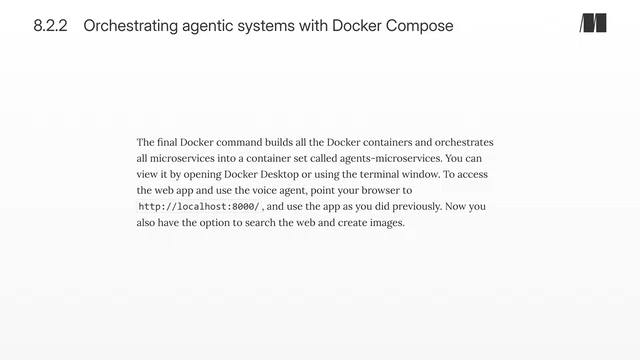

**1. `localhost:8000` 打不开，但容器是 running。**
九成是应用监听在 `127.0.0.1` 而不是 `0.0.0.0`。容器有自己的网络命名空间，`127.0.0.1` 只指容器自己。改 `CMD` 里的 `--host 0.0.0.0`。

**2. compose 里服务互相调不通。**
容器内不要写 `http://localhost:8001`，要写 `http://realtime-web-agent:8001`。`localhost` 在容器里指它自己。这个课里没展开，但一定会撞。

**3. `depends_on` 不等于“等对方 ready”。**
它只保证启动顺序。前端容器启动时后端可能还在 import 模块，于是第一个请求直接 502。需要给后端加 `healthcheck`，前端用 `depends_on: condition: service_healthy`。课里没讲 healthcheck 写法。

**4. Apple Silicon 上镜像架构不匹配。**
M1/M2/M3 上 build 出来的镜像默认 arm64，推到只有 amd64 的服务器会跑不起来。需要 `docker build --platform linux/amd64`。课里没讲。

**5. 端口 8000 被占。**
Mac 上经常是别的 Python 进程或 AirPlay 占着。`lsof -i :8000` 查一下，或者把宿主机端口改成 `-p 8080:8000`。

**6. API Key 泄露在三个地方。**
shell history、`docker inspect` 的环境变量、git 提交的 compose 文件。课里只说了“copy your key into the command”，没讲怎么安全注入。建议 `--env-file .env` 并把 `.env` 加进 `.gitignore`。

**7. localtunnel 的密码你拿不到。**
讲师说“默认密码是你连接 client 用的 IP”。如果你在公司 NAT 后面，出口 IP 和你以为的不一样，就会一直提示密码错。localtunnel 官方提供了查密码的页面（课里没讲具体地址），或者换 ngrok 这类会给固定 token 的工具。

**8. localtunnel 的 URL 每次重启都会变。**
它不适合做任何需要固定回调地址的 webhook 调试。讲师也说了这只是 demo 工具。

**9. 麦克风权限。**
浏览器只在 `https://` 或 `localhost` 下允许麦克风。localtunnel 给的是 https，所以能用；但如果你用局域网 IP 直连，会静默失败。课里没讲。

**10. 镜像体积失控。**
不带 `.dockerignore` 会把 `node_modules`、`.venv`、`.git` 全 COPY 进去。课里只说生产要 `prune`，没说具体怎么 prune。

**11. 缓存的 key 设计。**
第 4.7 节的 `json.dumps(args)` 遇到不可序列化对象会炸（虽然有 `default=str` 兜底，但 `str(obj)` 可能带内存地址，导致永远不命中）。生产要把参数显式转成稳定结构。

**12. 熔断器在 Node 里对应什么。**
讲师讲了 circuit breakers 的概念，但没给实现。Node 生态里常用 `opossum` 这类库；前端也可以自己用状态机实现“连续 N 次失败就短路 M 秒”。**这是我补的对应关系，不是讲师讲的。**

**13. 队列在 Node 里对应什么。**
讲师说 event-driven worker 用 message bus（Redis / NATS / Kafka）。Node 里常见的是 BullMQ（基于 Redis）。同样，**这是我的补充，课里没点名 BullMQ。**

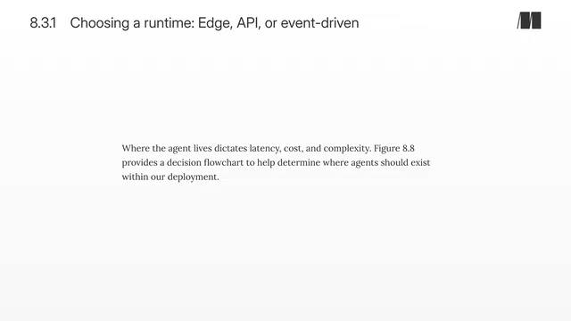

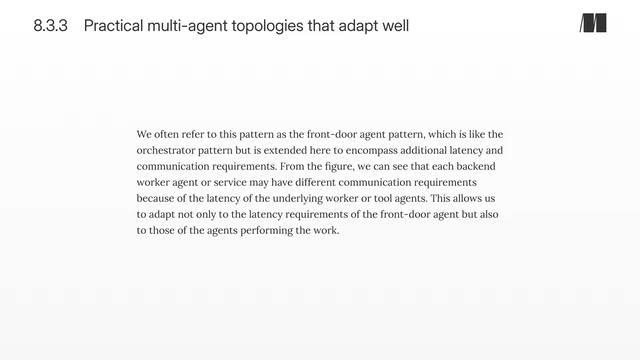

**14. 运行时选型别一步到位。**
讲师的原话是 “pick the simplest runtime that meets your latency target”。很多团队一上来就上 Kafka + K8s，结果 demo 都跑不起来。先 API，再 edge，最后才 worker queue。

**15. 前端工程师最容易忽略的一条：成本要按“每次会话”和“每个解决的任务”来量。**
讲师明确说 “instrument cost per session, cost per resolved task, and cost per user before applying any optimization”。没有这三个数，任何缓存和路由优化都是拍脑袋。

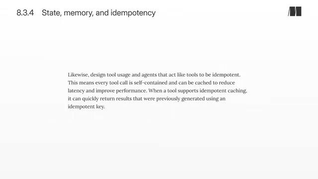

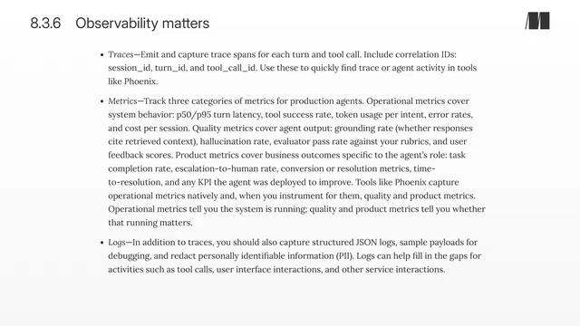

**16. Prompt caching 的结构规则。**
讲师给了一条非常具体的规则：“put stable content at the top of the prompt and dynamic content at the bottom”，并且缓存段通常要求 ≥1024 tokens、字节级完全一致才命中。这意味着你把时间戳、用户名拼在 system prompt 开头，缓存永远不命中。课里没给具体代码，但这条规则可以直接拿去做 code review checklist。

**17. 不是所有东西都该缓存。**
讲师列了“强候选”：汇率（分钟级 TTL）、天气快照、embedding、幂等工具结果；“差候选”：用户频繁更新的数据、依赖完整对话历史的结果、任何涉及鉴权状态的东西。**agent 整体输出默认属于差候选**，因为同样的 prompt 在不同上下文下可以产生不同的正确答案。

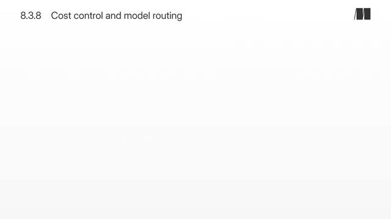