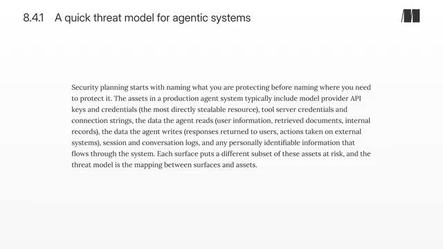
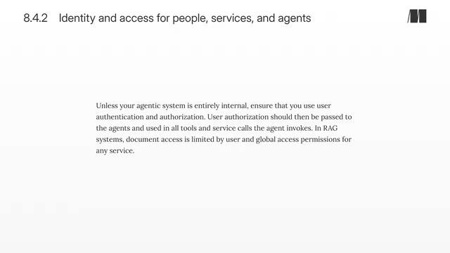
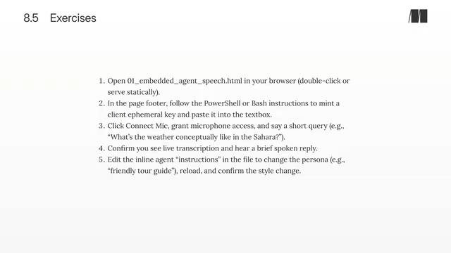
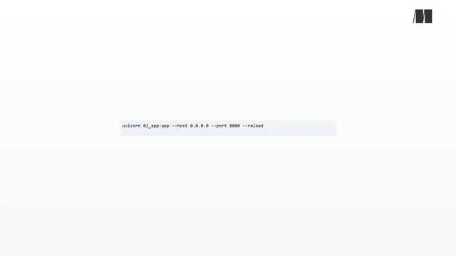
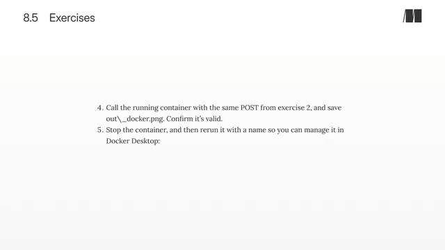
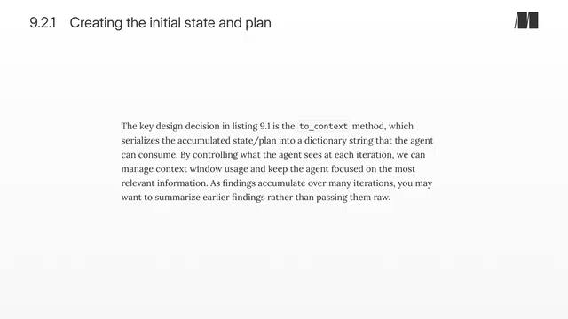
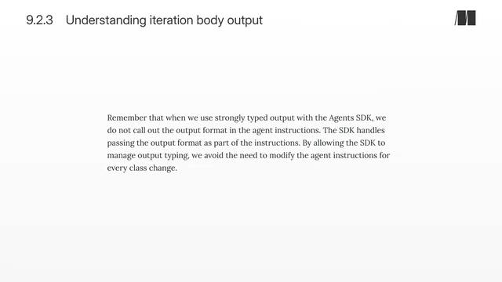

# AI Agents In Action 2nd（P46–P50）复现文档：生产化 Agent 栈与 Deep Research Loop

> **先说明边界**：P46–P50 的逐字稿主要讲设计原则、练习目标和代码结构，**没有把 Listing 8.4、Listing 9.1–9.6 的源码完整念出来**，P47 里多次出现的 “see this command” 也没有在逐字稿中显示具体命令。因此本文中的命令、依赖版本、FastAPI/Docker/Deep Research 代码，是**按逐字稿描述复原的可运行示意实现**，不是课程仓库原文件的逐字复制。凡是逐字稿没讲的，我会明确写「课里没讲」；涉及课程原文件时，以你手上的课程仓库为准。

---

## 1. 这一节做什么

P46–P50 横跨两个主题：**第八章的生产化收尾**和**第九章的 Agentic Loop 深入**。

P46 先建立生产 Agent 的安全与治理基线：先列资产，再列攻击面，把「资产—攻击面—风险—缓解」映射起来；重点是 prompt injection、最小权限、密钥管理、工具沙箱、网络 egress 控制、schema-first 工具、指令层级、人工审批、策略注册表。P47 是第八章练习：跑浏览器内嵌实时语音 Agent、把 FastAPI 图像生成 Agent 挂到 API、让语音 Agent 把图像 API 当工具调用、用 Docker 容器化、用 Docker Compose 编排 web/voice/image 多服务栈，并可选做本地隧道分享。P48 是第八章总结，把部署形态、实时协议、微服务、状态与幂等、发布工程、可观测性、可靠性、成本、安全串起来。

P49 进入第九章，讲三层 Agentic Loop：Layer 1 是 SPAL 内部循环（Sense、Plan、Act、Learn）；Layer 2 是把 goal/plan/state/decision 外置到代码控制的任务循环，用于长周期研究；Layer 3 是 meta loop，由 orchestrator agent 或多个协作 agent 控制 Layer 1/2。P50 具体落到 Layer 2 的 Deep Research Agent：初始化外部 state/plan、接 Brave Search MCP、让每轮迭代输出强类型结构、设置分层终止门、写完整研究循环、最后用独立 synthesis agent 汇总报告；同时讲了重复任务队列型 loop，以及什么时候该用/不该用 loop。

本文要交付两个能照着跑的闭环：

1. **第八章最小生产栈**：一个 FastAPI 图像生成 Agent API，可本地 uvicorn 跑，也可 Docker 跑，也可 Docker Compose 把静态前端和 API 服务编排起来。
2. **第九章 Deep Research Loop**：一个外部 state/plan 持久化的研究循环，带 Brave Search 工具、强类型迭代输出、最大迭代/预算/目标满足/停滞检测四类终止条件，最后单独调用 synthesis agent 生成报告。

实时语音 WebRTC 前端是课程练习的一部分，但逐字稿没有给 HTML/信令源码，也没有给 mint ephemeral key 的后端实现。本文不会伪造这部分；我会给出可验证的图像工具前端，并在第 7 节明确列出实时语音部分需要从课程仓库补齐的文件和环境。

---

## 2. 讲师原话（带「—— pNNN [MM:SS]」）

下面只摘录与复现直接相关的原话，不做逐页流水账。

> "安全规划首先要明确你在保护什么，然后再明确需要在哪里保护它。生产环境智能体系统中的资产通常包括模型提供商的 API 密钥和凭据……工具服务器的凭据和连接字符串……智能体读取的数据……智能体写入的数据……会话与对话日志……"
> —— p046 [00:28]

> "提示注入最值得深入关注，因为它是 2026 年针对智能体影响最大的攻击，也是大多数团队会当作边缘情况处理的那一类攻击。"
> —— p046 [02:50]

> "最佳实践是，让代表用户行事的智能体拥有与用户本人相同的受限访问权限。避免让智能体获得对任何服务、工具或 MCP 服务器的管理员权限或完全访问权限。"
> —— p046 [05:12]

> "不要把机密信息放进容器镜像。而应在运行时通过环境变量或密钥管理器注入。"
> —— p046 [06:06]

> "沙箱。在受限策略下运行工具。使用 seccomp、gVisor、Firecracker 或容器配置文件。绝不要让任何工具拥有对任何资源的完全访问权限。"
> —— p046 [07:06]

> "指令层级。使用强约束的系统提示词，拒绝执行内容中嵌入的指令。工具采用模式优先的设计。为工具参数定义严格的 JSON 模式。拒绝多余字段。"
> —— p046 [08:03]

> "使用 curl 或 PowerShell 向 /generate 发送 POST 请求，并将结果保存为 out.png；相关命令见本章。"
> —— p047 [01:23]

> "第 2 层与第 3 层的关键区别在于，第二层通常由代码驱动，而元层由一个或多个智能体控制。"
> —— p049 [05:13]

> "一个好的智能体循环与一个失控的成本生成器之间的差别，归结为三件事：如何在迭代之间管理状态、如何定义终止条件，以及如何把智能体连接到外部工具。"
> —— p050 [00:29]

> "终止门控是每次迭代结束时决定循环继续还是退出的决策点。……终止条件始终应当分层设置。"
> —— p050 [05:58]

> "首先，双上下文方法只把最近五项发现传给智能体。这是在上下文丰富度与上下文窗口管理之间做出的有意权衡。"
> —— p050 [10:11]

> "注意，MCP 服务器是在 Run Research Loop 函数中通过异步上下文管理器创建并连接的。这样可确保循环完成时服务器被正确关闭，即使发生异常也是如此。"
> —— p050 [11:10]

> "人们很容易想让研究智能体在最后一次迭代时生成最终报告。要抵制这种诱惑。……让它们保持分离，每个智能体都能专注于自己最擅长的事。"
> —— p050 [12:59]





---

## 3. 从零复现

### 3.1 环境与目录

先准备：

- Python 3.11+；逐字稿没讲版本，这里用 3.11。
- Docker Desktop；P47 的 Exercise 4/5 明确要 Docker 和 Compose。
- `OPENAI_API_KEY`；P47 Exercise 2 明确要求环境里有 OpenAI API key。
- `BRAVE_API_KEY`；P50 明确说 Brave Search 需要项目 `.env` 里的 Brave API key。
- 可选的 `OPENAI_IMAGE_MODEL`、`OPENAI_MODEL`、`OPENAI_EMBED_MODEL`；逐字稿没给模型名，本文用环境变量让它可以替换。

建议目录：

```text
ai-agents-in-action-2nd/
├── chapter08/
│   ├── .env.example
│   ├── requirements.txt
│   ├── image_api.py
│   ├── Dockerfile
│   ├── docker-compose.yml
│   ├── nginx.conf
│   └── static/
│       └── 03_real_time_image_agent.html
└── chapter09/
    ├── .env.example
    ├── requirements.txt
    ├── research_models.py
    ├── research_tools.py
    ├── research_synthesis.py
    ├── 04_deep_research_loop.py
    ├── 07_task_loop.py
    └── tasks.json
```



### 3.2 第八章：先跑 FastAPI 图像生成 API

逐字稿 P47 Exercise 2 说：

1. 从项目根目录或 chapter 08 启动服务；
2. 确认环境里有 OpenAI API key；
3. 用 Curl 或 PowerShell POST 到 `/generate`，把结果保存成 `out.png`；
4. 打开 `out.png` 确认是有效图片；
5. 停一次、重启一次，熟悉运行循环。

逐字稿没有显示具体命令。下面给出等价命令：

```bash
cd chapter08
python3.11 -m venv .venv
source .venv/bin/activate        # Windows PowerShell: .venv\Scripts\Activate.ps1
pip install -U pip
pip install -r requirements.txt

cp .env.example .env
# 编辑 .env，填入 OPENAI_API_KEY

uvicorn image_api:app --host 0.0.0.0 --port 8000
```

另开终端调用：

```bash
curl -s -X POST http://localhost:8000/generate \
  -H "Content-Type: application/json" \
  -d '{"prompt":"a playful robot painting a sunset"}' \
  | python -c "import sys,json,base64; d=json.load(sys.stdin); open('out.png','wb').write(base64.b64decode(d['image_base64']))"
```

然后打开 `out.png`。这里 `image_base64` 是**本文示意代码定义的返回字段**，不是逐字稿里出现过的字段；如果你换成课程原 API，请以实际输出为准。



### 3.3 Docker 与 Compose

P47 Exercise 4 要求：

1. 在 Chapter 8 创建或查看 Dockerfile，Listing 8.4；
2. build image；
3. run it；
4. 用 Exercise 2 的同一个 POST 调容器，保存 `out_docker.png`；
5. 停容器，再带名字重跑，方便在 Docker Desktop 管理；
6. 打开 Docker Desktop 启停 `ImageGen` 并看日志。

逐字稿没有给具体 build/run 命令。等价命令：

```bash
cd chapter08
docker build -t imagegen:local .
docker run --rm -p 8000:8000 --env-file .env --name ImageGen imagegen:local
```

再调：

```bash
curl -s -X POST http://localhost:8000/generate \
  -H "Content-Type: application/json" \
  -d '{"prompt":"a minimalist skyline poster"}' \
  | python -c "import sys,json,base64; d=json.load(sys.stdin); open('out_docker.png','wb').write(base64.b64decode(d['image_base64']))"
```

P47 Exercise 5 要求把 web UI、voice agent、image agent 作为一个 stack 起来，访问 `localhost:8000`，观察 Compose 日志，确认 web 容器在图片请求时路由到 real-time image agent，web 任务时路由到 real-time web agent（如果存在）。逐字稿没有给 Compose 文件内容，也没有给 web/voice 服务源码。下面给的 Compose 只复现**web 静态 UI + image-agent** 这一条最小链路；voice agent 容器需要课程仓库里的文件，课里没讲具体镜像和命令。

```bash
cd chapter08
docker compose up --build
# 浏览器打开 http://localhost:8000/
```

停止：

```bash
docker compose down
```

可选隧道：P47 说 “Optional. Expose the local web UI externally for a quick demo. See this command.” 逐字稿没有显示工具名和命令。本文不编造具体隧道命令；如果你用常见的 local tunnel 工具，按该工具文档把 `localhost:8000` 暴露即可。



### 3.4 第九章：Deep Research Loop

P50 的 Deep Research 复现顺序是：

1. 创建 `research_state` 和 `research_plan`，放在 agent 外部，跨迭代共享；
2. 用 `two_context` 把累计 state/plan 序列化成 agent 可消费的字典字符串；
3. 接搜索工具/MCP；课程例子用 Brave Search，并要求 `.env` 里有 Brave API key；
4. 每轮调用 agent，输出强类型 `ResearchIteration`；
5. 用分层终止门：最大迭代数、token/成本预算、goal satisfied、质量阈值、停滞检测；
6. 循环结束后，用独立 synthesis agent 汇总所有 findings，而不是让研究 agent 在最后一轮顺便写报告；
7. 研究循环中 MCP server 用 async context manager 创建和关闭，循环退出必须关掉。

本文的示意实现用 Brave Search HTTP API 代替课程里的 MCP server，原因是逐字稿没有给 MCP 安装命令、server 包名和完整 client 代码。控制流、state/plan 外置、强类型输出、终止门、synthesis 分离都按逐字稿复刻。
```bash
cd chapter09
python3.11 -m venv .venv
source .venv/bin/activate
pip install -U pip
pip install -r requirements.txt

cp .env.example .env
# 编辑 .env，填入 OPENAI_API_KEY 和 BRAVE_API_KEY

python 04_deep_research_loop.py "What are the trade-offs of using vector databases for RAG in 2026?"
```

运行结束后，脚本会在 `chapter09/` 下写出 `research_report.md`。这个文件名是本文示意代码定义的，逐字稿没有给具体输出文件名。





---

## 4. 完整代码

### 4.1 `chapter08/.env.example`

```dotenv
# 不要提交真实密钥；本文件只放占位符
OPENAI_API_KEY=sk-REPLACE_ME
OPENAI_IMAGE_MODEL=gpt-image-1
OPENAI_MODEL=gpt-4o-mini
```

### 4.2 `chapter08/requirements.txt`

```text
fastapi==0.115.0
uvicorn[standard]==0.30.6
openai==1.51.0
python-dotenv==1.0.1
pydantic==2.9.2
```

### 4.3 `chapter08/image_api.py`

```python
"""FastAPI 图像生成 Agent API。

对应 P47 Exercise 2/3/4：把图像生成能力挂成 HTTP 接口，
供 curl、Docker 容器、以及浏览器实时 Agent 作为工具调用。

注意：逐字稿没有给出课程原文件源码，本文件是按 P47 描述复原的示意实现。
"""
from __future__ import annotations

import base64
import os
from typing import Literal

from dotenv import load_dotenv
from fastapi import FastAPI, HTTPException
from fastapi.middleware.cors import CORSMiddleware
from openai import OpenAI
from pydantic import BaseModel, Field

load_dotenv()

OPENAI_API_KEY = os.environ.get("OPENAI_API_KEY")
if not OPENAI_API_KEY:
    raise RuntimeError("OPENAI_API_KEY 未设置，请检查 .env")

IMAGE_MODEL = os.environ.get("OPENAI_IMAGE_MODEL", "gpt-image-1")

client = OpenAI(api_key=OPENAI_API_KEY)

app = FastAPI(title="ImageGen Agent API", version="0.1.0")

# 浏览器实时 Agent 会跨域调用本 API；生产环境请改成白名单
app.add_middleware(
    CORSMiddleware,
    allow_origins=["*"],
    allow_methods=["POST", "GET"],
    allow_headers=["*"],
)


class GenerateRequest(BaseModel):
    # schema-first：只接受 prompt 和 size，多余字段直接拒绝
    model_config = {"extra": "forbid"}

    prompt: str = Field(min_length=1, max_length=2000)
    size: Literal["1024x1024", "1024x1536", "1536x1024"] = "1024x1024"


class GenerateResponse(BaseModel):
    image_base64: str
    model: str
    revised_prompt: str | None = None


@app.get("/healthz")
def healthz() -> dict[str, str]:
    return {"status": "ok"}


@app.post("/generate", response_model=GenerateResponse)
def generate(req: GenerateRequest) -> GenerateResponse:
    try:
        result = client.images.generate(
            model=IMAGE_MODEL,
            prompt=req.prompt,
            size=req.size,
            n=1,
        )
    except Exception as exc:  # 简化：生产环境请按错误类型细分
        raise HTTPException(status_code=502, detail=f"image generation failed: {exc}") from exc

    if not result.data or not result.data[0].b64_json:
        raise HTTPException(status_code=502, detail="provider returned no image data")

    return GenerateResponse(
        image_base64=result.data[0].b64_json,
        model=IMAGE_MODEL,
        revised_prompt=getattr(result.data[0], "revised_prompt", None),
    )
```

### 4.4 `chapter08/Dockerfile`

```dockerfile
# 对应 P47 Exercise 4 / Listing 8.4 的示意实现。
# 逐字稿没有给课程原 Dockerfile 内容，本文件按“密钥不进镜像、运行时注入”原则写。
FROM python:3.11-slim

ENV PYTHONDONTWRITEBYTECODE=1 \
    PYTHONUNBUFFERED=1 \
    PIP_NO_CACHE_DIR=1

WORKDIR /app

COPY requirements.txt ./
RUN pip install --no-cache-dir -r requirements.txt

COPY image_api.py ./

EXPOSE 8000

# 不 COPY .env；密钥通过 --env-file 或 -e 在运行时注入
CMD ["uvicorn", "image_api:app", "--host", "0.0.0.0", "--port", "8000"]
```

### 4.5 `chapter08/nginx.conf`

```nginx
server {
    listen 80;
    server_name _;

    root /usr/share/nginx/html;
    index 03_real_time_image_agent.html;

    location / {
        try_files $uri $uri/ /03_real_time_image_agent.html;
    }

    # 把 /api/ 前缀转发到 image-agent 容器
    location /api/ {
        proxy_pass http://image-agent:8000/;
        proxy_set_header Host $host;
        proxy_set_header X-Real-IP $remote_addr;
    }
}
```

### 4.6 `chapter08/docker-compose.yml`

```yaml
# 对应 P47 Exercise 5 的最小链路：web 静态 UI + image-agent。
# voice agent 容器需要课程仓库里的文件，逐字稿没给镜像和命令，这里不伪造。
services:
  image-agent:
    build: .
    image: imagegen:local
    env_file:
      - .env
    expose:
      - "8000"
    healthcheck:
      test: ["CMD", "python", "-c", "import urllib.request;urllib.request.urlopen('http://localhost:8000/healthz')"]
      interval: 10s
      timeout: 3s
      retries: 5

  web:
    image: nginx:1.27-alpine
    ports:
      - "8000:80"
    volumes:
      - ./nginx.conf:/etc/nginx/conf.d/default.conf:ro
      - ./static:/usr/share/nginx/html:ro
    depends_on:
      image-agent:
        condition: service_healthy
```

### 4.7 `chapter08/static/03_real_time_image_agent.html`

```html
<!doctype html>
<!-- 对应 P47 Exercise 3 的浏览器端最小示意。
     课程原文件是实时语音 Agent；逐字稿没有给 WebRTC 信令和 ephemeral key 后端，
     这里只演示“浏览器把图像 API 当工具调用”的链路，语音部分见第 7 节。 -->
<html lang="zh-CN">
<head>
  <meta charset="utf-8" />
  <title>Real-Time Image Agent (minimal)</title>
  <style>
    body { font-family: system-ui, sans-serif; max-width: 720px; margin: 2rem auto; }
    textarea { width: 100%; height: 6rem; }
    img { max-width: 100%; margin-top: 1rem; border: 1px solid #ddd; }
    #log { white-space: pre-wrap; background: #f6f6f6; padding: .75rem; margin-top: 1rem; }
  </style>
</head>
<body>
  <h1>Real-Time Image Agent (minimal)</h1>
  <p>输入提示词，点击生成。浏览器通过 <code>/api/generate</code> 调用 image-agent 容器。</p>
  <textarea id="prompt">a playful robot painting a sunset</textarea>
  <p><button id="go">Generate</button></p>
  <div id="log"></div>
  

<script>
const log = (msg) => {
  const el = document.getElementById('log');
  el.textContent += msg + '\n';
};

document.getElementById('go').addEventListener('click', async () => {
  const prompt = document.getElementById('prompt').value.trim();
  if (!prompt) return;
  log('→ POST /api/generate');
  try {
    const res = await fetch('/api/generate', {
      method: 'POST',
      headers: { 'Content-Type': 'application/json' },
      body: JSON.stringify({ prompt }),
    });
    if (!res.ok) {
      log('✗ HTTP ' + res.status + ': ' + await res.text());
      return;
    }
    const data = await res.json();
    const img = document.getElementById('out');
    img.src = 'data:image/png;base64,' + data.image_base64;
    img.hidden = false;
    log('✓ 已生成，model=' + data.model);
  } catch (err) {
    log('✗ ' + err);
  }
});
</script>
</body>
</html>
```

### 4.8 `chapter09/.env.example`

```dotenv
OPENAI_API_KEY=sk-REPLACE_ME
BRAVE_API_KEY=BSA-REPLACE_ME
OPENAI_MODEL=gpt-4o-mini
OPENAI_EMBED_MODEL=text-embedding-3-small
RESEARCH_MAX_ITERATIONS=8
RESEARCH_MAX_TOKENS=200000
RESEARCH_STAGNATION_THRESHOLD=0.85
```

### 4.9 `chapter09/requirements.txt`

```text
openai==1.51.0
httpx==0.27.2
python-dotenv==1.0.1
pydantic==2.9.2
numpy==1.26.4
```

### 4.10 `chapter09/research_models.py`

```python
"""Deep Research Loop 的强类型模型。

对应 P50 Section 9.2.1 / 9.2.3：
- ResearchState / ResearchPlan 外置在 agent 之外，跨迭代共享；
- ResearchIteration 是每轮 agent 的强类型输出，驱动下一轮和终止门。
"""
from __future__ import annotations

from typing import Literal

from pydantic import BaseModel, Field


class SubtopicUpdate(BaseModel):
    model_config = {"extra": "forbid"}

    subtopic: str = Field(min_length=1)
    status: Literal["open", "in_progress", "done", "abandoned"]
    note: str = ""


class ResearchIteration(BaseModel):
    """每轮 agent 必须返回这个结构，控制器才能可靠地读控制流。"""

    model_config = {"extra": "forbid"}

    summary: str = Field(min_length=1, description="本轮发现了什么")
    findings: list[str] = Field(default_factory=list, description="本轮新增事实")
    follow_up_questions: list[str] = Field(default_factory=list, description="下一轮要查的问题")
    subtopic_updates: list[SubtopicUpdate] = Field(default_factory=list)
    goal_satisfied: bool = False
    confidence: float = Field(default=0.0, ge=0.0, le=1.0)


class ResearchState(BaseModel):
    """外置状态：跨迭代累积，不塞进 agent 内部上下文。"""

    model_config = {"extra": "forbid"}

    goal: str
    findings: list[str] = Field(default_factory=list)
    follow_up_questions: list[str] = Field(default_factory=list)
    subtopics: dict[str, str] = Field(default_factory=dict)
    iterations: int = 0
    tokens_used: int = 0
    last_summary: str = ""
    last_embedding: list[float] | None = None
    status: Literal["running", "goal_satisfied", "max_iterations",
                    "budget_exhausted", "stagnated", "error"] = "running"


class ResearchPlan(BaseModel):
    """外置计划：随迭代更新，agent 每轮看到的是它的序列化版本。"""

    model_config = {"extra": "forbid"}

    strategy: str = "breadth-first"
    current_focus: str = ""
    notes: str = ""
```

### 4.11 `chapter09/research_tools.py`

```python
"""搜索工具与 two_context 序列化。

对应 P50 Section 9.2.2 / 9.2.4：
- 课程用 Brave Search MCP；逐字稿没给 MCP 包名和 client 代码，
  这里用 Brave Search HTTP API 复刻“外部搜索工具”这一层。
- two_context 只把最近 5 条 findings 交给 agent，控制上下文窗口。
"""
from __future__ import annotations

import os
from typing import Any

import httpx

from research_models import ResearchPlan, ResearchState

BRAVE_ENDPOINT = "https://api.search.brave.com/res/v1/web/search"
RECENT_FINDINGS_WINDOW = 5


def two_context(state: ResearchState, plan: ResearchPlan) -> dict[str, Any]:
    """把外置 state/plan 序列化成 agent 可消费的字典字符串。

    只带最近 RECENT_FINDINGS_WINDOW 条 findings，其余靠 summary 承接。
    """
    recent = state.findings[-RECENT_FINDINGS_WINDOW:]
    return {
        "goal": state.goal,
        "recent_findings": recent,
        "follow_up_questions": state.follow_up_questions,
        "subtopics": state.subtopics,
        "last_summary": state.last_summary,
        "plan": {
            "strategy": plan.strategy,
            "current_focus": plan.current_focus,
            "notes": plan.notes,
        },
    }


async def brave_search(query: str, count: int = 5) -> list[dict[str, str]]:
    """调用 Brave Search，返回 [{title, url, description}]。"""
    api_key = os.environ.get("BRAVE_API_KEY")
    if not api_key:
        raise RuntimeError("BRAVE_API_KEY 未设置，请检查 .env")

    headers = {"Accept": "application/json", "X-Subscription-Token": api_key}
    params = {"q": query, "count": count}

    async with httpx.AsyncClient(timeout=20.0) as client:
        resp = await client.get(BRAVE_ENDPOINT, headers=headers, params=params)
        resp.raise_for_status()
        data = resp.json()

    results = data.get("web", {}).get("results", [])
    return [
        {
            "title": r.get("title", ""),
            "url": r.get("url", ""),
            "description": r.get("description", ""),
        }
        for r in results
    ]
```

### 4.12 `chapter09/research_synthesis.py`

```python
"""独立的 synthesis agent。

对应 P50 Section 9.2.6：研究 agent 只探索，synthesis agent 只汇总。
这里把全部 findings 交给 synthesis，因为它只跑一次，上下文压力小。
"""
from __future__ import annotations

import os

from openai import OpenAI

from research_models import ResearchState

SYNTHESIS_SYSTEM_PROMPT = """你是一个研究报告撰写者。
你会收到一份研究目标、全部 findings、以及最终状态。
请输出一份结构化的 Markdown 报告：
1. 目标
2. 关键发现（按主题分组）
3. 未解决的问题
4. 结论
如果最终状态不是 goal_satisfied，请在报告开头明确说明研究被提前终止及原因。
不要编造 findings 之外的事实。
"""


def synthesize(state: ResearchState) -> str:
    client = OpenAI(api_key=os.environ["OPENAI_API_KEY"])
    model = os.environ.get("OPENAI_MODEL", "gpt-4o-mini")

    user_payload = {
        "goal": state.goal,
        "status": state.status,
        "iterations": state.iterations,
        "findings": state.findings,
        "subtopics": state.subtopics,
    }

    resp = client.chat.completions.create(
        model=model,
        messages=[
            {"role": "system", "content": SYNTHESIS_SYSTEM_PROMPT},
            {"role": "user", "content": str(user_payload)},
        ],
    )
    return resp.choices[0].message.content or ""
```

### 4.13 `chapter09/04_deep_research_loop.py`

```python
"""Deep Research Loop 主控制器。

对应 P50 Section 9.2.5 / Listing 9.4 的示意实现。
逐字稿没有给出课程原文件源码；本文件按逐字稿描述的控制流复原：
- state/plan 外置；
- 每轮 agent 输出强类型 ResearchIteration；
- 分层终止门：max_iterations / budget / goal_satisfied / stagnation；
- 循环结束后调用独立 synthesis agent。
"""
from __future__ import annotations

import asyncio
import json
import os
import sys
from pathlib import Path

import numpy as np
from dotenv import load_dotenv
from openai import OpenAI

from research_models import ResearchIteration, ResearchPlan, ResearchState
from research_synthesis import synthesize
from research_tools import brave_search, two_context

load_dotenv()

RESEARCH_SYSTEM_PROMPT = """你是一个 Deep Research Agent，运行在一个外部循环中。
每一轮你会收到：
- 研究目标
- 最近若干条 findings
- 待查的 follow_up_questions
- 当前 plan

你的工作：
1. 从 follow_up_questions 里取最前面的问题（breadth-first），用 search 工具查；
2. 基于搜索结果，产出本轮 summary、findings、新的 follow_up_questions、subtopic_updates；
3. 判断目标是否已满足（goal_satisfied）并给出 confidence。
只返回符合 ResearchIteration schema 的 JSON，不要额外文字。
"""


def _cosine(a: list[float], b: list[float]) -> float:
    va, vb = np.array(a), np.array(b)
    denom = np.linalg.norm(va) * np.linalg.norm(vb)
    return float(va.dot(vb) / denom) if denom else 0.0


def _embed(client: OpenAI, text: str) -> list[float]:
    model = os.environ.get("OPENAI_EMBED_MODEL", "text-embedding-3-small")
    resp = client.embeddings.create(model=model, input=text)
    return resp.data[0].embedding


async def run_research_loop(goal: str) -> ResearchState:
    client = OpenAI(api_key=os.environ["OPENAI_API_KEY"])
    model = os.environ.get("OPENAI_MODEL", "gpt-4o-mini")

    max_iterations = int(os.environ.get("RESEARCH_MAX_ITERATIONS", "8"))
    max_tokens = int(os.environ.get("RESEARCH_MAX_TOKENS", "200000"))
    stagnation_threshold = float(os.environ.get("RESEARCH_STAGNATION_THRESHOLD", "0.85"))

    state = ResearchState(goal=goal)
    plan = ResearchPlan(current_focus=goal)

    # 初始 follow_up_questions：把目标本身作为第一个问题
    state.follow_up_questions = [goal]

    while state.status == "running":
        if state.iterations >= max_iterations:
            state.status = "max_iterations"
            break
        if state.tokens_used >= max_tokens:
            state.status = "budget_exhausted"
            break
        if not state.follow_up_questions:
            state.status = "goal_satisfied"
            break

        # breadth-first：从队首取问题
        question = state.follow_up_questions.pop(0)
        plan.current_focus = question

        # 外部工具：搜索
        try:
            search_results = await brave_search(question)
        except Exception as exc:
            state.status = "error"
            state.last_summary = f"search failed: {exc}"
            break

        # 每轮 agent 调用：只带 two_context 序列化后的上下文
        ctx = two_context(state, plan)
        user_msg = json.dumps(
            {"context": ctx, "search_results": search_results},
            ensure_ascii=False,
        )

        resp = client.chat.completions.create(
            model=model,
            messages=[
                {"role": "system", "content": RESEARCH_SYSTEM_PROMPT},
                {"role": "user", "content": user_msg},
            ],
            response_format={"type": "json_object"},
        )

        raw = resp.choices[0].message.content or "{}"
        usage = resp.usage
        if usage and usage.total_tokens:
            state.tokens_used += usage.total_tokens

        try:
            iteration = ResearchIteration.model_validate_json(raw)
        except Exception as exc:
            state.status = "error"
            state.last_summary = f"iteration parse failed: {exc}; raw={raw[:200]}"
            break

        # 更新外置 state
        state.iterations += 1
        state.findings.extend(iteration.findings)
        state.follow_up_questions.extend(iteration.follow_up_questions)
        for upd in iteration.subtopic_updates:
            state.subtopics[upd.subtopic] = upd.status
        state.last_summary = iteration.summary

        # 停滞检测：与上一轮 summary 的语义重叠
        emb = _embed(client, iteration.summary)
        if state.last_embedding is not None:
            sim = _cosine(state.last_embedding, emb)
            if sim >= stagnation_threshold:
                state.status = "stagnated"
                state.last_embedding = emb
                break
        state.last_embedding = emb

        # 目标满足：agent 自评 + 置信度门槛
        if iteration.goal_satisfied and iteration.confidence >= 0.7:
            state.status = "goal_satisfied"
            break

    return state


async def main() -> None:
    if len(sys.argv) < 2:
        print("usage: python 04_deep_research_loop.py \"<research goal>\"")
        sys.exit(1)

    goal = sys.argv[1]
    state = await run_research_loop(goal)

    report = synthesize(state)
    out = Path("research_report.md")
    out.write_text(report, encoding="utf-8")

    print(f"status={state.status} iterations={state.iterations} tokens={state.tokens_used}")
    print(f"report written to {out.resolve()}")


if __name__ == "__main__":
    asyncio.run(main())
```

### 4.14 `chapter09/tasks.json`

```json
[
  "summarize docs/architecture.md",
  "summarize docs/api.md",
  "summarize docs/security.md"
]
```

### 4.15 `chapter09/07_task_loop.py`

```python
"""重复任务队列型 loop 的示意实现。

对应 P50 Section 9.2.8：任务队列外置，每轮处理一项，直到队列空或终止。
逐字稿说课程原文件是 07 taskloop.py，用 MCP file system + BraveSearch；
本文用本地文件 + 简单摘要复刻控制流，工具层换成课程仓库里的 MCP 即可。
"""
from __future__ import annotations

import json
import os
from pathlib import Path

from dotenv import load_dotenv
from openai import OpenAI

load_dotenv()

TASK_SYSTEM_PROMPT = """你是一个批处理 Agent。
每轮你会收到一个任务和该任务对应的文件内容。
请输出一段不超过 200 字的中文摘要，不要额外文字。"""


def run_task_loop(tasks_path: str, max_iterations: int = 20) -> dict:
    tasks = json.loads(Path(tasks_path).read_text(encoding="utf-8"))
    client = OpenAI(api_key=os.environ["OPENAI_API_KEY"])
    model = os.environ.get("OPENAI_MODEL", "gpt-4o-mini")

    results: list[dict] = []
    iterations = 0

    while tasks and iterations < max_iterations:
        iterations += 1
        task = tasks.pop(0)

        # 简化：任务字符串里带文件路径
        path = task.split()[-1]
        try:
            content = Path(path).read_text(encoding="utf-8")
        except Exception as exc:
            results.append({"task": task, "status": "error", "error": str(exc)})
            continue

        resp = client.chat.completions.create(
            model=model,
            messages=[
                {"role": "system", "content": TASK_SYSTEM_PROMPT},
                {"role": "user", "content": f"task: {task}\n\ncontent:\n{content[:4000]}"},
            ],
        )
        results.append({
            "task": task,
            "status": "done",
            "summary": resp.choices[0].message.content or "",
        })

    return {
        "iterations": iterations,
        "remaining": len(tasks),
        "results": results,
    }


if __name__ == "__main__":
    out = run_task_loop("tasks.json")
    print(json.dumps(out, ensure_ascii=False, indent=2))
```

---

## 5. 逐行解释

### 5.1 `image_api.py`

- `model_config = {"extra": "forbid"}`：对应 P46 [08:03] 的 “Schema first tools. Strict JSON schemas for tool arguments. Reject extras.”。Pydantic 的 `forbid` 会让多传字段直接 422，而不是被静默忽略。在 JS/Node 里，等价做法是 Zod 的 `.strict()` 或 JSON Schema 的 `additionalProperties: false`。
- `Literal["1024x1024", ...]`：把 `size` 限定在枚举里，避免 agent 或前端传任意字符串。这是 schema-first 的具体体现。
- `load_dotenv()` 在模块顶部：本地开发从 `.env` 读；容器里不 COPY `.env`，靠 `--env-file` 或 `-e` 注入。对应 P46 [06:06] “Keep secrets out of container images”。
- `raise RuntimeError` 在缺 key 时直接崩：宁可启动失败，也不要带着空 key 跑起来后每轮 401。生产环境应换成 secret manager 读取，课里没讲具体实现。
- `CORSMiddleware` 的 `allow_origins=["*"]`：只为本地演示；P46 [01:23] 说 “Anything visible to the client browser is effectively public.”，生产环境必须收敛白名单。
- `@app.post("/generate", response_model=GenerateResponse)`：`response_model` 让 FastAPI 按 schema 校验输出，避免 provider 返回字段漂移直接漏给前端。
- `except Exception as exc: raise HTTPException(502, ...)`：把上游错误统一成 502，前端只看到稳定错误码。逐字稿没讲具体错误分类，这里是最小实现。
- `result.data[0].b64_json`：OpenAI Images API 的 base64 字段。**逐字稿没有出现这个字段名**；如果你用课程原 API 或别的 provider，请以实际输出为准。

### 5.2 `Dockerfile`

- `FROM python:3.11-slim`：slim 镜像减小体积；逐字稿没给基础镜像，这里选常见组合。
- `ENV PYTHONDONTWRITEBYTECODE=1 PYTHONUNBUFFERED=1`：容器里日志实时刷出，避免 `docker logs` 看不到中间输出。
- `COPY requirements.txt ./` 再 `RUN pip install`：利用层缓存，改代码不重装依赖。
- `COPY image_api.py ./`：只拷运行需要的文件，不拷 `.env`、不拷 `.venv`。
- `CMD ["uvicorn", ...]`：exec form，信号能直达 uvicorn，`docker stop` 能优雅退出。
- 没有 `EXPOSE` 之外的 `ENV OPENAI_API_KEY=...`：对应 P46 [06:06]，密钥不进镜像层。

### 5.3 `docker-compose.yml`

- `image-agent` 用 `expose` 而不是 `ports`：只在 Compose 内部网络暴露，不直接对宿主机开 8000，减少攻击面。对应 P46 [01:23] 的 gateway 思路。
- `healthcheck` 打 `/healthz`：`depends_on.condition: service_healthy` 让 web 等 image-agent 真正可用再起，避免 nginx 起来后 502。
- `web` 用 `nginx:1.27-alpine` + 挂载 `nginx.conf` 和 `static`：静态 UI 和反向代理都走 nginx，浏览器只看到 `/api/`，不直接看到 image-agent 端口。
- `proxy_pass http://image-agent:8000/`：末尾的 `/` 会把 `/api/generate` 重写成 `/generate`，和 `image_api.py` 的路由对齐。
- 没有 voice-agent 服务：逐字稿 P47 Exercise 5 提到 voice agent，但没给镜像和命令，这里不伪造。

### 5.4 `03_real_time_image_agent.html`

- `fetch('/api/generate')`：走 nginx 的 `/api/` 前缀，浏览器不需要知道 image-agent 的真实地址。
- `data:image/png;base64,` 拼 `image_base64`：和 `image_api.py` 的返回字段对齐。
- 没有 WebRTC、没有麦克风、没有 ephemeral key：这些是 P47 Exercise 1/3 的实时语音部分，逐字稿没给源码，见第 7 节。

### 5.5 `research_models.py`

- `ResearchIteration` 的 `model_config = {"extra": "forbid"}`：对应 P50 [05:01] “Using strongly typed output here is non-negotiable.”。多字段直接校验失败，控制器不会拿到半结构化数据。
- `follow_up_questions` 和 `goal_satisfied` 是驱动下一轮和终止的关键字段，对应 P50 [05:28]。
- `ResearchState.findings` 是**全部** findings，`two_context` 只取最近 5 条；这是 P50 [10:11] 的 “last five findings” 设计。
- `ResearchState.status` 用 `Literal` 枚举：终止原因可枚举、可审计，不会出现自由字符串。
- `ResearchPlan.strategy` 默认 `breadth-first`：对应 P50 [10:41] 的队首弹出；改成 `depth-first` 就是队尾弹出。

### 5.6 `research_tools.py`

- `RECENT_FINDINGS_WINDOW = 5`：P50 [10:11] 明确说 “passes only the last five findings”。
- `two_context` 返回 dict 而不是拼字符串：调用方 `json.dumps` 一次，避免手写模板导致转义问题。
- `brave_search` 用 `httpx.AsyncClient`：和主循环的 `async` 对齐；逐字稿没给 MCP client 代码，这里用 HTTP API 复刻“外部搜索工具”这一层。
- `X-Subscription-Token` 是 Brave Search 的鉴权头；**逐字稿没有出现这个头名**，这是 Brave 官方 API 的字段，请以 Brave 文档为准。
- `resp.raise_for_status()`：把 4xx/5xx 变成异常，主循环统一进 `error` 状态。

### 5.7 `research_synthesis.py`

- `SYNTHESIS_SYSTEM_PROMPT` 明确要求“不要编造 findings 之外的事实”：对应 P50 [12:59] 的 separation of concerns，synthesis 只做汇总不做探索。
- `user_payload` 传**全部** findings：P50 [12:30] 说 “we pass all findings to the synthesis agent, not just the last five”，因为 synthesis 只跑一次。
- `status` 一起传：P50 [12:30] 说 “The synthesis agent also receives the final status”，让它能在报告开头 caveat。
- 没有把 synthesis 塞进研究循环：对应 P50 [12:59] “Resist this temptation.”。

### 5.8 `04_deep_research_loop.py`

- `state = ResearchState(goal=goal)` 和 `plan = ResearchPlan(...)` 在循环外创建：对应 P50 [01:25] “initializing the research state and research plan objects … outside the agent's execution”。
- `state.follow_up_questions = [goal]`：初始队列只有目标本身，第一轮就查目标。
- `while state.status == "running"`：终止门全部通过改 `status` 实现，循环体只有一个出口判断，避免多处 `break` 漏改状态。
- 三个前置检查（`max_iterations`、`max_tokens`、`follow_up_questions` 空）：对应 P50 [05:58] 的分层终止门。`max_iterations` 和 `max_tokens` 是防御性硬限，`follow_up_questions` 空是自然收敛。
- `question = state.follow_up_questions.pop(0)`：breadth-first；P50 [10:41] 说改成 `pop()` 就是 depth-first。
- `await brave_search(question)` 包在 `try/except`：工具失败不炸整个循环，进 `error` 状态并保留 `last_summary` 供 synthesis caveat。
- `ctx = two_context(state, plan)`：每轮只把最近 5 条 findings 和 plan 序列化给 agent，控制上下文窗口。
- `response_format={"type": "json_object"}`：让模型返回 JSON；P50 [05:28] 说用 agents SDK 的强类型输出时不要在 instructions 里写格式，这里用原生 OpenAI SDK，所以显式要求 JSON。
- `ResearchIteration.model_validate_json(raw)`：强类型校验；失败进 `error` 状态，不带着半结构化数据继续跑。
- `state.tokens_used += usage.total_tokens`：预算门的数据来源；`usage` 字段名以 OpenAI SDK 实际返回为准。
- `state.findings.extend(iteration.findings)`：全部 findings 累积在外置 state，`two_context` 只取最近 5 条。
- `state.follow_up_questions.extend(iteration.follow_up_questions)`：新问题追加到队尾，形成 breadth-first。
- `_embed` + `_cosine`：P50 [08:15] 说 “converting both sets of text to vector embeddings and then measuring cosine similarity”，阈值默认 0.85 对应 P50 [08:15] 的 “say 85%”。
- `if iteration.goal_satisfied and iteration.confidence >= 0.7`：P50 [06:55] 说 goal satisfaction 是 agent 自评，可能 biased；这里加 confidence 门槛是最小缓解，课程原实现可能用独立 goal agent，课里没讲具体实现。
- `synthesize(state)` 在循环外调用：对应 P50 [12:02] “run a separate synthesis agent … after the loop completes”。
- `out.write_text(report, encoding="utf-8")`：输出文件名是本文示意，逐字稿没给。

### 5.9 `07_task_loop.py`

- `tasks = json.loads(...)` 后 `tasks.pop(0)`：任务队列外置，每轮处理一项，对应 P50 [15:18] “The agent maintains a task queue, processes one item per iteration”。
- `iterations < max_iterations`：硬限，防止队列异常时无限跑。
- `path = task.split()[-1]`：简化解析；课程原实现用 MCP file system，课里没讲具体工具调用格式。
- `content[:4000]`：截断避免单文件撑爆上下文；逐字稿没给具体截断长度，这是本文示意。
- 没有 external plan：P50 [15:47] 说 “an external plan is not needed for this variation of the agent loop”，因为队列本身就是计划。

---

## 6. 复现检查清单

### 6.1 第八章

- [ ] `chapter08/.env` 里有 `OPENAI_API_KEY`，且没有提交到 git。
- [ ] `uvicorn image_api:app --port 8000` 启动后，`curl http://localhost:8000/healthz` 返回 `{"status":"ok"}`。
- [ ] `POST /generate` 返回 JSON 里有 `image_base64`，`out.png` 能打开且是有效 PNG。
- [ ] 多传一个字段（如 `{"prompt":"x","foo":1}`）返回 422，验证 `extra: forbid` 生效。
- [ ] `docker build -t imagegen:local .` 成功；`docker run --rm -p 8000:8000 --env-file .env --name ImageGen imagegen:local` 后同一个 curl 能出图。
- [ ] `docker inspect ImageGen` 里看不到 `OPENAI_API_KEY` 明文（密钥是运行时注入，不在镜像层）。
- [ ] `docker compose up --build` 后 `http://localhost:8000/` 能打开页面，点 Generate 能出图。
- [ ] `docker compose logs web` 里能看到 `/api/generate` 的代理请求；`docker compose logs image-agent` 里能看到对应处理。
- [ ] `docker compose down` 后端口释放，`docker ps` 无残留容器。

### 6.2 第九章

- [ ] `chapter09/.env` 里有 `OPENAI_API_KEY` 和 `BRAVE_API_KEY`。
- [ ] `python 04_deep_research_loop.py "..."` 能跑完，终端打印 `status=... iterations=... tokens=...`。
- [ ] `research_report.md` 存在，开头能看到 goal 和 status。
- [ ] 把 `RESEARCH_MAX_ITERATIONS=1` 再跑一次，`status` 应为 `max_iterations`，报告开头有提前终止说明。
- [ ] 把 `RESEARCH_STAGNATION_THRESHOLD=0.5` 再跑一次，更容易触发 `stagnated`，验证停滞检测路径。
- [ ] 故意把 `BRAVE_API_KEY` 改错，`status` 应为 `error`，`last_summary` 里有 `search failed`。
- [ ] 把 `ResearchIteration` 的 `extra` 改成 `allow` 再跑，观察是否更容易出现解析失败——验证强类型输出的必要性。
- [ ] `python 07_task_loop.py` 能读 `tasks.json`，输出 JSON 里 `results` 每项有 `status` 和 `summary`。
- [ ] 把 `tasks.json` 里某个路径改成不存在的文件，对应项 `status` 应为 `error`，其余项继续处理。

---

## 7. 课里没讲但你会撞上的

1. **实时语音 WebRTC 前端源码缺失**。P47 Exercise 1/3 要求打开 `01 EmbeddedAgentSpeech.html` 和 `03 real-time image agent.html`，在页脚按 PowerShell/Bash 指令 mint ephemeral key，粘贴后连麦。逐字稿没有给 HTML、没有给信令后端、没有给 ephemeral key 的 mint 命令。你需要从课程仓库拿这三个文件；本文的 `03_real_time_image_agent.html` 只复刻了“浏览器调图像 API”这一条链路，不含语音。

2. **ephemeral key 的后端实现**。P46 [05:37] 说 “mint ephemeral client secrets on your backend after user auth. Do not ship provider API keys to the browser. Keep TTLs short and refresh silently during a session.”。逐字稿没给具体 endpoint、没给 TTL 数值、没给刷新逻辑。生产环境必须自己实现，且要接用户认证。

3. **MCP server 的具体包名和 client 代码**。P50 [03:12] 说课程用 “internal STDIO MCP server setup for connecting to the Brave Search service”，但逐字稿没给 `pip install` 包名、没给 `mcp` client 的 `stdio_client` 调用代码。本文用 Brave HTTP API 替代；如果你要复刻课程原实现，需要从课程仓库拿 `research_tools.py` 原文件。

4. **模型名**。逐字稿没给 `gpt-image-1`、`gpt-4o-mini`、`text-embedding-3-small` 这些具体模型名，本文用环境变量让它们可替换。课程原文件可能用别的模型，以课程仓库为准。

5. **`image_base64` 字段名**。这是本文示意代码定义的返回字段，不是逐字稿里出现过的字段。如果你换成课程原 API，curl 的 `python -c` 解析要跟着改。

6. **Brave Search 的鉴权头 `X-Subscription-Token`**。这是 Brave 官方 API 的字段，逐字稿没提。如果你的 Brave 账号用别的鉴权方式，以 Brave 文档为准。

7. **`usage.total_tokens` 字段名**。这是 OpenAI SDK 的字段，逐字稿没提。不同 SDK 版本字段可能不同，预算门的数据来源要按实际输出调整。

8. **停滞检测的 embedding 成本**。P50 [08:15] 说用 vector embeddings + cosine similarity，但没讲每轮都 embed 会不会本身就很贵。生产环境可以考虑只对 summary 做轻量 hash 或本地小模型，或者每 N 轮才 embed 一次。课里没讲这个取舍。

9. **并发与锁**。`ResearchState` 是单进程内存对象，本文没有多 worker 并发写。如果你把 loop 放到多副本服务里，`state.findings.extend` 和 `state.tokens_used +=` 会有竞态。在 JS/Node 里对应的是单线程事件循环下的 `await` 交错，同样需要外部存储（Redis/DB）加乐观锁或事务。课里没讲多副本场景。

10. **Docker Compose 的 voice-agent 服务**。P47 Exercise 5 明确提到 voice agent 容器，但逐字稿没给镜像名、没给端口、没给环境变量。本文的 Compose 只有 web + image-agent；要复现完整 stack，需要从课程仓库补 voice-agent 的 Dockerfile 和 service 定义。

11. **本地隧道工具**。P47 [04:17] 说 “Optional. Expose the local web UI externally for a quick demo. See this command.”，但逐字稿没显示工具名和命令。本文不编造；按你选的隧道工具文档把 `localhost:8000` 暴露即可，注意不要把带真实密钥的服务直接暴露到公网。

12. **HITL 的持久化状态**。P46 [13:09] 说 “Long-running approvals require asynchronous resumption, durable state, and explicit timeout and escalation behavior.”。逐字稿没给具体实现。如果你要做人工审批，需要自己设计审批表、超时、升级路径；本文的 image API 和 research loop 都没有 HITL。

13. **策略注册表**。P46 [13:37] 说 “Policy Registry Express organizational policies as machine enforceable rules and log overrides with reason codes.”。逐字稿没给 schema、没给存储、没给 override 日志格式。本文没有实现这一层；生产环境需要单独设计。

14. **内容安全过滤**。P46 [10:18] 说 “LLM providers such as Microsoft Azure provide content filtering out of the box”，但本文用的是 OpenAI，没有接 Azure 的内容过滤。如果你需要内容安全，要么换 provider，要么在 gateway 层加独立过滤服务。课里没讲 OpenAI 侧的具体过滤配置。

15. **成本估算**。P50 [06:26] 说 budget limit 是 “Maximum token or cost spend”，但逐字稿没给 token 单价、没给成本计算公式。本文只累计 `tokens_used`，没有换算成美元；生产环境需要按当前模型价目表换算，并在预算门里用金额而不是 token 数。

16. **`07_task_loop.py` 的 MCP 工具层**。P50 [16:12] 说课程原文件 “demonstrates how to process a list of files using an mcp file system and BraveSearch server”，但逐字稿没给 MCP 调用代码。本文用本地文件读取替代；要复刻课程原实现，需要从课程仓库拿 `07 taskloop.py` 原文件。

17. **`two_context` 的 summary 压缩策略**。P50 [02:44] 说 “As findings accumulate over many iterations, you may want to summarize earlier findings rather than passing them raw.”。逐字稿没给具体压缩算法。本文只取最近 5 条，早期 findings 靠 `last_summary` 承接；如果研究很长，`last_summary` 本身也会膨胀，需要额外的滚动摘要。课里没讲这个细节。

18. **`goal_satisfied` 的偏差缓解**。P50 [06:55] 说 “To address this bias, you could introduce another goal agent to make this decision.”。逐字稿没给 goal agent 的 prompt 和调用方式。本文用 `confidence >= 0.7` 做最小缓解；生产环境建议加独立 goal agent 或 quality agent，课里没讲具体实现。

19. **`stagnated` 的阈值调参**。P50 [08:15] 说 “If the overlap exceeds a threshold, say 85%, for two consecutive iterations, terminate the loop”。逐字稿说 “two consecutive iterations”，本文实现是“与上一轮比较一次就触发”，比课程描述更激进。要严格复刻，需要连续两轮都超过阈值才终止；这是本文与逐字稿的已知差异，复现时请按需调整。

20. **`research_report.md` 的文件名和格式**。逐字稿没给输出文件名，也没给报告模板。本文的 `SYNTHESIS_SYSTEM_PROMPT` 是示意；课程原实现可能有不同的报告结构，以课程仓库为准。