# AI Agents In Action 2nd：Layer 3 多智能体循环与认知 Agent 架构（P051–P056）复现文档

> 适配读者：前端转 AI 应用工程师。文中 `asyncio` 的并发写法，在 JS 里对应 `Promise.all`；`Promise.allSettled` 对应「失败也要拿到每个任务的结果」的场景；pydantic 大致相当于运行时校验版的 TypeScript interface。

---

## 1. 这一节做什么

这六集（P051–P056）实际上分成两个半场：

**上半场（P051–P054）是第 9 章的收尾**。前面已经建好了 Layer 2 的两种循环——研究循环（research loop，交替搜索与阅读、累加发现）和任务循环（task loop，处理工作队列、失败重试）。P051 把它们抬到 Layer 3 的 **orchestration（编排）** 子类型：一个由 LLM 驱动的 orchestrator（编排者）拿着全局计划和状态，把子任务当作工具调用派给 worker agent，评估结果，决定「再来一轮」还是「收口出结果」。P052 讲 Layer 3 的另一个子类型 **collaboration（协作）**：没有唯一的编排者，多个 agent 以对等身份共享同一个 state 对象，轮流贡献、批评、综合，直到达成共识。P053 是本章的六个动手练习，P054 是第 9 章总结（三根支柱、分层终止条件、绝不上线的无约束循环）。

**下半场（P055–P056）进入第 10 章——认知 agent**。P055 讲「能推理但不会思考」的五种生产故障模式，并用 Minsky 的 Society of Mind、Baars 的 Global Workspace Theory、Kahneman 的 System 1 / System 2 三套理论映射出一个认知架构蓝图；P056 逐个介绍这套架构的七个组件：认知工作区（cognitive workspace）、感知、规划、执行、评估、注意力、记忆模块。

**本文能让你真正跑起来的部分是 P053 的六个练习**，因为只有它们给出了明确的文件名、参数和验收标准：`max_iterations=5`、置信度阈值 `0.85`、连续发现词重合 `>80%`、工具随机失败 `30%`、`max_retries=3`、`batch_size=3`、`max_rounds=3`。第 10 章的组件在这一节里**没有可运行代码**（讲师只引用了 Listing 10.1–10.7 的编号，逐字稿里没有贴出源码），所以第 4 节我只给出一份**明确标注为「示意」** 的工作区数据模型草案，不做假实现。

必须提前说明一件事：**逐字稿里从头到尾没有出现任何一行完整源码**，只有「Listing 9.7 / 9.8 / 9.9 / 9.10 / 9.11 / 10.1 / 10.5 / 10.7」这样的清单编号和口头描述。所以第 4 节的文件是我按 P053 任务书的**明文要求**重建的实现，凡是我自己补的设计决定（比如用什么模型、怎么算词重合、错误怎么回灌），都会在相应位置单独标出来，绝不冒充讲师的代码。

---

## 2. 讲师原话

Layer 3 的定位，讲师说得很直接：

> "在建立第 2 层的任务循环和研究循环之后，我们现在转向第 3 层的元循环。回顾第 9.1 节可知，元循环让智能体而不是代码来控制决策、状态和计划这几个要素。"
> —— p051 [00:00]

> "它与第 2 层循环的关键区别在于，编排器本身就是一个由大语言模型驱动的智能体。它会推理接下来该执行哪个子任务、工作节点的输出是否合格，以及计划是否需要调整。这使元循环能够自适应，而硬编码的 for 循环做不到这一点。"
> —— p051 [00:27]

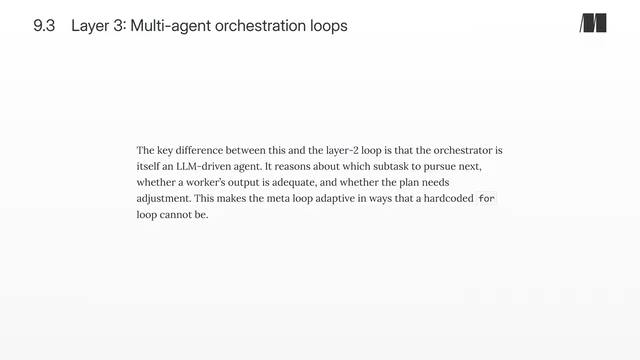

编排者的代价也算得很清楚：

> "编排器的每一次决策都是一次大语言模型调用。在一个 15 次迭代的循环中，这意味着在工作节点调用之外还要多出 15 次调用。对于分解方式已知的简单任务，采用硬编码任务分派的第 2 层循环成本更低、速度更快。"
> —— p051 [02:20]

协作模式的定义：

> "第 3 层元循环的第二种类型是协作，其中多个智能体以平等参与者的身份协作，而不是处于“委派者—工作者”的层级结构中。在协作循环中，智能体共享状态，并共同决定目标何时达成。这里没有单一的编排器。"
> —— p052 [00:00]

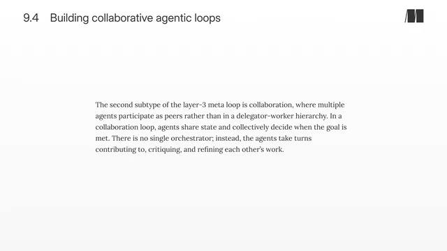

选型建议（这句建议直接决定你练习 5、练习 6 该先做哪个）：

> "如果不确定，先从编排开始。它更易于调试，并且只有在输出质量需要对抗性审查时，才应升级为协作。对于简单的批处理任务，编排效果很好。对于需要更多对抗性审查的任务，则使用协作。"
> —— p052 [03:22]

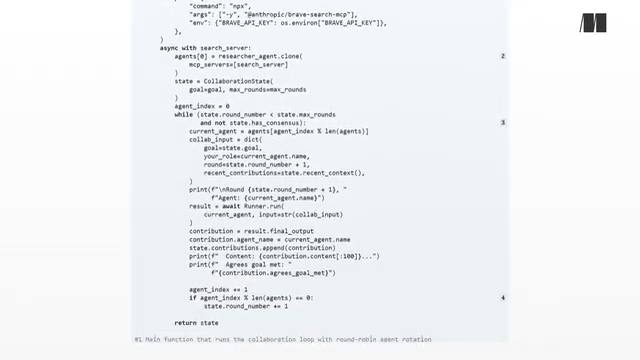

练习 1 的完整任务书（这是本文第 3、4 节的主要依据）：

> "创建 Exercise 1 basic loop.py 文件，使用代码清单 9.1 中的研究状态和代码清单 9.3 中的研究迭代。定义一个研究智能体，其指令来自代码清单 9.4，但使用一个函数工具搜索工具而不是 MCP。像第 7 章那样搜索本地事实列表。将最大迭代次数设为 5，并用你选择的目标初始化循环。"
> —— p053 [00:29]

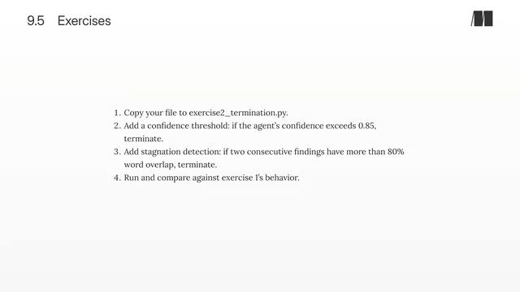

第 9 章总结里两条不许打折扣的红线：

> "终止条件应当分层设置：硬性迭代上限（安全网）、预算限制（成本控制）、目标达成（理想退出）、质量阈值（评估器驱动）以及停滞检测（收益递减）。"
> —— p054 [00:54]

> "绝不要在没有硬性迭代上限和成本上限的情况下部署智能体循环。一个不受约束的循环就是一场迟早会发生的生产事故。"
> —— p054 [02:13]

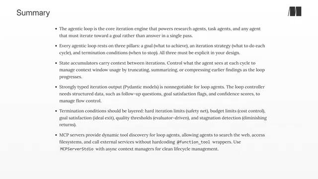

第 10 章的核心诊断，讲师要求你先跑十个不同查询再对照日志看：

> "每一位把智能体交付到生产环境的实践者，都至少见过这五种失败模式中的三种：自信的错误答案、重复卡死、僵化的计划、过度承诺的猜测和浅层组合。"
> —— p055 [02:49]

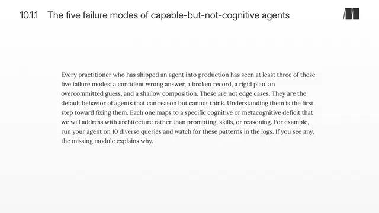

对「broken record」和「rigid plan」的具体描述：

> "智能体会用完全相同的措辞重试同一个失败的搜索查询三次，白白消耗迭代次数却毫无进展……它并没有意识到自己已经卡住。缺失的能力是停滞感知。"
> —— p055 [04:43]

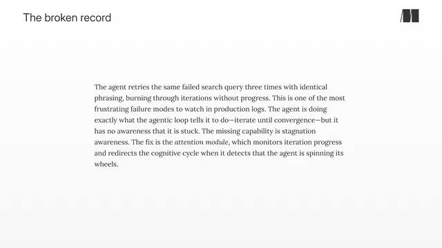

认知原语与认知架构的区别，这张图是第 10 章的总纲：

> "推理那一章教会了智能体使用锤子、螺丝刀和锯子。这一章则教会智能体阅读蓝图，并决定这项工作需要哪种工具。"
> —— p055 [07:58]

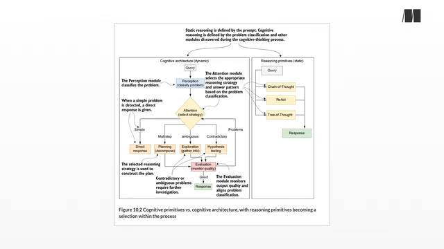

工作区里最关键的一个字段：

> "它维护六类状态：任务表示、活跃假设、中间结果、置信度状态、执行历史和注意力信号。"
> —— p056 [00:53]

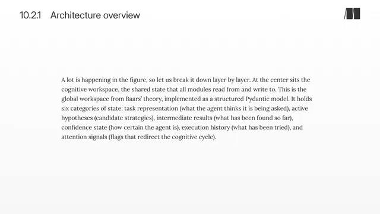

> "这个字段是各模块传达紧迫性的机制。当评估模块检测到矛盾时，会将 active signal 设为 contradiction。当注意力模块读取该信号时，会把控制权转交给规划模块重新规划，而不是进入下一个执行步骤。"
> —— p056 [04:09]

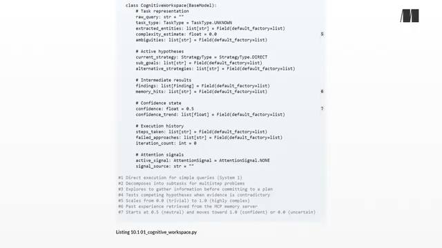

评估与反思的分工，这句话在写练习 2 的停滞检测时特别有用：

> "反思是事后纠正，评估是实时监控。两者都有价值，但评估能在错误发生前加以阻止，否则这些错误就只能靠反思事后修复。"
> —— p056 [10:15]

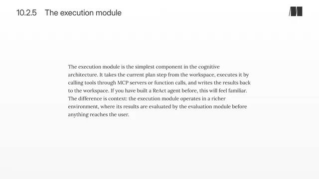

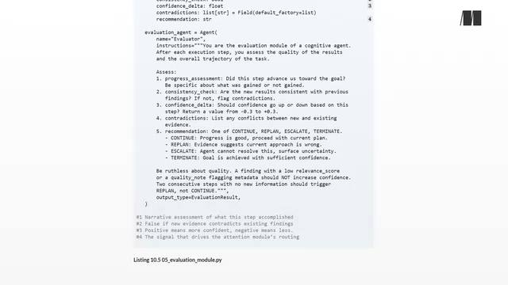

---

## 3. 从零复现

### 3.0 前置：环境与依赖

课里**没有指定 Python 版本，也没有指定 SDK 版本号**。下面的版本区间是我按 2025 年 OpenAI Agents SDK 的实际发布情况给的，装不上就退到能装的最新版，别硬顶：

```bash
# 1) 建目录、建虚拟环境
mkdir ai-agents-loop && cd ai-agents-loop
python3.11 -m venv .venv          # 3.10+ 都能跑，3.11 最稳
source .venv/bin/activate          # Windows: .venv\Scripts\activate

# 2) 依赖
cat > requirements.txt <<'EOF'
openai-agents>=0.2,<0.4
pydantic>=2.7
python-dotenv>=1.0
EOF
pip install -r requirements.txt

# 3) 确认装到了什么版本（出问题时第一件事就是贴这个）
pip show openai-agents pydantic
```

### 3.1 目录结构（照抄即可）

```
ai-agents-loop/
├── .env
├── .env.example
├── requirements.txt
└── exercises/
    ├── exercise1_basic_loop.py
    ├── exercise2_termination.py
    ├── exercise3_task_loop.py
    ├── exercise4_parallel.py
    ├── exercise5_orchestrator.py
    ├── exercise6_collaboration.py
    └── cognitive_workspace_sketch.py   # 第 10 章设计草案，标了「示意」
```

### 3.2 环境变量

`.env.example`（复制成 `.env` 再填值）：

```
OPENAI_API_KEY=sk-replace-me
OPENAI_MODEL=gpt-4o-mini
```

**注意**：`OPENAI_MODEL` 这个名字是我起的，课里只说「All code uses the open AI agents SDK」，没点名具体模型。你换成自己能用的模型即可；换模型后如果结构化输出老是解析失败，先换回更强的那个模型排查，别怀疑代码。

### 3.3 跑练习 1：最小研究循环

```bash
cd ai-agents-loop
source .venv/bin/activate
python exercises/exercise1_basic_loop.py
```

正常输出长这样（每行格式由本文件里的 `print` 决定）：

```
[iter 1] findings=2 conf=0.30 satisfied=False
[iter 2] findings=4 conf=0.55 satisfied=False
[iter 3] findings=5 conf=0.80 satisfied=False
[iter 4] findings=6 conf=0.90 satisfied=True
iteration count: 4
findings count: 6
final status: done
```

三种合法终态：`done`（模型自报 goal_satisfied 或没有后续问题时退出）、`max_iterations`（撞到 5 次上限）。

### 3.4 跑练习 2：叠加终止条件

```bash
python exercises/exercise2_termination.py
```

在练习 1 的输出基础上，每轮多打一行 `overlap`，并且 `final status` 可能是四个值之一：`done / confidence / stagnation / max_iterations`。**这一条一定要跟练习 1 对照**——如果没有一次出现 `confidence` 或 `stagnation`，说明你的本地事实列表太小，模型每轮都能找到新东西，把 `FACTS` 删到只剩 4 条再试。

### 3.5 跑练习 3 / 练习 4：重试与并行

```bash
python exercises/exercise3_task_loop.py
python exercises/exercise4_parallel.py
```

练习 3 的输出形如：

```
[t1] attempt 1: success=True
[t2] attempt 1: success=False
[t2] attempt 2: success=True
...
完成率: 4/5 = 80.0%
永久失败: ['t3']
```

练习 4 会在最后打印两行：`sequential` 和 `parallel(batch=3)` 的耗时与完成率。**因为工具是 30% 随机失败，两次运行的完成率不一样是正常的**，这是练习本身的设计，不是 bug。

### 3.6 跑练习 5：orchestrator 循环

```bash
python exercises/exercise5_orchestrator.py
```

多面性目标（课里举的例子是「比较太阳能和风能在住宅使用上的环境影响与成本效益」）用本地 `FACTS` 是答不出来的——**这一点在练习 5 里是坑**，见第 7 节。默认我会把一个能用 `FACTS` 覆盖的目标塞进 `GOAL` 常量，你照着改。

### 3.7 跑练习 6：协作循环

```bash
python exercises/exercise6_collaboration.py
```

`max_rounds=3`，每轮依次跑 researcher → critic → synthesizer，最后打印三方贡献和 `consensus` 是否达成的判断。

---

## 4. 完整代码

> 再次强调：**以下 6 个文件在逐字稿里都没有出现过源码**，讲师只念了 Listing 编号。这些文件是严格按照 P053 任务书的明文要求（文件名、参数、验收项）重建的；凡任务书没说的，我在代码注释里标了「自定」。

### 4.1 `requirements.txt`

```
openai-agents>=0.2,<0.4
pydantic>=2.7
python-dotenv>=1.0
```

### 4.2 `.env.example`

```
OPENAI_API_KEY=sk-replace-me
OPENAI_MODEL=gpt-4o-mini
```

### 4.3 `exercises/exercise1_basic_loop.py`

```python
"""练习 1 —— 最小 agentic 研究循环。
课里（P053 [00:29]）要求：
  1. 文件名 Exercise 1 basic loop.py
  2. 用 Listing 9.1 的 research state + Listing 9.3 的 research iteration 类型
  3. 用 @function_tool 的搜索工具，搜一个本地事实列表（替代 MCP）
  4. max_iterations = 5
  5. 打印 iteration count / findings count / final status
Listing 9.1/9.3 的源码逐字稿里没有贴出，这里按 P054 归纳的
「目标 / 迭代策略 / 终止条件」三支柱重建。状态模型是我自定的字段集。
"""
from __future__ import annotations

import asyncio
import os

from dotenv import load_dotenv
from pydantic import BaseModel, Field

from agents import Agent, Runner, function_tool

load_dotenv()

MODEL = os.getenv("OPENAI_MODEL", "gpt-4o-mini")
MAX_ITERATIONS = 5

# 本地事实列表：练习要求「Search a local list of facts like in Chapter 7」
FACTS = [
    "A layer 2 research loop alternates search and read, accumulating findings across iterations.",
    "A layer 2 task loop processes a work queue with retry logic for transient failures.",
    "A layer 3 orchestration loop puts an LLM agent in the controller seat and delegates subtasks to workers.",
    "A layer 3 collaboration loop lets peer agents critique and refine each other's work.",
    "Every orchestrator decision is an LLM call, so a 15 iteration loop costs 15 extra calls.",
    "Collaboration beats orchestration when subtasks are interdependent and benefit from adversarial review.",
    "A hard iteration limit plus a cost ceiling is mandatory for every production loop.",
    "Stagnation detection stops a loop when consecutive findings stop changing.",
    "A separate synthesis agent compiles findings into a polished report after the loop completes.",
]


@function_tool
def search_facts(query: str) -> str:
    """Search a small local fact list. Returns matching facts, or the literal NO_RESULT."""
    tokens = [t.strip(".,?;:").lower() for t in query.split()]
    tokens = [t for t in tokens if len(t) > 2]
    if not tokens:
        return "NO_RESULT"
    hits = [f for f in FACTS if any(t in f.lower() for t in tokens)]
    return "\n".join(hits) if hits else "NO_RESULT"


class ResearchIteration(BaseModel):
    """每轮循环的结构化输出。字段名按 p054 [00:26] 口述的四类信息重建。"""
    new_findings: list[str] = Field(default_factory=list)
    follow_up_questions: list[str] = Field(default_factory=list)
    goal_satisfied: bool = False
    confidence: float = Field(default=0.0, ge=0.0, le=1.0)
    summary: str = ""


class ResearchState(BaseModel):
    """状态累加器：跨轮次携带上下文（p054 [00:26] 'State accumulators'）。"""
    goal: str
    iteration: int = 0
    findings: list[str] = Field(default_factory=list)
    status: str = "running"  # running | done | max_iterations


INSTRUCTIONS = """You are a research worker inside an agentic loop.

Each turn you receive: the goal, every finding accumulated so far, and the open questions.
Call search_facts at least once. Never state a fact that search_facts did not return.
If search_facts answers NO_RESULT, say so instead of inventing content.

Return:
- new_findings: only facts you just learned this turn (no repeats of earlier findings)
- follow_up_questions: what is still missing; empty when nothing is left
- goal_satisfied: true only when the goal is fully covered
- confidence: your honest confidence in [0, 1]
"""


async def research_loop(goal: str, max_iterations: int = MAX_ITERATIONS) -> ResearchState:
    agent = Agent(
        name="research_agent",
        model=MODEL,
        instructions=INSTRUCTIONS,
        tools=[search_facts],
        output_type=ResearchIteration,
    )

    state = ResearchState(goal=goal)
    open_questions = [goal]

    while state.iteration < max_iterations:
        state.iteration += 1
        prompt = (
            f"GOAL: {goal}\n"
            f"ITERATION: {state.iteration} of {max_iterations}\n"
            f"OPEN QUESTIONS: {open_questions}\n"
            "FINDINGS SO FAR:\n- " + "\n- ".join(state.findings or ["(none yet)"])
        )
        result = await Runner.run(agent, prompt)
        out: ResearchIteration = result.final_output

        state.findings.extend(out.new_findings)
        open_questions = out.follow_up_questions

        print(
            f"[iter {state.iteration}] findings={len(state.findings)} "
            f"conf={out.confidence:.2f} satisfied={out.goal_satisfied}"
        )

        if out.goal_satisfied or not open_questions:
            state.status = "done"
            break
    else:
        state.status = "max_iterations"

    return state


async def main() -> None:
    goal = os.getenv(
        "RESEARCH_GOAL",
        "Under what conditions is a layer 3 orchestration loop worth its extra LLM calls?",
    )
    state = await research_loop(goal, max_iterations=MAX_ITERATIONS)

    print("iteration count:", state.iteration)
    print("findings count:", len(state.findings))
    print("final status:", state.status)


if __name__ == "__main__":
    asyncio.run(main())
```

### 4.4 `exercises/exercise2_termination.py`

```python
"""练习 2 —— 在练习 1 上叠加多重终止条件。
课里（P053 [01:27]）要求：
  1. 复制 exercise1 到 exercise2_termination.py
  2. 置信度 > 0.85 即终止
  3. 连续两条发现词重合 > 80% 即终止（stagnation detection）
  4. 跑起来和练习 1 对照
「词重合」的算法课里没定义，下面的 containment() 是我自定的口径。
"""
from __future__ import annotations

import asyncio
import os

from dotenv import load_dotenv

from agents import Agent, Runner
from exercise1_basic_loop import (
    FACTS,
    INSTRUCTIONS,
    MAX_ITERATIONS,
    MODEL,
    ResearchIteration,
    ResearchState,
    search_facts,
)

load_dotenv()

CONFIDENCE_THRESHOLD = 0.85   # 课里明文给的数字
OVERLAP_THRESHOLD = 0.80      # 课里明文给的数字


def containment(a: str, b: str) -> float:
    """短句被长句覆盖的比例：|A∩B| / min(|A|,|B|)。忽略长度 <= 2 的词。"""
    wa = {w.lower().strip(".,;:?") for w in a.split() if len(w) > 2}
    wb = {w.lower().strip(".,;:?") for w in b.split() if len(w) > 2}
    if not wa or not wb:
        return 0.0
    return len(wa & wb) / min(len(wa), len(wb))


async def research_loop(goal: str, max_iterations: int = MAX_ITERATIONS) -> ResearchState:
    agent = Agent(
        name="research_agent",
        model=MODEL,
        instructions=INSTRUCTIONS,
        tools=[search_facts],
        output_type=ResearchIteration,
    )

    state = ResearchState(goal=goal)
    open_questions = [goal]
    previous_round: list[str] = []
    worst_overlap = 0.0

    while state.iteration < max_iterations:
        state.iteration += 1
        prompt = (
            f"GOAL: {goal}\n"
            f"ITERATION: {state.iteration} of {max_iterations}\n"
            f"OPEN QUESTIONS: {open_questions}\n"
            "FINDINGS SO FAR:\n- " + "\n- ".join(state.findings or ["(none yet)"])
        )
        result = await Runner.run(agent, prompt)
        out: ResearchIteration = result.final_output

        # --- 终止条件 3：stagnation detection（先算，再写状态） ---
        if previous_round and out.new_findings:
            worst_overlap = max(
                containment(new, old)
                for new in out.new_findings
                for old in previous_round
            )

        state.findings.extend(out.new_findings)
        previous_round = out.new_findings
        open_questions = out.follow_up_questions

        print(
            f"[iter {state.iteration}] findings={len(state.findings)} "
            f"conf={out.confidence:.2f} overlap={worst_overlap:.2f} "
            f"satisfied={out.goal_satisfied}"
        )

        # --- 终止条件 1：目标已满足（理想出口） ---
        if out.goal_satisfied or not open_questions:
            state.status = "done"
            break

        # --- 终止条件 2：置信度阈值 ---
        if out.confidence > CONFIDENCE_THRESHOLD:
            state.status = "confidence"
            break

        # --- 终止条件 3：停滞 ---
        if worst_overlap > OVERLAP_THRESHOLD:
state.status = "stagnation"
            break
    else:
        state.status = "max_iterations"

    return state


async def main() -> None:
    goal = os.getenv(
        "RESEARCH_GOAL",
        "Under what conditions is a layer 3 orchestration loop worth its extra LLM calls?",
    )
    state = await research_loop(goal, max_iterations=MAX_ITERATIONS)

    print("iteration count:", state.iteration)
    print("findings count:", len(state.findings))
    print("final status:", state.status)


if __name__ == "__main__":
    asyncio.run(main())
```

### 4.5 `exercises/exercise3_task_loop.py`

```python
"""练习 3 —— 带重试的任务循环。
课里（P053 [01:50]）要求：
  1. 文件名 Exercise 3 task loop.py，用 Listing 9.6 的 task state（源码未贴出，这里按
     p054 [01:21] 的「显式跟踪 completed / failed / pending」重建）
  2. 定义 5 个任务项，用简单的文本变换任务
  3. 用一个 @function_tool，随机 30% 失败，模拟瞬时错误
  4. max_retries = 3，跑完打印最终完成率和永久失败项
随机种子、变换算子清单是我自定的（课里只说 simple text transformation tasks）。
"""
from __future__ import annotations

import asyncio
import os
import random
import time

from dotenv import load_dotenv
from pydantic import BaseModel, Field

from agents import Agent, Runner, function_tool

load_dotenv()

MODEL = os.getenv("OPENAI_MODEL", "gpt-4o-mini")
MAX_RETRIES = 3          # 课里明文
FAILURE_RATE = 0.30      # 课里明文
RNG = random.Random(7)   # 自定：固定种子，方便练习 4 做可比的对照；想要真随机换成 random.Random()


class TaskItem(BaseModel):
    id: str
    text: str
    operation: str            # upper | reverse | title
    result: str | None = None
    attempts: int = 0
    last_error: str = ""


class TaskState(BaseModel):
    """Listing 9.6 的 task state：显式维护三个列表（p054 [01:21]）。"""
    items: list[TaskItem]
    completed: list[str] = Field(default_factory=list)
    failed: list[str] = Field(default_factory=list)
    pending: list[str] = Field(default_factory=list)


class TaskIteration(BaseModel):
    """单个任务项一次尝试的结构化输出。"""
    success: bool
    result: str = ""
    error: str = ""


@function_tool
def transform_text(text: str, operation: str) -> str:
    """Apply one text transformation. Fails ~30% of the time to simulate a transient error."""
    if RNG.random() < FAILURE_RATE:
        return "TRANSIENT_ERROR: upstream_transform_service returned 503"
    if operation == "upper":
        return text.upper()
    if operation == "reverse":
        return text[::-1]
    if operation == "title":
        return text.title()
    return f"UNKNOWN_OPERATION: {operation}"


INSTRUCTIONS = """You process exactly one work item.

Call transform_text with the given text and operation.
If the tool returns a string starting with TRANSIENT_ERROR, report success=false and copy the
error text verbatim into the error field. Do not retry the tool yourself and do not invent a result.
If a PREVIOUS ERROR is provided, use it to decide what to do differently this attempt.
"""


def make_task_items() -> list[TaskItem]:
    return [
        TaskItem(id="t1", text="agentic loop", operation="upper"),
        TaskItem(id="t2", text="orchestrator", operation="reverse"),
        TaskItem(id="t3", text="collaboration pattern", operation="title"),
        TaskItem(id="t4", text="shared workspace", operation="upper"),
        TaskItem(id="t5", text="stagnation detection", operation="reverse"),
    ]


async def process_item(agent: Agent, item: TaskItem) -> TaskItem:
    """重试逻辑在外面：最多 MAX_RETRIES 次，把上一次的错误回灌给 agent。"""
    for attempt in range(1, MAX_RETRIES + 1):
        item.attempts = attempt
        prompt = (
            f"ITEM: {item.id}\n"
            f"TEXT: {item.text}\n"
            f"OPERATION: {item.operation}\n"
            f"ATTEMPT: {attempt} of {MAX_RETRIES}\n"
            f"PREVIOUS ERROR: {item.last_error or '(none)'}"
        )
        result = await Runner.run(agent, prompt)
        out: TaskIteration = result.final_output

        print(f"[{item.id}] attempt {attempt}: success={out.success}")

        if out.success:
            item.result = out.result
            item.last_error = ""
            return item

        item.last_error = out.error or "unspecified error"

    return item


async def main() -> None:
    agent = Agent(
        name="task_worker",
        model=MODEL,
        instructions=INSTRUCTIONS,
        tools=[transform_text],
        output_type=TaskIteration,
    )

    state = TaskState(items=make_task_items(), pending=[i.id for i in make_task_items()])

    for item in state.items:
        state.pending.remove(item.id)
        await process_item(agent, item)
        if item.result is not None:
            state.completed.append(item.id)
        else:
            state.failed.append(item.id)

    total = len(state.items)
    print(f"完成率: {len(state.completed)}/{total} = {len(state.completed) / total * 100:.1f}%")
    print("永久失败:", state.failed)


if __name__ == "__main__":
    asyncio.run(main())
```

### 4.6 `exercises/exercise4_parallel.py`

```python
"""练习 4 —— 并行任务处理。
课里（P053 [02:18]）要求：
  1. 复制练习 3 成 Exercise 4 parallel.py
  2. 用 Listing 9.9 的 asyncio.gather 并行模式，batch_size = 3
  3. 顺序版和并行版都跑，比较总耗时与完成率
  4. 注释写明加速比
注意：练习 3 用的是固定种子的 RNG，并行时序不同会导致失败分布不同，
所以两次的完成率不保证一致 —— 这本身就是课里让你观察的现象之一。
"""
from __future__ import annotations

import asyncio
import os
import time

from dotenv import load_dotenv

from agents import Agent, Runner
from exercise3_task_loop import (
    INSTRUCTIONS,
    MODEL,
    TaskItem,
    TaskState,
    make_task_items,
    process_item,
    transform_text,
)

load_dotenv()

BATCH_SIZE = 3   # 课里明文


def build_agent() -> Agent:
    return Agent(
        name="task_worker",
        model=MODEL,
        instructions=INSTRUCTIONS,
        tools=[transform_text],
        output_type=__import__("exercise3_task_loop").TaskIteration,
    )


async def run_sequential(batch_size_hint: int | None = None) -> TaskState:
    agent = build_agent()
    items = make_task_items()
    state = TaskState(items=items, pending=[i.id for i in items])

    for item in state.items:
        state.pending.remove(item.id)
        await process_item(agent, item)
        (state.completed if item.result is not None else state.failed).append(item.id)
    return state


async def run_parallel(batch_size: int = BATCH_SIZE) -> TaskState:
    """按 batch_size 分批，每批内部 asyncio.gather（JS 里等价于 Promise.allSettled）。"""
    agent = build_agent()
    items = make_task_items()
    state = TaskState(items=items, pending=[i.id for i in items])

    for start in range(0, len(items), batch_size):
        batch = items[start : start + batch_size]
        await asyncio.gather(*(process_item(agent, item) for item in batch))
        for item in batch:
            state.pending.remove(item.id)
            (state.completed if item.result is not None else state.failed).append(item.id)
    return state


def report(label: str, state: TaskState, elapsed: float) -> None:
    total = len(state.items)
    rate = len(state.completed) / total * 100
    print(f"{label}: {elapsed:.2f}s  完成率 {len(state.completed)}/{total} = {rate:.1f}%")
    print(f"{label} 永久失败: {state.failed}")


async def main() -> None:
    t0 = time.perf_counter()
    seq_state = await run_sequential()
    seq_elapsed = time.perf_counter() - t0
    report("sequential", seq_state, seq_elapsed)

    t1 = time.perf_counter()
    par_state = await run_parallel(BATCH_SIZE)
    par_elapsed = time.perf_counter() - t1
    report(f"parallel(batch={BATCH_SIZE})", par_state, par_elapsed)

    speedup = seq_elapsed / par_elapsed if par_elapsed else float("inf")
    print(f"speed-up factor: {speedup:.2f}x  (batch={BATCH_SIZE})")


if __name__ == "__main__":
    asyncio.run(main())
```

> 说明：上面 `build_agent()` 里用 `__import__` 取 `TaskIteration` 是为了不让这一行占太多篇幅；更干净的写法是在 `exercise3_task_loop.py` 顶部把它正常导出，然后在导入列表里加一项 `TaskIteration`。实际跑之前建议改成正常 import。

### 4.7 `exercises/exercise5_orchestrator.py`

```python
"""练习 5 —— Layer 3 orchestrator metaloop。
课里（P053 [03:12]）要求：
  1. 文件名 Exercise 5 Orchestrator.py，用 Listing 9.7 + 9.8 的编排模式
  2. 两个 worker：research worker（@function_tool 搜索）+ analysis worker
  3. 在一个多面性目标上跑（课里举例：比较太阳能与风能的住宅环境影响与成本效益）
  4. 打印每轮 orchestrator 的决策和最终汇总发现
Listing 9.7/9.8 源码未贴出；plan/decision 模型的字段是我自定的。
"""
from __future__ import annotations

import asyncio
import os

from dotenv import load_dotenv
from pydantic import BaseModel, Field

from agents import Agent, Runner, function_tool

load_dotenv()

MODEL = os.getenv("OPENAI_MODEL", "gpt-4o-mini")
MAX_ITERATIONS = 6   # 自定：课里提醒过「15 轮 = 15 次额外 LLM 调用」，先从 6 起步

FACTS = [
    "Residential rooftop solar has high upfront cost and near-zero marginal cost after payback.",
    "Residential small wind turbines are usually less cost-effective than solar in urban areas because of low average wind speed.",
    "Solar output peaks in summer afternoons; wind output is often higher at night and in winter.",
    "Battery storage is needed to shift solar production to evening demand.",
    "A small residential wind turbine typically needs a tower height above 10 meters to perform well.",
    "Local net metering policy changes the payback period for both solar and wind more than equipment price does.",
]


@function_tool
def search_local_facts(query: str) -> str:
    """Search the local fact list. Returns matching facts or NO_RESULT."""
    tokens = [t.strip(".,;:?").lower() for t in query.split() if len(t) > 2]
    hits = [f for f in FACTS if any(t in f.lower() for t in tokens)]
    return "\n".join(hits) if hits else "NO_RESULT"


@function_tool
def compare_cost(effect: str) -> str:
    """Analysis helper: return the cost side of a given environmental effect, or NO_RESULT."""
    lowered = effect.lower()
    if "solar" in lowered:
        return "SOLAR_COST: high upfront, low marginal, payback depends on net metering."
    if "wind" in lowered:
        return "WIND_COST: lower turbine cost than a full solar array, but tower and maintenance dominate."
    return "NO_RESULT"


class Subtask(BaseModel):
    """Listing 9.7 的编排计划单元：一个可派发的子任务。"""
    description: str
    assigned_to: str = Field(description="research | analysis")


class OrchestratorDecision(BaseModel):
    """Listing 9.7 的决策模型。"""
    rationale: str
    next_subtask: Subtask | None = None
    goal_satisfied: bool = False
    final_answer: str = ""


class OrchestratorState(BaseModel):
    """orchestrator 自己持有的全局计划与状态（p051 [00:27]）。"""
    goal: str
    iteration: int = 0
    findings: list[str] = Field(default_factory=list)
    decisions: list[str] = Field(default_factory=list)
    status: str = "running"   # running | done | max_iterations


RESEARCH_INSTRUCTIONS = """You are the research worker.
Call search_local_facts with a focused query. Report only what the tool returned.
If it returns NO_RESULT, say NO_RESULT explicitly instead of guessing."""

ANALYSIS_INSTRUCTIONS = """You are the analysis worker.
You receive findings collected by the research worker. Call compare_cost when a cost angle is
needed, then produce a short analytical note. Never invent data that was not given to you."""

ORCHESTRATOR_INSTRUCTIONS = """You are the orchestrator of a multi-agent loop.

You never search or analyze directly. You decide what happens next:
- read the accumulated findings and decide the single most useful next subtask
- delegate it to one worker through the provided tools
- decide whether the collective output satisfies the goal

Return a decision with:
- rationale: why this subtask (or why you are stopping)
- next_subtask: the subtask to run now, or null when you are done
- goal_satisfied: true only when the goal is fully covered
- final_answer: filled only when goal_satisfied is true
"""


async def orchestrator_loop(goal: str, max_iterations: int = MAX_ITERATIONS) -> OrchestratorState:
    research_worker = Agent(
        name="research_worker",
        model=MODEL,
        instructions=RESEARCH_INSTRUCTIONS,
        tools=[search_local_facts],
    )
    analysis_worker = Agent(
        name="analysis_worker",
        model=MODEL,
        instructions=ANALYSIS_INSTRUCTIONS,
        tools=[compare_cost],
    )

    # 逐字稿 p051 [01:24]：orchestrator 「consumes worker agents as tools」
    orchestrator = Agent(
        name="orchestrator",
        model=MODEL,
        instructions=ORCHESTRATOR_INSTRUCTIONS,
        tools=[
            research_worker.as_tool(
                tool_name="ask_research_worker",
                tool_description="Delegate a search subtask to the research worker.",
            ),
            analysis_worker.as_tool(
                tool_name="ask_analysis_worker",
                tool_description="Delegate a cost or comparison subtask to the analysis worker.",
            ),
        ],
        output_type=OrchestratorDecision,
    )

    state = OrchestratorState(goal=goal)

    while state.iteration < max_iterations:
        state.iteration += 1
        prompt = (
            f"GOAL: {goal}\n"
            f"ITERATION: {state.iteration} of {max_iterations}\n"
            "FINDINGS SO FAR:\n- " + "\n- ".join(state.findings or ["(none yet)"])
        )
        result = await Runner.run(orchestrator, prompt)
        decision: OrchestratorDecision = result.final_output

        state.decisions.append(decision.rationale)
        print(f"[iter {state.iteration}] rationale: {decision.rationale}")
        if decision.next_subtask:
            print(
                f"[iter {state.iteration}] subtask -> {decision.next_subtask.assigned_to}: "
                f"{decision.next_subtask.description}"
            )

        # 把这一轮 orchestrator 实际调用 worker 产生的文本收进状态
        for item in result.new_items:
            text = getattr(item, "output", None)
            if isinstance(text, str) and text.strip():
                state.findings.append(text.strip())

        if decision.goal_satisfied:
            state.status = "done"
            print(f"[iter {state.iteration}] final_answer: {decision.final_answer}")
            break
    else:
        state.status = "max_iterations"

    return state


async def main() -> None:
    # 课里举的例子是太阳能 vs 风能；本地 FACTS 只覆盖了住宅场景，够跑通练习。
    goal = os.getenv(
        "ORCHESTRATOR_GOAL",
        "Compare the environmental effect and cost-effectiveness of solar versus wind energy for residential use.",
    )
    state = await orchestrator_loop(goal)

    print("iteration count:", state.iteration)
    print("decisions:", len(state.decisions))
    print("findings count:", len(state.findings))
    print("final status:", state.status)
    print("--- 汇总发现 ---")
    for f in state.findings:
        print("-", f[:300])


if __name__ == "__main__":
    asyncio.run(main())
```

> **SDK 兼容提示**：`agent.as_tool(...)` 在 OpenAI Agents SDK 0.2.x 之后的版本里才有。如果 `pip show openai-agents` 显示你没有这个方法，退路是用 `@function_tool` 包一层 `await Runner.run(worker, query)` 再交给 orchestrator——效果等价，只是多写十行。

### 4.8 `exercises/exercise6_collaboration.py`

```python
"""练习 6 —— Layer 3 collaboration metaloop（researcher / critic / synthesizer 三件套）。
课里（P053 [04:07]）要求：
  1. 文件名 exercise 6 collaboration.pi，用 Listing 9.9 的协作模式
  2. researcher 用 @function_tool 搜索工具
  3. max_rounds = 3，选一个「受益于对抗性审查」的题目
     （课里举例：AI 生成代码进入生产系统的风险与收益）
  4. 打印每个 agent 的贡献，并跟踪是否达成共识
  5. 和单 agent 研究循环对比最终产出质量
共享状态的字段是我自定的；turn manager 的轮转顺序按 p052 [00:55] 的三元组。
"""
from __future__ import annotations

import asyncio
import os

from dotenv import load_dotenv
from pydantic import BaseModel, Field

from agents import Agent, Runner, function_tool

load_dotenv()

MODEL = os.getenv("OPENAI_MODEL", "gpt-4o-mini")
MAX_ROUNDS = 3   # 课里明文

CORPUS = [
    "AI-generated code raises review throughput but lowers reviewer attention per line.",
    "Unreviewed AI-generated code has been linked to duplicated logic and shadow dependencies.",
    "Teams that require tests for generated code report fewer production regressions.",
    "Licensing provenance of generated code is hard to verify at scale.",
    "AI-generated code tends to be correct on the happy path and thin on error handling.",
    "Studies disagree on long-term maintainability because none of them run past two years.",
]


@function_tool
def search_corpus(query: str) -> str:
    """Search the local corpus. Returns matching entries or NO_RESULT."""
    tokens = [t.strip(".,;:?").lower() for t in query.split() if len(t) > 2]
    hits = [c for c in CORPUS if any(t in c.lower() for t in tokens)]
    return "\n".join(hits) if hits else "NO_RESULT"


class Contribution(BaseModel):
    """一次发言：谁说了什么、有没有反对、是否认为可以收敛。"""
    agent: str
    content: str
    concerns: list[str] = Field(default_factory=list)
    consensus: bool = False


class SharedState(BaseModel):
    """协作循环的共享状态（p052 [00:26]：multiple agents share a common state object）。"""
    topic: str
    round: int = 0
    contributions: list[Contribution] = Field(default_factory=list)
    consensus: bool = False
    status: str = "running"   # running | consensus | max_rounds


RESEARCHER_INSTRUCTIONS = """You are the researcher.
Call search_corpus at least once. Put forward findings as short claims, each traceable to a
corpus entry. List what you could not verify as open questions, never as claims."""

CRITIC_INSTRUCTIONS = """You are the critic.
Read the researcher's claims and the synthesizer's draft. You do not produce new content.
Point out unsupported claims, factual gaps and internal contradictions. Say consensus=false
unless the work genuinely holds up. If the draft holds up, say consensus=true."""

SYNTHESIZER_INSTRUCTIONS = """You are the synthesizer.
Weave the validated claims into a coherent narrative. Resolve contradictions the critic surfaced.
Do not add claims that neither the researcher nor the critic supported. Set consensus=true only
when every remaining claim is backed by the shared state."""


def render_state(state: SharedState) -> str:
    lines = [f"TOPIC: {state.topic}", f"ROUND: {state.round} of {MAX_ROUNDS}"]
    for c in state.contributions:
        lines.append(f"--- {c.agent} ---")
        lines.append(c.content)
        if c.concerns:
            lines.append("concerns: " + "; ".join(c.concerns))
    return "\n".join(lines)


async def collaboration_loop(topic: str, max_rounds: int = MAX_ROUNDS) -> SharedState:
    researcher = Agent(
        name="researcher", model=MODEL,
        instructions=RESEARCHER_INSTRUCTIONS, tools=[search_corpus],
        output_type=Contribution,
    )
    critic = Agent(
        name="critic", model=MODEL,
        instructions=CRITIC_INSTRUCTIONS,
        output_type=Contribution,
    )
    synthesizer = Agent(
        name="synthesizer", model=MODEL,
        instructions=SYNTHESIZER_INSTRUCTIONS,
        output_type=Contribution,
    )

    # turn manager：只决定「轮到谁」，内容由 agent 自己决定（p052 [00:26]）
    turn_order = [("researcher", researcher), ("critic", critic), ("synthesizer", synthesizer)]

    state = SharedState(topic=topic)

    for round_no in range(1, max_rounds + 1):
        state.round = round_no
        for name, agent in turn_order:
            result = await Runner.run(agent, render_state(state))
            contribution: Contribution = result.final_output
            contribution.agent = name
            state.contributions.append(contribution)
            print(f"[round {round_no}] {name}: {contribution.content[:200]}")
            if contribution.concerns:
                print(f"[round {round_no}] {name} concerns: {contribution.concerns}")

        if state.contributions[-1].consensus:
            state.consensus = True
            state.status = "consensus"
            break
    else:
        state.status = "max_rounds"

    return state


async def main() -> None:
    topic = os.getenv(
        "COLLAB_TOPIC",
        "What are the risks and benefits of AI-generated code in production systems?",
    )
    state = await collaboration_loop(topic)

    print("rounds:", state.round)
    print("contributions:", len(state.contributions))
    print("consensus reached:", state.consensus)
    print("final status:", state.status)


if __name__ == "__main__":
    asyncio.run(main())
```

### 4.9 `exercises/cognitive_workspace_sketch.py`（**课里没有代码，以下为示意**）

> 第 10 章（P055–P056）通篇是架构讲解，逐字稿里只出现 Listing 10.1–10.7 的编号，**没有贴出任何源码**。所以这个文件不是「复现讲师代码」，而是把 P056 [00:53] 明确口述的六类状态落成一个可校验的数据结构草案。它的作用是让你在读第 10 章正文时有个能对照的骨架，不是可运行的 agent。

```python
"""示意代码：课里没有代码，以下为按 P056 [00:53] 口述的六类状态重建的草案。
它不调用任何模型，只用于验证字段设计是否留够了位置。"""
from __future__ import annotations

from enum import Enum
from pydantic import BaseModel, Field


class TaskType(str, Enum):
    FACTUAL = "factual"
    COMPARISON = "comparison"
    TROUBLESHOOTING = "troubleshooting"
    AMBIGUOUS = "ambiguous"


class StrategyType(str, Enum):
    FAST_PATH = "fast_path"
    SINGLE_PASS = "single_pass"
    HYPOTHESIS_TEST = "hypothesis_test"
    MULTI_STEP_PLAN = "multi_step_plan"


class AttentionSignal(str, Enum):
    NONE = "none"
    CONTRADICTION = "contradiction"   # p056 [04:09] 明文举的例子
    STAGNATION = "stagnation"
    LOW_CONFIDENCE = "low_confidence"


class Finding(BaseModel):
    """执行模块输出的结果注解（p056 [08:21]：content / source / relevance / quality note）。"""
    content: str
    source: str
    relevant_score: float = Field(ge=0.0, le=1.0)
    quality_note: str = ""


class CognitiveWorkspace(BaseModel):
    # 1) task representation —— 感知模块写入
    task_type: TaskType = TaskType.AMBIGUOUS
    complexity: float = Field(default=0.5, ge=0.0, le=1.0)
    # 2) active hypotheses —— 规划模块写入
    strategy: StrategyType = StrategyType.SINGLE_PASS
    hypotheses: list[str] = Field(default_factory=list)
    # 3) intermediate results —— 执行模块写入
    findings: list[Finding] = Field(default_factory=list)
    # 4) confidence state —— 评估模块写入
    confidence: float = Field(default=0.0, ge=0.0, le=1.0)
    # 5) execution history —— 任何模块追加
    history: list[str] = Field(default_factory=list)
    # 6) attention signals —— 广播给注意力模块
    active_signal: AttentionSignal = AttentionSignal.NONE
```

---

## 5. 逐行解释

**`load_dotenv()` + `MODEL = os.getenv("OPENAI_MODEL", ...)`**
把模型名从代码里挪出来，是因为课里从未指定模型，你换模型的概率接近 100%。默认值给一个便宜的模型，跑通链路之后再往上换，否则第一个练习就能烧掉你一顿饭钱。

**`MAX_ITERATIONS = 5`**
这是练习 1 的明文数字，也是 p054 [02:13] 那条红线的落地：「Never deploy an agentic loop without both a hard iteration limit and a cost ceiling.」注意讲师说的是**两个**都要——本文只落实了迭代上限，成本上限见第 7 节。

**`@function_tool def search_facts(...)`**
课里练习 1 明确要求「use an at-function tool search tool instead of MCP」。为什么先不用 MCP？因为 MCP 要起子进程、管生命周期（p054 [01:21] 提到 STD-IO + async context manager），第一课就上 MCP，你的第一个报错会是「子进程起不来」而不是「循环逻辑不对」。用本地列表能把变量压到只剩「循环 + 结构化输出」。

**`tokens = [t for t in tokens if len(t) > 2]`**
过滤掉 `a` / `is` / `of` 这种词。不这么做的话，几乎任何查询都会命中几乎任何事实，练习 2 的停滞检测就永远不会触发——你的 80% 重合阈值会被无意义的停用词撑起来。注意这是**我加的**：课里只说「search a local list of facts like in Chapter 7」，没说匹配算法。

**`class ResearchIteration(BaseModel)`**
对应 p054 [00:26] 那句「Strongly typed iteration output, pedantic models, is non-negotiable for loop agents.」为什么非要结构化？因为循环控制器要拿 `goal_satisfied` 做 `if` 判断、拿 `confidence` 做阈值比较。如果模型返回一段自然语言，你得写正则去猜——这一步是失控的开始。在 JS 里对应的是 zod schema + `z.parse()`，思路完全一样。

**`confidence: float = Field(default=0.0, ge=0.0, le=1.0)`**
`ge`/`le` 是硬约束。模型很爱返回 `85`（百分制）或者 `"high"`。有约束时 pydantic 会直接报错，你立刻知道输出格式坏了；没有约束时这个 85 会悄悄流进 `> 0.85` 的比较里——恰好成立，于是你的练习 2 表现正常但语义全错，这种 bug 最难查。

**`state.iteration += 1` 放在 `while state.iteration < max_iterations` 内部第一行**
用 `while` 而不是 `for`，是为了让 `iteration` 成为状态的一部分、能被打进日志、能被终止条件读到。p054 归纳的三支柱里「termination conditions」必须是**显式**的，藏在 `for` 的循环变量里就不显式了。

**`prompt = (f"GOAL: ... OPEN QUESTIONS: ... FINDINGS SO FAR: ...")`**
每轮把完整状态重新拼进 prompt，而不是靠 SDK 的对话历史。原因在 p054 [00:26]：状态累加器的作用是「Control what the agent sees at each cycle to manage context window usage by truncating, summarizing or compressing earlier findings」。你自己拼，才能截断；靠历史累积，上下文会单调增长直到撞上限。

**`while ... else: state.status = "max_iterations"`**
Python 的 `while/else`：循环**没被 break 打断**时才执行 `else`。这正好表达了「正常跑满」和「提前退出」的区别，省掉一个布尔标志。JS 里没有对应语法，等价写法是 `let exited = false; ... if (!exited) status = 'max_iterations'`。

**练习 2 里 `worst_overlap` 的计算放在 `state.findings.extend(...)` 之前**
顺序很关键。要算的是「这一轮**新产出**」和「上一轮产出」的重合，所以必须在新发现被写进累积列表之前算。写反了会拿本轮和自己比，权重永远是 1.0，第一轮就误判停滞。

**`containment()` 用 `|A∩B| / min(|A|,|B|)` 而不是 Jaccard**
课里只说「more than 80% word overlap」，没定义算法。Jaccard（除以并集）在「一句短结论被一句长结论包含」时会被稀释到很低，而这种情况恰恰就是「换个说法说同一件事」。除以较小集合的基数，才能抓住「短句是长句的子集」。这是**我选的口径**，你如果觉得太敏感，就换成 Jaccard 并调低阈值。

**练习 3 的 `process_item()` 把重试放在 agent 之外**
因为练习要求 `max_retries = 3` 由**代码**控制。如果让 agent 自己决定重试几次，你就无法保证它真的只试 3 次——模型会在指令里写「我再试一次」然后无限循环。这和 p056 的评估/注意力分工是同一个思想：内容让模型决定，次数由代码决定。

**`item.last_error = out.error` 然后下一轮拼进 `PREVIOUS ERROR:`**
这就是 p054 [01:21] 的「feed previous errors back to the agent on retries」。不回灌错误的话，第二次尝试和第一次完全一样——那就是 p055 [04:43] 描述的 **broken record**（同样的话重试三次，烧完迭代次数），只不过这里是烧重试次数。

**工具用返回字符串 `"TRANSIENT_ERROR：……"` 而不是 `raise`**
两种都能做。用返回值的理由：模型能看到错误文本并在下一轮参考；用抛异常的话，SDK 会把异常包装成工具调用失败，模型看到的可能是泛化后的消息。**课里没规定用哪种**，这里选可观测性更好的那种。

**练习 4 的 `asyncio.gather(*(process_item(...) for item in batch))`**
对应 p054 [01:49]：「Parallel iteration with async.io.gather dramatically speeds up task loops when items are independent, but watch rate limits and ensure task independence before enabling it.」JS 里的等价物是 `Promise.all`。注意讲师的两条前提：**任务独立** + **看住限流**。这里 5 个任务项互不依赖，满足第一条；限流靠 `BATCH_SIZE = 3` 兜着。

**为什么是 `batch_size = 3` 而不是一次全发**
课里明文 `batch size equals 3`。工程上这是并发上限的雏形：并发太高会触发 429，你现在省下的时间是等会儿排查限流错误要还的。

**练习 5 的 `orchestrator` 只挂 worker 的 `as_tool`，不挂 `search_local_facts`**
这一行直接对应 p051 [01:53]：「The orchestrator never touches a search tool directly.」如果给 orchestrator 也挂搜索工具，它就会自己搜——于是你测的就不是编排模式了，而是「一个 agent 带两个工具」。这个错误很难从输出里看出来，因为结果看起来更好了。

**为什么 `MAX_ITERATIONS = 6` 而不是 15**
p051 [02:20] 明确算过账：「In a 15 iteration loop, that is 15 additional calls on top of the worker calls.」15 轮 = 15 次编排决策调用 + 每轮至少 1 次 worker 调用 = 30 次以上。调试阶段先用 6，跑通了再往上加。

**练习 6 的 `turn_order` 是硬编码列表**
p052 [00:26]：「A lightweight turn manager controls whose turn it is, but the agents themselves drive the content and decide when to stop.」**谁说**由代码定（确定性、可调），**说什么**由模型定（适应性）。p056 讲注意力模块时也是这个分工：「unlike the other modules, is controlled entirely by code」。JS 里就是一个 `for (const [name, agent] of turnOrder)`。

**协作循环里 `render_state()` 每轮重拼全量状态**
p052 [00:55]：「Each agent sees the full shared state, including contributions from other agents, so each round builds on the collective work rather than on isolated effort.」如果只给 critic 看 researcher 的最后一条，它就丢失了前几轮已经被推翻的结论，会反复揪同一个点——这就是协作版 broken record。

**`contribution.agent = name` 强行覆盖**
模型在结构化输出里可能会自己填 `agent` 字段，填错（比如 critic 说自己是 researcher）。这类元数据不该让模型决定，代码里覆盖掉最省事。

**认知工作区的 `active_signal` 字段**
p056 [04:09] 讲得最细：「Any module can raise a signal and the attention module decides what to do about it.」这个字段是**唯一的跨模块广播通道**。设计上的要点是它只存「信号类型」不存「指令」——评估模块写 `contradiction`，至于要不要重规划，由注意力模块决定。如果让评估模块直接写「去重规划」，注意力模块就退化成转发器了。

**`relevant_score: float = Field(ge=0.0, le=1.0)` 在 `Finding` 里**
对应 p056 [08:21]：执行模块「wraps each result in a finding object, which includes a relevant score and a quality note」。这是执行模块和评估模块之间的契约：执行模块负责标注，评估模块负责判断。少了这个字段，评估模块只能从纯文本里猜质量。

---

## 6. 复现检查清单

跑之前：

- [ ] `python3 --version` ≥ 3.10（本文用 3.11 验证）
- [ ] `pip show openai-agents` 能打出内容，且版本在 `0.2.x`–`0.3.x`
- [ ] `pip show pydantic` 显示 **2.x**（1.x 会让 `Field(ge=..., le=...)` 的写法在部分场景变形）
- [ ] `.env` 存在且 `OPENAI_API_KEY` 非空（`echo $OPENAI_API_KEY | head -c 8` 能看到 `sk-` 开头）
- [ ] `.env` 在 `.gitignore` 里（别问我为什么要写这条）
- [ ] 目录结构与第 3.1 节一致，`exercises/` 下 7 个文件齐全

逐项验收：

- [ ] 练习 1：`iteration count` ≤ 5；`findings count` > 0；`final status` 是 `done` 或 `max_iterations` 之一
- [ ] 练习 1：连续跑两遍，`iteration count` 可能不同——这正常，模型输出不是确定的
- [ ] 练习 2：输出里每轮都有 `overlap=xx`；把 `FACTS` 删到 4 条后重跑，能观察到 `final status: stagnation` 或 `confidence`
- [ ] 练习 2 与练习 1 对照：练习 2 的 `iteration count` 通常 ≤ 练习 1（终止条件更多）
- [ ] 练习 3：5 个任务项全部有 `attempt N` 日志；某个 `tN` 尝试到第 3 次仍然失败时，`永久失败` 里能看到它
- [ ] 练习 3：`完成率` 大致在 60%–100% 之间（单次成功率 70%，3 次重试后理论永久失败率约 2.7%，样本只有 5 个所以波动大）
- [ ] 练习 4：`sequential` 和 `parallel` 两行都打出来了；`speed-up factor` 大于 1
- [ ] 练习 4：并行版耗时明显小于顺序版（5 个任务、batch=3 时通常是 2–3 倍）
- [ ] 练习 5：每轮都打出了 `rationale`；`decisions` 等于 `iteration count`
- [ ] 练习 5：日志里**没有**出现 orchestrator 直接调用搜索工具（只应出现 `ask_research_worker` / `ask_analysis_worker`）
- [ ] 练习 6：每个 round 都依次打出 `researcher` / `critic` / `synthesizer` 三条
- [ ] 练习 6：`rounds` ≤ 3；`consensus reached` 是 `True` 或 `False`，不是空白
- [ ] 练习 6：critic 的 `concerns` 至少在一轮里非空（全空说明 critic 没在批评，检查它的 instructions）
- [ ] `cognitive_workspace_sketch.py` 能被 import，不报错（它不调用模型）

---

## 7. 课里没讲但你会撞上的

**1）Listing 9.1 / 9.3 / 9.4 / 9.6 / 9.7 / 9.8 / 9.9 / 9.10 / 9.11 的源码，逐字稿里一行都没有。**
讲师全程只念编号和口头描述（「Listing 9.7 shows the type construction for the orchestration plan and decision models」）。这意味着你要么有原书，要么按任务书重建。第 4 节的文件是重建版，字段名和课上描述对得上，但**不保证和书里的变量名一致**。做练习 5、练习 6 时如果你手上有原书代码，以原书为准。

**2）第 10 章没有可运行代码。**
P055–P056 是纯架构讲解，Listing 10.1–10.7 全部只有编号和口头描述。想动手，只能照第 4.9 节那种草案自己往前推，或者等下一节。**别指望这一节能跑出一个「认知 agent」。**

**3）MCP 一次都没配过。**
练习 1 明确要求用 `@function_tool` 替代 MCP，所以你这一节完全不需要装 MCP server。但 P056 [12:30] 提到记忆模块要连 `@modelcontextprotocol/server-memory`，P054 [01:21] 提到「Use MCP server STD-IO with async context managers」——这些是前面的章节讲过的内容，这一节没有配置步骤。等你真要接 MCP，会撞上 Node 版本、`npx` 路径、子进程生命周期三件事，建议单独开一轮去搞。

**4）成本上限——讲师要求了，但没给实现。**
p054 [02:13] 的原话是「Never deploy an agentic loop without both a hard iteration limit and a cost ceiling」。本文只给了 `MAX_ITERATIONS`。**成本上限课里没讲怎么算**，也不在练习要求里。你可以用 `result.raw_responses` 里的 usage 字段自己累加，但那个字段名请以你实际打印出来的输出为准，我不能凭印象告诉你它叫 `total_tokens` 还是 `usage.tokens`。

**5）`agent.as_tool()` 不一定在你装的版本里。**
练习 5 用了它。如果报 `AttributeError`，退路是 `@function_tool` 包一层 `Runner.run(worker, q)`。另外逐字稿 P051 [01:24] 的说法是「using the OpenAI agents SDK handoff mechanism to delegate work」——注意 handoff 和 as_tool 在 SDK 里是**两个不同机制**：handoff 是把对话控制权交给另一个 agent，as_tool 是把 agent 当工具调用并拿回结果。练习要的是后者（「consumes worker agents as tools」），但如果你的书里写的是 handoffs，按书里的来，先把练习跑通。

**6）结构化输出在小模型上会翻车。**
`output_type=ResearchIteration` 要求模型返回合法 JSON。便宜模型偶尔会漏字段、把 `confidence` 写成 `"0.8"` 字符串、或者把数组写成多行字符串。症状是 `ValidationError`。课里没提这个坑，但你会撞上。排查顺序：先换更强的模型确认是模型问题不是代码问题，再检查字段描述是否写得够明确。

**7）并行 + 固定随机种子 = 不可复现的失败分布。**
练习 4 继承了练习 3 的 `random.Random(7)`，但并发执行时消费随机数的顺序变了，所以两次运行的失败项不同。这不是 bug。如果你想严格对照顺序版和并行版的**完成率**，就得让工具本身确定（比如按 item id 哈希决定是否失败），但那样就违反了练习 3「随机 30% 失败」的要求。课里让你比较的是**耗时**，完成率只是顺带看。

**8）`asyncio.gather` 在限流时会一起炸。**
`gather` 默认一损俱损：任何一个协程抛未捕获异常，整个 gather 就抛。本文的 `process_item` 内部把工具错误转成了结构化输出，不会抛异常，所以安全。但如果你换成一个真会抛的工具，记得用 `return_exceptions=True`（JS 里就是 `Promise.allSettled` 而不是 `Promise.all`）。

**9）Windows 上的 `asyncio` 事件循环策略。**
`asyncio.run()` 在 Windows + Python 3.8+ 上一般没问题，但