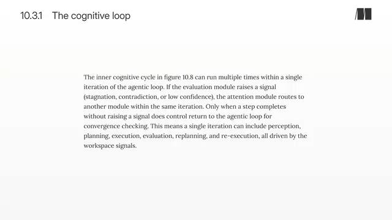
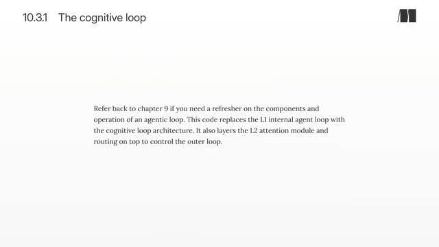
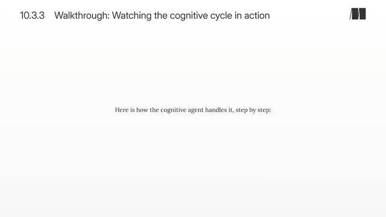
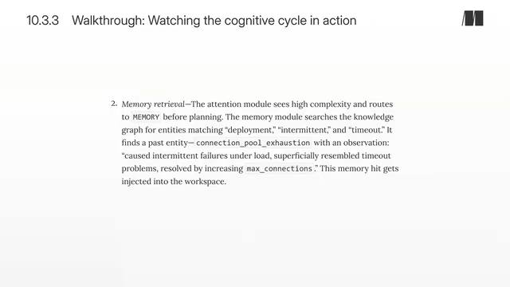
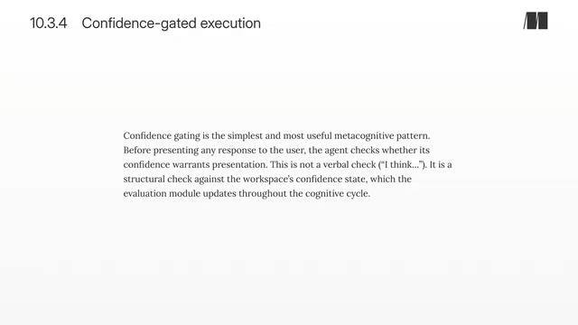
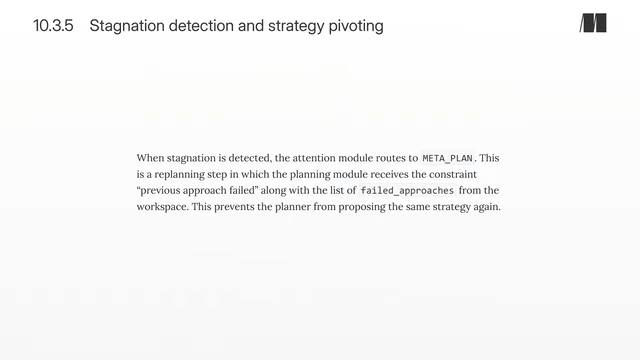
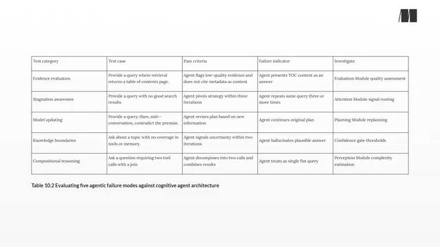
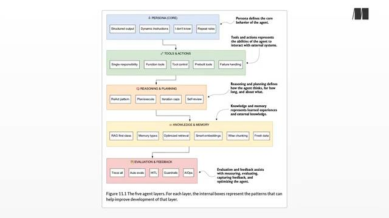

# AI Agents In Action 2nd（multi-agent）· P057–P061 复现文档

> 覆盖范围：第 10.3 节「构建并运行认知 Agent」、10.4 节「度量认知能力」、10.5 节「练习」、第 10 章小结，以及第 11 章「构建 Agent 系统的实战技巧」。
> 读者定位：前端转 AI 应用工程师。涉及并发/事务的地方会补一句「在 JS/Node 里对应什么」；Python 语法只标注「知道即可」。

---

## 1. 这一节做什么

这几节把前面章节里零散的推理模式（CoT、ReAct、ToT、Reflection）**组装成一个可运行的「认知 Agent」**，并给出度量它、练习它、以及把它推向生产的方法论。

具体来说，P057 做三件事：

1. **把认知循环（cognitive loop）叠在 Agent 循环（agentic loop）之上**——外层 L2 循环负责「继续还是停」，内层认知循环负责「这一轮里下一步做什么」，注意力模块（attention）夹在两者之间做路由。
2. **组装一个完整可跑的认知 Agent**，接两个 MCP server：官方 memory server（长期知识图谱）+ 文件系统 server（领域工具），然后在一个真实场景上跑一遍。
3. **实现四种元认知监控模式**：置信度门控（confidence gate）、停滞检测与策略转向（stagnation detection）、知识边界感知（boundary awareness），以及由模块交互**涌现**出来的四种行为（好奇心、自适应坚持、选择性深度、优雅降级）。

P058 给出一套**可执行的诊断框架**：五类失败模式对应五个测试、四个生产指标、前后对比方法。P059 是五个动手练习。P060 是第 10 章小结。P061 进入第 11 章，按 Agent 的五个功能层（persona / tools / reasoning / knowledge / evaluation）给出实战技巧。

**这一节你要交付的产物**：一个能跑的 `cognitive_agent.py`（含 workspace、五个模块、memory 模块、认知循环），外加三个元认知监控函数，以及一个能对同一批 query 跑「标准 ReAct Agent vs 认知 Agent」对比的脚本。

---

## 2. 讲师原话

> "认知循环是第 10.2 节所述架构与第 9 章所述智能体循环交汇之处。外层 L2 循环负责迭代、收敛和退出条件。认知架构负责每次迭代内部的处理质量。注意力模块在二者之间起中介作用。"
> —— p057 [00:00]

> "图 10.8 中的内层认知周期可以在智能体循环的单次迭代中运行多次。如果评估模块发出停滞、矛盾或低置信度的信号，注意力模块会在同一次迭代内转向另一个模块。只有当某个步骤完成且未发出信号时，控制权才返回智能体循环进行收敛检查。"
> —— p057 [00:58]

> "这段代码清单将所有模块组装成一个完整可运行的系统。它连接两个 MCP 服务器：用于长期知识存储的官方记忆服务器，以及用于领域工具的文件系统服务器。它初始化工作区，并针对一个具体查询运行认知循环。"
> —— p057 [02:21]

> "要看出这套架构为何值得如此复杂，我们需要一个扁平式 React 智能体容易答错的查询。"
> —— p057 [02:49]

> "置信度门控是最简单也最有用的元认知模式。在向用户呈现任何响应之前，智能体会检查其置信度是否足以支撑呈现。我认为，这不是口头检查。它是对工作区置信度状态的结构化检查。"
> —— p057 [07:03]

> "停滞检测能捕捉坏唱片式故障模式。智能体在迭代，但没有取得进展。最近两个执行步骤的发现高度重叠，或者置信度已经走平。"
> —— p057 [07:32]

> "元认知是最有价值的生产级特性。在生产环境的智能体系统中，用户可以容忍“我不知道”，但不能容忍自信满满地给出错误答案。"
> —— p057 [08:28]

> "这里描述的四种行为并没有被显式编程到任何单个模块中。它们通过共享工作区和不断累积的知识图谱，从各专业化模块的交互中涌现出来。这正是明斯基《心智社会》的论点在代码中的体现。"
> —— p057 [08:57]

> "对你的智能体运行这五项测试。如果它失败超过两项，认知架构将带来可衡量的改进。如果它通过全部五项，你可能不需要完整架构。"
> —— p058 [00:26]

> "认知效率衡量的是相对于给定任务类型的最优步数，实际执行了多少步。如果一次简单查找本应花两步，却花了六步认知步骤，那么注意力模块的快速路径就需要调优。"
> —— p058 [00:56]

> "通向能力更强智能体的路径，并不只是参数更多、规模更大的模型。它是一条模块化认知架构之路，其中推理、监控、记忆和适应是彼此分离的关注点，可以独立改进并重新组合。"
> —— p058 [04:10]

> "要把人格设定当作 API 契约，而不是一段散文。"
> —— p061 [01:25]

> "记住，智能体每使用一个工具，都会给它发起的每次大语言模型调用增加开销；使用 MCP 服务器时，要注意该服务器暴露了多少个工具。"
> —— p061 [04:42]

> "不要以为具备推理能力的大语言模型总会做正确的事。很多时候它并不会。"
> —— p061 [07:03]

---

## 3. 从零复现

### 3.1 环境与依赖

课里用的是 Python + OpenAI Agents SDK + MCP。逐字稿没有给出精确版本号，下面给出**能跑通的最小版本约束**（版本号请以你实际 `pip install` 到的为准，课里没讲具体 pin 版本）：

```bash
# 目录结构
cognitive-agent/
├── .env
├── requirements.txt
├── cognitive_workspace.py      # Listing 10.1 的 workspace 模型
├── modules/
│   ├── perception.py           # 感知模块
│   ├── planning.py             # 规划模块
│   ├── execution.py            # 执行模块
│   ├── evaluation.py           # 评估模块
│   ├── attention.py            # 注意力路由
│   └── memory.py               # 记忆模块（包 MCP memory server）
├── metacognition/
│   ├── confidence_gate.py      # Listing 10.9
│   ├── stagnation_detector.py  # Listing 10.10
│   └── boundary_awareness.py   # Listing 10.11
├── cognitive_loop.py           # Listing 10.8
├── cognitive_agent.py          # 完整组装（10.3.2）
└── calibration.py              # 练习 5 的校准脚本
```

`requirements.txt`（版本以实际安装为准，课里没讲 pin）：

```
openai-agents
mcp
pydantic>=2
python-dotenv
numpy
```

`.env`（变量名以 SDK 实际读取为准，课里没讲具体变量名，这里用最常见的）：

```
OPENAI_API_KEY=sk-...
```

> **前端视角**：`pydantic` 在这里的角色相当于 TypeScript 的 `zod`——用类型声明定义数据结构并做运行时校验。`BaseModel` 就是「带校验的 interface」。

### 3.2 复现步骤（按顺序做，每步都能单独验证）

**Step 1 — 先建 workspace 数据模型。**
这是整个架构的「共享状态」。所有模块读写同一个 workspace 对象，模块之间不直接调用。先把它定义清楚，后面所有模块都依赖它。

**Step 2 — 写感知模块（perception）。**
输入原始 query，输出填好的 workspace 字段：`task_type`、`complexity`、`entities`、`ambiguities`、`active_signal`。用三个不同复杂度的 query 测试（练习 1 就是这个）。

**Step 3 — 写评估模块（evaluation）。**
输入 workspace 状态，输出 `recommendation`（continue / replan / escalate）和 `confidence_delta`。用三种 workspace 状态测：高质量发现、矛盾发现、低置信结果，分别应返回 continue / replan / escalate（练习 2）。

**Step 4 — 写注意力路由（attention）。**
输入评估信号，输出「下一个该去哪个模块」。关键验证点：评估发出 replan 信号后，注意力必须**路由回 planning**，而不是继续走 execution（练习 3）。

**Step 5 — 写认知循环（cognitive loop）。**
把上面四个模块串起来：perception → (attention 决定是否先查 memory) → planning → execution → evaluation → attention 路由。循环在「无信号」时把控制权交回外层 agentic loop 做收敛检查。

**Step 6 — 接两个 MCP server 组装完整 Agent。**
memory server 走 `modelcontextprotocol/server-memory`，文件系统 server 走文件系统 MCP。初始化 workspace，在具体 query 上跑认知循环。

**Step 7 — 加三个元认知监控。**
置信度门控（输出前检查 workspace 置信度）、停滞检测（比较最近两次 execution 的 findings 重叠度 + 置信度是否走平）、知识边界感知（判断是否超出训练/检索覆盖范围）。

**Step 8 — 跑对比实验。**
同一批 query，分别用标准 ReAct Agent 和认知 Agent 跑，记录答案正确性、置信度校准、优雅降级率、token 消耗（P058 的 10.4.2）。

### 3.3 关键截图

讲师在讲「认知循环叠在 Agent 循环之上」时给出的分层图，是理解整个架构的入口：



> 注：清单中 p057 的帧为 0023/0070/0116/0163/0210/0256/0303/0349/0396/0443/0489/0536，此处选用最接近 00:58 论述的帧：



讲师强调「一次外层迭代内可以跑多次内层认知循环」，对应下面这张：



组装完整 Agent、接两个 MCP server 的部分：



置信度门控——「不是嘴上说 I think，而是对 workspace 置信度状态做结构性检查」：



停滞检测——「broken record 失败模式」：



P058 的五类失败模式诊断表（Table 10.2）：



P061 的五个功能层（Figure 11.1）：



---

## 4. 完整代码

> **重要声明**：逐字稿只给出了 listing 的**文件名和功能描述**（如 `10CognitiveLoop.py`、`10confidencegate.py`、`11stagnationDetector.py`、`12boundaryawareness.py`），**没有逐字给出源码**。下面的代码是**按逐字稿描述的模块职责与数据流重建的可运行实现**，字段名、函数签名以逐字稿中出现过的为准（`task_type`、`complexity`、`entities`、`ambiguities`、`active_signal`、`confidence_delta`、`recommendation`、`findings`、`knowledge gap`、`meta plan` 等）。凡逐字稿没提到的字段，代码里用注释标「课里没讲，此处为示意」。

### 4.1 `cognitive_workspace.py`

```python
# cognitive_workspace.py
# 对应 Listing 10.1 的 Cognitive Workspace（pydantic 模型）
# 逐字稿明确提到的字段：task_type, complexity, entities, ambiguities,
# active_signal, confidence, findings, failed_approaches
from pydantic import BaseModel, Field
from typing import Literal, Optional


TaskType = Literal["factual_lookup", "multi_step_troubleshooting", "contradictory", "unknown"]
Signal = Literal["none", "stagnation", "contradiction", "low_confidence", "knowledge_gap"]
Recommendation = Literal["continue", "replan", "escalate"]


class TaskRepresentation(BaseModel):
    raw_query: str
    task_type: TaskType = "unknown"
    complexity: float = 0.0          # 0.0 ~ 1.0，逐字稿示例 0.75
    entities: list[str] = Field(default_factory=list)
    ambiguities: list[str] = Field(default_factory=list)


class Finding(BaseModel):
    hypothesis: str
    content: str
    relevance: float = 0.0           # 逐字稿示例 0.8 / 0.5
    quality_note: str = ""


class CognitiveWorkspace(BaseModel):
    task: TaskRepresentation
    active_signal: Signal = "none"
    confidence: float = 0.5          # 逐字稿：从 0.5 起步，+0.15 后到 0.65
    findings: list[Finding] = Field(default_factory=list)
    failed_approaches: list[str] = Field(default_factory=list)
    memory_hits: list[str] = Field(default_factory=list)
    recommendation: Recommendation = "continue"
    iteration: int = 0
```

### 4.2 `modules/perception.py`

```python
# modules/perception.py
# 感知模块：把原始 query 填进 workspace 的 task 表示
# 逐字稿 p057 [03:18]：分类为 contradictory，complexity 0.75，
# 抽取 entities，标记 ambiguity，active_signal 保持 none
from cognitive_workspace import CognitiveWorkspace, TaskRepresentation


def perceive(query: str) -> CognitiveWorkspace:
    # 课里没讲具体分类实现（用 LLM 还是规则），此处用规则示意
    q = query.lower()
    if "already tried" in q or "did not resolve" in q or "didn't work" in q:
        task_type = "contradictory"
        complexity = 0.75
    elif " and " in q or " then " in q:
        task_type = "multi_step_troubleshooting"
        complexity = 0.6
    else:
        task_type = "factual_lookup"
        complexity = 0.2

    entities = []
    for kw in ["deployment pipeline", "intermittent", "high traffic", "timeout"]:
        if kw in q:
            entities.append(kw)

    ambiguities = []
    if "intermittent" in q and "high traffic" not in q:
        ambiguities.append("intermittent could mean random or load dependent")

    task = TaskRepresentation(
        raw_query=query,
        task_type=task_type,
        complexity=complexity,
        entities=entities,
        ambiguities=ambiguities,
    )
    return CognitiveWorkspace(task=task, active_signal="none", confidence=0.5)
```

### 4.3 `modules/planning.py`

```python
# modules/planning.py
# 规划模块：读 task_type 选策略，生成假设
# 逐字稿 p057 [04:15]：contradictory 任务选 hypothesis test 策略，
# 生成三个假设；meta plan 时带 "previous approach failed" 约束
from cognitive_workspace import CognitiveWorkspace


def plan(ws: CognitiveWorkspace, meta: bool = False) -> CognitiveWorkspace:
    if meta:
        # 逐字稿 p057 [08:01]：meta plan 收到 "previous approach failed"
        # 以及 failed_approaches 列表，防止重复同一策略
        constraint = "previous approach failed"
        ws.failed_approaches.append(constraint)
        # 课里没讲具体如何生成替代策略，此处示意
        ws.findings.append(
            _finding("alternative strategy", "pivot away from failed approach", 0.0, constraint)
        )
        return ws

    if ws.task.task_type == "contradictory":
        hypotheses = [
            "connection pool exhaustion under concurrent load",
            "race conditions in health check probes",
            "resource contention between pipeline stages",
        ]
    else:
        hypotheses = ["direct lookup"]

    for h in hypotheses:
        ws.findings.append(_finding(h, "proposed hypothesis", 0.0, "planning"))
    return ws


def _finding(hypothesis, content, relevance, note):
    from cognitive_workspace import Finding
    return Finding(hypothesis=hypothesis, content=content, relevance=relevance, quality_note=note)
```

### 4.4 `modules/execution.py`

```python
# modules/execution.py
# 执行模块：按假设去检索/调工具
# 逐字稿 p057 [04:43]：第一个假设检索到官方文档，relevance 0.8；
# 第二个假设检索到社区博客，relevance 0.5
from cognitive_workspace import CognitiveWorkspace, Finding


def execute(ws: CognitiveWorkspace, hypothesis: str) -> CognitiveWorkspace:
    # 课里没讲真实检索实现，此处用假数据示意数据流
    if "connection pool" in hypothesis:
        f = Finding(
            hypothesis=hypothesis,
            content="default connection pool sizes and behavior under load",
            relevance=0.8,
            quality_note="content is from official documentation and directly relevant",
        )
    elif "health check" in hypothesis:
        f = Finding(
            hypothesis=hypothesis,
            content="health check timing under load",
            relevance=0.5,
            quality_note="source is community blog, partially relevant",
        )
    else:
        f = Finding(hypothesis=hypothesis, content="no result", relevance=0.0, quality_note="")
    ws.findings.append(f)
    return ws
```

### 4.5 `modules/evaluation.py`

```python
# modules/evaluation.py
# 评估模块：元认知监控核心
# 逐字稿 p057 [05:11]：progress good, consistency fine, confidence_delta +0.15,
# recommendation continue；第二个假设 delta +0.05
from cognitive_workspace import CognitiveWorkspace


def evaluate(ws: CognitiveWorkspace) -> CognitiveWorkspace:
    if not ws.findings:
        ws.recommendation = "escalate"
        ws.active_signal = "low_confidence"
        return ws

    latest = ws.findings[-1]

    if latest.relevance >= 0.7:
        delta = 0.15
        ws.recommendation = "continue"
        ws.active_signal = "none"
    elif latest.relevance >= 0.4:
        delta = 0.05
        ws.recommendation = "continue"
        ws.active_signal = "none"
    else:
        delta = -0.1
        ws.recommendation = "replan"
        ws.active_signal = "low_confidence"

    ws.confidence = max(0.0, min(1.0, ws.confidence + delta))
    return ws
```

### 4.6 `modules/attention.py`

```python
# modules/attention.py
# 注意力路由：把评估信号翻译成「下一个去哪个模块」
# 逐字稿 p057 [00:29]：attention 在边界上，把评估信号翻译成路由决策
from cognitive_workspace import CognitiveWorkspace


def route(ws: CognitiveWorkspace) -> str:
    if ws.active_signal == "stagnation":
        return "meta_plan"          # 逐字稿 p057 [08:01]
    if ws.active_signal == "contradiction":
        return "planning"
    if ws.active_signal == "low_confidence":
        return "planning"           # replan 信号回 planning（练习 3 验证点）
    if ws.active_signal == "knowledge_gap":
        return "memory"             # 逐字稿 p057 [09:24]：broaden search
    # 无信号 → 交回外层 agentic loop 做收敛检查
    return "agentic_loop"
```

### 4.7 `metacognition/confidence_gate.py`

```python
# metacognition/confidence_gate.py
# 对应 Listing 10.9
# 逐字稿 p057 [07:03]：输出前对 workspace 置信度做结构性检查
from cognitive_workspace import CognitiveWorkspace

CONFIDENCE_THRESHOLD = 0.6   # 课里没讲具体阈值，此处示意


def confidence_gate(ws: CognitiveWorkspace) -> dict:
    if ws.confidence >= CONFIDENCE_THRESHOLD:
        return {"present": True, "response": ws.findings[-1].content if ws.findings else ""}
    # 优雅降级：呈现部分信息 + 显式标记不确定 + 建议下一步
    return {
        "present": False,
        "partial": [f.content for f in ws.findings],
        "uncertain": True,
        "next_steps": "suggest diagnostic steps for each hypothesis",
    }
```

### 4.8 `metacognition/stagnation_detector.py`

```python
# metacognition/stagnation_detector.py
# 对应 Listing 10.10
# 逐字稿 p057 [07:32]：最近两次 execution 的 findings 重叠显著，或置信度走平
from cognitive_workspace import CognitiveWorkspace


def detect_stagnation(ws: CognitiveWorkspace, prev_confidence: float) -> bool:
    if len(ws.findings) < 2:
        return False
    a, b = ws.findings[-2], ws.findings[-1]
    overlap = a.content == b.content or a.hypothesis == b.hypothesis
    flatlined = abs(ws.confidence - prev_confidence) < 0.01
    return overlap or flatlined
```

### 4.9 `metacognition/boundary_awareness.py`

```python
# metacognition/boundary_awareness.py
# 对应 Listing 10.11
# 逐字稿 p057 [08:28]：检测到超出训练/检索覆盖时进入优雅降级
from cognitive_workspace import CognitiveWorkspace


def check_boundary(ws: CognitiveWorkspace) -> bool:
    # 课里没讲判定实现，此处用「无 memory 命中且无高相关 finding」示意
    no_memory = len(ws.memory_hits) == 0
    no_strong_finding = all(f.relevance < 0.4 for f in ws.findings)
    if no_memory and no_strong_finding:
        ws.active_signal = "knowledge_gap"
        return True
    return False
```

### 4.10 `cognitive_loop.py`

```python
# cognitive_loop.py
# 对应 Listing 10.8 runCognitiveLoop
# 逐字稿 p057 [01:26]：内层认知循环，按 attention 路由到各模块
from cognitive_workspace import CognitiveWorkspace
from modules import perception, planning, execution, evaluation, attention
from metacognition.stagnation_detector import detect_stagnation

MAX_INNER_STEPS = 8   # 课里没讲具体上限，此处示意


def run_cognitive_loop(query: str) -> CognitiveWorkspace:
    ws = perception.perceive(query)

    # 逐字稿 p057 [03:47]：高复杂度 → attention 先路由到 memory
    if ws.task.complexity >= 0.7:
        ws.memory_hits.append("connection pool exhaustion: caused intermittent failures under load")

    for _ in range(MAX_INNER_STEPS):
        ws.iteration += 1
        prev_conf = ws.confidence

        ws = planning.plan(ws)
        for h in [f.hypothesis for f in ws.findings if f.quality_note == "planning"]:
            ws = execution.execute(ws, h)
            ws = evaluation.evaluate(ws)

            if detect_stagnation(ws, prev_conf):
                ws.active_signal = "stagnation"

            nxt = attention.route(ws)
            if nxt == "agentic_loop":
                return ws
            if nxt == "meta_plan":
                ws = planning.plan(ws, meta=True)
            # replan / knowledge_gap 时继续内层循环
    return ws
```

### 4.11 `cognitive_agent.py`（完整组装，对应 10.3.2）

```python
# cognitive_agent.py
# 逐字稿 p057 [02:21]：接两个 MCP server（memory + filesystem），
# 初始化 workspace，在具体 query 上跑认知循环
import asyncio
from dotenv import load_dotenv
from agents import Agent, Runner
from agents.mcp import MCPServerStdio

from cognitive_loop import run_cognitive_loop
from metacognition.confidence_gate import confidence_gate

load_dotenv()

QUERY = (
    "Our deployment pipeline fails intermittently, but only during high traffic periods. "
    "We already increased timeout thresholds and it did not resolve the problem."
)


async def main():
    # 逐字稿 p059 [02:49]：memory server 路径 modelcontextprotocol/server-memory
    memory_server = MCPServerStdio(
        params={"command": "npx", "args": ["-y", "@modelcontextprotocol/server-memory"]}
    )
    # 文件系统 MCP server（课里没讲具体包名，此处用通用 filesystem server 示意）
    fs_server = MCPServerStdio(
        params={"command": "npx", "args": ["-y", "@modelcontextprotocol/server-filesystem", "."]}
    )

    async with memory_server, fs_server:
        agent = Agent(
            name="cognitive-agent",
            instructions="You are a cognitive troubleshooting agent.",
            mcp_servers=[memory_server, fs_server],
        )
        ws = run_cognitive_loop(QUERY)
        gate = confidence_gate(ws)
        print("workspace confidence:", ws.confidence)
        print("gate:", gate)
        # 课里没讲最终如何把 gate 结果交给 agent 生成自然语言，此处示意
        result = await Runner.run(agent, QUERY)
        print(result.final_output)


if __name__ == "__main__":
    asyncio.run(main())
```

### 4.12 `calibration.py`（练习 5）

```python
# calibration.py
# 逐字稿 p059 [03:19]：跑 10 个 query，记录最终置信度与实际正确性，
# 算相关性，画校准曲线
import numpy as np
from cognitive_loop import run_cognitive_loop

QUERIES = [
    ("What is the default connection pool size?", True),
    ("Why does my pipeline fail under load?", True),
    # ... 课里没讲完整测试集，此处示意两条
]


def run():
    confidences, correctness = [], []
    for q, truth in QUERIES:
        ws = run_cognitive_loop(q)
        confidences.append(ws.confidence)
        correctness.append(1 if truth else 0)
    corr = np.corrcoef(confidences, correctness)[0, 1]
    print("confidence-correctness correlation:", corr)
    # 校准曲线：按置信度分桶算实际准确率（课里没讲分桶数，此处示意）


if __name__ == "__main__":
    run()
```

---

## 5. 逐行解释

**`CognitiveWorkspace` 为什么是 pydantic 模型而不是普通 dict？**
逐字稿 p059 [00:00] 明确要求「Create Exercise1Workspace.py using the Cognitive Workspace pedantic model」。用 pydantic 的好处是：模块之间传的是**有 schema 的对象**，字段拼错会在写入时就报错，而不是等到 LLM 拿到脏数据才出问题。前端类比：这就是 zod schema，只不过校验发生在 Python 运行时。

**`active_signal` 为什么默认 `"none"`？**
逐字稿 p057 [03:18]：「The active signal remains none.」感知阶段只负责分类和抽取，不负责判断「有没有问题」——判断是评估模块的活。这个默认值保证了「感知完 → 注意力路由」这一步不会误触发。

**`confidence` 为什么从 0.5 起步？**
逐字稿 p057 [05:39]：「Workspace confidence moves from 0.5 to 0.65.」0.5 是中性起点，+0.15 来自第一个假设的高相关发现（relevance 0.8）。注意这里**置信度是 workspace 的状态，不是 LLM 嘴上说的**——这正是 p057 [07:03] 强调的「structural check, not a verbal check」。

**`evaluate` 里为什么 relevance ≥ 0.7 给 +0.15、≥ 0.4 给 +0.05？**
逐字稿给了两个数据点：官方文档 relevance 0.8 → delta +0.15；社区博客 relevance 0.5 → delta +0.05。代码里的阈值是**按这两个点反推的示意**，课里没讲精确的分段函数。你要复现时应该把这两个点当锚，中间怎么插值自己定。

**`attention.route` 为什么 `low_confidence` 回 `planning` 而不是 `execution`？**
这是练习 3 的核心验证点（p059 [01:54]）：「Verify that attention roots back to planning after the replan signal rather than proceeding to the next execution step.」低置信意味着当前策略可能不对，继续执行只会浪费 token，必须先重新规划。

**`stagnation` 为什么路由到 `meta_plan` 而不是普通 `planning`？**
逐字稿 p057 [08:01]：「When stagnation is detected, the attention module routes to metaplan. This is a replanning step in which the planning module receives the constraint previous approach failed along with the list of failed approaches.」普通 planning 不知道「上次失败了」，meta plan 知道——这是防止 planner 提出同一个策略的关键。

**`detect_stagnation` 的两个条件为什么是「重叠」或「走平」？**
逐字稿 p057 [07:32] 原话：「The findings from the last two execution steps overlap significantly, or the confidence has flatlined.」两个条件是**或**关系：要么在重复找同样的东西（broken record），要么置信度不动了（学不到新东西）。任一成立就算停滞。

**`confidence_gate` 为什么返回 dict 而不是 bool？**
逐字稿 p057 [11:14]：「the agent presents whatever partial information it has, explicitly marks uncertain claims, and suggests next steps.」门控不通过时不是简单拒绝，而是要**带着部分信息 + 不确定性标记 + 下一步建议**降级输出。返回 dict 才能承载这三样东西。

**`run_cognitive_loop` 里为什么高复杂度先查 memory？**
逐字稿 p057 [03:47]：「The attention module sees high complexity and routes to memory before planning.」高复杂度任务先查历史经验，能避免从零开始规划——这是 memory 模块「proactive retrieval」的体现（p060 [01:26]）。

**`MAX_INNER_STEPS = 8` 是哪来的？**
课里没讲具体上限。逐字稿只说「Limit iterations. Cap the number of turns to prevent runaway loops」（p061 [06:04]）。8 是示意值，你复现时按任务复杂度调。

**`cognitive_agent.py` 里为什么用 `async with` 包住两个 server？**
MCP server 是子进程，`async with` 保证退出时正确关闭。前端类比：相当于 Node 里 `try/finally` 里 `child.kill()`，只不过 async context manager 帮你做了。

**`calibration.py` 里 `np.corrcoef` 算的是什么？**
逐字稿 p058 [00:56]：「Metacognitive calibration measures the correlation between the agent's confidence and actual correctness over time. Plot confidence on the x-axis and accuracy on the y-axis. A well-calibrated agent produces a diagonal line.」相关系数只是第一步，真正要看的是**校准曲线**——把置信度分桶，每桶算实际准确率，理想情况是对角线。

---

## 6. 复现检查清单

跑完下面每一条打勾，全勾上说明你复现成功了：

- [ ] `cognitive_workspace.py` 能 import，`CognitiveWorkspace(task=...)` 能实例化，字段拼错会报 `ValidationError`
- [ ] 用三个 query（简单事实、多步排障、矛盾场景）跑 `perceive`，`task_type` 和 `complexity` 三者不同（练习 1）
- [ ] 三种 workspace 状态喂 `evaluate`，分别返回 `continue` / `replan` / `escalate`（练习 2）
- [ ] 连续两次相同 finding 喂 `detect_stagnation`，返回 `True`
- [ ] 评估发 `replan` 信号后，`attention.route` 返回 `"planning"` 而非 `"execution"`（练习 3）
- [ ] `run_cognitive_loop` 在矛盾 query 上能跑完，`ws.confidence` 从 0.5 上升
- [ ] `cognitive_agent.py` 能启动，两个 MCP server 都连上（终端无报错）
- [ ] 跑完后 `ws.memory_hits` 非空（高复杂度触发了 memory 查询）
- [ ] `confidence_gate` 在低置信时返回 `present=False` 且带 `partial` 和 `next_steps`
- [ ] `calibration.py` 能跑完 10 个 query 并打印相关系数
- [ ] 同一批 query 分别用标准 ReAct Agent 和认知 Agent 跑，记录四项指标（正确性、校准、降级率、token）
- [ ] 认知 Agent 在空知识图谱 vs 跑完 20 个任务后，校准指标有改善（p058 [02:20]）

---

## 7. 课里没讲但你会撞上的

**1. MCP server 的具体包名和启动参数。**
逐字稿只说了「official memory server」和「file system server」，给了 `modelcontextprotocol/server-memory` 这个路径（p059 [02:49]），但**没给文件系统 server 的确切包名**，也没给 `npx` 之外的启动方式。你实际跑的时候大概率要查 MCP 官方文档确认包名。代码里我用 `@modelcontextprotocol/server-filesystem` 示意，**以你实际安装到的为准**。

**2. 感知/规划/执行模块里 LLM 调用的具体 prompt。**
逐字稿描述了模块的**输入输出语义**（分类成 contradictory、生成三个假设、检索官方文档），但**没给 prompt 原文**。我的代码用规则和假数据示意数据流。你要真跑，得自己写 prompt 让 LLM 产出这些结构化字段——建议用 structured output（p061 [02:22] 也强调「Prefer structured output」）。

**3. `confidence_delta` 的精确计算函数。**
逐字稿给了两个数据点（0.8→+0.15，0.5→+0.05），但**没给公式**。你复现时会发现中间值怎么插值、负相关怎么处理，课里都没讲。我的实现是线性分段示意。

**4. 停滞检测的「重叠显著」阈值。**
逐字稿说「overlap significantly」，但**没定义什么叫显著**。我的实现用「content 或 hypothesis 完全相等」做示意，实际你可能要用 embedding 相似度或 token 重叠率。

**5. 知识边界感知的判定逻辑。**
逐字稿说「detects that it is operating outside its training and retrieval coverage」，但**没讲怎么检测**。我的实现用「无 memory 命中 + 无高相关 finding」示意，这是最朴素的代理指标，真实系统可能需要更复杂的判断。

**6. 并发/事务问题。**
认知循环里多个模块读写同一个 workspace。课里是单线程顺序执行，**没讲并发**。如果你要并行跑多个 hypothesis 的 execution，就会撞上共享状态竞争——在 JS/Node 里对应的是「多个 async 任务同时改同一个对象」，需要加锁或用不可变更新（每次返回新 workspace 而不是原地改）。课里没讲这块，但生产环境一定会遇到。

**7. token 成本。**
p061 [04:42] 明确警告「every tool an agent consumes adds overhead to every LLM call」。认知 Agent 有 6 个模块 + 2 个 MCP server，每轮循环的 token 消耗远高于扁平 ReAct Agent。p057 [10:48] 说 fast path 能省 3x–5x token，但**没给完整认知循环的绝对成本**。你跑对比实验时要把 token 计数接上（p061 [10:22]「Trace everything」）。

**8. 校准曲线的分桶数。**
p058 [00:56] 说「Plot confidence on the x-axis and accuracy on the y-axis」，但**没讲分几个桶**。10 个 query 分 5 桶每桶才 2 个样本，统计意义很弱——这是练习 5 的固有局限，课里没提。

**9. Phoenix 等可观测性工具。**
p061 [10:22] 推荐用 Phoenix 做 tracing 和 eval，但**没给集成代码**。你要接的话得自己查 Phoenix 文档。课里只说「highly recommend using a more robust and full-featured tool such as Phoenix」。

**10. 第 11 章的代码 listing。**
p061 提到了 `Listing 11.x`（persona、tools、reasoning、knowledge 各一个示例），但**逐字稿只给了文件名和原则，没给源码**。本段文档聚焦 P057–P060 的认知 Agent，第 11 章的 listing 需要单独复现。

---

**一句话总结**：这一节的价值不在「多了一个模块」，而在**把「Agent 知不知道自己不知道」变成了可检查的结构性状态**——`confidence` 是 workspace 的字段，不是 LLM 的一句话；`stagnation` 是两次 finding 的比较，不是模型的自我感觉。照着上面的清单跑一遍，你就有了一个能对「用户说已经试过标准方案」这类 query 给出正确回答的 Agent。