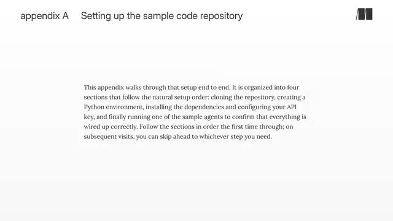
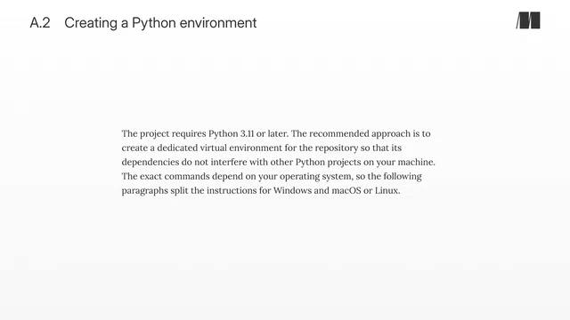
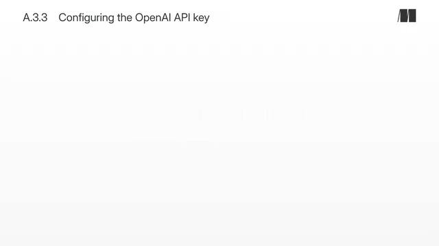
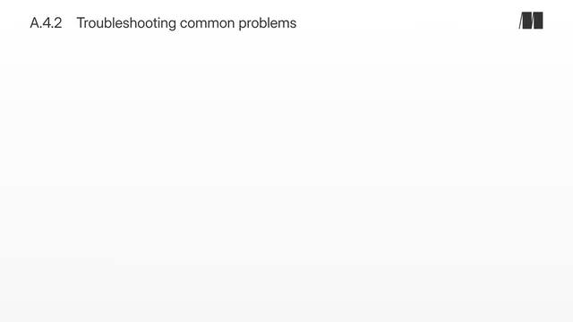
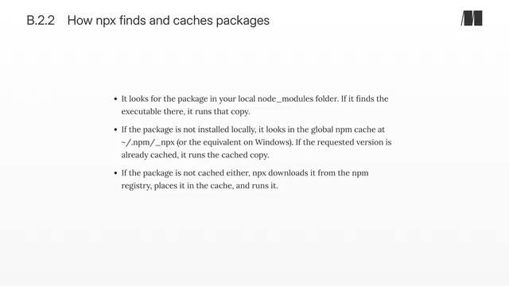
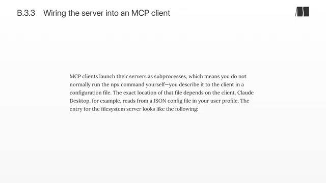
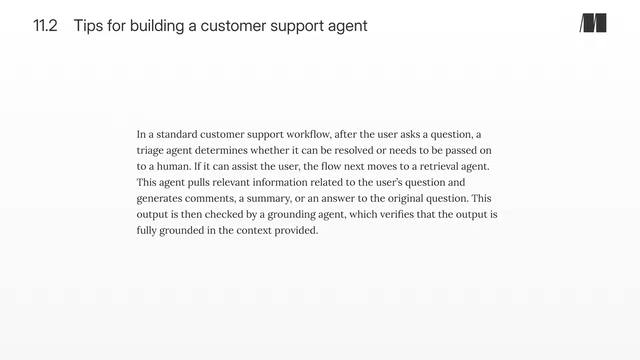
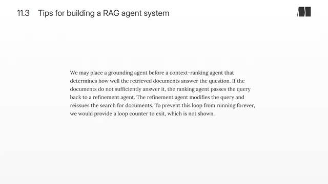
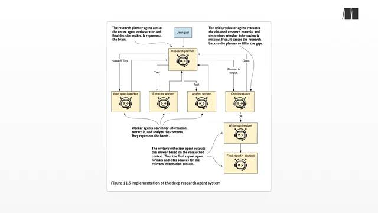
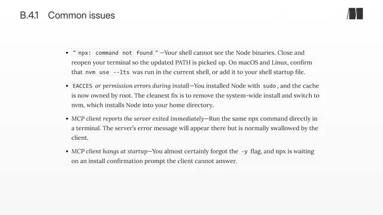

# AI Agents In Action 2nd（multi-agent）P62–P73 复现文档

> 覆盖范围：Section 11.2 客服 Agent 要点、11.3 RAG Agent 系统要点、11.4 Deep Research Agent 系统要点，以及附录 A（Python 示例仓库环境搭建）、附录 B（Node.js + NPX 跑本地 MCP Server）。
> 读者定位：前端转 AI 应用工程师。文末会把 Python 侧的每个概念映射回你熟悉的 Node 工具链。

---

## 1. 这一节做什么

这十二集（P62–P73）其实是两段性质完全不同的内容缝在一起，但拼起来刚好是一条「从设计 → 到能在本机跑起来」的完整链路：

**第一段（P62–P65）是设计课，没有代码落地。** 讲师用三节讲三种最常被问到的 Agent 形态：客服 Agent、RAG Agent 系统、Deep Research Agent。每一节都是「五个 Agent 层怎么映射到这类业务」＋「几条工程铁律」＋「一张多 Agent 协作图」。Listing 11.5 / 11.6 / 11.7 在逐字稿里只被点名，正文代码没有念出来，所以这一段的复现产物是**设计表和职责划分**，不是可执行文件。

**第二段（P66–P73）是纯环境课，全是可执行步骤。** 附录 A 教你 clone 仓库、建 Python 3.11 虚拟环境、装依赖、配 `OPENAI_API_KEY`、跑通第一个样例，并给出两类最常见报错的分诊方法。附录 B 教你装 Node 20 LTS、用 `npx` 拉起一个本地 MCP Server（以官方 filesystem server 为例），再把它写进 MCP 客户端（如 Claude Desktop）的 JSON 配置里。

**这一节结束时，你手上应该有两个能亲手验证的结果：**

1. 终端里执行 `python ch02/<第一个样例>.py`，程序跑完并打印出模型输出，没有 `AuthenticationError`、没有 `ModuleNotFoundError`；
2. Claude Desktop（或任意 MCP 客户端）启动后，列表里出现 filesystem server，并且它能读写你显式授权的那一个目录。

**最终目录结构长这样**（目录名以仓库实际为准，章节文件夹这个约定是逐字稿明确讲的）：

```
ai-agent-workflows/                 ← clone 下来的仓库根目录
├── .env                            ← 你自己创建，放 OPENAI_API_KEY（不进版本控制）
├── .env.example                    ← 仓库自带，照抄成 .env
├── .gitignore                      ← 仓库自带，.env 已在里面
├── requirements.txt                ← 仓库自带，所有依赖 pin 在这里
├── .vscode/
│   └── launch.json                 ← 仓库自带，F5 调试时会自动装依赖
├── ch02/                           ← 「每章代码一个文件夹」
│   └── <第一个 agent 样例>.py
├── ch11/
│   ├── <listing 11.5 三分类升级 agent>.py
│   ├── rag_agent_tips.py           ← 讲师念作 "Listing 11.6 rag agent tips"
│   └── <listing 11.7 deep research>.py
└── ...
```

以及仓库之外、属于你用户目录的一个文件：

```
<用户主目录>/.../claude_desktop_config.json   ← MCP 客户端配置，位置随客户端而定
```

---

## 2. 讲师原话（带「—— pNNN [MM:SS]」）

> "对于这类智能体，五个智能体层分别对应如下。角色设定对应支持角色。工具与动作对应 API、查询和升级。推理规划对应分诊逻辑和人工介入升级。知识记忆对应基于手册的检索增强生成。评估反馈对应日志和人工介入。"
> —— p062 [00:29]

> "缩小职责范围。从一组有边界的意图开始，例如订单、退货和状态查询，并随时间逐步增加领域。保持这些智能体轻量且专注，从而响应更快，也更不容易出错或产生幻觉。"
> —— p062 [00:58]

> "在标准的客户支持工作流中，用户提出问题后，分诊智能体会判断该问题能否被解决，还是需要转交给人工。如果它能够帮助用户，流程接下来会进入检索智能体……随后，该输出会由依据校验智能体检查，确认输出完全基于所提供的上下文。"
> —— p062 [03:18]–[03:45]

> "只在需要时使用智能体。如果单次检索增强生成调用就能奏效，就跳过编排器。仅为路由、分支检索、诊断或操作增加智能体。"
> —— p063 [00:28]

> "几乎所有情况下，你都希望智能体系统回答“我不知道”，而不是自信地给出错误答案。"
> —— p063 [01:26]

> "两层编排。研究规划器作为大脑，将任务委派给无状态工作单元：网页搜索器、提取器、分析器、摘要器。让工作单元保持工具化。不要保留长期记忆。"
> —— p064 [00:26]–[00:56]

> "该项目需要 Python 3.11 或更高版本。推荐做法是为该仓库创建专用虚拟环境，以免其依赖干扰你机器上的其他 Python 项目。"
> —— p067 [00:00]

> "在任一平台上，环境激活后，命令行提示符前会显示 `venv`，这表示后续的 Python 和 pip 命令都在该虚拟环境中运行。"
> —— p067 [00:26]

> "示例通过从仓库根目录的 `.env` 文件中读取 API 密钥来向 OpenAI 进行身份验证。……警告！切勿共享 `.env` 文件，也不要将其提交到版本控制。它包含可访问你 OpenAI 账户的机密凭据，任何获得该凭据的人都可能给你的账户带来费用。"
> —— p068 [01:25]–[01:53]

> "如果看到身份验证错误，请仔细检查 `.env` 文件是否位于仓库根目录，以及 `OPENAI_API_KEY` 是否设置为有效的密钥。如果看到找不到模块的错误，请确认虚拟环境已激活，并且依赖已安装到该环境中。"
> —— p069 [00:55]

> "使用 npx 运行包时……如果该包也没有缓存，npx 会从 npm 注册表下载它，放入缓存并运行。实际结果是，使用 npx 首次运行 MCP 服务器明显比后续运行耗时更长。"
> —— p071 [00:57]–[01:26]

> "将 MCP 服务器作为子进程启动的 MCP 客户端无法回答该提示，因此在配置客户端时始终要包含 `-y`。"
> —— p071 [01:46]

> "请注意，`command` 字段只是 `npx`，包名作为 `args` 的一项出现，并将 `-y` 列在最前面，以抑制安装提示。"
> —— p072 [02:15]

> "MCP 客户端在启动时挂起。你几乎肯定忘了 `-y` 标志，而 `npx` 正在等待客户端无法回答的安装确认提示。"
> —— p073 [00:58]

---

## 3. 从零复现

下面每一步都是「打开终端 → 敲 → 看到什么才算过」。命令里凡是**逐字稿只说「See this command」而没有念出来的**，我会标注「画面给出，逐字稿未念；以下为等价标准写法」，你可以放心照着敲。

### Step 0｜确认前置

- Git 已安装（`git --version` 有输出）。
- Python **3.11 或更高**（讲师明确：「The project requires Python 3.11 or later」—— p067 [00:00]）。
- 一个有效的 OpenAI API Key，能在 OpenAI API keys 页面拿到。

### Step 1｜Clone 仓库

讲师的原话是：「The first command downloads a full copy of the repository into a new AI agent workflows folder. The second command moves you into that folder.」（—— p066 [00:56]–[01:26]）

```bash
# 在你存放项目的目录下执行
git clone <仓库地址> ai-agent-workflows
cd ai-agent-workflows
```

`<仓库地址>` 逐字稿没有念出全名（只说「The repository is hosted on GitHub」—— p066 [00:56]），请以书本配套仓库页面为准。文件夹名 `ai-agent-workflows` 是讲师明确说的。

**验收**：`ls` 能看到 `requirements.txt`、`.env.example`、`.gitignore` 和若干 `chXX/` 文件夹。



### Step 2｜创建并激活虚拟环境

讲师说「The exact commands depend on your operating system」（—— p067 [00:00]），并提示最后「shell prompt is prefixed with `venv`」（—— p067 [00:26]，语音识别成了 "VNV"）。

**Windows（CMD / PowerShell，在仓库根目录）：**

```powershell
python -m venv .venv
.venv\Scripts\activate
```

**macOS / Linux（终端，在仓库根目录）：**

```bash
python3 -m venv .venv
source .venv/bin/activate
```

> 命令文本逐字稿未念出，画面给出；以上是 `venv` 的标准写法，虚拟环境目录名 `.venv` 可按仓库习惯替换。

**验收**：命令行提示符前面出现 `(.venv)` 或 `(venv)`。如果没有，后面 100% 会踩到 `ModuleNotFoundError`——讲师在 p069 [00:55] 把这条列成了两大类报错之一。

> **前端对照**：`.venv` 相当于给你这个项目单独一份 `node_modules`，激活相当于把这份 `node_modules/.bin` 放到 PATH 最前面。Python 没有 `npx` 那种现场解析，它靠的是「当前 shell 的 PATH 指向哪个 python」。

### Step 3｜让 VS Code 用对解释器（可选但强烈建议）

讲师给的步骤（—— p067 [00:53]）：

1. `Ctrl+Shift+P`（Windows / Linux）或 `Cmd+Shift+P`（macOS）打开命令面板；
2. 搜 `Python: Select Interpreter`；
3. 选中你刚建的那个解释器。

> **前端对照**：这件事等价于 VS Code 底部状态栏的 Node 版本选择器（或者 `.nvmrc` + 自动切换），选错了就是「终端里能跑、编辑器里红波浪线」。



### Step 4｜安装依赖（两条路，选一条）

**Path A：用 VS Code 调试器。**「If you have VS Code installed with the Python extension, you can press F5 to start debugging one of the sample files. The launch configuration shipped with the repository ensures that the required dependencies are installed automatically before the sample runs.」（—— p068 [00:27]）

也就是说：仓库自带的 `.vscode/launch.json` 里挂了 pre-launch 任务，F5 会自动装依赖。这是讲师说的「fastest path」。

**Path B：手动 pip。**「run the following command from the repository root with your virtual environment activated.」（—— p068 [00:57]）

```bash
pip install -r requirements.txt
```

依赖版本全部 pin 在仓库根的 `requirements.txt` 里，**不要自己手写这个文件**——逐字稿只说了它存在并 pin 了依赖，没有列内容，抄一份假的版本号比不抄更危险。

**验收**：命令结束没有红色的 `ERROR:`，`pip list` 里有 `openai`。

### Step 5｜配置 API Key

「The repository includes a `.env.example` file that you can copy as a starting point. Create a new file named `.env` in the repository root.」（—— p068 [01:25]）

```bash
# macOS / Linux
cp .env.example .env

# Windows PowerShell
Copy-Item .env.example .env
```

然后把 `.env` 里的占位符换成真 Key：

```dotenv
OPENAI_API_KEY=sk-你的真实key
```

**这一行是整个流程里唯一有安全风险的步骤。** 讲师原话：「Never share or commit your `.env` file to version control.」（—— p068 [01:53]）仓库的 `.gitignore` 已经列了 `.env`（—— p069 [01:31]），但你还是应该自己 `git status` 确认一眼它没被暂存。



### Step 6｜跑第一个样例

「Each chapter's code lives in its own folder under the repository root. To run a sample, navigate to the chapter folder and execute the Python file.」（—— p069 [00:27]）

```bash
cd ch02
python <样例文件名>.py
```

讲师举的例子就是「to run the first agent from chapter 2」，但文件名逐字稿没念出来，进目录 `ls` 一下即可。

**验收**：终端打印出 agent 的完整输出后进程结束。如果打印到一半卡住，那是模型在生成，不是死循环。

出问题先按这张表分诊（讲师 p069 [00:55] 给的两大类）：

| 现象 | 根因 | 处理 |
|---|---|---|
| 认证类报错 | `.env` 不在仓库根，或 Key 填错 | 确认文件位置和变量名 `OPENAI_API_KEY` |
| `ModuleNotFoundError` / 导入失败 | 虚拟环境没激活，或依赖装到了系统 Python | 重新激活 `.venv` 后重装 |



### Step 7｜装 Node（为 MCP Server 准备）

「For the MCP servers covered in this book, install the current long-term support, LTS release of Node 20, or later.」（—— p070 [01:25]）

- **Windows**：去 nodejs.org 下 LTS 的 `.msi`，双击、接受默认值；装完**关掉并重开**所有终端窗口，让 PATH 生效。想并行多版本就用 nvm-windows，然后 `nvm install lts`、`nvm use lts`（—— p070 [01:52]）。
- **macOS**：「the recommended path is Homebrew」—— `brew install node`（—— p070 [02:21]）。没装 Homebrew 先去 brew.sh。
- **Linux / WSL**：「the recommended path is NVM」（—— p070 [02:51]）。装完 NVM 后重开终端，再：

```bash
nvm install --lts
nvm use --lts
```

> 命令文本逐字稿未逐条念出，画面给出。

### Step 8｜验证 Node / npm / npx

```bash
node --version
npm --version
npx --version
```

讲师的验收标准：「`node --version` should report v20 or later. `npm --version` and `npx --version` should each report a number close to 10.」（—— p071 [00:29]）

任一返回 `command not found`，就是 PATH 没更新——关掉整个终端会话重开。

顺便理解 npx 的查找顺序（讲师 p071 [00:57] 讲得很清楚，这是后面排错的理论基础）：

1. 先看本地 `node_modules` 里有没有这个包的可执行文件；
2. 没有就看全局 npm 缓存 `~/.npm/_npx`（Windows 上是对应路径）；
3. 缓存也没有，才去 NPM registry 下载，放进缓存再跑。

所以 **MCP server 的第一次启动明显慢，第二次开始秒开**。



### Step 9｜手动跑一次 filesystem MCP Server

先当健全性检查手跑一遍。结构是四段（—— p072 [00:26]）：

```
npx  -y  <包名>  <传给 server 的参数>
 │    │      │            └─ filesystem server 接受一个或多个允许读写的目录
 │    │      └─ @modelcontextprotocol/server-filesystem
 │    └─ --yes 的短写，自动接受安装确认
 └─ Node 自带的启动器
```

**macOS / Linux：**

```bash
npx -y @modelcontextprotocol/server-filesystem /绝对路径/到/你要授权的目录
```

**Windows**（把 Unix 风格路径换掉，—— p072 [01:17]）：

```powershell
npx -y @modelcontextprotocol/server-filesystem C:\Users\you\mcp-workspace
```

**验收**：终端打印一段启动 banner，然后光标停住等待 STDIN 上的 MCP 消息——这是正常的，它在等客户端说话。`Ctrl+C` 退出。

### Step 10｜接进 MCP 客户端

客户端是把这个命令当**子进程**拉起来的，所以正常情况下你不需要手敲。你要做的是写配置文件。Claude Desktop 读的是用户目录下的一个 JSON 文件（—— p072 [02:15]）。内容见第 4 章。

配完**完全退出客户端再重启**（不是关窗口）。重启后在工具/服务器列表里应该能看到 filesystem server，并且只对你在 `args` 里写的那个目录有权限。



### Step 11｜把三种 Agent 模式落成设计表

这一段的「复现」不是敲命令，是把你手上的业务按讲师的层映射拆开。具体产物在第 4 章的表 4-1 到 4-4。做法是：

1. 先按 **五层**（persona / tools & actions / reasoning & planning / knowledge & memory / eval & feedback）把你的 agent 逐层写一行；
2. 再判断**到底需不需要多 Agent**——讲师在 p063 [00:28] 给的判据是「If a one-shot RAG call works, skip the orchestrator」；
3. 需要的话，按角色拆成 triage → retrieval → grounding → guardrail → answer 这样的流水线，每个角色只负责一个判断；
4. 给每个循环加**计数器**（讲师在图 11.4 的 refine 回路上明确说「we would provide a loop counter to exit, which is not shown」—— p063 [02:23]）。

---

## 4. 完整代码

> **重要声明**：P62–P65 的三节设计课，逐字稿里**没有任何可执行代码**——Listing 11.5 / 11.6 / 11.7 只被点名，正文内容讲师没有念出。所以本章分两部分：
> - **4.A 环境层文件**：逐字稿明确描述了文件内容和字段，可以直接照抄；
> - **4.B 设计层产物**：把讲师口述的规则整理成表，**不是课程代码**；
> - **4.C 验证脚本**：**课里完全没有这段代码，以下为示意**，只是帮你把 Step 0–8 的验收自动化。

### 4.A 环境层文件（可直接照抄）

**文件 1：`.env`（放在仓库根目录，不进版本控制）**

```dotenv
OPENAI_API_KEY=sk-在这里换成你自己的key
```

**文件 2：`.env.example`（仓库自带，内容同上，值留占位符）**

```dotenv
OPENAI_API_KEY=your-openai-api-key-here
```

**文件 3：`requirements.txt`（仓库自带，不要手写）**

逐字稿只说了它「pins its dependencies」（—— p068 [00:00]），没有列出版本号。**保持仓库原样即可**，你只需要执行：

```bash
pip install -r requirements.txt
```

**文件 4：`.vscode/launch.json`（仓库自带，Path A 靠它）**

逐字稿说「The launch configuration shipped with the repository ensures that the required dependencies are installed automatically before the sample runs.」（—— p068 [00:27]）。不要自己改，除非你想关掉自动安装。

**文件 5：`claude_desktop_config.json`（MCP 客户端配置）**

字段结构完全来自讲师 p072 [02:15] 的口述：`command` 就是 `npx`，包名放在 `args` 里，`-y` 排第一。

```json
{
  "mcpServers": {
    "filesystem": {
      "command": "npx",
      "args": [
        "-y",
        "@modelcontextprotocol/server-filesystem",
        "/Users/you/mcp-workspace"
      ]
    }
  }
}
```

Windows 版（把最后一个参数改成 Windows 路径，反斜杠在 JSON 里要写成 `\\`）：

```json
{
  "mcpServers": {
    "filesystem": {
      "command": "npx",
      "args": [
        "-y",
        "@modelcontextprotocol/server-filesystem",
        "C:\\Users\\you\\mcp-workspace"
      ]
    }
  }
}
```

> 说明：顶层键名 `mcpServers` 和 `filesystem` 这个自定义名字，逐字稿没有逐字念出（讲师说的是「The entry for the file system server looks like the following」），以你所用客户端的文档为准；**`command` / `args` / `-y` 在最前面这三件事是逐字稿明确讲过的**。

### 4.B 设计层产物（课程不是代码，以下是讲师口述规则的结构化整理）

**表 4-1｜五层在客服 Agent 上的映射**（来自 p062 [00:29]）

| 层 | 客服 Agent 上的具体含义 |
|---|---|
| Persona | support role（客服角色） |
| Tools & Actions | APIs、lookup、escalation |
| Reasoning & Planning | triage logic、HITL escalation |
| Knowledge & Memory | RAG over manuals（手册检索） |
| Eval & Feedback | logs、HITL、用户点赞点踩 |

**表 4-2｜标准客服 Agent 系统的六个角色**（来自 p062 [03:18]–[04:38] 与图 11.3）

| # | 角色 | 唯一职责 | 失败时会发生什么 |
|---|---|---|---|
| 1 | Triage Agent | 判断这个问题能不能自助解决，还是必须转人工 | 什么都自己答 → 答错不该答的 |
| 2 | Retrieval Agent | 拉取与问题相关的资料，生成摘要/答案 | 答案没有出处 |
| 3 | Grounding Agent | 校验输出是否完全落在给定上下文内；并判断是否需要调用业务 API | 幻觉直接流到用户 |
| 4 | Guardrail Agent | 若调了 API，校验返回是否符合预期 | 错误动作被提交 |
| 5 | Answer Agent | 汇总检索结果与 API 结果，组织最终回答 | — |
| 6 | Feedback（用户） | 点赞 / 点踩 | 没有评估信号，无法迭代 |

**表 4-3｜RAG Agent 系统的取舍**（来自 p063 全节）

| 决策点 | 讲师给的判据 |
|---|---|
| 要不要上 orchestrator | 一次 RAG 调用能解决，就别上（p063 [00:28]） |
| 什么时候值得加 Agent | routing、branched retrieval、diagnostics、actions |
| 模块怎么切 | triage / router / retriever / answerer，可选 critic（CRAG） |
| 检索怎么优化 | 索引、metadata filter、领域微调 embedding、re-ranking，加 hybrid 检索 |
| grounding 纪律 | 强制「只用上下文」、要求引用或原文摘录 |
| 要不要允许说不知道 | 要，而且几乎总是优于自信地答错（p063 [01:26]） |

**表 4-4｜Deep Research 的两层编排**（来自 p064 [00:26]–[03:47] 与图 11.5）

| 层 | 角色 | 约束 |
|---|---|---|
| 上层（brain） | Research Planner | 唯一有「长期记忆/全局判断」的角色 |
| 下层（hands） | Web Searcher / Extractor / Analyst / Summarizer | **无长记忆，工具化** |
| 质检 | Critic | 检查覆盖度、矛盾、缺失视角；不够就退回 planner 要更多上下文 |
| 产出 | Writer / Final Report Agent | 必须为所有引用标注来源 |
| 横切 | 缓存、预算、限流、流式 UX | 缓存要定期清，否则返回陈旧数据（p064 [01:25]） |

> 图表三张（图 11.3 客服系统、图 11.4 RAG 系统、图 11.5 Deep Research）分别对应下面三张截图，建议对照阅读。







### 4.C 环境自检脚本（**课里没有这段代码，以下为示意**）

把下面这段存成仓库根目录的 `check_env.py`，它只做一件事：把 Step 0–8 里所有「验收标准」变成一次可重复执行的检查。

```python
"""check_env.py — 课程环境自检脚本（课里没有这段，纯示意，用于复现验收）"""
import os
import sys
import shutil
import subprocess
from pathlib import Path


def line(ok: bool, msg: str) -> None:
    print(f"[{'PASS' if ok else 'FAIL'}] {msg}")


def check_python_version() -> None:
    major, minor = sys.version_info[:2]
    ok = (major, minor) >= (3, 11)
    line(ok, f"Python >= 3.11  (当前 {major}.{minor})")


def check_venv_active() -> None:
    in_venv = sys.prefix != getattr(sys, "base_prefix", sys.prefix)
    line(in_venv, f"虚拟环境已激活  (sys.prefix={sys.prefix})")


def check_openai_installed() -> None:
    try:
        import openai  # noqa: F401
        line(True, "openai 包已安装")
    except ImportError:
        line(False, "openai 包未安装 —— 先 pip install -r requirements.txt")


def check_env_file() -> None:
    root = Path(__file__).resolve().parent
    env_path = root / ".env"
    if not env_path.exists():
        line(False, f".env 不存在: {env_path}")
        return
    line(True, f".env 存在: {env_path}")

    key = None
    for raw in env_path.read_text(encoding="utf-8").splitlines():
        s = raw.strip()
        if not s or s.startswith("#") or "=" not in s:
            continue
        k, v = s.split("=", 1)
        if k.strip() == "OPENAI_API_KEY":
            key = v.strip().strip('"').strip("'")
    if not key:
        line(False, "OPENAI_API_KEY 未在 .env 中定义")
    elif not key.startswith("sk-"):
        line(False, "OPENAI_API_KEY 看起来不像真实 key（应为 sk- 开头）")
    else:
        line(True, f"OPENAI_API_KEY 已设置（长度 {len(key)}，不打印内容）")


def check_gitignore() -> None:
    root = Path(__file__).resolve().parent
    gi = root / ".gitignore"
    if not gi.exists():
        line(False, ".gitignore 不存在")
        return
    entries = {l.strip() for l in gi.read_text(encoding="utf-8").splitlines()}
    line(".env" in entries, ".gitignore 中包含 .env")


def check_node_toolchain() -> None:
    for exe in ("node", "npm", "npx"):
        path = shutil.which(exe)
        if not path:
            line(False, f"{exe} 不在 PATH —— 装完 Node 后要重开终端")
            continue
        try:
            out = subprocess.run(
                [exe, "--version"], capture_output=True, text=True, timeout=10
            ).stdout.strip()
        except Exception as e:                     # noqa: BLE001
            line(False, f"{exe} 执行失败: {e}")
            continue
        line(True, f"{exe} -> {out}  ({path})")


def main() -> None:
    print("=== AI Agents In Action 环境自检 ===\n")
    check_python_version()
    check_venv_active()
    check_openai_installed()
    check_env_file()
    check_gitignore()
    print()
    check_node_toolchain()
    print("\n=== 检查结束 ===")


if __name__ == "__main__":
    main()
```

运行：

```bash
python check_env.py
```

**注意这个脚本不打印 Key 内容，只打印长度**——因为终端输出经常被粘进群聊。

---

## 5. 逐行解释

### 5.1 `.env` 为什么只有一行

`.env` 的职责单一：给进程注入环境变量。Python 侧的样例用 `os.environ` 或 `python-dotenv` 读它，**路径必须和脚本假设的「仓库根目录」一致**——讲师在 p069 [00:43] 特意强调「double-check that your `.env` file is in the repository root」，因为绝大多数「认证失败」其实是 `cd` 到子目录后启动，`.env` 搜不到，于是 `OPENAI_API_KEY` 是空字符串，SDK 就抛认证错误。

变量名 `OPENAI_API_KEY` 是逐字稿明确念出的（—— p068 [01:49]、p069 [00:43]）。**别改名**，SDK 认的就是这个名字。

> **前端对照**：这跟 Vite 的 `.env` 机制看起来一样，但有个关键差别——Vite 只把 `VITE_` 前缀的变量注入前端 bundle，而 Python 这边 `os.environ` 拿到的是**全部**环境变量。所以在 Python 项目里把 Key 放 `.env` 是安全的（只要文件不进 git），但**千万不要把同一个 `.env` 拿去做前端构建**，否则 key 会打进 JS 产物里。

### 5.2 `requirements.txt` 为什么不手写

讲师只说了一句「The repository pins its dependencies in a `requirements.txt` file at the repository root」（—— p068 [00:00]）。`pins`（锁定版本）意味着里面是精确版本号，可能是 `openai==1.x.y` 这种带 patch 版本的。手写一份 `openai`（不带版本）虽然大概率也能跑，但你就失去了「和作者同一个环境」这个最重要的复现前提。**复现的第一原则是别改输入。**

> **前端对照**：`requirements.txt` 在这里承担的角色更接近 `package-lock.json` 而不是 `package.json`——因为它钉住了版本。

### 5.3 `claude_desktop_config.json` 每个字段

```json
"command": "npx",
```
必须是 `npx` 本身，不能是 `npx @modelcontextprotocol/...` 这种整串。讲师原话：「the `command` field is just `npx`」（—— p072 [02:15]）。客户端会把 `command` 和 `args` 数组拼成一次进程启动调用，等价于你在终端敲 `npx -y @modelcontextprotocol/server-filesystem /path`。写成整串会导致「找不到名为 `npx xxx` 的可执行文件」。

```json
"args": ["-y", "@modelcontextprotocol/server-filesystem", "/Users/you/mcp-workspace"]
```
`-y` 必须是**第一项**。原因在 p071 [01:46] 讲得很直白：MCP 客户端是拿子进程方式拉起 server 的，「do not have a way to answer that prompt」——它没法在终端上按 y。少了 `-y`，`npx` 就卡在「Ok to proceed? (y)」上，客户端表现为**启动时挂起**（—— p073 [00:58] 把这条列成了独立故障现象）。

第三个参数是**允许读写的目录白名单**。这是 filesystem server 唯一的权限边界，写 `/` 或 `C:\` 就等于把整台机器交出去。

```json
"filesystem": { ... }
```
这个键名是你在客户端里看到的服务器显示名，可以随便改（改成 `"我的工作区"` 也行），它不影响启动命令。讲师没有逐字念出这个键，以客户端文档为准。

### 5.4 三张架构图为什么要拆这么多角色

图 11.3 那张（p062 [03:52]）看起来最反直觉：一个「客服 Agent」为什么是六个 Agent？讲师自己的回答是：「what we describe as one agent is actually multiple agents, six in this case, performing various roles and working together.」（—— p062 [03:18]）

拆分的动机是**每个角色的失败模式不同，必须分开观测**：

- Triage 判错 = 该转人工的没转，用户炸了；
- Retrieval 判错 = 拉错文档，后面全错；
- Grounding 判错 = 幻觉流出；
- Guardrail 判错 = 执行了不该执行的写操作。

如果全塞进一个 prompt，你只能看到「最终答案不对」，没法定位是哪一环。拆开之后每一环都能独立打点、独立评估——这正是 p065 总结里「Optimize each layer independently, then integrate」的意思。

同理，图 11.5 的 deep research（p064 [03:15]）里，planner 是**唯一有状态的**，worker 全是「no long memory」的无状态工具（—— p064 [00:56]）。这样 worker 可以随意重试、替换、并行，而不会污染全局上下文。

> **前端对照**：这套结构和前端的「容器组件 vs 展示组件」是同一思路——有状态的那层只做决策和编排，无状态的那层只做纯函数式的输入输出。你的 React 项目里如果把所有 `useState` 都塞进叶子组件，调试体验就和把所有逻辑塞进一个 agent prompt 一样。

### 5.5 为什么必须有 loop counter

讲师在图 11.4 的 refinement 回路上说：「To prevent this loop from running forever, we would provide a loop counter to exit, which is not shown.」（—— p063 [02:23]）

这条回路是：grounding agent → context ranking agent → 判断文档够不够 → 不够就把 query 退回 refinement agent 改写 → 重新检索。**只要「够不够」这个判断是模型做的，它就有可能永远判断「不够」**。所以在实现里必须有一个外部计数器（比如最多 3 轮），超出就带着当前最好结果返回并明确说「没找到足够信息」。

这和 p063 [01:26] 那句「you want your agent system to reply with, I don't know, rather than provide a false answer」是一对：**兜底出口不是可选项，是设计的组成部分。**

### 5.6 `check_env.py` 的几处刻意设计

- `sys.prefix != sys.base_prefix`：这是判断「当前 Python 是否运行在 venv 里」的标准方法。比检查 `VIRTUAL_ENV` 环境变量可靠，因为后者在 `sudo` 或某些 shell 下会丢。
- `shutil.which("node")`：直接查 PATH，等价于你在终端敲 `node`。找不到就返回 `None`，正好对应 p071 [00:29] 说的「command not found」。
- `.strip('"').strip("'")`：`.env` 里写成 `OPENAI_API_KEY="sk-xxx"` 也合法，这两个 strip 让两种写法都能过。
- 只打印 key 长度不打印 key：这条是防你自己手滑把终端输出贴到群里。

---

## 6. 复现检查清单

按顺序打勾，任何一项没过就别往下走：

**环境层**

- [ ] `git --version` 有输出，仓库已 clone 到 `ai-agent-workflows/`
- [ ] `python --version` ≥ 3.11
- [ ] 提示符前缀出现 `(.venv)`
- [ ] `pip install -r requirements.txt` 无 `ERROR`
- [ ] `python -c "import openai; print(openai.__version__)"` 能打印版本号
- [ ] `.env` 在**仓库根目录**，且 `OPENAI_API_KEY=` 后面是 `sk-` 开头的真 Key
- [ ] `git status` 的输出里**没有** `.env`
- [ ] 在 `ch02/` 下 `python <样例>.py` 跑完并打印输出

**Node / MCP 层**

- [ ] `node --version` ≥ v20
- [ ] `npm --version` 和 `npx --version` 都在 10 附近
- [ ] `npx -y @modelcontextprotocol/server-filesystem <目录>` 能打印启动 banner 并停住等输入
- [ ] 第二次运行明显比第一次快（证明 npx 缓存生效）
- [ ] `claude_desktop_config.json` 里 `command` 是 `npx`，`args[0]` 是 `"-y"`，`args[1]` 是包名
- [ ] 文件系统 server 的目录参数是**最小够用**的一个工作目录，不是整块磁盘
- [ ] 完全退出客户端再重启后，服务器列表里能看到它

**设计层**

- [ ] 你的 agent 已经按五层写了五行，每层有具体内容而不是「随便」
- [ ] 你能回答「这个流程如果只用一次 RAG 调用能不能解决」——如果能，就把多余 Agent 删掉
- [ ] 每一个由模型判断的循环回路都有外部计数器
- [ ] 有明确的「不知道」出口，且这个出口会带上「我查了什么、为什么不够」

---

## 7. 课里没讲但你会撞上的

以下是逐字稿没覆盖、但按上面的步骤走几乎一定会遇到的事。

**1. `.env` 不会被自动加载。** 附录 A 只说「样例从 `.env` 读 Key」，但没讲是谁在加载。Python 默认**不会**自动读 `.env`——要么样例代码里调了 `python-dotenv` 的 `load_dotenv()`，要么你自己 export。如果你在 `check_env.py` 里加了真实调用的逻辑却发现 Key 读不到，缺的就是这一步。前端同学最容易在这卡住，因为 Vite/Next 是自动注入的。

**2. Windows 上 `python` 和 `py` 的区别。** 逐字稿给的 Windows 命令是 `python -m venv`，但很多 Windows 机器上 `python` 指向 Microsoft Store 的占位程序，敲下去会弹应用商店。这时用 `py -3.11 -m venv .venv`。

**3. `npx` 首次下载会被墙/会超时。** 讲师说「Depending on your network connection, this can take a minute or two」（—— p068 [00:57]，讲的是 pip，但 npx 同理）。`@modelcontextprotocol/server-filesystem` 第一次拉不下来时，先确认 npm registry 可达（`npm config get registry`），再考虑换源。这类环境问题逐字稿完全没有涉及。

**4. 清 npx 缓存的命令。** 讲师在 p073 [01:23] 说「clear the cache and let it redownload」，并说「See this command」——但具体命令逐字稿没有念出来。常见做法是 `npx clear-npx-cache`，或者直接删除 `~/.npm/_npx` 目录（这个路径是逐字稿明确给出的，所以删目录这条路一定有依据）。如果 `clear-npx-cache` 提示找不到命令，就以实际输出为准，走删目录。

**5. 锁版本排查时用 `@latest`。** 讲师给了一个明确写法：「`npx -y @modelcontextprotocol/server-filesystem@latest`」，并解释「This forces NPX to resolve the requested version against the registry before running.」（—— p073 [01:46]）。当你怀疑客户端跑的是旧版时，把 `@latest` 临时加进 `args` 的包名后面，是最快的验证手段。

**6. 客户端「启动即退出」和「启动即挂起」是两种不同的病。** 讲师给了明确的分诊法（—— p073 [00:58]）：

- **退出**：把同一条 npx 命令直接敲在终端里，错误信息会打印出来——而它「is normally swallowed by the client」；
- **挂起**：几乎必然是漏了 `-y`。

**7. macOS 上 `sudo npm install -g` 之后权限会坏掉。** 讲师说得很直接（—— p073 [00:29]）：「You installed node with `sudo`, and the cache is now owned by root. The cleanest fix is to remove the system-wide install and switch to NVM」。这在 Linux 上同理，前端同学装 Node 老手了应该不陌生，但第一次在 Mac 上踩还是会懵。

**8. Node 的定期升级路径。** 讲师按装法给了三条（—— p073 [01:53]）：Windows 重跑最新 LTS 的 `.msi`（原地升级）；macOS `brew upgrade node`；NVM 系 `nvm install --lts` 然后 `nvm alias default lts/*`。升完记得重新跑 Step 8 的三条 `--version`。

**9. 图 11.4 / 11.5 里的循环在真实代码里极易失控。** 讲师自己承认「not shown」的 loop counter，在你真正实现时是必须写的。另外 deep research 的 planner 容易把同一句 query 反复发给 worker，p064 [01:25] 提到的「cache repeated queries」和「set per run token budgets with alerting」就是给这个场景准备的——**记住缓存要定期清**，否则会一直拿到陈旧搜索结果。

**10. 客服 Agent 的「身份与最小权限」是最容易被跳过的一条。** 讲师在 p062 [01:26] 说「Verify user identity before exposing account data. Follow least privilege for tools, grant the agent the user's role and associated tools」。这句话的意思是：**Agent 不应该有比你（当前这个用户）更大的权限**。你在设计工具集时，要把「这个用户能不能查这个订单」的判断放在调用 API 之前，而不是之后。这一条课程没有给出实现代码，需要你自己在业务层做。

**11. 三个字段名的核查提醒。** 这篇文档里出现的配置字段只有 `command`、`args`、`OPENAI_API_KEY`、`mcpServers`、`filesystem`，其中前三个是逐字稿明确讲过的。如果你在别处看到 `env`、`cwd`、`transport` 之类的字段，那些**不在本课程范围内**，以你所用的 MCP 客户端文档为准，不要因为这篇文档没提就以为它们不存在，也别反过来认为讲师讲过。



---

**一句话收束**：P62–P65 教的是「一个 Agent 该拆成几个角色、每个角色只准负责一个判断」，P66–P73 教的是「这些判断最终要跑在一个 Python 3.11 虚拟环境 + 一个 Node 20 的 npx 子进程里」。前者决定你的系统对不对，后者决定你能不能把它跑起来——两件事都得做，缺一个都交付不了。