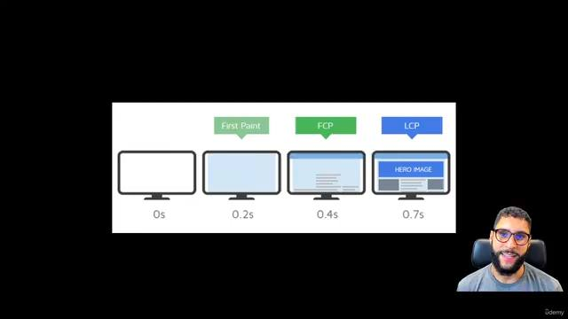
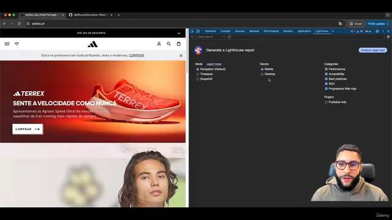
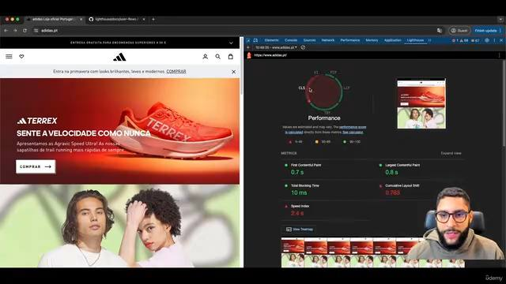
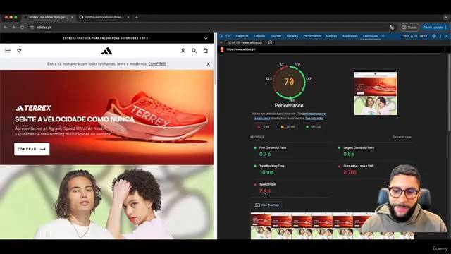
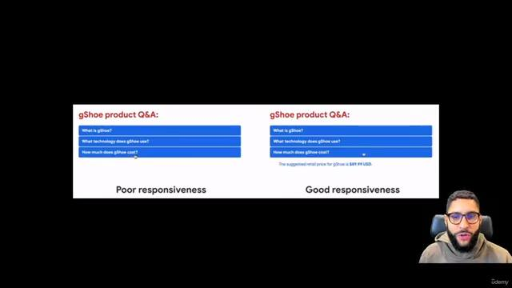
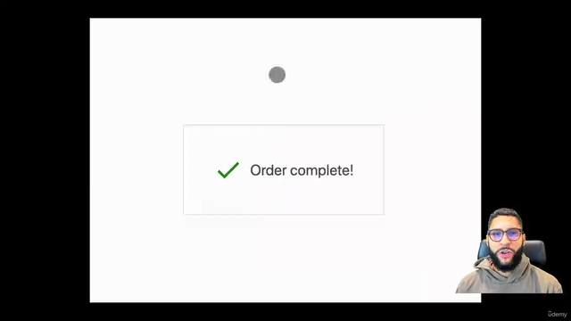
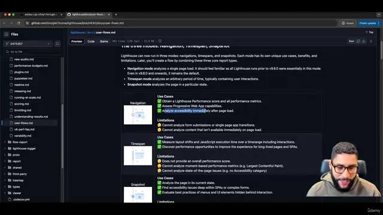

# Web Performance & Monitoring（P1–P7）复现文档

> 适用课程：BV18hxK6iEWu，P1–P7  
> 复现目标：用 Chrome DevTools Lighthouse、PageSpeed Insights、Web Vitals Chrome 扩展，对任意一个网页完成一次可重复的性能体检，记录 LCP / INP / CLS / TTFB / TTI 等指标，产出可执行的诊断清单。  
> 注意：P1–P7 是“指标讲解 + 工具操作”课，不是完整的监控报警系统实现课。课程总览里提到过“实时监控、Telegram 通知”等方向，但在这 7 个片段里没有给出报警系统代码、服务端采集代码或通知集成步骤。本文不会把这些内容写成“讲师已实现”。


## 1. 这一节做什么

这 7 个片段解决的是三个问题：

1. **为什么前端性能值得做**：讲师用转化率、跳出率、真实公司案例说明，加载时间和交互延迟会直接影响用户留存、成本和收入。
2. **用什么指标判断好坏**：重点讲 Web Vitals，尤其是 Core Web Vitals 里的 LCP、INP、CLS，并补充 TTFB、TTI、请求数、页面体积等辅助指标。
3. **怎么把这些指标测出来**：用 Chrome DevTools 的 Lighthouse 跑实验室报告，用 PageSpeed Insights 看线上真实用户数据，用 Web Vitals 扩展做当前页快速查看。

读完并照着做，你应该能完成下面这条最小闭环：

- 打开一个网页；
- 在 DevTools 里跑一次 Lighthouse Navigation + Desktop + Performance 报告；
- 从报告里抄下 LCP、TBT（Lighthouse 界面里作为 INP 的近似读数）、CLS、Speed Index 等值；
- 到 PageSpeed Insights 输入同一个 URL，分别看 Mobile / Desktop 的实验室数据和真实用户数据；
- 安装 Web Vitals 扩展，在当前页快速查看 LCP、CLS、FCP、TTFB；
- 把结果填进本文提供的 `perf-audit/audit-record.md`；
- 按本文提供的 `perf-audit/thresholds.csv` 判断哪些指标需要改进。

这一节**不包含**的内容也要说清楚：课里没有给出自动报警服务、没有给出 RUM 埋点 SDK、没有给出 CI 集成、没有给出服务端缓存或 CDN 配置。P1–P7 的落点是“测量与诊断”，不是“监控报警系统上线”。如果你的目标是做“前端监控报警”，这 7 节只能帮你把“报警要报什么指标、阈值怎么定、报告怎么读”打牢。


## 2. 讲师原话（带「—— pNNN [MM:SS]」）

下面引用的是逐字稿里的关键原话，英文保留原样，后面给中文解释。逐字稿是语音识别结果，个别词有明显识别误差，引用时只取语义清楚的部分。

> “In the first module we are going to check some answers for the question why I should care about web performance...”
>
> 中文：第一个模块先回答“为什么我要关心 Web 性能”。
>
> —— p001 [00:00]

> “We will see also how to know if the websites we are working on are good or not through three kinds of metrics.”
>
> 中文：我们会通过三类指标判断网站到底好不好。结合后文，这三类分别对应加载性能、交互响应、视觉稳定性。
>
> —— p002 [00:29]

> “If you have 20 visitors per month, but just 5 of these visitors buy some instrument, you have a conversion rate of 5 divided by 20.”
>
> 中文：20 个访客里 5 个购买，转化率按 `5 / 20` 计算。
>
> —— p003 [00:25]

> “If the load time increases from one second to three seconds, the probability of a user bounce increases 32%.”
>
> 中文：加载时间从 1 秒增加到 3 秒，用户跳出概率增加 32%。这是讲师引用的 Google 2017 研究结论。
>
> —— p003 [01:07]

> “Largest Contentful Paint, or LCP, measures the loading performance of a website.”
>
> 中文：LCP 衡量网站加载性能。讲师在后面给出良好阈值：LCP 应发生在 2.5 秒以内。
>
> —— p004 [00:31]

> “To provide a good user experience, LCP should occur within 2.5 seconds.”
>
> 中文：良好用户体验要求 LCP 在 2.5 秒以内。
>
> —— p004 [01:00]

> “INP is the metric that measures the point where the user interacts with the page with an event like pointer up, mouse up or click.”
>
> 中文：INP 衡量用户与页面交互的响应点，关注 pointer up、mouse up、click 这类事件。讲师后面给出良好阈值：INP 不超过 200ms。
>
> —— p004 [01:14]

> “Cumulatively outshift or CLS measures visual stability in a website.”
>
> 中文：CLS 衡量网站视觉稳定性。讲师给出的良好阈值是小于 0.1。
>
> —— p004 [03:30]

> “To calculate this metric, WebVitals uses a formula that is the impact fraction times the distance fraction.”
>
> 中文：CLS 的计算公式是 impact fraction 乘以 distance fraction。
>
> —— p006 [03:35]

> “The report we are going to choose for our case is navigation, where the lighthouse reload the page and does some things under the hood to measure, for example, the interaction to next paint.”
>
> 中文：本课选择 Navigation 模式。Lighthouse 会重新加载页面，并在底层做交互来测量 INP 一类指标。
>
> —— p007 [02:21]

> “PageSpeed Insights is good to analyze online websites. It's not possible to analyze local hosts...”
>
> 中文：PageSpeed Insights 适合分析线上网站，不能分析 localhost。
>
> —— p007 [09:19]

> “This report here is real user experience... and this is like the average of all the reports...”
>
> 中文：PageSpeed Insights 里的这部分是真实用户体验数据，是一批线上用户报告的平均值。讲师提到最近 28 天采集周期。
>
> —— p007 [11:19]



## 3. 从零复现

### 3.1 前置条件与目录

你不需要安装 Node、npm 或任何后端服务。课里使用的工具全部是浏览器侧工具：

- Chrome 浏览器；
- 一个可访问的目标 URL。线上站点可以直接用；本地页面也可以用 DevTools Lighthouse 分析，但 PageSpeed Insights 只接受线上可访问 URL；
- Chrome Web Store，用于安装 Web Vitals 扩展。

建议在本地建一个纯记录目录：

```text
perf-audit/
├── thresholds.csv
├── audit-record.md
└── README.md
```

这三个文件的完整内容在第 4 节。它们不是讲师代码，而是把讲师的操作步骤固化成可保存、可复用的审计工作簿。

### 3.2 第一步：先定指标和阈值，不要先看总分

复现时建议先打开 `thresholds.csv`，把本次要记录的指标固定下来。课里明确给出的阈值如下：

| 指标 | 良好 | 需要改进 | 差 | 课里依据 |
| --- | --- | --- | --- | --- |
| LCP | ≤ 2.5s | 课里没讲中间档 | 课里没讲中间档 | p004 [01:00] |
| INP | ≤ 200ms | 200ms–500ms | > 500ms | p006 [02:54] |
| CLS | < 0.1 | 0.1–0.25 | > 0.25 | p006 [04:40] |
| TTFB | < 800ms | 800ms–1.8s | > 1.8s | p006 [05:10] |
| TTI | ≤ 3.8s | 课里没讲中间档 | > 7.3s | p006 [06:00] |

TTFB 这里要注意：逐字稿口播是“800 milliseconds and one second and 800 milliseconds”，按语义应理解为 800ms 到 1.8s；如果工具输出或团队规范不同，以实际输出为准。LCP 讲师只给了“2.5 秒以内”的良好阈值，没有在 P1–P7 里给出完整的差档，所以文档里不替讲师补一个“差”的数值。

请求数和页面体积也出现在课程里，但讲师明确说不能脱离网站类型给统一区间：银行网站和餐厅网站不能套同一个标准。因此它们只记录实际值，不设统一好坏阈值。

### 3.3 第二步：用 Chrome DevTools Lighthouse 跑实验室报告

以讲师演示的 `adidas.pt` 为例，你可以在浏览器里打开目标页面，然后按下面步骤操作。实际使用时把 URL 换成你的页面。

1. 在页面任意位置右键，点击 **Inspect**，打开 Chrome DevTools。
2. 在 DevTools 顶部标签里找到 **Lighthouse**。如果标签被折叠，点右侧的 `>>` 展开。
3. 进入 Lighthouse 面板后，先看 **Mode**。课里介绍了三种模式：
   - **Navigation**：重新加载页面，生成性能分数和指标，适合分析首次加载。本课选这个。
   - **Time span**：在一段时间范围内测量布局偏移和 JavaScript 执行时间，包含交互，适合长生命周期页面和单页应用。
   - **Snapshot**：不重新加载页面，分析页面当前状态，适合查 SPA、复杂表单、隐藏在交互后的菜单和 UI。
4. **Device** 选择 **Desktop**。讲师本轮演示选的是 Desktop；你也可以再跑一次 Mobile 做对比。
5. **Categories** 只勾选 **Performance**。把 Accessibility、Best Practices、SEO 等取消勾选；**Plugins publisher ads** 也不选。
6. 点击 **Analyze page loads**。Lighthouse 会重新加载页面，并在底层执行一些操作来采集指标。
7. 等待报告生成。



跑完后，按下面顺序读报告：

1. **Summary / 总分**：先看总分，但不要只看总分。把鼠标悬停在分数上，可以看到每个指标的分数。
2. **指标区**：记录 LCP、FCP、TBT、CLS、Speed Index。讲师在本课里把 Lighthouse 界面里的 **TBT** 当作 **INP** 的近似读数，因为该界面当时没有直接显示 INP。注意：TBT 和 INP 不是同一个字段，记录时要写清楚你记的是“Lighthouse 的 TBT”还是“PageSpeed Insights 的 INP”。
3. **截图区**：报告里会有采集过程中的页面快照，
能看出首屏是先出文字、先出图，还是先出骨架屏。把它和 LCP 元素对照，能帮你判断“最大内容”到底是哪一块。

4. **Diagnostics / 诊断区**：先看 critical，再看 moderate。讲师点开的是 “Eliminate render-blocking resources”，报告会说明阻塞资源影响 FCP 和 LCP，并列出具体脚本；处理方向是把关键 JS/CSS 内联，非关键 JS 延迟或异步。课里只给了方向，没有给 Webpack/Vite 的具体配置。
5. **Passed audits**：已经通过的项，不用处理。
6. **报告底部**：记录 emulated device、Lighthouse 版本、是否使用 custom throttling、生成日期。讲师说明默认没有 custom throttling，但可以在 Configuration 里模拟网速和 CPU，也可以模拟设备。






### 3.4 第三步：用 PageSpeed Insights 看线上真实用户数据

PageSpeed Insights 和 DevTools Lighthouse 不是二选一，而是两个视角。讲师在 p007 [09:19] 明确说：PageSpeed Insights 适合分析线上网站，**不能分析 localhost 或内网地址**；DevTools Lighthouse 则可以分析本地页面。所以本地开发阶段用 DevTools，上线后用 PageSpeed Insights 交叉验证。

操作步骤：

1. 打开 PageSpeed Insights 页面。
2. 在 URL 输入框里粘贴一个**公网可访问**的完整地址，例如 `https://adidas.pt`。不要填 `http://localhost:3000`。
3. 点击分析按钮，等待报告生成。
4. 页面顶部可以切换 **Mobile / Desktop**。讲师本轮先看 Mobile，你也可以再切 Desktop 对比。
5. 看 **Core Web Vitals** 区域。课里点到的名字包括 LCP、INP、CLS；页面还会出现 FCP、FID、TTFB、TBT 等字段。这里要注意：讲师在 p007 [10:51] 特别说明，PageSpeed Insights 当时已经展示 INP，而 DevTools Lighthouse 界面当时展示的是 TBT，所以不要把两个字段混着抄。
6. 看 **真实用户数据** 和 **实验室数据** 的区别。讲师用同一个页面出现的不同数值解释：一部分是线上真实用户报告的平均值，采集周期是最近 28 天；另一部分是本次模拟跑出来的实验室数据。两边数值不同是正常的，不代表工具坏了。具体数值以你运行时为准，不要照抄讲师屏幕上的 1.7 秒或 5.3 秒。
7. 继续往下看 diagnostics 和 passed audits。PageSpeed Insights 也会列出具体问题，并且每个问题会关联受影响指标。讲师举的例子是“图片元素没有显式 width 和 height”，这类问题会影响 CLS；修掉之后 CLS 可能改善。
8. 记录报告生成日期、设备类型、数据来源（真实用户 / 实验室）。这三项不记录，后面无法解释数值差异。

PageSpeed Insights 的报告结构和 Lighthouse 很像，原因是讲师在 p007 [15:10] 说这三个工具都由 Google 维护、都基于 Lighthouse API。但界面不同，能拿到的信息也不同，所以讲师建议：**每次尽量把三个工具都跑一遍**，拿不同视角，而不是只信一个分数。

### 3.5 第四步：安装 Web Vitals 扩展做当前页快速查看

Web Vitals 扩展适合“我现在就在这个页面，想立刻知道大概怎么样”的场景。操作步骤：

1. 打开 Chrome Web Store，搜索 `web vitals`。
2. 找到 Google 提供的 Web Vitals 扩展并安装。
3. 打开目标页面，点击浏览器工具栏里的扩展图标。
4. 弹层里会显示当前页的 LCP、CLS、FCP、TTFB 等读数，以及一些设置和文档链接。讲师在 p007 [14:22] 演示时，这些值直接显示在扩展里，不需要打开 DevTools。
5. 记录读数时仍然要写清楚：这是“当前页、当前设备、当前会话”的扩展读数，不是完整 Lighthouse 报告，也不是 PageSpeed Insights 的 28 天真实用户平均值。

课里没有讲这个扩展的采样口径、是否受缓存影响、是否统计 SPA 路由切换后的交互。你如果要把它的数字写进正式报告，建议只作为快速筛查，最终结论仍以 Lighthouse 和 PageSpeed Insights 的报告为准。

### 3.6 第五步：把一次审计固化成记录

每次审计复制一份 `audit-record.md`，按下面顺序填：

1. 先填审计信息：URL、日期、浏览器版本、网络环境、是否登录。
2. 填运行记录：用了哪个工具、什么模式、什么设备、什么时候跑的。
3. 填指标记录：每个 run 一行，LCP、INP、TBT、CLS、FCP、TTFB、TTI、Speed Index、页面体积、请求数。没有显示的字段写 `N/A`，不要猜。
4. 填诊断清单：诊断项、影响指标、证据、处理建议、状态。
5. 写结论：优先改哪个指标、最可能的原因、下一步动作、本次不能确认的点。
6. 保存报告截图或导出文件的位置。

课里没有规定“必须跑几次”。讲师演示的是单次报告。如果你要做团队基线，建议至少 Desktop 和 Mobile 各跑一次；这是工程建议，不是讲师原话。跑多次时，每次都要单独一行，不要把多次结果平均成一个数，否则你无法判断波动。

## 4. 完整代码

课里没有代码。下面不是讲师提供的源码，而是把 P1–P7 的操作固化成三个**完整可保存**的审计文件。保存后按 `README.md` 操作，就能复现这条性能体检流程。

### 4.1 `perf-audit/thresholds.csv`

```csv
metric,good,needs_improvement,poor,source,note
LCP,<=2500ms,,,p004 01:00,"课里只给良好阈值，未给中间档和差档"
INP,<=200ms,200ms-500ms,>500ms,p006 02:54,"200ms 到 500ms 之间需要检查改进；大于 500ms 要处理长任务"
CLS,<0.1,0.1-0.25,>0.25,p006 04:40,"0.1 到 0.25 是改进理由；大于 0.25 是 trouble"
TTFB,<800ms,800ms-1800ms,>1800ms,p006 05:10,"逐字稿口播为 800ms 到 1s800ms，这里按 1.8s 记录；以实际输出为准"
TTI,<=3800ms,,>7300ms,p006 06:00,"课里只给良好和差阈值"
```

### 4.2 `perf-audit/audit-record.md`

```markdown
# 性能审计记录

## 0. 本次审计信息

- 目标 URL：
- 审计日期：
- 审计人：
- 浏览器与版本：
- 网络环境：
- 是否登录：
- 备注：

## 1. 运行记录

| run | 工具 | 模式 | 设备 | 日期时间 | 备注 |
| --- | --- | --- | --- | --- | --- |
| 1 | Chrome DevTools Lighthouse | Navigation | Desktop |  |  |
| 2 | Chrome DevTools Lighthouse | Navigation | Mobile |  |  |
| 3 | PageSpeed Insights | 线上报告 | Mobile |  | 真实用户 + 实验室 |
| 4 | PageSpeed Insights | 线上报告 | Desktop |  |  |
| 5 | Web Vitals 扩展 | 当前页 | 当前设备 |  | 快速查看 |

## 2. 指标记录

| run | 来源 | LCP | INP | TBT | CLS | FCP | TTFB | TTI | Speed Index | 页面体积 | 请求数 |
| --- | --- | --- | --- | --- | --- | --- | --- | --- | --- | --- | --- |
| 1 |  |  | N/A |  |  |  |  |  |  |  |  |
| 2 |  |  | N/A |  |  |  |  |  |  |  |  |
| 3 |  |  |  | N/A |  |  |  |  |  |  |  |
| 4 |  |  |  | N/A |  |  |  |  |  |  |  |
| 5 |  |  | N/A | N/A |  |  |  | N/A | N/A | N/A | N/A |

说明：
- Lighthouse 界面当时用 TBT 作为 INP 的近似读数。记录时 TBT 填 TBT 列，不要填到 INP 列。
- 页面没有展示的字段写 N/A，不要凭印象补。
- 同一指标来自不同工具时，必须保留“来源”列，不能合并成一个数。

## 3. 诊断问题清单

| 优先级 | 诊断项 | 影响指标 | 证据 | 处理建议 | 状态 |
| --- | --- | --- | --- | --- | --- |
| critical |  |  |  |  | 待处理 |
| moderate |  |  |  |  | 待处理 |

## 4. 结论

- 需要优先改进的指标：
- 最可能的原因：
- 下一步动作：
- 本次不能确认的点：

## 5. 原始报告位置

- Lighthouse 报告截图/导出：
- PageSpeed Insights 报告 URL：
- Web Vitals 扩展截图：
```

### 4.3 `perf-audit/README.md`

```markdown
# perf-audit

对应课程：BV18hxK6iEWu P1–P7。
课里没有代码；这是一套手动性能审计工作簿。

## 文件

- thresholds.csv：课里给出的指标阈值。
- audit-record.md：每次审计复制一份填写。
- README.md：本文件。

## 一次审计怎么跑

### 1. 准备

1. 准备一个可访问的目标 URL。
2. 线上 URL 可以同时用于 DevTools Lighthouse 和 PageSpeed Insights。
3. 本地 URL 只能用于 DevTools Lighthouse，不能用于 PageSpeed Insights。

### 2. Chrome DevTools Lighthouse

1. 打开目标页面。
2. 在页面任意位置右键，点击 Inspect。
3. 在 DevTools 顶部找到 Lighthouse 标签。
4. Mode 选择 Navigation。
5. Device 先选 Desktop；需要对比时再跑一次 Mobile。
6. Categories 只勾选 Performance，取消其他类别；不要选 Plugins publisher ads。
7. 点击 Analyze page loads。
8. 记录 LCP、FCP、TBT、CLS、Speed Index。
9. TBT 单独记录，不要写成 INP。
10. 展开 Diagnostics，先看 critical，再看 moderate；记录诊断项、影响指标、证据。
11. 记录报告底部的设备、Lighthouse 版本、是否使用 custom throttling、生成日期。

### 3. PageSpeed Insights

1. 打开 PageSpeed Insights。
2. 粘贴公网可访问的 URL，运行分析。
3. 分别查看 Mobile 和 Desktop。
4. 记录 Core Web Vitals 区域里的 LCP、INP、CLS。
5. 区分真实用户数据和实验室数据；记录报告日期和 28 天采集周期说明。
6. 记录 diagnostics 和 passed audits。

### 4. Web Vitals 扩展

1. 在 Chrome Web Store 搜索 web vitals，安装扩展。
2. 打开目标页面，点击扩展图标。
3. 记录当前页的 LCP、CLS、FCP、TTFB。
4. 只作为快速筛查，不替代完整报告。

### 5. 填写 audit-record.md

1. 复制 audit-record.md 为 audit-record-YYYY-MM-DD-站点名.md。
2. 按 run 逐行填写，不要合并不同工具的结果。
3. 没有显示的字段写 N/A。
4. 用 thresholds.csv 判定每个指标处于良好、需要改进还是差。
5. 课里没有给出中间档或差档的指标，写 N/A 并注明“课里没讲”，不要自己编阈值。

## 判定规则

- LCP：小于等于 2.5s 为良好；其他档位课里没讲。
- INP：小于等于 200ms 良好；200ms 到 500ms 需要改进；大于 500ms 为差。
- CLS：小于 0.1 良好；0.1 到 0.25 需要改进；大于 0.25 为差。
- TTFB：小于 800ms 良好；800ms 到 1.8s 需要检查后端；大于 1.8s 要检查网络瓶颈。
- TTI：小于等于 3.8s 良好；大于 7.3s 为差；中间档课里没讲。
```

## 5. 逐行解释

### 5.1 为什么先写 `thresholds.csv`，而不是先看报告总分

Lighthouse 报告最显眼的是总分，但总分是多个指标聚合出来的。讲师在 p007 [04:57] 说总分是“把多个指标聚合在一起的分数”，并展示了官方的分数计算文档和模拟计算器。如果你先盯总分，很容易出现“总分 70，但 CLS 是红的”这种情况，却不知道该先修什么。先把指标和阈值固定下来，报告出来以后逐项对照，才能把“分数”翻译成“动作”。

`thresholds.csv` 的第一行是表头，后面每一行是一个指标：

- `metric`：指标名，和报告里的字段保持一致。
- `good`：良好档。LCP 写 `<=2500ms`，因为讲师在 p004 [01:00] 说“within 2.5 seconds”；INP 写 `<=200ms`，对应 p006 [02:40]；CLS 写 `<0.1`，对应 p006 [04:40]；TTFB 写 `<800ms`，对应 p006 [05:10]；TTI 写 `<=3800ms`，对应 p006 [06:00]。
- `needs_improvement`：需要改进档。INP 的 200ms–500ms 来自 p006 [02:54]；CLS 的 0.1–0.25 来自 p006 [04:40]；TTFB 的 800ms–1.8s 来自 p006 [05:10] 那段口播。LCP 和 TTI 的这一列留空，因为课里没有给出完整中间档，留空比编一个数字诚实。
- `poor`：差档。INP `>500ms`、CLS `>0.25`、TTFB `>1.8s`、TTI `>7300ms` 都是课里明确说到的。LCP 的差档课里没讲，所以留空。
- `source`：记录这句话来自哪一页、哪个时间点。以后团队里有人质疑阈值，可以直接回到原片核对。
- `note`：记录口播里的歧义。比如 TTFB 的“800 milliseconds and one second and 800 milliseconds”，如果直接按字面抄会变成两个互相矛盾的数字；这里按语义记成 1.8s，并注明“以实际输出为准”。这不是替讲师改口，而是把歧义显式记录下来。

这里有一个必须指出的逐字稿数字矛盾：p003 [00:25] 讲师说“5 divided by 20”，紧接着口播“20%”。但按公式 `5 / 20` 计算是 `0.25`，也就是 25%，不是 20%。复现时以公式为准，同时在记录里注明“讲师口播为 20%，按公式为 25%”。同理，p006 [04:14] 的 CLS 例子 `0.75 × 0.25` 精确值是 `0.1875`，讲师口播为 `0.18`，这是四舍五入，不是另一个公式。

### 5.2 `audit-record.md` 为什么要分“运行记录”和“指标记录”

同一个页面，用 DevTools Lighthouse Desktop 跑一次、Mobile 跑一次、PageSpeed Insights 再跑一次，得到的 LCP 可能完全不同。如果你只写“LCP = 1.5s”，不写来源，三天后你根本不知道这个 1.5s 是谁测的。`运行记录` 表解决“这次数从哪来”的问题：工具、模式、设备、日期时间、备注，一行一个 run。

`指标记录` 表解决“每个指标填哪里”的问题。这里特意把 `INP` 和 `TBT` 分成两列，是因为讲师在 p007 [04:06] 说 Lighthouse 界面当时用 TBT 作为 INP 的近似读数，但两者不是同一个字段。你如果把 Lighthouse 的 TBT
直接填进 INP 列，就会把实验室里的阻塞时间误当成线上交互延迟，后续对比和报警阈值都会失真。TBT 和 INP 的测量对象不同：TBT 来自实验室加载过程，统计主线程被长任务阻塞的时间；INP 来自页面生命周期内的真实交互，观察 click、tap、键盘等交互到下一次绘制之间的延迟。课里在 P7 明确说 Lighthouse 界面当时用 TBT 作为 INP 的近似读数，又在 PageSpeed Insights 部分说线上报告已经展示 INP，这两句话要一起读：**近似读数可以辅助判断，但不能替代字段本身**。所以记录表里保留两列，哪怕某一次只拿到其中一个，也不合并。

`N/A` 的规则同样是为了防止“看起来完整、实际上错误”的记录。Lighthouse 的 Navigation 报告里通常没有线上真实用户 INP，就写 `N/A`；PageSpeed Insights 的线上部分没有实验室 TBT，也写 `N/A`；Web Vitals 扩展没有 TTI、Speed Index、页面体积、请求数，就逐格写 `N/A`。不要因为“印象里大概是 2 秒”就填一个数。性能审计最常见的翻车不是工具不会用，而是记录时把不同来源、不同设备、不同采集周期的数字混成一个，最后得出一个无法复现的结论。

`诊断问题清单` 表把“指标”翻译成“动作”。讲师在 P7 演示的诊断区里，critical 和 moderate 是分开的；点开 “Eliminate render-blocking resources” 后，报告会说明它影响 FCP 和 LCP，并列出具体阻塞脚本。记录时至少写四件事：诊断项名称、它影响的指标、证据在哪里、准备怎么处理。证据可以是报告里的脚本 URL、截图位置、Lighthouse 的审计说明，不能只写“感觉是图片太大”。状态列建议只用“待处理 / 已确认 / 已修复 / 不适用”四种，避免每个人写一套。

`结论` 部分故意留了“本次不能确认的点”。性能报告只能说明现象，不能自动证明根因。比如 LCP 慢，可能是图片大、可能是服务端 TTFB 高、可能是渲染阻塞资源、也可能是 CDN 命中率差；P1–P7 只教你从报告里看到这些线索，没有教你用后端日志或链路追踪去定位。把不能确认的点写下来，下一次审计才有方向，而不是把猜测写成结论。

`原始报告位置` 是最后一道可复现保障。Lighthouse 报告可以导出，PageSpeed Insights 有可分享的报告 URL，Web Vitals 扩展可以截图。三项至少留一项；如果团队要求归档，就把导出文件和截图一起放到同一个日期目录里。课里没有规定归档格式，但“只有一张总分截图”通常不够，因为诊断项和指标明细都在下面。

### 5.3 `README.md` 为什么把操作顺序固定成“先 Lighthouse，再 PageSpeed Insights，最后扩展”

这个顺序对应三种不同的问题。DevTools Lighthouse 适合开发阶段和本地页面，能重新加载页面、模拟设备、模拟网络和 CPU，给出实验室报告；PageSpeed Insights 适合线上页面，能同时看到实验室数据和最近一段时间的真实用户数据；Web Vitals 扩展适合当前页快速筛查。课里在 P7 说三者都基于 Lighthouse API，所以分数和诊断项会相似，但界面暴露的信息不同。先跑 Lighthouse，是因为它离你的开发环境最近，改完代码可以立刻重跑；再跑 PageSpeed Insights，是为了确认线上真实用户是否也遇到同样的问题；最后用扩展做日常快速查看，不替代前两者。

`README.md` 里写“本地 URL 只能用于 DevTools Lighthouse，不能用于 PageSpeed Insights”，这不是说 PageSpeed Insights 技术上永远无法访问本地地址，而是讲师在 P7 明确说它适合分析线上网站、不能分析 localhost。复现时按这个边界操作，能避免你在输入框里填 `http://localhost:3000` 后得到失败结果，却误以为页面性能有问题。

判定规则部分只抄课里给出的阈值，空档写“课里没讲”。这里要特别提醒：**不要为了让表格完整而补一个 LCP 的“差”阈值**。讲师在 P4 只说了 LCP 应在 2.5 秒以内，在 P6 也没有补完整的差档；TTI 只说了 3.8 秒以内理想、超过 7.3 秒要处理，中间档也没讲。文档里留空，读者才知道哪些结论有课程依据，哪些需要自己查最新官方文档。性能指标和阈值会随工具版本、设备、网络变化，课程录制时的界面和今天的界面也可能不同；遇到字段名或分档变化，以实际输出为准，并把差异记在备注里。



这张截图对应的是“交互之后多久能看到视觉反馈”的问题。复现时不要只看报告里的一个数字，要在页面上亲手点一次按钮、开一次折叠面板，观察反馈是否立刻出现。课里在 P6 说，INP 在 200ms 以内算良好，200ms 到 500ms 要检查改进，超过 500ms 要处理长任务；这个分段可以直接用在诊断清单的优先级判断上。



CLS 这张截图对应的是“布局为什么抖”的解释。课里给的公式是 `impact fraction × distance fraction`，例子是 `0.75 × 0.25 = 0.1875`，口播四舍五入为 `0.18`。复现时如果报告里 CLS 是 0.18，不要只写“页面抖动”，要回到报告和页面截图，找出是哪个元素在加载后把下面的内容推走了。课里给的最直接方向是给未加载内容留占位符，比如表格行还没回来时先占住位置；具体用 CSS 高度、骨架屏还是图片宽高属性，课里没有展开，属于你实现时要补的细节。

## 6. 复现检查清单

下面这份清单按“能不能从头跑一遍”组织。每项都对应前面章节的动作；打勾之前不要跳到下一步。

### 6.1 环境与目标

- [ ] 已安装 Chrome，并能打开开发者工具。
- [ ] 已准备一个可访问的目标 URL。
- [ ] 如果目标 URL 是 localhost 或内网地址，已明确它只能用于 DevTools Lighthouse，不能用于 PageSpeed Insights。
- [ ] 如果目标页面需要登录，已记录登录账号、角色和登录后的起始页面；课里没有讲登录态如何影响报告，这一步是为了让你自己可复现。
- [ ] 已关闭或记录可能影响结果的浏览器扩展、广告拦截、代理和缓存设置。
- [ ] 已确定本次审计是 Desktop、Mobile，还是两者都跑；不要跑完才补记设备。

### 6.2 Chrome DevTools Lighthouse

- [ ] 在页面上右键，点击 Inspect，DevTools 已打开。
- [ ] 已找到 Lighthouse 标签；如果标签被折叠，已从 `>>` 里展开。
- [ ] Mode 已选择 Navigation。
- [ ] Device 已选择 Desktop 或 Mobile，并记录。
- [ ] Categories 只勾选 Performance；Accessibility、Best Practices、SEO 已取消；Plugins publisher ads 未勾选。
- [ ] 已点击 Analyze page loads，并等待报告完整生成。
- [ ] 已记录总分，但没有把总分当成唯一结论。
- [ ] 已记录 LCP、FCP、TBT、CLS、Speed Index 的实际显示值。
- [ ] 已把 TBT 填在 TBT 列，没有填到 INP 列。
- [ ] 已展开 Diagnostics，先记录 critical，再记录 moderate。
- [ ] 对每个诊断项，已记录它影响的指标和证据，而不是只抄标题。
- [ ] 已查看 Passed audits，确认哪些项不需要处理。
- [ ] 已记录报告底部的设备、Lighthouse 版本、是否使用 custom throttling、生成日期。
- [ ] 如果使用了 Configuration 里的网速或 CPU 模拟，已把模拟参数写进备注。

### 6.3 PageSpeed Insights

- [ ] 已打开 PageSpeed Insights。
- [ ] 输入的是公网可访问 URL，不是 localhost 或内网地址。
- [ ] 已分别查看 Mobile 和 Desktop；如果只跑了一个，已记录原因。
- [ ] 已记录 Core Web Vitals 区域的 LCP、INP、CLS。
- [ ] 已区分真实用户数据和实验室数据，并记录报告日期和 28 天采集周期说明。
- [ ] 已记录 diagnostics 和 passed audits 中与本次目标相关的项。
- [ ] 已保存报告 URL 或截图位置。
- [ ] 如果 PageSpeed Insights 和 Lighthouse 的数字不同，已记录差异，没有强行让它们一致。

### 6.4 Web Vitals 扩展

- [ ] 已在 Chrome Web Store 搜索 `web vitals`，安装 Google 提供的扩展。
- [ ] 已打开目标页面，点击扩展图标。
- [ ] 已记录扩展显示的 LCP、CLS、FCP、TTFB 等读数。
- [ ] 已注明这是当前页、当前设备、当前会话的快速读数，不是 28 天真实用户平均值。
- [ ] 没有把扩展读数直接当成 Lighthouse 报告或 PageSpeed Insights 报告。

### 6.5 记录与判定

- [ ] 已复制 `audit-record.md`，命名为 `audit-record-YYYY-MM-DD-站点名.md`。
- [ ] 审计信息、运行记录、指标记录已填写完整。
- [ ] 每个 run 单独一行，没有把 Desktop 和 Mobile 平均成一个数。
- [ ] 没有显示的字段写 `N/A`，没有凭印象补数。
- [ ] 已用 `thresholds.csv` 判定每个指标处于良好、需要改进还是差。
- [ ] 课里没有给出中间档或差档的指标，已写“课里没讲”，没有自编阈值。
- [ ] 诊断问题清单至少有一条 critical 或 moderate 的具体项，并写明影响指标。
- [ ] 结论里写了下一步动作和本次不能确认的点。
- [ ] 原始报告位置已填写，至少有一张截图或一个报告 URL。

### 6.6 失败重跑

- [ ] 如果 Lighthouse 报告没有生成，已检查页面是否可访问、DevTools 是否停留在正确标签、是否被其他面板占用。
- [ ] 如果 PageSpeed Insights 分析失败，已确认 URL 是公网地址且没有登录墙。
- [ ] 如果报告数字波动很大，已检查是否有缓存、是否换了设备模拟、是否有后台任务占用 CPU。
- [ ] 重跑后已新增 run 行，没有覆盖旧记录。
- [ ] 已把失败原因写进备注，而不是只保留成功的那一次。



这张截图用于对照 6.3 的第一步：PageSpeed Insights 的入口是 URL 输入框，输入线上地址后才能拿到真实用户数据和实验室数据。复现时如果输入 localhost，不要继续往下填记录表，因为课里明确说这个工具不适合本地地址。

## 7. 课里没讲但你会撞上的

这一节专门列“课程边界”。P1–P7 的重点是指标和工具操作，不是完整监控系统。下面这些问题你照着做时大概率会遇到，但课里没有给出实现，所以这里只说明现象和应对方向，不把未讲的内容安到讲师头上。

### 7.1 课里没有报警系统代码

课程总览里提到过“实时监控性能、通过 Telegram 通知”这类方向，但在 P1–P7 的逐字稿里，没有出现采集服务、定时任务、消息队列、通知渠道接入或告警规则配置的代码。P7 最后讲的是三个测量工具，不是报警服务。所以如果你要做“前端监控报警”，这 7 节只能帮你确定“报什么指标、阈值怎么定、报告怎么读”；真正的报警链路，课里没讲。不要因为文档里出现“报警”两个字，就以为已经有可部署的服务端实现。

### 7.2 Lighthouse 和 PageSpeed Insights 的数据不是一回事

同一个页面，Lighthouse 的 LCP 可能是 1.5 秒，PageSpeed Insights 的真实用户 LCP 可能是 5.3 秒；这不是工具坏了。讲师在 P7 解释过：一部分是本次模拟的实验室数据，一部分是线上真实用户报告的平均值，采集周期是最近 28 天。你复现时会遇到同样的差异。正确做法是保留两个来源，分别记录设备和日期，不要取平均，也不要用一个去“修正”另一个。课里没有讲如何做数据对齐，这属于你后续要补的工程问题。

### 7.3 登录态、缓存和地理位置会影响结果

Lighthouse 重新加载页面时，可能带着当前浏览器的登录态和缓存；PageSpeed Insights 从外部访问，通常没有你的登录态，也可能从不同地理位置发起请求。课里没有讲登录态、Cookie、CDN 节点、缓存命中率对报告的影响。你如果在审计后台页面，最好记录“是否登录”“是否清缓存”“是否使用代理”；如果线上报告和本地报告差异很大，先把这三项写进备注，再判断是不是代码问题。

### 7.4 SPA 的软导航不会被 Navigation 模式完整覆盖

P7 介绍过 Lighthouse 的三种模式：Navigation 会重新加载页面；Time span 在一段时间范围内测量布局偏移和 JavaScript 执行时间，包含交互，适合长生命周期页面和单页应用；Snapshot 不重新加载页面，只分析当前状态，适合 SPA、复杂表单和隐藏在交互后的 UI。但课里没有给 SPA 的路由级采集方案，也没有讲软导航后 LCP、INP、CLS 如何重新计算。你如果做的是 React、Vue 这类单页应用，Navigation 报告只能代表首次加载；用户点击路由后的交互延迟，需要用 Time span 或额外埋点观察。课里没有埋点 SDK 的代码，别在这里找。

### 7.5 Lighthouse 界面里的字段名会变

讲师在 P7 演示时，Lighthouse 界面显示的是 TBT，PageSpeed Insights 显示的是 INP；讲师明确说当时 Lighthouse 没直接显示 INP，所以用 TBT 近似。你用的 Chrome 版本可能已经改了界面，可能直接显示 INP，也可能把 TBT 放到别的分组。复现时以你屏幕上实际出现的字段名为准；如果字段名和本文不同，在 `audit-record.md` 的备注里写清楚“本次 Lighthouse 显示的是某字段”，不要硬套本文的列名。本文没有编造 `ExitCode`、`OOMKilled`、`HostConfig` 这类字段，因为课里没有出现，性能报告里也不涉及。

### 7.6 移动端模拟不等于真实低端手机

Lighthouse 的 Mobile 设备模拟和 PageSpeed Insights 的移动报告，都是模拟，不是拿真实低端手机跑。课里提到可以在 Configuration 里模拟网速和 CPU，也提到可以模拟设备，但没有给具体的设备矩阵和跑分标准。你如果面向大量低端安卓用户，模拟报告可能偏乐观；这时需要真实设备抽测。课里没讲真实设备实验室怎么搭，也没讲 WebPageTest 之类的工具，本文不替讲师补充。

### 7.7 阈值有空档，不要自己补

LCP 课里只给了“2.5 秒以内”的良好阈值；TTI 只给了“3.8 秒以内”和“超过 7.3 秒要处理”；TTFB 的口播在“800ms 到 1s800ms”之间有识别歧义。复现时如果报告落在空档里，正确写法是“课里没讲该档，按实际输出记录”，而不是从别的文章抄一个数字填进 `thresholds.csv`。性能阈值会随官方文档更新，课程录制时的标准不一定等于今天的最新标准；你需要最新标准时，去查工具自带文档，并在记录里注明来源和日期。

### 7.8 诊断项修起来可能跨前后端

Lighthouse 会把“Eliminate render-blocking resources”“图片没有显式 width 和 height”这类问题列出来，但课里只给了方向：关键 JS/CSS 内联、非关键 JS 异步或延迟、给未加载内容留占位符。真正修的时候，你可能要改构建配置、图片组件、服务端渲染顺序，甚至 CDN 缓存策略。课里没有讲 Webpack、Vite、Next.js 的具体配置，也没有讲后端缓存和数据库优化；P1 的课程总览提到后端优化、基础设施优化是后续模块的内容，不在 P1–P7 里。读者如果是前端转 AI 应用工程师，遇到构建配置时按你现有框架的文档处理，不要把这部分当成讲师已经教过。

### 7.9 真实用户数据有延迟，不能用来做即时报警

PageSpeed Insights 的真实用户数据是最近一段时间的聚合，不是实时流。课里说采集周期是最近 28 天；这意味着你今天改完代码，线上真实用户数据不会立刻变。你如果要做“页面一慢就报警”，需要额外的实时采集和告警系统，而这套系统在 P1–P7 里没有实现。课里也没有讲采样率、上报队列、去重、降噪、告警抑制这些工程细节。本文不编造这些实现，只提醒你：不要把 PageSpeed Insights 当成实时监控面板。

### 7.10 扩展读数适合筛查，不适合验收

Web Vitals 扩展打开就能看到当前页的 LCP、CLS、FCP、TTFB，很方便，但课里没有讲它的采样口径、是否受缓存影响、是否统计 SPA 路由切换后的交互。你可以在日常开发时用它快速看一眼，但不要把扩展读数直接写进验收报告。验收至少要用 Lighthouse 的完整报告，线上部分再用 PageSpeed Insights 交叉验证；如果团队有真实用户监控，再以真实用户数据为准。课里没讲真实用户监控怎么接，这一层需要你们团队自己补。

### 7.11 审计记录要能复现，不要只留总分

最后再强调一次记录问题。性能报告的数字会随设备、网络、缓存、登录态、工具版本变化；只留一个总分，过几天没人能复现。`audit-record.md` 要求写 URL、日期、浏览器版本、网络环境、是否登录、工具、模式、设备、字段来源、原始报告位置，就是为了让另一个人照着同一条件再跑一次。课里没有规定这套模板，但这是把讲师的操作变成团队流程的最低成本方式。你如果只复制本文的代码块而不填运行记录，这份文档就退化成“看过课”，而不是“能复现”。


这张截图对应的是“为什么值得做”的业务论证。课里用 Google、Amazon、BBC、Mozilla 的案例说明加载时间会影响收入、搜索量、用户流失和下载量；这些数字来自讲师引用的文章，不是让你拿去当自己项目的 KPI。复现时如果你要说服团队，可以把“本次审计发现的指标问题”和“业务影响”分开写：前者是你测出来的，后者是课里引用的案例，不能混成同一个结论。课里没有讲如何做 A/B 实验验证性能改版的收益，这部分需要你们自己设计。