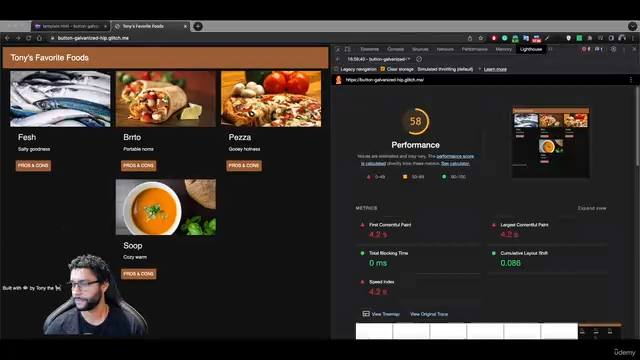
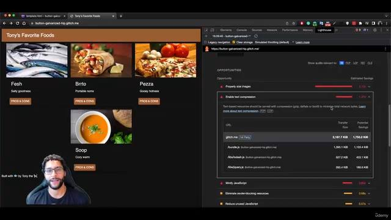
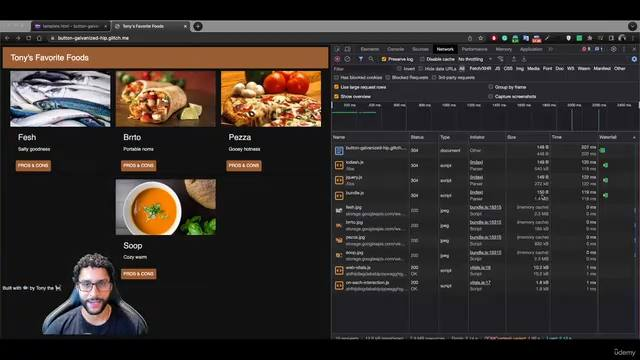
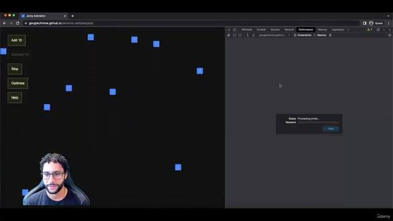
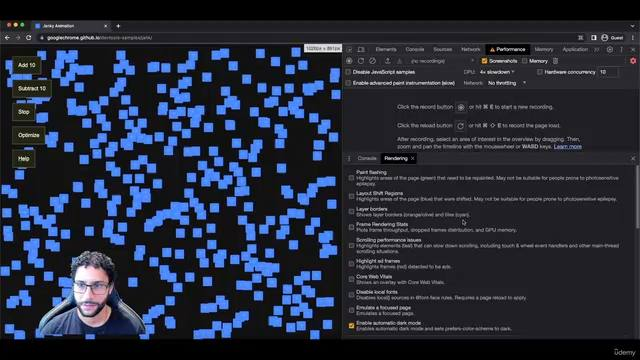

# Web Performance & Monitoring：懒加载/预加载、Lighthouse 调优与运行时性能剖析（P12–P16）

> 本文档覆盖 BV18hxK6iEWu 的 P12–P16。课程本身是英文讲解 + 现场演示，没有给出可直接下载的仓库，所以本文档把「讲师在演示里做的每一步」还原成可照做的操作手册：一个本地可跑的最小项目（Node + Express 静态服务 + 一个长图页面 + 一个动画页面），然后用 Lighthouse 和 Performance 面板按讲师顺序复现全部优化动作。
>
> 说明：讲师演示用的站点叫 "Tony 最爱的食物"，托管在 Glitch 上，源码未随课程提供。本文档第 4 节给出的是**等价复现项目**，代码为本文档编写，不是讲师原代码；凡讲师原话涉及的结论、命令、指标，都在第 2 节标注了出处。

---

## 1. 这一节做什么

这五节课是一条完整的「前端性能工程」流水线，从「写代码时怎么少加载」到「上线后怎么量、怎么改、怎么验证」：

| 课 | 主题 | 产出物 |
|---|---|---|
| P12 | 懒加载（lazy loading）与预加载（preloading） | 两个 vanilla JS 页面：滚动到可视区才换 `src`；用 `<link rel="preload">` 提前抓下一张图 |
| P13 | 一批「小改动大收益」的清单 | 一份可执行的检查表：iframe、preload、CSS 内联/打包、cookie 体积、请求数、混合协议、404、压缩、Cache-Control |
| P14 | PWA 与性能的关系 | 理解 service worker / app shell / 资源优化三件套；用 Duolingo 现场验证「只缓存你访问过的部分」 |
| P15 | 用 Lighthouse 做「改前 / 改后」对比 | 一个真实项目从 58 分 → 71 → 68 → 75 的完整调优过程（压缩、图片尺寸、渲染阻塞资源） |
| P16 | 用 Performance 面板定位运行时卡顿 | 用 CPU 4x 降速复现卡顿，从 Main 线程的红色三角定位到「先写后读」导致的强制同步布局，并用一个 flag 修掉 |

对前端转 AI 应用工程师的人来说，这一节的价值在于：你以后要把模型调用、流式输出、大列表渲染塞进页面，**P15 的「先量基线再改」和 P16 的「读写顺序」是每天都会撞上的东西**。

---

## 2. 讲师原话（带出处）

**关于懒加载的定位**

> "本节课我们将讨论懒加载，这是一种将非关键资源的加载推迟到需要时或即将进入用户视口时才进行的技术。"
> —— p012 [00:00]

> "使用懒加载时，不会一开始就加载所有图片，而只加载当前屏幕上可见或即将可见的图片。"
> —— p012 [00:29]

**关于预加载**

> "另一方面，预加载是提前加载重要资源的过程，以便在需要时这些资源已经就绪。"
> —— p012 [00:41]

> "如果网页上有色块或幻灯片，你可以使用预加载，在当前幻灯片显示时提前获取并缓存接下来几张幻灯片的图片。"
> —— p012 [00:57]

**懒加载的 vanilla JS 实现要点**

> "image 标签有一个 data source 属性，存放实际的图片 URL。初始时加载占位图片 placeholder.jpg。当页面加载完成（DOM content loaded 事件）后，添加一个滚动事件监听器来触发懒加载函数。"
> —— p012 [01:47]

> "如果图片可见，就将其 SRC 属性更新为 data source 中的值，并移除 data source 属性。"
> —— p012 [02:19]

**预加载的 vanilla JS 实现要点**

> "通过带有 preload 属性的 link 标签来预加载 image.jpg。"
> —— p012 [02:36]

> "在 image.onload 事件处理函数中，用预加载的图片替换占位图片。"
> —— p012 [02:52]

**iframe 的两个性能代价**

> "第一，iFrame 会产生额外的 HTTP 请求。每有一个 iFrame，就会多出一个 HTTP 请求。第二，iFrame 是在整个页面加载完成后才请求的。所以如果页面上有一个大的 iFrame，你的 Largest Contentful Paint 和 First Contentful Paint 都会受到影响。"
> —— p013 [00:12]

**preload 的语义边界（很重要，容易误解）**

> "尽管名称中包含 load 一词，它并不会加载并执行脚本，而只是以更高的优先级调度脚本的下载和缓存。"
> —— p013 [00:51]

**CSS 的处理方式**

> "与其导入外部 CSS 文件（会产生新的 HTTP 请求），不如生成 CSS 并以内联方式放入，或将其纳入构建产物中。这可以借助 webpack、holup 或 vit 等打包工具轻松实现。"
> —— p013 [01:27]

（注：讲师口播的 "holup"、"vit" 应为 Rollup、Vite，属语音识别误差；课里没展开具体配置。）

**cookie 体积**

> "建议 cookie 大小应小于 4 MB。除了 cookie 的总大小外，还建议你的域名下 cookie 总数不超过 20 个。"
> —— p013 [02:10]

> "理想情况下，你应该尽量控制在 500 KB 以下，但 Web 现状数据显示，中位数约为 1500 KB，即使在移动端也是如此。"
> —— p013 [02:40]

**怎么数请求数**

> "你只需打开开发者工具。右键点击检查，打开网络面板……然后重新加载页面……在底部可以看到请求总数。共 265 个请求，合计 14.6 MB 的资源。"
> —— p013 [04:07]

**PWA 的三个概念**

> "第一个是 Service Worker，这项技术充当浏览器与网络之间的代理，支持高级缓存策略和离线能力。"
> —— p014 [00:55]

> "第二个概念是应用外壳架构，这种技术将核心应用外壳（例如包含基本 UI 元素和导航）与动态内容分离。"
> —— p014 [01:24]

**PWA 现场验证的结论**

> "Duolingo 只缓存了我尝试访问的那些板块。比如联赛部分，就不太能用。"
> —— p014 [05:13]

**Lighthouse 基线**

> "这个网站的主要得分是 58，属于中等性能分数。"
> —— p015 [01:48]

**压缩问题的定位方法**

> "检查文件是否被压缩的一个好方法是查看 content encoding 这个响应头……在这里点击并搜索 content encoding。按回车，没有找到匹配项，对吧？所以这里没有文件使用压缩。"
> —— p015 [05:00]

**压缩的修复（含一个真实踩坑）**

> "我们只需在这里声明一个变量 compression 等于 require compression……然后在这里写 app.use compression 即可。"
> —— p015 [05:54]

> "我检查发现这里 app.use 中漏了括号。所以 compression 的正确用法是在 app.use 中带上括号。"
> —— p015 [06:39]

**压缩修复后的验证**

> "这里可以看到 bundle.js 的原始大小和压缩后大小……你只需查看这里的 content encoding 字段……目前是 gzip。"
> —— p015 [07:31]

> "之前的报告中性能分数是 58，现在我们把它提高到了 71。"
> —— p015 [08:28]

**图片尺寸问题**

> "下一个大的优化机会是合理设置图片尺寸……这里可以看到各张图片，每张有 2.3 MB……资源总大小为 7.9 MB。"
> —— p015 [08:57]

> "之前 2.3 MB、2.3 MB 的图片现在变成了 40.8 KB……我们把总大小从 7.9 MB 降到了 2.4 MB。"
> —— p015 [11:36]

**分数会波动（讲师自己也没解释）**

> "这里的性能分数从 71 降到了 68。为什么会这样？我无法解释分数为何下降，谷歌的人也一样。"
> —— p015 [12:04]

**渲染阻塞资源与 Network request blocking**

> "我们有两个库。第一个是 load-.js，第二个是 jquery.js，都在 Libs 文件夹中。"
> —— p015 [13:35]

> "Chrome 里有一个工具叫网络请求拦截，打开它只需按 Windows+Shift+P 或 Command+Shift+P。"
> —— p015 [14:05]

> "我们可以看到 load-.js 和 jQuery 并非必需，因为页面已经完全可交互了。而且这两个文件因为被拦截，服务器也没有成功返回响应。"
> —— p015 [15:14]

> "75，所以当你在这里解决问题、抓住这些优化机会时，主要得分即性能分数就会提高。"
> —— p015 [17:01]

**Performance 面板的 CPU 降速**

> "性能面板允许我们对 CPU 进行节流，比如把 CPU 和网络都降低到四分之一速度。"
> —— p016 [01:32]

**FPS 检查**

> "这里有一个选项叫帧渲染统计，可以显示页面的 FPS……60 FPS 左右是理想的 FPS 数值。"
> —— p016 [05:27]

**Summary 面板的五个分类**

> "我们还有更多阶段，比如脚本执行、绘制、系统和空闲。"
> —— p016 [07:06]

**红色三角的含义**

> "这里所有这些任务在顶部都有一个红色三角形……这个红色三角形意味着主线程中的这些事件值得检查，因为它们像是网站性能的瓶颈。"
> —— p016 [10:34]

**根因：强制同步布局**

> "这段脚本在每个动画帧中改变 DOM 元素的位置……改变位置之后，它又会读取元素的位置。由于浏览器不知道每个方块的新位置（因为位置被重新计算了），浏览器不得不重新计算每个方块的位置样式，然后才继续执行脚本的其余部分。"
> —— p016 [11:48]

> "优化正是针对这种情况：首先获取元素的位置，然后再更新其位置，而不是反过来。"
> —— p016 [12:48]

---

## 3. 从零复现

### 3.0 环境与目录

```bash
node -v          # 建议 18.x 或 20.x LTS
npm -v
```

目录结构（本文档全部文件都在这棵树里）：

```
perf-lab/
├── package.json
├── server.js                  # Express 静态服务 + compression
├── public/
│   ├── index.html             # 首页：导航到三个实验页
│   ├── lazy.html              # P12 懒加载
│   ├── preload.html           # P12 预加载
│   ├── anim.html              # P16 动画卡顿复现
│   ├── css/
│   │   └── site.css
│   ├── js/
│   │   ├── lazy.js
│   │   ├── preload.js
│   │   └── anim.js
│   └── img/
│       ├── placeholder.jpg    # 占位图（自己随便找一张 20KB 以内的）
│       ├── big/               # 原图，每张 ~2MB
│       │   ├── 1.jpg ... 6.jpg
│       └── small/             # 缩略图，每张 ~40KB
│           ├── 1.jpg ... 6.jpg
└── libs/                      # 故意放两个"非必要"库，用于 P15 的阻塞实验
    ├── lodash.js
    └── jquery.js
```

> 图片素材自己准备：`big/` 里放 6 张 2000px 宽的大图，`small/` 里放同名 400px 宽的缩略图。没有素材时可以用 `sharp` 批量生成，但**课里没讲图片处理工具**，这一步属于你自己的准备工作。

### 3.1 安装依赖

```bash
mkdir perf-lab && cd perf-lab
npm init -y
npm i express@4 compression@1.7.4
```

`compression` 就是 P15 讲师现场 `require` 的那个包（"这是一个 npm 包，如果你使用 Node.js，它可以压缩你的文件" —— p015 [06:15]）。

### 3.2 第一步：先跑起来，拿到「改前」基线

```bash
node server.js
# 打开 http://localhost:3000
```

此时 `server.js` 里**故意不启用 compression**（第 4 节给出两个版本，先跑 `server.no-compress.js` 的内容）。然后：

1. 打开 DevTools → Lighthouse 面板
2. Mode 选 **Navigation**（讲师用的默认项，"模式导航，默认的那个" —— p015 [01:29]）
3. Device 选 **Desktop**
4. Categories **只勾 Performance**
5. 点 **Analyze page load**



记下总分和 Opportunities 列表。这就是你的 baseline。讲师在同一位置的基线是 **58 分**（p015 [01:48]）。

### 3.3 第二步：确认「文本没压缩」

讲师的做法是去 Network 面板看 `Content-Encoding` 响应头：

1. Network 面板 → 勾上 **Use large request rows**（讲师原话："勾选这里的这个复选框，即使用大请求行" —— p015 [03:18]）
2. 清空 → **Ctrl+Shift+R / Cmd+Shift+R** 强制不走缓存刷新
3. 点任意一个 JS 请求 → Headers → 搜 `content-encoding`



没压缩时：Size 列两个数字相等（讲师看到的 bundle 是 1.4MB / 1.4MB）。压缩后：左边小、右边大，且 `content-encoding: gzip`。

> 讲师在这里踩过一个坑值得记住：他第一次看的时候文件"看起来已经压缩了"，原因是**文件来自浏览器缓存**。他的原话："这个文件已经被获取过了，并且存放在了浏览器缓存中。所以我在这里只需要在不使用缓存的情况下更新页面。"（p015 [04:12]）所以每次验证前必须硬刷新。

### 3.4 第三步：加 compression，验证分数上涨

把 `server.js` 换成第 4 节的「启用压缩版」，重启，再跑一次 Lighthouse。讲师的结果是 **58 → 71**（p015 [08:28]）。

注意讲师踩的第二个坑：`app.use(compression)` 少了括号，Glitch 报 "在收到响应之前端口已关闭"。正确写法是 `app.use(compression())`（p015 [06:39]）。

### 3.5 第四步：图片尺寸

1. Network 面板硬刷新，按 Size 排序，看 `img/big/*.jpg` 的体积（讲师看到每张 2.3MB，总资源 7.9MB —— p015 [09:52]）
2. 把页面里图片路径从 `img/big/` 改成 `img/small/`
3. 再硬刷新，体积应降到每张几十 KB（讲师：40.8KB，总量 7.9MB → 2.4MB —— p015 [11:36]）

讲师在这里遇到一个反直觉现象：改完图片后分数从 71 **掉到 68**。他的态度是"我也不知道为什么，Google 的人也解释不了，但继续把 Opportunities 清完分数就会上去"（p015 [12:04]）。**这一点务必记住：单次 Lighthouse 分数有噪声，看趋势不看单点。**

### 3.6 第五步：干掉渲染阻塞资源

1. 打开 `public/index.html`，里面 `<head>` 引了 `libs/lodash.js` 和 `libs/jquery.js`
2. 先用 **Network request blocking** 验证它们是否必要：
   - `Ctrl+Shift+P` / `Cmd+Shift+P` → 输入 `network request blocking`
   - 添加 pattern：`libs`
   - 硬刷新，页面功能正常 → 说明这两个库可以删
3. 从 `index.html` 删掉两个 `<script>`，硬刷新，再跑 Lighthouse



讲师的结果：**68 → 75**（p015 [17:01]）。

### 3.7 第六步：P16 的运行时卡顿复现

1. 打开 `http://localhost:3000/anim.html`
2. `Ctrl+Shift+P` → `frame rendering stats`，右上角出现 FPS 计数器
3. 连点「Add 10 boxes」按钮，加到页面明显卡顿
4. 打开 Performance 面板 → 点齿轮 → CPU 选 **4x slowdown**
5. 点录制 → 等 5 秒 → 停止



### 3.8 第七步：从火焰图定位到那一行

1. 看 **Summary** 环形图：Rendering 占比最大（讲师："我们所做的大部分性能分析都应用在了渲染上" —— p016 [07:06]）
2. 看 **Main** 轨道：找带**红色三角**的 task（讲师："这个红色三角形表示主线程中的这些事件值得检查" —— p016 [10:34]）
3. 点开 → 右侧 Summary 显示事件名（讲师看到的是 `animation frame fires`）→ 点里面的链接跳到 Sources 对应函数
4. 在函数里看到「先改 `style.top`，再读 `offsetTop`」——这就是强制同步布局



### 3.9 第八步：用 flag 切换修复前后

`anim.js` 里有一个 `app.optimize` 布尔值。`false` 时是「先写后读」，`true` 时是「先读后写」。页面上那个「Optimize」按钮就是翻转这个 flag。翻转后 FPS 回到 60 附近。

---

## 4. 完整代码

### 4.1 `package.json`

```json
{
  "name": "perf-lab",
  "version": "1.0.0",
  "private": true,
  "scripts": {
    "start": "node server.js",
    "start:nocompress": "node server.no-compress.js"
  },
  "dependencies": {
    "compression": "1.7.4",
    "express": "4.18.2"
  }
}
```

### 4.2 `server.no-compress.js`（基线版，用于拿「改前」分数）

```js
const express = require('express');
const path = require('path');

const app = express();
const PORT = process.env.PORT || 3000;

// 故意不启用 compression，用于 Lighthouse 基线对比
app.use(express.static(path.join(__dirname, 'public')));
app.use('/libs', express.static(path.join(__dirname, 'libs')));

app.listen(PORT, () => {
  console.log(`[no-compress] http://localhost:${PORT}`);
});
```

### 4.3 `server.js`（启用压缩版，对应 P15 的修复）

```js
const express = require('express');
const compression = require('compression');
const path = require('path');

const app = express();
const PORT = process.env.PORT || 3000;

// 注意：compression 必须调用，写成 compression() 而不是 compression
app.use(compression());

app.use(express.static(path.join(__dirname, 'public')));
app.use('/libs', express.static(path.join(__dirname, 'libs')));

app.listen(PORT, () => {
  console.log(`[compress] http://localhost:${PORT}`);
});
```

### 4.4 `public/index.html`

```html
<!DOCTYPE html>
<html lang="zh-CN">
<head>
  <meta charset="UTF-8" />
  <meta name="viewport" content="width=device-width, initial-scale=1.0" />
  <title>Perf Lab</title>
  <link rel="stylesheet" href="/css/site.css" />
  <!-- 这两个库用于 P15 的渲染阻塞实验，验证完请删掉 -->
  <script src="/libs/lodash.js"></script>
  <script src="/libs/jquery.js"></script>
</head>
<body>
  <h1>Perf Lab</h1>
  <ul>
    <li><a href="/lazy.html">P12 懒加载</a></li>
    <li><a href="/preload.html">P12 预加载</a></li>
    <li><a href="/anim.html">P16 运行时卡顿</a></li>
  </ul>
</body>
</html>
```

### 4.5 `public/css/site.css`

```css
body {
  font-family: system-ui, -apple-system, "Segoe UI", sans-serif;
  margin: 0;
  padding: 24px;
  background: #fafafa;
  color: #222;
}
h1 { font-size: 24px; }
ul { line-height: 2; }
.gallery { display: grid; gap: 16px; }
.gallery img {
  width: 100%;
  max-width: 800px;
  display: block;
  background: #ddd;
  min-height: 200px;
}
```

### 4.6 `public/lazy.html`（P12 懒加载）

```html
<!DOCTYPE html>
<html lang="zh-CN">
<head>
  <meta charset="UTF-8" />
  <meta name="viewport" content="width=device-width, initial-scale=1.0" />
  <title>Lazy Loading Demo</title>
  <link rel="stylesheet" href="/css/site.css" />
</head>
<body>
  <h1>Lazy Loading</h1>
  <p>向下滚动，图片进入可视区时才真正下载。</p>
  <div class="gallery">
    
    
    
    
    
    
  </div>
  <script src="/js/lazy.js"></script>
</body>
</html>
```

### 4.7 `public/js/lazy.js`

```js
function lazyLoad() {
  const images = document.querySelectorAll('img[data-src]');

  images.forEach((img) => {
    const rect = img.getBoundingClientRect();
    const inViewport = rect.top < window.innerHeight && rect.bottom > 0;

    if (inViewport) {
      img.src = img.dataset.src;
      img.removeAttribute('data-src');
    }
  });
}

document.addEventListener('DOMContentLoaded', () => {
  lazyLoad();
  window.addEventListener('scroll', lazyLoad);
});
```

### 4.8 `public/preload.html`（P12 预加载）

```html
<!DOCTYPE html>
<html lang="zh-CN">
<head>
  <meta charset="UTF-8" />
  <meta name="viewport" content="width=device-width, initial-scale=1.0" />
  <title>Preload Demo</title>
  <link rel="stylesheet" href="/css/site.css" />
  <!-- 提前以高优先级抓取并缓存下一张图 -->
  <link rel="preload" as="image" href="/img/big/2.jpg" />
</head>
<body>
  <h1>Preload</h1>
  <p>当前显示第 1 张，第 2 张已在后台预加载。</p>
  <div class="gallery">
    
  </div>
  <script src="/js/preload.js"></script>
</body>
</html>
```

### 4.9 `public/js/preload.js`

```js
document.addEventListener('DOMContentLoaded', () => {
  const hero = document.getElementById('hero');
  const preloaded = new Image();

  preloaded.onload = () => {
    hero.src = preloaded.src;
  };

  preloaded.src = '/img/big/2.jpg';
});
```

### 4.10 `public/anim.html`（P16 卡顿复现）

```html
<!DOCTYPE html>
<html lang="zh-CN">
<head>
  <meta charset="UTF-8" />
  <meta name="viewport" content="width=device-width, initial-scale=1.0" />
  <title>Animation Perf Demo</title>
  <link rel="stylesheet" href="/css/site.css" />
  <style>
    #stage { position: relative; height: 600px; background: #fff; border: 1px solid #ddd; overflow: hidden; }
    .box { position: absolute; width: 40px; height: 40px; background: #4a90e2; }
    .toolbar { margin-bottom: 12px; display: flex; gap: 8px; }
  </style>
</head>
<body>
  <h1>Animation Perf</h1>
  <div class="toolbar">
    <button id="add">Add 10 boxes</button>
    <button id="remove">Remove 10 boxes</button>
    <button id="toggle">Stop / Start</button>
    <button id="optimize">Optimize</button>
  </div>
  <div id="stage"></div>
  <script src="/js/anim.js"></script>
</body>
</html>
```

### 4.11 `public/js/anim.js`

```js
const app = {
  optimize: false,   // false = 先写后读（卡顿）；true = 先读后写（流畅）
  running: true,
  boxes: [],
  rafId: null,
};

const stage = document.getElementById('stage');

function createBox(i) {
  const el = document.createElement('div');
  el.className = 'box';
  el.style.left = `${(i % 10) * 60}px`;
  el.style.top = '0px';
  stage.appendChild(el);
  return { el, top: 0, dir: 1, speed: 1 + (i % 5) };
}

function addBoxes(n) {
  const start = app.boxes.length;
  for (let i = 0; i < n; i++) {
    app.boxes.push(createBox(start + i));
  }
}

function removeBoxes(n) {
  for (let i = 0; i < n && app.boxes.length > 0; i++) {
    const b = app.boxes.pop();
    b.el.remove();
  }
}

function tick() {
  if (!app.running) {
    app.rafId = requestAnimationFrame(tick);
    return;
  }

  if (app.optimize) {
    // 先读：一次性把所有位置读出来
    const positions = app.boxes.map((b) => b.el.offsetTop);
    // 再写：统一更新
    app.boxes.forEach((b, i) => {
      let top = positions[i] + b.speed * b.dir;
      if (top > 560 || top < 0) {
        b.dir *= -1;
        top = positions[i];
      }
      b.top = top;
      b.el.style.top = `${top}px`;
    });
  } else {
    // 先写后读：每次写 style.top 之后立刻读 offsetTop，触发强制同步布局
    app.boxes.forEach((b) => {
      b.el.style.top = `${b.top}px`;
      const current = b.el.offsetTop;   // ← 瓶颈在这一行
      let top = current + b.speed * b.dir;
      if (top > 560 || top < 0) {
        b.dir *= -1;
        top = current;
      }
      b.top = top;
    });
  }

  app.rafId = requestAnimationFrame(tick);
}

document.getElementById('add').addEventListener('click', () => addBoxes(10));
document.getElementById('remove').addEventListener('click', () => removeBoxes(10));
document.getElementById('toggle').addEventListener('click', () => {
  app.running = !app.running;
});
document.getElementById('optimize').addEventListener('click', () => {
  app.optimize = !app.optimize;
  console.log('optimize =', app.optimize);
});

addBoxes(10);
app.rafId = requestAnimationFrame(tick);
```

### 4.12 `libs/lodash.js` 与 `libs/jquery.js`

课里没给这两个文件的内容。复现时用任意版本的 lodash / jQuery 的 UMD 构建即可（例如从 npm 包里的 `lodash.min.js`、`jquery.min.js` 拷过来）。它们的作用只是**制造两个体积可观、且页面实际不需要的同步脚本**，用来复现 P15 的「Eliminate render blocking resources」。

---

## 5. 逐行解释

### 5.1 `lazy.js`

```js
const images = document.querySelectorAll('img[data-src]');
```
只选还没加载的图。加载完会 `removeAttribute('data-src')`，所以下一轮 scroll 不会重复处理——这是讲师原话里的关键动作："它的 SRC 属性会用来自数据源的值更新，同时数据源属性会被移除"（p012 [02:19]）。

```js
const rect = img.getBoundingClientRect();
const inViewport = rect.top < window.innerHeight && rect.bottom > 0;
```
判断「是否进入可视区」。`rect.bottom > 0` 不能省，否则已经滚过去的图也会被当成可见。

```js
document.addEventListener('DOMContentLoaded', () => { ... });
```
讲师明确说的是 "DOM 内容加载事件"（语音识别把 DOMContentLoaded 听成了 dumb content loaded，p012 [01:47]）。用 `DOMContentLoaded` 而不是 `load`，是因为 `load` 要等所有资源（包括大图）都下完，那时再挂 scroll 监听已经晚了。

**在 JS/Node 里对应什么**：这段是纯浏览器 API，Node 里没有 `window` / `document`。如果你在 Next.js 里写，要放在 `useEffect` 里或 `'use client'` 组件中，否则 SSR 阶段会报 `window is not defined`。

**课里没讲**：讲师用的是 scroll 监听，现代浏览器有 `IntersectionObserver` 可以替代，性能更好。课里没提这个 API，本文档也不替你改写成它——想用请自行查 MDN。

### 5.2 `preload.html` 里的 `<link rel="preload">`

```html
<link rel="preload" as="image" href="/img/big/2.jpg" />
```
`as="image"` 是必须的，它告诉浏览器资源类型，浏览器才能用正确的优先级和缓存策略。讲师原话："属性，指定正在预加载的资源的类型。在这个例子中是 image。"（p012 [02:58]）

**最容易误解的一点**（讲师专门强调过，p013 [00:51]）：`rel="preload"` **不会执行脚本**，只是「以更高优先级下载并缓存」。所以拿它 preload 一个 JS 文件，脚本不会跑，只是提前躺在缓存里。

### 5.3 `preload.js`

```js
const preloaded = new Image();
preloaded.onload = () => { hero.src = preloaded.src; };
preloaded.src = '/img/big/2.jpg';
```
`new Image()` 创建的图片对象不在 DOM 里，但浏览器会真的去下载。`onload` 触发时图片已在内存/HTTP 缓存里，此时把它赋给页面上的 `` 是**同步命中缓存**，不会再有网络往返。这就是讲师说的 "在 image.onload 事件处理函数内部，占位图像会被替换为预加载的图像"（p012 [02:52]）。

### 5.4 `server.js` 里的 `app.use(compression())`

```js
app.use(compression());
```
- 必须**调用**：`compression` 是工厂函数，返回 middleware。写成 `app.use(compression)` 就是把函数本身当 middleware 传进去，Express 调用它时参数不对，请求会挂住——这正是讲师踩的坑（p015 [06:39]）。
- 它只压缩**文本类**响应（JS/CSS/HTML/JSON），图片（jpg/png）本身已是压缩格式，再 gzip 收益接近 0。所以 P15 里「压缩」和「图片尺寸」是两个独立问题，不能互相替代。
- 验证方式只有一个：看响应头 `content-encoding`。讲师原话："你只需要检查这里的 content encoding 字段……所以目前是 gzip。"（p015 [07:59]，jzip 是 gzip 的口误）

**在 JS/Node 里对应什么**：这就是 Node 侧的中间件，等价于你在 Next.js 里用 `next.config.js` 的 `compress: true`（默认已开），或在 Nginx 里配 `gzip on;`。

### 5.5 `anim.js` 的两种写法

**卡顿版（`optimize = false`）**：
```js
b.el.style.top = `${b.top}px`;   // 写
const current = b.el.offsetTop;  // 读 → 强制同步布局
```
浏览器为了让你读到正确的 `offsetTop`，必须**立刻**把刚才的样式变更 flush 成布局。每循环一次就 flush 一次，N 个盒子就是 N 次布局。讲师的原话解释得很准："由于浏览器不知道每个方块的位置，因为它被重新计算了，浏览器必须重新设置每个查询的位置样式，然后继续执行"（p016 [11:48]）。

**流畅版（`optimize = true`）**：
```js
const positions = app.boxes.map((b) => b.el.offsetTop);  // 先全部读
app.boxes.forEach((b, i) => { b.el.style.top = ...; });  // 再全部写
```
读和写分批做，浏览器只需要在批次之间做一次布局。讲师原话："首先获取元素的位置，然后更新它的位置，而不是反过来"（p016 [12:48]）。

**在 JS/Node 里对应什么**：这是浏览器渲染管线的概念，Node 里没有。但「批量读、批量写」的思路在前端框架里到处都是——React 的 batch update、Vue 的 nextTick 都是同一类问题的解法。

**课里没讲**：讲师没提 `transform: translateY()` 比 `top` 更省（因为 `transform` 不触发 layout，只触发 composite）。这是另一个优化方向，本文档不展开。

### 5.6 `anim.js` 的 `requestAnimationFrame`

```js
app.rafId = requestAnimationFrame(tick);
```
每帧调一次 `tick`，与浏览器刷新率对齐（60Hz 下约 16.7ms 一次）。讲师在 Performance 面板里看到的 `animation frame fires` 事件就是它（p016 [11:34]）。

注意 `app.running = false` 时仍然继续 `requestAnimationFrame`，只是跳过动画逻辑——这样「Stop / Start」按钮才能恢复。如果直接 `cancelAnimationFrame`，恢复逻辑要另写。

---

## 6. 复现检查清单

按顺序打勾，任何一项不过就不要往下走：

**环境**
- [ ] `node -v` 输出 18.x 或 20.x
- [ ] `npm i` 无报错，`node_modules/compression` 存在
- [ ] `node server.no-compress.js` 后 `http://localhost:3000` 能打开首页

**P12 懒加载**
- [ ] 打开 `/lazy.html`，Network 面板硬刷新，初始只请求 `placeholder.jpg`，不请求 `big/*.jpg`
- [ ] 向下滚动，`big/1.jpg`、`big/2.jpg` 依次出现在 Network 里
- [ ] 滚到底再滚回顶部，已加载的图**不再**发第二次请求（因为 `data-src` 已被移除）

**P12 预加载**
- [ ] 打开 `/preload.html`，Network 里 `big/2.jpg` 的 Priority 列显示为 High（或至少早于 `hero` 的赋值时机）
- [ ] `hero` 的 `src` 从 `placeholder.jpg` 变成 `big/2.jpg` 时，Network 里**没有**新增 `big/2.jpg` 请求（命中缓存）

**P13 清单（手动核对）**
- [ ] 页面里没有 iframe（或已确认 iframe 是必要的）
- [ ] 所有资源同协议（本地都是 http，无混合内容警告）
- [ ] Network 面板底部显示的请求总数与资源总量已记录
- [ ] 无 404（Console 无红色 404 报错）

**P15 Lighthouse**
- [ ] 基线报告已保存（分数、Opportunities 列表截图）
- [ ] 硬刷新后，任一 JS 请求的 Headers 里**没有** `content-encoding`
- [ ] 换成 `server.js` 重启后，同一请求 Headers 里出现 `content-encoding: gzip`
- [ ] 图片路径从 `big/` 改到 `small/` 后，单张图 Size 从 MB 级降到几十 KB
- [ ] 用 Network request blocking 拦截 `libs` 后页面功能正常
- [ ] 从 `index.html` 删掉两个 `<script>` 后页面功能仍正常
- [ ] 最终分数高于基线（讲师是 58 → 75；你的绝对值会不同，看趋势）

**P16 Performance**
- [ ] `frame rendering stats` 已开启，右上角有 FPS 数字
- [ ] 加到 50+ 盒子后 FPS 明显低于 60
- [ ] Performance 录制时 CPU 设为 4x slowdown
- [ ] Summary 里 Rendering 占比最大
- [ ] Main 轨道能找到带红色三角的 task
- [ ] 点开 task 能跳到 `anim.js` 里 `const current = b.el.offsetTop;` 这一行
- [ ] 点 Optimize 后 FPS 回到 60 附近

---

## 7. 课里没讲但你会撞上的

**1. Lighthouse 分数不稳定。** 讲师自己就撞上了：改完图片分数从 71 掉到 68，他的原话是"我也不知道为什么，Google 的人也解释不了"（p015 [12:04]）。实践建议：同一版本连跑 3 次取中位数，或者只看 Opportunities 列表有没有变短，别死盯总分。

**2. `compression` 对图片无效。** 课里把「文本压缩」和「图片尺寸」当成两个独立 Opportunity 讲，但没解释为什么。原因是 jpg/png 已经是压缩格式，gzip 后再压收益接近 0。所以图片必须靠「换小图 / 换 WebP / 响应式 `srcset`」解决——`srcset` 课里没讲。

**3. `rel="preload"` 用错会反优化。** 讲师强调了它「只下载不执行」（p013 [00:51]），但没讲：preload 一个当前页面根本用不到的资源，会**抢走**关键资源的带宽，Lighthouse 会直接报 "预加载关键请求" 或 "Unused preload" 警告。只 preload 你确定下一屏就要用的东西。

**4. 本地 `localhost` 跑 Lighthouse 和线上跑结果差很多。** 本地没有 CDN、没有真实网络延迟、没有服务端渲染耗时。讲师演示用的是 Glitch 上的线上站点，所以他的数字有参考价值；你在 `localhost:3000` 跑出来的绝对分数会偏高。要贴近真实，Performance 面板里把 Network 也设成 Fast 3G（讲师提过这个选项，p016 [02:02]）。

**5. PWA 的 service worker 在 `http://localhost` 能用，在 `http://192.168.x.x` 不能用。** 课里 P14 只演示了 Duolingo 的成品，没讲实现。你自己动手时会发现 service worker 要求 secure context，本地开发只有 `localhost` 被特殊放行。局域网真机调试需要 HTTPS 或 `chrome://flags` 里的 unsafely-treat-insecure-origin-as-secure。

**6. `offsetTop` 只是强制同步布局的一种触发方式。** 讲师只演示了 `offsetTop`。实际上读 `offsetWidth`、`offsetHeight`、`scrollTop`、`getComputedStyle()`、`getBoundingClientRect()` 都会触发同样的 flush。你在真实项目里排查时，搜这些 API 比搜 `offsetTop` 更全面。

**7. React/Vue 里这个问题换了张脸。** 在框架里你不会手写 `requestAnimationFrame` 循环，但「在 render 里读 DOM 尺寸」是一模一样的坑。React 的 `useLayoutEffect` 里读 `ref.current.offsetHeight` 再 `setState`，就是强制同步布局的框架版。P16 的结论可以直接迁移：**读和写分开批次**。

**8. 讲师演示的 Glitch 项目源码没有随课提供。** 本文档第 4 节是等价复现，不是原项目。如果你想看原项目，只能去 Glitch 上搜 "Tony 最爱的食物"，课里没给链接。

**9. `libs/lodash.js` 和 `libs/jquery.js` 的具体版本课里没指定。** 复现时用任意版本即可，它们的作用只是「两个体积大、页面不需要的同步脚本」。如果你用的版本太小（比如只引了 lodash 的 core 构建），Lighthouse 可能不会把它标成显著的渲染阻塞资源，实验效果会打折。

---

**参考截图索引**（本文档共插入 6 张，均来自清单）：

| 图 | 帧 | 用途 |
|---|---|---|
| 1 | p015_0109s.jpg | Lighthouse 面板配置（Navigation / Desktop / Performance） |
| 2 | p015_0181s.jpg | Network 面板 large request rows + 压缩体积对比 |
| 3 | p015_0254s.jpg | Network request blocking 拦截 libs |
| 4 | p016_0089s.jpg | Performance 面板 CPU 4x slowdown 配置 |
| 5 | p016_0325s.jpg | Main 轨道红色三角瓶颈 |
| 6 | p012_0107s.jpg | 懒加载/预加载概念页（P12 开头） |

