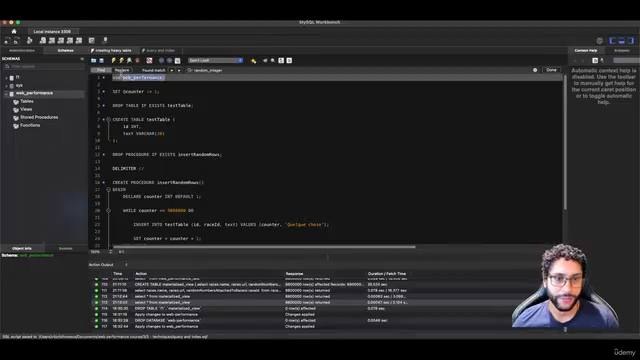
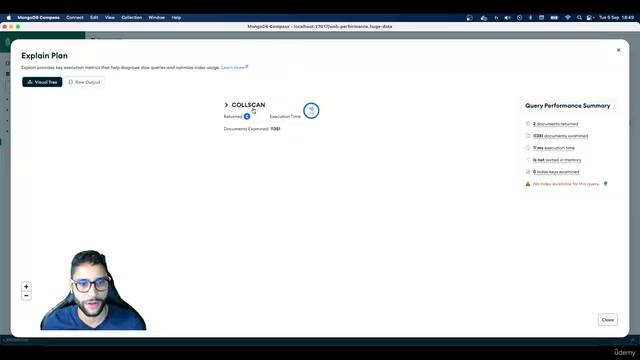
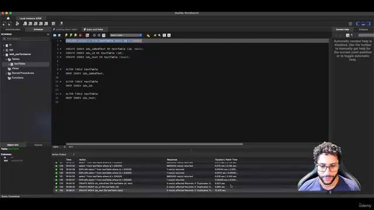
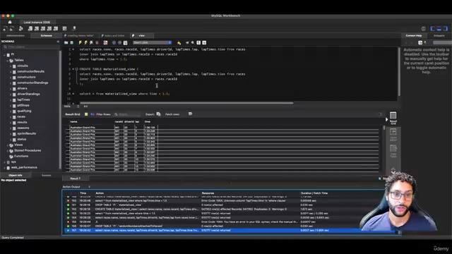
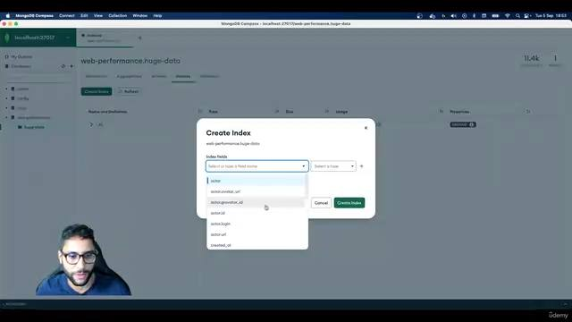
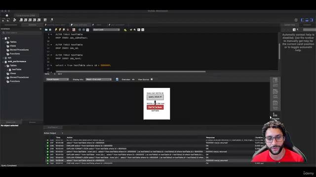
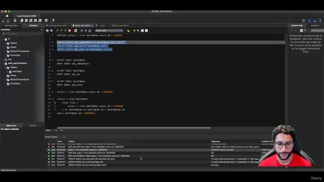
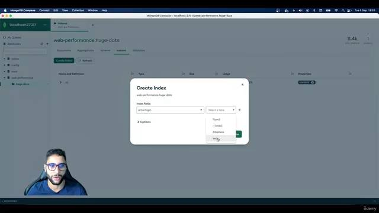

# Web Performance & Monitoring（P17–P21）数据库性能优化复现文档

> 说明：这五段逐字稿的主线是**服务端瓶颈与数据库性能优化**，不是前端监控 SDK。课程标题里有 Monitoring，但 P17–P21 没有讲告警规则、告警通道、前端上报 SDK；这部分课里没讲。本文只复现逐字稿里真正出现过的 MySQL 索引实验、执行计划、物化视图手法和 MongoDB 索引实验，不把没讲过的监控系统编进来。下面的扩写只做三件事：把已有命令讲清楚、把复现时容易出错的排查路径补出来、用前端开发者熟悉的概念做对照；凡是逐字稿没有明确给出的字段、数据量和数字，都不补造成“课里讲过”的样子。

## 1. 这一节做什么

这一节要复现一个“数据库性能实验台”：

1. 在 MySQL 里建一个 900 万行的测试表 `test`，先跑一条范围查询，观察它扫描大量行。
2. 用 `EXPLAIN` 看查询计划里的 `rows`，再创建组合索引 `idx_id_text`，对比索引前后的扫描行数。
3. 用 MySQL Workbench 的可视化执行计划观察“全表扫描”和“走索引”的图形差异。
4. 因为 MySQL 没有原生物化视图，按讲师的做法用 `CREATE TABLE ... AS SELECT ...` 建一张物理表，模拟 materialized view。
5. 在 MongoDB Compass 里创建 `web_performance` 数据库和 `huge_data` 集合，导入包含 `actor.login` 的 JSON 数据，先查询，再创建 `actor.login` 升序索引，最后用 explain 对比执行时间。

同时，P17 和 P18 提供了判断依据：服务端瓶颈包括慢查询、外部服务依赖、CPU/内存/磁盘不足、低效代码、缓存配置不当；优化数据库能带来更快查询、更高并发、更低资源消耗和更低基础设施成本。P19 还列了很多优化手段：反规范化、分区、归档/清理、连接池、避免 `SELECT *`、减少不必要的 join、合理使用 `WHERE`、`GROUP BY`、`ORDER BY`、分页、查询缓存、更新统计信息。本文把这些手段放进“实验 + 检查清单”里，而不是按页码流水账复述。

还要明确这一节“做什么”和“不做什么”。它做的是可重复的服务端实验：先建立基线，再用索引改变执行计划，最后用执行计划和统计信息验证变化。它不做的，是把课程标题里的 Monitoring 扩写成一套完整监控平台；逐字稿没有给出告警规则、告警通道、前端 RUM SDK、埋点格式、采样率、上报队列这些内容，所以本文不凭空补。对前端开发者来说，可以把这一节理解成一次“后端版 Performance 面板观察”：平时你在浏览器 DevTools 里看网络请求耗时、主线程任务、缓存命中，这里则是在 MySQL 的 `EXPLAIN`、Workbench execution plan、MongoDB 的 `explain("executionStats")` 里看“查询到底怎么被执行的”。观察对象从浏览器换成了数据库，但方法仍然是对比基线、定位瓶颈、验证优化是否真的改变了执行路径。

注意一个逐字稿里的口径差异：P019 口述过 `id > 200,000`，P020 又明确围绕 `id > 8,000,000` 做执行计划。复现时采用 **`id > 8000000`**，因为后面执行计划、索引对比都围绕 800 万这个量级。复现时不要一会儿用 20 万、一会儿用 800 万来对比，否则 `rows`、索引选择、缓存状态都会混在一起，最后无法判断变化来自哪一步。建议先固定查询条件，再创建索引，再重复同一条查询；如果要做额外查询，另起一组实验记录，不要把多个变量同时改掉。


## 2. 讲师原话（带「—— pNNN [MM:SS]」）

- “Poorly optimized database queries can slow down server response times.” —— p017 [00:50]
- “In adequate server resources like CPU, memory or disk space can limit the server's ability to handle concurrent requests.” —— p017 [01:31]
- “Optimized databases lead to faster query execution and reduced response times, resulting in improved user experience and increased customer satisfaction.” —— p018 [00:51]
- “A database index is a data structure that enhances the efficiency and speed of data retrieval operations in a database system.” —— p019 [00:12]
- “Joins are the most complex and performance-expensive operations between all the database operations.” —— p019 [05:59]
- “MySQL doesn't have like a native way to implement materialized view” —— p019 [09:39]
- “A query execution plan is a detailed blueprint or hold map that outlines how a database management system, DBMS, will execute a specific SQL query.” —— p020 [00:00]
- “here we have an insight that is query executed without index” —— p021 [06:19]
- “first running with 17 milliseconds and now running in zero milliseconds” —— p021 [09:42]

这些原话的用途是核对复现方向，不是让复现者背结论。比如“索引能提升检索效率”对应的是本节要看到的索引前后执行计划变化；“join 是复杂且昂贵的操作”对应的是 `02_explain.sql` 里那个 inner join + 子查询 + `ORDER BY` 的查询；“MySQL 没有原生物化视图”对应的是 `03_materialized_demo.sql`；“query executed without index”对应的是 MongoDB Compass 在索引前的提示；“17 milliseconds 到 zero milliseconds”对应的是课里演示环境中的耗时对比。复现时应当先看执行计划和统计指标，再谈耗时；否则很容易把操作系统缓存、MongoDB 小数据量、MySQL 缓冲池预热等偶然因素误当成索引效果。

## 3. 从零复现

### 3.1 目录结构

在你本地新建一个目录，例如：

```text
webperf-db-lab/
├── sql/
│   ├── 01_init_test_table.sql
│   ├── 02_explain.sql
│   └── 03_materialized_demo.sql
├── mongodb/
│   └── 01_setup.js
└── data/
    └── repos.json
```

这个目录结构不是装饰，而是把实验变量分开：`01_init_test_table.sql` 负责造 MySQL 数据，`02_explain.sql` 负责查询计划和索引，`03_materialized_demo.sql` 负责物化表替代方案；`mongodb/01_setup.js` 负责 MongoDB 样例数据、查询和索引；`data/repos.json` 则是 Compass 导入时可用的 JSON 样例。复现时建议按文件名顺序执行，因为后一步依赖前一步。不要把 `DROP DATABASE`、`CREATE INDEX`、物化表刷新混在同一个临时命令里，否则一旦失败，很难判断是数据没建好、索引没建上，还是查询条件写错了。若你愿意手动在 MySQL Workbench 和 Compass 里点界面，也可以保留这些文件作为“命令行基准”，界面操作和命令行结果互相校验。前端开发者可以把这理解成项目里的脚本目录：初始化脚本、调试脚本、样例数据分开，避免“调一次改一次，最后无法重放”。

### 3.2 环境与版本

课里没有讲具体版本。下面脚本按 **MySQL 8.0 语法**编写，因为用到了 `utf8mb4_0900_ai_ci`。MongoDB 部分用 `mongosh` 和 MongoDB Compass 均可；课里演示的是 MongoDB Compass。你本地需要：

- MySQL 8.0+
- MySQL Workbench（可选，用来看可视化执行计划）
- MongoDB 6.0+（或你机器上已装的可用版本）
- MongoDB Compass（可选，课里用它导入数据和看 explain）
- `mongosh` 命令行（用于执行 `01_setup.js`）

如果你不想装 Workbench，MySQL 的 `EXPLAIN` 仍然可以在命令行跑；可视化执行计划是 Workbench 的界面能力，不是 SQL 本身的能力，这点课里也展示了 Workbench 右侧结果区的 “execution plan”。

环境准备阶段先做三件事。第一，确认 MySQL 服务真的在运行，并且你用的账号有创建数据库、建表、建索引权限；很多“脚本跑不动”不是 SQL 写错，而是账号只能读不能写。第二，确认端口和连接参数。命令行里的 `mysql -u root -p` 默认连本机 3306 端口；如果你的 MySQL 在 Docker、远程主机或自定义端口，要补 `-h`、`-P` 参数，否则会得到连接拒绝或找不到套接字。第三，确认 MongoDB 的 `mongod` 已经启动，`mongosh` 能连通 `127.0.0.1:27017`；Compass 导入失败时也要先回到这一步确认服务端正常。这里的“环境一致性”可以类比前端复现 bug：浏览器版本、Node 版本、代理和缓存不一致，现象就会飘；数据库实验也一样，MySQL 版本、排序规则、MongoDB 版本、是否已有同名集合，都会影响你看到的输出。

常见错误与排查：若创建数据库时报 `Unknown collation: 'utf8mb4_0900_ai_ci'`，通常说明你的 MySQL 不是 8.0，或者实际连到了 MariaDB/旧版本实例；此时不要盲目删改实验逻辑，先确认版本，再决定是否把排序规则改成该环境支持的写法。若报 `Access denied`，先检查账号权限；若报 `Can't connect to local MySQL server`，先检查服务、端口、套接字。若 `mongosh` 报连接失败，先检查 MongoDB 是否启动、端口是否被占用、连接字符串是否写错数据库名。以上都属于工具链问题，不是本实验的结论。

### 3.3 启动 MySQL 实验

在 `webperf-db-lab/` 下执行：

```bash
mysql -u root -p < sql/01_init_test_table.sql
mysql -u root -p < sql/02_explain.sql
mysql -u root -p < sql/03_materialized_demo.sql
```

第一条脚本会创建 `web_performance` 数据库、900 万行 `test` 表。逐字稿里讲师用循环一行一行插，耗时很长；下面代码用 0–9 的数字表做笛卡尔积生成 900 万个 id，结果等价，但更快。课里没有给固定文本原文，下面用 `'sample text'` 代替，避免编造原文。

执行这三条命令时，要给自己留出观察点。第一条命令执行完后，先进入数据库确认 `numbers`、`test` 是否存在，并跑一次 `SELECT COUNT(*) FROM test;` 确认行数；如果这里不是 9000000，后面的执行计划对比就没有意义。第二条命令执行时，先看创建索引前的 `EXPLAIN`，再执行 `CREATE INDEX`，再看索引后的 `EXPLAIN`；不要一次性跑完只看最后一个结果，否则你会丢失基线。第三条命令执行时，先看原始 `SELECT` 的结果，再看 `CREATE TABLE ... AS SELECT` 建出的物化表，最后确认物化表里的记录和条件 `lap_time_ms < 1500` 一致。每一步都可以截屏或记录输出，方便与前端的“优化前/优化后”性能记录对照。

常见错误与排查：如果插入 900 万行很慢、磁盘占用明显升高，先检查磁盘剩余空间和数据库数据目录所在分区；不要在磁盘接近满时强行跑。若 `COUNT(*)` 返回小于 9000000，检查 `numbers` 是否完整插入 0–9、`WHERE seq.id <= 9000000` 是否被误删、插入过程是否中断。若 `CREATE INDEX` 很慢，这是正常的建索引成本，尤其在大表上；先等完成，再用 `SHOW INDEX FROM test;` 确认索引存在。若你在已有同名索引的情况下重复执行建索引语句，可能得到重复索引名错误，此时应重跑初始化脚本或先删除旧索引，而不是在错误状态下继续比较。前端对照：这类似你改了一个打包配置却没清缓存，第二次结果不可信；数据库实验也要先保证基线和变量干净。



### 3.4 启动 MongoDB 实验

在 `webperf-db-lab/` 下执行：

```bash
mongosh "mongodb://127.0.0.1:27017/web_performance" --file mongodb/01_setup.js
```

如果你坚持按课里的 Compass 方式做：在 Compass 里新建数据库 `web_performance`、集合 `huge_data`，把 `data/repos.json` 作为 JSON 数组导入；然后执行：

```js
db.huge_data.find({ "actor.login": "Petrov" })
db.huge_data.find({ "actor.login": "Petrov" }).explain("executionStats")
db.huge_data.createIndex({ "actor.login": 1 }, { name: "actor_login_asc" })
db.huge_data.find({ "actor.login": "Petrov" }).explain("executionStats")
```

课里演示的是 11,000 个 GitHub 账号相关对象；逐字稿没有给原始 JSON 文件，所以本文用 3 条同结构样例数据复现“嵌套字段查询 + 建索引 + explain”的手法，数据量不同，执行时间数字不会和课里完全一样。

MongoDB 这一步的重点不是追求和课里一模一样的毫秒数，而是观察三件事：查询字段是否是嵌套路径 `actor.login`，索引是否建在同一个路径上，`explain("executionStats")` 的前后执行计划是否从没有索引可用变成使用索引。Compass 导入时要注意 JSON 格式：如果文件是一个 JSON 数组，选择数组导入；如果文件是一行一个 JSON，选择对应格式，不要混用。导入完成后，先在集合里数一数文档数量，再跑 `find`，确认 `"Petrov"` 确实存在。若查询返回空数组，优先检查字段名大小写、嵌套层级、引号以及数据是否导入到了错误的数据库或集合。

常见错误与排查：若 `mongosh` 提示找不到数据库，不用紧张，MongoDB 在第一次写入时会创建数据库；但你执行 `find` 前必须确保脚本已经插入数据。若创建索引时报已存在同名索引，说明脚本可能重复执行过，先确认集合状态再决定是否 `drop`。若 `explain` 输出结构与课里截图不同，以你本地版本为准，重点看 `winningPlan`、`executionStats` 里的扫描文档数、返回文档数，以及是否出现索引扫描。MongoDB 小数据量时，耗时可能接近 0 毫秒，这并不是“索引没用”，而是样本太小、缓存太热；要结合执行计划和扫描数量判断。前端对照：这类似在 DevTools 里看一条请求是否命中缓存，不能只看秒表上的 0ms，还要看请求头和缓存来源。



## 4. 完整代码

下面代码与上文一一对应。运行顺序是：先 MySQL 初始化，再 MySQL 执行计划，再物化表演示，最后 MongoDB 脚本。代码块保留原样；如果你要改动连接参数、字符集或数据量，建议先在副本上改，并记录改动，否则复现结果不能和本文基线对比。

### 4.1 `sql/01_init_test_table.sql`

```sql
-- 重建实验库，避免重复运行时残留旧表
DROP DATABASE IF EXISTS web_performance;
CREATE DATABASE web_performance
  CHARACTER SET utf8mb4
  COLLATE utf8mb4_0900_ai_ci;
USE web_performance;

-- 用作“数字发生器”的辅助表，只有 0-9
DROP TABLE IF EXISTS numbers;
CREATE TABLE numbers (
  n INT NOT NULL PRIMARY KEY
) ENGINE=InnoDB;

INSERT INTO numbers (n) VALUES
(0),(1),(2),(3),(4),(5),(6),(7),(8),(9);

-- 故意不建主键：为了复现课里的“全表扫描”基线。
-- 真实业务表通常应该有主键，这里只是实验。
DROP TABLE IF EXISTS test;
CREATE TABLE test (
  id INT NOT NULL,
  text VARCHAR(255) NOT NULL
) ENGINE=InnoDB;

-- 用 7 位数字笛卡尔积生成 1..9,000,000
-- 1 + d0 + d1*10 + ... + d6*1000000
INSERT INTO test (id, text)
SELECT seq.id, 'sample text'
FROM (
  SELECT
    1
    + d0.n
    + d1.n * 10
    + d2.n * 100
    + d3.n * 1000
    + d4.n * 10000
    + d5.n * 100000
    + d6.n * 1000000 AS id
  FROM numbers AS d0
  CROSS JOIN numbers AS d1
  CROSS JOIN numbers AS d2
  CROSS JOIN numbers AS d3
  CROSS JOIN numbers AS d4
  CROSS JOIN numbers AS d5
  CROSS JOIN numbers AS d6
) AS seq
WHERE seq.id <= 9000000;
```

这个脚本的副作用很明确：会删除并重建 `web_performance`。因此只能在实验实例或本地环境执行，不要在生产库执行。它的优点是幂等，重复运行能得到干净基线；代价是每次都要重新写入 900 万行，耗时和磁盘占用不可忽略。若你只想反复验证索引，可以在第一次建好后跳过 `DROP DATABASE`，但对比时一定要用 `SHOW INDEX` 确认当前索引状态。

### 4.2 `sql/02_explain.sql`

```sql
USE web_performance;

-- 基线：看索引创建前，EXPLAIN 里的 rows 估算
EXPLAIN
SELECT *
FROM test
WHERE id > 8000000;

-- 逐字稿明确提到的组合索引：名称为 idx_id_text，字段为 id + text
-- 注意：课里还说创建了另外两个简单索引，但没有给出字段名，本文不编造。
CREATE INDEX idx_id_text
ON test (id, text);

-- 索引后：再看 rows 是否下降
EXPLAIN
SELECT *
FROM test
WHERE id > 8000000;

-- 按 P020 口述复刻一个更复杂的查询：
-- 同一张表做 inner join + 子查询 + where + order by
EXPLAIN
SELECT
  t1.id,
  t1.text
FROM test AS t1
INNER JOIN (
  SELECT id
  FROM test
  WHERE id > 8500000
) AS t2 ON t1.id = t2.id
WHERE t1.id > 8000000
ORDER BY t1.id ASC;
```

这段代码一次包含两个变量：索引前后的简单查询对比，以及一个更复杂的 join 子查询执行计划。建议你按注释分三次执行，或者至少把三次 `EXPLAIN` 的输出分别保存；否则最后只看到复杂查询的计划，会丢掉“索引前/索引后”的直接证据。复杂查询那段不是要求你优化到某个固定成本，而是按 P020 的口径复刻“同一张表做 inner join + 子查询 + where + order by”时执行计划长什么样。不同 MySQL 版本可能显示不同 `select_type`、`type`、`key`、`Extra`，不要死记字段值，重点看是否使用索引、估算行数是否变化。

### 4.3 `sql/03_materialized_demo.sql`

```sql
USE web_performance;

-- 课里用的是 Formula 1 数据库，但没有给完整 schema。
-- 下面用最小等价表复现“MySQL 没有原生物化视图，用物理表存结果”的手法。
-- 字段名是本实验新建的，不是课程 F1 数据库的原字段名。
DROP TABLE IF EXISTS lap_times;
CREATE TABLE lap_times (
  id INT NOT NULL AUTO_INCREMENT PRIMARY KEY,
  race_name VARCHAR(100) NOT NULL,
  race_id INT NOT NULL,
  driver_id INT NOT NULL,
  lap_time_ms INT NOT NULL
) ENGINE=InnoDB;

INSERT INTO lap_times (race_name, race_id, driver_id, lap_time_ms) VALUES
('Australian Grand Prix', 1, 1, 1200),
('Australian Grand Prix', 1, 2, 1800),
('Australian Grand Prix', 1, 3, 1400),
('Bahrain Grand Prix', 2, 1, 1600),
('Bahrain Grand Prix', 2, 2, 1300),
('Bahrain Grand Prix', 2, 3, 1900);

-- 先把“昂贵查询”的结果跑出来，观察原始查询
SELECT
  race_name,
  race_id,
  driver_id,
  lap_time_ms
FROM lap_times
WHERE lap_time_ms < 1500;

-- MySQL 的替代方案：用 CREATE TABLE ... AS SELECT 建物理表
DROP TABLE IF EXISTS materialized_lap_times;
CREATE TABLE materialized_lap_times AS
SELECT
  race_name,
  race_id,
  driver_id,
  lap_time_ms
FROM lap_times
WHERE lap_time_ms < 1500;

-- 以后查询直接读物化表
SELECT *
FROM materialized_lap_times;
```

这段代码只演示“物化结果”这一手法，不假装还原完整的 Formula 1 schema。`CREATE TABLE ... AS SELECT` 建出来的物理表会保存查询结果，但不会像真正的物化视图那样由数据库自动维护刷新；源表更新后，物化表仍是旧快照。复现时要观察这一点：先查 `lap_times`，再查 `materialized_lap_times`，确认结果一致；然后可以手动改一条 `lap_times` 数据再查物化表，你会看到物化表没有自动变化。这个现象不是 bug，而是替代方案的代价。

### 4.4 `data/repos.json`

```json
[
  {
    "id": 1,
    "actor": {
      "login": "Petrov"
    },
    "repo": {
      "url": "https://github.com/example/repo-1",
      "description": "demo repository 1",
      "public": true
    },
    "payload": {
      "branches": ["main"]
    }
  },
  {
    "id": 2,
    "actor": {
      "login": "Petrov"
    },
    "repo": {
      "url": "https://github.com/example/repo-2",
      "description": "demo repository 2",
      "public": false
    },
    "payload": {
      "branches": ["main", "dev"]
    }
  },
  {
    "id": 3,
    "actor": {
      "login": "AnotherUser"
    },
    "repo": {
      "url": "https://github.com/example/repo-3",
      "description": "demo repository 3",
      "public": true
    },
    "payload": {
      "branches": ["release"]
    }
  }
]
```

这份 JSON 用来复现嵌套字段查询的数据形状。两个文档的 `actor.login` 是 `Petrov`，一个文档是 `AnotherUser`，所以按 `"actor.login": "Petrov"` 查询应该返回 2 条。不要为了追求课里的 11,000 条而在这里手工复制大量假数据；本文明确说明这是 3 条同结构样例，用于观察查询路径和索引使用，不用于复现课里的毫秒级数值。若你用 Compass 导入，确认导入的是数组而不是单个对象；若用 `mongosh`，直接用后面的 `insertMany` 即可。

### 4.5 `mongodb/01_setup.js`

```js
// 执行方式：
// mongosh "mongodb://127.0.0.1:27017/web_performance" --file mongodb/01_setup.js

const appDb = db.getSiblingDB("web_performance");

appDb.huge_data.drop();

appDb.huge_data.insertMany([
  {
    id: 1,
    actor: { login: "Petrov" },
    repo: {
      url: "https://github.com/example/repo-1",
      description: "demo repository 1",
      public: true
    },
    payload: { branches: ["main"] }
  },
  {
    id: 2,
    actor: { login: "Petrov" },
    repo: {
      url: "https://github.com/example/repo-2",
      description: "demo repository 2",
      public: false
    },
    payload: { branches: ["main", "dev"] }
  },
  {
    id: 3,
    actor: { login: "AnotherUser" },
    repo: {
      url: "https://github.com/example/repo-3",
      description: "demo repository 3",
      public: true
    },
    payload: { branches: ["release"] }
  }
]);

print("---- query result ----");
printjson(
  appDb.huge_data.find({ "actor.login": "Petrov" }).toArray()
);

print("---- explain before index ----");
printjson(
  appDb.huge_data
    .find({ "actor.login": "Petrov" })
    .explain("executionStats")
);

// 课里在 Compass 里创建的是 actor.login 的 ascending 索引。
// 1 表示 ascending。
appDb.huge_data.createIndex(
  { "actor.login": 1 },
  { name: "actor_login_asc" }
);

print("---- explain after index ----");
printjson(
  appDb.huge_data
    .find({ "actor.login": "Petrov" })
    .explain("executionStats")
);
```

这个脚本的重点是“同一个查询，在建立索引前后各看一次执行统计”。脚本开头 `drop()` 会影响同名集合，只在实验库使用。`printjson` 输出可能很长，终端里建议重定向到文件，或者只观察 `winningPlan`、`executionStats.totalDocsExamined`、`executionStats.nReturned` 等关键字段。若你的 MongoDB 版本对 `explain("executionStats")` 的输出字段命名略有差异，以实际文档为准；不要把本文截图里的字段名当成所有版本都必须一致。

## 5. 逐行解释

### 5.1 SQL 初始化脚本

`DROP DATABASE IF EXISTS web_performance;` 是为了让实验可以反复重跑。你每次运行都会得到干净的 `test` 表，避免旧索引影响对比。

`CREATE DATABASE ... COLLATE utf8mb4_0900_ai_ci;` 指定字符集和排序规则。`utf8mb4_0900_ai_ci` 是 MySQL 8.0 的写法；如果你用 MySQL 5.7，这一行会报错，需要改成 `utf8mb4_general_ci`。课里没有讲版本，这里按 MySQL 8.0 写。

`numbers` 表只有 0–9 十行，它的作用不是业务数据，而是“数字发生器”。7 个 `numbers` 做 `CROSS JOIN`，相当于 10×10×10×10×10×10×10 = 1000 万种组合；再用 `1 + d0 + d1*10 + ...` 生成 1 到 10,000,000 的 id，最后 `WHERE seq.id <= 9000000` 只保留前 900 万行。这样比逐行 `INSERT` 快很多。理解这段 SQL 时，可以把 `d0` 看成个位、`d1` 看成十位，依此类推；七个数字表交叉连接后，每一种组合对应一个序号，最后用条件截断到 900 万。

`test` 表故意没有主键：

```sql
CREATE TABLE test (
  id INT NOT NULL,
  text VARCHAR(255) NOT NULL
) ENGINE=InnoDB;
```

这是为了复现课里的“full table scan”基线。InnoDB 里如果 `id` 是主键，`WHERE id > 8000000` 很可能直接走聚簇索引，不容易复现全表扫描。实验表不加主键，创建 `idx_id_text` 后才能明显看到扫描行数变化。真实项目不要学这一点，业务表通常应该有主键。这里的关键是：实验表的设计是为了制造可观察的基线，不是推荐你把业务表设计成没有主键。若你复现时发现 `EXPLAIN` 一开始就用了某个索引，先检查表上是否有残留索引，或是否重跑时没执行 `DROP DATABASE`。

这一节常见错误：如果你把 `text` 改成 `TEXT` 类型、把 `id` 改成 `BIGINT`，严格说也能做实验，但生成结果的类型、索引大小、行数统计可能和本文不同；如果 `numbers` 插入失败，`test` 的行数会少很多；如果 `WHERE seq.id <= 9000000` 写成 `<= 90000000`，行数会超出预期。前端对照：初始化脚本就像测试数据 fixture，fixture 不干净，后面的性能断言全是噪音。

### 5.2 `EXPLAIN` 与索引

`EXPLAIN SELECT * FROM test WHERE id > 8000000;` 不会真的返回 100 万行数据，它返回的是优化器对这条查询的执行计划。逐字稿里讲师特别提到 `rows` 列：它表示 DBMS 估算要搜索多少行。你复现时也只需要先盯 `rows`，不要背所有字段名；不同 MySQL 版本输出列可能略有差异，以实际输出为准。

看 `EXPLAIN` 时建议按顺序确认：语句操作的是不是 `test` 表；`possible_keys` 是否列出了候选索引；`key` 是否真的选择了索引；`rows` 估算是否变化；`Extra` 里有没有 `Using where`、`Using index`、`Using filesort` 等提示。这里最重要的不是把字段名背下来，而是建立“查询意图 → 可用索引 → 实际选择 → 估算扫描量”的对应关系。前端开发者可以把它类比成 DevTools 的 Performance 面板：你不是只看总耗时，而是看时间花在脚本、渲染、网络还是空闲；`EXPLAIN` 也不是只看一行结果，而是看优化器选择了哪条执行路径。

`CREATE INDEX idx_id_text ON test (id, text);` 创建的是组合索引。组合索引可以理解为“按 id 排序，再按 text 排序”的目录。因为查询条件是 `id > 8000000`，而 `id` 是组合索引的最左列，所以这个索引有机会被用上。这也是复合索引的“最左前缀”规则：`(id, text)` 对 `id` 单独查询有用，但对只查 `text` 的查询不一定有用。

课里说创建了三个索引，其中一个是组合索引。逐字稿只明确给出了组合索引 `idx_id_text` 和字段 `id + text`，另外两个简单索引没有给字段名，所以本文没有编造另外两个索引。你如果按课里完整操作，可能会看到不同的 `rows` 数字，这是正常的。

常见错误与排查：第一，若 `EXPLAIN` 里的 `key` 一直是 `NULL`，先确认索引是否真的创建成功，可以用 `SHOW INDEX FROM test;` 查看。第二，若 `rows` 在索引后没有下降，不一定是 SQL 写错；范围查询返回大量行时，优化器可能仍然认为全表扫描更便宜，尤其样本统计信息不准时。此时先执行 `ANALYZE TABLE test;` 更新统计信息，再观察；仍然不下降时，检查查询是否与索引最左列匹配。第三，不要把 `rows` 当精确值，它是估算；本实验用它做前后对比可以，但不要把“估算行数”直接当成“实际扫描行数”。第四，不要为了看到索引而随意在生产查询里加 `FORCE INDEX`；那属于诊断手段，不是通用优化方案。前端对照：这类似你看到某条资源走了缓存，不等于所有资源都会走缓存；索引也是针对查询形状生效的。



### 5.3 物化视图替代方案

MySQL 没有原生 materialized view，讲师在 P019 [09:39] 明确说了这一点。课里的替代方案是：先跑 `SELECT`，再用 `CREATE TABLE ... AS SELECT ...` 把结果存成物理表。

`CREATE TABLE materialized_lap_times AS SELECT ...` 会把查询结果物化下来。之后查 `materialized_lap_times` 就不再需要每次做过滤计算。代价是数据会“旧”：源表 `lap_times` 更新后，物化表不会自动更新，你需要自己安排刷新，例如定时删除重建、增量更新，或者用事件调度。课里没有讲刷新策略，这是你生产化时一定会撞上的问题。

复现这里时，最好把“查询结果正确”和“物化表会过期”都验证一遍。先核对原始 `SELECT` 返回的记录，再核对 `materialized_lap_times`，两边应当一致；然后修改 `lap_times` 中的一条记录，比如改 `lap_time_ms`，再查询物化表，你会看到它不会自动变。这个实验不是让你解决刷新问题，而是让你意识到：物化表是一种缓存，缓存就要有失效策略。前端对照：这很像静态生成页面或接口缓存：首次生成后读取很快，但源数据变化时，必须触发重新生成或设置过期策略；否则用户看到的是旧内容。

常见错误与排查：`CREATE TABLE ... AS SELECT` 建出的表不会自动继承源表的所有约束、索引和注释，别把它当成源表的完整克隆；若后续要按某字段查询物化表，可能需要额外索引。若重跑脚本报物化表已存在，先执行 `DROP TABLE IF EXISTS`，脚本里已经这样做，但如果你手动改过语句，要自己保证幂等。若物化表数据比源表少或多，检查 `WHERE lap_time_ms < 1500` 是否在两个查询中一致。若你直接在生产库使用这种方案，还要考虑刷新期间的空窗、并发读写和回滚策略；课里没有讲这些，不能假装实验已经覆盖。



### 5.4 MongoDB 脚本

`const appDb = db.getSiblingDB("web_performance");` 切换到 `web_performance` 数据库；如果数据库不存在，MongoDB 会在第一次写入时创建它。

`appDb.huge_data.drop();` 清空旧集合，保证脚本可重复执行。

`appDb.huge_data.insertMany([...]);` 插入样例文档。课里导入的是 11,000 个 GitHub 相关对象，包含 `actor.login`、仓库 URL、`payload.branches`、`description`、`public`、`id` 等信息。这里用 3 条同结构数据复现查询路径。

`appDb.huge_data.find({ "actor.login": "Petrov" })` 查询嵌套字段。注意 `actor.login` 必须加引号，因为点号在 JavaScript 对象字面量里不能直接写成裸键；在 MongoDB 查询里它表示“actor 下面的 login 字段”。讲师在 P021 [05:06] 也强调了嵌套字段要加引号。

`.explain("executionStats")` 让 MongoDB 返回执行统计信息。课里在 Compass 里点 “Explain” 看执行计划，并看到 “query executed without index” 的 insight。命令行里的 `executionStats` 是你可用的等价观察入口；具体输出字段以你本地 MongoDB 版本为准，不要死记字段名。实际看结果时，重点确认是否出现索引扫描而非集合扫描、返回文档数是否符合预期、检查文档数和返回文档数之间的比例是否合理。小数据量下耗时可能非常短，不能只用毫秒数判断优化是否生效。

`appDb.huge_data.createIndex({ "actor.login": 1 }, { name: "actor_login_asc" });` 创建升序索引。`1` 表示 ascending，`-1` 表示 descending。课里在 Compass 的索引界面选了 ascending，因为要按 `actor.login` 升序组织索引。单字段等值查询下，升序和降序索引通常都能服务查询，但课里就是按 ascending 演示的。

创建索引后再次 `explain`，你应该能看到执行计划从“没有索引可用”变成“走 `actor_login_asc` 索引”。课里从 17ms 降到接近 0ms，这个数字来自 11,000 条文档的演示环境；你用 3 条样例数据不会得到同样的耗时，但执行计划形态会变化。

常见错误与排查：若查询没有结果，先检查 `actor.login` 是否写对、值是否大小写一致、数据是否导入到 `web_performance.huge_data`。若 `createIndex` 后 explain 仍显示集合扫描，检查索引路径是否与查询路径完全一致，注意 `"actor.login"` 是一个完整字段路径，不是两个独立字段；还要确认你没有把索引建在另一个数据库或集合上。若重复运行脚本后索引名冲突，先确认是否需要重建集合，或者改为幂等处理。前端对照：这类似给对象数组建 Map 索引，查询前要确认 key 的路径和值完全匹配；路径写错时，建了索引也不会命中。



## 6. 复现检查清单

下面每条都保留原来的检查目标，并补上“怎么验证”。验证时建议按顺序执行，不要跳步；每一步的截图或输出都能帮助你判断下一步是否可信。

- [ ] MySQL 中 `web_performance` 数据库存在。验证：登录 MySQL 后执行 `SHOW DATABASES LIKE 'web_performance';`，应看到一行；若没有，说明 `01_init_test_table.sql` 没执行成功或连到了另一个实例。再确认当前用户有权限进入该库。
- [ ] `SELECT COUNT(*) FROM test;` 返回 `9000000`。验证：在 `USE web_performance;` 后执行该查询；若行数不足，检查 `numbers` 是否只有 0–9、笛卡尔积是否完整、`WHERE seq.id <= 9000000` 是否保留。行数查询本身可能耗时，耐心等待；若远超 9000000，检查是否把上限写大或重复插入了。
- [ ] `EXPLAIN SELECT * FROM test WHERE id > 8000000;` 在创建索引前能看到较大的 `rows` 估算。验证：记录第一次 `EXPLAIN` 的 `rows`、`key`、`type` 等列；不要只看最终一次。若一开始已经显示使用索引，先确认表上是否残留旧索引，必要时重跑初始化脚本。
- [ ] 执行 `CREATE INDEX idx_id_text ON test (id, text);` 成功。验证：执行 `SHOW INDEX FROM test;`，确认索引名 `idx_id_text` 存在，列顺序是 `id`、`text`。若报重复索引名，说明之前建过；若报语法错误，检查括号和字段名。
- [ ] 再次 `EXPLAIN`，`rows` 相比索引前下降。数字不必和课里完全一致。验证：用完全相同的查询再执行一次，比较 `key` 是否变化、`rows` 是否下降；如果 `rows` 没下降，先执行 `ANALYZE TABLE test;` 更新统计信息，再检查查询条件是否匹配索引最左列。不要用不同查询条件做前后对比。
- [ ] 在 MySQL Workbench 里点结果区右侧的 “execution plan”，能看到执行计划图；创建索引后图形和成本会变化。验证：在 Workbench 中打开同一查询，先看索引前图形，再建索引刷新计划；若界面没有显示，确认你执行的是 `EXPLAIN` 或使用“Explain Current Statement”，并确认连接的是正确 schema。命令行结果与 Workbench 图形可能排版不同，但执行路径应能互相对应。
- [ ] `materialized_lap_times` 表存在，且 `SELECT * FROM materialized_lap_times;` 返回 `lap_time_ms < 1500` 的记录。验证：先用原始 `SELECT` 查 `lap_times`，核对结果行；再查物化表。建议再手动更新一条源表记录并复查物化表，确认“不会自动刷新”的代价确实存在。
- [ ] MongoDB 中 `web_performance.huge_data` 有 3 条样例文档。验证：执行 `db.huge_data.countDocuments()`，结果应为 3；若为 0，说明 `insertMany` 没跑到或连错数据库；若大于 3，说明重复执行且没有 `drop` 成功或导入了额外数据。
- [ ] `db.huge_data.find({ "actor.login": "Petrov" })` 返回 2 条。验证：观察返回文档数量；若为 0，检查字段名、大小写、引号和数据库；若为 3，检查是否把 `AnotherUser` 写成了 `Petrov`，或导入了额外样例。
- [ ] 创建 `actor_login_asc` 索引后，`explain("executionStats")` 能看到索引被使用。验证：确认 `createIndex` 返回成功，再执行 `getIndexes()` 查看 `actor_login_asc` 是否存在；然后对比索引前后的 `winningPlan` 或扫描文档数。小数据量下毫秒数可能接近 0，不能只凭时间判断。
- [ ] 如果你用 Compass，能在 Explain 面板看到 “query executed without index” 一类提示；不同版本提示文案可能不同，以实际界面为准。验证：在索引创建前查看 Explain，再创建索引后刷新/重新执行 Explain；若提示不出现，检查是否选错集合、是否查询条件变化，或以 `mongosh` 的 `explain("executionStats")` 输出为准交叉验证。







## 7. 课里没讲但你会撞上的

| 现象 | 原因 | 怎么办 |
| --- | --- | --- |
| 900 万行插入很慢、磁盘占用高，甚至中途失败 | 实验要真实写入 900 万行；磁盘空间、`innodb_buffer_pool_size`、容器内存限制、临时表空间都会影响；逐字稿里的循环插入本身也很耗时 | 先在本地或独立实验实例执行，确认磁盘余量；不要在生产库跑 `DROP DATABASE`；若失败，清理残留表后重跑；本文用笛卡尔积生成，已经比逐行插入快，但仍会实际占用空间 |
| `COUNT(*)` 不是 `9000000` | `numbers` 表不完整、`WHERE seq.id <= 9000000` 被改动、插入中途停止、重复执行后状态混杂 | 先查 `SELECT COUNT(*) FROM numbers;` 是否为 10；再检查生成 SQL 的上限；最稳妥是重跑 `01_init_test_table.sql`，确保从干净库开始 |
| 创建数据库时报 `Unknown collation: 'utf8mb4_0900_ai_ci'` | MySQL 版本低于 8.0，或实际连到了 MariaDB/其他兼容实例 | 先确认版本；如果环境不支持，改用该环境支持的排序规则，例如 `utf8mb4_general_ci`，并记录改动；不要把一个版本报错误判为 SQL 逻辑错误 |
| `EXPLAIN` 的 `rows` 是估算值，和实际扫描行数不一致 | 优化器依赖统计信息，范围查询、数据分布、索引选择都会影响估算 | 用 `EXPLAIN` 看执行路径，不要把它当精确计数器；需要更接近真实执行信息时，可在非生产环境了解 `EXPLAIN ANALYZE`，但这已超出本课范围；对比时保持查询和版本一致 |
| 索引前后的 `rows` 没下降，甚至看起来更差 | 范围条件命中行数多、优化器认为全表扫描更便宜、统计信息过期、索引未匹配最左列 | 检查 `key` 是否真的使用索引；执行 `ANALYZE TABLE` 更新统计；确认查询条件与索引最左列一致；不要为了截图强行加 `FORCE INDEX`，除非你明确知道自己只是在做诊断 |
| 组合索引 `(id, text)` 对只查 `text` 的查询没有明显帮助 | 复合索引遵循最左前缀规则；从第二列开始的过滤不能单独享受该索引的完整收益 | 根据真实查询建索引；不要以为“字段出现在组合索引里”就等于每个字段都有独立索引；如果 `text` 是高频过滤条件，应评估单独的 `text` 索引或调整组合顺序 |
| 索引建得越多，写入越慢、磁盘占用越高 | 每次写入、更新、删除都可能需要维护索引；索引本身也占空间 | 只建与关键查询匹配的索引；定期检查未使用或重复索引；课里重点演示读性能提升，但没有展开写放大和索引维护成本，生产环境必须同时看读写 |
| `CREATE TABLE ... AS SELECT` 后，源表更新了而物化表没变 | MySQL 没有原生物化视图，`CREATE TABLE ... AS SELECT` 只生成一次性物理快照，不会自动刷新 | 为物化表设计刷新策略：定时重建、增量更新、事件调度或应用层双写；明确可接受的数据延迟；刷新时考虑并发读写、失败重试和回滚 |
| `CREATE TABLE ... AS SELECT` 生成的表缺少原表约束或索引 | CTAS 创建的是新表，不会自动复制源表的全部索引、外键、注释等对象 | 用 `SHOW CREATE TABLE` 对比源表和物化表；按查询需要补索引；不要把物化表当作源表的完整克隆，也不要假设约束会自动继承 |
| MySQL Workbench 的 execution plan 与命令行 `EXPLAIN` 看起来不一致 | Workbench 展示的是可视化解释，可能按界面版本合并/呈现信息；查询、schema、连接实例或缓存状态也可能不同 | 确认 Workbench 连接的是同一个 MySQL 实例和 schema；用完全相同的 SQL；以 `key`、`rows`、`type`、`Extra` 等关键列交叉核对；不要只凭图形颜色下结论 |
| MongoDB Compass 导入 `repos.json` 失败 | 导入格式不匹配，例如把 JSON 数组当 NDJSON，或把单对象当数组；也有可能是字段类型或编码问题 | 确认文件是数组还是逐行 JSON；Compass 导入时选择对应格式；也可以改用 `mongosh` 的 `insertMany` 样例脚本先跑通查询链路 |
| `find({ "actor.login": "Petrov" })` 返回空 | 字段路径写错、大小写不一致、数据导入到了别的数据库/集合、JSON 里没有 `Petrov`，或点号字段没有加引号 | 先执行 `db.huge_data.findOne()` 看真实结构；用 `countDocuments()` 确认数据量；检查数据库名、集合名和字段路径；嵌套字段查询建议始终给 `"actor.login"` 加引号 |
| 建了 `actor.login` 索引，explain 仍显示集合扫描 | 索引建错集合/数据库、索引路径不匹配、查询条件不同、脚本没有执行到建索引步骤，或数据量太小导致界面提示不明显 | 用 `getIndexes()` 确认 `actor_login_asc` 存在且 key 是 `actor.login`；对比索引前后的 `winningPlan` 和扫描文档数；以 `mongosh` 的 `executionStats` 输出为准 |
| 课里从 17ms 到接近 0ms，你本地复现不出同样数字 | 课里是约 11,000 条文档的演示环境，