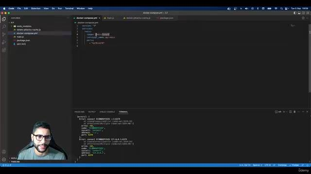
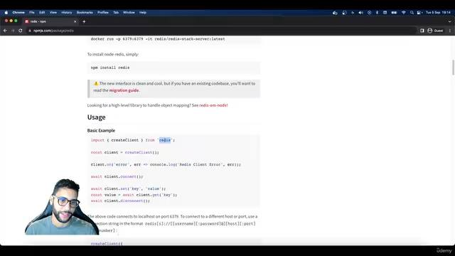
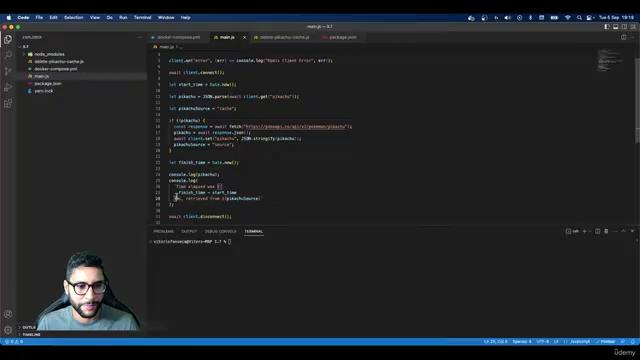
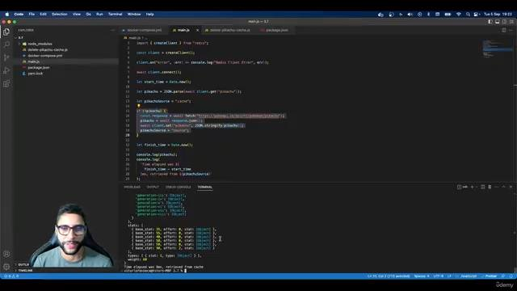
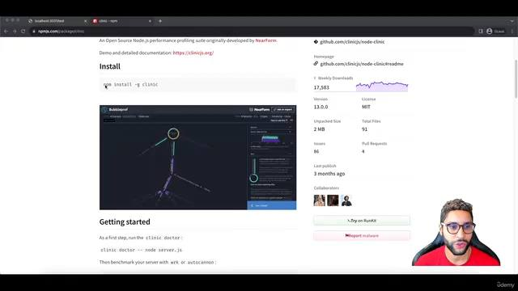
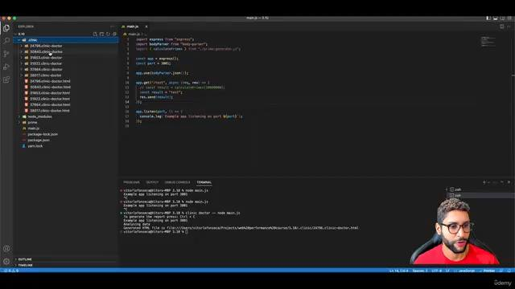

# Web Performance & Monitoring（P22–P26）复现文档

> 课程：BV18hxK6iEWu ｜ 覆盖 P22–P26
> 读者画像：前端转 AI 应用工程师。文中涉及 Node.js 的部分会直接给出可运行代码；涉及 Java/.NET 的只做「知道即可」标注。

---

## 1. 这一节做什么

这五节课是一组**后端性能优化 + 性能观测**的连续内容，讲师没有写一个完整的大项目，而是围绕「一个电商网站被第三方服务拖慢」这个想象场景，逐层给出四类手段，最后用 profiler 工具把「慢」变成可观测的数字。按项目实现逻辑，这五节可以重组成一条可复现的动手链路：

1. **P22 架构层**：第三方服务慢/挂 → 消息队列异步化、连接池、缓存、超时与降级网关。
2. **P23 缓存层（可动手）**：用 Docker 起 Redis，用 npm 的 `redis` 包写一个 Node 脚本，对比「走外部 API」和「走缓存」的耗时。**这是本组课唯一有完整可运行代码的部分**，本文档的「从零复现」主要围绕它展开。
3. **P24 微服务层**：微服务带来的性能收益（独立部署、水平扩展、技术选型、松耦合），以及已有微服务后能做的事（service mesh、缓存、异步通信、监控）。纯讲解，无代码。
4. **P25 算法层**：大 O 记号，O(1)/O(n)/O(n²) 三个例子。纯讲解，无代码。
5. **P26 观测层（可动手）**：用 `clinic` 这个 npm 包对一个 Express 应用做 profiling，对比「返回字符串的端点」和「算 1000 万以内素数的端点」两份报告。**这是第二个可动手部分**。

所以本文档的「从零复现」会给你**两个可跑起来的小项目**：Redis 缓存对比脚本、clinic profiling 演示应用。其余三节按「设计决策」的形式落成表格，不编造代码。

从学习路径上看，这一组内容不是让你背几个名词，而是让你形成一条排查链路：先判断慢是不是卡在第三方依赖上，再考虑用异步化、连接池、缓存、超时和降级把这些等待拆开；如果系统已经拆成微服务，再考虑服务间通信和监控；最后用 profiler 把「感觉慢」变成「哪段代码、哪类资源、哪张图上有尖峰」。对前端转 AI 应用工程师来说，这条链路同样适用：调用模型 API、向量库、第三方 OCR/支付/库存接口时，本质上也会遇到同步等待、连接复用、缓存、超时和可观测性问题。前端页面上的 loading 状态、骨架屏、请求取消只能改善用户感知，不能替代后端把这些等待变成可缓存、可异步、可观测的工程手段。

**前端类比（帮助理解，不是课里原话）**：Redis 这一节可以类比成「服务端版本的 HTTP 缓存/CDN 缓存」；clinic 这一节可以类比成「Node 端的 Chrome DevTools Performance 面板」。类比的目的是帮你迁移已有经验，但不要把浏览器缓存策略或 DevTools 的字段名直接当成 Redis 或 clinic 的真实配置。

---

## 2. 讲师原话

> "设想你是一家开发电商网站的公司的开发者，这个平台依赖多个第三方服务来处理支付、库存管理和运费计算……如果其中一些第三方服务响应缓慢，你电商网站的用户体验就会受到影响。"
> —— p022 [00:00]

> "你的网站不必依次等待每个第三方服务的响应，而可以异步发起请求……消息队列架构可以帮助我们改进后端部分的这一点。"
> —— p022 [00:28]

> "现在设想你的电商每秒有一百万个请求，并且每个请求至少要向仓储集成系统发起一个 HTTP 请求。对于这些请求中的每一个，都会建立到该仓储平台的连接，而每个连接都需要重新执行一次 TLS 握手过程。使用连接池可以避免这种情况。"
> —— p022 [03:13]

> "为第三方服务（例如我们的仓储系统）的响应实现缓存机制，可以显著提升性能。"
> —— p022 [04:08]

> "假设你无法实现消息队列，另一种做法是再配置一个支付网关。这样，当第一个网关超时时，就使用第二个。只要能够做到，就始终应该为发往第三方服务的请求设置合适的超时时间。"
> —— p022 [04:33]

> "缓存是指把频繁访问的数据存储在缓存中；缓存是位于应用与原始数据源之间的临时存储层。当有数据请求到来时，应用会先检查缓存。"
> —— p023 [00:29]

> "Memcached 是一个开源的内存缓存系统，专为高性能和分布式环境而设计。它以键值存储的方式运行……"
> —— p023 [01:21]

> "Redis 是一个内存数据结构存储，既可以用作数据库，也可以用作缓存。它提供丰富的数据结构，并支持高级缓存特性，例如数据过期、发布与消息订阅，以及持久化选项。"
> —— p023 [02:06]

> "这里的第一件事是让 Redis 在你的机器或服务器上运行……创建一个 Docker Compose 文件，并在其中写入你想运行的镜像，在这个例子中就是 Redis 最新版……"
> —— p023 [03:26]

> "这个包基本上是在 Node 应用与运行在 Docker 中的 Redis 服务器之间建立接口……"
> —— p023 [04:45]

> "这里我们有一个对象，基本上就是 pikachu 的数据……从源数据获取时耗时 254 毫秒。"
> —— p023 [09:03]

> "只需运行 node main.js 并回车，瞧，只要 8 毫秒，就是这 8 毫秒对 254 毫秒。"
> —— p023 [10:23]

> "微服务是小型且自包含的单元，可以独立开发和部署。这使得识别并修复性能瓶颈变得更加容易。"
> —— p024 [00:16]

> "服务网格是一个专用的基础设施层，负责管理微服务之间的通信。它可以通过提供负载均衡、容错和流量路由等功能来帮助提升性能。"
> —— p024 [02:29]

> "算法复杂度也称为时间复杂度或计算复杂度，它通过分析算法运行时间随输入数据规模增长的变化来衡量算法的效率。"
> —— p025 [00:00]

> "性能分析器是一种非常强大的工具，你可以用它找出代码中执行时间最长的部分。"
> —— p026 [00:00]

> "Clinic.js——一个最初由 NearForm 开发的开源 Node.js 性能分析套件。"
> —— p026 [03:58]

> "要运行性能分析器本身，你只需运行 clinic doctor -- node server.js。"
> —— p026 [04:28]

> "这里我们看到处理器使用率和内存使用率，而这里的这两张图专门与 Node.js 环境相关。那就是事件循环。"
> —— p026 [06:57]

这些引语在复现时可以作为「检查点」：当你跑 Redis demo 时，重点看第一次是否显示 `retrieved from source`、第二次是否显示 `retrieved from cache`；当你跑 clinic 时，重点看报告里是否有 CPU、内存、event loop 这几类图，而不是死记报告里的百分比数字。

---

## 3. 从零复现

### 3.1 环境准备

| 依赖 | 版本/说明 |
|---|---|
| Node.js | 课里没给具体版本；建议 18 LTS 以上（`redis` 包 v4+ 需要 Node 14+） |
| Docker Desktop | 用来跑 Redis 容器（讲师用的是 Docker Desktop，p023 [04:25] 画面里能看到） |
| npm 包 `redis` | 讲师现场 `npm install` 的包，用于 Node ↔ Redis 通信 |
| npm 包 `express` | P26 的演示应用用它起 HTTP 服务 |
| npm 包 `clinic` | 全局安装（`-g`），profiler 工具 |

> 注意：讲师在 P23 里念包名时口音较重，逐字稿里被识别成「the redis」「readies」，实际就是 npm 上的 `redis` 包；P23 里提到的「ReptmQ」是 RabbitMQ 的识别错误，「memcached and readies」是「memcached and Redis」。这些是语音识别问题，不是另一个工具。

环境准备阶段最容易出现的不是代码错误，而是「命令在哪运行、服务有没有起来、端口有没有对上」。建议你按顺序验证：先在终端运行 `node -v` 确认 Node 可用；再运行 `docker --version` 和 `docker compose version` 确认 Docker Desktop 已启动且 Compose 插件可用；最后再进入具体项目目录执行 `npm init` 和 `npm install`。如果 `docker compose` 报「不是命令」，先检查 Docker Desktop 是否启动，或你的 Docker 版本是否使用旧式 `docker-compose` 命令；本文档默认使用课里展示的 Docker Compose 方式。

**前端对照**：前端项目里你习惯先确认 `node -v`、`npm -v`、依赖是否安装；这里同理，只是多了 Docker 容器这一层。你可以把 Redis 容器理解成「本地起了一个只提供 key-value 接口的小服务」，Node 脚本就是它的客户端。

### 3.2 项目 A：Redis 缓存对比脚本（P23）

**目录结构：**

```
redis-demo/
├── docker-compose.yml
├── package.json
└── main.js
```

**步骤 1：起 Redis 容器**

讲师给了两种方式（p023 [03:26]）：Docker Compose 文件，或直接跑 docker 命令。我们用 Compose，因为可复现性最好。

```yaml
# docker-compose.yml
version: "3.8"
services:
  redis:
    image: redis:latest
    container_name: redis-demo
    ports:
      - "6379:6379"
```

启动：

```bash
docker compose up -d
```

命令解释：`docker compose up` 会读取当前目录的 `docker-compose.yml`，拉取或使用本地已有的 `redis:latest` 镜像，创建并启动名为 `redis-demo` 的容器；`-d` 表示 detached，也就是放到后台运行，终端不会被容器日志占住。启动后可以用 `docker ps` 或 `docker ps --filter "name=redis-demo"` 验证容器是否处于 `Up` 状态，并确认端口映射里有 `6379->6379`。如果端口被占用，Docker 会报端口绑定失败；这时要么停掉占用 6379 的进程，要么改宿主机端口，并同步修改 `main.js` 的连接端口。

讲师特别提醒（p023 [03:56]）：「these ports are the native ports of Redis. So if you change, keep in mind that you have to refer later in your script.」——也就是说如果你把宿主端口从 6379 改成别的，`main.js` 里连接时也要跟着改。

**常见错误与排查**：如果 `docker compose up -d` 后 `docker ps` 看不到容器，先看 `docker compose logs redis`；如果报连接错误，先确认 Docker Desktop 正在运行；如果 `main.js` 报 `Redis Client Error`，优先检查容器是否在跑、端口是否被占用、`createClient()` 是否连到了正确端口。若第一次运行就显示 `retrieved from cache`，说明 Redis 里已经有旧的 `pikachu` key，可以按检查清单清掉容器再试。

**步骤 2：初始化 Node 项目并装依赖**

```bash
npm init -y
npm install redis
```

命令解释：`npm init -y` 用默认值生成 `package.json`，避免交互式追问；`npm install redis` 会把 `redis` 包写入 `dependencies`，生成或更新 `package-lock.json`，并把包下载到 `node_modules`。如果安装失败，先看报错是网络问题、权限问题还是 Node 版本问题；不要在不确认原因时直接复制别人的 `node_modules`。

**步骤 3：写 `main.js`**（完整代码见第 4 节）

**步骤 4：跑两次，对比耗时**

```bash
node main.js   # 第一次：走 PokeAPI，输出 "retrieved from source"
node main.js   # 第二次：走 Redis 缓存，输出 "retrieved from cache"
```

讲师实测：第一次 254ms，第二次 8ms（p023 [09:03] 与 [10:23]）。你的机器上数字会不同，但量级差异应该明显。验证时不要只看「有没有输出 Pikachu」，而要看最后一行里的来源标记和耗时：第一次应是 `source`，第二次应是 `cache`；如果第二次仍是 `source`，说明写缓存失败或读缓存 key 不一致。

**常见错误与排查**：`fetch is not defined` 说明 Node 版本较低，见第 7 节；`client is closed` 通常是 `await client.connect()` 没执行或执行失败；进程跑完不退出通常是忘了 `await client.disconnect()`；如果终端刷 Redis 连接错误，先回到 Docker 容器状态排查。

### 3.3 项目 B：clinic profiling 演示（P26）

**目录结构：**

```
clinic-demo/
├── package.json
└── main.js
```

**步骤 1：初始化并装依赖**

```bash
npm init -y
npm install express
npm install -g clinic
```

讲师强调 `-g` 是全局安装（p026 [04:28]）：「just certify you are running this command with the G flag that stands for global」。全局安装的目的是让你在任意项目目录都能直接运行 `clinic` 命令；如果运行 `clinic --version` 报「command not found」，先检查全局安装是否成功、npm 全局 bin 是否在 PATH 中，再决定是否用 `npx clinic` 或重新安装。

**步骤 2：写 `main.js`**（完整代码见第 4 节，包含两个端点：`/test` 返回字符串，`/primes` 算素数）

**步骤 3：先跑一次普通启动，确认能访问**

```bash
node main.js
# 终端输出：Example app listening on port 2001
```

浏览器打开 `http://localhost:2001/test`，应看到字符串 `test`。这一步是「先确认应用本身没坏」，再做 profiling；否则 clinic 报告里出现异常时，你无法判断是业务代码问题还是 profiling 启动问题。如果浏览器打不开，先检查终端是否还在运行、端口是否为 2001、是否有其他进程占用该端口。

**步骤 4：用 clinic 跑 profiling**

先停掉上一步的进程，然后：

```bash
clinic doctor -- node main.js
```

命令解释：`clinic doctor` 是 clinic 的一个子命令；`--` 后面的 `node main.js` 是要被观测的启动命令，clinic 会用它启动你的应用并收集运行数据。终端会提示「press Ctrl+C to generate the report」（p026 [05:27]）。此时**不要立刻按 Ctrl+C**，先在浏览器里请求一次端点（`/test` 或 `/primes`），再回终端按 Ctrl+C。clinic 会生成一个 HTML 报告，路径类似 `.clinic/<数字>.clinic-doctor/index.html`。如果你按 Ctrl+C 太早，报告可能没有足够的工作负载，图形会显得很空，不能代表真实请求过程。

**步骤 5：对比两份报告**

- 第一次：只请求 `/test`，报告里 CPU 只有零星小尖峰。
- 第二次：请求 `/primes`（1000 万以内素数），报告里 CPU 出现明显尖峰、内存持续上升、event loop 也出现尖峰（p026 [10:55]）。

讲师提醒（p026 [07:27]）：「Don't stick to these numbers here it's impossible to the CPU to get 150% of usage but we can stick to the behavior of the CPU」——报告里的百分比数字不必较真，看**形状**。

> 每次重跑前讲师会删掉 `.clinic` 文件夹（p026 [08:26]：「let's delete this folder dot clinic」），避免和历史报告混在一起。

**常见错误与排查**：如果 `clinic` 命令找不到，检查 `npm install -g clinic` 是否成功；如果启动时报端口占用，先停掉普通 `node main.js`；如果报告里几乎没有请求数据，说明请求端点与生成报告的顺序不对，应「启动 clinic → 请求端点 → Ctrl+C」；如果两次报告看起来一样，检查是否请求了正确 URL、是否删掉了旧 `.clinic` 目录。

**前端对照（帮助理解，不是课里原话）**：`/test` 和 `/primes` 的对比，类似你在 Chrome DevTools Performance 里对比「空页面」和「长任务页面」：前者 CPU 图很平，后者会出现长任务和主线程繁忙。clinic 是 Node 侧工具，字段名和浏览器 DevTools 不一样，但看「尖峰、持续上升、长任务」的思路可以迁移。

---

## 4. 完整代码

### 4.1 `redis-demo/docker-compose.yml`

```yaml
version: "3.8"
services:
  redis:
    image: redis:latest
    container_name: redis-demo
    ports:
      - "6379:6379"
```

### 4.2 `redis-demo/package.json`

```json
{
  "name": "redis-demo",
  "version": "1.0.0",
  "description": "Redis cache vs source comparison demo",
  "main": "main.js",
  "type": "commonjs",
  "scripts": {
    "start": "node main.js"
  },
  "dependencies": {
    "redis": "^4.6.0"
  }
}
```

> 版本号说明：课里没念具体版本号，`^4.6.0` 是 `redis` 包 v4 系列的一个可用版本。如果你装出来是 v5，API 基本兼容本文用法；若报错请以 `npm view redis version` 的实际输出为准。

### 4.3 `redis-demo/main.js`

```javascript
const { createClient } = require("redis");

async function main() {
  // 1. 创建 Redis 客户端
  const client = createClient();

  // 2. 连接错误日志
  client.on("error", (err) => {
    console.log("Redis Client Error", err);
  });

  // 3. 连接 Redis
  await client.connect();

  // 4. 记录开始时间
  const startTime = Date.now();

  // 5. 先查缓存
  let pikachu = await client.get("pikachu");
  let source = "cache";

  // 6. 缓存未命中 → 走外部 API
  if (!pikachu) {
    source = "source";
    const response = await fetch("https://pokeapi.co/api/v2/pokemon/pikachu");
    const data = await response.json();
    pikachu = JSON.stringify(data);

    // 7. 把结果写回缓存
    await client.set("pikachu", pikachu);
  }

  // 8. 打印结果与耗时
  console.log(pikachu);
  const endTime = Date.now();
  console.log(
    `time elapsed was ${endTime - startTime} milliseconds retrieved from ${source}`
  );

  // 9. 断开连接
  await client.disconnect();
}

main().catch((err) => {
  console.error(err);
  process.exit(1);
});
```

> 关于 `fetch`：课里讲师用的是「an HTTP request」这个说法，没有点名具体库。Node 18+ 自带全局 `fetch`，所以这里直接用；如果你在 Node 16 上跑，需要 `npm install node-fetch` 并改成 `const fetch = require("node-fetch")`。这一点课里没讲，属于环境差异。

### 4.4 `clinic-demo/package.json`

```json
{
  "name": "clinic-demo",
  "version": "1.0.0",
  "description": "Clinic.js profiling demo",
  "main": "main.js",
  "type": "commonjs",
  "scripts": {
    "start": "node main.js"
  },
  "dependencies": {
    "express": "^4.18.0"
  }
}
```

### 4.5 `clinic-demo/main.js`

```javascript
const express = require("express");

const app = express();
const PORT = 2001;

// 计算 0 到 max 之间的所有素数
function calculatePrimes(max) {
  const primes = [];
  for (let i = 2; i <= max; i++) {
    let isPrime = true;
    for (let j = 2; j * j <= i; j++) {
      if (i % j === 0) {
        isPrime = false;
        break;
      }
    }
    if (isPrime) primes.push(i);
  }
  return primes;
}

// 端点 1：轻量，直接返回字符串
app.get("/test", (req, res) => {
  res.send("test");
});

// 端点 2：重量，算 1000 万以内素数
app.get("/primes", (req, res) => {
  const primes = calculatePrimes(10000000);
  res.json({ count: primes.length });
});

app.listen(PORT, () => {
  console.log(`Example app listening on port ${PORT}`);
});
```

> 说明：讲师在 P26 里演示时，是**手动注释/取消注释**两个端点来切换的（p026 [02:58]：「let's uncomment this line and let's comment this line」）。我这里把两个端点都保留，用不同 URL 区分，效果等价且更方便对比。如果你要严格复现讲师的操作，把其中一个 `app.get` 注释掉即可。

---

## 5. 逐行解释

### 5.1 `redis-demo/main.js`

**`const { createClient } = require("redis");`**
从 `redis` 包解构出 `createClient`。讲师在 p023 [05:24] 说：「you just need to import create clients, port this previously installed package」——「port」是「from」的识别错误。这里用 CommonJS 写法，是因为示例项目没有额外配置 ESM；如果你把项目改成 `"type": "module"`，则要换成 `import` 写法，二者不要混用。

**`const client = createClient();`**
创建一个 Redis 客户端实例。讲师原话（p023 [05:24]）：「we need to run the create clients and assign it to a constant」。默认连 `localhost:6379`，正好对应 docker-compose 里映射的端口。如果你改了宿主端口或 Redis 不在本机，需要在 `createClient` 里传连接配置；这一步课里没有展开。

**`client.on("error", (err) => {...})`**
讲师（p023 [05:24]）：「In any case of error here, we need to log... if the Redis container is not available or there is no Redis registered with that port it's going to happen an error here」。**这是你最容易撞上的坑**：如果 Docker 没起，这里会刷错误日志。实际排查时先看这条日志，再回到 `docker ps` 和端口映射，不要只盯着 `main.js` 改。

**`await client.connect();`**
讲师（p023 [05:54]）：「here we can run client connect where we will connect with Redis」。v4 的 `redis` 包是 Promise API，必须 `await`，否则后续 `get`/`set` 会报「client is closed」。如果你在函数外直接调用 `client.connect()` 而不 `await`，程序可能在连接完成前就继续往下走，表现为随机失败。

**`const startTime = Date.now();`**
讲师（p023 [06:56]）：「I'm gonna put in a variable the start time of the execution of my application to measure the execution time of the script, with Redis and without Redis」。这里记录的是脚本进入「查缓存/回源」阶段的起点，最后用 `endTime - startTime` 得到毫秒差。它不是严格意义的性能基准，只是课程用的直观对比。

**`let pikachu = await client.get("pikachu");`**
讲师（p023 [06:56]）：「I verify if I have some Pikachu value in my Redis... is there any value with the key Pikachu?」缓存未命中时 `get` 返回 `null`。注意 Redis 取出来的是字符串；如果之前存的是对象，必须先序列化，否则后面无法原样写回。

**`let source = "cache";`**
讲师（p023 [07:26]）：「if the Pikachu was retrieved from Redis from cache in this case here or from source」。这个变量只用于最后打印，让你一眼看出这次是命中还是回源。它不参与缓存逻辑，所以不要误以为改它就能改变数据来源。

**`if (!pikachu) { ... }`**
讲师（p023 [07:55]）：「if the Pikachu is new it means that this value doesn't exist in Redis. So the script is going to retrieve this value from the Poke API」。这里的判断依赖 `get` 未命中返回 `null`；如果缓存里存了空字符串，也会被当成未命中，实际项目中要区分「没有这个 key」和「key 存在但值为空」。

**`const response = await fetch("https://pokeapi.co/api/v2/pokemon/pikachu");`**
讲师（p023 [07:55]）：「through this URL, we can retrieve Pikachu data... we are going to do a request, an external request, an HTTP request」。PokeAPI 是公开免费 API，不需要 key，适合做 demo。真实项目里这里通常是第三方库存、支付、物流接口，慢和失败都是常态，所以后面才需要超时、缓存、降级。

**`pikachu = JSON.stringify(data);`**
Redis 只能存字符串，所以要把对象序列化。讲师在 p023 [08:25] 说「we are going to set in the cache the response we retrieved from the server」，没细讲序列化，但这是必须的一步。如果你直接 `client.set("pikachu", data)` 传对象，可能会报类型错误或得到非预期结果。

**`await client.set("pikachu", pikachu);`**
讲师（p023 [08:25]）：「client set pikachu and the value of the response」。**注意**：课里没设置过期时间（TTL）。生产环境应该用 `client.set(key, value, { EX: 3600 })` 之类，否则缓存永不过期，数据会一直陈旧。这一点属于「课里没讲但你会撞上」，见第 7 节。

**`console.log(\`time elapsed was ${endTime - startTime} milliseconds retrieved from ${source}\`);`**
讲师（p023 [08:40]）：「put a console log called time elapsed was 10 milliseconds retrieved from cache or source」。讲师实测输出是 `time elapsed was 254 milliseconds retrieved from source` 和 `time elapsed was 8 milliseconds retrieved from cache`。对比两次输出时，先看来源标记，再看耗时；如果来源标记对了但耗时差异很小，可能是 PokeAPI 本身很快或本机网络波动。

**`await client.disconnect();`**
讲师（p023 [06:24]）：「here we disconnect from Redis」。不 disconnect 的话 Node 进程会挂住不退出，因为 Redis 连接是长连接。若你在调试时发现脚本执行完了但终端没回到提示符，优先检查是否漏了断开连接。

### 5.2 `clinic-demo/main.js`

**`const app = express();`**
讲师（p026 [00:29]）：「here we are creating the express application」。Express 的 `app` 对象负责注册路由和启动 HTTP 服务；你可以把它类比成前端路由表，但这里是在服务端接收请求。

**`const PORT = 2001;`**
讲师（p026 [00:29]）：「here we are specifying the ports」。讲师演示时用的就是 2001。端口被占用时，`app.listen` 会报 `EADDRINUSE`，这时先停掉占用进程或换端口。

**`function calculatePrimes(max) { ... }`**
讲师（p026 [01:59]）：「we have a method called calculating primes and here we put the maximum number and this method is going to calculate all the prime numbers between zero and the number we specify here」。内层循环用 `j * j <= i` 是常见的素数判定优化，讲师没细讲算法细节，只强调「10 million 会让端点明显变慢」。这个函数是故意做成 CPU 密集型的，用来在 clinic 报告里制造可观察的尖峰。

**`app.get("/test", ...)`**
讲师（p026 [01:29]）：「we requested through HTTP get methods, the /test endpoint to our web API. And these endpoints returned to us a string test」。这个端点几乎不做事，所以适合作为「轻负载对照组」。

**`app.get("/primes", ...)`**
讲师（p026 [02:29]）：「imagine we put something like 10 million. With this number we can verify that the endpoint will delay a little bit more than just return a string test」。请求这个端点时，Node 主线程会忙于计算，报告里的 CPU 和 event loop 图形会和 `/test` 明显不同。

**`app.listen(PORT, ...)`**
讲师（p026 [00:59]）：「let's run node main.js to start our web API. Example app listening on port 2001」——这句启动日志和讲师屏幕上的一模一样。看到这句才说明服务已启动，可以继续浏览器请求或 clinic profiling。

### 5.3 clinic 命令

**`clinic doctor -- node main.js`**
讲师（p026 [04:28]）：「to run the profiler itself you just need to run clinic doctor -- node server.js that is the script you are using to serve your web API」。`--` 后面的部分是要被 profile 的启动命令。执行顺序应是：运行命令 → 等应用启动 → 浏览器请求端点 → 回终端 Ctrl+C 生成报告。

**报告里的四张图**
讲师（p026 [06:57]）：「we have the CPU usage, the memory usage, and these two graphics here are related specifically to Node.js environment. That is the event loop」。所以报告里至少有 CPU、内存、event loop 相关的图。**具体每张图的标题字段名请以你实际生成的 HTML 为准**，课里没有逐字念出所有图例文字。看报告时先看整体形状：是否有持续高位、是否有尖峰、是否与请求 `/primes` 的时间点对应；不要因为百分比数字看起来夸张就认为环境坏了。

---

## 6. 复现检查清单

### 项目 A：Redis 缓存对比

- [ ] `docker compose up -d` 后，`docker ps` 能看到 `redis-demo` 容器在跑。验证：执行 `docker ps --filter "name=redis-demo"`，状态应为 `Up`，端口映射包含 `6379->6379`；若没有，查看 `docker compose logs redis`。
- [ ] `npm install redis` 成功，`node_modules/redis` 存在。验证：执行 `ls node_modules/redis` 能看到包文件，或 `node -e "console.log(require('redis/package.json').version)"` 有版本输出。
- [ ] 第一次 `node main.js`：终端打印出 Pikachu 的 JSON，最后一行是 `retrieved from source`，耗时在几百毫秒量级。验证：重点看最后一行是否包含 `source`，并记录耗时作为对照。
- [ ] 第二次 `node main.js`：最后一行是 `retrieved from cache`，耗时明显更小（讲师实测 8ms vs 254ms）。验证：第二次不要清缓存，直接同一目录再跑；若仍是 `source`，检查 `client.set` 是否执行、key 是否一致。
- [ ] 如果第一次就显示 `retrieved from cache`：说明 Redis 里已有旧数据，`docker compose down -v` 清掉再试。验证：执行后重新 `docker compose up -d`，再跑第一次，应回到 `source`。
- [ ] 如果报 `Redis Client Error`：检查 Docker 是否在跑、端口 6379 是否被占用。验证：先 `docker ps`，再检查端口占用；修复后重新运行 `node main.js`，错误日志应消失。

### 项目 B：clinic profiling

- [ ] `npm install -g clinic` 成功，`clinic --version` 有输出。验证：在任意目录执行 `clinic --version`，能打印版本号即成功；若找不到命令，检查全局 bin 是否在 PATH。
- [ ] `node main.js` 后浏览器访问 `http://localhost:2001/test` 返回 `test`。验证：浏览器页面只显示 `test`，终端保持运行不退出。
- [ ] `http://localhost:2001/primes` 能返回 `{"count": ...}`（1000 万以内素数个数是 664579，可用来验证）。验证：浏览器或 `curl` 请求后，检查 `count` 是否为 664579；若明显不对，检查 `calculatePrimes` 参数是否被改动。
- [ ] `clinic doctor -- node main.js` 启动后，终端提示按 Ctrl+C 生成报告。验证：看到提示后不要立刻按，先请求端点。
- [ ] 请求端点后再按 Ctrl+C，`.clinic/` 目录下生成 HTML 报告。验证：执行 `ls .clinic` 能看到新目录，打开其中的 `index.html`。
- [ ] 打开报告，能看到 CPU、内存、event loop 三类图。验证：以你实际生成的 HTML 为准，确认至少能找到这三类信息；不要死记课里未逐字念出的字段名。
- [ ] 对比 `/test` 和 `/primes` 两份报告：后者 CPU 尖峰更明显、内存持续上升。验证：两次报告使用同一台机器、同一 Node 版本，且请求的端点不同；重跑前删掉旧 `.clinic` 目录，避免看错历史报告。

### 纯讲解部分（P22/P24/P25）的「检查」

这三节没有代码，检查方式是**能用自己的话复述决策**：

- [ ] 能说出消息队列解决的是「同步等待第三方」的问题，以及它带来的代价（用户拿到的是「处理中」而非「已完成」）。验证：用一句话向别人解释「为什么下单接口可以先返回处理中，再由后台异步调用库存/支付」。
- [ ] 能说出连接池省掉的是每次请求的 TLS 握手开销。验证：能解释「复用已建立的连接」和「每个请求重新握手」的成本差异。
- [ ] 能说出超时 + 备用网关是「消息队列不可用时的降级方案」。验证：能画出「主网关超时 → 切备用网关」的简单流程。
- [ ] 能说出微服务的四个性能收益：独立部署、水平扩展、技术选型自由、松耦合。验证：每个收益各举一个电商场景例子。
- [ ] 能说出 O(1)/O(n)/O(n²) 各举一个例子（取首元素 / 线性查找 / 冒泡排序）。验证：不查资料，口头说出输入规模翻倍时三类复杂度的耗时趋势差异。

---

## 7. 课里没讲但你会撞上的（表格：现象 / 原因 / 怎么办）

| 现象 | 原因 | 怎么办 |
|---|---|---|
| Redis 里的 Pikachu 数据永远不更新 | 讲师在 P23 讲了「cache invalidation 是 critical aspect」（p023 [00:59]），但 demo 代码里 `client.set("pikachu", pikachu)` **没有设 TTL**。 | 生产写法是 `client.set(key, value, { EX: 3600 })`；课里没给具体 TTL 数值，需要按业务新鲜度要求决定。 |
| 照着代码跑，`redis` 客户端 API 报错或行为不一致 | 课里没念版本号。v4 用 `createClient()` + `await client.connect()`；如果你装到 v5，大部分用法兼容，但个别选项名可能变。 | 以 `npm view redis version` 和你 `node_modules/redis/README` 为准；不要盲目复制旧版本示例。 |
| `main.js` 报 `fetch is not defined` | 课里没提 Node 版本。Node 18 以下没有全局 `fetch`。 | 要么升级 Node，要么装 `node-fetch` 并按第 4 节说明改写。 |
| clinic 报告里找不到本文档提到的某个字段名 | 讲师只念了「CPU usage」「memory usage」「event loop」这几个大类（p026 [06:57]），报告 HTML 里每张图的坐标轴标签、图例文字课里没逐字念。 | **这些字段名请以你实际生成的报告为准**，不要照抄本文档里的描述当字段名用。 |
| 以为 clinic 只有 `doctor` 一个命令 | 讲师只演示了 `clinic doctor`。clinic 还有 `clinic flame`、`clinic bubbleprof` 等子命令，课里没讲。 | 知道即可；要用时查官方文档，不要在本文档基础上编造未讲过的命令行为。 |
| 逐字稿里的 Kafka、RabbitMQ、Redis、Linkerd 等名字看起来像新工具 | P22 里「Kafka and ReptmQ」是 RabbitMQ 的识别错误；「memcached and readies」是「memcached and Redis」；P24 里的「Istio, Linkered and Consul」中「Linkered」应为 Linkerd。 | 这些是语音识别问题，不是新工具；**课里只报了名字，没给安装/配置步骤**，要用得自己查官方文档。 |
| 想照 P24 搭一套微服务或 service mesh，但文档里没有 YAML | P24 是纯概念课，讲师明确说「I'll put the link of these services in the attachments」。 | 本文档不为这一节编造任何 YAML 或配置——课里没有；需要落地时另找官方文档。 |
| 想照 P25 写 O(1)/O(n)/O(n²) 的可运行代码，但找不到完整函数体 | P25 讲师用伪代码/口头描述讲 O(1)/O(n)/O(n²)，逐字稿里没有完整函数体。 | 本文档不补，因为补了就是编造。想动手的话，把第 4.5 节的 `calculatePrimes` 当成 O(n√n) 的实例来感受「输入变大、耗时怎么涨」即可——但注意这**不是**讲师在 P25 讲的那三个例子。 |
| 把这五节理解成数据库锁、事务或 JS 并发控制 | 这五节没有涉及数据库锁或事务。唯一沾边的是 P22 的消息队列。 | 在 JS/Node 里，它对应的是「把同步 `await` 改成丢进队列后立即返回」，而不是 JS 的 `Promise` 并发控制；消息队列是跨进程、可持久化的，比 `Promise.all` 重得多。 |

---

### 附：本文档引用的截图














> 截图路径说明：以上路径均取自题给清单中的帧号（p022_0028s 对应清单里的 p022 [00:28] 一栏，依此类推）。若你的渲染环境对帧号命名有额外规则，以清单原文件名为准。