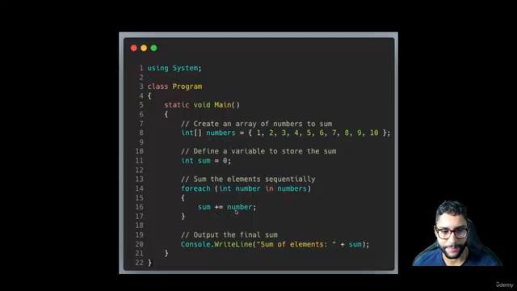
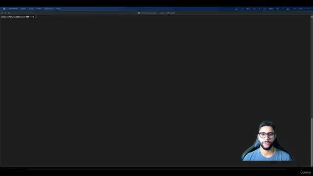
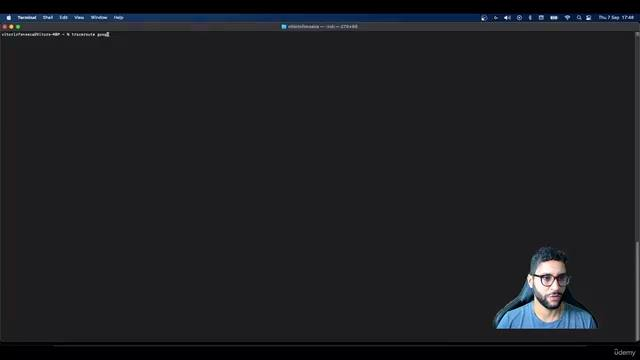
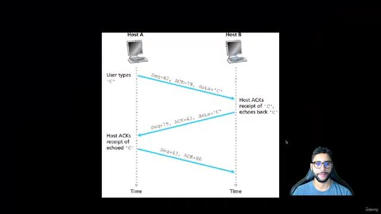
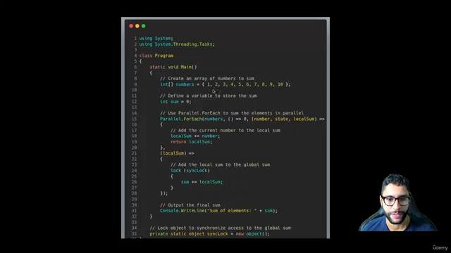
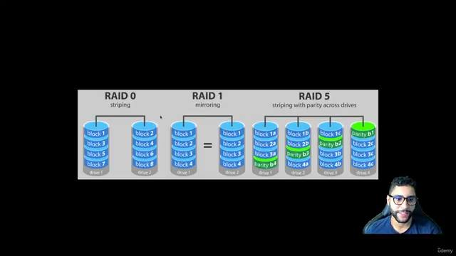

# Web Performance & Monitoring（P027–P030）复现文档

> 复现范围：P027–P030。按逐字稿，这四讲并不是从零实现一个“前端监控报警平台”，而是围绕性能优化、硬件扩展、网络栈、TCP/UDP/IP/DNS 展开。**监控报警系统的 SDK、上报接口、存储、告警规则、通知渠道，这四段逐字稿里都没有讲**。本文只复现逐字稿里真正出现的内容，不把别的课程内容硬塞进来。

## 1. 这一节做什么

这一范围可以拆成四个可交付物：

| 交付物 | 来源 | 是否可以“跑起来” | 本文对应位置 |
|---|---|---|---|
| C# 并行求和示例 | P027 | 可以，使用 .NET 控制台运行 | 第 3、4、5 节 |
| 网络路径诊断命令 | P029 | 可以，在 macOS/Linux 运行 `traceroute`，Windows 运行 `tracert` | 第 3、5 节 |
| 硬件扩展与 RAID 选型表 | P028 | 不能直接“启动服务器”，只能按表做判断 | 第 4、6 节 |
| TCP/UDP/IP/DNS 知识表 | P030 | 纯讲解，无代码 | 第 4、5 节 |

P027 的核心是：先分析算法复杂度，再用一些低成本手段优化代码，例如选择合适数据类型、保持简单、避免不必要的计算、选择合适数据结构、缓存昂贵函数结果、减少 IO、分页、选择更好的排序/查找算法、并行化、写性能测试和负载测试。讲师特别强调：**并行化不是无脑加，先 benchmark，确认值得再增加复杂度**。

P028 的核心是硬件扩展：纵向扩展包括 CPU、内存、存储；横向扩展包括手动增加机器和自动扩展。存储部分讲了 RAID 0、RAID 1、RAID 5。自动扩展部分讲了阈值、监控指标、启动实例、负载均衡、缩容。

P029 的核心是网络层：网络栈、延迟、带宽、RTT、`traceroute` / `tracert`。讲师用 `traceroute google.com` 展示数据包从本机到目标经过的跳数，并说明某些慢点不一定在你的平台，而可能在中间网络。

P030 的核心是协议：TCP 的三次握手、分段、流控、拥塞避免；UDP 的无连接、低开销；IP 的寻址和路由；DNS 的域名到 IP 解析，以及 DNS 缓存、DNS 预取、选择快速可靠 DNS 服务商等优化方向。

## 2. 讲师原话（带「—— pNNN [MM:SS]」）

下面引用逐字稿中的关键原话，并补一句中文解释。英文保留原样，便于对照视频。

> "分析算法的时间复杂度，以识别潜在瓶颈，始终是个好做法。"
> —— p027 [00:00]  
> 意思是：先分析时间复杂度，定位瓶颈，这是性能优化的起点。

> "应优先选择时间复杂度更低的算法，例如 O(log N) 或 O(N)，而不是 O(N²) 或 O(2^N) 这类更高的复杂度。"
> —— p027 [00:30]  
> 目标是更低复杂度的算法，而不是接受明显更差的复杂度。

> "当 map 方法执行完毕后，内存中存储的翻倍值会被垃圾回收。"
> —— p027 [02:53]  
> 讲师用 JavaScript 的 `map` 举例：映射产生的临时结果在完成后可被垃圾回收，不必额外创建长期变量。

> "如果函数以相同输入被多次调用，可以把结果存入缓存，并在后续调用时取回。"
> —— p027 [03:39]  
> 这是 memoization：相同输入重复调用时，缓存结果，减少重复计算。

> “Parallel.ForEach ... basically consists in
get tasks and divide these tasks between threads or processes”  
> —— p027 [07:27]  
> 这是讲师对并行的定义：把任务切分，分给多个线程或进程去做。

> "这里有一个局部变量 sum，它尚未赋值。"
> —— p027 [07:48]  
> 讲师说回调里有一个 local sum。注意“未赋值”这个说法：在 C# 里未赋值的局部变量读不出来，所以复现时这里必须写成 `int localSum = 0;`（详见第 5 节）。

> "需要特别指出的是，这对一小部分数组并没有用……这样做值得吗？"
> —— p027 [09:17]  
> 数组很小时，并行不划算。讲师反复用 “is it worthable” 提醒：先问值不值，再决定加不加复杂度。

> "想象你有一个包含一百万个数字的数组……你可以把数字数组扩展到一千万个。"
> —— p027 [09:40]  
> 这是他给出的 benchmark 规模：先 100 万，跑不出差异就放大到 1000 万。

> "如果这样做不值得，就不要在代码中实现这类方案。"
> —— p027 [10:38]  
> 结论很硬：不值得就别写进去。

> "你可以使用 JMeter 或 Taurus 这类工具来验证这一点。"
> —— p027 [10:38]  
> 性能测试和负载测试的工具，讲师只点了名，并说文档放在课程附件里；**具体怎么用，课里没讲**。

> "硬件扩展，即通过升级或添加硬件组件来提高计算机系统的容量或性能的过程。"
> —— p028 [00:24]  
> 硬件扩展的定义：升级或增加硬件，扩容 CPU、内存、存储、网络。

> "绝不要将同一个数据库同时用于报表和生产用途。"
> —— p028 [04:22]  
> 这是他讲 RAID 1 时顺带撂下的一句硬规矩：报表库和生产库必须分开。

> "纵向扩展是一种通过升级现有机器容量来实现的扩展方式。"
> —— p028 [05:22]  
> 纵向扩展 = 升级你现有的机器；买更多机器则是横向扩展。

> "如果处理器利用率持续超过 80%，就应启动更多实例。"
> —— p028 [07:21]  
> 自动扩展的阈值示例：CPU 持续超过 80% 就加实例。

> "延迟，通常称为 ping 时间，衡量发送请求与收到响应之间的延迟。"
> —— p029 [04:55]  
> 延迟（ping time）= 发出请求到收到响应之间的等待。

> "往返时间，即数据包从发送方传到接收方再返回所花的时间。"
> —— p029 [05:25]  
> RTT = 数据包从发送方到接收方再回来的总时间，直接影响 Web 应用的响应感。

> "正如前面提到的，在 Windows 上运行这些命令，只需运行 tracert。"
> —— p029 [08:54]  
> Unix 系用 `traceroute`，Windows 用 `tracert`（逐字稿里的 “prom” 是口误/转写误差）。

> "TCP 通过三次握手在发送方和接收方之间建立连接。"
> —— p030 [00:11]  
> TCP 传数据之前，先三次握手建连接。

> "UDP 在发送数据前不建立连接。"
> —— p030 [03:08]  
> UDP 不建连接，直接把包发到目标 IP，不检查对方是否准备好接收。

> "DNS 服务器就像互联网的地址簿，把人类可读的域名转换成 IP 地址。"
> —— p030 [05:53]  
> DNS 是互联网的电话簿：把人类可读的域名翻译成 IP 地址。

> "可以实现 DNS 缓存、DNS 预取以及使用快速可靠的 DNS 提供商等多种策略。"
> —— p030 [08:22]  
> 他给出的三个 DNS 优化方向：缓存、预取、换更快更可靠的 DNS 服务商。**具体怎么做，课里说“future class”再讲，本段没展开。**

## 3. 从零复现

这一节按“先建工程、再跑代码、再跑网络命令、最后做选型判断”的顺序走。每一步都给出命令和预期现象。

### 3.1 环境准备

你需要的是 .NET SDK。逐字稿里只出现了 `System.Threading.Tasks`（讲师念作 “system dot trading dot tasks”，是转写误差），没有说 SDK 版本。本文示例统一用 `net8.0`；你本机装的是 6/7/9，把第 4 节 `csproj` 里的 `TargetFramework` 改成对应值即可。

```bash
dotnet --version
```

能打印出版本号（形如 `8.0.xxx`）就可以继续。打印 “command not found”，说明 SDK 没装或没进 PATH。

网络诊断部分不需要额外依赖：macOS / Linux 自带 `traceroute`，Windows 自带 `tracert`。

### 3.2 建目录

```bash
mkdir -p perf-demo/{SequentialSum,ParallelSum,Benchmark}
cd perf-demo
```

目录结构如下，和第 4 节的文件一一对应：

```
perf-demo/
├── SequentialSum/
│   ├── SequentialSum.csproj
│   └── Program.cs
├── ParallelSum/
│   ├── ParallelSum.csproj
│   └── Program.cs
└── Benchmark/
    ├── Benchmark.csproj
    └── Program.cs
```

三个工程分开建，是因为它们各自都有一个入口方法，塞进同一个工程会撞车。功能上：前两个是“正确性对照”（都必须输出 55），第三个是“值不值得”的度量工具。

### 3.3 先跑顺序版，拿到基准答案

把第 4.1、4.2 节的两组文件（四个）分别写进对应目录，然后：

```bash
dotnet run --project SequentialSum
```

预期输出只有一行：

```
55
```

这是 1 到 10 的和。把 `SequentialSum` 的输出记下来，它就是后面并行版的“标准答案”。讲师在 p027 [06:33] 演示的第一个脚本就是这个形态：一个数组、一个 `sum` 变量、一个 `foreach` 累加、最后打印。

### 3.4 再跑并行版，验证结果一致

```bash
dotnet run --project ParallelSum
```

预期同样只有一行：`55`。

如果输出不是 55（比如 54、56，或者每次跑都不一样），说明锁没加对——去第 5 节看 `lock` 那几行。

### 3.5 做 benchmark，回答“值不值得”

这一步对应讲师 p027 [09:40] 的建议：拿 100 万和 1000 万两个规模，分别测顺序和并行的耗时。

```bash
dotnet run --project Benchmark -- 1000000
dotnet run --project Benchmark -- 10000000
```

预期输出两行，形如：

```
sequential  n=1000000 sum=1000000 elapsed=... ms
parallel    n=1000000 sum=1000000 elapsed=... ms
sequential  n=10000000 sum=10000000 elapsed=... ms
parallel    n=10000000 sum=10000000 elapsed=... ms
```

两边 `sum` 必须相等。`elapsed` 的具体数值随机器变化，**不要照抄我这里的数字，以你自己机器的输出为准**。把四个数字填进第 4.7 节的记录表，再决定要不要并行。

记住讲师在 p027 [09:17] 的话：十个元素的数组当然也能量，但结论一定是“不值得”。所以 `ParallelSum` 那个 1..10 的例子只用来看正确性，不用来看性能。



### 3.6 网络路径诊断

macOS / Linux：

```bash
traceroute google.com
```

Windows（命令提示符或 PowerShell）：

```cmd
tracert google.com
```

两条命令做的事情一样：把数据包从你机器到目标中间经过的每一个跳点列出来，每一跳带若干次探测的耗时。逐字稿里讲师在 p029 [05:48]–[07:54] 演示的路径大致是：本机 → 家里的运营商网关（他念作 “meo”）→ 若干中间主机（“telepack”、“tva g”，都挂在 `cprm.net` 下，他查了一下是 Altis International 的骨干网）→ 几个随机 IP（他猜测可能是 DNS 或 CDN）→ 最后落到 Google 一台专门响应这类探测的服务器上。

这里有个他解释得很清楚、但第一次看会懵的点：**你 `traceroute google.com`，最后一跳显示的可能是一个奇怪的 URL 而不是 `google.com`**。原因是这类探测不是 HTTP 请求，Google 会把它导到一台专门处理非 HTTP 请求的机器上。所以看到陌生主机名不代表你走错了。



怎么读这份输出：一行一个跳点。你要找的是**耗时突然变大的那一行**——从那一跳开始往后，时间都不小，说明瓶颈在那一段网络，而不是在你的服务器上。讲师原话的意思很明确：用户慢，可能是中间某个服务器的问题，“it's not your fault”。

注意：逐字稿里没有念出列名，不同系统的列格式也不一样。**具体列名和格式请以你机器的实际输出为准**，不要拿本文当列名依据。



### 3.7 把“硬件扩展”落成一次判断

这一块没有代码，复现方式是按顺序回答七个问题，每个问题的答案都能从 P028 的逐字稿里找到依据：

1. **瓶颈在哪？** 看 CPU 利用率、内存占用、存储容量/IO。讲师的开场场景就是“CPU 打满、内存也打满、看起来是硬件不够”。
2. **是计算密集吗？** 是 → 纵向扩 CPU（换更快的处理器，或多处理器配置加 CPU）。
3. **是并发连接撑不住吗？** 且代码已经优化过 → 纵向扩内存（加 RAM，减少对慢速磁盘的依赖）。
4. **是存储不够/读写互相打架吗？** → 先决定存储布局：单盘、RAID 0、RAID 1、RAID 5，按第 4.4 节的表选。
5. **纵向还是横向？** 升级现有机器 = 纵向；买更多机器 = 横向。
6. **横向是手动还是自动？** 手动 = 你自己加机器；自动 = 系统按指标自己加。
7. **自动的话，阈值和指标是什么？** 讲师给的样例：CPU 利用率持续超过 80% → 加实例；监控的指标是 CPU 利用率、网络流量、请求延迟。

### 3.8 把“网络协议”落成两张顺序图

P030 是纯讲解，没有可
继续——

P030 是纯讲解，没有可运行的代码。所以它的“复现”方式不是敲命令，而是把讲师口述的两个过程按时序画出来、再照着自己的图讲一遍。做完这一步，你应该能脱稿说出下面两张表里的每一步。

**时序一：TCP 三次握手（p030 [00:11]–[01:11]）**

| 步 | 谁动作 | 发什么 | 讲师的说法 |
|---|---|---|---|
| 1 | 客户端 → 服务器 | SYN | “the client sends a scene a scene message to the server”，SYN 意为 synchronization |
| 2 | 服务器 → 客户端 | ACK | 服务器收到 SYN，回一个 acknowledge，表示“收到了，现在确认” |
| 3 | 客户端 → 服务器 | ACK | “the client sends a knowledge message back to the server”，握手完成 |

讲师口述里第二步他只说了“回一个 acknowledge”。实际抓包中第二步常是 SYN 和 ACK 合在一个包里发回，**这一点课里没展开**，你按讲师的三步记即可；真去看抓包时以实际输出为准，不要拿本文当协议字段依据。

握手之后进入数据传输，讲师用带序号的例子讲（p030 [01:41]–[02:10]）：客户端发数据（他举的例子是用户敲的字符 C）带序号 42，服务器回 ACK 并把序号 +1 变成 43；客户端再发下一段，序号 79/80，同时带上一步的 43。这一段他讲得很绕，你只要记住一句话：**每次确认都用“下一个期望的序号”，所以总是 +1**。



**时序二：DNS 解析（p030 [05:53]–[08:22]）**

| 步 | 谁动作 | 说明 |
|---|---|---|
| 1 | 用户在浏览器输入 `manageengine.com` | 讲师用的示例域名 |
| 2 | 浏览器 → DNS resolver | 问：这个域名的 IP 是多少 |
| 3 | resolver 查自己的本地缓存 | 命中就直接返回 IP，后面的步骤全部跳过 |
| 4 | resolver → root server | 未命中时先问根服务器 |
| 5 | resolver → TLD 服务器 | 逐字稿里念成 “TRG server”，是同一步 |
| 6 | resolver → 权威 DNS | “a global DNS”，讲师说这里是“最多能问到的地方” |
| 7 | resolver → 用户 | 返回 IP，浏览器开始加载页面 |

注意第 3 步是整张表里最值钱的一步：**命中缓存就没有 4/5/6**。讲师在 p030 [08:22] 明确说 DNS 解析慢会“delays the start of the page load process”，这就是为什么优化手段是缓存、预取、换更快的服务商——三者都是在缩短或跳过这几步。


## 4. 完整代码

下面每个文件都可以直接复制保存。路径相对 `perf-demo/`。四个 `.csproj` 全部使用同一个骨架，只有工程名不同。

### 4.1 `SequentialSum/SequentialSum.csproj`

```xml
<Project Sdk="Microsoft.NET.Sdk">

  <PropertyGroup>
    <OutputType>Exe</OutputType>
    <TargetFramework>net8.0</TargetFramework>
    <ImplicitUsings>enable</ImplicitUsings>
    <Nullable>enable</Nullable>
    <RootNamespace>SequentialSum</RootNamespace>
    <AssemblyName>SequentialSum</AssemblyName>
  </PropertyGroup>

</Project>
```

### 4.2 `SequentialSum/Program.cs`

```csharp
int[] numbers = { 1, 2, 3, 4, 5, 6, 7, 8, 9, 10 };

int sum = 0;

foreach (int number in numbers)
{
    sum += number;
}

Console.WriteLine(sum);
```

### 4.3 `ParallelSum/ParallelSum.csproj`

```xml
<Project Sdk="Microsoft.NET.Sdk">

  <PropertyGroup>
    <OutputType>Exe</OutputType>
    <TargetFramework>net8.0</TargetFramework>
    <ImplicitUsings>enable</ImplicitUsings>
    <Nullable>enable</Nullable>
    <RootNamespace>ParallelSum</RootNamespace>
    <AssemblyName>ParallelSum</AssemblyName>
  </PropertyGroup>

</Project>
```

### 4.4 `ParallelSum/Program.cs`

```csharp
int[] numbers = { 1, 2, 3, 4, 5, 6, 7, 8, 9, 10 };

int sum = 0;
object syncLock = new object();

Parallel.ForEach(numbers, number =>
{
    int localSum = number;

    lock (syncLock)
    {
        sum += localSum;
    }
});

Console.WriteLine(sum);
```

### 4.5 `ParallelSum/LocalSumDemo.cs`

这是讲师 p027 [07:48]–[08:47] 口述的那种“回调里拿到 local sum、返回出去、在第二个回调里加锁并入总和”的写法。它是一个**类文件，不是入口**，所以放在 `ParallelSum` 工程里不会和 `Program.cs` 的顶层语句冲突。

```csharp
public static class LocalSumDemo
{
    public static int Sum(int[] numbers)
    {
        int total = 0;
        object syncLock = new object();

        Parallel.ForEach(
            numbers,
            () => 0,
            (number, state, localSum) => localSum + number,
            localSum =>
            {
                lock (syncLock)
                {
                    total += localSum;
                }
            });

        return total;
    }
}
```

想验证它，把 `ParallelSum/Program.cs` 最后一行临时改成：

```csharp
Console.WriteLine(LocalSumDemo.Sum(numbers));
```

输出仍然是 `55`。验证完记得改回去，否则第 3.4 节的“只有一行 55”会对不上你看到的两行。

### 4.6 `Benchmark/Benchmark.csproj`

```xml
<Project Sdk="Microsoft.NET.Sdk">

  <PropertyGroup>
    <OutputType>Exe</OutputType>
    <TargetFramework>net8.0</TargetFramework>
    <ImplicitUsings>enable</ImplicitUsings>
    <Nullable>enable</Nullable>
    <RootNamespace>Benchmark</RootNamespace>
    <AssemblyName>Benchmark</AssemblyName>
  </PropertyGroup>

</Project>
```

### 4.7 `Benchmark/Program.cs`

```csharp
using System.Diagnostics;

int n = args.Length > 0 ? int.Parse(args[0]) : 1_000_000;

int[] numbers = new int[n];
for (int i = 0; i < n; i++)
{
    numbers[i] = 1;
}

long warmup = 0;
foreach (int number in numbers)
{
    warmup += number;
}
_ = warmup;

Stopwatch sw = new Stopwatch();

sw.Restart();
long sequential = 0;
foreach (int number in numbers)
{
    sequential += number;
}
sw.Stop();
Console.WriteLine($"sequential  n={n} sum={sequential} elapsed={sw.ElapsedMilliseconds} ms");

object syncLock = new object();
long parallel = 0;

sw.Restart();
Parallel.ForEach(numbers, number =>
{
    lock (syncLock)
    {
        parallel += number;
    }
});
sw.Stop();
Console.WriteLine($"parallel    n={n} sum={parallel} elapsed={sw.ElapsedMilliseconds} ms");
```

### 4.8 Benchmark 结果记录表

跑完第 3.5 节两条命令后，把数字填进来。这张表就是你回答“is it worthable”的证据。

| 规模 n | 顺序耗时（ms） | 并行耗时（ms） | 并行是否更快 | 结论 |
|---|---|---|---|---|
| 1,000,000 | | | | |
| 10,000,000 | | | | |

判定规则（依据 p027 [09:40]–[10:38]）：

- 两个规模下并行都不快 → **不要并行**，保留顺序版。
- 只有 1000 万时并行更快 → 说明收益依赖数据量，只有当你的真实数据量达到这个级别才值得引入并行。
- 两个规模都并行更快 → 值得，但要同时接受“代码复杂度上升”这个代价。

**耗时数字请以你自己机器的实际输出为准**，不同 CPU 核数差异很大。



### 4.9 `Benchmark/MemoizeDemo.cs`（本文示意，非讲师代码）

讲师在 p027 [03:39] 讲了 memoization 的概念，但**课里没有给出 C# 实现**。下面是我补的示意实现，放在 `Benchmark` 工程里同样是非入口类文件。**课里没有代码，以下为示意。**

```csharp
public static class MemoizeDemo
{
    public static Func<TArg, TResult> Memoize<TArg, TResult>(Func<TArg, TResult> fn)
        where TArg : notnull
    {
        Dictionary<TArg, TResult> cache = new Dictionary<TArg, TResult>();
        object syncLock = new object();

        return arg =>
        {
            lock (syncLock)
            {
                if (cache.TryGetValue(arg, out TResult cached))
                {
                    return cached;
                }
            }

            TResult result = fn(arg);

            lock (syncLock)
            {
                cache[arg] = result;
            }

            return result;
        };
    }
}
```

### 4.10 存储布局与扩展选型表（P028 的可交付产物）

这张表把 p028 的口述全部落成可判断的行。存储部分依据 p028 [02:23]–[05:22]，扩展部分依据 [05:22]–[08:51]。

| 场景 | 判断依据 | 选型 | 讲师给的例子 |
|---|---|---|---|
| 计算密集，要最短时间内算完 | CPU 打满 | 纵向扩 CPU：换更快的处理器，或多处理器配置加 CPU | p028 [01:24] |
| 并发连接撑不住，代码已优化过 | 内存打满 | 纵向扩内存：加 RAM，减少对慢速磁盘的依赖 | p028 [01:53] |
| 所有数据放一块盘，最基础 | 无特殊要求 | 单盘 | 电商的订单与发货数据都放一块盘，p028 [02:53] |
| 不同业务块互相抢库 | 高需求块拖慢其他块 | RAID 0（分条）：把库拆到不同盘 | 发货数据放 Drive 1、购物车数据放 Drive 2，p028 [03:23] |
| 报表读取拖垮生产 | 大量读影响生产用户 | RAID 1（镜像）：一份给报表、一份给生产 | Drive 1 做报表、Drive 2 做生产，p028 [04:22] |
| 既要拆分又要数据一致性 | 需要校验 | RAID 5：RAID 0 + RAID 1 的组合，每块盘配校验盘 | 两盘同块数据不一致时由校验盘判定哪份对，p028 [04:52] |
| 单机升不动或成本不划算 | 需要更多机器 | 横向扩：买更多机器分摊负载 | p028 [05:22] |
| 加机器要人盯 | 无自动化 | 手动扩展 | p028 [06:22] |
| 流量有峰谷 | 有指标可监控 | 自动扩展：按阈值自动加减实例 | p028 [06:51] |

自动扩展的执行链，按讲师 p028 [07:21]–[08:51] 的顺序抄成流程图：

```
定义阈值与策略（示例：CPU 持续 > 80% 则加实例）
        ↓
监控指标（CPU 利用率 / 网络流量 / 请求延迟）
        ↓
指标越过阈值 → 触发扩容
        ↓
从预配置模板或镜像创建新实例
        ↓
负载均衡把流量分到新实例
        ↓
指标回落到阈值以下 → 终止多余实例
```


### 4.11 协议对照表（P030 的可交付产物）

| 协议 | 所在层 | 是否建连接 | 可靠性 | 典型用途（讲师举的） | 出处 |
|---|---|---|---|---|---|
| TCP | 传输层 | 三次握手建连接 | 分段、流控、拥塞避免，保证可靠 | 网页、文件下载 | p030 [00:11]–[03:08] |
| UDP | 传输层 | 不建连接 | 不保证送达，丢了不重传 | 语音、视频流、在线游戏、IoT | p030 [03:08]–[04:08] |
| IP | 网络层 | 无连接 | 不保证顺序、不保证无错 | 寻址与路由 | p030 [04:37]–[05:36] |
| DNS | 应用层 | — | 域名 → IP 的解析 | 浏览器输入域名后的第一步 | p030 [05:53]–[08:22] |

讲师在 p030 [04:08] 特意强调了一句：**TCP 和 UDP 都在传输层**。这是最容易记混的一条，抄表时别把它们放到网络层去。



## 5. 逐行解释

### 5.1 `SequentialSum/Program.cs`

- `int[] numbers = { 1, 2, 3, 4, 5, 6, 7, 8, 9, 10 };` —— 讲师用的是 1 到 10 的数组（p027 [06:04] 说“one plus two plus three plus four and etc”）。选这么小是为了肉眼能验算结果 55。
- `int sum = 0;` —— 累加器必须先初始化。C# 里未赋值的局部变量**不能读**，这一点直接决定了后面并行版怎么写。
- `foreach (int number in numbers)` —— 顺序遍历，一次处理一个元素。
- `sum += number;` —— 这就是讲师说的“summing the assigning of each number to this variable”。
- `Console.WriteLine(sum);` —— 打印总数，对应他的 “here we are just consoling the total result”。

**在 JS/Node 里对应什么**：这段等价于 `numbers.reduce((a, b) => a + b, 0)`。前端同学对 `reduce` 熟，可以直接把顺序版理解成 `reduce`，并行版理解成“分开 reduce 再多段相加”。

### 5.2 `ParallelSum/Program.cs`

- `object syncLock = new object();` —— 锁对象。必须是引用类型（`object` 最常用），不能是值类型。讲师在 p027 [08:18] 描述的就是这个 `sync lock`：“check if the variable is locked”。
- `Parallel.ForEach(numbers, number => { ... });` —— 对应讲师 p027 [07:27] 的原话：把任务切分，分给线程或进程。注意它**不保证顺序**，所以你不能假设第一个执行的 lambda 拿到的就是 1。
- `int localSum = number;` —— 这一行是本文相对逐字稿做的**必要修正**。讲师说 “here we have a local sum that is an unassigned variable”，但 C# 里未赋值的局部变量一读就报错（CS0165，见第 7 节），照他念的写编译不过。所以这里显式赋值为当前元素。语义上和他描述的“第一轮 localSum 是 1、第二轮是 2”完全一致。
- `lock (syncLock) { sum += localSum; }` —— 临界区。`sum` 是共享变量，多个线程同时 `+=` 会丢更新（读-改-写三步被打断）。`lock` 保证同一时刻只有一个线程进这段。讲师原话：“if it's locked it waits to be unlocked and when it's unlocked it assigns the local sum value to the sum value”，就是这句。

**在 JS/Node 里对应什么**：浏览器和 Node 主线程是单线程事件循环，普通变量不存在这种数据竞争，**你写业务代码时基本不需要这个 `lock`**。真的要用多线程只能用 `worker_threads`，那时共享内存要靠 `SharedArrayBuffer` + `Atomics` 来保证原子性；`Atomics.add` 大致相当于这里的临界区。这一句「知道即可」，不要去给普通前端代码加锁。

### 5.3 `ParallelSum/LocalSumDemo.cs`

- `Parallel.ForEach(numbers, () => 0, (number, state, localSum) => ..., localSum => ...)` —— 这是 `Parallel.ForEach` 的另一个重载，四个参数：数据源、每线程初始值、每线程的循环体、每线程结束时的收尾。讲师口述的“回调里返回 local sum、在第二个回调里加锁并入总和”就是它，只是他讲的时候把它压缩成了一段叙述。
- `() => 0` —— 每个线程/work partition 的本地累加器从 0 开始。
- `(number, state, localSum) => localSum + number` —— 本线程内部一直累加，**不碰共享变量**，所以这里没锁也不会出错。这是这个重载的价值：把锁的粒度从“每个元素”降到“每个分区一次”。
- `localSum => { lock (syncLock) { total += localSum; } }` —— 分区结束时才进一次临界区，把本地结果并进总数。
- `return total;` —— 返回结果。注意 `total` 在 lambda 里被捕获，C# 允许闭包捕获局部变量（这点和 Java 的 effectively final 不一样，Java 里这种写法编译不过，**知道即可**）。

### 5.4 `Benchmark/Program.cs`

- `int n = args.Length > 0 ? int.Parse(args[0]) : 1_000_000;` —— 规模从命令行传，默认 100 万，正好对应讲师 p027 [09:40] 说的 “one million numbers”。
- `numbers[i] = 1;` —— 全部填 1，这样 `sum` 一定等于 `n`，方便一眼校验：`n=1000000` 就该输出 `sum=1000000`。这比随机数好核对。
- `long warmup = 0; foreach (...) { warmup += number; } _ = warmup;` —— 预热。第一次跑会触发 JIT 编译，耗时会偏高，不预热的话顺序版会被冤枉成“很慢”。`_ = warmup;` 是丢弃赋值，只是为了消掉“变量未使用”的提示。
- `Stopwatch sw = new Stopwatch();` —— 计时器，需要 `using System.Diagnostics;`。
- `sw.Restart();` —— 重置并开始。用它而不是 `Start()`，是为了让同一只表复用两次。
- `sw.ElapsedMilliseconds` —— 毫秒数。**这个字段名请以你实际编译时的 API 为准**，它属于 .NET 标准库，不是逐字稿里的内容。
- `lock (syncLock) { parallel += number; }` —— 注意这里**故意保留每个元素都加锁**的写法。这样写出来的并行版在 1000 万规模下很可能比顺序版还慢，而这恰恰是最好的教学结果：它直观证明了讲师那句“don't implement these kind of solutions if it's not worthable”。

**在 JS/Node 里对应什么**：`Stopwatch` ≈ `performance.now()` 前后取差；`console.time('x') / console.timeEnd('x')` 也行。

### 5.5 `Benchmark/MemoizeDemo.cs`（示意）

- `where TArg : notnull` —— 字典的键不能是 null，这是泛型约束，**不必深究，知道即可**。
- 第一段 `lock` 里 `TryGetValue` —— 命中就直接返回，这就是讲师说的 “store the result in a cache and retrieve it for subsequent calls”。
- 两段锁之间**故意留在锁外**执行 `fn(arg)` —— 慢函数执行期间不持锁，否则缓存反而变成性能瓶颈。代价是并发时同一个 key 可能被算两次（缓存击穿的一种形态），讲师没讨论这个取舍，**课里没讲**。
- 第二段 `lock` 里 `cache[arg] = result;` —— 写回缓存。

### 5.6 两张表为什么这么定

- 选型表里“报表库与生产库分开”被单独立成一行，因为讲师用了最强的一句话：**“never use the same database for reporting and for production purposes”**（p028 [04:22]）。这不是建议，是他明确说 never 的一条。
- RAID 5 那一行我写成“RAID 0 + RAID 1 的组合，另加校验盘”，因为讲师原话就是 “basically the combination of RAID 0 and RAID 1 but with the difference that for each drive here, there is a generation of a parity disk”。他把 RAID 5 描述成两者组合，**这个说法和教科书上的定义不完全一致**，但本文按他的表述记，不擅自改写。
- 协议表里 IP 那一行特意写了“不保证顺序、不保证无错”，因为讲师 p030 [05:36] 说得很明白：IP 的无连接特性降低了延迟和开销，但“does not guarantee the ordered or error-free delivery of packets”。
- 阈值那一行只放 80%，因为这是他唯一给出的具体数字（p028 [07:21]）。别的阈值课里没给。

## 6. 复现检查清单

按顺序打勾，全绿就算复现完成。

**环境**
- [ ] `dotnet --version` 有输出，且大版本与 `TargetFramework` 一致
- [ ] `perf-demo/` 下存在 `SequentialSum`、`ParallelSum`、`Benchmark` 三个目录
- [ ] 每个目录里都有对应的 `.csproj` 和 `Program.cs`

**顺序版**
- [ ] `dotnet run --project SequentialSum` 输出 `55`
- [ ] 输出没有多余的空行或警告刷屏

**并行版**
- [ ] `dotnet run --project ParallelSum` 输出 `55`
- [ ] 连跑 5 次（`for i in 1 2 3 4 5; do dotnet run --project ParallelSum; done`）**每次都还是 55**，没有出现 54、56 之类
- [ ] 临时改成 `LocalSumDemo.Sum(numbers)` 后仍然输出 `55`，改回后恢复一行输出

**Benchmark**
- [ ] `dotnet run --project Benchmark -- 1000000` 打出两行，两个 `sum` 相等且等于 1000000
- [ ] `dotnet run --project Benchmark -- 10000000` 打出两行，两个 `sum` 相等且等于 10000000
- [ ] 4.8 的记录表四格已填
- [ ] 已按判定规则得出结论，并写下一句“我的项目要不要并行”

**网络诊断**
- [ ] macOS/Linux 跑 `traceroute google.com` 有输出；Windows 跑 `tracert google.com` 有输出
- [ ] 能指出输出里**从哪一跳开始耗时明显变大**
- [ ] 能解释为什么最后一跳的主机名不是 `google.com`

**概念复述（P030）**
- [ ] 不看文档能说出三次握手的三步，以及第二步是谁发给谁
- [ ] 能说出 TCP 和 UDP 各在传输层还是网络层
- [ ] 能说出 DNS 解析的 7 步顺序，并指出缓存命中后哪几步会被跳过
- [ ] 能说出讲师给的三个 DNS 优化方向

**边界确认**
- [ ] 你清楚这四讲**没有**给出监控 SDK、上报接口、告警规则、通知渠道的任何实现
- [ ] 你清楚 JMeter / Taurus 只是被点名，课里没讲用法

## 7. 课里没讲但你会撞上的

**1）照着讲师的“未赋值 local sum”写，编译直接报错。**
C# 会报 `CS0165: Use of unassigned local variable`。讲师说的 “an unassigned variable” 是口述时对代码的概括，不是可编译的字面写法。本文 4.4 里写成 `int localSum = number;` 就是为了绕开它。这是你复现这段代码时**第一个会撞上的坑**。

**2）`Parallel.ForEach` 的结果顺序不可依赖。**
它把任务分给多个线程，谁先跑完谁先结束。本例只做加法所以结果稳定；一旦你改成“把结果 append 进 List”，顺序就会随机。讲师讲的是求和，没提这一点，**课里没讲**。要保序得自己带索引再排序。

**3）每个元素都加锁的并行，在千万级数据上很可能更慢。**
这是锁竞争导致的。`LocalSumDemo` 那个重载就是解法之一（把锁粒度从“每元素”降到“每分区”）。讲师在 p027 只说“先 benchmark 再决定”，没有直接给出“分区累加”这个优化，**这一段属于你自己跑数据时会发现的结论**。

**4）Benchmark 的数字波动很大，单次结果不能当结论。**
JIT 预热、CPU 频率调节、后台进程都会影响。建议每个规模连跑 3–5 次取中位数。讲师只说要 benchmark，**没说重复几次、怎么统计**，这部分课里没讲。

**5）`int` 会溢出。**
本例数组全填 1，1000 万也不会溢出。但如果你把元素换成大数，`int` 累加会静默回绕成负数，`sum` 对不上而你不一定立刻发现。改用 `long` 即可。讲师全程用 `int`，**没提溢出**。

**6）`traceroute` 在部分 Linux 上默认没装。**
需要先装包（Debian/Ubuntu 是 `sudo apt install traceroute`）。另外某些网络会屏蔽探测包，输出里会出现连续的 `* * *`，这既不是你的命令错了，也不是链路断了。这类输出怎么读，**课里没讲**，以你机器的实际输出为准。

**7）`traceroute` 和 `tracert` 的参数不通用。**
讲师只说了 Windows 用 `tracert`，没讲两者参数差异。别把 `-n`、`-I` 这类参数直接跨平台照抄。

**8）P028 的硬件扩展，课里没有任何一条可执行命令。**
RAID 具体怎么配（`mdadm`、硬件 RAID 卡、云平台的存储配置界面）、自动扩展在哪个云平台怎么点、指标用什么工具采集——**全都没讲**。这一讲产出的是判断顺序和选型依据，不是操作手册。本文第 4.10 节给的表就是它能产出的全部东西。

**9）自动扩展的“80%”只是讲师的举例阈值，不是通用最佳值。**
他在 p028 [07:21] 用的是 “you might specify that”，语气是举例。别把这个数字直接抄进生产配置。你的阈值应该来自你自己的压测数据。

**10）讲师说“报表明细不要和生产同库”，但没讲怎么拆。**
是拆机器、拆库、还是只读副本，他都没说。他只给了 RAID 1 这个存储层的思路（一份给报表、一份给生产）。应用层怎么分库分表，**课里没讲**。

**11）DNS 的三个优化方向，课里只给了名字。**
“DNS caching、DNS prefetching、using a fast and reliable DNS provider” 是在 p030 [08:22] 说的，他明确表示细节在后面的课里。所以本文 4.11 也只到“有这三个方向”为止。前端常见的 `<link rel="dns-prefetch">` 属于这一类，但**这条具体做法课里没讲**，我在这里提它只是告诉你“以后会往哪走”，不是讲师说的。

**12）课程标题里的“监控报警”，这四讲没有落地实现。**
P027