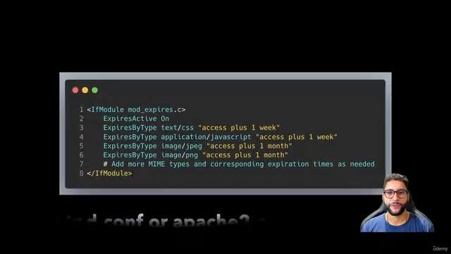
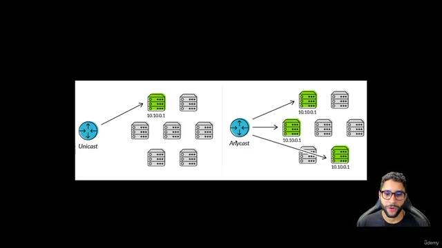

## 1. 这一节做什么

这五讲（P31–P35）属于 Web Performance & Monitoring 模块里的“网络层性能”部分，不是监控报警系统的完整实现。逐字稿里明确说监控工具会在下一模块再看（p035 [08:22]）。本节要复现出来的东西分三层：

1. **HTTP 基础认知**：请求/响应各由什么组成，GET/POST/PUT/DELETE 分别做什么，200/404/500 代表什么，HTTP 为什么是无状态的，keep-alive 在解决什么问题。
2. **HTTP 优化与缓存**：减少请求、启用 gzip/deflate、升级 HTTP/2 或 HTTP/3、减少重定向；然后用 `Cache-Control`、`Expires`、`ETag`、`Last-Modified`、`Vary` 控制缓存；最后在 Apache / nginx 上配置静态资源过期时间。
3. **部署层性能**：单线程与多线程的差别，为什么单线程语言需要负载均衡；DNS 解析流程、DNS 延迟优化、DNS 缓存。

本文会带你做一个**本地 nginx 缓存实验站**：用完整文件启动一个静态站点，让 `style.css`、`app.js`、图片资源带上 7 天缓存头，再用浏览器 DevTools 和 `curl -I` 验证。负载均衡和 DNS 部分课程没有给出可直接复制的完整配置，本文不会伪造字段名，而是给检查表和设计决策表；涉及未讲内容会明确标注“课里没讲”。


## 2. 讲师原话（带「—— pNNN [MM:SS]」）

> "HTTP 被视为无状态协议，因为每个请求-响应周期都是独立的，并且不会保留过去交互的任何信息。"
> —— p031 [04:15]  
> 讲师在这里强调 HTTP 的无状态性：每个请求-响应周期独立，服务器不保留上一次交互的记忆。要维持登录态，课程提到 cookies 或 sessions。

> "第一条建议很合乎逻辑：减少请求数量。"
> —— p032 [00:00]  
> 优化 HTTP 的第一条是减少请求数量；课程举的例子是把多个资源合并成一个文件，减少建立新连接的开销。

> "在网站服务器上启用 gzip 或 deflate 等压缩技术……减小传输数据的大小。"
> —— p032 [00:59]  
> 在 Web 服务器上启用 gzip 或 deflate，减小传输体积和带宽占用。

> "Cache-Control 可以设置为 public、private、max-age、no-cache、no-store 等指令。"
> —— p033 [00:00]  
> 讲师逐条解释 Cache-Control 的常见指令：public、private、max-age、no-cache、no-store。

> "这个资源会在我的机器上缓存三天。"
> —— p033 [03:58]  
> 在 Adidas.pt 的 DevTools 里，讲师把字体资源的 max-age 秒数换算成大约三天，并看到 Expires 是三天后的日期。

> "如果使用 Apache……请确保已启用 mod_expires 模块。"
> —— p033 [06:45]  
> Apache 侧配置缓存要先确保 `mod_expires` 模块启用，然后在配置文件里按文件类型设置过期时间。

> "如果使用 nginx……请添加以下配置行来设置缓存过期时间……为 CSS、JavaScript、JPEG 和 PNG 设置 7 天的缓存过期时间。"
> —— p033 [07:32]  
> nginx 侧在 server block 里为 css、javascript、jpeg、png 设置 7 天缓存过期；保存后先 `nginx -t` 测试语法，再 `nginx -s reload` 重载。

> "单线程语言的设计目标是按顺序执行任务。"
> —— p034 [00:29]  
> 单线程语言按顺序执行任务，难以充分利用多核 CPU；一个请求在计算时，后续请求要等待。

> "在网站服务器前端配置负载均衡后，用户只需将请求指向负载均衡器，负载均衡器再把请求重定向到最空闲的进程。"
> —— p034 [01:59]  
> 负载均衡器把请求转发给最空闲的进程；课程用“四倍容量”的示意说明把单线程应用实例分布到多个核上的效果。

> "DNS 解析器会向 DNS 根名称服务器发起查询。"
> —— p035 [00:59]  
> DNS 解析先问 DNS resolver，再找根域名服务器；根服务器不直接给最终 IP，而是指向 .com 这类顶级域服务器。

> "选择信誉良好且高性能的 DNS 提供商，对改善 DNS 延迟至关重要。"
> —— p035 [04:59]  
> 改善 DNS 延迟的第一条策略是选择有全球节点、查询响应快的高性能 DNS 提供商。

> "现代网页浏览器支持 DNS 预取。"
> —— p035 [05:40]  
> 现代浏览器支持 DNS 预取：页面里有很多外部链接时，可以提前解析这些域名的 IP，用户点击时省掉解析时间。

> "我们需要调整操作系统，因为 Apache 并不控制 DNS 缓存的 TTL。"
> —— p035 [09:31]  
> 服务端 DNS 缓存 TTL 不由 Apache 控制，要动操作系统层；课程说 Linux 上可以用逐字稿听写为 “DNSMaskU” 的工具（通常指 dnsmasq，具体以课程附件为准），在配置文件里加 TTL 秒数，保存后重载。


## 3. 从零复现

### 3.1 复现范围与前置条件

本文的“可运行实验”是 P033 的缓存配置：本地 nginx 静态站点 + 7 天缓存 + DevTools/curl 验证。P031、P032 是概念和优化清单，P034、P035 是架构与 DNS 运维，课程没有给完整可复制文件；这些部分按“检查表/设计表”复现，不伪造命令输出字段。

前置条件：

- 一台 Linux 或 macOS 机器；Windows 建议在 WSL 里做，但课里没讲 WSL。
- 已安装 nginx。**课里没讲安装命令和版本号**，请按你的系统包管理器安装；本文不写不存在的版本号。
- 一个现代浏览器，能用 DevTools 的 Network 面板。
- 终端能运行 `nginx`、`curl`。

目录结构如下，后面所有文件都放在这个目录里：

```text
perf-lab/
├── nginx.conf
└── site/
    ├── index.html
    ├── style.css
    ├── app.js
    └── img/
        └── demo.svg
```

### 3.2 第一步：创建目录和文件

在终端执行（路径按你的实际位置改）：

```bash
mkdir -p perf-lab/site/img
cd perf-lab
```

然后依次保存第 4 章的 5 个文件。注意 `nginx.conf` 里的 `include /etc/nginx/mime.types;` 是常见路径；如果你的 nginx 安装路径不同，改成你机器上实际存在的 `mime.types` 路径。**这个路径差异课里没讲**，属于本机环境问题。

### 3.3 第二步：测试 nginx 配置

在 `perf-lab` 目录下执行：

```bash
nginx -t -p "$PWD" -c nginx.conf
```

`-p "$PWD"` 把当前目录作为 nginx prefix，这样配置里的 `root site;` 会指向 `perf-lab/site`。`-c nginx.conf` 指定配置文件。看到语法测试成功的提示后再启动；具体提示文案以你的 nginx 版本为准。

### 3.4 第三步：启动本地站点

```bash
nginx -p "$PWD" -c nginx.conf
```

然后访问：

```text
http://localhost:8080/
```

如果 8080 被占用，改 `nginx.conf` 里的 `listen 8080;`，再重新测试和启动。端口冲突课里没讲，这是本地实验常见问题。

### 3.5 第四步：验证缓存头

先看 CSS：

```bash
curl -I http://localhost:8080/style.css
```

再看 JS 和图片：

```bash
curl -I http://localhost:8080/app.js
curl -I http://localhost:8080/img/demo.svg
```

你会看到与缓存过期相关的响应头。`expires 7d;` 对应 7 天，按秒换算是 `7 × 24 × 60 × 60 = 604800` 秒。具体头字段和值以 `curl -I` 实际输出为准；不要凭记忆填字段。

再打开浏览器 DevTools：

1. 打开 `http://localhost:8080/`。
2. 按 F12 或右键 Inspect，进入 Network 面板。
3. 刷新页面。
4. 点 `style.css`、`app.js`、`img/demo.svg`，在 Headers 里看 Response Headers。
5. 对照 P033 的方法：看到 `max-age` 的秒数就换算成分钟/小时/天；看到 `Expires` 就看绝对过期时间。


### 3.6 第五步：复现讲师在 Adidas.pt 的观察法

课程里讲师打开 `adidas.pt`，在 DevTools 的 Network 面板里点字体、图片、脚本，查看 Response Headers 里的缓存信息。你可以用任意站点复现这个观察动作，不必只盯 Adidas：

- 字体资源：讲师看到 `Cache-Control` 里的 `max-age`，换算后约 3 天；`Expires` 是课程当天（9 月 12 日）之后三天，即 9 月 15 日。
- 运动鞋图片：讲师看到 `Cache-Control: private, no-transform, max-age`。`private` 表示不应被代理服务器缓存；`no-transform` 表示资源不应被压缩/转换，因为图片压缩会损失像素信息。
- 脚本 `fbevents.js`：讲师看到 `public` 和 `max-age`，`public` 表示浏览器和中间代理都可以缓存。


### 3.7 第六步：理解 Apache / nginx 的配置位置

Apache 侧，课程步骤是：确保 `mod_expires` 模块启用；打开 Apache 配置文件；按 CSS、JavaScript、JPEG、PNG 等文件类型设置过期时间；保存并重启 Apache。逐字稿没有记录具体配置行内容，只说明屏幕上有示例，所以本文不伪造 Apache 指令。

nginx 侧，课程步骤是：打开 nginx 配置文件或 virtualhost 文件；在 `server` block 里为 css、javascript、jpeg、png 设置 7 天过期；保存；`nginx -t` 测试语法；`nginx -s reload` 重载。本文第 4 章的 `nginx.conf` 就是把这段课程描述落成完整文件，其中 `expires 7d;` 对应“7 天”。



### 3.8 第七步：复现 P034 的判断过程（不写未讲配置）

P034 没有给负载均衡配置文件，只讲原理。你可以按下面顺序复现讲师的推导：

1. 判断你的后端语言/运行时是单线程顺序执行，还是能多线程并发。课程说单线程语言按顺序执行，难以充分利用多核。
2. 画出“一个请求在计算时，后续请求等待”的排队图。
3. 设想在 Web 服务器前加负载均衡器，把请求分给最空闲的进程；课程用四个核的示意说明容量可以变成四倍。
4. 再把负载均衡器放到多台服务器前：一台忙或挂掉，就转到另一台健康服务器。
5. 列出课程给出的收益：高可用、可扩展、防止单台过载、优化资源利用、按地理位置分流。


### 3.9 第八步：复现 P035 的 DNS 解析流程

按课程画一遍 DNS 解析：

1. 用户访问 `example.com`，本机不知道它的 IP，问 DNS resolver。
2. DNS resolver 不知道，去问最近的 DNS 根域名服务器。
3. 根服务器说：去问 `.com` 的顶级域服务器。
4. DNS resolver 去问 `.com` TLD 服务器。
5. TLD 服务器说：去问 Amazon Route 53 的名称服务器（课程例子）。
6. Route 53 返回 `example.com` 的 IP，例如课程中的 `192.0.2.44`。
7. DNS resolver 把 IP 返回给用户机器。
8. 用户机器用这个 IP 访问 Web 服务器，Web 服务器返回页面资源。

课程指出两个问题：解析耗时；缓存过期后需要反复解析。对应方案：选高性能 DNS 提供商、DNS prefetching、Anycast、合理 TTL、监控 DNS、DNS 负载均衡；以及客户端和服务端 DNS 缓存。


服务端 DNS 缓存部分，课程说 Linux 上可以用 dnsmasq（逐字稿听写为 DNSMaskU），打开课程屏幕上的配置文件，加入以秒为单位的 TTL，保存后重载。**逐字稿没有记录该配置行的字段名和具体值**，所以本文不编造 `dnsmasq.conf` 的字段；请以课程截图或 dnsmasq 对应版本文档为准。客户端 DNS 缓存由浏览器自己管理，前端应用不需要专门改代码；但课程也提醒，旧浏览器或较少见浏览器可能有不同缓存行为。


## 4. 完整代码

> 说明：逐字稿只给了 nginx 的“7 天 + css/js/jpeg/png”思路，没有逐行给出完整 `nginx.conf`；下面是为了让实验能跑起来而补全的完整文件。`gzip` 配置对应 P032 的“启用 gzip/deflate”优化点，但具体 nginx 指令不是逐字稿原文。Apache 配置行和 dnsmasq 配置行逐字稿没有记录，本文不伪造。

### 4.1 `perf-lab/nginx.conf`

```nginx
pid /tmp/perf-lab-nginx.pid;
error_log /tmp/perf-lab-error.log warn;

events {
    worker_connections 1024;
}

http {
    include       /etc/nginx/mime.types;
    default_type  application/octet-stream;
    access_log    /tmp/perf-lab-access.log;

    gzip on;
    gzip_types text/css application/javascript image/svg+xml;

    server {
        listen 8080;
        server_name localhost;

        root site;
        index index.html;

        location / {
            try_files $uri $uri/ =404;
        }

        location ~* \.(css|js)$ {
            expires 7d;
        }

        location ~* \.(jpe?g|png|svg)$ {
            expires 7d;
        }
    }
}
```

### 4.2 `perf-lab/site/index.html`

```html
<!doctype html>
<html lang="zh-CN">
<head>
  <meta charset="utf-8">
  <meta name="viewport" content="width=device-width, initial-scale=1">
  <title>Perf Lab - Cache Headers</title>
  <link rel="stylesheet" href="style.css">
</head>
<body>
  <h1>Perf Lab</h1>
  <p>打开 DevTools 的 Network 面板，刷新页面，查看 style.css、app.js、img/demo.svg 的响应头。</p>
  
  <script src="app.js"></script>
</body>
</html>
```

### 4.3 `perf-lab/site/style.css`

```css
body {
  font-family: system-ui, sans-serif;
  margin: 40px;
}

h1 {
  color: #1f4e79;
}

img {
  border: 1px solid #ccc;
}
```

### 4.4 `perf-lab/site/app.js`

```javascript
document.documentElement.dataset.perfLab = "ready";
```

### 4.5 `perf-lab/site/img/demo.svg`

```svg
<svg xmlns="http://www.w3.org/2000/svg" width="160" height="90" viewBox="0 0 160 90">
  <rect width="160" height="90" fill="#eaf2fb"/>
  <text x="80" y="50" text-anchor="middle" font-size="16" fill="#1f4e79">cache</text>
</svg>
```

### 4.6 启动、验证、停止命令汇总

```bash
cd perf-lab

nginx -t -p "$PWD" -c nginx.conf
nginx -p "$PWD" -c nginx.conf

curl -I http://localhost:8080/
curl -I http://localhost:8080/style.css
curl -I http://localhost:8080/app.js
curl -I http://localhost:8080/img/demo.svg

nginx -s stop -p "$PWD" -c nginx.conf
```

### 4.7 P034 / P035 的设计决策表（不是可执行配置）

| 主题 | 课程给出的判断 | 复现时你要检查什么 |
|---|---|---|
| 单线程 | 顺序执行，一个请求计算时后续等待，难以吃满多核 | 你的运行时是否真的单线程；CPU 密集任务会不会阻塞请求 |
| 多线程 | 多个线程并发，能利用多核 | 是否真的并行；共享状态是否需要同步（课程没讲锁/事务细节） |
| 进程级负载均衡 | 负载均衡器把请求发给最空闲进程 | 是否有多个应用实例；是否有健康检查；是否有分发策略 |
| 服务器级负载均衡 | 一台忙/挂掉时转到健康服务器 | 高可用、可扩展、防过载、资源利用、地理分流 |
| DNS 解析 | resolver → 根 → TLD → 权威 DNS → IP | 你的 DNS 提供商是否有全球节点、查询响应是否低 |
| DNS prefetch | 浏览器提前解析页面中链接的域名 | 页面是否有很多外部链接；是否值得预取 |
| Anycast | 同一 IP 从多个位置宣告，路由到最近 DNS | 你的 DNS 服务是否支持；课程没给配置 |
| TTL | 太长影响变更传播，太短增加查询 | 你的 DNS 记录 TTL 是否符合业务变更频率 |
| DNS 缓存 | 客户端浏览器 + 服务端操作系统层 | Linux 可用 dnsmasq；具体配置行课里没给 |

## 5. 逐行解释

### 5.1 `nginx.conf` 逐行解释

`pid /tmp/perf-lab-nginx.pid;`：把本次实验的 nginx 主进程 PID 写到 `/tmp`，避免和你系统里已有的 nginx 抢默认 pid 文件。课里没讲 pid 路径，这是本地实验隔离手段。

`error_log /tmp/perf-lab-error.log warn;`：错误日志写到 `/tmp`，启动失败时先看这个文件。课里没讲日志路径。

`events { worker_connections 1024; }`：nginx 的事件连接数配置。课程没有讲 nginx 事件模型，这里只是让配置完整可启动。

`http { ... }`：HTTP 配置块，所有 server 都放在里面。

`include /etc/nginx/mime.types;`：引入 MIME 类型映射，让 `.css`、`.js`、`.svg` 返回正确的 Content-Type。你的 nginx 如果不在 `/etc/nginx`，改这一行；课里没讲这个路径差异。

`default_type application/octet-stream;`：没有匹配到 MIME 类型时的默认类型。

`access_log /tmp/perf-lab-access.log;`：访问日志写到 `/tmp`，方便确认请求有没有打到 nginx。

`gzip on;`：启用 gzip 压缩，对应 P032 的“启用 gzip/deflate 减少传输体积”。课程只讲要启用，没有给 nginx 具体指令；这行是复现补全。

`gzip_types text/css application/javascript image/svg+xml;`：指定哪些 MIME 类型参与 gzip。课程没有给这个列表，这里是实验补全。注意 `text/html` 通常由 nginx 默认处理，不写也不影响本实验。

`server { ... }`：一个虚拟主机。

`listen 8080;`
让 nginx 在 8080 端口监听。选 8080 而不是 80，是为了避开 80 端口需要 root 权限、以及本机可能已有 Web 服务占用的问题；**课里没讲端口怎么选**，这是本地实验的补全。

`server_name localhost;`：只匹配 Host 头为 `localhost` 的请求。本地实验够用；课程没有讲 `server_name` 与多域名虚拟主机的配置。

`root site;`：静态资源根目录，这里故意写成相对路径。它依赖启动时的 `-p "$PWD"`，nginx 会把 prefix 和 `site` 拼起来，实际指向 `perf-lab/site`。如果你只写 `nginx -c nginx.conf` 而不给 `-p`，nginx 会用它编译时的默认 prefix，`root site` 就可能指向完全不同的目录，页面直接 404。这个坑课里没讲，是复现时最容易卡住的一步。

`index index.html;`：访问 `/` 时返回目录下的 `index.html`。

`try_files $uri $uri/ =404;`：先按请求路径找同名文件，再找同名目录，都没有就返回 404。这样 URL 和磁盘文件一一对应，你在 DevTools 里看到的请求路径能和目录结构直接对照，排查缓存头时不会错对象。课程没有讲 `try_files`，这里是为了让静态站行为可预测。

`location ~* \.(css|js)$ { expires 7d; }`：`~*` 表示正则匹配且忽略大小写，也就是 `.CSS`、`.Js` 都会命中。`expires 7d;` 就是课程“为 css、javascript 设置 7 天过期”的落点。nginx 的 `expires` 指令会生成与过期时间相关的响应头，但**具体输出哪些字段名、max-age 具体是多少秒，请以你机器上 `curl -I` 的实际输出为准**，不要拿别的服务器截图套。按秒算，7 天是 `7 × 24 × 60 × 60 = 604800` 秒。

`location ~* \.(jpe?g|png|svg)$ { expires 7d; }`：课程原文只说了 jpeg 和 png；这里补了 `jpe?g`（同时匹配 jpg 和 jpeg）以及 `svg`。加 svg 的唯一原因是本实验想用一个纯文本图片文件，方便你把内容直接粘进编辑器；如果你要严格对齐课程，把 `svg` 从这一行去掉，然后把第 4.5 节换成任意一张真实的 jpg/png，其他不变。

### 5.2 `index.html` 逐行解释

`<!doctype html>`：声明标准模式，避免浏览器进入怪异模式导致布局和请求行为异常。

`<html lang="zh-CN">`：页面语言标注。和缓存无关，但 `app.js` 会往这个元素上写 `data-perf-lab`，所以需要它能被选中。

`<meta charset="utf-8">`：声明编码，防止页面里的中文变成乱码。乱码不影响缓存头观察。

`<meta name="viewport" ...>`：移动端视口设置。**课里没讲**，这里加上只是让页面在窄屏下不至于缩成一团。

`<link rel="stylesheet" href="style.css">`：这一行会在页面加载时触发对 `style.css` 的请求，是 Network 面板里第一行要观察的静态资源。

``：触发对 `img/demo.svg` 的请求。注意相对路径要和第 3.1 节的目录结构对上，否则会 404，你就看不到缓存头了。

`<script src="app.js"></script>`：触发对 `app.js` 的请求。放在 `</body>` 前，保证执行时 DOM 已经解析完；这是常规做法，**课里没讲脚本位置**。

整体上这三个标签对应课程里“点字体、点图片、点脚本”的三个观察对象，只是把字体换成了 CSS——因为本地实验没有字体文件，而 CSS 和 JS 在课程的 nginx 配置里属于同一组 7 天缓存。

### 5.3 `style.css` 与 `app.js` 逐行解释

`body { font-family: system-ui, sans-serif; margin: 40px; }`：用系统字体，避免为了字体文件再引一个外部请求，把实验变量控制到最少。`system-ui` 是前端常用写法，**课里没讲**。

`h1 { color: #1f4e79; }`：让标题有颜色，方便你一眼确认 CSS 真的生效、不是加载失败的裸 HTML。

`img { border: 1px solid #ccc; }`：给图片加边框，确认图片路径没错。

`document.documentElement.dataset.perfLab = "ready";`：这一行会在 `<html>` 标签上写入 `data-perf-lab="ready"`。它的作用是让你能区分“JS 文件被下载了”和“JS 真的执行了”——打开 DevTools 的 Elements 面板看 `<html>` 标签属性即可。缓存实验里经常出现“文件没重新请求，但你以为代码更新了”，这个小标记就是用来排除这种错觉的。

这两个文件还有一层用途，是暴露缓存失效问题：你改动 `style.css` 的内容但文件名不变，浏览器在 7 天有效期内可能根本不发请求，直接用本地副本，于是你看到的是旧样式。课程在 p033 [08:25] 只提醒“you might need to handle cache invalidation strategies for resources that may change frequently”，**没有给出具体做法**。工程上常见的解法是给文件名加内容哈希或加版本查询串，但课里没讲，不要当成讲师观点。

### 5.4 `demo.svg` 逐行解释

`<svg xmlns=... width="160" height="90" viewBox="0 0 160 90">`：声明 SVG 命名空间和画布尺寸，`viewBox` 让图形等比缩放。

`<rect width="160" height="90" fill="#eaf2fb"/>`：铺一层浅蓝背景，让图片在页面里可见。

`<text x="80" y="50" text-anchor="middle" ...>cache</text>`：居中写 “cache” 字样，截图或录屏时能一眼确认加载的是哪个文件。

### 5.5 命令逐行解释

`nginx -t -p "$PWD" -c nginx.conf`：`-t` 只做配置语法测试，不启动服务；`-p "$PWD"` 把当前目录设为 prefix，让 `root site` 指向正确位置；`-c nginx.conf` 指定用哪个配置文件。三个参数必须一起给，少给 `-p` 或 `-c`，nginx 就会去读系统默认配置，你改的东西根本不会生效。

`nginx -p "$PWD" -c nginx.conf`：真正启动。没有 `-t`，其余参数含义相同。启动后 nginx 会按 `pid` 指令把主进程号写到 `/tmp/perf-lab-nginx.pid`。

`curl -I http://localhost:8080/style.css`：`-I` 表示只取响应头，不发完整响应体。它对应讲师在 DevTools 里点开某个资源、切到 Headers 看 Response Headers 的动作，但更快、更容易贴进文档对比。逐个对 `style.css`、`app.js`、`img/demo.svg` 发一遍，就能确认三个文件都拿到了相同的 7 天缓存策略。注意 `curl -I` 发的是 HEAD 请求，某些服务器对 HEAD 和 GET 返回的头可能不同；nginx 服务静态文件时通常一致，如果你发现浏览器和 curl 结果对不上，先怀疑这条，而不是怀疑配置写错。

`nginx -s stop -p "$PWD" -c nginx.conf`：发送停止信号。`-s` 后面跟 `stop` 是停服务，跟 `reload` 是重载配置。**`-s` 同样要带 `-p` 和 `-c`**，否则 nginx 会去操作系统默认实例，可能出现“我明明停了，8080 还在响应”的情况。课程里出现的 `nginx -s reload` 就是这个位置，只是讲师没有展开讲 prefix 和配置文件参数。

### 5.6 设计决策表逐条解释

“单线程”一行：课程说单线程语言顺序执行、一个请求在计算时后续请求要等。所以复现时你要检查的不是“语言名字”，而是**有没有会长时间占住执行流的任务**。放到前端转 AI 应用工程师的场景：Node 是单线程事件循环，一次大的 `JSON.parse`、同步加密、图片处理都会把后续请求堵在队列里。这是把课程结论迁移到 Node，**课里没点名 Node**。

“多线程”一行：课程说多线程能同时跑多个执行流、利用多核。但多线程一旦共享状态就需要同步机制，课程完全没有展开锁和事务。在 JS/Node 里没有传统意义上的互斥锁，多进程之间共享状态得靠外部存储或消息传递——这一点课里没讲，属于你上手多实例部署时必然撞上的空白。

“进程级负载均衡”一行：课程原话是转发给 most idle process，即最空闲的进程。复现时你要确认自己的部署里真的有多个应用实例可分发，否则负载均衡器后面只有一个进程，配了也等于没配。具体用哪种分发算法、怎么做健康检查，课程没讲。

“服务器级负载均衡”一行：课程列的收益是高可用、可扩展、防单台过载、优化资源利用、按地理位置分流。其中地理分流课程原话是“some load balancers offer”，也就是只有部分产品具备，别默认所有负载均衡都自带。

“DNS 解析”一行：把课程那条 resolver → 根 → TLD → 权威 DNS 的链路画出来，你才知道延迟可能耗在哪一跳。课程用的是 Amazon Route 53 作为权威 DNS 的例子，`192.0.2.44` 是示意 IP。

“TTL”一行：课程原话的逻辑是长 TTL 减少查询次数但延迟变更传播，短 TTL 对变更更灵敏但查询流量变大。所以复现动作是去你的 DNS 记录里看 TTL 值，判断它和你的发版频率是否匹配。

“DNS 缓存”一行：课程明确区分了客户端缓存（由浏览器自己管理，前端不用改代码，但旧浏览器行为可能不同）和服务端缓存（要动操作系统，Apache 管不了 TTL）。Linux 上课程提到 dnsmasq，逐字稿听写成了 DNSMaskU，配置文件里的具体行没有记录，所以本文不给假配置。

## 6. 复现检查清单

按顺序勾，任何一项没通过就先停下修，不要跳到下一步。

**A. 环境**

- [ ] 终端能执行 `nginx -v`，说明 nginx 已安装（版本号课里没讲，任何可用版本都行）。
- [ ] 8080 端口空闲；被占用就改 `listen` 端口，并同步改所有 `curl` 地址。
- [ ] 配置里 `include /etc/nginx/mime.types;` 指向的文件真实存在，路径不对就改成你机器上的实际路径。

**B. 文件**

- [ ] `perf-lab/nginx.conf` 存在。
- [ ] `perf-lab/site/index.html`、`style.css`、`app.js`、`img/demo.svg` 四个文件都存在。
- [ ] `index.html` 里三个引用路径与磁盘文件完全一致（大小写也要一致，Linux 区分大小写）。

**C. 启动**

- [ ] `nginx -t -p "$PWD" -c nginx.conf` 语法测试通过。
- [ ] 启动后访问 `http://localhost:8080/` 能看到标题、彩色文字、图片和 `data-perf-lab` 属性。
- [ ] 访问不存在的路径返回 404，而不是 500 或空白页。
- [ ] 如果失败，先看 `/tmp/perf-lab-error.log`，再看 `/tmp/perf-lab-access.log` 确认请求是否到达 nginx。

**D. 缓存头**

- [ ] `curl -I http://localhost:8080/style.css` 返回 200。
- [ ] `curl -I http://localhost:8080/app.js` 返回 200。
- [ ] `curl -I http://localhost:8080/img/demo.svg` 返回 200。
- [ ] 三个响应里都能看到与 7 天过期相关的头；字段名和数值以你实际输出为准。
- [ ] 能把看到的秒数换算回天数：604800 秒 = 7 天。
- [ ] `curl -I http://localhost:8080/` 的 HTML 不在这两个 location 的匹配范围内，所以它不会拿到同样的 7 天策略——这正好对应课程“按文件类型设过期时间”的思路。

**E. DevTools 对照**

- [ ] 打开 Network 面板刷新页面，能看到 `style.css`、`app.js`、`img/demo.svg` 三条请求。
- [ ] 点开任意一条，在 Response Headers 里能找到缓存相关信息。
- [ ] 再刷新一次，观察这些资源是否直接走了本地缓存而不再向服务器要完整内容；具体标记文案以你的浏览器版本为准。
- [ ] 用 Elements 面板确认 `<html>` 上有 `data-perf-lab="ready"`，排除“JS 没执行”的误判。

**F. P032 优化点自查（对照式，不是自动脚本）**

- [ ] 请求数量：打开 Network 数一数，页面总共有几个请求，有没有可以合并或删掉的。
- [ ] 压缩：观察文本类资源（css/js）的体积是否被压缩；具体看哪个字段、显示什么值，以你浏览器和 curl 的实际输出为准。
- [ ] 协议版本：课程建议尽可能升级 HTTP/2 或 HTTP/3；本实验是本地 http，**看不到这个效果**，要验证得在真实 HTTPS 站点上看。
- [ ] 重定向：课程建议尽量用直连 URL；在 Network 面板里看有没有 3xx 跳转拖慢首屏。

**G. P034 / P035 的纸面复现**

- [ ] 写出你的运行时是单线程顺序执行还是多线程并发，并指出哪类任务会堵住它（Node 场景下就是同步 CPU 密集任务）。
- [ ] 画出一次 DNS 解析的 8 步链路，标出每一步可能耗时的地方。
- [ ] 找到你域名 DNS 记录的 TTL 值，写出“调长”和“调短”各自会带来什么代价。
- [ ] 分清你的缓存配置在客户端还是服务端：浏览器缓存由浏览器管，服务端 DNS 缓存由操作系统层管。




## 7. 课里没讲但你会撞上的

**1）`mime.types` 的路径不是到处都一样。** 课程只说“打开 nginx 配置文件加几行”，没提不同发行版、不同安装方式下 nginx 的配置目录和 `mime.types` 位置完全不同。用包管理器装的通常有默认路径，但 Homebrew 之类的安装方式路径会变。撞上时不要改课程思路，只改这一行 `include` 的路径。

**2）不给 `-p` 和 `-c`，你的配置就是“没生效”。** 课程演示时是在服务器上直接改默认配置，所以没讲这两个参数。你在项目目录里做实验，不给这两个参数就会去读系统默认配置，表现为“我明明写了 7 天，怎么响应头一点没变”。这是本文实验里最容易误判成“课程内容错了”的坑。

**3）`expires 7d` 输出的字段名和数值要自己看。** 不同 nginx 版本、不同指令组合下，实际输出的缓存头可能不止一个字段，秒数计算方式也可能让你意外。**不要凭记忆写死字段名**；以 `curl -I` 的输出为准，再拿去和讲师在 Adidas 页面看到的那几个字段对照。

**4）浏览器缓存会让你以为“代码没更新”。** 这正是课程在最后提醒的 cache invalidation 问题，但讲师没给解决方案。你改完 `style.css` 再刷新，很可能还是旧样式。撞上时的排查顺序：先确认服务器上的文件真的改了，再用 DevTools 确认这次请求是打到服务器还是直接用了本地副本。至于“给文件名加 hash”这类工程做法，**课里没讲**，属于后续要自己补的知识。

**5）`public` / `private` / `no-transform` 在实际链路上会被改写。** 讲师在 Adidas 页面看到 `private, no-transform, max-age`，说明中间链路对图片资源做了限制。你自己部署时，如果前面有 CDN 或公司代理，最终到达浏览器的头可能和你 nginx 里写的不一样。课程解释了这些指令的含义，但没讲“被上游改写后怎么排查”。

**6）图片再 gzip 基本没收益。** 课程把“启用 gzip/deflate”作为通用优化，但没说清楚它主要对文本类资源有效；jpeg、png 本身已是压缩格式，再压往往收益极小甚至变大。撞上时不要以为是 gzip 配错了。

**7）本地 http 看不到 HTTP/2 和 HTTP/3 的效果。** 课程建议升级到 HTTP/2 或 HTTP/3，但没给配置步骤，也没讲证书要求。你在 `http://localhost:8080` 上做的实验，协议版本这一项是无法验证的。

**8）Node 是单线程，但“单线程”不等于“不能并发”。** 课程讲单线程语言顺序执行、请求要排队，这个结论迁移到 Node 时要注意：Node 靠事件循环处理 I/O 并发，真正会堵住的是同步的 CPU 密集任务。所以“加负载均衡”之前，先确认瓶颈到底是 CPU 还是 I/O。**课里没点名 Node，这段是迁移提醒。**

**9）多实例之间共享状态，课程完全没有覆盖。** 课程说负载均衡可以把请求分到多个进程或多个服务器，但没说多实例之后 session、缓存、计数器怎么办。在 JS/Node 里，这通常意味着要把状态挪到外部存储，而不是放在进程内存里——否则用户第二次请求被分到另一个实例，登录态就丢了。这是你真正上负载均衡时第一个撞上的问题。

**10）DNS 缓存你看不见，也不好清。** 课程说客户端缓存由浏览器自己管、服务端缓存要动操作系统，但没给“怎么查看当前缓存了什么”“怎么强制清掉”的方法。撞上时的表现是：你改了 DNS 记录，本地却还是访问旧 IP。这时要分清是浏览器缓存、操作系统缓存、还是上游递归 DNS 的缓存，逐层排查；具体命令各系统不同，**课里没讲**，不要照搬网上随手搜到的命令。

**11）dnsmasq 的配置行不要照抄本文。** 逐字稿只说了“打开配置文件、加一行指定 TTL 秒数、保存、重载”，没有记录字段名。网上流传的配置片段版本差异很大，抄错会导致服务起不来。这一项请以课程截图或你所装版本对应的官方文档为准。

**12）`curl -I` 和浏览器看到的可能不一致。** 前面提过一次，这里再强调：`curl -I` 发 HEAD，浏览器发 GET；有些服务器、有些 CDN 对两者的响应头处理不同。验证缓存策略时，最好两边都看一眼，只信一边容易得出错误结论。

到这里，P031–P035 里**能动手的部分**（缓存头配置与验证）已经被完整复现；**不能动手的部分**（负载均衡、DNS、HTTP/2 升级）课程只给了原理和方向，本文用决策表和检查清单承接，没有编造配置。下一步做监控报警时，课程在 p035 [08:22] 明确说监控工具会在下一模块讲，届时再把这里的响应时间、缓存命中、DNS 耗时接进监控指标。