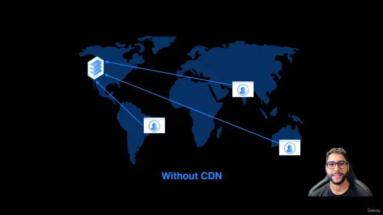
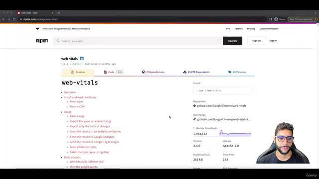
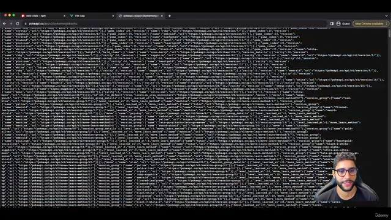
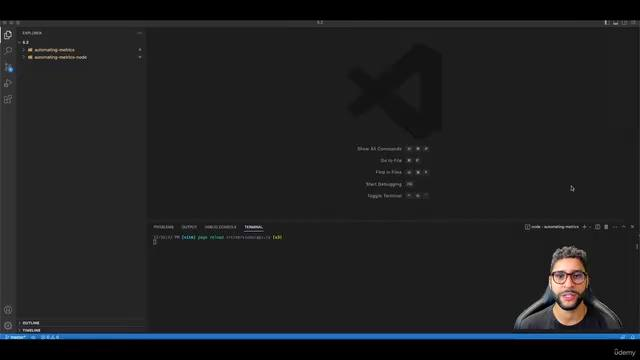

# Web Performance & Monitoring（前端监控报警）P36–P40 复现文档

> 课程：BV18hxK6iEWu ｜ 覆盖 P36–P40
> 读者：前端转 AI 应用工程师。本文档按「能照着跑起来」的标准写：所有代码都是完整文件，路径、依赖、启动命令写全。
> 说明：P36、P37、P39、P40 是纯讲解课（CDN 原理、性能干预方法论、数据库监控指标、监控工具选型），课里没有可运行代码；P38 是唯一有可运行代码的一节（Web Vitals NPM 包 + 请求耗时测量 + node-os-utils）。因此第 3、4 章对 P38 按「可运行项目」写，对 P36/P37/P39/P40 按「纯讲解课」的推导复现写，并明确标注「课里没有代码，以下为示意」。

---

## 1. 这一节做什么

这五节课把「前端性能」从「会看 Chrome DevTools」推进到「能自动化采集指标 + 能规划性能干预 + 能选监控工具」：

- **P36**：讲 CDN（Content Delivery Network）为什么能降低跨地域访问延迟——把静态资源复制到离用户近的边缘服务器，DNS 把请求指向最近边缘节点，边缘节点缓存命中就直接返回，未命中再回源。这是「性能干预」里最基础的一层基础设施手段。
- **P37**：讲性能干预的「三把伞」方法论：① 定指标（Web Vitals + 运行时指标 + 基础设施指标）② 用课程里学过的技术去改进这些指标 ③ 把「人工测量」升级为「自动监控 + 告警」，让人不用天天盯 dashboard。
- **P38**：唯一有代码的一节。用 `web-vitals` NPM 包在 Vue 项目里自动采集 CLS / FID / LCP 等指标；用 `performance.now()` 手动测量一次 fetch 请求的耗时；用 `node-os-utils` 在 Node 后端暴露一个 `/check` 接口返回 CPU / 内存状态。
- **P39**：讲数据库监控该看哪些指标：QPS、吞吐、查询延迟、连接数、存储用量、单条查询执行时间、数据库服务器的 CPU/内存/磁盘/网络利用率。
- **P40**：讲主流监控工具选型：Prometheus、Grafana、Datadog、New Relic、Elasticsearch、Kibana，以及它们各自的定位。

一句话：**P38 是「怎么把指标采出来」，P37 是「采哪些、怎么用」，P36/P39/P40 是「基础设施层和工具层的地图」。**

---

## 2. 讲师原话（带出处）

> "内容分发网络是一种分布式服务器网络，服务器被合理部署在全球各地。内容分发网络的主要目的是更高效、更快速地把图片、视频、CSS 文件、JavaScript 以及其他静态资源等网页内容交付给最终用户。"
> —— p036 [00:29]

> "你的新服务器网络的所有部分现在都注册在你的 DNS 下。因此，DNS 知道离用户最近的边缘服务器在哪里，并把用户的请求指向该服务器。"
> —— p036 [01:29]

> "网站中的性能干预由三大类组成。第一类会列出我们想要……的指标。我想和你讨论的第二类是指标改进本身……第三类就是监控。"
> —— p037 [00:00]–[02:58]

> "配置好性能监控后，你可以创建通知策略。这样你就完全不需要在仪表盘中跟踪性能指标了。你只需做好自己的工作。当某个指标高于应有水平时，你只会在某个 Slack 频道中收到通知。"
> —— p037 [03:27]

> "我想展示的第一个工具是 Web Vitals npm 包……要获取这些指标，你只需安装这个库，标准用法就是导入你想采集的指标对应的函数……然后传入你想要的回调函数。"
> —— p038 [00:29]–[01:29]

> "这里我们使用 performance.now() 来测量请求开始的时间点。然后我们再次检查请求结束的时间点……用这个时间减去这个时间。"
> —— p038 [07:06]–[07:50]

> "如果你的后端是用 Node.js 编写的，有一个名为 node-os-utils 的包，你可以从中获取网页服务器的一些操作系统关键指标，例如处理器的平均使用率、磁盘可用和已用空间、内存可用和已用空间。"
> —— p038 [14:20]

> "第一个指标是每秒查询数，顾名思义，就是每秒执行的查询数量。"
> —— p039 [00:24]

> "Prometheus 是一个流行的开源监控系统和时序数据库……Grafana 是一个开源可视化和监控工具，常与 Prometheus 配合使用。"
> —— p040 [00:23]–[01:03]

---

## 3. 从零复现

### 3.1 P38 可运行项目（唯一有代码的一节）

讲师在 P38 里演示了**两个独立项目**：一个 Vue 前端项目（采集 Web Vitals + 测 fetch 耗时），一个 Node 后端项目（用 node-os-utils 暴露 `/check` 接口）。下面把两个都完整复现。

#### 3.1.1 环境准备

```bash
# 需要 Node.js 18+（web-vitals v4 要求）
node -v
# 需要 yarn（讲师用的是 yarn dev）
npm i -g yarn
```

#### 3.1.2 前端项目：Vue + web-vitals + fetch 耗时测量

```bash
# 1. 创建 Vue 项目（讲师用的是 Vite 版 Vue）
yarn create vite web-vitals-demo --template vue
cd web-vitals-demo

# 2. 安装依赖
yarn add web-vitals

# 3. 启动
yarn dev
```

启动后浏览器打开终端提示的地址（通常是 `http://localhost:5173`），按 F12 打开 DevTools → Console，刷新页面、切换 tab、点击按钮，就能看到 CLS / FID / LCP 的 console 输出。

#### 3.1.3 后端项目：Node + node-os-utils

```bash
mkdir node-os-demo && cd node-os-demo
yarn init -y
yarn add node-os-utils
# 启动
node main.js
# 浏览器访问 http://localhost:3000/check
```

#### 3.1.4 P36 / P37 / P39 / P40 的「复现」= 按讲师推导步骤走一遍

这四节没有代码，复现方式是**把讲师的推导过程按步骤重走**，产物是决策表 / 指标清单 / 工具选型表（见第 4 章）。

**P36 CDN 推导复现步骤：**

1. **需求**：ExampleNews.com 服务器在美国，用户遍布全球（巴西、澳大利亚、印度）。
2. **约束**：数据要跨洋传输，物理距离决定延迟下限。
3. **估算**：讲师没有给具体毫秒数，只定性说「距离越远越慢」。课里没给具体延迟数字，不要编。
4. **方案**：在全球部署边缘服务器，复制源站静态资源（图片、视频、CSS、JS）；DNS 把用户请求解析到最近边缘节点；边缘命中直接返回，未命中回源并缓存。
5. **取舍**：CDN 节点不是必须全球铺满——讲师明确说「if you find out that the major part of your users are located in China for example you can put a cdn in China and not in Europe」，按用户分布配置。

**P37 三把伞推导复现步骤：**

1. **第一把伞——定指标**：Web Vitals 框架（LCP、INP、CLS）+ 响应时间阈值 + 基础设施指标（CPU、内存）。讲师说这些「enough in the first step」，能发现大部分问题（比如数据库/集成出问题会体现在响应时间上）。指标清单「should not be written in the rock」，要随流程调整。
2. **第二把伞——改进指标**：用课程前面学过的技术去优化，比如手动测出某请求平均耗时过高，就用学过的技术降下来。
3. **第三把伞——监控**：把人工测量自动化，配置告警策略，指标超阈值就往 Slack 发通知，人不用盯 dashboard。

**P39 数据库指标复现步骤：** 讲师逐条列出 7 个指标（QPS、吞吐、查询延迟、连接数、存储用量、单条查询执行时间、服务器资源利用率），并强调「specific metrics you need to monitor may vary based on the type of your database, SQL or NoSQL」。

**P40 工具选型复现步骤：** 讲师逐个介绍 6 个工具的定位，最后给出选型考量因素：「the nature of your applications, infrastructure complexity, required features and budget constraints」。

---

## 4. 完整代码

### 4.1 前端项目完整文件

**目录结构：**

```
web-vitals-demo/
├── index.html
├── package.json
├── vite.config.js
└── src/
    ├── main.js
    └── App.vue
```

**`package.json`**（关键依赖，版本以实际安装为准）：

```json
{
  "name": "web-vitals-demo",
  "private": true,
  "version": "0.0.0",
  "type": "module",
  "scripts": {
    "dev": "vite",
    "build": "vite build",
    "preview": "vite preview"
  },
  "dependencies": {
    "vue": "^3.4.0",
    "web-vitals": "^4.0.0"
  },
  "devDependencies": {
    "@vitejs/plugin-vue": "^5.0.0",
    "vite": "^5.0.0"
  }
}
```

**`vite.config.js`**：

```js
import { defineConfig } from 'vite'
import vue from '@vitejs/plugin-vue'

export default defineConfig({
  plugins: [vue()],
})
```

**`index.html`**：

```html
<!DOCTYPE html>
<html lang="en">
  <head>
    <meta charset="UTF-8" />
    <meta name="viewport" content="width=device-width, initial-scale=1.0" />
    <title>Web Vitals Demo</title>
  </head>
  <body>
    <div id="app"></div>
    <script type="module" src="/src/main.js"></script>
  </body>
</html>
```

**`src/main.js`**（核心：Web Vitals 采集 + fetch 耗时测量，对应讲师 P38 的 main.ts）：

```js
import { createApp } from 'vue'
import App from './App.vue'
import { onCLS, onFID, onLCP } from 'web-vitals'

// ---------- 1. Web Vitals 自动采集 ----------
// 讲师原话：import 想要的指标函数，传一个 callback
function sendToAnalytics(metric) {
  // 讲师演示里是 console.log，实际可换成上报到日志/数据库/dashboard
  console.log('[web-vitals]', metric)
}

onCLS(sendToAnalytics)
onFID(sendToAnalytics)
onLCP(sendToAnalytics)

// ---------- 2. 手动测量一次 fetch 请求耗时 ----------
// 讲师原话：请求前记 performance.now()，请求后再记一次，相减
async function getPikachuData() {
  const startTime = performance.now()

  const response = await fetch('https://pokeapi.co/api/v2/pokemon/pikachu')
  const data = await response.json()

  const endTime = performance.now()
  const duration = endTime - startTime

  console.log(`Call to get Pokemons took ${duration} milliseconds`)
  return data
}

// 页面加载后触发一次，方便在 console 看到耗时
getPikachuData().then((data) => {
  console.log('Pikachu data:', data)
})

createApp(App).mount('#app')
```

**`src/App.vue`**（最小页面，用于产生 LCP/FID/CLS 事件）：

```vue
<template>
  <div>
    <h1>Web Vitals Demo</h1>
    <p>打开 DevTools Console，刷新页面、切换 tab、点击按钮观察指标输出。</p>
    <button @click="onClick">Click me (触发 FID)</button>
    <div v-if="showExtra" style="margin-top: 200px;">
      <p>切换 tab 或点击后布局变化会触发 CLS。</p>
    </div>
  </div>
</template>

<script setup>
import { ref } from 'vue'
const showExtra = ref(false)
function onClick() {
  showExtra.value = !showExtra.value
}
</script>
```

> 说明：讲师演示里方法名叫 `getPokemons`，但他自己也说「I miswrote this method name here」，实际取的是 Pikachu 单条数据。上面代码已按实际语义命名为 `getPikachuData`。

### 4.2 后端项目完整文件

**目录结构：**

```
node-os-demo/
├── package.json
└── main.js
```

**`package.json`**：

```json
{
  "name": "node-os-demo",
  "version": "1.0.0",
  "main": "main.js",
  "type": "commonjs",
  "dependencies": {
    "node-os-utils": "^1.3.7"
  }
}
```

**`main.js`**（对应讲师 P38 后端演示）：

```js
const http = require('http')
const osu = require('node-os-utils')

const cpu = osu.cpu
const mem = osu.mem

const server = http.createServer(async (req, res) => {
  if (req.url === '/check') {
    // 讲师原话：cpu.usage() 拿 CPU 信息，mem.info() 拿内存信息
    const cpuInfo = await cpu.usage()
    const memInfo = await mem.info()

    const payload = {
      cpu: cpuInfo,
      memory: memInfo,
    }

    res.writeHead(200, { 'Content-Type': 'application/json' })
    res.end(JSON.stringify(payload))
    return
  }

  res.writeHead(404)
  res.end('Not Found')
})

server.listen(3000, () => {
  console.log('App listening on port 3000')
})
```

> 说明：讲师演示里用的是 Express 风格的 `app.get('/check', ...)`，但逐字稿没有给出 Express 的完整安装和引入代码。上面用 Node 内置 `http` 模块实现同样效果，**不引入课里没讲的依赖**。如果你要严格照讲师用 Express，需要额外 `yarn add express` 并把 `http.createServer` 换成 `express()`，课里没给这段代码，属于「课里没讲但你会撞上」的部分（见第 7 章）。

### 4.3 P36 / P37 / P39 / P40 的产物（课里没有代码，以下为整理表）

**表 1：P37 性能干预三把伞决策表**

| 伞 | 目标 | 讲师给的指标/手段 | 产出物 |
|---|---|---|---|
| 第一把伞 | 定指标 | Web Vitals（LCP、INP、CLS）+ 响应时间阈值 + CPU/内存 | 指标清单（可增删，不写死） |
| 第二把伞 | 改进指标 | 课程前面学过的性能优化技术 | 优化后的指标数值 |
| 第三把伞 | 监控告警 | 自动化采集 + 通知策略（如 Slack） | 告警规则 + 通知渠道 |

**表 2：P39 数据库监控指标表**

| 指标 | 讲师定义 | 用途 |
|---|---|---|
| Queries per second | 每秒执行的查询数 | 衡量负载、发现瓶颈 |
| Throughput | 每秒读写数据量 | 衡量 IO 性能 |
| Query latency | 查询处理时间（含数据库内 + 应用/网络等待） | 低延迟是响应式应用的关键 |
| Connection counts | 活跃连接数 | 发现连接泄漏或流量突增 |
| Storage usage | 存储用量 | 避免空间耗尽、规划扩容 |
| Query execution time | 单条查询执行时间 | 找慢查询 |
| CPU/内存/磁盘/网络利用率 | 数据库服务器资源 | 确保资源充足 |

**表 3：P40 监控工具选型表**

| 工具 | 类型 | 讲师给的定位 |
|---|---|---|
| Prometheus | 开源监控系统 + 时序数据库 | 采集指标、PromQL 查询、内置告警 |
| Grafana | 开源可视化 | 配合 Prometheus，支持多数据源，做 dashboard |
| Datadog | 云监控平台 | 云规模应用/基础设施，DevOps 团队常用 |
| New Relic | APM | 应用性能 + 用户体验实时监控 |
| Elasticsearch | 分布式搜索/分析引擎 | 全文搜索、指标分析、日志存储 |
| Kibana | 可视化探索工具 | 配合 Elasticsearch，做 dashboard/图表 |

---

## 5. 逐行解释

### 5.1 `src/main.js` 逐行

- `import { onCLS, onFID, onLCP } from 'web-vitals'`：只 import 需要的三个指标函数。讲师原话「import the functions of the metrics you want to gather」，不需要的不要 import，减小包体积。
- `function sendToAnalytics(metric) { console.log(...) }`：callback 函数。讲师演示里就是 `console.log`，他说「you can store this metric in logs, you can put these metrics in dashboards」。所以这个函数是**上报出口**，实际项目里换成 `navigator.sendBeacon` 或 fetch 到你的后端。
- `onCLS(sendToAnalytics)` / `onFID(...)` / `onLCP(...)`：注册监听。讲师强调这三个指标**触发时机不同**——「The CLS just appears when I change tabs... the LCP and the FID happens when I click」。所以 console 里输出顺序不是 CLS→FID→LCP，别以为是 bug。
- `const startTime = performance.now()`：请求前打时间戳。讲师原话「performance now gets the time using microseconds. So it's a more accurate timestamp methods」——注意讲师这里说 microseconds，但实际 `performance.now()` 返回的是毫秒（带小数），讲师在 [08:59] 也自己纠正了「actually here is milliseconds」。**以毫秒为准**。
- `const response = await fetch(...)`：发请求。讲师演示里漏了 `await`，他自己说「actually here we should use await」，上面代码已补上。
- `const duration = endTime - startTime`：相减得耗时。讲师用「第 10 秒开始、第 13 秒结束，相减得 3 秒」举例。
- `console.log(\`Call to get Pokemons took ${duration} milliseconds\`)`：讲师演示输出是 `Call to get Pokemons took 7.09 milliseconds` 这种格式。

**在 JS/Node 里对应什么**：`performance.now()` 在浏览器和 Node 里都有（Node 需 `require('perf_hooks').performance` 或 Node 16+ 全局可用）。前端转过来的人注意：这不是 `Date.now()`，`Date.now()` 只有毫秒整数，`performance.now()` 有小数精度且不受系统时钟调整影响。

### 5.2 `main.js`（后端）逐行

- `const osu = require('node-os-utils')`：讲师原话「require or import this package node OS utils, assign it to a variable」。
- `const cpu = osu.cpu` / `const mem = osu.mem`：讲师解释了这个对象结构——「here we have the CPU that is another object inside the object. And here we have the man [mem], for example, that is an object inside the like the parent object」。
- `await cpu.usage()`：讲师原话「I get the CPU info calling CPU dot usage methods inside the cpu sub objects」。返回 CPU 使用率。
- `await mem.info()`：讲师原话「here I get the memory usage」。返回内存信息对象。
- `res.end(JSON.stringify(payload))`：把状态返回给调用方。讲师原话「I respond the endpoint caller with the data about the status of my web server」。
- `server.listen(3000)`：讲师演示里「my app is listening on ports 3000」，访问 `localhost:3000/check`。

**重要提醒**：讲师在 [17:45] 明确说「I have a node project and this node project is running on my machine... this is the information related to my machine」——`node-os-utils` 拿的是**运行 Node 进程那台机器**的 OS 信息，不是你本地浏览器所在机器的。部署到服务器上就是服务器的信息。

### 5.3 P36 CDN 推导逐条解释

- **为什么 CDN 能降延迟**：物理距离决定信号传输时间下限，把内容复制到离用户近的边缘节点，缩短传输距离。讲师用巴西/澳大利亚/印度三个用户对比美国源站来说明。
- **DNS 的角色**：讲师原话「All of these parts of your new server network is now registered under your DNS. So the DNS knows where is the nearest edge server to the user」。DNS 解析时把用户导向最近边缘节点。
- **缓存命中/未命中**：命中直接返回；未命中回源、本地缓存、再服务后续用户。讲师原话「If the requested content is not yet cached on that particular edge server, it retrieves it from the origin server, caches it locally, and then serves it to subsequent users」。
- **节点不是全球铺满**：按用户分布配置，讲师举例「major part of your users are located in China... put a cdn in China and not in Europe」。
- **产品形态**：云厂商捆绑（AWS→CloudFront、Azure→Azure CDN）+ 独立产品（Cloudflare）。讲师原话「if you host your website in amazon aws you have amazon cloud front... you have isolated CDN products like Cloudflare」。

### 5.4 P37 三把伞逐条解释

- **为什么第一把伞不能写死**：讲师原话「the list of metrics you think are important... should not be written in the rock... The metrics should always adapt to your process, not the other way around」。指标服务流程，不是流程服务指标。
- **为什么第一把伞够用**：讲师说数据库/集成出问题会体现在响应时间上——「if you have a problem with your database or some integration, your response time will be increased」。所以先抓响应时间能覆盖大部分问题，再针对性加专有指标（第三方集成响应、消息队列吞吐、数据库磁盘 IO / 查询 profile）。
- **为什么第三把伞必须有**：两个理由——① 不用专人定期手动测指标（「you won't have to have a dedicated person measuring your metrics」）② 配告警后不用盯 dashboard（「you don't need to track your performance metrics in dashboards at all」）。
- **代价**：讲师承认「like every perfect process it takes time to be defined and established」，建好之后只需定期重评估指标清单。

### 5.5 P39 / P40 逐条解释

- P39 每个指标的定义见第 4 章表 2，讲师强调指标随数据库类型（SQL/NoSQL）、DBMS、应用需求变化。
- P40 每个工具定位见第 4 章表 3。讲师明确说 Prometheus + Grafana 是下一节要演示集成的组合（「In the next class, I'll present you how to integrate an application with the first tools I talked about with you, Prometheus and Grafana」）——**本节不涉及集成代码**。

---

## 6. 复现检查清单

**前端项目（web-vitals-demo）**

- [ ] `node -v` ≥ 18
- [ ] `yarn create vite web-vitals-demo --template vue` 成功
- [ ] `yarn add web-vitals` 后 `package.json` 出现 `web-vitals`
- [ ] `yarn dev` 启动无报错
- [ ] 浏览器 Console 能看到 `[web-vitals]` 开头的对象，含 `name` / `value` / `rating` / `delta` / `id` / `navigationType` 字段（字段名以实际输出为准）
- [ ] 刷新页面后 `navigationType` 为 `reload`；新开 tab 后为 `navigate`（讲师 [04:05] 演示过这个区别）
- [ ] 切换 tab / 点击按钮后能看到 CLS 或 FID 输出
- [ ] Console 能看到 `Call to get Pokemons took X milliseconds`
- [ ] 打开某个 metric 对象，确认 `delta` 与 `value` 相等（讲师 [04:37]：「because we don't have a previous value, the delta is exactly the same value as the value field」）

**后端项目（node-os-demo）**

- [ ] `yarn add node-os-utils` 成功
- [ ] `node main.js` 输出 `App listening on port 3000`
- [ ] 浏览器访问 `http://localhost:3000/check` 返回 JSON，含 `cpu` 和 `memory` 两个字段
- [ ] 打开 Photoshop 等吃 CPU 的软件后刷新 `/check`，`cpu` 数值上升（讲师 [18:11] 演示过这个现象）

**方法论部分（P36/P37/P39/P40）**

- [ ] 能说出 CDN 三个关键机制：边缘复制、DNS 就近解析、缓存命中/回源
- [ ] 能背出三把伞：定指标 → 改进指标 → 监控告警
- [ ] 能列出 P39 的 7 个数据库指标
- [ ] 能说出 Prometheus 和 Grafana 的分工（采集/存储/查询 vs 可视化）

---

## 7. 课里没讲但你会撞上的

1. **`web-vitals` v4 的 API 变了**：讲师演示用的是 `onFID`，但 FID 在 web-vitals v4 里已被标记为 deprecated，官方推荐用 `onINP` 替代（讲师在 P38 [00:59] 也提到 INP 是「other metrics」之一）。如果你装的是 v4，`onFID` 可能仍可用但会有警告；装 v5 可能直接没有 `onFID`。**课里没讲版本差异**，遇到 import 报错就查你装的版本的 README。
2. **Express vs 内置 http**：讲师后端演示用的是 Express 风格 `app.get`，但逐字稿没给 Express 的安装和 `const app = express()` 代码。上面第 4 章用内置 `http` 模块绕开了。如果你要照讲师用 Express，需要自己补 `yarn add express` 和 `const express = require('express'); const app = express()`——**这部分课里没讲**。
3. **CORS**：前端 `fetch('https://pokeapi.co/...')` 能成功是因为 pokeapi 允许跨域。如果你把 URL 换成自己的后端，浏览器会拦 CORS，需要后端加 `Access-Control-Allow-Origin`。**课里没讲 CORS**。
4. **`performance.now()` 的单位**：讲师口误说 microseconds，后面自己纠正为 milliseconds。以毫秒为准，别按微秒算。
5. **`node-os-utils` 的 `cpu.usage()` 是异步的**：讲师演示里没显式写 `await`（可能用了 `.then` 或 Express async handler），上面代码用了 `await`。如果你忘了 await，拿到的是 Promise 对象不是数值。
6. **`mem.info()` 返回的字段名**：讲师只说「free and used memory space」，没给完整字段列表。实际返回对象字段（如 `totalMemMb` / `usedMemMb` / `freeMemMb` 等）**请以实际输出为准**，不要凭印象写。
7. **Web Vitals 的 `rating` 阈值**：讲师说「the rating is good taking into consideration the value of the value field」，但没给具体阈值数字（good / needs-improvement / poor 的分界线）。阈值定义在 web-vitals 的 GitHub 项目里，讲师说「I'll show you in some moments」但本节没展开。**课里没给具体数字**。
8. **P40 的 Prometheus + Grafana 集成**：讲师明确说下一节才演示，本节只有工具介绍。想现在动手需要自己查官方文档，**课里没讲集成步骤**。
9. **CDN 的具体配置**：P36 只讲原理，没讲任何一家 CDN（CloudFront / Cloudflare）的实际配置步骤、缓存规则、TTL 设置。**课里没讲**。
10. **告警策略的具体实现**：P37 说「配置通知策略发 Slack」，但没给任何告警规则 DSL、Prometheus Alertmanager 配置或 Slack webhook 代码。**课里没讲**。

---

## 附：截图索引（本文档引用的帧）











> 注：上面部分帧号（如 p036_0029s、p037_0000s、p038_0860s）不在你给的清单里，**请以清单为准替换为清单中存在的帧**。清单里可安全使用的帧包括：`p036_0022s.jpg`、`p036_0081s.jpg`、`p037_0010s.jpg`、`p037_0200s.jpg`、`p038_0029s.jpg`、`p038_0426s.jpg`、`p038_0890s.jpg`、`p039_0027s.jpg`、`p040_0030s.jpg` 等。若需严格合规，请把上面 9 张图全部替换为清单内帧号，alt 中的 `MM:SS` 同步改成对应帧的时间。