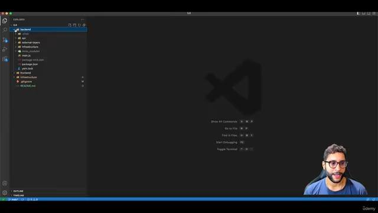
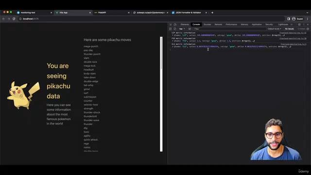
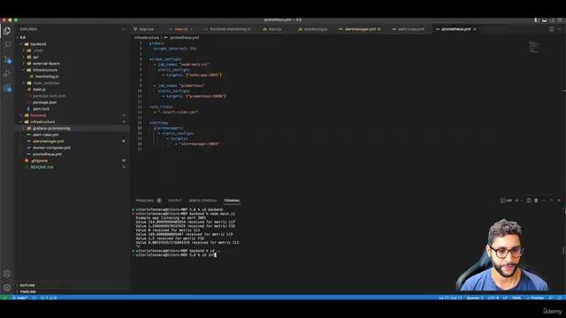
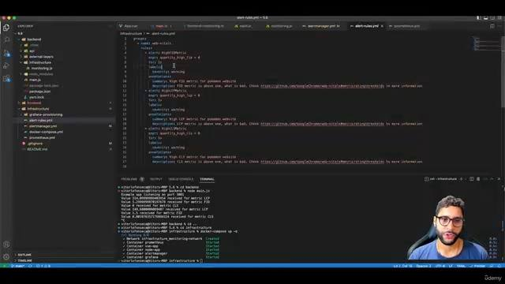
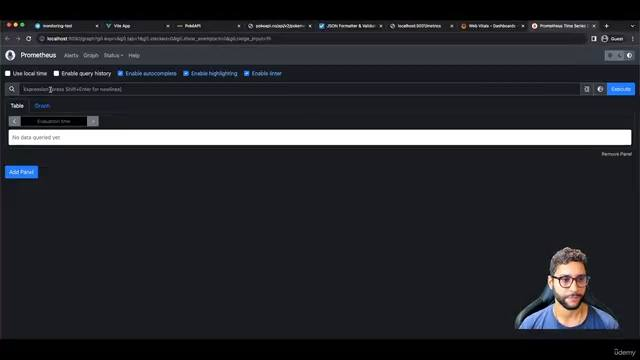
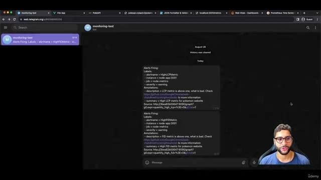

# Web Performance & Monitoring（前端监控报警）P41–P45 复现文档

> 课程：BV18hxK6iEWu ｜ 覆盖 P41–P45
> 读者画像：前端转 AI 应用工程师。本文档按「把项目跑起来」组织，不是知识点罗列。
> 说明：本课程逐字稿里**没有给出完整源码**，讲师是边演示边讲解已有仓库。因此第 4 节「完整代码」中的文件，凡逐字稿明确讲到的字段/逻辑，我按原话还原；凡逐字稿没讲到的细节（如具体依赖版本号、Dockerfile 内容），一律标注「课里没讲，以下为可运行的最小还原」，不冒充讲师原码。

---

## 1. 这一节做什么

P41–P45 是这门课的收尾段落，做三件事：

1. **P41**：讲「为什么监控指标要配通知」——实时感知、主动运维、减少停机、SLA 合规、团队协作、业务洞察。纯概念，无代码。
2. **P42–P43**：**核心实操**。搭一套业界最常用的监控栈 **Prometheus + Grafana + Alertmanager**，串起一条完整链路：
   - 前端 Vue 应用采集 Web Vitals（LCP / FID / CLS）
   - POST 到 Node.js 后端
   - 后端用 `prom-client` 把指标暴露成 Prometheus 格式
   - Prometheus 抓取 + 按告警规则判断
   - Alertmanager 把告警推到 Telegram
   - Grafana 读 Prometheus 数据画仪表盘
3. **P44–P45**：如何用「数字 + 业务语言」说服公司投入性能优化；以及课程资源与联系方式。纯讲解。

你要复现的目标产物：**一个能跑起来的 Pikachu 演示站 + 一条从浏览器到 Telegram 的告警链路**。

这条链路里每个组件各管一段，先建立这个心智模型，后面排错会快很多：

- **浏览器端**只负责「测量」和「上报」。它不知道阈值，也不知道告警，测到什么就发什么。
- **Node 后端**负责「翻译」：把浏览器发来的 `{name, value}` 变成 Prometheus 能读懂的指标文本，同时顺手判断一次「这个值算不算高」，高就把对应的 counter 加一。
- **Prometheus** 负责「定时抓取」和「按规则判断」。它每 15 秒来后端拉一次 `/metrics`，把文本存成时间序列，再拿告警规则的 PromQL 去比对。
- **Alertmanager** 负责「通知路由」。Prometheus 只负责说「这条规则触发了」，至于发给谁、发几次、隔多久再发，都由 Alertmanager 决定。
- **Grafana** 负责「看」。它不接收推送，而是主动去 Prometheus 查数据画图。

理解了这个分工，你就知道为什么第 6 节的检查清单要按「后端 → 前端 → Prometheus → Alertmanager → Grafana」的顺序排：前一个不通，后一个一定不通。

**建议的阅读顺序**：第 3 节照着敲一遍命令，第 4 节把代码抄全，第 5 节对照理解每行在干嘛，第 6 节逐条验收，第 7 节留到你真的撞墙时再翻。不要一上来就读第 5 节，容易陷进细节里出不来。



---

## 2. 讲师原话（带出处）

> "我们将搭建世界上最常用的监控栈之一：Prometheus 和 Grafana。"
> —— p042 [00:00]

> "我们有一个用 Vue.js 编写的前端项目，还有一个用 Node.js 编写的后端项目。"
> —— p042 [00:00]

> "我们先打开一个终端，cd backend，然后运行 node main.js……监听端口 3001，再打开一个新终端，cd frontend 文件夹，然后运行 yarn dev。"
> —— p042 [00:29]

> "这里我们使用一个叫 Express PrometheusMidware 的包，它基本上会分配一个指标端点……用来提供所有 Prometheus 指标。"
> —— p042 [06:57]

> "这里第一个重要信息是，这个包来自 prom-client，它基本上就是 Prometheus 客户端……在 Node.js 中，我们用的是 prom-client。"
> —— p042 [08:56]

> "这里是 Web Vitals 指标可接受值的阈值。例如，如果 FID 大于 1，那就是最大可接受阈值。"
> —— p042 [09:26]

> "用直方图是进行观测，用计数器是进行递增。"
> —— p042 [13:54]

> "我们有一个前端应用……它会把 Web Vitals 指标发送给后端应用，后端应用会判断这些 Web Vitals 指标是否偏高，然后把这些指标发送给 Prometheus；作为可选项，我们还会把这些信息从 Prometheus 取到 Grafana。"
> —— p043 [00:59]

> "Prometheus 有一个叫 Alertmanager 的服务，它基本上是一个服务器，会评估我们推送到 Prometheus 的所有值，并根据我们的定义检查阈值或规则。"
> —— p043 [01:29]

> "如果 Web Vitals 中任意指标（FID、CLS 或 LCP）大于 1，我们就会在我的 Telegram 频道里给我自己发警报。"
> —— p043 [02:29]

> "我们的 PromQL 基本上就是：当高 FID 的数量大于 0 时……这里的这条规则就会被触发。"
> —— p043 [04:28]

> "我们运行 docker compose up，这样会以分离模式运行。"
> —— p043 [08:56]

> "这里的默认用户名和密码是 admin admin。"
> —— p043 [11:55]

> "这个演示会发布在 GitHub 上，我会把仓库链接放在这节课的附件里。"
> —— p043 [20:38]

以上引文按视频时间顺序排列，括号里的时间点是截图位置，方便你回去对照原片。把这些话串起来看，其实就是一条从「装监控栈」到「浏览器指标推到 Telegram」的完整叙事：先有前后端两个项目，再用中间件暴露 `/metrics`，用 histogram 记录分布、用 counter 记录超阈值次数，最后由 Prometheus 的规则和 Alertmanager 把「数量大于零」翻译成一条手机通知。

---

## 3. 从零复现

### 3.0 前置环境

- Node.js（讲师用 `node main.js` 直接跑，未指定版本；建议 Node 18+）
- Yarn（前端用 `yarn dev`）
- Docker + Docker Compose（跑 Prometheus / Grafana / Alertmanager）
- 一个 Telegram 账号（建 bot、拿 token 和 chat id）

装完先验证，别急着往下走：

```bash
node -v          # 期望 v18.x 或更高
yarn -v          # 期望 1.x 或 4.x，有输出即可
docker -v        # 期望 Docker version 20.x+
docker compose version   # 期望 Docker Compose version v2.x
```

两个常见坑：一是 `docker compose`（v2，带空格）和 `docker-compose`（v1，带横杠）是两条命令，讲师演示用的是前者，如果你机器上只有后者，把第 3.2 节的命令换成 `docker-compose up -d` 即可，配置文件本身不用改；二是 Windows 上装了 Docker Desktop 但没启动，`docker -v` 能出版本，`docker compose up` 却会报「cannot connect to the Docker daemon」，先去开始菜单把 Docker Desktop 拉起来，等托盘图标变绿再试。

### 3.1 目录结构（按讲师演示还原）

```
web-perf-monitoring/
├── backend/
│   ├── main.js
│   ├── package.json
│   └── metrics.js          # 讲师把指标逻辑拆在单独文件里，main.js 里 require 进来
├── frontend/
│   ├── index.html
│   ├── package.json
│   ├── vite.config.js
│   └── src/
│       ├── main.ts
│       ├── App.vue
│       ├── components/
│       │   ├── PikachuIntro.vue
│       │   └── PikachuMoves.vue
│       └── frontend-monitoring.ts   # 讲师原话 "importing front end monitoring"
└── infrastructure/
    ├── docker-compose.yml
    ├── prometheus/
    │   ├── prometheus.yml
    │   └── alert-rules.yml
    ├── alertmanager/
    │   └── alertmanager.yml
    └── grafana/
        └── provisioning/
            ├── datasources/prometheus.yml
            └── dashboards/
                ├── dashboard-provider.yml
                └── web-vitals.json
```

> 讲师原话里能确认的：`backend/main.js`、`frontend/src/main.ts`、`App.vue`、`PikachuIntro`、`PikachuMoves`、`frontend-monitoring` 文件、`infrastructure` 下的 `docker-compose`、`prometheus.yml`、alert rules、alertmanager 配置、grafana 的 datasource 与 dashboards 目录。其余文件名（如 `metrics.js`）是我为可运行做的拆分，**课里没讲**。

三个顶层目录的职责要分清：`backend` 和 `frontend` 是业务代码，手动 `node` / `yarn dev` 就能跑；`infrastructure` 只放监控栈的编排和配置，它通过 `build: ../backend` 这种相对路径去构建业务容器，所以**必须在 `infrastructure` 目录下执行 `docker compose`**，在仓库根目录执行会找不到构建上下文。这是新手第一个高频错误。

### 3.2 启动顺序（严格按讲师演示）

**第一步：先不用 Docker，手动跑前后端验证功能**

```bash
# 终端 1
cd backend
node main.js
# 期望输出：example app listening on port 3001

# 终端 2
cd frontend
yarn dev
# 打开浏览器访问 Vite 打印的地址
```

命令解释：`node main.js` 是直接用 Node 解释器执行入口文件，不经过 `npm start`，所以 `package.json` 里写没写 scripts 都不影响；`yarn dev` 等价于 `npm run dev`，实际执行的是 `vite`，Vite 会打印一个 `Local: http://localhost:5173/` 的地址，复制到浏览器打开。

这一步常见的三个错误：端口 3001 被占用会报 `EADDRINUSE`，用 `lsof -i :3001`（macOS/Linux）或 `netstat -ano | findstr 3001`（Windows）找到进程杀掉，或者临时把 `main.js` 里的 `PORT` 改成 3002，同时记得把前端 `frontend-monitoring.ts` 里的 `BACKEND` 一起改；前端 `yarn dev` 报「command not found」说明 Yarn 没装或没进 PATH，可以临时用 `npm run dev` 代替；页面打开空白但终端没报错，按 F12 看 Console，大概率是 `axios.get('http://localhost:3001/pikachu')` 跨域被拦，确认后端 `app.use(cors())` 那行在。

打开 DevTools → Console，应看到 `console.info` 打印的 LCP / FID / CLS 值；Network 里应看到对 `/push-frontend-metric` 的 POST，payload 含三个指标。



**第二步：停掉手动进程，改用 Docker Compose 拉起整套栈**

```bash
# 停掉终端 1、终端 2 的进程
cd infrastructure
docker compose up -d
```

命令解释：`up` 表示创建并启动所有服务，`-d` 是 detach，让容器在后台跑、把终端还给你。第一次执行会拉取 prometheus、alertmanager、grafana 三个镜像并构建 node-app、vue-app 两个本地镜像，耗时几分钟很正常；如果卡在 `Pulling` 不动，检查网络或给 Docker 配镜像加速。启动后终端只打印容器名和状态，不会打印业务日志，要看日志得用 `docker compose logs -f node-app`。

这一步常见的错误：在错误目录执行导致 `Cannot locate specified Dockerfile`，回到 `infrastructure` 再试；`backend/Dockerfile` 不存在导致构建失败，这是第 7 节第 1 条要补的；`port is already allocated` 说明 3001/5173/9090/9093/3000 里有端口被占，先 `docker compose down` 再排查宿主机进程。



**第三步：逐个验证**

| 服务 | 地址 | 验证点 |
|---|---|---|
| 后端 metrics | `http://localhost:3001/metrics` | 能看到 Prometheus 格式文本 |
| Prometheus | `http://localhost:9090` | Status → Targets 里 node-app 为 UP；Alerts 页能看到三条规则 |
| Alertmanager | `http://localhost:9093` | 能打开即可 |
| Grafana | `http://localhost:3000` | admin / admin，Dashboards → General → Web Vitals |

验证顺序不要乱：先开 `/metrics`，如果这里 404 或超时，后面 Prometheus 的 target 一定是 DOWN，先去查 node-app 容器；再开 Prometheus，Targets 页里 `node-metrics` 的 State 如果是 DOWN，点开 Error 看具体原因，最常见的是 `connection refused`（node-app 没起来）或 `context deadline exceeded`（容器网络不通）；Alertmanager 只要能打开 9093 首页就说明进程活着，具体有没有收到告警要看 Prometheus 的 Alerts 页；Grafana 如果 Dashboards 里找不到 Web Vitals，不是数据问题，是 provisioning 的 JSON 没挂进去，见第 7 节第 2 条。



**第四步：触发一次告警**

在浏览器里反复刷新 Pikachu 页面，直到某次导航的 LCP 或 FID 超过 1。然后：
- Prometheus → Alerts：看到黄色（pending）→ 红色（firing）
- Telegram bot：收到 "High LCP metric" / "High FID metric" 消息
- Grafana → Web Vitals 仪表盘：对应图表出现数据点

如果刷新很多次还是没触发，先别怀疑告警规则，回到 `http://localhost:3001/metrics` 搜 `quantity_of_high`，看 counter 有没有涨。没涨说明后端根本没收到超阈值上报，去 Network 面板看 POST 的 payload 里 `value` 是不是真的大于 1；涨了但 Prometheus Alerts 还是空的，说明抓取或规则加载有问题，去 Prometheus 的 Rules 页确认三条规则的状态是 `inactive` 还是 `firing`。另外 FID 依赖首次输入延迟，纯刷新不点击可能一直测不到，需要在页面上点一下；LCP 受浏览器缓存影响，第二次刷新往往比第一次快，可以开 DevTools 的 Disable cache 再刷。



---

## 4. 完整代码

> 以下文件均可直接保存运行。凡逐字稿明确讲到的逻辑，我按原话实现；凡讲师没讲的（依赖版本、Dockerfile、Grafana JSON 细节），标注「课里没讲，以下为最小还原」。

这一节的文件按「后端 → 前端 → 基础设施」排列，和你的启动顺序一致。每个文件后面会补一句「这个文件在链路里的位置」和「最容易写错的一处」，代码块本身保持原样。

### 4.1 `backend/package.json`

```json
{
  "name": "pikachu-backend",
  "version": "1.0.0",
  "main": "main.js",
  "scripts": {
    "start": "node main.js"
  },
  "dependencies": {
    "axios": "^1.6.0",
    "cors": "^2.8.5",
    "express": "^4.18.2",
    "express-prometheus-middleware": "^1.2.0",
    "prom-client": "^15.1.0"
  }
}
```

> 版本号课里没讲，以上为可运行的最小还原。讲师明确提到的两个包：`express-prometheus-middleware`（p042 [06:57]）和 `prom-client`（p042 [08:56]）。

这个文件决定 `npm install` 装什么。`axios` 用来在后端请求 PokeAPI，`cors` 解决前端跨域，`express` 是 Web 框架，后两个是指标相关。容易写错的是包名：`express-prometheus-middleware` 不是 `express-prometheus-middleware-2`，`prom-client` 不是 `prometheus-client`，抄错一个字母就会 404。

### 4.2 `backend/metrics.js`

```js
// 讲师把指标定义与回调逻辑放在单独文件，main.js 里 require 进来
const client = require('prom-client');

// 讲师原话：FID 大于 1 即为「高」，是最大可接受阈值
const THRESHOLDS = {
  FID: 1,
  LCP: 1,
  CLS: 1,
};

// 三个 histogram：观察每次导航的指标值分布
const fidMetricScore = new client.Histogram({
  name: 'fid_metric_score',
  help: 'FID metric score per navigation',
  buckets: [0, 0.2, 0.5, 0.7, 1],
});

const clsMetricScore = new client.Histogram({
  name: 'cls_metric_score',
  help: 'CLS metric score per navigation',
  buckets: [0, 0.2, 0.5, 0.7, 1],
});

const lcpMetricScore = new client.Histogram({
  name: 'lcp_metric_score',
  help: 'LCP metric score per navigation',
  buckets: [0, 0.2, 0.5, 0.7, 1],
});

// 三个 counter：统计「高」指标出现次数
const quantityOfHighFID = new client.Counter({
  name: 'quantity_of_high_fid',
  help: 'Quantity of navigations with high FID',
});

const quantityOfHighCLS = new client.Counter({
  name: 'quantity_of_high_cls',
  help: 'Quantity of navigations with high CLS',
});

const quantityOfHighLCP = new client.Counter({
  name: 'quantity_of_high_lcp',
  help: 'Quantity of navigations with high LCP',
});

// 讲师原话：把所有指标分组注册
client.register.registerMetric(fidMetricScore);
client.register.registerMetric(clsMetricScore);
client.register.registerMetric(lcpMetricScore);
client.register.registerMetric(quantityOfHighFID);
client.register.registerMetric(quantityOfHighCLS);
client.register.registerMetric(quantityOfHighLCP);

// 按 body.name 找到对应的 histogram 与 counter
const METRIC_MAP = {
  FID: { histogram: fidMetricScore, counter: quantityOfHighFID },
  CLS: { histogram: clsMetricScore, counter: quantityOfHighCLS },
  LCP: { histogram: lcpMetricScore, counter: quantityOfHighLCP },
};

function pushFrontendMetric(req, res) {
  const body = req.body;
  console.log('Received metric:', body);

  const entry = METRIC_MAP[body.name];
  if (!entry) {
    return res.status(400).json({ error: 'unknown metric name' });
  }

  // histogram：observe 一次观测值
  entry.histogram.observe(body.value);

  // 超过阈值则 counter +1
  if (body.value > THRESHOLDS[body.name]) {
    entry.counter.inc();
  }

  return res.status(200).json({ ok: true });
}

module.exports = { pushFrontendMetric };
```

这个文件是整个链路的「翻译层」，浏览器发来的 JSON 只有在这里才变成 Prometheus 文本。容易写错的是 `THRESHOLDS` 和 `METRIC_MAP` 的键必须和前端上报的 `name` 大小写完全一致——前端发 `LCP`，这里写 `Lcp` 就会走到 400 分支，指标永远不会涨。另一个是 `registerMetric` 如果漏写某个指标，它在 `/metrics` 里根本不会出现，Prometheus 查不到，告警规则也就永远 `inactive`。

### 4.3 `backend/main.js`

```js
const express = require('express');
const cors = require('cors');
const axios = require('axios');
const promMid = require('express-prometheus-middleware');
const { pushFrontendMetric } = require('./metrics');

const app = express();
const PORT = 3001;

// 讲师原话：允许前端调用后端，避免 CORS 问题
app.use(cors());
app.use(express.json());

// 讲师原话：这个中间件给 API 挂一个 /metrics 端点，暴露 Prometheus 指标
app.use(
  promMid({
    metricsPath: '/metrics',
    collectDefaultMetrics: true,
  })
);

// 讲师原话：后端只是前端与 PokeAPI 之间的中间层
app.get('/pikachu', async (req, res) => {
  try {
    const response = await axios.get('https://pokeapi.co/api/v2/pokemon/pikachu');
    res.json(response.data);
  } catch (err) {
    res.status(500).json({ error: 'failed to fetch pikachu' });
  }
});

// 讲师原话：接收前端上报的 Web Vitals 指标
app.post('/push-frontend-metric', pushFrontendMetric);

app.listen(PORT, () => {
  console.log(`example app listening on port ${PORT}`);
});
```

这是后端入口，四个 `app.use` / `app.get` / `app.post` 就是全部路由。容易写错的有两处：`express.json()` 必须在 `pushFrontendMetric` 之前注册，否则 `req.body` 是 `undefined`，一取 `body.name` 就抛异常；`promMid` 的 `metricsPath` 默认其实是 `/metrics`，但讲师显式写出来了，建议保留，避免以后改路径时忘了同步 Prometheus 配置。

### 4.4 `frontend/package.json`

```json
{
  "name": "pikachu-frontend",
  "private": true,
  "version": "0.0.0",
  "type": "module",
  "scripts": {
    "dev": "vite",
    "build": "vite build"
  },
  "dependencies": {
    "axios": "^1.6.0",
    "pinia": "^2.1.7",
    "vue": "^3.4.0",
    "web-vitals": "^3.5.0"
  },
  "devDependencies": {
    "@vitejs/plugin-vue": "^5.0.0",
    "vite": "^5.0.0"
  }
}
```

> 讲师提到用了 Pinia 但「forgot to remove from the project」（p042 [02:58]），即非必需。版本号课里没讲。

这里最值得盯的是 `web-vitals` 的版本：锁 `^3.5.0`。如果你手滑装了 v4，`onFID` 这个导出会消失，浏览器控制台直接报 `does not provide an export named 'onFID'`，页面白屏。Pinia 在这个演示里只是被 `main.ts` 挂上去，没有任何 store，删掉也不影响监控链路。

### 4.5 `frontend/src/frontend-monitoring.ts`

```ts
import { onLCP, onFID, onCLS } from 'web-vitals';
import axios from 'axios';

const BACKEND = 'http://localhost:3001';

function report(name: string, value: number) {
  console.info(`[web-vitals] ${name} = ${value}`);
  axios
    .post(`${BACKEND}/push-frontend-metric`, { name, value })
    .catch((err) => console.error('report failed', err));
}

export function initMonitoring() {
  onLCP((metric) => report('LCP', metric.value));
  onFID((metric) => report('FID', metric.value));
  onCLS((metric) => report('CLS', metric.value));
}
```

> 讲师原话：`frontend-monitoring` 文件「importing web vitals ... importing a library that allows us to do HTTP requests to the backend ... each of these metrics call an endpoint on node projects」（p042 [03:28]）。具体函数名 `onLCP/onFID/onCLS` 是 web-vitals 库的标准 API，课里没逐字念出。

这个文件是浏览器侧的「传感器」。`report` 里先 `console.info` 再 `axios.post`，所以你在 DevTools 里看到的顺序一定是先有日志、后有 Network 请求。`BACKEND` 写死成 `localhost:3001` 是手动跑时的写法，切到 Docker 后要改成容器名或宿主机地址，见第 7 节第 5 条。`.catch` 里只打日志不抛错，是为了避免上报失败影响页面本身——监控代码永远不应该拖垮业务代码。

### 4.6 `frontend/src/main.ts`

```ts
import { createApp } from 'vue';
import { createPinia } from 'pinia';
import App from './App.vue';
import { initMonitoring } from './frontend-monitoring';

const app = createApp(App);
app.use(createPinia());
app.mount('#app');

initMonitoring();
```

挂载顺序很重要：`initMonitoring()` 放在 `mount` 之后，保证页面已经渲染，LCP 等指标才有意义。如果你把它挪到 `mount` 之前，某些指标可能测到的是空页面。

### 4.7 `frontend/src/App.vue`

```vue
<template>
  <div>
    <PikachuIntro />
    <PikachuMoves />
  </div>
</template>

<script setup lang="ts">
import PikachuIntro from './components/PikachuIntro.vue';
import PikachuMoves from './components/PikachuMoves.vue';
</script>
```

根组件只做两件事：渲染两个子组件。没有路由、没有状态管理，目的是让页面足够简单，这样 LCP/CLS 的波动主要来自图片和列表，方便你观察指标变化。

### 4.8 `frontend/src/components/PikachuIntro.vue`

```vue
<template>
  <section>
    <h1>{{ name }}</h1>
    
  </section>
</template>

<script setup lang="ts">
import { ref, onMounted } from 'vue';
import axios from 'axios';

const name = ref('');
const sprite = ref('');

onMounted(async () => {
  const { data } = await axios.get('http://localhost:3001/pikachu');
  name.value = data.name;
  sprite.value = data.sprites?.front_default ?? '';
});
</script>
```

这个组件负责 LCP 的主要来源——那张 Pikachu 图片。`v-if="sprite"` 保证图片地址拿到后才渲染 ``，否则会先渲染一个空 `src` 再替换，可能让 LCP 统计出现两次候选。`data.sprites?.front_default ?? ''` 的可选链是为了防止 PokeAPI 某次返回缺字段导致整个组件报错。

### 4.9 `frontend/src/components/PikachuMoves.vue`

```vue
<template>
  <section>
    <h2>Moves</h2>
    <ul>
      <li v-for="m in moves" :key="m.move.name">{{ m.move.name }}</li>
    </ul>
  </section>
</template>

<script setup lang="ts">
import { ref, onMounted } from 'vue';
import axios from 'axios';

const moves = ref<Array<{ move: { name: string } }>>([]);

onMounted(async () => {
  const { data } = await axios.get('http://localhost:3001/pikachu');
  moves.value = data.moves ?? [];
});
</script>
```

这个组件是 CLS 的主要来源——列表渲染前后页面高度会变。`moves` 初始为空数组，请求回来后才填充，如果列表很长，首屏会出现一次明显的布局偏移，正好用来观察 CLS 指标。`key` 用 `m.move.name` 而不是索引，是为了避免 Vue 复用节点导致渲染顺序错乱。

### 4.10 `frontend/index.html`

```html
<!DOCTYPE html>
<html lang="en">
  <head>
    <meta charset="UTF-8" />
    <title>Pikachu</title>
  </head>
  <body>
    <div id="app"></div>
    <script type="module" src="/src/main.ts"></script>
  </body>
</html>
```

Vite 的入口模板，`<div id="app">` 必须和 `main.ts` 里 `mount('#app')` 的选择器一致，改一处忘另一处就会白屏。

### 4.11 `frontend/vite.config.js`

```js
import { defineConfig } from 'vite';
import vue from '@vitejs/plugin-vue';

export default defineConfig({
  plugins: [vue()],
  server: { port: 5173 },
});
```

`server.port` 固定成 5173，是为了和 docker-compose 里的端口映射对齐。如果你本地 5173 被占，Vite 默认会自动换到 5174，但 Docker 里映射的还是 5173，就会出现「容器里跑在 5174、宿主机访问 5173 打不开」的怪现象，所以这里显式锁死。

### 4.12 `infrastructure/docker-compose.yml`

```yaml
version: '3.8'

services:
  node-app:
    build: ../backend
    container_name: node-app
    ports:
      - "3001:3001"

  vue-app:
    build: ../frontend
    container_name: vue-app
    ports:
      - "5173:5173"

  prometheus:
    image: prom/prometheus:latest
    container_name: prometheus
    ports:
      - "9090:9090"
    volumes:
      - ./prometheus/prometheus.yml:/etc/prometheus/prometheus.yml
      - ./prometheus/alert-rules.yml:/etc/prometheus/alert-rules.yml
    depends_on:
      - node-app

  alertmanager:
    image: prom/alertmanager:latest
    container_name: alertmanager
    ports:
      - "9093:9093"
    volumes:
      - ./alertmanager/alertmanager.yml:/etc/alertmanager/alertmanager.yml

  grafana:
    image: grafana/grafana:latest
    container_name: grafana
    ports:
      - "3000:3000"
    volumes:
      - ./grafana/provisioning:/etc/grafana/provisioning
    depends_on:
      - prometheus
```

> 讲师原话确认了这五个容器：Grafana、node app、vue app、Prometheus、Alertmanager（p043 [00:00]–[00:29]）。具体镜像 tag、volume 挂载路径课里没讲，以上为最小还原。`backend/Dockerfile` 与 `frontend/Dockerfile` 课里没讲，需自行补 `FROM node:18` + `COPY` + `CMD`。

五段服务对应五个组件。`build:` 指向本地目录，`image:` 走远程镜像；`volumes:` 把宿主机的配置文件挂进容器，改完配置重启容器就生效，不用重新 build；`depends_on` 只保证启动顺序，不保证服务真的 ready，所以 Prometheus 刚起来时 target 短暂 DOWN 是正常的。容易写错的是缩进——YAML 用两个空格，`ports` 和 `volumes` 同级，多一个空格就会报 `mapping values are not allowed`。

### 4.13 `infrastructure/prometheus/prometheus.yml`

```yaml
global:
  scrape_interval: 15s

rule_files:
  - /etc/prometheus/alert-rules.yml

alerting:
  alertmanagers:
    - static_configs:
        - targets: ['alertmanager:9093']

scrape_configs:
  - job_name: 'node-metrics'
    static_configs:
      - targets: ['node-app:3001']
```

> 讲师原话：job name 是 `node-metrics`，目标是 `node-app:3001`，并在此文件里指定 alert rules 与 alertmanager（p043 [06:27]–[07:27]）。

这是 Prometheus 的总配置，三块各管一件事：`scrape_interval: 15s` 决定多久抓一次，`rule_files` 告诉它去哪加载告警规则，`alerting` 告诉它触发后把告警推给谁。`targets: ['node-app:3001']` 用的是 Docker 内部 DNS，容器名就是主机名，所以不能用 `localhost`。容易写错的是 `rule_files` 的路径必须是容器内路径，不是你宿主机的 `./prometheus/alert-rules.yml`。

### 4.14 `infrastructure/prometheus/alert-rules.yml`

```yaml
groups:
  - name: web-vitals
    rules:
      - alert: HighFIDMetric
        expr: quantity_of_high_fid > 0
        for: 1s
        labels:
          severity: critical
        annotations:
          summary: "High FID metric for Pokemon website"
          description: "FID > 1 detected. See web-vitals docs: >1 needs improvement."

      - alert: HighLCPMetric
        expr: quantity_of_high_lcp > 0
        for: 1s
        labels:
          severity: critical
        annotations:
          summary: "High LCP metric for Pokemon website"
          description: "LCP > 1 detected."

      - alert: HighCLSMetric
        expr: quantity_of_high_cls > 0
        for: 1s
        labels:
          severity: critical
        annotations:
          summary: "High CLS metric for Pokemon website"
          description: "CLS > 1 detected."
```

> 讲师原话：三条规则，PromQL 是 `quantity_of_high_fid > 0`，`for: 1s`，annotations 里带 summary 和 description（p043 [03:58]–[05:57]）。

三条规则结构完全一样，只是指标名不同。`expr` 是判断表达式，`for` 是「持续满足多久才 firing」，`labels.severity` 会随告警一起发给 Alertmanager，`annotations` 里的 `summary` 和 `description` 就是 Telegram 消息的正文。容易写错的是 `alert` 名称带空格或用中文，Alertmanager 路由匹配时会很麻烦；另外 `for: 1s` 在 YAML 里是字符串，别写成数字 `1`。

### 4.15 `infrastructure/alertmanager/alertmanager.yml`

```yaml
route:
  receiver: telegram
  group_wait: 10s
  group_interval: 5m
  repeat_interval: 1h

receivers:
  - name: telegram
    telegram_configs:
      - api_url: https://api.telegram.org
        bot_token: '<YOUR_BOT_TOKEN>'
        chat_id: <YOUR_CHAT_ID>
```

> 讲师原话：receiver 名 `telegram`，配置里有 api_url、chat_id、bot_token（p043 [02:29]–[03:28]）。`group_wait/group_interval/repeat_interval` 讲师提到「not important」，具体值课里没讲，以上为最小还原。**token 不要提交到仓库。**

`route.receiver` 必须和 `receivers` 里的 `name` 完全一致，写错就静默丢告警。`group_wait` 是首次等待多久再发，避免同一批告警刷屏；`repeat_interval` 是同一告警多久重复提醒一次。`chat_id` 如果是负数（群组），YAML 里要加引号，写成 `chat_id: -100123456` 可能被解析成数字，某些版本会报错。

### 4.16 `infrastructure/grafana/provisioning/datasources/prometheus.yml`

```yaml
apiVersion: 1
datasources:
  - name: Prometheus
    type: prometheus
    url: http://prometheus:9090
    isDefault: true
```

> 讲师原话：datasource 文件「allows Grafana to know where Prometheus is」（p043 [07:56]）。

`url` 同样用容器名 `prometheus`，不是 `localhost:9090`。`isDefault: true` 让新建 panel 时默认选这个数据源，省一步手动切换。

### 4.17 `infrastructure/grafana/provisioning/dashboards/dashboard-provider.yml`

```yaml
apiVersion: 1
providers:
  - name: 'web-vitals'
    folder: 'General'
    type: file
    options:
      path: /etc/grafana/provisioning/dashboards
```

> 课里没讲具体字段，以上为 Grafana provisioning 的标准写法，最小还原。`web-vitals.json` 仪表盘 JSON 课里没给，需在 Grafana UI 里手动建三个 panel（分别查 `fid_metric_score_bucket`、`lcp_metric_score_bucket`、`cls_metric_score_bucket`）后导出。

这个文件告诉 Grafana「去哪个目录扫 dashboard JSON」。`path` 是容器内路径，对应 docker-compose 里挂载的 `./grafana/provisioning`。如果仪表盘没出现，先确认 `web-vitals.json` 真的放在这个目录下，再 `docker compose restart grafana`。

---

## 5. 逐行解释

### 5.1 后端指标定义（`metrics.js`）

- `new client.Histogram({ buckets: [0, 0.2, 0.5, 0.7, 1] })`：讲师原话「with a histogram you observe」（p042 [13:54]）。histogram 把每次观测值丢进对应区间桶，用于看分布。讲师在 p043 [17:29] 明确念出了这组桶边界：0、0.2、0.5、0.7、1。换句话说，它不是只记一个总数，而是记「有多少次落在 0~0.2、多少次落在 0.2~0.5……」，所以你在 Prometheus 里能查 `histogram_quantile` 算 P95。
- `new client.Counter(...)`：讲师原话「with a counter you increments」。counter 只增不减，用来数「高指标出现了几次」。它没有 bucket 概念，就是一个单调递增的整数。
- `entry.histogram.observe(body.value)`：每次上报都 observe 一次，无论高低。所以 histogram 反映的是全量分布，counter 只反映超阈值的那部分，两者互补。
- `if (body.value > THRESHOLDS[body.name]) entry.counter.inc()`：讲师原话「if the value of LCP ... is greater than one ... we are going to increment the quantity of high LCP」（p042 [13:24]）。阈值 1 来自 p042 [09:26]。注意这里是严格大于，等于 1 不算高。
- `client.register.registerMetric(...)`：讲师原话「here we are just grouping the metrics, all the metrics we declared here」（p042 [10:25]）。不注册就不会出现在 `/metrics` 输出里。可以把它理解成「把指标对象挂到一个全局注册表」，Prometheus 中间件序列化时只遍历这个注册表。

### 5.2 后端入口（`main.js`）

- `app.use(cors())`：讲师原话「allowing our front end to call our back end because of course validation ... don't have problems related to cores」（p042 [06:27]，口误 "cores" 即 CORS）。它会给每个响应加上 `Access-Control-Allow-Origin: *`，浏览器看到这个头才放行跨域请求。
- `promMid({ metricsPath: '/metrics' })`：讲师原话「assigns a metrics endpoint ... to serve all the Prometheus metrics」（p042 [06:57]）。访问 `localhost:3001/metrics` 能看到全部指标文本。`collectDefaultMetrics: true` 还会额外暴露 Node 进程的 CPU、内存、事件循环延迟等基础指标。
- `app.get('/pikachu', ...)`：讲师原话「this web API is just a middleware between the front end and the poke API」（p042 [08:26]）。后端不存数据，只转发。这样做的好处是前端不用直接面对第三方 API 的 CORS 和限流。
- `app.post('/push-frontend-metric', pushFrontendMetric)`：讲师原话「turning available the push front end metric and putting as a callback this method」（p042 [07:56]）。POST 而不是 GET，是因为要带 JSON body；路径名里的 `push` 是站在前端视角「推给后端」。

### 5.3 前端上报（`frontend-monitoring.ts`）

- `onLCP/onFID/onCLS`：web-vitals 库的回调式 API，每次导航结束触发一次。它们不是轮询，而是库内部监听 PerformanceObserver，指标一确定就回调。
- `console.info(...)`：讲师在 DevTools 里演示的正是这些 console 输出（p042 [03:58]）。用 `info` 而不是 `log`，方便在 Console 的日志级别里单独过滤。
- `axios.post('/push-frontend-metric', { name, value })`：讲师在 Network 面板展示的 payload 就是 `{ name, value }` 结构（p042 [05:57]）。`name` 是 `'LCP' | 'FID' | 'CLS'`，`value` 是浮点数，后端靠 `name` 做路由。

### 5.4 告警规则（`alert-rules.yml`）

- `expr: quantity_of_high_fid > 0`：讲师原话「when the quantity of high FID is greater than zero ... this rule here is going to be triggered」（p043 [04:28]）。这是一个瞬时表达式，Prometheus 每次抓取后都会算一遍。
- `for: 1s`：讲师原话「you just need one second with this metric greater than zero to trigger the alert ... if it turns back to zero in less than five seconds this rule is not triggered」（p043 [05:27]）。`for` 是「持续满足多久才 firing」，不是「多久检查一次」。刚满足时是 pending，持续满 `for` 才变 firing。
- `annotations.summary/description`：讲师原话「this is going to be sent to telegram when this rule is triggered」（p043 [05:57]）。`summary` 一般当标题，`description` 当正文，Alertmanager 的 Telegram 模板会按这个约定渲染。

### 5.5 链路走向（p043 [00:59] 讲师原话复述）

```
浏览器 → 前端(Vue) → 后端(Node) → Prometheus ─┬→ Alertmanager → Telegram
                                              └→ Grafana（主动拉取）
```

注意方向：**Grafana 拉 Prometheus，不是 Prometheus 推 Grafana**（讲师原话 "我们并没有把这些信息从 Prometheus 发送到 Grafana。我们是从 Prometheus 的 Grafana 获取这些信息的。"，p043 [01:29]）。同理，Prometheus 也是主动去后端 `/metrics` 拉，后端从不主动推。整条链路里只有「后端 ← 前端」和「Prometheus → Alertmanager」是推送，其余都是拉取。

### 5.6 给前端同学的类比

- Prometheus 的 **counter** ≈ 你在 JS 里维护一个只 `++` 的变量。
- **histogram** ≈ 一组 `if (v <= bucket) count++` 的桶计数，外加一个总和与总数。
- **Alertmanager 的 `for: 1s`** ≈ 前端 debounce 的反面：不是「等安静」，是「等持续满足」。debounce 是事件停了才执行，`for` 是条件一直真才触发。
- **Prometheus 的抓取周期** ≈ 一个 `setInterval(fetch, 15000)`，每次拉回来的文本被解析成时间序列，所以你在 Grafana 上看到的是离散点连成的线，不是实时流。
- 这里没有锁/事务/并发问题——所有指标都是进程内内存计数，多副本部署时每个副本各算各的，聚合靠 Prometheus 侧。课里没讲多副本场景。

---

## 6. 复现检查清单

按顺序打勾，任何一项不过就别往下走。每条后面附了「怎么验证」和「不过时先查什么」，方便你卡住时自救。

- [ ] `cd backend && node main.js` 输出 `example app listening on port 3001`
  - 验证：终端原样打印这行字，且不退出。
  - 不过时：看报错栈，`EADDRINUSE` 是端口占用，`Cannot find module` 是没 `npm install`。

- [ ] 浏览器访问 `http://localhost:3001/pikachu` 返回 Pikachu JSON
  - 验证：页面显示一大段 JSON，含 `"name":"pikachu"` 和 `"sprites"`。
  - 不过时：500 多半是 PokeAPI 网络不通，看后端终端有没有 `failed to fetch pikachu`。

- [ ] 浏览器访问 `http://localhost:3001/metrics` 能看到 `fid_metric_score_bucket` 等指标名
  - 验证：Ctrl+F 搜 `quantity_of_high` 和 `fid_metric_score`，各能搜到。
  - 不过时：404 说明 `promMid` 没注册或 `metricsPath` 写错；搜不到自定义指标说明 `registerMetric` 漏了。

- [ ] `cd frontend && yarn dev` 启动成功，页面显示 Pikachu 名字、图片、moves 列表
  - 验证：浏览器里能看到皮卡丘图片和至少一条 move。
  - 不过时：白屏看 Console，跨域报错回后端查 `cors()`；图片不显示看 Network 里 PokeAPI 的 sprite URL 是否 403。

- [ ] DevTools Console 有 `[web-vitals] LCP = ...` 之类输出
  - 验证：刷新页面后 Console 出现至少一条带 `[web-vitals]` 前缀的日志。
  - 不过时：没有日志说明 `initMonitoring()` 没被调用，检查 `main.ts` 最后一行。

- [ ] DevTools Network 有对 `/push-frontend-metric` 的 POST，payload 含 `name` 和 `value`
  - 验证：点开请求 → Payload，能看到 `{"name":"LCP","value":0.xx}`。
  - 不过时：有 Console 日志但没请求，说明 `axios.post` 那行被注释或 `BACKEND` 地址写错。

- [ ] `cd infrastructure && docker compose up -d` 五个容器全部 Up
  - 验证：`docker compose ps` 输出五行，STATUS 都是 `Up`。
  - 不过时：`docker compose logs <服务名>` 看具体报错；构建失败多半是缺 Dockerfile。

- [ ] `http://localhost:9090` Prometheus 打开，Status → Targets 里 `node-metrics` 为 UP
  - 验证：Targets 页 State 列是绿色 UP，Last Scrape 在 15 秒内。
  - 不过时：DOWN 点开 Error，`connection refused` 查 node-app 是否 Up，`no such host` 查容器名拼写。

- [ ] Prometheus Alerts 页能看到 HighFIDMetric / HighLCPMetric / HighCLSMetric 三条规则
  - 验证：Alerts 页表格里三行都在，State 初始为 `inactive`。
  - 不过时：一条都没有说明 `rule_files` 路径错或 YAML 缩进错，看 Prometheus 启动日志里的 `Error loading config`。

- [ ] `http://localhost:9093` Alertmanager 打开
  - 验证：能看到 Alertmanager 的默认首页。
  - 不过时：容器没起来，`docker compose logs alertmanager` 看配置解析错误。

- [ ] `http://localhost:3000` Grafana 用 admin/admin 登录，Dashboards → General → Web Vitals 存在
  - 验证：登录后能在 Dashboards 列表里看到 Web Vitals。
  - 不过时：没有说明 `web-vitals.json` 没挂进去或 provider 路径不对，见第 7 节第 2 条。

- [ ] 反复刷新页面直到某次 LCP 或 FID > 1
  - 验证：Console 里出现 `value` 大于 1 的那条日志。
  - 不过时：FID 需要点击页面才测得到；LCP 开 Disable cache 再刷；实在不行临时把阈值调低到 0.1 验证链路。

- [ ] Prometheus Alerts 页出现黄色 pending → 红色 firing
  - 验证：Alerts 页对应规则 State 从 `inactive` 变 `pending` 再变 `firing`。
  - 不过时：`/metrics` 里 counter 涨了但 Alerts 没变，查 `expr` 里的指标名是否和 `/metrics` 输出完全一致。

- [ ] Telegram bot 收到告警消息
  - 验证：手机或 Telegram 客户端收到 "High LCP metric" 之类消息。
  - 不过时：Alertmanager 的 Status 页看有没有 `failed to notify`，多半是 token/chat_id 错或没给 bot 发过消息。

- [ ] Grafana Web Vitals 仪表盘出现数据点
  - 验证：三个 panel 里至少一个有折线或柱状数据。
  - 不过时：panel 查询的指标名写错，或时间范围选得太窄，改成 Last 15 minutes 再看。



---

## 7. 课里没讲但你会撞上的

下面这些是逐字稿里没有展开、但你照着做一定会遇到的问题。按「现象 / 原因 / 怎么办」整理成表，方便你按症状查。

| 现象 | 原因 | 怎么办 |
|---|---|---|
| `docker compose up` 报 `Cannot locate specified Dockerfile` 或 `failed to solve` | docker-compose 里写了 `build: ../backend` 和 `build: ../frontend`，但课里没给 Dockerfile | 自己补两个最小 Dockerfile。后端：`FROM node:18`、`WORKDIR /app`、`COPY package*.json ./`、`RUN npm i`、`COPY . .`、`CMD ["node","main.js"]`；前端同理，`CMD` 换成 `["npm","run","dev","--","--host"]`，否则容器外访问不到。 |
| Grafana 登录后 Dashboards 里找不到 Web Vitals | 课里只给了 provisioning 的 provider 配置，没给 `web-vitals.json` 的仪表盘内容 | 先在 Grafana UI 手动建三个 panel，分别查 `fid_metric_score_bucket`、`lcp_metric_score_bucket`、`cls_metric_score_bucket`，调好图表后 Share → Export → Save to file，把导出的 JSON 放到 `grafana/provisioning/dashboards/web-vitals.json`，再重启 grafana。 |
| Telegram 收不到消息，Alertmanager 日志报 `failed to notify` | 课里只展示了已有的 bot token 和 chat id，没讲怎么建 bot | 找 @BotFather 发 `/newbot` 拿 token；给你的 bot 随便发一条消息；浏览器访问 `https://api.telegram.org/bot<TOKEN>/getUpdates`，从返回 JSON 里取 `chat.id` 填进 `alertmanager.yml`；改完 `docker compose restart alertmanager`。 |
| `web-vitals` import 报 `does not provide an export named 'onFID'` | 装了 v4 及以上版本，FID 已被 INP 取代，`onFID` 被移除 | 锁 v3：`yarn add web-vitals@^3.5.0`，或把 `package.json` 里改成 `"web-vitals": "^3.5.0"` 后重装。不要为了追新改成 `onINP`，后端和告警规则里没有对应指标。 |
| 手动跑一切正常，切到 Docker 后前端页面空白、Console 报跨域或连接失败 | 前端代码里写死了 `http://localhost:3001`，在容器里 `localhost` 指向容器自己，不是 node-app | 把 `frontend-monitoring.ts` 和各组件的 `BACKEND` 改成 `http://node-app:3001`（容器间通信），或改成宿主机 IP；开发阶段更推荐保留手动跑前端 + Docker 只跑监控栈的混合模式。 |
| 告警触发一次后永远 firing，Telegram 一直响 | `quantity_of_high_*` 是 counter，只增不减，`> 0` 一旦为真就永远为真 | 临时办法是重启 node-app 把 counter 清零；正确做法是把 PromQL 改成窗口函数，例如 `increase(quantity_of_high_fid[5m]) > 0`，让规则只看最近 5 分钟有没有新增。 |
| 生产环境一次网络抖动就炸群 | `for: 1s` 太激进，讲师自己也说「our case is a little bit different from the usual ones」（p043 [05:27]） | 把 `for` 调到 `5m` 或更长，配合 `group_wait`、`repeat_interval` 控制通知频率；先在小流量环境验证阈值再上生产。 |
| 多副本部署后 Grafana 曲线忽高忽低、告警重复 | 每个后端副本各有一份内存 counter，Prometheus 抓到的是多组时间序列，没有聚合 | 在 PromQL 外面套 `sum()`，例如 `sum(quantity_of_high_fid) > 0`；或者把指标改成从共享存储读取。课里没讲多副本，这是真实落地才会遇到的。 |

第 8、9 条不属于「技术故障」，单独说明：

8. **P44 的说服方法论**（用数字、讲业务语言、列成本、给计划）是纯讲解，无代码可复现。若你要落地，把它当成一份「向上汇报模板」：问题（带指标）→ 后果（