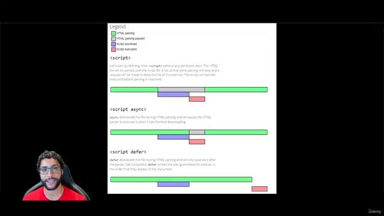
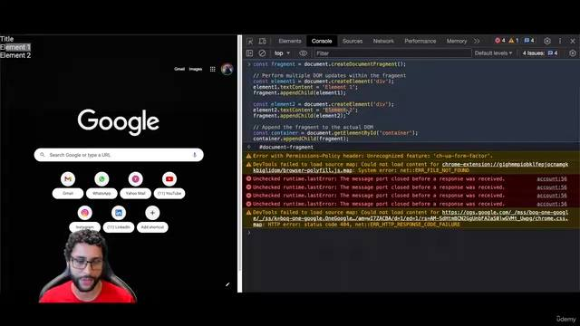
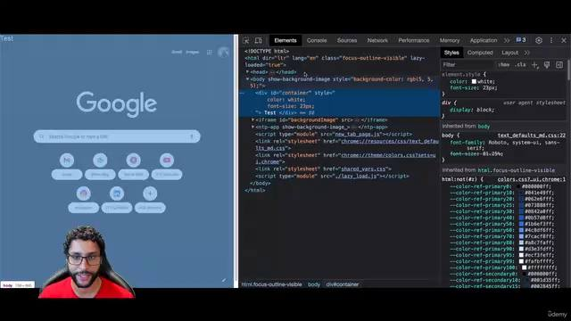
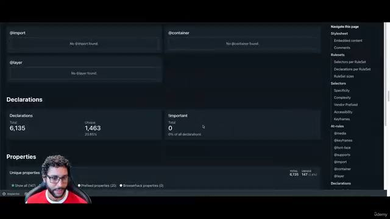
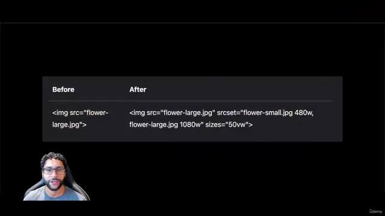

# Web Performance & Monitoring（前端监控报警）P008–P011 复现文档

> 覆盖课程：BV18hxK6iEWu 第 8–11 讲
> 主题：关键渲染资源 → JavaScript 优化 → CSS 优化 → 图片优化
> 读者定位：前端转 AI 应用工程师。本文档按「能照着跑」的标准写，凡是逐字稿没讲到的内容，一律标注「课里没讲」。

---

## 1. 这一节做什么

这四讲不是讲监控报警本身，而是先讲**前端性能优化的四大块**，为后面的监控指标（LCP 等）打地基。具体产出：

| 讲次 | 主题 | 你要产出的东西 |
|---|---|---|
| P008 | 关键资源（Critical Resources）概念 | 一份「首屏关键资源清单」 |
| P009 | JavaScript 优化 | 一个可运行的 HTML 页面，内含 minify 配置、async/defer 对比、循环缓存、DocumentFragment、requestAnimationFrame、事件委托 6 个可验证的 demo |
| P010 | CSS 优化 | 用 MarkerSeed / cssstats / projectwallace 三个在线工具分析同一份 CSS，产出分析报告 |
| P011 | 图片优化 | 一个响应式图片页面（srcset + picture + lazy loading），以及用 sharp / imagemin 批量压缩图片的脚本 |

最终你会得到一个本地可跑的 `perf-lab` 项目，里面每一块优化都有对应的可验证页面。**注意：这四讲没有讲后端监控上报、没有讲报警规则、没有讲 WebSocket 或任何服务端组件**——课里没讲，本文档也不编。

从学习路径上看，这一节的目标不是让你背概念，而是让你亲手看到「同一个页面，在脚本加载方式、循环写法、DOM 插入方式、CSS 选择器复杂度、图片尺寸与格式不同时，浏览器行为会有什么差异」。因此本文档在每一步都尽量给出可操作命令、可观察现象和可排查的常见错误。你不需要先理解监控平台的全部指标，只要先能稳定复现这四类优化，后面再接入 LCP、CLS、INP 等监控指标时，才知道哪些改动会影响首屏、哪些改动只是代码风格。

这四讲里出现的工具分两类：一类是浏览器 DevTools 和本地 Node 脚本，属于你一定能跑起来的部分；另一类是 MarkerSeed、cssstats、projectwallace 这三个在线分析工具，属于辅助观察 CSS 质量的部分。前者要保证命令可执行，后者要保证输入内容或 URL 正确。文档中的「课里没讲」标注，表示讲师在逐字稿中没有展开，但复现时很可能遇到，需要你按通用排查方式处理。

---

## 2. 讲师原话

> "关键资源是指处理网页最初可见部分（也就是首屏内容）所必需的资产。"
> —— p008 [00:04]

> "第一种是标准做法：当解析到 script 标签时，HTML 解析会停止，只有在脚本下载并执行后才会继续。第二种方式中，async 属性让浏览器能够下载文件而不阻塞页面解析，但脚本执行仍会阻塞页面渲染。第三种方式中，defer 属性会推迟脚本执行，直到 HTML 解析完成。"
> —— p009 [01:27]

> "一种可行的改进是在循环中缓存数组长度，避免每次迭代都重新计算长度。"
> —— p009 [02:16]

> "不要直接把元素追加到 DOM，而可以把它们追加到文档片段，完成所有需要的修改后，再通过一次操作将片段追加到 DOM。"
> —— p009 [05:06]

> "事件委托是 JavaScript 中的一种技术，它利用事件冒泡来高效处理多个元素上的事件。"
> —— p009 [09:56]

> "指标部分会展示所分析文件的指标。例如，这里有样式表文件的大小、CSS 规则的总数、CSS 规则的平均长度……"
> —— p010 [01:45]

> "复杂度为 T1 的选择器，是指仅使用一种类型来查询 DOM 元素的选择器……复杂度更高的选择器越多，CSS 样式表运行起来就越慢。"
> —— p010 [10:10]

> "向移动设备提供桌面尺寸的图片，可能比实际需要多用两到四倍的数据量。与其对所有图片采用一刀切的方式，理想情况下应根据分辨率向不同设备提供不同尺寸的图片。这种图片提供方式称为响应式图片。"
> —— p011 [02:32]

> "只需在 img 标签上添加 loading 属性，就能轻松实现图片懒加载，就这么简单！"
> —— p011 [13:06]（讲师口误，实际是 `loading` 属性）

这些原话对应到复现动作上：P008 先建立「首屏关键资源」的判断标准；P009 用脚本加载顺序、循环缓存、批量 DOM 操作、rAF 和事件委托观察运行时差异；P010 用在线工具把 CSS 体积、规则数、选择器复杂度可视化；P011 用 `srcset`、`picture`、`loading="lazy"` 和 `sharp` / `imagemin` 观察图片传输与压缩差异。引用中的英文保留原样，便于你回到视频对应时间点核对；中文解释只用于帮助你定位要验证的现象，不替代讲师原话。

---

## 3. 从零复现

### 3.1 环境准备

```bash
# 需要 Node 18+（sharp 和 imagemin 都要求）
node -v
mkdir perf-lab && cd perf-lab
npm init -y
npm install --save-dev sharp imagemin imagemin-webp imagemin-mozjpeg imagemin-pngquant
```

> 版本说明：课里没讲具体版本号，只说了「sharp 是 npm 包」「imagemin 有各种插件」。上面用 `--save-dev` 装最新版即可，`package.json` 里会记录实际版本。

命令逐行解释：`node -v` 用来确认 Node 版本，课程中的 `sharp` 和 `imagemin` 相关依赖需要较新的 Node 运行时；如果版本过低，安装或运行时可能直接报错。`mkdir perf-lab && cd perf-lab` 创建并进入项目目录，后续所有相对路径都以此目录为根。`npm init -y` 生成默认 `package.json`，这样 `npm install --save-dev` 才能把依赖写入 `devDependencies`。`npm install --save-dev sharp imagemin imagemin-webp imagemin-mozjpeg imagemin-pngquant` 安装图片处理依赖：`sharp` 用于按尺寸生成图片和转 WebP，`imagemin` 是压缩入口，`imagemin-webp`、`imagemin-mozjpeg`、`imagemin-pngquant` 分别是 WebP、JPEG、PNG 的压缩插件。课里没有给出版本矩阵，因此不要手写固定版本去覆盖安装结果，以实际安装后的 `package.json` 为准。

常见错误与排查：如果 `npm install` 卡住，先在终端确认网络和 npm registry 是否可用；如果 `sharp` 安装失败，先检查 Node 版本是否满足要求，再尝试删除 `node_modules` 和 `package-lock.json` 后重新安装；如果后面运行 `compress.js` 出现 `ERR_REQUIRE_ESM`，说明当前 `imagemin` 版本与 `require` 写法不匹配，这是第 7 节会展开的问题。前端对照：在前端项目里，这类依赖通常放在构建脚本或 CI 中，不会进入浏览器 bundle；本文档用 Node 脚本模拟「构建期图片处理」，便于你观察输入输出文件差异。

目录结构（照此创建）：

```
perf-lab/
├── package.json
├── src/
│   ├── index.html              # 主页面，串起所有 demo
│   ├── js/
│   │   ├── loop-cache.js       # 循环缓存长度
│   │   ├── fragment.js         # DocumentFragment 批量插入
│   │   ├── raf-batch.js        # requestAnimationFrame 批量更新
│   │   └── delegation.js       # 事件委托
│   ├── css/
│   │   └── style.css           # 待分析的 CSS
│   └── img/
│       ├── flower-small.jpg    # 你自己准备一张原图，命名 flower.jpg
│       └── flower.jpg
├── scripts/
│   ├── resize.js               # sharp 生成多尺寸
│   └── compress.js             # imagemin 压缩
└── dist/                       # 输出目录
```

创建目录时建议先建 `src/js`、`src/css`、`src/img`、`scripts`、`dist` 这几个目录，再把第 4 节代码分别保存到对应文件。注意 `src/img` 里需要你自己准备一张原图并命名为 `flower.jpg`，否则 `resize.js` 会找不到输入文件。`dist` 是输出目录，脚本会在需要时创建它；如果你提前手动创建，也不影响运行。前端对照：这里的 `src` 相当于源码目录，`dist` 相当于构建产物目录，和常见前端脚手架的 `src` / `dist` 分工一致。

### 3.2 步骤一：搭一个最小静态服务器

课里没讲服务器怎么起，但你需要一个能跑 HTML 的本地环境。用 Node 自带的 `http-server` 即可：

```bash
npx http-server src -p 8080 -c-1
```

打开 `http://localhost:8080`。`-c-1` 关掉缓存，方便你改代码后刷新看到变化。

命令解释：`npx` 会临时下载并执行 `http-server`，不需要你全局安装；`src` 是静态服务器根目录，因此浏览器访问 `/` 时对应 `src/index.html`；`-p 8080` 指定端口，如果 8080 被占用，可以改成 `-p 8081` 并同步访问新端口；`-c-1` 表示缓存控制，避免浏览器缓存旧 HTML/CSS/JS 导致你以为代码没生效。常见错误与排查：如果出现 `EADDRINUSE`，说明端口被占用，换端口即可；如果浏览器打开是目录列表而不是页面，检查 `src/index.html` 是否存在、文件名大小写是否正确；如果修改后仍看到旧内容，先确认启动命令带了 `-c-1`，再在 DevTools Network 面板勾选 Disable cache 后刷新。前端对照：这相当于本地开发服务器，和生产环境的 CDN 缓存、HTTP 缓存策略不是一回事；这里只是为了复现 demo 时减少缓存干扰。

### 3.3 步骤二：验证 async / defer 的加载行为

在 `src/index.html` 的 `<head>` 里放三个脚本，分别用三种方式加载。为了能肉眼看到差异，脚本里用 `document.write` 或 `console.log` 打时间戳。**课里只讲了三种加载方式的语义，没给具体 demo 代码**，下面的 demo 是为复现语义而写的。

打开 DevTools → Network，勾选 "Disable cache"，把网络限速调到 "Slow 3G"，刷新页面，观察三个脚本的下载与执行顺序。


验证时重点看三件事：标准脚本是否在 HTML 解析到该标签时阻塞后续解析；`async` 脚本是否在下载完成后立即执行，且执行顺序可能与标签顺序不一致；`defer` 脚本是否等 HTML 解析完成后再按顺序执行。课里讲的是语义，没给具体 demo 代码，所以本文档的 demo 只用于观察行为，不代表课程额外提供了代码。常见错误与排查：如果 Network 面板看不到明显差异，先确认限速是否生效、Disable cache 是否勾选、脚本文件是否很小导致下载太快；如果页面白屏时间变化不明显，可以把脚本内容改成明显耗时或打时间戳的版本再观察。前端对照：现代框架里的脚本策略、模块加载和 hydration 时机，底层仍然绕不开「下载是否阻塞解析」「执行是否阻塞渲染」这两类问题。

### 3.4 步骤三：验证循环缓存长度

打开 DevTools Console，粘贴 `loop-cache.js` 的内容运行。课里讲师是在 DevTools 里现场敲的：



运行后你应该看到 `bad 0` 到 `bad 3`，以及 `good 0` 到 `good 3` 两组输出。验证重点是观察代码写法差异，而不是用这段小数组测出明显性能差距。讲师也提到，这里优化不大，但如果 `length` 是一个会发 HTTP 请求的方法，就是 huge deal。常见错误与排查：如果 Console 报 `arr is not defined`，说明你没有把完整脚本粘贴进去或分次执行导致作用域丢失；如果只看到一组输出，检查是否只运行了反例或正例。前端对照：在前端业务代码里，循环缓存长度属于运行时微优化，真正影响首屏的往往是资源体积、请求数量和渲染阻塞，不要因为这个小例子而过度优化普通数组循环。

### 3.5 步骤四：验证 DocumentFragment

讲师的做法是：先在页面里用 "Edit as HTML" 手动加一个 `<div id="container">`，再在 Console 里跑 snippet。你照做：

1. 打开 `http://localhost:8080`
2. DevTools → Elements → 右键 `<body>` → "Edit as HTML" → 加 `<div id="container" style="color:white;font-size:23px"></div>`
3. Console 里粘贴 `fragment.js` 运行
4. 观察 container 里一次性出现两个 div


验证时注意：`fragment.js` 里会先判断 `container` 是否存在，如果你没有先加 `<div id="container">`，函数不会报错但也不会有可见结果。常见错误与排查：如果 Console 报找不到元素，检查 `id` 是否拼成 `container`；如果页面看不到文字，检查容器样式是否把文字颜色设成和背景一样，或者 DevTools Elements 里是否已经插入了两个 div。前端对照：批量插入的思路在前端框架中很常见，例如先把多个节点准备好再一次性挂载，减少多次布局和重排；但具体 API 仍是浏览器 DOM API，Node 环境没有直接对应物。

### 3.6 步骤五：验证 requestAnimationFrame 批量更新

同样在 Console 里跑 `raf-batch.js`。讲师强调：把多次 DOM 更新塞进一个 rAF 回调，浏览器在下次重绘前一次性执行。



验证时观察 `container` 里是否新增了 `raf element one` 和 `raf element two`。`requestAnimationFrame` 的回调不是立即同步执行，而是排到下一次重绘前，所以你在 Console 里执行后，可能需要等一帧才看到结果。常见错误与排查：如果切到后台标签页再执行，rAF 可能暂停或不触发，这是第 7 节会提到的现象；如果 `container` 不存在，回调里会直接 return，页面上不会出现新元素。前端对照：动画和批量 DOM 更新常用 rAF 对齐浏览器重绘节奏，但在 Node 服务端没有「重绘」概念，不能用它来类比服务端异步调度。

### 3.7 步骤六：验证事件委托

在页面里放一个 `<ul id="list">`，里面若干 `<li>`。跑 `delegation.js`，然后动态往 list 里 append 新的 li，点击新 li 也能触发——这就是委托的好处。



验证时先点击原有的 `item 1/2/3`，再点击脚本动态生成的 `item 4 (dynamic)`，Console 都应该打印 `clicked: ...`。常见错误与排查：如果点击 li 没有输出，检查监听是否挂在 `#list` 上、`event.target.tagName` 是否等于 `LI`；如果点击 li 内部文字时偶尔不触发，可能遇到 `event.target` 是文本节点的情况，稳妥写法可用 `closest('li')`，但课里示例用的是简单判断。前端对照：React 等框架的合成事件系统底层也利用事件委托，把监听挂在根容器上；理解冒泡和 `target` 后，排查「为什么新加元素没有绑定事件」会更直接。

### 3.8 步骤七：CSS 分析三件套

课里给了三个在线工具，全部是浏览器打开、粘贴 CSS、看报告，无需安装：

1. **MarkerSeed**：粘贴 CSS 全文 → 点 "Test my CSS" → 看 Metrics 和 Tests 两栏
2. **cssstats.com**：粘贴 CSS 文件的 **URL**（不是内容）→ 回车 → 看文件大小、gzip 后大小、规则数、选择器数
3. **projectwallace.com**：点 "Analyze CSS now" → 粘贴 URL → 看 Complexity 分布




操作时注意两个工具的输入方式不同：MarkerSeed 是粘贴 CSS 全文，cssstats.com 和 projectwallace.com 更偏向粘贴 CSS 文件的 URL。如果你本地服务是 `http://localhost:8080/css/style.css`，在线工具不一定能访问你的 localhost，这时需要把 CSS 放到可公开访问的地址，或按工具页面提示使用它支持的方式。课里没讲在线工具的可访问性限制，遇到打不开或分析失败时不要误以为 CSS 写错了。常见错误与排查：如果报告里规则数为 0，检查是否只粘了空内容或 URL 不可访问；如果 Complexity 分布和预期不符，先确认分析的是同一份 `style.css`。前端对照：这些在线工具相当于 CSS 静态体检，生产项目里也可以用本地 lint 或构建分析替代，但本课程演示的是在线工具操作。

### 3.9 步骤八：生成多尺寸图片

把一张原图放到 `src/img/flower.jpg`，跑：

```bash
node scripts/resize.js
```

会在 `dist/img/` 下生成 `flower-small.jpg` 和 `flower-large.jpg`。课里说「3 到 5 个版本」，示例只做 2 个，你可以按需加。

命令解释：`node scripts/resize.js` 直接执行 Node 脚本，脚本内部用 `sharp` 读取 `src/img/flower.jpg`，分别 `resize(480)` 和 `resize(1024)` 输出小图和大图，并额外用 `.webp({ quality: 80 })` 生成 WebP。常见错误与排查：如果报找不到输入文件，确认文件名是 `flower.jpg` 且位于 `src/img/`；如果 `dist/img` 不存在，脚本里已经用 `fs.mkdirSync(..., { recursive: true })` 处理；如果生成的图片尺寸不符合预期，检查你传入的宽度参数。前端对照：响应式图片需要多个尺寸版本，构建期生成比运行时临时缩放更稳定；但课程只演示了本地脚本，没有讲 CDN 动态裁剪。

### 3.10 步骤九：写响应式图片 HTML

在 `index.html` 里用 `srcset` + `sizes` 引入，再用 `<picture>` 做 WebP 回退。课里给了属性语义，没给完整 HTML，下面代码是按语义写的。



验证时把浏览器窗口缩到 600px 以下，观察 Network 面板里图片请求是否从大图切换为小图。注意 `srcset` 里的 `w` 描述符要和 `sizes` 配合，浏览器会根据布局宽度和像素密度选择候选图。`<picture>` 中 WebP 的 `<source>` 要放在 JPEG 的 `` 之前，因为浏览器取第一个匹配的 source。常见错误与排查：如果 Network 里始终只请求同一张图，检查 `srcset` 路径是否正确、浏览器是否支持 WebP、窗口是否真的跨过断点；如果图片不显示，检查文件名和扩展名大小写。前端对照：响应式图片是浏览器原生能力，和前端框架无关；但你需要把它和构建产物路径、CDN 路径对应起来。

### 3.11 步骤十：压缩图片

```bash
node scripts/compress.js
```

输出到 `dist/img/`，对比压缩前后文件大小。


命令解释：脚本用 `imagemin` 读取 `src/img/*.{jpg,png}`，通过 `imageminMozjpeg`、`imageminPngquant`、`imageminWebp` 三个插件输出到 `dist/img/`。带 `quality` 参数的插件属于 lossy，课里讲师说「for most people, loss plugins is the best choice」。常见错误与排查：如果脚本报 `ERR_REQUIRE_ESM`，见第 7 节；如果压缩后文件数量为 0，检查 glob 路径和源目录里是否有 jpg/png；如果输出文件覆盖了 `resize.js` 生成的文件，注意两个脚本都写 `dist/img/`，这是示例目录结构的正常现象。前端对照：生产项目里图片压缩通常放在构建流水线或上传流程中，本课只是用本地脚本让你看到压缩前后体积差异。

---

## 4. 完整代码

### 4.1 `src/index.html`

```html
<!DOCTYPE html>
<html lang="zh-CN">
<head>
  <meta charset="UTF-8" />
  <meta name="viewport" content="width=device-width, initial-scale=1.0" />
  <title>Perf Lab</title>
  <link rel="stylesheet" href="./css/style.css" />

  <!-- 三种脚本加载方式对比：standard / async / defer -->
  <script src="./js/loop-cache.js"></script>
  <script async src="./js/fragment.js"></script>
  <script defer src="./js/delegation.js"></script>
</head>
<body>
  <h1>Perf Lab</h1>

  <!-- DocumentFragment 与 rAF 的挂载点 -->
  <div id="container" style="color:white;font-size:23px"></div>

  <!-- 事件委托的挂载点 -->
  <ul id="list">
    <li>item 1</li>
    <li>item 2</li>
    <li>item 3</li>
  </ul>

  <!-- 响应式图片：srcset + sizes -->
  

  <!-- picture：WebP 优先，JPEG 回退 -->
  <picture>
    <source srcset="./img/flower.webp" type="image/webp" />
    
  </picture>

  <script src="./js/raf-batch.js"></script>
</body>
</html>
```

### 4.2 `src/js/loop-cache.js`

```javascript
// 反例：每次迭代都求值 array.length
const arr = [1, 2, 3, 4];
for (let i = 0; i < arr.length; i++) {
  console.log('bad', i);
}

// 正例：把 length 缓存到变量
const len = arr.length;
for (let i = 0; i < len; i++) {
  console.log('good', i);
}
```

### 4.3 `src/js/fragment.js`

```javascript
function createDocumentFragmentDemo() {
  const fragment = document.createDocumentFragment();

  const div1 = document.createElement('div');
  div1.textContent = 'element one';
  fragment.appendChild(div1);

  const div2 = document.createElement('div');
  div2.textContent = 'element two';
  fragment.appendChild(div2);

  const container = document.getElementById('container');
  if (container) {
    container.appendChild(fragment);
  }
}

createDocumentFragmentDemo();
```

### 4.4 `src/js/raf-batch.js`

```javascript
function batchUpdates() {
  requestAnimationFrame(() => {
    const container = document.getElementById('container');
    if (!container) return;

    const div1 = document.createElement('div');
    div1.textContent = 'raf element one';
    container.appendChild(div1);

    const div2 = document.createElement('div');
    div2.textContent = 'raf element two';
    container.appendChild(div2);
  });
}

batchUpdates();
```

### 4.5 `src/js/delegation.js`

```javascript
const list = document.getElementById('list');

if (list) {
  list.addEventListener('click', (event) => {
    if (event.target.tagName === 'LI') {
      console.log('clicked:', event.target.textContent);
    }
  });

  // 动态新增的 li 自动继承父元素上的监听
  const newLi = document.createElement('li');
  newLi.textContent = 'item 4 (dynamic)';
  list.appendChild(newLi);
}
```

### 4.6 `src/css/style.css`

```css
/* 故意留一些可被工具挑出问题的写法，方便 MarkerSeed 报红 */
* {
  margin: 0;
  padding: 0;
}

.container .wrapper .inner .title {
  color: #333333;
  font-size: 16px;
}

.container .wrapper .inner .title:hover::before {
  content: "";
}

.button {
  background: #ff0000;
  border: 1px solid #ff0000;
}

@media (max-width: 600px) {
  .button {
    display: block;
  }
}
```

### 4.7 `scripts/resize.js`

```javascript
const sharp = require('sharp');
const path = require('path');
const fs = require('fs');

const SRC = path.join(__dirname, '..', 'src', 'img', 'flower.jpg');
const OUT_DIR = path.join(__dirname, '..', 'dist', 'img');

if (!fs.existsSync(OUT_DIR)) {
  fs.mkdirSync(OUT_DIR, { recursive: true });
}

async function main() {
  await sharp(SRC).resize(480).toFile(path.join(OUT_DIR, 'flower-small.jpg'));
  await sharp(SRC).resize(1024).toFile(path.join(OUT_DIR, 'flower-large.jpg'));
  await sharp(SRC).webp({ quality: 80 }).toFile(path.join(OUT_DIR, 'flower.webp'));
  console.log('resize done');
}

main().catch((err) => {
  console.error(err);
  process.exit(1);
});
```

### 4.8 `scripts/compress.js`

```javascript
const imagemin = require('imagemin');
const imageminWebp = require('imagemin-webp');
const imageminMozjpeg = require('imagemin-mozjpeg');
const imageminPngquant = require('imagemin-pngquant');
const path = require('path');

async function main() {
  const files = await imagemin(
    [path.join(__dirname, '..', 'src', 'img', '*.{jpg,png}')],
    {
      destination: path.join(__dirname, '..', 'dist', 'img'),
      plugins: [
        imageminMozjpeg({ quality: 75 }),
        imageminPngquant({ quality: [0.6, 0.8] }),
        imageminWebp({ quality: 80 }),
      ],
    }
  );
  console.log('compressed:', files.length, 'files');
}

main().catch((err) => {
  console.error(err);
  process.exit(1);
});
```

### 4.9 `package.json`（关键部分）

```json
{
  "name": "perf-lab",
  "version": "1.0.0",
  "scripts": {
    "serve": "http-server src -p 8080 -c-1",
    "resize": "node scripts/resize.js",
    "compress": "node scripts/compress.js"
  },
  "devDependencies": {
    "http-server": "^14.1.1",
    "imagemin": "^8.0.1",
    "imagemin-mozjpeg": "^10.0.0",
    "imagemin-pngquant": "^9.0.2",
    "imagemin-webp": "^7.0.0",
    "sharp": "^0.33.0"
  }
}
```

> 版本号以你实际 `npm install` 后 `package.json` 里记录的为准；课里没讲版本。

---

## 5. 逐行解释

**`index.html` 里的三个 script**
- 第一个 `<script src="./js/loop-cache.js">` 是**标准加载**：HTML 解析到这里停下，等下载+执行完才继续。这就是讲师说的 "当遇到 script 标签时，HTML 解析会停止。"。
- 第二个带 `async`：下载不阻塞解析，但**下载完立刻执行，执行时会阻塞渲染**。讲师原话 "执行过程会继续阻塞页面渲染。"。
- 第三个带 `defer`：下载不阻塞解析，**等 HTML 全部解析完才执行**。讲师原话 "将脚本执行推迟到 HTML 解析完成之后。"。
- 在 JS/Node 里对应什么：这三者都是浏览器行为，Node 没有对应概念。但如果你用 Next.js 的 `<Script strategy="beforeInteractive|afterInteractive|lazyOnload">`，语义上和 defer/async 是同一类问题。常见错误与排查：如果三个脚本的执行顺序看起来完全一样，先确认网络限速和 Disable cache；如果 `async` 脚本里依赖 DOM 已解析，可能会在 DOM 尚未就绪时执行，需要把逻辑放进 `DOMContentLoaded` 或改用 `defer`。

**`loop-cache.js`**
- `for (let i = 0; i < arr.length; i++)`：每次循环都重新读 `arr.length`。讲师在 DevTools 里现场演示了这一点——"数组的 .length 被求值了四次。"。
- `const len = arr.length` 缓存后，循环里只读变量。讲师说"这里优化不大，但如果 length 是一个发 HTTP 请求的方法，就是 huge deal"。
- 在 JS 里对应什么：这就是 JS 本身，无需翻译。常见错误与排查：如果在 Console 里分两次执行，第二次可能因为 `const arr` 重复声明报错，刷新页面后重新粘贴完整脚本即可。前端对照：这是运行时微优化，不要把它当成首屏性能的主要手段。

**`fragment.js`**
- `document.createDocumentFragment()` 创建一个轻量容器，不在 DOM 树上。
- 两次 `appendChild` 都挂在 fragment 上，**不触发重排**。
- 最后 `container.appendChild(fragment)` 一次性把整个 fragment 挂到真实 DOM，**只触发一次重排**。讲师原话 "只会发生一次 DOM 操作。"。
- 在 JS/Node 里对应什么：Node 没有 DOM，但 React 的 `ReactDOM.createPortal` 或批量 setState 的批处理思路类似——都是"攒一批再提交"。常见错误与排查：如果 `container` 不存在，脚本不会报错但也不会插入节点；检查 `id` 和页面结构。

**`raf-batch.js`**
- `requestAnimationFrame(cb)` 把 cb 排到浏览器下一次重绘之前执行。讲师原话 "安排 DOM 更新，使其在浏览器执行下一次重绘之前发生。"。
- 在 JS/Node 里对应什么：Node 里没有 rAF，最接近的是 `process.nextTick` 或 `setImmediate`，但语义不同（Node 没有"重绘"概念）。常见错误与排查：后台标签页中 rAF 可能暂停，切换回前台后才继续；如果测试时看不到效果，先确认页面处于前台。

**`delegation.js`**
- 监听挂在 `#list`（父元素）上，而不是每个 `<li>`。
- `event.target.tagName === 'LI'` 判断点击源是不是 li。讲师原话 "检查 event.target.tagName 就能判断点击是否发生在 LI 元素上。"。
- 动态 append 的 `item 4` 自动继承监听，因为监听在父元素上。
- 在 JS/Node 里对应什么：Node 的 `EventEmitter` 是发布订阅，没有 DOM 冒泡，所以没有直接对应。React 的合成事件系统底层就是事件委托。常见错误与排查：点击 li 内部文本节点时，`event.target` 可能不是 li，简单示例够用，复杂场景用 `closest('li')` 更稳。

**`style.css`**
- `*` 通配符选择器：MarkerSeed 会报红，因为通配符会匹配所有元素，运行时开销大。
- `.container .wrapper .inner .title`：4 层嵌套，projectwallace 会把它算成高复杂度选择器。讲师说"选择器越多、复杂度越高，CSS 样式表在运行时就会越慢。"。
- `@media` 查询：MarkerSeed 的 Tests 里会单独列一条"包含媒体查询。"。常见错误与排查：在线工具分析不到本地 URL 时，先确认输入方式；不要因为工具打不开就改 CSS。

**`resize.js`**
- `sharp(SRC).resize(480)`：sharp 是讲师点名的 npm 包，"传入图片路径并指定新的图片尺寸。"。
- `.webp({ quality: 80 })`：讲师说 WebP 比 JPEG/PNG 小 25–35%，这里顺手生成一份 WebP 供 `<picture>` 用。常见错误与排查：输入图片不存在会报错；输出目录权限不足也会失败，检查路径和权限。

**`compress.js`**
- `imageminMozjpeg({ quality: 75 })`：JPEG 用 mozjpeg 插件，**lossy**（有 quality 参数就是 lossy，讲师原话 "如果插件会改变输出图像的画质，那么它就是有损的。"）。
- `imageminPngquant({ quality: [0.6, 0.8] })`：PNG 用 pngquant，也是 lossy。
- `imageminWebp({ quality: 80 })`：WebP 压缩。讲师说"对大多数人来说，有损插件是最佳选择。"。常见错误与排查：如果 `require('imagemin')` 报 ESM 错误，按第 7 节处理；如果压缩后文件没变，检查插件是否真的匹配到了输入格式。

---

## 6. 复现检查清单

跑完上面所有步骤后，逐条打勾，并按下述验证方法确认，不要只凭“看起来没报错”就打勾：

- [ ] `npm install` 无报错，`node_modules` 里能看到 `sharp` 和 `imagemin`。验证方法：在项目根目录执行 `ls node_modules | grep -E "sharp|imagemin"`，或直接看 `package.json` 的 `devDependencies` 是否写入这些包。
- [ ] `npx http-server src -p 8080 -c-1` 能起服务，浏览器打开 `http://localhost:8080` 看到 "Perf Lab"。验证方法：终端出现服务启动日志，浏览器页面标题和一级标题可见；如果端口冲突，换端口后访问新地址。
- [ ] DevTools Network 面板 Slow 3G 下，能看到三个脚本的加载顺序差异（standard 阻塞、async 乱序执行、defer 最后执行）。验证方法：勾选 Disable cache 和 Slow 3G，刷新后按时间轴看三个脚本的请求与执行标记；如果差异不明显，把脚本内容改成带时间戳输出。
- [ ] Console 里能看到 `bad 0..3` 和 `good 0..3` 两组输出。验证方法：完整粘贴 `loop-cache.js` 内容后回车，数一下 Console 是否共 8 行输出。
- [ ] 手动加 `<div id="container">` 后，Console 跑 `fragment.js`，container 里一次出现两个 div。验证方法：Elements 面板展开 `#container`，确认子节点是 `element one` 和 `element two`。
- [ ] 跑 `raf-batch.js`，container 里再出现两个 div（"raf 元素一/二"）。验证方法：执行后在 Elements 面板刷新查看，或等待一帧后在 Console 检查 `container.children.length`。
- [ ] 点击 `item 1/2/3` 和动态生成的 `item 4`，Console 都打印 `clicked: ...`。验证方法：逐个点击四个 li，确认每次都有一条对应文本的输出。
- [ ] MarkerSeed 粘贴 `style.css` 全文，Tests 里 "需要压缩。" 显示为红色 true。验证方法：打开 MarkerSeed，粘贴完整 CSS 后点测试，定位 Tests 栏对应条目。
- [ ] cssstats.com 粘贴 CSS 的 URL，能看到 file size 和 gzip size 两个数字。验证方法：确认 URL 可公开访问，提交后看报告顶部 Metrics 区域。
- [ ] projectwallace.com 粘贴 URL，Complexity 分布里能看到复杂度 ≥ 3 的选择器。验证方法：提交 URL 后查看 Complexity 分组，对照 `style.css` 里的多级选择器。
- [ ] `node scripts/resize.js` 后 `dist/img/` 下有 `flower-small.jpg`、`flower-large.jpg`、`flower.webp`。验证方法：执行 `ls dist/img`，确认三个文件名都存在。
- [ ] `node scripts/compress.js` 后 `dist/img/` 下文件大小比 `src/img/` 小。验证方法：分别执行 `ls -lh src/img dist/img`，对比同名或同类型文件体积；注意 lossy 压缩后体积通常下降。
- [ ] 把浏览器窗口缩到 600px 以下，Network 面板里图片请求变成 `flower-small.jpg`（srcset 生效）。验证方法：打开 Network 的 Img 过滤，调整窗口宽度后刷新，观察请求 URL 是否切换。
- [ ] 页面滚动到图片位置之前，Network 里图片请求是延迟发出的（`loading="lazy"` 生效）。验证方法：清空 Network 后刷新，首屏不滚动时看图片请求是否尚未发出；滚动接近图片后再观察请求出现。

---

## 7. 课里没讲但你会撞上的

| 现象 | 原因 | 怎么办 |
|---|---|---|
| 改了 HTML/CSS/JS，刷新后还是旧内容 | `http-server` 默认可能带缓存，浏览器也会缓存静态资源；课里没讲缓存排查。 | 启动时加 `-c-1`，并在 DevTools Network 勾选 Disable cache；仍不生效时检查是否访问了错误端口或错误目录。 |
| `require('imagemin')` 报 `ERR_REQUIRE_ESM` | imagemin 8.x 是 ESM-only，旧 Node 或 CommonJS `require` 写法不匹配；课里没讲模块格式问题。 | 改用 ESM `import`，或按项目实际情况降级到支持 CommonJS 的版本；不要只改文件名而不改模块类型。 |
| `sharp` 安装或运行失败 | 平台、Node 版本或二进制依赖不匹配；Apple Silicon 上偶发需要重建。 | 先确认 Node 18+，删除 `node_modules` 和锁文件后重装；必要时执行 `npm rebuild sharp`。 |
| `srcset` 写了但浏览器总选同一张图 | 只写 `srcset` 不写 `sizes`，浏览器按默认 100vw 估算，可能选错候选图；课里讲了 `sizes` 语义但没强调必须配对。 | 补全 `sizes`，并用 Network 面板实际观察不同窗口宽度下的请求 URL。 |
| 首屏 LCP 图片加了 `loading="lazy"` 反而变慢 | 讲师说 lazy load 不影响 load time，但如果 LCP 元素本身是图片，延迟加载会拖慢 LCP；课里没讲这个反例。 | 首屏关键图片不要加 lazy，非首屏图片再加；用 Lighthouse 或 Performance 面板对比。 |
| `<picture>` 没有按预期选 WebP | `<source>` 顺序错误，浏览器取第一个匹配的 source；课里没讲顺序问题。 | 把 WebP 的 `<source>` 放在 JPEG 的 `` 之前，并确认路径和 MIME 类型正确。 |
| MarkerSeed / cssstats / projectwallace 打不开或分析失败 | 三个都是第三方在线工具，可能受网络、URL 可访问性、工具自身可用性影响；课里没讲可用性和 API 限额。 | 先确认 CSS URL 可公开访问；工具不可用时改用本地 `stylelint` 或构建分析替代，不要误改 CSS。 |
| `async` 脚本里用 `document.write` 没有按预期输出 | 浏览器对 async 脚本中的 `document.write` 有忽略或限制行为；课里没讲。 | 不要在 async 脚本里依赖 `document.write`，改用 DOM API 或把逻辑放到 DOM 就绪后。 |
| `requestAnimationFrame` 在后台标签页不触发 | 浏览器会暂停后台标签页的渲染节奏，rAF 随之暂停；课里没讲。 | 测试时保持页面在前台；需要后台也执行的逻辑不要只依赖 rAF。 |
| 点击 li 内部文字时事件委托偶尔不触发 | 某些情况下 `event.target` 是文本节点而非 li，`tagName` 为 undefined；课里示例用的是简单 `tagName` 判断。 | 复杂场景用 `event.target.closest('li')`，并判断结果是否存在；简单 demo 可保持原写法。 |
| 以为这四讲会讲监控上报、报警规则或服务端组件 | 这四讲只讲关键资源、JS、CSS、图片优化，没有讲 `navigator.sendBeacon`、`PerformanceObserver`、报警阈值、WebSocket 等；课里没讲，本文档也不编。 | 把本文档当作性能优化基础篇；真正的监控上报和报警内容留到后续讲次，不要在这里虚构接口。 |
| 图片脚本输出目录互相覆盖，误以为压缩没生效 | `resize.js` 和 `compress.js` 都写 `dist/img/`，同名文件可能被后执行的脚本覆盖；课里没讲输出命名冲突。 | 分目录输出，或先备份；对比体积时确认比较的是同一批文件，必要时改输出文件名。 |