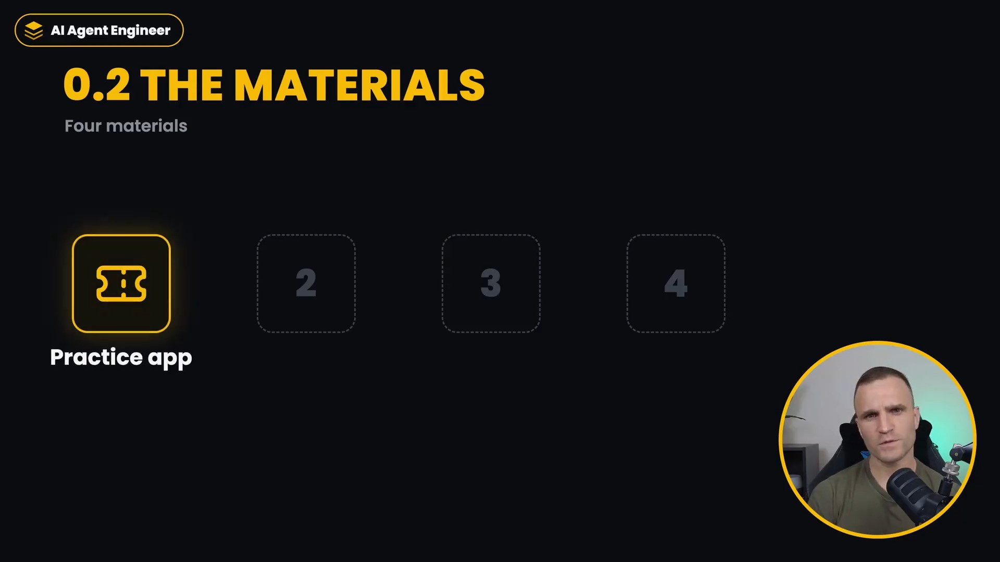
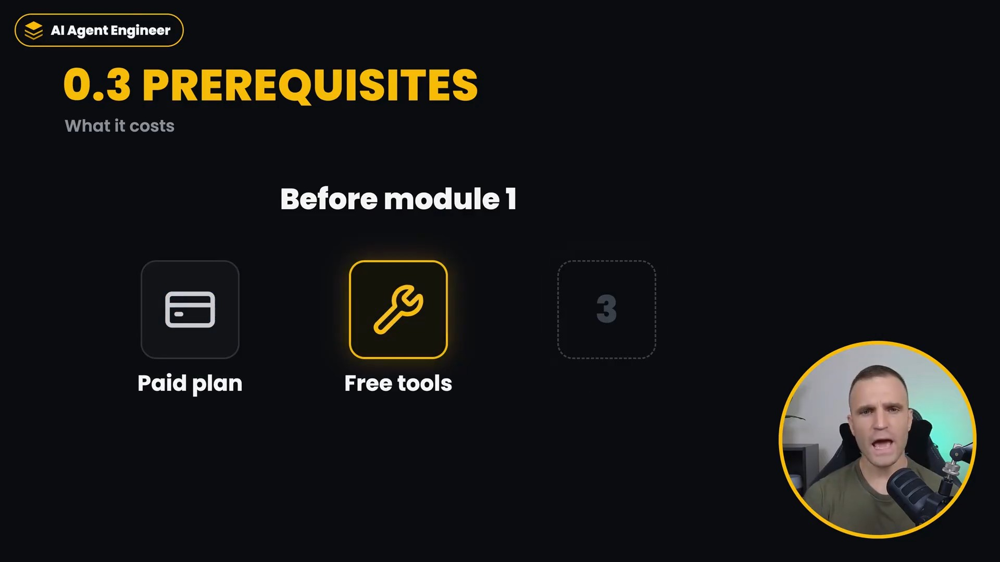
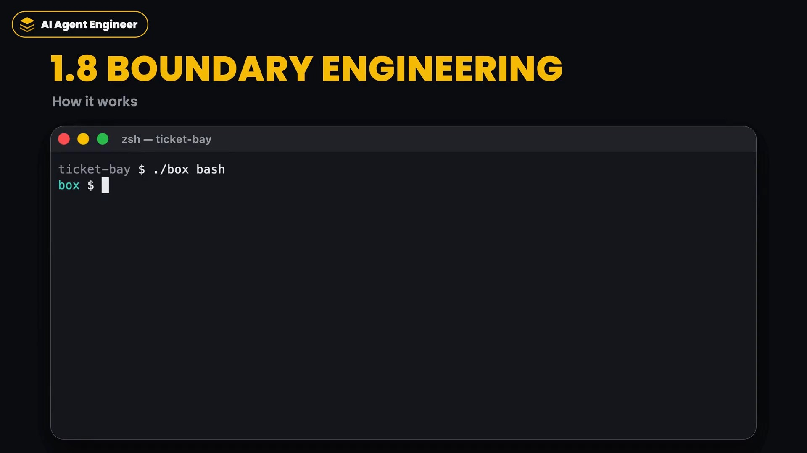
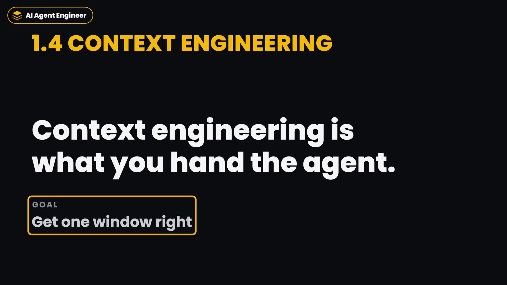
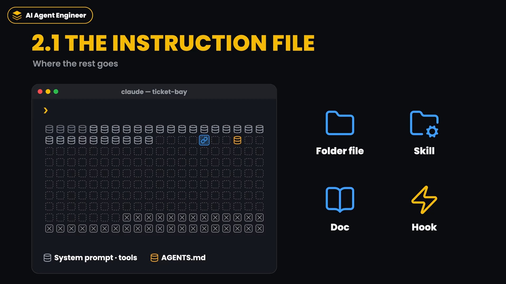
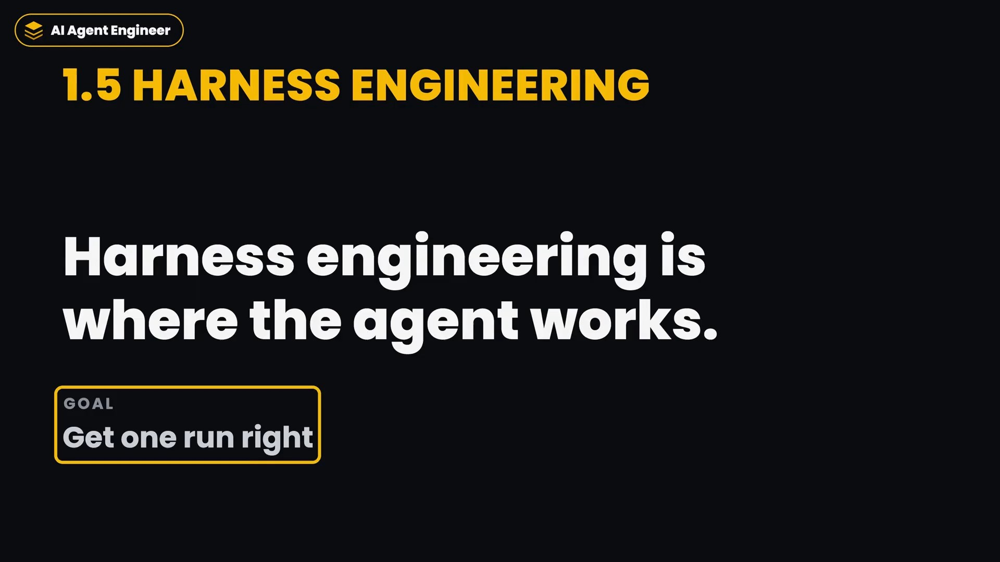
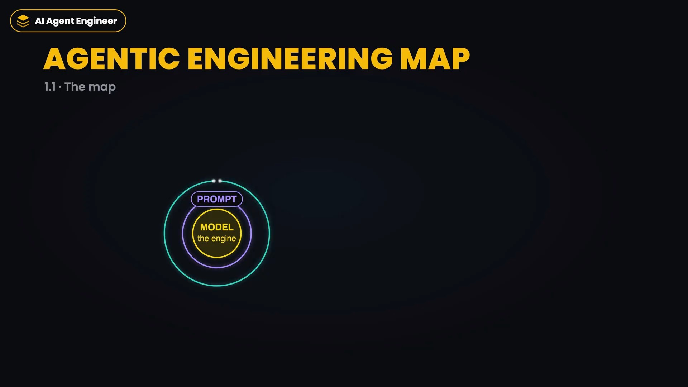
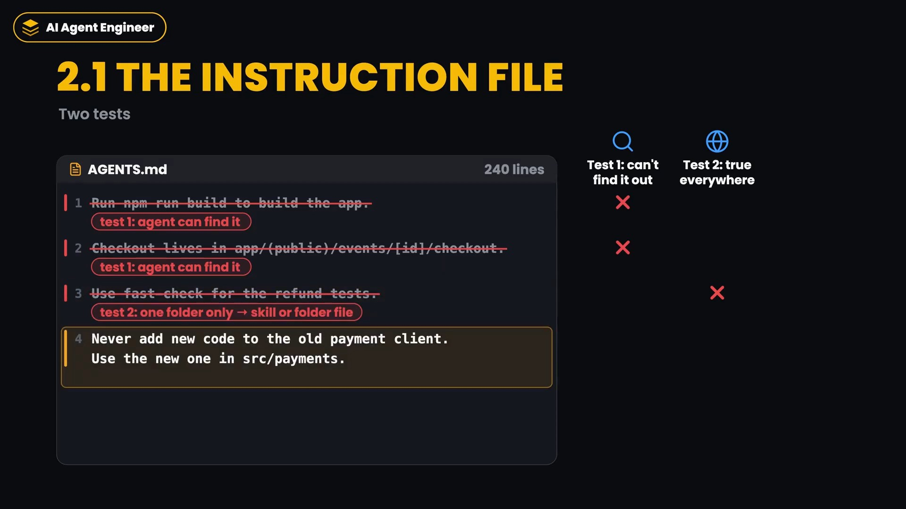

# AI Agent Engineer 课程复现文档（P1–P13）

> 覆盖范围：P1–P13。包含课程总览、材料清单、前置环境（M0）、Agent 工程七层地图（M1）、以及模块 2 的第一课「instruction file（agents.md）」。
> 读者定位：前端转 AI 应用工程师。文中涉及 shell / Docker / 网络白名单的地方会补一句「在前端/Node 语境里对应什么」。
> 术语说明：逐字稿里多处把 **Claude Code** 转写成 “cloud code”、把 **Claude Pro** 转写成 “CloudPro”、把 **Anthropic** 转写成 “Anthropic / Anthropik / Tropic”、把 **ChatGPT Plus** 转写成 “ChagGPT+”。本文正文使用正确拼写，并在首次出现处注明逐字稿原词，方便你对照视频。

---

## 1. 这一节做什么

这 13 集不是「一个功能一个功能地写代码」，而是先给你一张**Agent 工程的全景图**，再让你把这张图上的两个关键落地点真正跑起来：

1. **M0 环境落地**：下载课程 kit，让你的编码 Agent 按 `M0/setup` 指南自动装工具、fork 并克隆 TicketBay 仓库、装讲师的 skills，最后用「单元测试全绿 + skills 已安装」作为验收。
2. **边界落地（box）**：在 TicketBay 仓库里用 `./box bash` 启动一个 Docker 容器，验证容器内看不到你的 SSH key、访问不了 `example.com`，但 npm 和 GitHub 可用。
3. **检查落地（`/context`）**：在 Claude Code 里跑 `/context`，亲眼看到你还没输入任何内容时，上下文窗口已经被系统提示、工具定义、记忆文件占掉了多少。
4. **instruction file 落地**：把一份过长的 `agents.md` 按讲师的两条测试（「Agent 能否自己从代码里看出来」+「是否在全仓库处处为真」）逐行删减，最后用 `/memory` 确认 `claude.md` 通过 import 把 `agents.md` 加载进来。

最终交付物有四样：**一个能跑测试的 TicketBay 副本**、**一个能启动的边界盒子**、**一份精简后的 `agents.md` + 一行 `claude.md`**、**一份你自己的七层检查笔记**。



---

## 2. 讲师原话（带出处）

课程的核心命题，讲师在 P4 用一句话钉死：

> "智能体等于模型加 harness。就是这里这个灰色环。通常，它会在循环中调用工具来实现目标。"
> —— p004 [02:20]

为什么 harness 值得单独一层？他给了 Terminal-Bench 的例子：

> "在 Terminal Bench 上——这是编码智能体的标准测试——有一个团队拿同一个模型，只改了 harness。同一个模型从第 30 名升到第 5 名。同样的模型。同样的任务。差别是 harness 带来的。"
> —— p004 [00:27]

上下文窗口填满后的症状，他说得很具体：

> "当上下文被填满时，模型表现会变差。它会忘掉一小时前给出的指令。它会犯一开始不会犯的错误。"
> —— p004 [01:25]

上下文工程被他拆成四个操作：

> "上下文工程围绕上下文窗口做四种操作：选择……压缩……隔离……卸载……"
> —— p007 [01:27]

边界盒子是他亲手演示的：

> "在 TicketBay 仓库里就是这样。我运行 ./box bash，它会在容器内打开一个命令行环境，与电脑的其他部分隔离开。我查看当前用户是谁。是项目文件夹里的 node。我列出自己的 SSH 密钥。没有这个文件夹。"
> —— p011 [02:52]

instruction file 的取舍原则只有一句：

> "一行内容只有在智能体无法自行发现、并且在仓库中处处成立时才会保留。"
> —— p013 [00:58]

以及一个反直觉的数据：

> "那一百个仓库中有 62% 把代码检查规则写成了指令。如果代码检查工具能检查它，它就不该作为文件中的一行。"
> —— p013 [02:25]

---

## 3. 从零复现

下面按「先环境、再边界、再检查、最后改文件」的顺序走。每一步都给出**可粘贴执行的命令**；凡是逐字稿只描述、没给具体命令的地方，我会明确标注「课里没给具体命令」。

### Step 0：前置条件核对

讲师在 P3 列了必须项：**Claude Pro（最小付费档）**、**Git**、**Python**、**Node 22**、**Docker（个人使用免费）**、**GitHub CLI**、**已登录的 Claude Code**。P3 明确说这些**不要手动装**，让 Agent 按 kit 里的指南装。但你要先能跑起来一个 Agent。

在终端确认最基础的三件事：

```bash
git --version
node --version      # 讲师要求 Node 22
python3 --version
```



> 课里没讲：如果 `node --version` 不是 22，是否必须先升级再跑 setup。按逐字稿的意思是交给 setup 指南处理，但 Node 版本不对会导致后续 `npm test` 行为不一致，建议先对齐 22。

### Step 1：下载 kit

P2 说明 kit 是「只给学生」的文件夹，里面有：机器 setup、hooks、email loop、AI employee 四份分步指南，每份都是「写给 Agent 看的」。P3 给了唯一一句需要你亲手敲的话：

> 在 kit 文件夹里打开你的 Agent，告诉它：`set me up with the setup guide in the M0 folder`。

所以：

```bash
# 1) 从视频下方下载 kit，解压到你自己的工作目录，例如
cd ~/work
# 2) 进入 kit 目录
cd ai-agent-kit
# 3) 在这个目录里启动 Claude Code
claude
```

然后在 Claude Code 的输入框里发：

```
set me up with the setup guide in the M0 folder
```

接下来它会：检查每个工具 → 安装缺失的 → fork TicketBay → clone 你的 fork → 跑单元测试 → 安装讲师 skills。P3 原话是 “It checks every tool and installs what is missing, then it forks ticket bay, clones your fork, runs the unit test and installs my skills.”

> 课里没给具体命令：fork 用的是 `gh repo fork` 还是网页操作、clone 到哪个目录、skills 具体从哪个 GitHub 仓库装——逐字稿都没有给。不要自己脑补命令，让 Agent 按 `M0` 指南执行。

### Step 2：验收 M0

P3 给了明确的完成标准，两个条件同时满足才算过：

```bash
# 进入你的 TicketBay 副本（路径以 setup 实际 clone 的位置为准）
cd <你的 TicketBay 路径>

# 条件 1：单元测试全绿
npm test

# 条件 2：skills 已安装（路径以 setup 实际安装位置为准）
ls ~/.claude/skills
```

> 课里没讲：`npm test` 具体跑的是哪个 script、skills 安装在 `~/.claude/skills` 还是别处。逐字稿只说“unit tests are green and my skills are installed”。如果 `ls` 报目录不存在，说明路径猜错了，回到 setup 输出里找它打印的真实路径。

### Step 3：启动边界盒子

P11 讲师演示的命令是：

```bash
./box bash
```

他说 “I run dot slash box bash and it opens a shell inside the container, separate from the rest of my computer.”

执行后你应该落在一个**容器内的 shell**，而不是宿主机的 shell。P11 明确说了四件事要在里面验证：

```bash
# 1) 当前用户
whoami
# 讲师看到的：node

# 2) 当前目录
pwd
# 讲师看到：项目文件夹（TicketBay）

# 3) SSH key 不应存在
ls ~/.ssh
# 讲师看到：No such folder

# 4) 宿主机 home 下的个人目录不应存在
ls ~
# 讲师看到：没有他 Mac 上的那些 home 文件夹

# 5) example.com 应被阻断
curl -sS --max-time 5 https://example.com
# 讲师看到：blocked

# 6) npm 与 GitHub 应可达
curl -sS --max-time 5 https://registry.npmjs.org/-/ping
curl -sS --max-time 5 https://api.github.com
# 讲师看到：NPM answers, GitHub answers
```



> 课里没给具体命令：讲师只说了“我试了 example.com、npm、github”，没有说用的是 `curl` 还是别的工具。上面的 `curl` 是等价复现方式，不是逐字稿原文。判定标准以“能否连通”为准。

### Step 4：在容器里启动 Claude Code

P11 说 “Then I start cloud code. It runs completely inside the container with the same limits.” 也就是在容器 shell 里再启动一次 Claude Code：

```bash
claude
```

这一步的意义：Claude Code 继承容器的文件系统和网络限制。你在宿主机上跑它是「全权限」，在盒子里跑它是「受限权限」。

### Step 5：用 `/context` 看见窗口占用

P12 给了第一个动手任务：

> “Run slash context inside cloud code and look at what fills the window before you type.”

```bash
# 在 Claude Code 对话框里输入
/context
```

你要观察的是：**在你一个字都没输入之前**，窗口里已经有什么。P7 列出的清单是：Claude Code 自己的 system prompt、每个内置工具的描述、你的 `claude.md` / `agents.md`、记忆文件、每个已安装 skill 的描述。你在 `/context` 里应该能对应上这些条目。



### Step 6：精简 `agents.md`

P13 的动手任务：

> “In your ticket bay copy switch to this lesson start branch. Its agents.md is too long. Ask your agent. Which of these lines can you find out from the code by yourself? Delete those lines and keep the rules the code can't tell.”

步骤：

```bash
# 1) 切换到本课的 start 分支（分支名以仓库实际为准，课里没给）
git switch <lesson-start-branch>

# 2) 在 Claude Code 里让它逐行审查
```

在 Claude Code 里发：

```
逐行检查 agents.md。对每一行问两个问题：
1) Agent 能不能自己从代码里看出来？能，就删。
2) 这一行是不是在整个仓库处处为真？只在某个子目录为真，就移到那个子目录的小文件或 skill 里。
删完告诉我每一行的去留理由。
```

然后手动加一个只有一行的 `claude.md`：

```bash
# 在仓库根目录
printf '@agents.md\n' > claude.md
```

这里 `@agents.md` 就是 P13 说的 “a one line cloud.md that says at agents.md”。

### Step 7：用 `/memory` 验收

```bash
# Claude Code 对话框
/memory
```

P13 的完成标准是：**`/memory` 显示 `agents.md` 被 import 进来了**。同时你要人工确认 `agents.md` 里剩下的每一行都是「代码告诉不了 Agent 的规则」。



---

## 4. 完整代码

> 说明：本课程的逐字稿以讲解和演示为主，**box 的四个配方文件、setup 脚本、skills 仓库的具体内容都没有在逐字稿中给出源码**。为了不编造，下面只给「逐字稿明确提到的文件名与职责」「可直接粘贴的命令序列」和「按讲师规则构造的示意文件」。示意文件均已标注。

### 4.1 仓库与 kit 的目录结构（按逐字稿描述还原）

```text
ai-agent-kit/                 # 从视频下方下载的 kit，只对学生开放
├── M0/                       # 机器 setup 指南（讲师让你对 Agent 说 "setup guide in the M0 folder"）
├── hooks/                    # hooks 指南（P2 提到）
├── email-loop/               # email loop 指南（P2 提到）
└── ai-employee/              # AI employee 指南（P2 提到）

TicketBay/                    # 你的 fork，M0 setup 自动 clone
├── package.json              # 构建命令的来源（P13 说 "The agent reads that from package.json"）
├── agents.md                 # 本次要精简的文件
├── claude.md                 # 本次要新建的一行文件
├── Dockerfile                # box 配方之一（P11）
├── .devcontainer/
│   └── devcontainer.json     # box 配方之二（P11，逐字稿写作 DevContainer.json）
├── init-firewall.sh          # box 配方之三（P11，逐字稿写作 InitFirewall.sh）
├── box                       # box 配方之四：启动脚本（P11 的 "./box bash"）
└── src/
    └── payments/             # P13 例子中提到的「新支付客户端」所在目录
```

### 4.2 box 的四个配方文件（职责表，内容课里没给）

| 文件 | 讲师描述的职责（P11 原话意译） | 你需要知道的事 |
|---|---|---|
| `Dockerfile` | “builds the image, node, git, and cloud code” | 镜像里装 Node、Git、Claude Code |
| `devcontainer.json` | “says how to run it. Your project folder is mounted inside plus one read-only folder with the settings for your second brain” | 挂载项目目录 + 一个只读的第二大脑设置目录 |
| `init-firewall.sh` | “runs when the box starts. It blocks all network traffic, then allows npm, github and Anthropic” | 默认全禁，再放行 npm / GitHub / Anthropic |
| `box`（启动脚本） | “starts the container and opens CloudCode inside it” | 启动容器并在其中打开 Claude Code |

> 课里没给这四个文件的源码。P11 说 “The box recipe is in the Ticket Bay REPL. Give it to your agent and ask it to set up the same box for your code.” 也就是说：**让 Agent 读仓库里的现有配方，照搬到你自己的项目**，这是官方路径。

### 4.3 边界验证脚本（课里没给脚本，以下为按 P11 验证步骤拼的示意）

保存为 `verify-box.sh`，在 `./box bash` 进入容器后执行：

```bash
#!/usr/bin/env bash
set -u

echo "== whoami =="
whoami

echo "== pwd =="
pwd

echo "== ~/.ssh =="
ls -la "$HOME/.ssh" 2>&1 || true

echo "== \$HOME 顶层 =="
ls -la "$HOME"

echo "== example.com（预期被阻断）=="
curl -sS --max-time 5 https://example.com >/dev/null 2>&1 \
  && echo "UNEXPECTED: example.com reachable" \
  || echo "OK: example.com blocked"

echo "== npm registry（预期可达）=="
curl -sS --max-time 5 https://registry.npmjs.org/-/ping >/dev/null 2>&1 \
  && echo "OK: npm reachable" \
  || echo "UNEXPECTED: npm blocked"

echo "== github api（预期可达）=="
curl -sS --max-time 5 https://api.github.com >/dev/null 2>&1 \
  && echo "OK: github reachable" \
  || echo "UNEXPECTED: github blocked"
```

> 这份脚本**不是讲师给的**，是把 P11 演示里的六个检查点写成可重复执行的形式。判定标准与逐字稿一致：`whoami` 为 `node`、项目目录、无 `~/.ssh`、`example.com` 被挡、npm 与 GitHub 通。

### 4.4 `claude.md`（一行，P13 明确要求）

```markdown
@agents.md
```

### 4.5 `agents.md` 示意（课里没给完整文件，以下为按 P13 两条测试构造的示意）

P13 明确给了「三条失败」和「两条通过」的例子。据此构造一份符合讲师标准的 `agents.md`：

```markdown
# agents.md

## Rules the code cannot tell you

- Never add new code to the old payment client. Use the new one in `src/payments`.
- Never edit the migrations in the `drizzle` folder by hand. Change the schema and run `npm run db.generate`.

## Pointers

- Reference material lives in `docs/refund-policy.md`.
```

文件里**不该出现**的东西（P13 明确点名）：

```markdown
# 以下三行都是反例，不要写进 agents.md
- Run `npm run build` to build the app.        # package.json 里就有，Agent 自己能读
- Checkout lives in the checkout folder under events.  # 代码结构自己就能看出来
- Use fast check for the refund tests.          # 只在一个子目录为真，应放进 skill 或该目录自己的文件
```

> 逐字稿没有给出精简后的完整 `agents.md` 全文（只给了“Too long. I ask the agent to check every line with the two tests. The build commands go... The architecture tour goes... The release checklist moves into a skill. What stays is a rule-like...”）。上面的示意文件是按讲师留下的两条通过规则重写的，**不是你从视频里逐字抄下来的原文**。

### 4.6 精简 `agents.md` 的提问模板（可直接粘贴）

```text
逐行审查仓库根目录的 agents.md。对每一行执行两道测试，并输出一张表：
列：行号 | 原文 | 测试1：Agent 能否从代码/package.json/目录结构自己看出来 | 测试2：是否在全仓库处处为真 | 结论（保留 / 删除 / 移到 skill / 移到子目录文件）

额外规则：
- 如果一行是 lint 规则、可被 linter 检查，判为删除（讲师原话：62% 的仓库犯了这个错）。
- 执行一次 expiry test：如果更强的模型会让这一行变得无意义，判为删除。
- 删完后，把保留的行控制在 100 行以内。
最后：在仓库根目录新建 claude.md，内容只有一行 @agents.md。
```

---

## 5. 逐行解释

### 5.1 为什么 `agents.md` 只保留三块内容

- `Never add new code to the old payment client. Use the new one in src/payments.` —— 这是**意图**，不是**事实**。代码里能看到两个 payment client 并存，但看不出「新的那个才是未来」。这条必须留。
- `Never edit the migrations in the drizzle folder by hand. Change the schema and run npm run db.generate.` —— 这是**流程约束**。代码里能看到 `drizzle` 目录，但看不出「手改会被下一次 generate 覆盖」。这条必须留。
- `Reference material lives in docs/refund-policy.md.` —— 这是**指针**，不是内容。P13 说 “Reference material stays in a dock and the file gets one pointer to it.” 把大段参考材料塞进 `agents.md` 会让它每次调用都占窗口，所以只留指针。

反过来说，被删掉的三行分别踩了三个坑：

- `Run npm run build` 属于「Agent 自己能读到」，`package.json` 里就有 script。
- `Checkout lives in the checkout folder under events` 属于「代码结构自明」，Agent `ls` 一下就知道。
- `Use fast check for the refund tests` 属于「只在一个子目录为真」，按 P13 应下沉到 skill 或该子目录自己的文件。

### 5.2 为什么 `claude.md` 要写成 `@agents.md`

P13 讲了两个名字的来历：**Claude Code 一直读 `claude.md`，Codex、Cursor 等工具读 `agents.md`**。较新的 Claude Code 也读 `agents.md`，但**只在没有 `claude.md` 时**才读。这就埋了一个坑：如果同事后来加了一个 `claude.md`，你 `agents.md` 里的所有共享规则会瞬间失效——P13 的原话是 “Agents.md is gone with every shared rule in it.”

解法就是：把全部规则放 `agents.md`，`claude.md` 只写一行 `@agents.md`。这样无论哪个工具、哪个人加文件，规则都会通过 import 加载进来。P13 的验收标准是 `/memory` 里能看到 `agents.md` 被 import。

### 5.3 为什么 instruction file 的加载是「叠加」而不是「覆盖」

P13 说了三层加载位置：

- `~/`（home 目录）：个人规则，**到处都加载**。
- 仓库根目录：**启动时加载**。
- 子目录：**只有当 Agent 读到那个子目录里的东西时才加载**。

讲师特别强调 “They don't override each other, they all get added to the window, one after the other.” 这在前端语境里类似 CSS 的叠加而不是覆盖——你以为后加载的会替换前面的，其实不会，全都进窗口。所以每一行都有成本。

### 5.4 为什么 imports 不省窗口

P13 专门点名了一个常见误解：有人把大文件拆成多个文件再用 `@` import 进来，以为能省 context。讲师说 “Imports... load at launch, so splitting a big file into imports changes nothing for the window.” 拆文件只改善可维护性，不减少 token。真正能省窗口的只有 P7 的四个操作：Select / Compress / Isolate / Offload。

### 5.5 为什么 `./box bash` 要这样验证

逐字稿 P11 的验证顺序是有教学意图的，逐条对应「lethal trifecta」（P11 讲的致命三要素）：

1. `whoami` + `pwd`：确认你在盒子内、而不是宿主机。这是**隔离生效**的第一证据。
2. `ls ~/.ssh` 报 No such folder：**切断私有凭据**。三要素里的第一项「access to private data」被拿掉。
3. `ls ~` 看不到宿主机 home：**切断私有文件**。
4. `curl example.com` 被挡：**切断外发通道**。三要素里的第三项「a way to send data out」被拿掉。
5. npm / GitHub 通：证明**白名单内的工作流没被误伤**——这是边界工程最容易翻车的地方：挡太狠，Agent 连依赖都装不了。

P11 的结论是 “Remove any one of the three and the attack has no path.” 盒子里前两项和第三项都被移除，所以即使发生 prompt injection，攻击链也断了。

### 5.6 为什么 `/context` 要在动手改文件之前跑

P12 的顺序是「先 `/context` 看现状，再 `./box bash` 验证边界」，最后才动 `agents.md`。原因在 P6：你的 prompt 只占窗口最底下一薄条，上面全是你看不见的东西。不先看清楚「已经占了什么」，就无法判断「删掉 `agents.md` 里的一行到底省了多少」。前端类比：先开 DevTools 的 Coverage 面板，再决定删哪个 bundle，而不是凭感觉删。

### 5.7 为什么 P13 要强调「100 行左右」

P13 原话 “Keep it to around 100 lines.” 理由是 “Every line in this file sits in front of the model on every call.” 这是 P4 讲的「窗口有限、填满变差」在 instruction file 上的直接推论。100 行不是魔法数字，是「每次调用都要付的固定税」的经验上限。



---

## 6. 复现检查清单

按顺序打勾，全部通过再进下一课。

**M0 环境**

- [ ] `git --version`、`node --version`（22）、`python3 --version` 都有输出
- [ ] 已下载 kit，并在 kit 目录里启动 Claude Code
- [ ] 已对 Agent 说出 `set me up with the setup guide in the M0 folder`
- [ ] TicketBay 已被 fork 并 clone 到本地
- [ ] `npm test` 全绿
- [ ] 讲师 skills 已安装（路径以 setup 实际输出为准）

**边界盒子**

- [ ] 在 TicketBay 仓库根目录执行 `./box bash`，成功进入容器 shell
- [ ] `whoami` 输出为 `node`
- [ ] `pwd` 显示的是项目目录
- [ ] `ls ~/.ssh` 报 no such folder
- [ ] `ls ~` 看不到宿主机的个人目录
- [ ] `curl https://example.com` 被阻断
- [ ] npm registry 可达
- [ ] GitHub API 可达
- [ ] 在容器内能启动 `claude`

**上下文与 instruction file**

- [ ] `/context` 能看到 system prompt、工具定义、记忆文件、skill 描述等条目
- [ ] 已切到本课的 start 分支
- [ ] 已让 Agent 对 `agents.md` 逐行执行两道测试
- [ ] 删除了「代码能自己看出来」的行
- [ ] 把「只在一个子目录为真」的行下沉到 skill 或子目录文件
- [ ] 保留的行全部是「代码告诉不了 Agent」的规则
- [ ] 已在根目录新建 `claude.md`，内容只有 `@agents.md`
- [ ] `/memory` 中能看到 `agents.md` 被 import
- [ ] 与 solution 分支对比，差异在可接受范围内

**七层地图自测（P12 的复习）**

- [ ] 能说出 Model / Prompt / Context / Harness / Memory / Loop / Boundary 各自「要搞对什么」
- [ ] 能说出 Context 的四个操作：Select / Compress / Isolate / Offload
- [ ] 能说出 lethal trifecta 的三个条件，以及盒子拿掉了哪两个

---

## 7. 课里没讲但你会撞上的

以下内容逐字稿**没有涉及**，是我按常见环境差异列的排障提示，不是讲师观点。

1. **Docker 没装或没启动**。`./box bash` 第一步就会失败。前端同学如果只装过 Node，需要先装 Docker Desktop（个人使用免费）。macOS / Windows 上还要确认 Docker daemon 正在运行。
2. **Linux 上 `docker` 需要 sudo**。如果没有把当前用户加入 `docker` 组，`./box bash` 会报权限错误。逐字稿没讲这一点。
3. **`./box` 没有执行权限**。`chmod +x box` 即可；Windows 上要在 WSL 里跑，`.sh` 脚本在 PowerShell 里不能直接执行。
4. **`init-firewall.sh` 需要容器内 root 或 `NET_ADMIN`**。逐字稿只说「启动时阻断所有流量再放行三个域名」，没说容器启动参数。如果防火墙脚本静默失败，你会看到 `example.com` 仍能访问——这说明盒子没生效，不要继续。
5. **白名单挡掉了你没想到的服务**。P11 的白名单只有 npm、github、anthropic。所以容器里 `pip install`、`docker pull`、访问公司内网 Git 都会失败。这是**设计如此**，不是 bug；需要时把服务加进 allow list，但 P11 明确提醒 “keep the allow list short”。
6. **Claude Code 的登录态在容器内不继承**。逐字稿 P11 说在容器里启动 Claude Code，“runs completely inside the container with the same limits”。如果宿主机已登录、容器内要求重新登录，属于正常现象——凭据隔离正是盒子的目的之一。P11 也强调 “keep your secrets out of the box”。
7. **`/context` 的输出条目名可能与 P7 列的不完全一致**。P7 列的是「理论上窗口里有什么」，实际工具版本不同，条目命名会变。以你屏幕上实际看到的为准，不要硬套。
8. **`/memory` 显示的 import 层级可能和你预期不同**。P13 说三层文件「叠加不覆盖」，你可能会看到 home 目录的个人规则、仓库根 `agents.md`、子目录文件同时出现。这是对的。
9. **fork 后的仓库落后于上游**。TicketBay 是公开仓库，讲师可能更新。setup 完成后如果 `npm test` 红了，先 `git fetch upstream && git rebase upstream/main`，再跑测试。
10. **Node 版本不对导致的测试差异**。P3 要求 Node 22，但没说版本漂移会发生什么。经验上 `npm test` 在 Node 20 上可能因 ESM / 原生模块行为不同而红。
11. **`agents.md` 删过头**。P13 的标准是「删到只剩代码告诉不了的规则」，但没说「删到 0 行」也可以。如果删完 Agent 开始重复犯同一个错，说明你删掉了一条它其实需要的意图约束——加回去，这就是「Would removing it cause the agent to make mistakes?」这条测试的实操含义。
12. **`claude.md` 写成 `@agents.md` 后仍然看不到加载**。P13 只说较新的 Claude Code 在没有 `claude.md` 时才读 `agents.md`，没说 import 语法在旧版本上的兼容性。如果 `/memory` 里看不到，先升级 Claude Code。
13. **课程里提到的 “NECJS”**。P2 原话是 “a ticket selling app in NECJS and Postgres”。这个拼写在逐字稿里就是如此，**疑似 Next.js 的转写误差，但逐字稿没有确认**，请以你 fork 下来的仓库 `package.json` 为准，文档不替你下结论。

---




