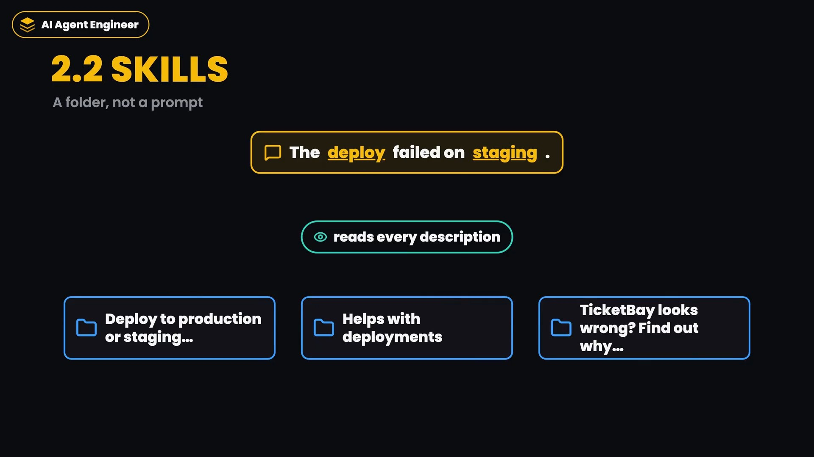
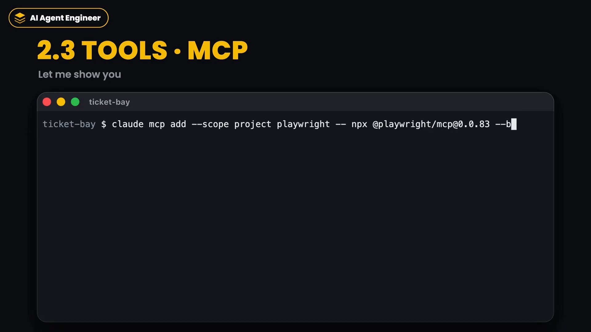
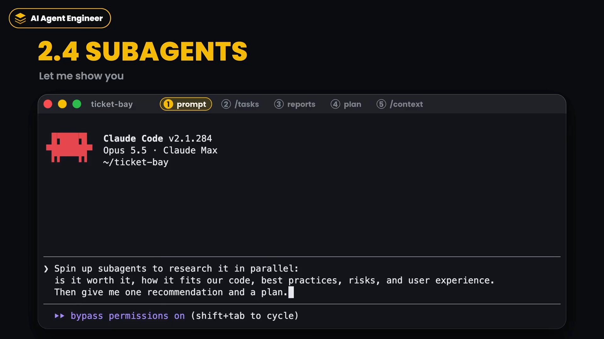
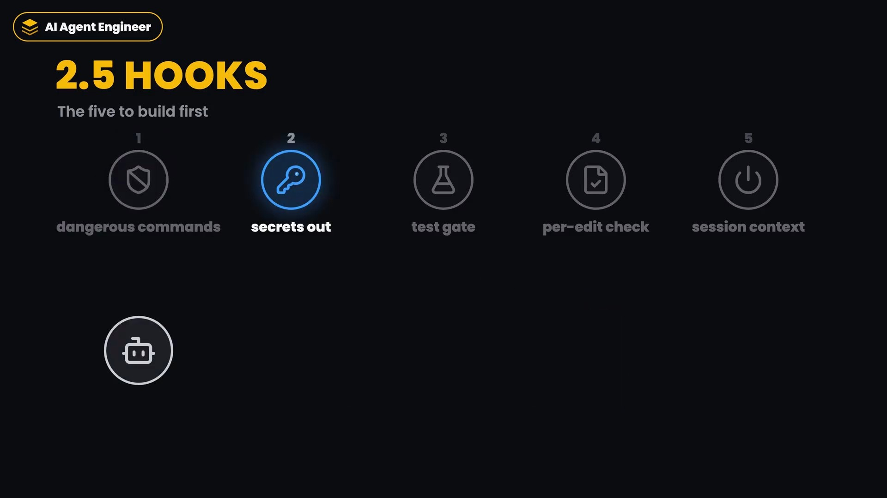
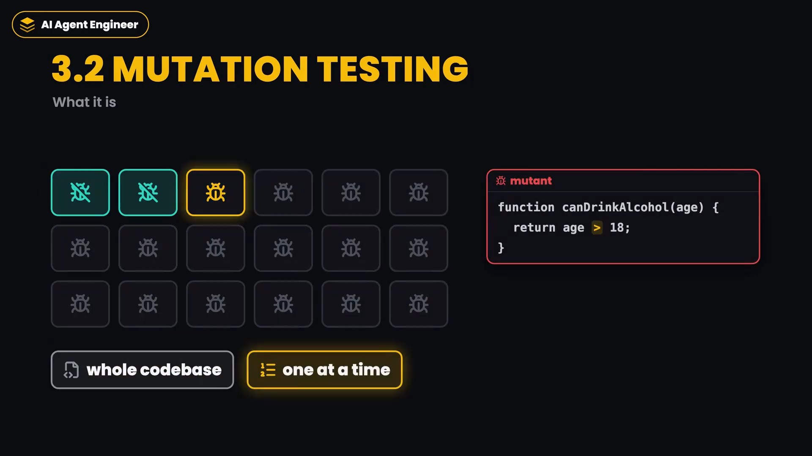
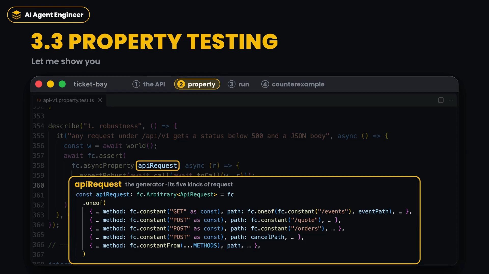

# AI Agent Engineer（MCP + 注入防御 + 质量门）P14–P21 复现文档

> 课程：BV1kDxh6fEgp ｜ 覆盖 P14–P21 ｜ 读者：前端转 AI 应用工程师
> 说明：本课程是「在 TicketBay 仓库里给 AI Agent 加装工程化护栏」的实操课。逐字稿里出现的工具名（Claude Code、Context7、Playwright MCP、Stryker、FastCheck、QuickE2E、Drizzle 等）均按讲师原话保留。凡逐字稿没讲到的内容，本文会明确标注「课里没讲」。

---

## 1. 这一节做什么

P14–P21 这八节课，把「一个只会写代码的 Agent」升级成「一个被工程约束住的 Agent」。它分成两条主线：

**第一条主线（P14–P18）：给 Agent 装护栏（Harness 工程）**
- P14：用 **Skill**（技能文件夹）把「你脑子里的操作流程」变成 Agent 按需加载的资产，核心是 `skill.md` 的 front matter 与 description 触发词。
- P15：用 **MCP**（Model Context Protocol）把 Agent 接到仓库外的系统（浏览器、库文档、数据库、GitHub），重点是 Playwright 浏览器服务器。
- P16：用 **Subagent**（子代理）把「大量阅读」隔离到独立上下文窗口，只把摘要带回主窗口。
- P17：用 **Hook**（钩子）把 `agents.md` 里「靠模型自觉遵守」的规则，变成「harness 强制执行」的脚本，分「阻断型」和「告知型」两类。
- P18：模块复盘，把上面五件事列成一张任务清单。

**第二条主线（P19–P21）：验证 Agent 写的代码到底行不行（Verification 工程）**
- P19：讲清「绿色测试会骗人」的三种方式（测试没检查行为、缺关键用例、单元测试全绿但页面是坏的），引出变异测试、属性测试、E2E 测试三条对策。
- P20：**变异测试（Mutation Testing）**——用 Stryker 故意改代码，看测试能不能发现，用「变异分数」替代「覆盖率」作为质量指标。
- P21：**属性测试（Property-based Testing）**——用 FastCheck 生成大量随机输入，验证「无论什么请求，都不返回 500 且永远是 JSON」这类业务不变量。

一句话概括：**P14–P18 让 Agent 守规矩，P19–P21 让 Agent 的产出可被证明。**

---

## 2. 讲师原话（带出处）

关于 Skill 的本质与触发：

> "A skill is a procedure the agent loads only when the task needs it. Until then, only its name and description sit in the context window. A skill is a folder, and skill.md is just the entry point." —— p014 [00:27]

> "The description decides when the skill triggers... the vague description makes the skill invisible." —— p014 [01:20]

> "The open standard allows about a thousand characters per description, so the trigger words go first." —— p014 [01:44]

关于「不要写废话规则」：

> "To test a line, delete it and if the agent's behavior doesn't change, it was a no-op, and it was costing you context on every call." —— p014 [02:40]

关于「脚本 vs 指令」的判据：

> "If every run must give the same result, make it a script... Deciding where to look first, and whether it is a bug or a policy. Those stay as instructions." —— p014 [03:36]

关于 MCP：

> "MCP, the model context protocol, is how an agent connects to systems outside your repo, like a browser, your library docs, a database, or GitHub." —— p015 [00:00]

> "I add Playwright to TicketBay with one command. clode mcp add with project scope. It writes a .mcp.json file at the root of the repo. I commit it so everyone who clones the repo gets the same server." —— p015 [01:23]

关于 Subagent 的取舍：

> "Use few for building and many for reading. Two sub-agents that edit the same code don't see each other's changes." —— p016 [00:55]

> "So the same task costs 3 to 10 times the tokens, and the result is often no better." —— p016 [02:23]

关于 Hook 的定位：

> "A rule in your agents.md is only text and nothing forces the model to follow it... A hook is a script the harness runs at a fixed moment." —— p017 [00:00]

> "A hook does one of two things. It blocks, or it informs." —— p017 [00:53]

> "So when you block something, always tell the agent what to do instead." —— p017 [01:21]

关于覆盖率骗人：

> "Coverage counts the lines a test runs, not whether the test checks anything... You can have 100% coverage without any test assertions." —— p020 [00:00]

关于变异分数：

> "The mutation score is the killed mutants divided by all the mutants. So 100% mutation score tells you much more about your tests than 100% coverage." —— p020 [03:14]

关于属性测试的价值：

> "Whatever request comes in, the answer is never a 500 and it's always JSON." —— p021 [02:38]

> "After 52 requests, it fails. And it shrinks the failing request to the smallest one. An event ID with one invisible character, the null byte." —— p021 [03:31]

---

## 3. 从零复现

这一节按「先装护栏、再装验证」的顺序，把 P14–P21 的动手步骤串成一条可执行路径。**前置假设**：你已克隆 TicketBay 仓库，并已按课程开头安装了 `write-great-skill` 技能与 `mutation-testing` 技能（逐字稿 p014 [05:02] 与 p020 [04:01] 都提到「你在课程开始时已经装好了」）。若没装，课里没讲具体安装命令，请以课程起始页为准。

### 步骤 A：建一个 debug runbook 技能（P14）

1. 在仓库里建目录 `.claude/skills/debug-runbook/`（逐字稿 p014 [04:04] 说技能放在仓库的 `.cloud, skills` 下，随 GIT 提交；也提到家目录 `.cloud, skills` 是全局加载。注意逐字稿里 "cloud" 是语音转写，实际工具名以你安装的 harness 为准，课里没讲确切目录名拼写，请以实际工具文档为准）。
2. 在该目录下写 `skill.md`，front matter 里写 `name` 和 `description`，description 里放**用户会说的原话触发词**（deploy / ship / release / push to prod 这类）。
3. 在 `skill.md` 旁边放 `scripts/` 子目录，把「每次结果必须一致」的机械步骤写成脚本（跑测试、读一条订单、列最近提交）。
4. 用「删除测试」清理指令：删掉一行后 Agent 行为不变，说明是 no-op，删掉它省上下文。
5. 验证触发：开三个全新会话，用**不点名技能**的话术提任务，三个都应自动加载；再提一个无关请求，不应加载。



### 步骤 B：加 Playwright MCP 服务器（P15）

1. 在仓库根目录执行一条 `mcp add` 命令（逐字稿 p015 [01:23] 说 "在项目作用域下运行 claude mcp add。"，工具名以你实际安装的为准），作用域选 **project**。
2. 命令会在仓库根写出 `.mcp.json`，把它提交进 Git，让所有克隆者拿到同一份服务器配置。
3. 启动 harness，它会**问一次**是否批准新服务器，批准即可。
4. 让 Agent 用 Playwright 打开「所有座位售罄」的演出（NovaKings），截图给你，确认徽标显示 sold out。
5. 若在沙箱里跑，且该服务器要下载东西，把它的 host 加进沙箱 allow list（逐字稿 p015 [02:18]）。



### 步骤 C：用并行子代理做调研（P16）

1. 主 Agent 只做「拆任务 + 合并报告」，把阅读外包给子代理。
2. 为「给 TicketBay 加二次登录（2FA）」开五个并行子代理，各管一个角度：值不值得做、怎么嵌进现有代码、最佳实践、风险、用户体验。
3. 用 `/tasks` 看五个子代理各自在自己的窗口里读；用 `/context` 看主窗口只涨了约 31,000 token，而子代理合计读了约 170,000 token。
4. 若确实要两个代理同时**改代码**，给每个代理一个独立 **git worktree**（独立分支的独立检出），最后像普通 PR 一样合并。



### 步骤 D：把规则变成 Hook（P17）

1. 从课程 kit 里把五个 hook 脚本连同它们的 settings 一次性拷进 TicketBay 仓库（逐字稿 p017 [04:12] 说 "一条复制命令就能把钩子脚本及其设置放进仓库。"）。
2. 五个 hook 分别是：① 拦危险命令（rm -rf / force push / drop database）；② 挡密钥（不让读 `.env`，改指 `.env.example`）；③ 测试门（Agent 说 done 时跑测试，红就阻断 stop 并把失败输出回灌）；④ 编辑后即时类型检查（只留该文件的错误）；⑤ 会话启动加载上下文（git status、最近提交、decisions 文件）。
3. 其中 ①②③ 是**阻断型**，④⑤ 是**告知型**（逐字稿 p017 [04:12] 明确 "其中三个会阻止，另外两个会提供信息。"）。
4. 逐行审 `agents.md`：每行问一句「这行是命名了一个事件，还是判断？」——命名事件的（"写完代码跑测试"、"永不读 .env"）转成 hook；判断类的（"金额用整数分存储，不用浮点"）留在文件里；"写干净代码"这类 Agent 本来就懂的，删掉。
5. 把 Drizzle 规则做成 hook：阻断对 `drizzle/` 文件夹的一切写入（文件工具、shell、`drizzle-kit drop` 三条路径都拦），并告诉 Agent 正确做法是「改 schema，然后跑 `npm run db:generate`」。



### 步骤 E：变异测试（P20）

1. 在 TicketBay 里让 Agent 对退款代码跑变异测试，工具是 **Stryker**（JS/TS/C# 用 Stryker，Java 用 PIT，Python 用 mutmut，Rust 用 cargo-mutants）。
2. 看结果：六个变异体存活，其中五个改不了赔付金额、一个能改。
3. 让 Agent 用一句话解释每个存活变异体：改了什么、为什么测试还是绿的、会放过什么真实 bug。
4. 补上缺失的测试，重跑，确认变异体被「杀死」。
5. 门禁策略：**不要**对整个仓库的分数设卡（没有通用好数字），只对**你改动的代码**设卡——那里每个变异体要么被杀死、要么被显式排除（排除要写注释和理由）。



### 步骤 F：属性测试（P21）

1. 在 TicketBay 的 API 上写一条属性：**无论什么请求进来，响应永远不是 500，且永远是 JSON**。
2. 用 FastCheck（JS/TS；Python 用 Hypothesis，Java 用 jqwik，C# 用 FsCheck，Rust 用 proptest）写生成器：`fc.assert` 里用 `fc.asyncProperty` 生成随机请求（合法的、坏的如撤销的 key / 非 JSON body、怪的如带控制字符的 event ID）。
3. 断言：status < 500、body 是 JSON、错误信息不暴露 stack trace。
4. 设 `runs: 800`，每次跑生成 800 个不同请求。
5. 第 52 个请求失败，工具把失败请求**收缩**到最小：一个带 null 字节的 event ID。数据库拒绝 null 字节报错，API 回了 500。
6. 修掉后属性通过。



---

## 4. 完整代码

> 说明：逐字稿是讲解 + 演示，没有逐字贴出全部源码。下面给出的是**按逐字稿描述重建的可运行骨架**，凡逐字稿没给确切字段/命令的地方，我在注释里标「课里没讲，以实际为准」。这些文件可直接保存进 TicketBay 对应路径。

### 4.1 `.claude/skills/debug-runbook/skill.md`（P14）

```markdown
---
name: debug-runbook
description: Debug TicketBay when something breaks. Use when the user says
  "something is broken", "debug", "why is this failing", "the page won't load",
  "sold-out show says few left", or "investigate this bug". Reads logs first,
  runs the repro script, never mutates the database.
---

# Debug Runbook

## When to use
Trigger on the phrases above. Do not use for feature work or refactors.

## First steps (order matters)
1. Read the app log at `logs/app.log` first — not the test log.
2. Run `scripts/repro.sh` to reproduce the reported symptom.
3. Check `git log --oneline -10` for recent changes touching the failing area.

## Gotchas (highest-signal section — append every time the agent gets it wrong)
- Never force-push to the production branch.
- The staging API only works over the VPN.
- Clear the build cache after any env-id change.
- Never change data in the database during debugging.

## Scripts (deterministic steps — same result every run)
- `scripts/repro.sh` — reproduces the bug
- `scripts/read-order.sh <id>` — reads one order from the DB
```

### 4.2 `.mcp.json`（P15，仓库根）

```json
{
  "mcpServers": {
    "playwright": {
      "command": "npx",
      "args": ["-y", "@playwright/mcp@latest"]
    }
  }
}
```

> 注：`command`/`args` 的具体写法课里没讲，上面是 Playwright MCP 的常见启动形态，**请以你实际 `mcp add` 命令生成的内容为准**，不要手抄。

### 4.3 `scripts/repro.sh`（P14 机械步骤脚本）

```bash
#!/usr/bin/env bash
set -euo pipefail
# 课里没讲具体测试命令，这里用 TicketBay 的测试入口占位
npm run test -- --runInBand "$@"
```

### 4.4 Hook 配置骨架（P17）

> 逐字稿说「一个拷贝命令把 hook 脚本和 settings 放进仓库」，但**没有贴出 settings 的字段结构**。下面给出的是按「阻断型 / 告知型」语义重建的示意，字段名请以你 harness 的实际 schema 为准（课里没讲确切字段名）。

```jsonc
// .claude/settings.json（示意，字段名以实际 harness 为准）
{
  "hooks": {
    "PreToolUse": [
      {
        "matcher": "Bash",
        "hooks": [
          { "type": "command", "command": "node hooks/block-dangerous.mjs" }
        ]
      },
      {
        "matcher": "Read",
        "hooks": [
          { "type": "command", "command": "node hooks/block-secrets.mjs" }
        ]
      }
    ],
    "Stop": [
      {
        "hooks": [
          { "type": "command", "command": "node hooks/test-gate.mjs" }
        ]
      }
    ],
    "PostToolUse": [
      {
        "matcher": "Edit",
        "hooks": [
          { "type": "command", "command": "node hooks/typecheck-one-file.mjs" }
        ]
      }
    ],
    "SessionStart": [
      {
        "hooks": [
          { "type": "command", "command": "node hooks/load-context.mjs" }
        ]
      }
    ]
  }
}
```

### 4.5 `hooks/block-dangerous.mjs`（P17 阻断型①）

```javascript
// 阻断危险 shell 命令。阻断时把「该做什么」写进 reason 回给 Agent。
const DANGEROUS = [
  /rm\s+-rf/i,
  /git\s+push\s+--force/i,
  /drop\s+database/i,
];

const input = JSON.parse(process.argv[2] ?? "{}");
const cmd = input?.tool_input?.command ?? "";

if (DANGEROUS.some((re) => re.test(cmd))) {
  // 阻断 + 给出替代路径（逐字稿 p017 [01:21]：block 时一定告诉它改做什么）
  console.log(JSON.stringify({
    decision: "block",
    reason: "This command is destructive. Use `git push` without --force, or ask the user before dropping anything.",
  }));
  process.exit(0);
}
// 不阻断时静默，不消耗上下文
process.exit(0);
```

### 4.6 `hooks/block-secrets.mjs`（P17 阻断型②）

```javascript
// 不让 Agent 读 .env，改指 .env.example
const input = JSON.parse(process.argv[2] ?? "{}");
const path = input?.tool_input?.file_path ?? "";

if (path.endsWith(".env")) {
  console.log(JSON.stringify({
    decision: "block",
    reason: "This file holds secrets. Read `.env.example` instead to learn which variables exist.",
  }));
  process.exit(0);
}
process.exit(0);
```

### 4.7 `hooks/test-gate.mjs`（P17 阻断型③）

```javascript
// Agent 说 done 时跑测试；红就阻断 stop 并把失败输出回灌；绿就静默。
import { execSync } from "node:child_process";

try {
  execSync("npm test", { stdio: "pipe" });
  process.exit(0); // 全绿：什么都不说，零上下文成本
} catch (err) {
  const out = String(err.stdout ?? "") + String(err.stderr ?? "");
  console.log(JSON.stringify({
    decision: "block",
    reason: `One or more tests failed. Fix the code unless the requirement changed.\n\n${out}`,
  }));
  process.exit(0);
}
```

### 4.8 `hooks/block-drizzle-writes.mjs`（P17 任务：Drizzle 规则）

```javascript
// 阻断对 drizzle/ 文件夹的一切写入：文件工具、shell、drizzle-kit drop 三条路径都拦。
const input = JSON.parse(process.argv[2] ?? "{}");
const tool = input?.tool_name ?? "";
const p = input?.tool_input?.file_path ?? "";
const cmd = input?.tool_input?.command ?? "";

const touchesDrizzle =
  p.includes("drizzle/") ||
  /drizzle-kit\s+drop/i.test(cmd) ||
  /\bdrizzle\//.test(cmd);

if (touchesDrizzle) {
  console.log(JSON.stringify({
    decision: "block",
    reason: "Migration files are generated, never hand-edited. Change the schema, then run `npm run db:generate`.",
  }));
  process.exit(0);
}
process.exit(0);
```

### 4.9 `tests/fees.mutation.test.ts`（P20 变异测试补测，示意）

```typescript
// 逐字稿 p020 [02:19] 的边界用例：18 岁应返回 true。
// 变异体把 >= 改成 >，这个用例会失败 → 变异体被杀死。
import { describe, it, expect } from "vitest";
import { canDrinkAlcohol } from "../domain/fees"; // 路径以实际为准

describe("canDrinkAlcohol", () => {
  it("returns true at exactly 18 (kills the >= -> > mutant)", () => {
    expect(canDrinkAlcohol(18)).toBe(true);
  });
  it("returns false at 17", () => {
    expect(canDrinkAlcohol(17)).toBe(false);
  });
});
```

### 4.10 `tests/api.property.test.ts`（P21 属性测试）

```typescript
// 属性：无论什么请求，响应永不 500，且永远是 JSON，错误不暴露 stack trace。
import { describe, it, expect } from "vitest";
import fc from "fast-check";
import { app } from "../src/app"; // 路径以实际为准

describe("API robustness (property)", () => {
  it("never returns 500 and always returns JSON", async () => {
    await fc.assert(
      fc.asyncProperty(
        // 生成器：随机请求（合法 / 坏 / 怪，含控制字符的 event ID）
        fc.record({
          method: fc.constantFrom("GET", "POST"),
          path: fc.constantFrom("/events", "/orders", "/quotes"),
          eventId: fc.string({ minLength: 0, maxLength: 40 }),
          body: fc.oneof(fc.string(), fc.constant(null)),
        }),
        async (req) => {
          const res = await app.request(req.path, {
            method: req.method,
            body: req.body ?? undefined,
          });
          expect(res.status).toBeLessThan(500);
          const text = await res.text();
          expect(() => JSON.parse(text)).not.toThrow();
          expect(text).not.toMatch(/at\s+\w+\s+\(.*:\d+:\d+\)/); // 不暴露 stack trace
        }
      ),
      { numRuns: 800 } // 逐字稿 p021 [03:31]：runs 设为 800
    );
  });
});
```

### 4.11 `package.json` 关键脚本（P17 / P20 / P21 依赖）

```jsonc
{
  "scripts": {
    "db:generate": "drizzle-kit generate",
    "test": "vitest run",
    "test:mutation": "stryker run"
  },
  "devDependencies": {
    "vitest": "^2.0.0",
    "fast-check": "^3.20.0",
    "@stryker-mutator/core": "^8.0.0",
    "@stryker-mutator/vitest-runner": "^8.0.0",
    "drizzle-kit": "^0.24.0"
  }
}
```

> 版本号课里没讲，上面是占位；请以你 `npm install` 实际解析到的版本为准，不要照抄。

---

## 5. 逐行解释

**Skill 的 front matter（4.1）**
- `description` 是唯一决定「技能会不会被触发」的字段（p014 [01:20]）。所以它必须写**用户的原话**（"页面加载不出来。"、"sold-out show says few left"），而不是抽象概括（"有助于调试"）。抽象描述 = 技能隐形。
- 描述有约 1000 字符上限（p014 [01:44]），所以触发词放最前面。
- `## Gotchas` 是「信号最高」的一节（p014 [02:40]）：每次 Agent 在这个技能里犯错，就追加一行。这是把「踩过的坑」沉淀成资产。
- `## Scripts` 与 `## First steps` 的分界，就是 p014 [03:36] 的判据：**每次结果必须一致的 → 脚本；需要判断的（先看哪、是 bug 还是策略）→ 指令**。语言模型不确定，同一输入可能不同输出，所以机械步骤绝不能写成指令。

**`.mcp.json`（4.2）**
- 放在仓库根、提交进 Git，是为了「克隆即得同一套服务器」（p015 [01:23]）。这是团队一致性，不是个人偏好。
- 只连你真正用的服务器（p015 [02:18]）：每个服务器都把工具名塞进每个会话，相似工具越多，模型越容易选错。

**Hook 的阻断 vs 告知（4.5–4.8）**
- 阻断型 hook 是「门」：能停命令、能停 Agent 说 done。但**阻断不是崩溃**——它把 `reason` 回给 Agent，Agent 读理由后走另一条路（p017 [01:21]）。所以每个 block 都必须写「改做什么」，否则 Agent 会卡死或乱试。
- 告知型 hook 不能停任何东西，只做检查/记录/加载上下文（p017 [00:53]）。测试门全绿时**静默**，正是「零上下文成本」的设计（p017 [03:43]）。
- 为什么 Drizzle 规则要用 hook 而不是 permission rule：deny 规则只匹配「一个工具 + 一个模式」，`cat .env` 走 shell 是另一个工具就绕过了；hook 在**每次调用**上跑你的代码，能覆盖所有到达该文件的工具（p017 [02:19]）。这就是「简单是非 → 用规则；需要脚本判断或必须对所有工具成立 → 用 hook」。

**变异测试（4.9）**
- 覆盖率数的是「测试跑过哪些行」，不是「测试检查了什么」（p020 [00:00]）。删光断言覆盖率仍 100%，就是铁证。
- 变异体 = 故意改一小处（`>=` 改 `>`、`+` 改 `-`、删一行、改返回值）。至少一个测试失败 → 变异体被杀死（测试覆盖了该行为）；全绿 → 存活（缺用例或缺断言）。
- 变异分数 = 杀死数 / 总数（p020 [03:14]）。它比覆盖率更能说明「你的测试到底在检查什么」。
- 有些变异体**杀不死**（改前后对所有输入结果相同，如「费用超 100 就封顶 100」，`>` 改 `>=` 在恰好 100 时两版都返回 100）。这类要**显式排除并写理由**（p020 [05:25]）。

**属性测试（4.10）**
- 属性测试四步：定义不变量 → 工具生成大量输入 → 逐个跑 → 检查不变量是否成立；破了就给出**最小反例**（p021 [00:52]）。
- `numRuns: 800` 对应逐字稿「设 runs 为 800，每次生成 800 个不同请求」。
- 收缩（shrinking）：失败后工具把反例缩到最小——这里缩到「一个带 null 字节的 event ID」（p021 [03:31]）。数据库拒绝 null 字节报错，API 回 500，正是「示例测试永远找不到、属性测试一找就中」的 bug。
- 属性测试**不替代**单元测试，是叠加层；在「有规则」的领域（钱、舍入、解析、状态）收益大，在胶水代码上收益小（p021 [04:23]）。

**给前端读者的对照**
- Hook 的「阻断 + 回灌 reason」在 Node 里就是「抛一个带 message 的 error 让上层 catch 后重试」，不是进程崩溃。
- 变异测试的「杀死/存活」类似前端里「改一个分支条件，看快照/断言有没有红」——只是自动化了。
- 属性测试的生成器类似前端 faker 造随机 props，但断言的是**不变量**而非固定快照。
- 子代理的「独立窗口」类似 Web Worker 的隔离内存：读的东西留在 worker 里，只 postMessage 摘要回主线程（课里没讲 Web Worker，此为类比）。

---

## 6. 复现检查清单

**P14 Skill**
- [ ] `.claude/skills/debug-runbook/skill.md` 存在，front matter 有 `name` + `description`
- [ ] description 含用户原话触发词，且在前 ~1000 字符内
- [ ] `scripts/` 下有 repro / read-order 等机械脚本
- [ ] 三个全新会话不点名也能自动加载；一个无关请求不加载
- [ ] 逐行删除测试：删掉后行为不变的行已清除

**P15 MCP**
- [ ] `.mcp.json` 在仓库根，已 `git add`
- [ ] 启动时批准过一次新服务器
- [ ] Agent 能用 Playwright 打开售罄演出并截图，徽标显示 sold out
- [ ] 沙箱场景下 host 已进 allow list

**P16 Subagent**
- [ ] 五个并行子代理各出一份报告，主代理合成一条建议 + 计划
- [ ] `/context` 显示主窗口增量远小于子代理合计 token
- [ ] 若两代理同时改码，各自独立 git worktree，按 PR 合并

**P17 Hook**
- [ ] 五个 hook 脚本 + settings 已进仓库
- [ ] 危险命令被拦、`.env` 被拦并改指 `.env.example`、测试红时 stop 被拦并回灌失败输出、编辑后即时类型检查、会话启动加载上下文
- [ ] `agents.md` 逐行审过：事件类转 hook、判断类保留、废话删除
- [ ] Drizzle 写入（文件工具 / shell / `drizzle-kit drop`）三路都被拦，且 reason 指向 `npm run db:generate`
- [ ] 任务验证：旧 migration 未变、新 migration 含 notes 列

**P20 变异测试**
- [ ] Stryker 已装，`test:mutation` 可跑
- [ ] 退款代码的存活变异体逐个有一句话解释
- [ ] 补测后变异体被杀死
- [ ] 门禁只卡「改动代码」，排除项有注释和理由

**P21 属性测试**
- [ ] FastCheck 已装，属性「永不 500 且永远 JSON」可跑
- [ ] `numRuns: 800`
- [ ] 属性找到 null 字节 bug 并收缩到最小反例
- [ ] 修复后属性通过

---

## 7. 课里没讲但你会撞上的

1. **目录名拼写**：逐字稿里 "Claude / Claude / Claude" 是语音转写，实际 harness 的目录名（`.claude` 还是别的）课里没讲清，请以你安装的工具文档为准，别照抄本文的 `.claude`。
2. **`mcp add` 的确切命令与 `.mcp.json` 字段**：课里只说「一条命令、project scope、写出 `.mcp.json`」，没给完整参数。本文 4.2 的 `command`/`args` 是常见形态，**以实际生成为准**。
3. **Hook settings 的字段名**：课里只说「拷进仓库」「阻断/告知」，没贴 schema。本文 4.4 的 `PreToolUse`/`Stop`/`PostToolUse`/`SessionStart` 是示意，**字段名请以实际输出为准**，不确定就写「该字段名请以实际输出为准」。
4. **依赖版本**：Stryker、FastCheck、Vitest、Drizzle 的版本课里没讲，4.11 是占位，务必以 `npm install` 实际解析为准。
5. **`npm run db:generate` 的真实脚本名**：逐字稿 p017 [07:04] 提到 `and pm run db.generate`（转写），实际可能是 `npm run db:generate`，以你 `package.json` 为准。
6. **测试命令**：TicketBay 的测试入口课里没给确切命令，4.3 / 4.7 用 `npm test` 占位。
7. **沙箱 allow list 的配置位置**：p015 [02:18] 只说「把 host 加进 allow list」，没给文件路径，需查你所用的沙箱工具文档。
8. **`/tasks`、`/context` 是 harness 内置命令**：课里演示了输出（31,000 vs 170,000 token），但没讲命令实现；换 harness 可能命令名不同。
9. **QuickE2E**：p019 [02:52] 提到是讲师自建的开源库，P21 只讲到属性测试，E2E 的 QuickE2E 实操在后续课，本节未展开——**课里没讲其安装与用法**。
10. **「注入防御」**：课程标题含「注入防御」，但 P14–P21 逐字稿里没有单独讲 prompt injection 防御的段落；与注入最相关的是 P17 的「挡密钥 hook」和 P21 的「控制字符 / null 字节」输入。若你要找专门的注入防御章节，**课里这八节没讲**，可能在别的 P 段。

---

**一句话收尾**：P14–P18 把「靠模型自觉」换成「靠 harness 强制」（skill 按需加载、MCP 接外部、subagent 隔离阅读、hook 定点执行）；P19–P21 把「测试绿了就等于对」换成「变异分数 + 属性不变量 + E2E 才叫证明」。照着第 3、4 节的文件和命令落地，再逐条过第 6 节清单，这套护栏就能在你自己的仓库里跑起来。