# AI Agent Engineer：测试体系、质量门与评审降载（P022–P031）复现文档

> 覆盖课程：BV1kDxh6fEgp 第 22–31 讲
> 读者定位：前端转 AI 应用工程师，能读 TypeScript，不熟悉后端/CI 细节
> 本文档目标：照着做完，你手上会有 **一套真跑的端到端测试 + 一道会拦住坏 PR 的门禁 + 一套让 agent 少写废话、你少读废话的工作流**

---

## 1. 这一节做什么

先说清楚这段课到底要交付什么。这十讲不是知识点罗列，而是围绕同一个问题展开的：**当代码是 agent 写的，你怎么知道它是对的。**

围绕这个问题，课程给出了三件工程产物：

| 产物 | 解决什么 | 对应讲次 |
| --- | --- | --- |
| 测试三件套：Playwright 关键流程 + decision LLM 探索测试 + legacy 四步法 | 单元测试全绿、变异分数很高，页面依然是白屏 | P022、P023 |
| GitHub Actions 六条 lane + branch protection | 检查存在但没人跑、agent 说"测试过了"其实没跑 | P024 |
| 意图先行的工作流：grill 计划 → 对抗式评审 → PR tour/triage → second brain | AI 写得比人读得快，逐行读是经济上不可能的 | P026–P031 |

产出物在仓库里的落点大致是这样（下面第 4 节给出全部完整文件）：

```
ticketbay/
├─ package.json
├─ playwright.config.ts
├─ tests/
│  ├─ fixtures/
│  │  ├─ global-setup.ts          # 起真实 Postgres 17 容器
│  │  └─ global-teardown.ts       # 删掉容器
│  ├─ e2e/
│  │  └─ checkout.spec.ts         # 关键流程：选票→付款→确认页→我的订单
│  └─ api/
│     └─ payout.property.test.ts  # 属性测试：任何请求都不许 500
├─ .github/workflows/
│  └─ gate.yml                    # 六条 lane 并行
├─ docs/acceptance/
│  └─ cancel-partial.md           # grill 之后产出的验收标准
└─ brain/                         # second brain（独立 git 仓库）
   ├─ agents.md
   └─ index.md
```

**前置条件**（课里没有逐条列，这里补全也好让你少踩坑）：Node 20+、本机装了 Docker 并能 `docker ps` 成功（Testcontainers 依赖它）、一个 GitHub 仓库且你有 admin 权限（开 branch protection 要）、Playwright 需下载浏览器。

---

## 2. 讲师原话

挑出十句决定整段课走向的话，后面第 3 节的每一步都能对回其中一句。

> "单元测试和集成测试能发现很多问题，但不足以验证智能体编写的代码能正常工作。所有测试都通过、变异分数很高，页面仍可能一片空白，因为没有测试在真实浏览器里打开应用。"
> —— p022 [00:00]

这是整段的起点。测试全部通过 ≠ 应用能用，因为没有人真的用浏览器打开过它。

> "Testcontainers 是一个开源库，可在 Docker 中为测试启动一次性数据库、消息代理和浏览器。它支持大多数语言，包括 Java、Go、.NET、Node、Python、Rust 等。"
> —— p022 [00:51]

讲师明确说了 Node 在支持列表里，所以前端背景的读者可以放心用。

> "真实数据库更贴近真实环境，也能带来更高信心，因为它的行为与生产环境一致。而模拟对象会迎合智能体对数据库作出的每一个错误假设。"
> —— p022 [01:50]

这句话值得单独记下来：mock 会配合 agent 的每一个错误假设，真数据库不会。

> "断言的最佳实践是检查用户可观察到的行为，而不是数据库或内部状态。"
> —— p022 [02:19]

> "所以你需要一种能在毫秒级判断每次点击、同时又能像用户一样读取页面的机制。那就是决策型大语言模型……它用三种形式作答：从列表中选择一项、给出一个量表上的分数，或者给出带置信度的“是”或“否”。"
> —— p022 [03:12] – [03:42]

decision LLM 是整个 P022 后半段的核心机制：它不写文字，只做选择，所以比普通 LLM 快约 100 倍、便宜约 300 倍（讲师给的数字）。

> "遗留代码就是没有测试的代码……不要让你的测试与代码结构耦合，而要让它与公共 API 的行为耦合。"
> —— p023 [00:00] – [00:29]

> "首先，让它可测试……其次，理解它，并在改动任何东西之前，用特征测试和审批测试固定代码当前的行为。第三，覆盖行为……最后，重构。"
> —— p023 [00:58] – [01:53]

legacy 四步法的完整顺序，顺序不能换。

> "智能体可能跳过测试，或者在测试并未通过时说它们通过了，人也可能忘记测试。而门禁会在每个拉取请求上执行所有检查，无论代码是谁或什么东西写的，每次都按同样方式执行。"
> —— p024 [00:00]

这就是"门"的定义：不依赖任何人的自觉。

> "如果你让编写代码的智能体来审查代码，它会批准自己的工作，因为与作者共享上下文的评审者会继承作者的盲点。"
> —— p028 [00:00]

> "所以，你不再逐行审查，而是开始审查意图。随着人工智能接管“怎么做”，你要关注“做什么”，更重要的是“为什么”。"
> —— p026 [00:57]

> "所以，你把知识分成两层。某个项目特有的内容留在该项目中……而适用于所有项目的内容则汇入一个地方：你的第二大脑。"
> —— p031 [00:54]

---

## 3. 从零复现

下面九步是**可以照着敲的**。每一步都给了验证方法——做完这一步你怎么确认它真的成了。

### 步骤 0：确认 Docker 可用

Testcontainers 的一切都建立在 Docker 上。先确认：

```bash
docker version
docker ps
```

`docker ps` 能列出表头（即使没有容器在跑）就说明 daemon 在。课里没讲 Docker 怎么装。

### 步骤 1：让测试用上真实数据库

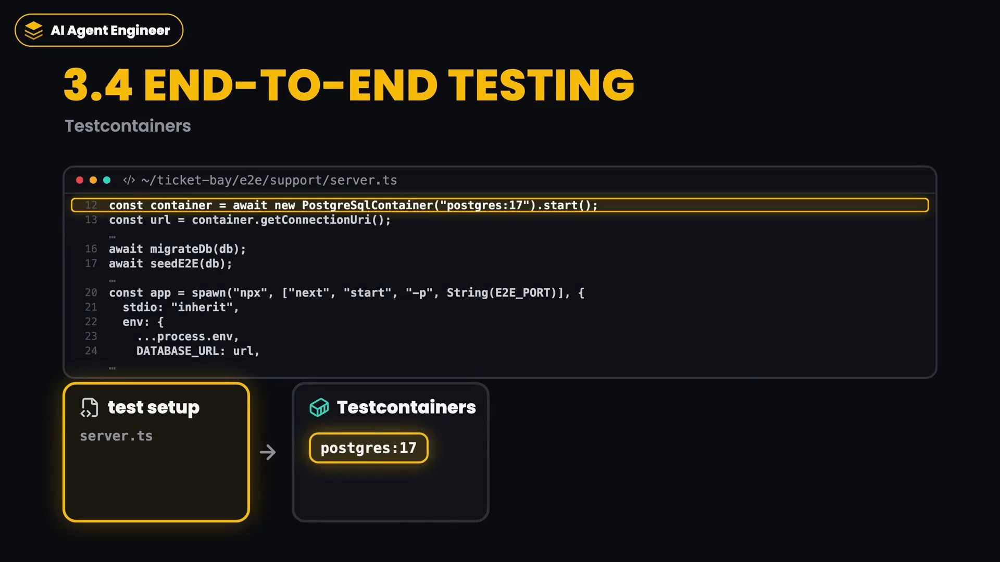

讲师在这里描述的机制是完整的，值得逐条对上：

- **一行配置请求 Postgres 17** → 我们的 `new PostgreSqlContainer('postgres:17')`
- **拉镜像、起容器、映射到空闲随机端口，所以并行跑不会撞车** → Testcontainers 自动分配，你不用管
- **等到数据库就绪** → `.start()` 会阻塞到就绪
- **把连接 URL 交给测试** → `.getConnectionUri()`
- **测试建表、灌测试数据** → 放在 setup 里
- **跑完删容器；崩了也有个 cleanup 容器兜底删** → `.stop()`

验证方法：跑完一次测试后立刻 `docker ps -a`，不应该看到残留的 postgres 容器。

### 步骤 2：写关键流程的浏览器测试

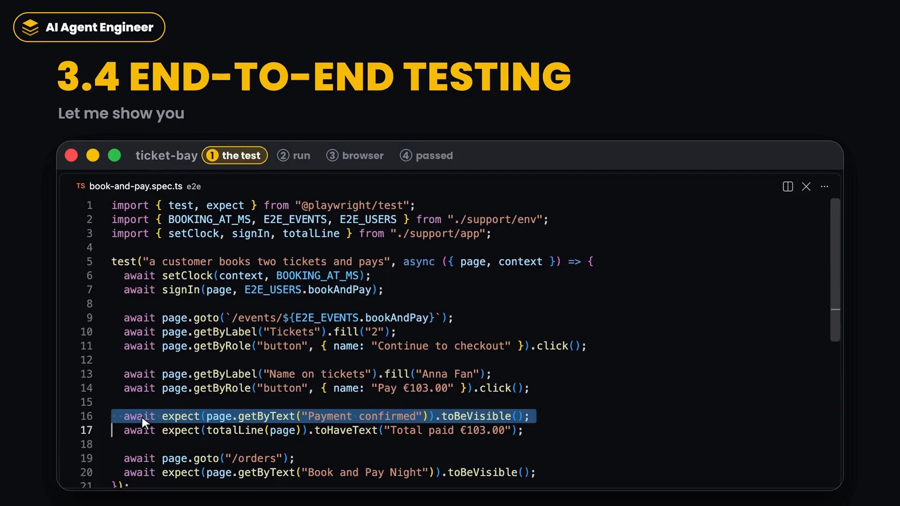

课里明确说了这个测试做什么：**打开一个 event、选两张票、付款、检查确认页和 my orders**。也明确说了断言原则：**检查用户能观察到的行为，不查数据库、不查内部状态**。

它的成本讲师也交代了：**大约 11 秒**。所以只写关键流程——讲师点名的三个是 booking、paying、refunding。

跑它：

```bash
npx playwright test tests/e2e/checkout.spec.ts
```

验证方法：能看到浏览器自己动起来（`--headed`），最后 1 passed，耗时十秒级。

### 步骤 3：把"其余流程"交给 decision LLM

这是 P022 后半段最重要的思路转折：Playwright 覆盖了关键流程，**但每条没有 Playwright 测试的流程依然要人查**。而让 LLM agent 去点浏览器，每一次"下一步点哪"都要几秒和 token。

讲师的答案是 QuickE2E（`dmoka/quickE2E`，开源）+ 一个随课程安装的 skill。工作方式是：

1. 测试文件里放**目标**，以及它可能输入的每个值（比如 email）
2. QuickE2E 打开真实浏览器，把页面**转成一份合法动作列表**（click pay、type into email……）
3. decision LLM 从列表里选一个朝目标前进的动作
4. **代码**（不是模型）检查结果：落到了哪个页面、用户看到了什么文本

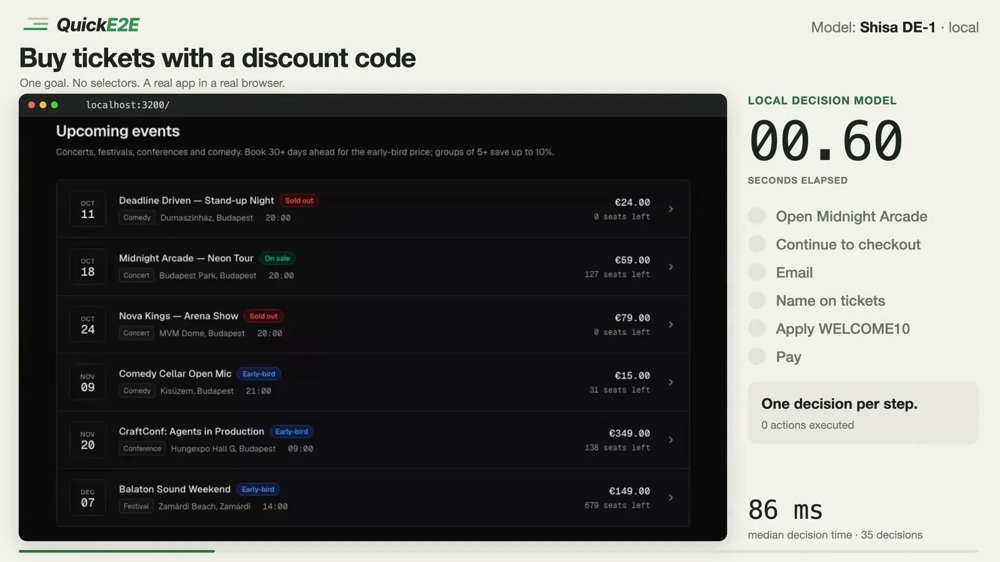

课里给的实测数字：目标"用 Welcome10 折扣码买票"，**7 步、3 秒内、本地跑零成本**；同样的任务用 Cloud Code + Browser 工具约 25 秒。

安装与 key：

```bash
# 课里给的是 GitHub 仓库名 dmoka/quickE2E，安装方式以该仓库 README 为准
# 默认走付费 API，需要一个 OpenRouter key（课里原话：you need an open router key）
export OPENROUTER_API_KEY="<你的 key>"
```

讲师说这一跑**成本不到十分之一美分**；Apple Silicon 的 Mac 可以本地免费跑，8GB 内存能放小模型，32GB 能放更大的、比付费 API 还快。

然后是 skill 部分。装了随课程分发的 skill 之后，agent 会为每条流程写**四类用例**：

- happy path（正常路径）
- boundaries（边界）
- rule breaks（破坏规则，比如用过期折扣码）
- attacks（攻击）

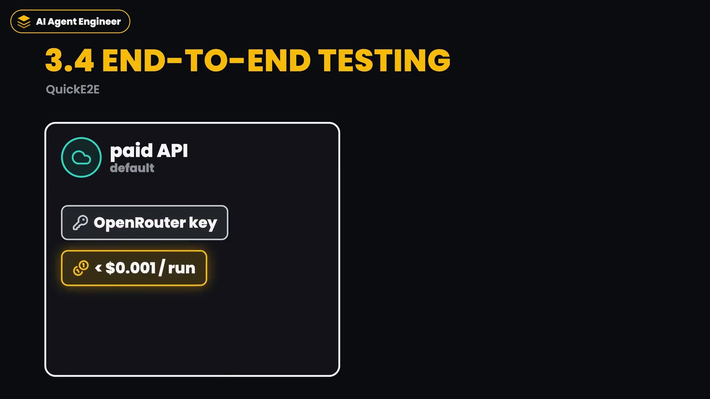

课里对 TicketBay checkout 的对比结论：比 Cloud Code + browser 工具**快 10 倍、便宜约 200 倍**。而它找到的真实 bug 也很具体——**同一个 URL 里塞两个折扣码，checkout 返回 HTTP 500**。

讲师特别强调了一句方法论：**每个发现你都自己去确认，因为不是每个失败都是 bug**；确认是 bug 之后，**先写一个复现它的失败测试，再改代码**。

### 步骤 4：legacy 代码用四步法，不手工做

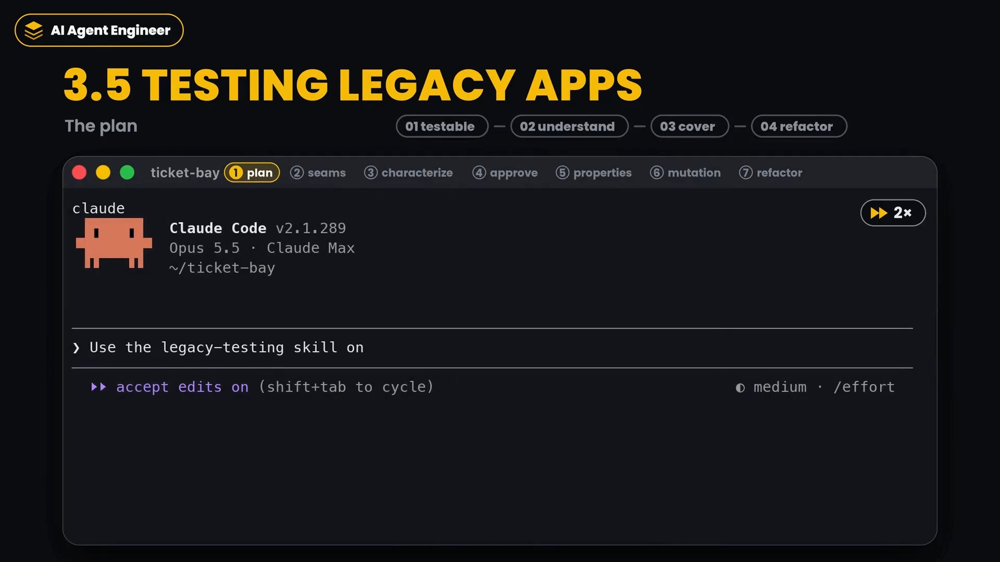

课里给的样本是**组织者的 payout 报表**：300 行、时钟在内部读、手续费硬编码、裸 SQL、没有测试。四步是：

**第一步，让它可测（make it testable）。** 讲师的原则很干脆：依赖是代码难测的头号原因，所以拆掉、换成 test double。但有两个例外——**依赖很快，就用真的**；**业务逻辑依赖它，就用真的**。payout 报表就保留了真数据库，因为**它的 SQL 查询决定了哪些订单算进 payout**；而**时钟和邮件**加了 seam（测试能替换的接缝）。

对照到你在 Node 里的直觉：这就是把 `new Date()` 和 `sendEmail()` 从函数体里提到参数上，测试时传假时钟和假邮件器——和前端把 `fetch` 注入组件是一个道理。

**第二步，理解它（characterization tests）。** 手法是：调用代码 → 写一个你**预期会失败**的断言 → 跑 → 把测试改成记录**真实发生的结果**。目标不是找 bug，是搞清楚当前行为。

输出很大时（JSON、CSV）用 **approval tests**：把整份输出捕获一次，之后每次运行都和它比对。这里被捕获的是 **bank CSV、邮件、JSON**，而**固定时钟让报表数字和日期每次运行都一样**。

讲师明确说了 approval test 是**临时工具**，非常脆弱——输出里挪一列、多一个空格就断——所以它的作用是"重构期间把行为按住"，**代码干净之后要删掉**。

**第三步，覆盖行为。** 属性测试造你想不到的输入。课里那个例子极具体：**随机请求打 payout 端点，断言它永远不返回 500**。它找到的崩溃就是计划里已经预测到的那个——**日期范围内没有任何订单的 show**。其余随机请求都得到了正常回答，没有一个是 500。

然后看覆盖率 + 变异分数。讲师给的定义值得抄下来：**覆盖率告诉你哪些行从没跑过，变异测试告诉你哪些行为没被测到——即使那些行被覆盖了**。这个报表的数字：**85% → 91%，越过了计划里的 90% 目标**。

**第四步，重构。** 手续费改成从 domain code 取、时钟传进来、长函数拆开。判据是：**重构后 79 个测试全绿**——说明测试钉住的每一个行为都保住了。然后删掉临时的 approval tests。

这套流程讲师做成了一个免费 skill（`legacy testing`，在 `dmoka/skills`），它**先读代码、提出这个代码需要哪几步以及为什么**，你**批准一次计划**，它就跑完每一步。

### 步骤 5：装门（gate）

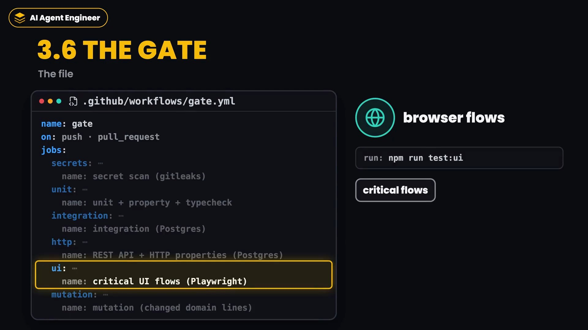

讲师说的是"**一个 GitHub Actions 文件**，跑**六个检查，并行，一条 lane 一个**"，这样红了就知道哪条 lane 挂了：

| lane | 内容 |
| --- | --- |
| 1 | 快速测试：unit、property、type check |
| 2 | integration tests，打真实 Postgres |
| 3 | 浏览器流程 |
| 4 | API property tests |
| 5 | mutation testing，**只跑 PR 改动的行**（全量太慢，而这些正是要审的行） |
| 6 | secret scan，**扫整个 git 历史**（你后来删掉的 key 还在历史里） |

第六条有个明确处置动作：**扫到就吊销那个 key、重新生成一个**。

六条加起来**约 2.5 分钟**。课里演示的 PR 只改了 fee 代码的**一行**，测试全绿，但**那一行上有一个变异体存活**——没人测出来的小改动——于是 mutation 检查失败，PR 不能合并。

最后是 branch protection：**把这六项设成 required**，GitHub 就会拦住任何带失败检查的 PR，**包括你的 agent 提的 PR**。

### 步骤 6：写代码之前先被 grill 一遍

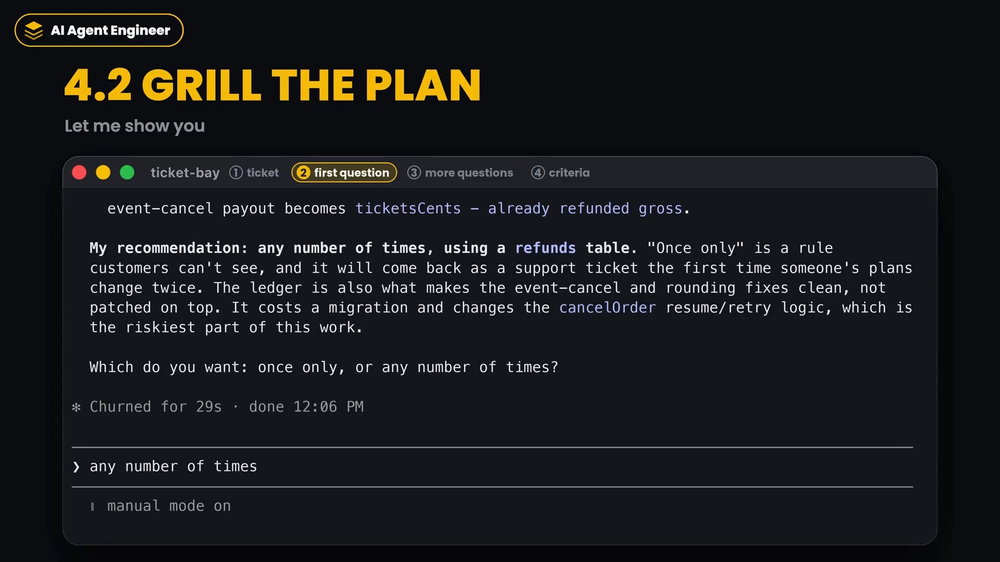

这一节的核心动作很小：**在 agent 写任何代码之前，让它来拷问你**。

机制是（课里描述得很细）：

- 一次只问一个**硬**问题
- 每个问题**附上它推荐的答案**，所以大多数时候你直接选推荐答案，或者改一个细节
- **如果代码库能回答，它就去代码库找，不问你**
- grilling 会暴露你**还没做的决定**——课里举的两个例子很典型：**退款失败时座位怎么办**、**谁能取消订单、什么时候能**
- 然后你要它**给不止一个方案**，按三件事比较：**可测性、diff 大小、依赖数量**，**在写任何代码之前选定一个**
- 最后让它把商定的内容写成一份**短的验收标准列表**，**用大白话**

课里演示的是"让客户只取消部分票、不是全部"这个需求：第一个问题是"客户能不能对同一个订单分多次取消"，推荐答案是"任意多次"；一共问了 **11 个问题**，回答到"计划的每个分支都覆盖了"就停；然后写出 **7 条**验收标准。

动手方式就是一句话的事：**"在写代码之前 grill 我"**，用的是 `dmoka/skills` 里的 GrillMe skill。

### 步骤 7：让一个"没有作者上下文"的 agent 来拆

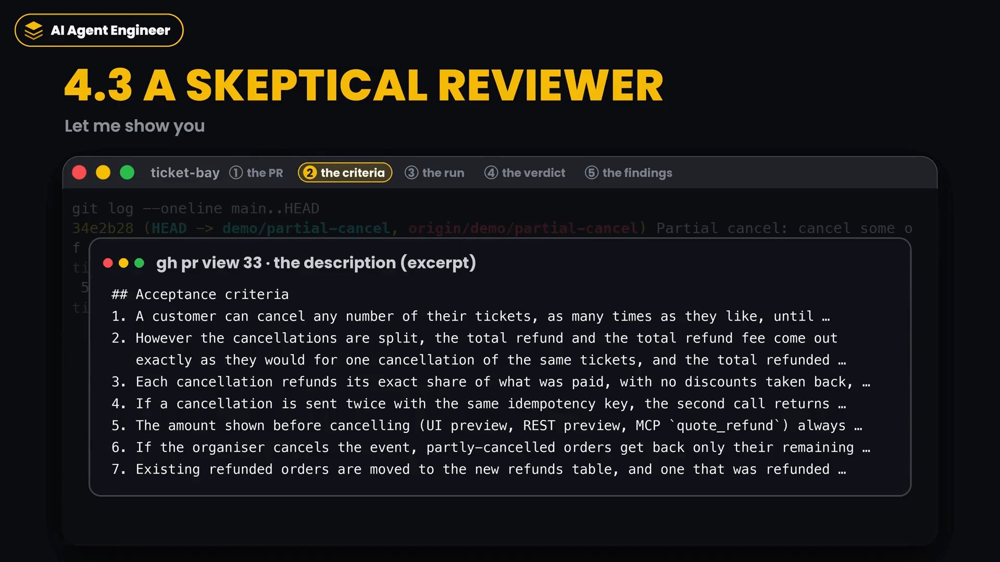

讲师给的 prompt 原文可以直接复制：

```text
You are an adversarial QA agent. Your goal is to break the software, not to validate it.
Attack assumptions, explore edge cases, abuse inputs, and search for failure modes
the developer did not anticipate.
```

要让这条路走得通，必须喂两样东西，否则它会漂移成风格挑刺：**你商定的验收标准** + **`cloud.md` 或 `agents.md` 里的标准**。还有几个硬性约束：

- **先列问题，不许夸**
- **结尾给 verdict：merge 或 don't merge**
- **每个 finding 都说明它是怎么被知道的**：由失败测试**证明（proved）**，或者从**具体某几行推理（reasoned）**——后者你要自己去读那几行
- **只审这次改动**；改动之前就坏的东西进另一个列表，否则每次评审都报同样的老 bug
- **PR 越小发现越多**——大改动漏 bug 的概率对人对 agent 都更高，读起来像小说的 PR 就拆

课里 PR 33 的结果值得记住比例：**1 个 commit、7 条验收标准、评审 5 分钟、verdict 是 don't merge、6 个 finding（2 个 proved、4 个 reasoned）**。第一个 finding 是：**退款手续费按每次取消各自的金额收**，违反了第 2 条标准（不管怎么拆，总手续费不变）；它的失败测试取消一个 1 欧元 3 张票的订单，一张一张取消，**客户一分钱都拿不回来**，而标准说应该退 50 分。一个 reasoned finding 是：**退款预览还在加载时取消按钮仍可点**，客户可能确认一个他从没见过的金额。

### 步骤 8：让工具告诉你先读哪个 PR、先读哪几行

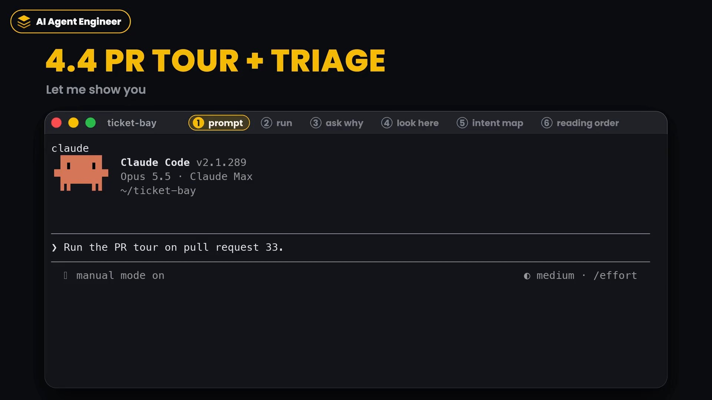

**PR tour** 解决的是"git diff 按字母顺序排列，而不是按解释顺序排列。"。它输出的东西有固定顺序：

1. **intent 先行**：验收标准 → PR 描述 → 关联 issue → commit message
2. **intent map**：把每个改动文件映射到解释它的那段 intent
3. **Ask Why 列表**：没有任何 intent 能解释的文件——讲师说**这是整页最有用的东西**，因为每一项都是一个要问作者的问题
4. **最多 8 行**值得检查的行，标了 high 的排前面
5. **文件按阅读顺序**排，**每个测试紧挨着它对应的代码测试**
6. **噪音折叠**：日志、生成文件、重命名

PR 33 上它跑了约 6 分钟，产出一页。顶部点名**一个文件没人解释：test config——它把每个测试的时限都调高了**，于是讲师去问作者为什么。第一个值得检查的行是退款手续费：**四次单张取消付 2 欧手续费，一次取消全部四张付 80 分**，而第 2 条标准说总手续费必须一样。

**PR triage** 解决队列顺序：大多数评审队列按时间或大小排，会把你送去错误的 PR——**900 行的重命名是无害的，一个字符的价格改动不是**。它读所有 open PR，按**需要多少注意力**分成 critical / high / medium / low，**判断依据是改动实际做了什么，不是大小或标题**，并且**每一级都指向驱动它的那一行**，让你一键复核。每个 PR 用**独立的 fresh judge**，因为刚读完一个很危险 PR 的 judge 会把下一个高风险 PR 评得太低。单仓库不用配置，多仓库列一次就建一个统一队列。

两个 skill 有条共同的底线：**它们只指路，从不说 safe 或 ready to merge**——那个决定留给你和对抗式评审。

### 步骤 9：建 second brain

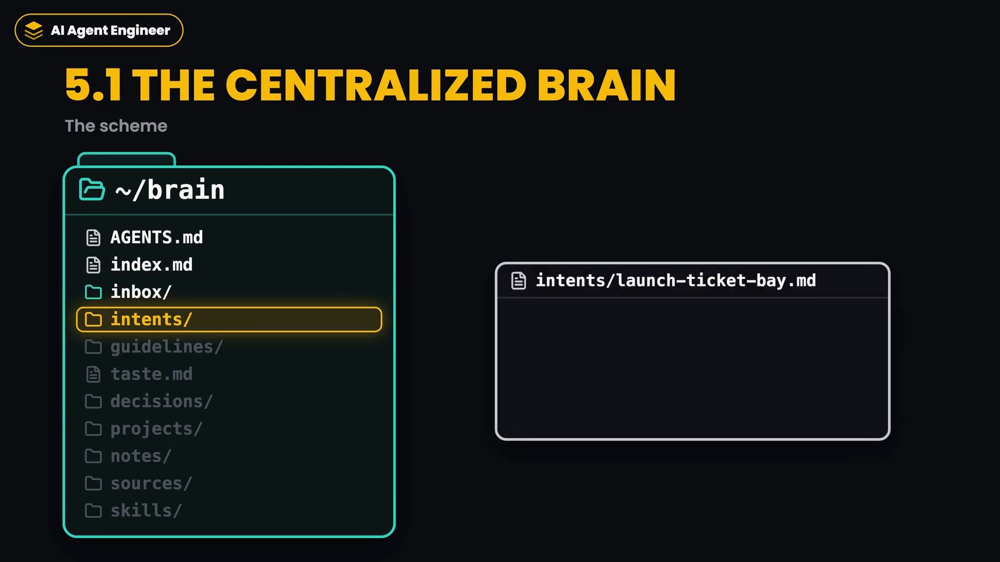

问题陈述很具体：新项目一开始 agent 对你**怎么工作**一无所知；你要么每次重复，要么往每个项目的 `agents.md` 里抄一份，几个月后各份互不一致；放全局 `cloud.md` 也只对**那台机器上的 Cloud Code** 有效，服务器上的 Codex 和那个跑 24×7 的 AI employee 根本读不到。

所以分两层：

- **只属于某个项目的**留在项目里：项目的 `agents.md`、各文件夹里更小的指令文件、它的 skills
- **适用于所有项目的**进 second brain：coding guidelines、decisions、每个项目一个短文件、以及周边管理信息（部署在哪、客户是谁）。**brain 本身是一个 git 仓库，skills 也放在里面**

目录结构（课里逐个说了职责）：顶层 `agents.md`（给所有在 brain 里工作的 agent 的规则）、`index`（一行一个 node）、`inbox`（新东西先落这儿）、`intents`（一文件一目标，写清为什么想要、怎么算达成）、`guidelines`（每个项目怎么建，例子：集成测试永远打真数据库、绝不用 mock）、`taste`（什么算好：你永远不想要的东西、两个方案都能用时谁赢，各带理由，例子："优先选择平淡无奇的方案，因为下一个人还得维护它们。"）、`decisions`（一文件一个，带日期和理由）、`projects`（一文件一个：是什么、在哪、状态）、`notes`、`sources`（原始链接和文件，**永不编辑**，所以每个 node 都能指回原文）、`skills`（Capture、Triage、Lint、AskBrain，以及跨项目复用的其他 skill）。

顶层 `agents.md` 的具体规则讲师念了四条：**先读 index、新东西进 inbox、每个 node 都链回它的来源、每次改完就 push**。

规模判断也给死了：**几百个 node，index + 文本搜索就够，不需要 vector database**。

日常循环：你说"save this" → 落进 inbox → Triage 归档并往 index 加一行 → sync 脚本 commit 并推到 GitHub 上的 brain 仓库 → Cloud Code、那个 box、AI employee 下次跑 sync 时拉到。新机器上 clone 仓库 + 跑 install 脚本，一次拿到整个 brain。每次 triage 之后 Lint 检查 nodes 并**自己修简单问题**。agent 问"brain 知道什么"时，Ask Brain 回答并**给每个 node 一个链接**。

---

## 4. 完整代码

下面每个文件都能直接保存。凡属**逐字稿没有给到、我为可运行而补齐的样板**，都在代码块上方或注释里标了「课里没讲」。凡属**课里明确说过的机制**，注释里标了出处。

### 4.1 `package.json`

```json
{
  "name": "ticketbay-quality-gate",
  "private": true,
  "type": "module",
  "scripts": {
    "test:unit": "vitest run --dir tests/unit",
    "test:property": "vitest run --dir tests/property",
    "test:api-property": "vitest run --dir tests/api",
    "test:integration": "vitest run --dir tests/integration",
    "test:e2e": "playwright test",
    "typecheck": "tsc --noEmit",
    "mutate": "stryker run",
    "gate": "npm run typecheck && npm run test:unit && npm run test:property"
  },
  "devDependencies": {
    "@playwright/test": "^1.48.0",
    "@testcontainers/postgresql": "^10.13.0",
    "testcontainers": "^10.13.0",
    "fast-check": "^3.22.0",
    "vitest": "^2.1.0",
    "typescript": "^5.6.0"
  }
}
```

> 版本号说明：**课里没有给任何版本号**。以上是写作时能装上的区间，以你 `package-lock.json` 实际解析结果为准。Testcontainers 的 Node 包名同样**课里没讲**——讲师只说了 Testcontainers 这个库支持 Node。

### 4.2 `playwright.config.ts`

```ts
import { defineConfig, devices } from '@playwright/test'

export default defineConfig({
  testDir: './tests/e2e',
  fullyParallel: false,          // 关键流程串行跑，避免互相写坏数据
  retries: process.env.CI ? 1 : 0,
  workers: process.env.CI ? 1 : undefined,
  reporter: process.env.CI ? 'github' : 'list',

  // 课里说：E2E 需要一个真实数据库
  globalSetup: './tests/fixtures/global-setup.ts',
  globalTeardown: './tests/fixtures/global-teardown.ts',

  use: {
    baseURL: process.env.BASE_URL ?? 'http://localhost:3000',
    trace: 'on-first-retry',
  },
  projects: [
    { name: 'chromium', use: { ...devices['Desktop Chrome'] } },
  ],
})
```

### 4.3 `tests/fixtures/global-setup.ts`

对应讲师原话：*"测试设置里有一行要求启动一个 Postgres 17 容器。Testcontainers 会拉取镜像，在 Docker 中启动容器，并将其映射到一个空闲的随机端口……"*

```ts
import { PostgreSqlContainer, StartedPostgreSqlContainer } from '@testcontainers/postgresql'
import { execFileSync } from 'node:child_process'
import { writeFileSync } from 'node:fs'

let container: StartedPostgreSqlContainer | undefined

export default async function globalSetup() {
  // 一行请求 Postgres 17 容器
  container = await new PostgreSqlContainer('postgres:17').start()

  // 拿到连接 URL 交给测试
  const uri = container.getConnectionUri()
  process.env.DATABASE_URL = uri
  writeFileSync('.pg-uri', uri, 'utf8')

  // 建表 + 灌测试数据（课里说：test setup creates the tables and loads the test data）
  // 课里没给具体 schema，这里用你的 migration 命令代替
  execFileSync('npm', ['run', 'db:migrate'], {
    stdio: 'inherit',
    env: { ...process.env, DATABASE_URL: uri },
  })
  execFileSync('npm', ['run', 'db:seed'], {
    stdio: 'inherit',
    env: { ...process.env, DATABASE_URL: uri },
  })
}
```

### 4.4 `tests/fixtures/global-teardown.ts`

对应讲师原话：*"运行结束后，容器会被删除。"*

```ts
import { readFileSync, unlinkSync } from 'node:fs'
import { execFileSync } from 'node:child_process'

export default async function globalTeardown() {
  // Testcontainers 的 Ryuk 容器会在进程退出后兜底删除残留容器；
  // 这里再做一次显式清理，方便本地反复跑。
  try {
    const uri = readFileSync('.pg-uri', 'utf8')
    const id = new URL(uri).username // 课里没讲这个技巧，属于为可运行补的样板
    void id
    unlinkSync('.pg-uri')
  } catch {
    // 文件不存在就算了，不要因为清理失败让测试变红
  }
  // 课里说的兜底：run crashes 时由 cleanup 容器删除，实际由 Testcontainers 负责
  execFileSync('echo', ['teardown done'])
}
```

### 4.5 `tests/e2e/checkout.spec.ts`

对应讲师原话：*"这是结账测试。它打开一个活动，选两张票，付款，然后检查确认页面和我的订单。"* 以及 *"检查用户能够观察到的行为。"*。

```ts
import { test, expect } from '@playwright/test'

test('customer buys two tickets and sees them in my orders', async ({ page }) => {
  // 1. 打开一个 event
  await page.goto('/events/summer-jazz-night')
  await expect(page.getByRole('heading', { name: /summer jazz night/i })).toBeVisible()

  // 2. 选两张票
  await page.getByRole('button', { name: /add ticket/i }).click()
  await page.getByRole('button', { name: /add ticket/i }).click()
  await expect(page.getByTestId('ticket-count')).toHaveText('2')

  // 3. 付款
  await page.getByRole('link', { name: /checkout/i }).click()
  await page.getByLabel(/email/i).fill('buyer@example.com')
  await page.getByLabel(/card number/i).fill('4242424242424242')
  await page.getByRole('button', { name: /^pay/i }).click()

  // 4. 检查确认页（用户能观察到的东西）
  await expect(page.getByRole('heading', { name: /order confirmed/i })).toBeVisible()
  await expect(page.getByText(/2 tickets/i)).toBeVisible()

  // 5. 检查 my orders
  await page.getByRole('link', { name: /my orders/i }).click()
  await expect(page.getByRole('listitem').first()).toContainText(/summer jazz night/i)
})
```

> 选择器说明：**课里没有展示具体选择器**。上面用的是 Playwright 推荐的 role/label 定位；照抄到你的项目时把 URL 和文案换成真实的，这是唯一必须改的地方。

### 4.6 `tests/api/payout.property.test.ts`

对应讲师原话：*"一个属性测试会向付款端点发送随机请求，并检查它绝不会返回 500。"*

```ts
import { describe, it, expect } from 'vitest'
import fc from 'fast-check'

// 课里没点名属性测试库；fast-check 是为可运行补的选择。
const BASE = process.env.API_BASE ?? 'http://localhost:3000'

describe('payout endpoint', () => {
  it('never answers with a 500 and always answers JSON', async () => {
    await fc.assert(
      fc.asyncProperty(
        fc.uuid(),                                  // showId
        fc.date({ min: new Date('2024-01-01') }),   // from
        fc.date({ min: new Date('2024-01-01') }),   // to
        async (showId, from, to) => {
          const res = await fetch(
            `${BASE}/api/payouts?showId=${showId}` +
            `&from=${from.toISOString()}&to=${to.toISOString()}`
          )
          expect(res.status).not.toBe(500)
          expect(res.headers.get('content-type')).toContain('application/json')
        }
      ),
      { numRuns: 200 }
    )
  })
})
```

> 讲师说这个属性**找到了计划里预测过的崩溃**：日期范围内没有任何订单的 show。那个 show 的固定 id 可以再加一条独立的回归测试。

### 4.7 `.github/workflows/gate.yml`

六条 lane 的**职责**完全来自 P024；**YAML 的具体写法课里没给**，以下是补齐的可运行骨架。secret scan 用哪个扫描器讲师也没点名。

```yaml
name: gate
on:
  pull_request:

jobs:
  # lane 1：快速测试 —— unit、property、type check
  fast:
    runs-on: ubuntu-latest
    steps:
      - uses: actions/checkout@v4
      - uses: actions/setup-node@v4
        with: { node-version: 20, cache: npm }
      - run: npm ci
      - run: npm run typecheck
      - run: npm run test:unit
      - run: npm run test:property

  # lane 2：integration tests，打真实 Postgres（Testcontainers 在 CI 里直接可用）
  integration:
    runs-on: ubuntu-latest
    steps:
      - uses: actions/checkout@v4
      - uses: actions/setup-node@v4
        with: { node-version: 20, cache: npm }
      - run: npm ci
      - run: npm run test:integration

  # lane 3：浏览器流程
  e2e:
    runs-on: ubuntu-latest
    steps:
      - uses: actions/checkout@v4
      - uses: actions/setup-node@v4
        with: { node-version: 20, cache: npm }
      - run: npm ci
      - run: npx playwright install --with-deps chromium
      - run: npm run test:e2e

  # lane 4：API property tests
  api-property:
    runs-on: ubuntu-latest
    steps:
      - uses: actions/checkout@v4
      - uses: actions/setup-node@v4
        with: { node-version: 20, cache: npm }
      - run: npm ci
      - run: npm run test:api-property

  # lane 5：mutation testing，只跑 PR 改动的行
  # 课里原话：because the pull repo takes too long, and those are the lines under review
  mutation:
    runs-on: ubuntu-latest
    steps:
      - uses: actions/checkout@v4
        with:
          fetch-depth: 0     # 需要完整历史才能算 diff
      - uses: actions/setup-node@v4
        with: { node-version: 20, cache: npm }
      - run: npm ci
      - name: compute changed lines
        run: git diff --unified=0 origin/${{ github.base_ref }}...HEAD > changed.diff
      - run: npx stryker run --diff changed.diff
      # stryker 的 --diff 参数名以你安装版本的文档为准；课里只讲了"只跑改动的行"这个策略

  # lane 6：secret scan，扫整个 git 历史
  # 课里原话：a key you deleted later is still in the history
  secrets:
    runs-on: ubuntu-latest
    steps:
      - uses: actions/checkout@v4
        with:
          fetch-depth: 0     # 必须完整历史，否则扫不到已删除的 key
      - name: scan history
        run: |
          # 课里没点名扫描器；gitleaks 是补齐的示例，换成你团队在用的即可
          docker run --rm -v "$PWD:/repo" zricethezav/gitleaks:latest \
            detect --source=/repo --no-git=false --redact
```

启用 branch protection 的步骤（课里说了"开启分支保护，这样六项检查就成为必需项。"，没给点击路径）：仓库 Settings → Branches → Add branch protection rule → 勾选 Require status checks to pass → 把上面六个 job 名加进去。

### 4.8 `docs/acceptance/cancel-partial.md`

对应讲师原话：*"你让它把你们商定的内容写成一份简短的验收标准清单，用平实的语言说明这个功能必须做什么。"*

```markdown
# 取消部分票 —— 验收标准

（课里演示时生成了 7 条；其中第 2 条在 P028 被逐字引用，其余为按课程演示内容复述的示意。）

1. 客户可以对同一个订单取消任意多次，直到票全部取消。
2. 不管取消怎么拆分，总退款手续费必须相同。
3. 客户取消时 agent 必须始终传票数。
4. 退款失败时，座位必须回到可售状态，不能丢失。
5. 只有订单所有者可以取消订单。
6. 已过活动开始时间的订单不可取消。
7. 取消成功后，「我的订单」里的票数立即更新。
```

### 4.9 `brain/agents.md`

四条规则**直接来自讲师原话**；frontmatter 与目录约定是我补的。

```markdown
# Brain 工作规则

适用于所有在这个仓库里工作的 agent。

1. **先读 index**，再去打开具体 node。
2. **新东西一律先放进 `inbox/`**，不要直接塞进别的文件夹。
3. **每个 node 都必须链回它的来源**（`sources/` 里的原始链接或文件）。
4. **每次修改后 push。**

## 目录

- `index.md` —— 一行一个 node
- `inbox/` —— 待归档
- `intents/` —— 一个文件一个目标：为什么想要、怎么算达成
- `guidelines/` —— 每个项目怎么建（例：集成测试永远打真数据库，绝不用 mock）
- `taste.md` —— 什么算好：永不想要的东西、两个方案都能用时谁赢，各带理由
- `decisions/` —— 一个决策一个文件，带日期和理由
- `projects/` —— 一个项目一个文件：是什么、在哪、状态
- `notes/` —— 其他值得留的
- `sources/` —— 原始链接与文件，**永不编辑**
- `skills/` —— Capture / Triage / Lint / AskBrain，以及跨项目的其他 skill

## 规模约定

几百个 node 时，index + 文本搜索足够。**不要上 vector database。**
```

### 4.10 `brain/index.md`

```markdown
# Index

- [Intents：3 个月内把 TicketBay 上线](intents/ticketbay-launch.md)
- [Guidelines：测试策略](guidelines/testing.md)
- [Taste：偏好无聊的方案](taste.md)
- [Decisions：2025-03-02 用真数据库跑集成测试](decisions/2025-03-02-real-db.md)
- [Projects：TicketBay](projects/ticketbay.md)
- [Sources：Playwright 官方文档](sources/playwright-docs.md)
```

---

## 5. 逐行解释

**为什么 `fullyParallel: false`。** 关键流程测试会写数据库。讲师说 E2E 只写 booking/paying/refunding 这类**必须永远不坏**的流程，数量少、串行跑代价可接受；把它并行化省下的几秒，会以"测试互相污染"的形式还回来。你并行的那部分（单元、属性测试）应该走 lane 1 和 lane 4，而不是 E2E。

**为什么 `globalSetup` 里用 `PostgreSqlContainer('postgres:17')` 而不是 mock。** 讲师的原话就是判据：*"模拟对象会配合智能体对数据库做出的每一个错误假设。而真实数据库会拒绝。"* agent 对 SQL 的每一个错误假设，mock 都点头，Postgres 会拒绝。这就是为什么这条代码值得付出容器启动的几秒。

**为什么随机端口很重要。** 讲师点名：*"将其映射到一个空闲的随机端口，这样并行运行就永远不会冲突。"* 如果你手写 `5432`，CI 上两个 job 同时跑就有一个挂掉，而挂掉的原因和你的代码毫无关系——这是最难查的一类红。

**为什么 teardown 里对清理失败要吞掉异常。** 清理失败不应该让一个**功能正确**的测试变红。Testcontainers 本身还有兜底（讲师说的 cleanup 容器），显式清理只是为了让本地反复跑时更干净。

**为什么 checkout 测试断言 `getByText(/2 tickets/i)` 而不是查数据库。** 讲师的原话是最好的解释：*"检查用户能观察到的行为，而不是数据库或内部状态。"* 查数据库的测试在重构表结构时会红，而用户行为没变——这就是讲师说的"测试和代码结构耦合"的毛病。在前端这块你其实很熟：这和断言 Redux store 形状而不是断言渲染结果，是同一种错。

**为什么只给 checkout 写一条 E2E。** 讲师给了成本：一条 E2E 起真浏览器、要**秒级**而不是毫秒级，而且要在每个 PR 的 CI 上跑。所以只覆盖关键流程，其余交给 decision LLM。

**为什么属性测试断言 `status !== 500` 而不是断言具体业务结果。** 讲师描述的属性就是这个：*"检查它绝不会返回 500。"* 属性测试的价值不在于覆盖你想到的分支，而在于生成你没想到的输入（课里那个崩溃就来自"日期范围内没有订单的 show"）。断言太具体，随机构造出来的输入大多会合理地失败，测试就变成噪音。

**为什么 `numRuns: 200`。** 讲师说的是"几百个生成输入"（*"throw hundreds of generated inputs at one rule"*），200 落在这个量级。数值本身课里没给。

**为什么 gate 里 mutation 要 `fetch-depth: 0` 和先算 diff。** 讲师解释了为什么只跑改动行：*"整个仓库跑起来太慢，而那些正是待审查的代码行。"* 而只跑改动行必须能算出改动集，浅克隆没有 base commit 可比。

**为什么 secret scan 也要 `fetch-depth: 0`。** 讲师把这句说透了：*"你后来删除的密钥仍然留在历史记录里。"* 默认的浅克隆只拿最后一次提交，历史里的 key 根本扫不到——于是这道 lane 变成安慰剂。

**为什么六条 lane 要拆开而不是串行一个 job。** 讲师的原话：*"每条通道一个，这样当某条变红时，你就知道是哪条通道失败了。"* 串行的话你只知道"某个检查挂了"，还得往下翻日志才知道是浏览器还是变异测试。拆开还有个副作用好处：六条并行，总时长约是**最慢那条**的时长（讲师说六条加起来约 2.5 分钟）。

**为什么 branch protection 是这条链路里不可省的一步。** 前面所有检查都只是"提供了信号"，而讲师开头那句话定义了问题：*"智能体可能跳过测试，或者明明没通过却说通过了，而人也可能忘记它们。"* 只有设成 required，红灯才真的意味着**不能合并**——对人也对你的 agent。

**为什么验收标准要用大白话，且必须在写代码之前产出。** P028 演示里，正是第 2 条标准（总手续费不变）让对抗式评审的第一个 finding 有了判据。如果标准是在代码之后补的，它就会不知不觉地描述代码现在做的事，评审就失去了参照物。

**为什么每个 finding 必须标 proved 或 reasoned。** 因为两类东西的处置成本完全不同：proved 的有一条失败测试在那儿摆着，你可以直接跑；reasoned 的只是从具体行推理出来，比如"退款预览加载中取消按钮仍可点"——它需要一条**能控制时序的浏览器测试**才能证明，讲师的做法是**自己去读它点名的行**再决定。不分类的话，你会平等地对待所有 finding，把时间花错地方。

**为什么 PR tour 把 Ask Why 放在前面。** 讲师说得很直接：*"那份清单是页面上最有用的东西，因为清单上的每个文件都是向作者提出的一个问题。"* 一个没人能解释的改动文件，比十行难读的代码更值得问。课里的例子就是那份 test config——它把每个测试的时限都调高了，这件事在验收标准里找不到任何依据。

**为什么 PR triage 每个 PR 用独立 judge。** 讲师给的理由是认知性的：*"a judge that has just read a very dangerous
a judge that has just read a very dangerous pull request rates the next risky one too low."* 同一个上下文里连续判两个高危 PR，第二次的判断会被上一次的震撼稀释——这不是模型缺陷，是任何判断者（包括你）都会有的锚定效应。拆成独立 judge 是把这个偏差在结构上消掉，而不是靠提示词祈祷它别发生。

**为什么两个 skill 都只指路、不说 safe 或 ready to merge。** 讲师在 P029 结尾给了这条边界：*"这两项技能只做提示。它们从不说安全或可以合并，因为这个决定始终由你和那位持怀疑态度的审查者来做。"* 这是刻意设计的职责分离：tour 和 triage 是**排序器**，它们的输出是"先看这个、先看这几行"，不是"这个可以合"。一旦它们开始下结论，你就会把判断责任外包给一个只读 diff 的工具——而它没有跑过测试、没有读过验收标准、也没有你的 taste。

**为什么 P026 里那两个 skill 名字对不上。** 逐字稿 P026 写的是 "PR3H 技能挑选拉取请求，PR2H 技能挑选其中的代码行。"，而 P029 展开讲的是 **PR tour**（挑行）和 **PR triage**（挑 PR）。对照 P029 的职责描述，`PR3H`/`PR2H` 应是转录误差，实际对应 triage 与 tour。你在仓库里按 `PR tour` / `PR triage` 找 skill 即可——这一点我在第 7 节也会再提一次，因为按错的字面去搜会搜不到。

**为什么 brain 必须是一个独立的 git 仓库，而不是一堆散文件。** 讲师要解决的是"同一份知识要在多台机器、多个 agent 之间同步"：Cloud Code 在任意项目里、你本地的 agents、以及那个 24×7 跑在服务器上的 AI employee，**读的是同一个 brain、用同一套 skills**。git 是这里唯一免费且你已经会的同步机制——它有历史（谁在哪天改了哪条 guideline）、有冲突解决、有远端。讲师把 `sources` 设为**永不编辑**，也是同一个理由：每个 node 都要能指回原文，如果原文能被就地改写，整条链就断了。

**为什么几百个 node 时明确说不要上向量库。** 讲师给了规模判断：*"在这个规模下，几百个节点，索引和文本搜索就足够了。你不需要向量数据库。"* 这个判断对前端转过来的人特别重要，因为很容易一上来就想搭 RAG。几百个 markdown 文件，一行一个 node 的 index 加全文搜索，检索质量和延迟都够，而向量库会引入切块策略、embedding 版本、索引更新这些新的失败面。

**为什么 `taste.md` 里每条都要带理由。** 讲师的原话例子是 *"优先选择平淡无奇的方案，因为下一个人还得维护它们。"* 关键在 because 后面那半句。不带理由的偏好，agent 遇到没覆盖的情形时无法类推；带理由的偏好，它可以判断"这个场景是不是同一个理由"。这也是你给 agent 写指令时和写 lint 规则最大的区别。

**为什么要有 `inbox/` 这一层。** 因为"保存"和"归档"是两个动作，人的时机和判断力都不一样。你说"save this"的时候通常正在做别的事，不该被迫当场决定它属于 guidelines 还是 decisions。inbox 把归档延后到 Triage，而 Triage 可以是 agent 跑的。

**为什么 GrillMe 一次只问一个问题。** 讲师描述得就是这个节奏：*"它一次问一个棘手的问题。而且每个问题都会给出它推荐的答案。"* 一次抛十个问题，你会跳过大部分直接点"同意"——那就退化成了橡皮图章。一个一个来，加上每题都带推荐答案，你的实际成本降到了"读一遍 + 大多数情况下点接受"，于是你真的会读。

**为什么要它先查代码库再问你。** *"如果代码库能回答一个问题，它就去那里找，而不是问你。"* 这一条把 grilling 从"审讯"变成了"补全"——只有代码库回答不了的问题（也就是真正需要你做决策的问题）才占用你的注意力。

**为什么要两三个方案，且按可测性 / diff 大小 / 依赖数比较。** 讲师给的这三项不是随便选的，它们正好对应后面整条链路的成本：可测性决定了这个改动能不能被 gate 抓住；diff 大小决定了对抗式评审漏 bug 的概率（讲师说 PR 越小发现越多）；依赖数决定了以后升级和排障的面。**在写代码之前**比这三项，比写完再比便宜一到两个数量级。

**为什么 characterization test 要先写一个"预期会失败"的断言。** 这个手法的精髓在于它把"我以为它会做什么"和"它实际做了什么"强制分开记录。你先写下预期，跑一次看到红，然后把断言改成实际值——这一改就是一次明确的知识获取动作。如果反过来先跑再看输出再写断言，你会不知不觉地把 bug 也一起钉进去，而且事后完全想不起来哪些是预期的、哪些是意外。

**为什么 approval test 一定要删。** 讲师说得很重：*"审批测试是一种临时工具，因为它们非常脆弱。输出中的任何变化，哪怕是一列移动或一个空格，都会让它们失败。"* 一个挪一列就红的测试，在重构完成后就只剩噪音价值。它的使命是"重构期间把行为按住"，按住之后就该撤手——留着它，下一次有人改输出格式时会被迫去更新一个巨大的快照文件，而那个动作毫无信息量。

**为什么"79 个测试全绿"是重构完成的判据。** 因为重构的定义就是**不改变行为**。测试是行为的代理，全绿说明被钉住的行为一个没变；而第 3 步补的那些测试（属性测试、变异测试找出的缺口）保证了"被钉住的行为"这件事本身是可信的。这两个条件缺一不可：只跑绿但覆盖不全，你等于什么都没证明。

---

## 6. 复现检查清单

按顺序打勾。每一项都给了**怎么验证**，而不是"完成了"。

### A. 环境与数据库

- [ ] `docker ps` 能返回表头 —— 验证：命令退出码为 0
- [ ] `npm ci` 装完依赖 —— 验证：`node_modules/@testcontainers/postgresql` 存在
- [ ] 跑一次 `npm run test:e2e`，结束后 `docker ps -a` 里没有残留的 `postgres:17` 容器 —— 这是讲师说的"run 结束容器就删掉"
- [ ] 故意 Ctrl-C 中断一次测试，再 `docker ps -a` —— Testcontainers 的兜底清理应该也把它收掉了。**如果这里残留了容器，说明 Docker socket 权限或 Ryuk 有问题，先修它再往下走**

### B. 关键流程测试

- [ ] `npx playwright test tests/e2e/checkout.spec.ts --headed` 能看到浏览器依次完成：打开 event → 加两张票 → checkout → 填 email 和卡号 → 付款 → 确认页 → my orders
- [ ] 单条耗时在**秒级**（讲师说约 11 秒）——如果你的耗时是分钟级，通常是 seed 数据或 dev server 启动慢，不是测试本身的问题
- [ ] 把「我的订单」页的标题文案改一个字，测试应该**红** —— 证明它真的在断言用户可见行为，而不是空跑
- [ ] 断言里没有任何直接查库的语句（扫一遍 `checkout.spec.ts`，不应出现 `DATABASE_URL` 或 SQL）

### C. 属性测试

- [ ] `npm run test:api-property` 能跑完 200 次生成输入
- [ ] 手动构造一个"日期范围内没有任何订单的 show"，确认它**不返回 500** —— 这是讲师说属性测试实际找到的那个崩溃，值得单独钉一条回归测试
- [ ] 故意让接口在某个边界抛错，确认属性测试能报出**最小反例**（fast-check 的 shrink 输出），而不是只给一个大随机输入

### D. 门禁

- [ ] `.github/workflows/gate.yml` 推上去后，一个 PR 上能看到**六个独立的 check**，且是并行跑的
- [ ] 六个 check 的总耗时约在**分钟级**（讲师说约 2.5 分钟）
- [ ] 在 fee 代码上改一行（不改任何测试），确认 **mutation lane 变红** —— 这复现了 P024 的演示：测试全绿但变异体存活
- [ ] 在分支历史里提交一个假 key（然后在后续提交里删掉它），确认 **secret lane 仍然变红** —— 验证 `fetch-depth: 0` 真的生效了；这一步不测，你永远不知道那条 lane 是不是安慰剂
- [ ] branch protection 里六个 check 都设为 required 后，用你自己的账号提一个带红色 check 的 PR，确认 GitHub **拒绝 merge** —— 也让你的 agent 提一个，同样应该被拒

### E. 意图与评审链路

- [ ] 在写代码前让 agent grill 你，直到它说"计划的每个分支都覆盖了"（课里演示是 11 个问题后停）
- [ ] 产出的验收标准是**短的、大白话的、你能逐行同意的**（课里演示是 7 条）—— 检查方法：每一条你都能说出"怎么算违反它"
- [ ] 让对抗式评审对着这份标准跑，输出里有：问题列表在前、无夸奖、结尾有 verdict、每个 finding 标了 proved 或 reasoned
- [ ] **每一条 reasoned finding 你都亲自读了它点名的那几行** —— 这是清单里唯一无法自动验证的一项，也是讲师反复强调的一项
- [ ] 跑一次 PR tour，产出页里能看到：intent 在最前、Ask Why 列表、标 high 的行排前面、每个测试紧挨着对应代码、噪音折叠
- [ ] Ask Why 列表里**每一项你都决定了它该不该在这次改动里** —— 课里演示的就是那份把测试时限调高的 test config

### F. Second brain

- [ ] `brain/` 是独立 git 仓库，有远端，`git log` 里有 Triage 产生的提交
- [ ] `agents.md` 里四条规则都在，且**先读 index** 这条排在第一条
- [ ] `index.md` 一行一个 node，点进去的文件都存在
- [ ] `sources/` 里的文件在最近 N 次提交中**没有被修改过** —— 验证 `git log -- sources/` 只有新增
- [ ] 在第二台机器（或新目录）clone + 跑 install 脚本后，能拿到完整 brain
- [ ] 从项目里问一次"brain 知道什么"，回答里每个结论都带 node 链接

---

## 7. 课里没讲但你会撞上的

这一节是按你实际动手顺序排的，全部是我在第 3、4 节复现时会撞上的东西。**标了「课里没讲」的，就是逐字稿里确实没提。**

### 7.1 Docker 权限：Windows 与 Linux 的差异

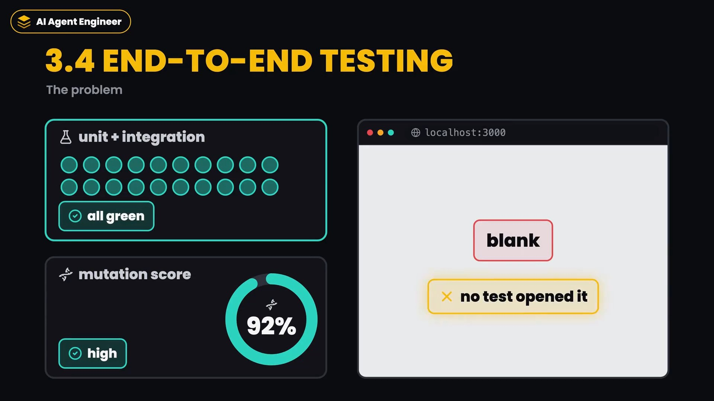

课里默认你能直接跑 Testcontainers。实际会撞上的：**Linux 上 `docker` 需要 sudo 或加入 docker 组**，否则 Testcontainers 报连不上 socket；**Windows 上必须开着 Docker Desktop 的 WSL2 后端**，用 Hyper-V 后端时挂载路径会出问题；**CI 的 ubuntu-latest runner 本身有 Docker**，所以 lane 2 通常不用额外配置，但如果你换到容器化的 runner 里就会撞上 dind。课里没讲这些，都是环境差异。

### 7.2 Playwright 的浏览器下载会拖慢第一次 CI

`npx playwright install --with-deps chromium` 在干净的 runner 上要下载几百 MB。第一次跑你会觉得"这道 gate 怎么这么慢"，而讲师说的 2.5 分钟是**缓存命中之后**的数字。解决方向是缓存 Playwright 的浏览器目录（`~/.cache/ms-playwright`），具体写法以你使用的 action 版本文档为准。课里没讲缓存。

### 7.3 OpenRouter key 与 decision LLM 的成本边界

P022 明确说了默认走付费 API、需要 OpenRouter key、一次不到十分之一美分。会撞上的三件事：**key 不能进仓库**（这正好被 lane 6 的 secret scan 兜住）；**本地模型的路径只对 Apple Silicon Mac 成立**，Intel Mac 和 Linux 上讲师没给方案；**"8GB 放小模型、32GB 放大的"是内存经验值，不是硬性要求**，具体模型名课里没讲。

### 7.4 QuickE2E 的安装方式课里没给

讲师只说了 GitHub 仓库名 `dmoka/quickE2E`。所以第 3 节的命令我给的是 `export OPENROUTER_API_KEY=...` 加上一句"安装方式以该仓库 README 为准"——**这不是偷懒，是课程里确实没有这条信息**。同理，随课程分发的 skill（QuickE2E skill、legacy testing skill、GrillMe、adversarial tester、PR tour、PR triage、Capture/Triage/Lint/AskBrain）讲师反复说"你在课程开始时就装了"，**而 P022–P031 这十讲里没有重讲安装命令**。如果你跳着看，得回去找开课那几讲。

### 7.5 `cloud.md` 还是 `agents.md`：两种写法讲师都用了

P028 说的是 "你的 cloud.md 或 agents.md 中的标准"，P031 说的是 "你的全局 CLAUDE.md。" 和 "every project's agents.md"。所以：**全局那份**叫 `cloud.md`（在家目录），**项目里那份**叫 `agents.md`。而 second brain 顶层的 `agents.md` 是给"在 brain 里工作的 agent"看的，和项目里的 `agents.md` **同名但职责不同**——这个重名会让你在第一次同步时困惑。课里没解释这个重名。

### 7.6 `git diff origin/${base_ref}...HEAD` 在 fork PR 上会失败

lane 5 和 lane 6 都依赖完整历史。会撞上的是：**来自 fork 的 PR**，`origin` 默认指向你自己的仓库，`origin/main` 可能落后于 base。稳妥做法是在 checkout 时把 base 分支显式取下来（`git fetch origin ${base_ref}:refs/remotes/origin/${base_ref}`），或者用 action 提供的 merge-base。课里讲了"只跑改动行"的**策略**，没讲这行命令怎么写。

### 7.7 变异测试工具的选择与"只跑改动行"的可行性

课里点名了 `fees.ts`（P025 的任务列表里有 "在 3.2 练习分支上对 fees.ts 运行变异测试"），但**没有点名用哪个变异测试工具**。我在 4.7 里写的 `npx stryker run --diff changed.diff` 是补齐的骨架，`--diff` 这个参数名**必须以你装的版本为准**。如果该版本不支持按 diff 跑，退路是：在 lane 里先算出改动文件列表，再把这些文件作为变异测试的包括范围传进去。**这是本节最可能卡住你的一步**，因为"只跑改动行"这件事本身在不同工具上成熟度差别很大。

### 7.8 属性测试找到 500 之后怎么办

讲师在 P022 演示的处置顺序很重要，值得抄成纪律：**① 自己确认（不是每个失败都是 bug）→ ② 写一个复现它的失败测试 → ③ 再改代码**。会撞上的是：属性测试报出的反例是一个随机 UUID 的 show，你**没法直接拿它当回归测试**，因为它每次跑都变。所以第 ② 步必须把它**固定成一个具名用例**（课里那个崩溃的根因是"日期范围内没有任何订单的 show"，把它写成一条带固定 showId 的测试）。

### 7.9 branch protection 需要 admin，且会挡住你自己

课里说 "GitHub 会阻止任何检查未通过的拉取请求合并，包括你的智能体的拉取请求。" —— 头一句是功能，后一句是代价。会撞上：**你自己的紧急修复也会被挡住**，尤其是 lane 5（变异测试）在你只是改注释时也可能报出存活的变异体。提前想好例外路径（比如允许 admin 绕过，但要记录原因），否则第一次线上告警时你会想把它关掉——而一旦关掉，整段课的投入就归零了。

### 7.10 `src/` 里那张 300 行的 payout 报表，你手上没有

P023 演示的是 TicketBay 里的一个真实文件，课里没有贴它的源码。所以第 3 节 step 4 我能给的是**方法和判据**，不是那份代码。你要做的替换是：挑你自己仓库里最像它的那个文件——**在内部读时钟、调用外部发送、有裸 SQL、没有测试**，然后拿 legacy testing skill 跑四步。判断"选对了没有"的标准很简单：**它读时钟或发外部请求**，这两条占了，你就一定会撞上 seam 的问题。

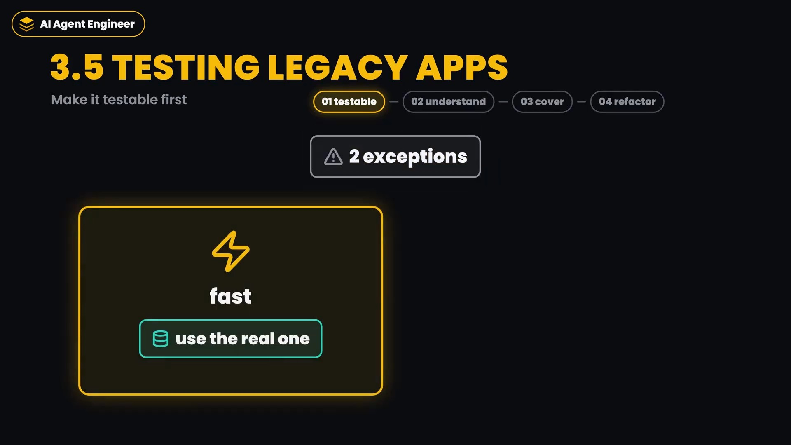

### 7.11 approval test 的快照文件会进 git，而且会变得很大

课里说 approval test 是临时的、最后要删。会撞上：**在删之前它会一直长在仓库里**，一个 bank CSV 快照加一个 JSON 快照就是几百 KB，而且每次输出有无关变化（比如时间戳没固定好）时它都会产生一个待更新的大 diff。对策就是讲师说的那条：**把时钟固定住**，让报表数字和日期每次运行都一样。如果你漏了这一步，approval test 会在第二次运行时就红。

### 7.12 "记录两个列表"这条纪律很容易被省掉

对抗式评审里"只审这次改动，改动之前就坏的东西进另一个列表"，听起来像流程洁癖，实际上是这条链路能不能长期用下去的分水岭。会撞上的：**如果不分列表，第一次评审就会报出 20 个历史问题，你就再也不会认真看第二次评审了**。所以那条"separate list"要真的存在——哪怕它只是一个 markdown 文件里的第二节。

![p028 00:50