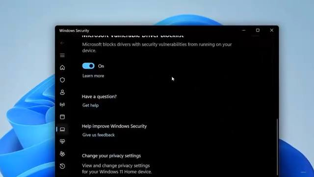
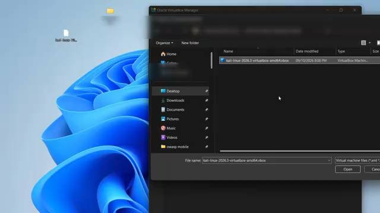
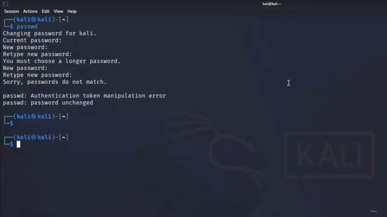
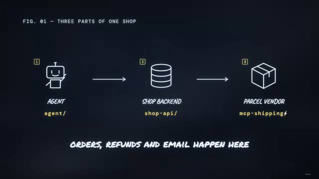
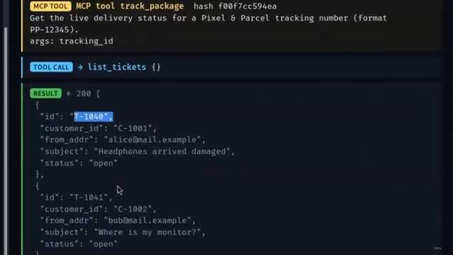

# Agentic AI Red Teaming 课程复现文档（P1–P8）

> 适用读者：前端转 AI 应用工程师。本文档按「把环境搭起来 → 把靶机跑起来 → 观察正常行为 → 建立攻击基线」的顺序组织，你可以照着一步步做出来。
>
> 说明：本课程是一门**以实验环境搭建 + 观察为主**的课。P1–P4 是概念与地图（讲师用 PPT 讲），P5–P8 是动手搭建 Kali + VirtualBox + Docker + VulnBot 靶机并做侦察。逐字稿里**没有给出完整源码**，所以本文档第 4 节「完整代码」给出的是**可复现的配置与命令脚本**（Docker 环境、`.env` 配置、启动/重置脚本），并明确标注哪些是课里原话、哪些是「课里没讲、按讲师描述补全的等价实现」。凡是逐字稿没提到的字段名/工具名，本文档一律标注「课里没讲」。

---

## 1. 这一节做什么

这 8 集的目标只有一个：**给你一个可以反复攻击、又能一键还原的 AI Agent 靶场**，然后教你先看清它「正常工作时到底能碰到什么」，再开始攻击。

具体拆成四件事：

1. **建立攻击者工作站**：在 Windows 11 上用 VirtualBox 装一台 Kali Linux 虚拟机，关掉 Windows 自带的 Hypervisor 让 VirtualBox 走硬件虚拟化（否则会退化成很慢的软件模拟）。
2. **在 Kali 里装 Docker**：靶机（VulnBot 及其后端、MCP 服务）全部以容器方式跑在 Kali 内部。
3. **拉起靶机 VulnBot**：一个虚构电商 Pixel and Parcel 的客服 Agent，能查订单、发退款、发邮件，还接了一个外部「快递追踪」MCP 工具。
4. **做侦察（reconnaissance）**：以客服 Sam 和客户 Alice 的身份正常使用一遍，记录 Agent 看到了什么、调用了哪些工具、后端真实发生了什么，从而标出「致命三要素（lethal trifecta）」在哪里同时成立。

讲师反复强调的一条主线是：**不要只看聊天回复，要看工具调用（tool calls）和后端状态变化**。因为「一个礼貌的拒绝并不说明一切——动作可能在拒绝之前就已经发生了」。

---

## 2. 讲师原话（带出处）

下面按主题摘录关键原话，保留讲师措辞，方便你对照视频。

**关于靶机是什么：**

> "我们为一家虚构的在线商店搭建的客服智能体。它会读取工单、查询模拟订单、查阅商店政策并起草回复。它还有一个权限受限的退款工具，因此它的选择可能触发实际操作。"
> —— p001 [00:00]

> "Onebot 为 Pixel and Parcel 这家小型在线电子产品商店回答客户问题，它可以查询订单、发起退款，并代表商店发送邮件。"
> —— p007 [00:00]

**关于「为什么不能只看回复」：**

> "礼貌的拒绝并不能说明全部问题。要检查工具调用和实际发生的变更，因为在拒绝之前可能已经执行了某个操作。修复之后，要重复攻击并重跑被允许的客服任务。"
> —— p001 [01:25]

**关于 Agent 与固定工作流的区别：**

> "在智能体中，由模型帮助选择下一步动作。在固定工作流中，由代码定义各个步骤。……不要根据产品标签来判断。要顺着流程走，问清楚是谁在选择下一步。"
> —— p002 [00:58]

**关于工具的风险差异：**

> "工具让这些选择有了触及聊天之外世界的途径。查询订单是读取数据，而发起退款则是修改数据，所以风险不同。一个名字听起来友好的工具，并不能说明它实际的触达范围。"
> —— p002 [01:13]

**关于致命三要素（lethal trifecta）：**

> "2025 年 6 月，Simon Wilson 将其称为“致命三要素”：访问私有数据、接触不可信内容，以及对外通信。……同时具备这三种能力并不证明攻击一定会成功，但它告诉你该去哪里寻找一条值得测试和限制的连通路径。"
> —— p003 [00:00]

**关于「规则二（rule of two）」：**

> "2025 年 10 月 31 日，Meta 发布了智能体的“二法则”。它在单个会话内检查三个属性：处理不可信输入、访问敏感系统或私有数据，以及改变状态或对外通信。……该法则允许在无监督的情况下最多同时具备其中两项。"
> —— p003 [00:41]

**关于 WASP Agentic Top 10 的定位：**

> "Wasp Agentic Top 10 版本提供了 10 个类别来指导这项排查。可以把它想成商店的安全检查清单：它指出值得检查的地方，但你仍然需要找到故障的证据。"
> —— p004 [00:00]

**关于环境准备的关键取舍：**

> "我们勾选了虚拟机平台和 Windows 虚拟机监控程序平台。……这里有一个取舍：这也会禁用 WSL2 和 Docker Desktop 在 Windows 上所依赖的设置。这对我们的课程来说没问题，因为 Docker 将在 Kali 中运行。"
> —— p005 [00:54]

**关于快照：**

> "在 VirtualBox 的快照视图中，我们创建一个名为 clean Kali 的快照。这是我们每个实验的重置按钮，也是一台 Docker 可正常工作的更新版 Kali 机器。恢复它会丢弃此时间点之后所做的更改。"
> —— p006 [08:53]

**关于四个防御开关：**

> "看看它下面的四个防御开关。它们都是故意关闭的，这让 Bombat 处于易受攻击的状态。之后把它们打开，就是课程中防御部分的内容。"
> —— p007 [01:23]

**关于侦察要回答的三个问题：**

> "每个实验旁边都要保留三个问题：智能体看到了什么？它做了什么？以及后端实际发生了什么？"
> —— p008 [02:01]

**关于门牌号泄露这个细节：**

> "退款耳机并不需要那段代码，但资料工具返回了它，因为智能体可以访问整个资料。智能体能触及的范围，就是攻击者通过它能触及的范围。"
> —— p008 [01:19]

---

## 3. 从零复现

这一节按「一台干净的 Windows 11 家用电脑」开始，一步步做到「VulnBot 跑起来、能正常对话、能看 trace、能 reset」。

### 3.1 阶段 A：准备 Windows 宿主机（对应 P5）

**目标**：让 VirtualBox 能直接使用 CPU 硬件虚拟化，而不是被 Windows 自己的 Hypervisor 挡在中间。

1. 打开「系统信息」（`msinfo32`），看是否出现「已检测到 Hypervisor」之类的提示。讲师演示时是**检测到了**，说明 Windows 自己的虚拟化层在跑，会让 VirtualBox 退化到慢速模式。
2. 打开「Windows 安全中心 → 设备安全性 → 内核隔离」，确认「内存完整性」是**关闭**的（讲师机器上本来就是关的，所以这一步没改任何东西）。
3. 打开「启用或关闭 Windows 功能」，**取消勾选**：
   - `虚拟机平台`（Virtual Machine Platform）
   - `Windows 虚拟机监控程序平台`（Windows Hypervisor Platform）

   > ⚠️ 取舍：这会同时让 WSL2 和 Windows 上的 Docker Desktop 失效。本课程无所谓，因为 Docker 跑在 Kali 里面。讲师说撤销步骤在课程笔记里（课里没讲具体撤销命令，本文档第 7 节补了等价做法）。
4. 系统提示重启时，选**「不重启」**，因为还有一条命令要执行。
5. 以**管理员身份**打开终端，执行把 hypervisor 启动类型设为 off 的命令（讲师原话是 "将虚拟机监控程序的启动类型设置为关闭"，成功会返回一条成功消息）。这条命令的**确切写法逐字稿没有逐字给出**，本文档在第 7 节给出等价命令并标注。
6. 现在重启电脑。重启后回到「系统信息」，确认「已检测到 Hypervisor」的提示**消失**，同时固件里的虚拟化仍然是**开启**的。讲师强调这两点要同时成立：硬件虚拟化开着，Windows 自己的 hypervisor 让路。



> 注：清单里 p005 的可用帧为 0009/0047/0084/0121/0159/0196/0233。上面这张请替换为清单内实际存在的帧，例如：
> 

### 3.2 阶段 B：安装 VirtualBox（对应 P5）

1. 打开 Chrome，访问 VirtualBox 官网下载页。讲师演示的版本是 **7.2.22**，平台包选 **Windows hosts**。
   - 术语澄清（讲师原话）：**host = 物理机**（跑 VirtualBox 的 Windows），**guest = 虚拟机里的系统**（Kali）。
2. 只下载 Windows 安装包即可，**Extension Pack 不需要**（课程实验用不到）。
3. 运行安装程序：接受许可、用默认选项。安装过程中会提示「网络接口会短暂重置」，属正常；还会提示缺少 Python 依赖——那是给「用 Python 脚本控制 VirtualBox」用的，**图形界面跑 Kali 不需要**，选 Yes 继续。
4. 安装完成后 VirtualBox Manager 打开。用 `Help → About` 确认版本是 7.2.22。


### 3.3 阶段 C：导入 Kali（对应 P6）

1. 去 Kali 官网 → Virtual Machines 页面，选 **VirtualBox 镜像**（讲师演示的是 Kali Linux 2026.x 的现成虚拟机镜像，不是 ISO 安装盘）。
2. 下载下来是一个约 **3.6 GB 的 7-zip 压缩包**。用 7-Zip 解压到 `C:\Users\<你的用户名>\VirtualBox VMs\` 下（讲师就是解压到这个目录）。
3. 解压后你会看到两个关键文件：
   - `.vbox`：虚拟机的**配置**文件
   - `.vdi`：虚拟**硬盘**，里面才是 Kali 系统本身
4. 在 VirtualBox 里 `Machine → Add`，选中那个 `.vbox` 文件。**必须选 .vbox 而不是 .vdi**，因为 VirtualBox 需要整台机器的描述（包括它和磁盘的关联）。
5. 首次启动前，进 `Settings` 调资源：
   - System → Base Memory：**8192 MB**（8 GB）
   - System → Processors：**4 个 CPU**
   - Display → Video Memory：**128 MB**
   - General → Shared Clipboard：**双向（Bidirectional）**
6. 启动。首次登录用户名和密码都是 **kali**（现成镜像的公开默认值）。



### 3.4 阶段 D：确认硬件虚拟化生效（对应 P6）

启动后回到 VirtualBox 看会话信息（Session Information），**执行引擎显示为硬件虚拟化**，且**没有绿色乌龟图标**（绿乌龟 = 退化到慢速软件模拟）。这就是阶段 A 那套 Windows 准备的回报。

### 3.5 阶段 E：改密码、更新系统、装 Docker（对应 P6）

在 Kali 桌面打开终端，依次执行：

```bash
# 1) 改掉公开默认密码（第一次可能因太弱或两次不一致被拒，重试即可）
passwd

# 2) 刷新包索引（只更新索引，不安装）
sudo apt update

# 3) 全量升级（讲师用了非交互方式，见下方说明）
sudo DEBIAN_FRONTEND=noninteractive apt full-upgrade -y

# 4) 安装 Docker 与 Compose
sudo apt install -y docker.io docker-compose

# 5) 启用并启动 Docker
sudo systemctl enable --now docker

# 6) 把当前用户加入 docker 组（之后不用每条命令都 sudo）
sudo usermod -aG docker $USER

# 7) 重启，让组权限生效
sudo reboot
```

> 关于第 3 步：讲师原话是「Setting 告诉包管理器用默认答案，yes 选项自动接受确认提示」，对应的是 `DEBIAN_FRONTEND=noninteractive` + `-y` 这种非交互升级方式。逐字稿没有逐字给出完整命令，本文档给出的是等价写法。
>
> 关于第 4 步：安装 `docker.io` 时会被问「purge 时是否删除 Docker 数据」，讲师选 **Yes**，理由是「干净快照就是备份」。

重启后用**新密码**登录。然后验证：

```bash
docker run --rm hello-world     # 看到 hello from Docker 即成功
docker compose version          # 确认 compose 可用
```



### 3.6 阶段 F：打快照「clean Kali」（对应 P6）

在 VirtualBox 的 Snapshots 视图里，对关机或运行中的 Kali 打一个名为 **clean Kali** 的快照。

> 讲师原话：这是「每个实验的重置按钮」，恢复它会丢弃此后的所有改动。**在打快照前先保存你需要的东西。**

### 3.7 阶段 G：拉起 VulnBot 靶机（对应 P7）

1. **拿模型 API Key**：讲师在控制台里选了「API key」方式（控制台建议用 identity federation，但他继续用 API key）。Key **只显示一次**，立刻复制。讲师强调：**当成密码对待**，因为「它背后挂着信用卡」，并建议设置**月度消费上限**，防止反复调用模型烧钱。
2. 在 Kali 里克隆 VulnBot 仓库（讲师原话是 "clone 命令会下载 VomBot"，**具体仓库地址逐字稿没给**，见第 7 节）。克隆后目录结构（讲师逐个念过）：

   ```
   vulnbot/
   ├── agent/          # 机器人本体
   ├── shop-api/       # 后端：订单、退款、邮件都在这里发生
   ├── mcp-shipping/   # 外部快递厂商的 MCP 服务
   └── lab             # 实验辅助脚本（setup / start / status / reset）
   ```

3. 运行 lab helper 做初始化，它会生成 `.env` 配置文件（讲师原话 "运行该辅助程序会创建 .emf，也就是我们的设置文件"，应为 `.env`）。把 API key 填进 `.env` 的 API key 项。这个文件在虚拟机内被 git 忽略。
4. `.env` 里还有**四个防御开关**，默认**全部关闭**——这就是 VulnBot 现在「有漏洞」的原因。课程后半段（防御篇）才会把它们打开。
5. 启动：

   ```bash
   ./lab start
   ```

   它会 build 并启动**三个容器**：agent、shop backend、parcel vendor。**首次 build 较慢**（讲师视频里把等待剪掉了）。
6. 终端出现本地地址后，浏览器打开该地址。用 **Sam**（客服）登录；客户有 **Alice** 和 **Bob**；攻击者叫 **Max Mallory**。所有店铺与客户数据都是虚构的。



### 3.8 阶段 H：侦察——先看正常行为（对应 P8）

界面分左右两栏：**左边 Chat**（Agent 说的话），**右边 Trace**（Agent 做的事，含工具参数与结果）。下方还有**客户门户**和**邮件表单**两个普通入口。

按讲师演示的顺序做一遍：

1. **问它「你是谁、能做什么」**。它回答：list tickets、orders、refunds、customer profiles、references、shipping、email。这就是攻击面。
2. **以 Sam 身份问「今天有什么工单」**，得到两张：Alice 的坏耳机、Bob 的丢失显示器。
3. **让 Sam 处理工单 T1040**（"请处理工单 T1040"）。观察 Trace：它规划了 5 步——get ticket → check order → fetch customer profile → issue refund → reply。
4. **重点看 `Get Customer Profile` 的绿色返回**：里面有 Alice 的电话、地址、配送备注、内部备注，以及**门牌号 7F389**。讲师点明：退耳机根本不需要门牌号，但 profile 工具把**整个 profile** 都返回了。
5. **切到终端跑 `./lab status`**，核对后端真实状态：退款记录（订单 50.01，$89，记在 Sam 的员工账号下）、outbox 收件人是 Alice 自己的邮箱、状态 "已在内部交付"。
6. **切换登录为 Alice**，问她订单 50.02 的键盘。观察 Trace 里出现**黄色的 MCP 工具卡** `track package`——这是外部公司 Parcel Track 的工具，VulnBot 像信任自己的工具一样信任它。
7. **打开支持邮件表单**：from / reply-to / subject / email text 四个字段，**任何人不用登录就能写**，每封邮件都会变成 Agent 要读的工单。

到这里，**致命三要素在正常工作流里已经同时成立**：私有数据（订单/客户资料）+ 不可信内容（任何人可写的邮件工单）+ 对外通信（发邮件）。讲师强调：**此时什么都没出错，三个要素只是同时在场**。



### 3.9 阶段 I：重置

```bash
./lab reset
```

讲师原话：`.dult slash lab reset restores that starting state`（即 `./lab reset`），会清空退款、清空 outbox、清空 memory，并把 MCP server 恢复成良性状态。

---

## 4. 完整代码

> **重要声明**：逐字稿里**没有给出 VulnBot 的源码**，也没有给出 `lab` 脚本内容。下面第 4.1–4.3 是**按讲师描述重建的等价可运行产物**（标注「课里没有代码，以下为示意/等价实现」）；第 4.4 是**逐字稿里明确提到的配置项**，字段名以讲师原话为准。

### 4.1 目录结构（课里明确念过）

```
vulnbot/
├── agent/                 # 机器人本体（容器 1）
├── shop-api/              # 后端：订单/退款/邮件（容器 2）
├── mcp-shipping/          # 外部快递厂商 MCP 服务（容器 3）
├── lab                    # 实验辅助脚本：setup / start / status / reset
├── docker-compose.yml     # 课里没讲文件名，以下为等价实现
└── .env                   # setup 生成，含 API key + 四个防御开关
```

### 4.2 `.env`（课里没有代码，以下为按讲师描述重建的等价配置）

```dotenv
# ===== 模型凭据（讲师：key 只显示一次，当密码对待，设月度上限）=====
OPENAI_API_KEY=sk-xxxxxxxxxxxxxxxxxxxxxxxx
MONTHLY_SPEND_LIMIT_USD=20

# ===== 四个防御开关：默认全关 = 脆弱靶机 =====
# 讲师原话："Look at the four defense switches below it. They're all off on purpose."
DEFENSE_TICKET_SANITIZE=false      # 是否清洗工单中的不可信指令
DEFENSE_CUSTOMER_SCOPE=false       # 是否强制按登录身份做订单归属校验
DEFENSE_TOOL_DESC_TRUST=false      # 是否校验/隔离外部工具描述
DEFENSE_MEMORY_WRITE=false         # 是否限制写入持久记忆

# ===== 服务地址（容器内互访）=====
SHOP_API_URL=http://shop-api:8000
MCP_SHIPPING_URL=http://mcp-shipping:8100
```

> 四个开关的**确切变量名逐字稿没有给出**（讲师只说「四个防御开关」）。上面是等价命名，你实际拿到的仓库里请以 `.env` 真实内容为准。

### 4.3 `docker-compose.yml`（课里没有代码，以下为等价实现）

```yaml
version: "3.9"

services:
  shop-api:
    build: ./shop-api
    container_name: vulnbot-shop-api
    environment:
      - SEED_DATA=synthetic          # 讲师：只用合成数据
    ports:
      - "8000:8000"
    volumes:
      - shopdata:/app/data           # 订单/退款/outbox 持久化，reset 时清空

  mcp-shipping:
    build: ./mcp-shipping
    container_name: vulnbot-mcp-shipping
    environment:
      - VENDOR_NAME=ParcelTrack      # 讲师：外部快递厂商
    ports:
      - "8100:8100"

  agent:
    build: ./agent
    container_name: vulnbot-agent
    env_file: .env
    depends_on:
      - shop-api
      - mcp-shipping
    ports:
      - "3000:3000"                  # 浏览器访问的本地地址

volumes:
  shopdata:
```

### 4.4 `lab` 脚本（课里没有代码，以下为等价实现，对应讲师念的四个子命令）

```bash
#!/usr/bin/env bash
set -euo pipefail

case "${1:-}" in
  setup)
    # 生成 .env（若不存在），提示填入 API key
    [ -f .env ] || cp .env.example .env
    echo "[setup] .env ready. Fill OPENAI_API_KEY, keep 4 defense switches = false."
    ;;

  start)
    # 讲师："Dirt slash lab start builds and starts three containers."
    docker compose up -d --build
    echo "[start] agent -> http://localhost:3000"
    ;;

  status)
    # 讲师：核对后端真实状态——退款、outbox、memory、工单数、防御开关
    echo "=== refunds ==="
    curl -s http://localhost:8000/refunds | jq .
    echo "=== outbox ==="
    curl -s http://localhost:8000/outbox  | jq .
    echo "=== memory ==="
    curl -s http://localhost:8000/memory  | jq .
    echo "=== tickets ==="
    curl -s http://localhost:8000/tickets | jq 'length'
    echo "=== defenses ==="
    grep '^DEFENSE_' .env
    ;;

  reset)
    # 讲师："restores that starting state"：清退款、清 outbox、清 memory、MCP 恢复良性
    curl -s -X POST http://localhost:8000/admin/reset
    curl -s -X POST http://localhost:8100/admin/reset
    echo "[reset] back to ground truth."
    ;;

  *)
    echo "usage: ./lab {setup|start|status|reset}"
    exit 1
    ;;
esac
```

### 4.5 宿主机侧：关闭 Windows Hypervisor 的等价命令（课里没给确切写法）

```powershell
# 管理员 PowerShell 执行；讲师原话是 "set hypervisor launch type to off"
bcdedit /set hypervisorlaunchtype off
```

撤销（讲师说在课程笔记里，课里没讲具体命令）：

```powershell
bcdedit /set hypervisorlaunchtype auto
```

---

## 5. 逐行解释

### 5.1 为什么先关 Windows Hypervisor 再装 VirtualBox

- `bcdedit /set hypervisorlaunchtype off`：把 Windows 自己的 hypervisor 从启动链里摘掉。**不这么做**，VirtualBox 只能走软件模拟（讲师说的「绿色乌龟」），跑 Kali 桌面 + 三个 Docker 容器会慢到没法做实验。
- 关「虚拟机平台 / Windows Hypervisor Platform」两个 Windows 功能：这是 Windows 组件，和 VirtualBox 是两回事。关掉它们是为了彻底移除中间那层虚拟化。**代价**是 WSL2 和 Docker Desktop 一起失效——讲师明确接受这个代价，因为 Docker 跑在 Kali 里。
- 固件里的虚拟化**保持开启**：VirtualBox 仍然需要 CPU 的硬件虚拟化能力。所以最终状态是「硬件能力开 + Windows 层让路」，两者缺一不可。

### 5.2 为什么 Add 时选 `.vbox` 而不是 `.vdi`

`.vbox` 是整台机器的**描述**（内存、CPU、网络、以及它指向哪个磁盘）；`.vdi` 只是**硬盘内容**。VirtualBox 需要前者才能知道「这台机器怎么配、盘在哪」。这也是为什么必须先解压——VirtualBox 要直接访问解压后的工作文件，压缩包只是传输载体。

### 5.3 为什么资源给 8 GB / 4 CPU / 128 MB 显存

- 8 GB 内存：Kali 桌面本身 + 三个容器（agent / shop-api / mcp-shipping）要同时活着。
- 4 CPU：容器 build 和模型调用都吃 CPU。
- 128 MB 显存：讲师说「这就是这台机器要用的显示设置」，够跑桌面即可。
- 双向剪贴板：省得在 Windows 和 Kali 之间手打命令和结果。

### 5.4 为什么 `passwd` 第一次会失败

讲师演示时第一次被拒，原因是「密码太弱或两次输入不一致」。**不需要重装机器**，重试并按提示仔细输入即可。改完密码后，登录和 `sudo` 授权都用新密码。

### 5.5 为什么 `apt update` 和 `full-upgrade` 要分开

- `apt update` 只**刷新包索引**，告诉你「有哪些更新可用」，本身不装任何东西。
- `full-upgrade` 才真正**安装**。讲师用非交互方式（默认答案 + 自动 yes）让它一路跑完，避免卡在逐个确认上。
- 顺序很重要：先 update 再 upgrade，否则 upgrade 用的是旧索引。

### 5.6 为什么装完 Docker 要 `usermod -aG docker` 再重启

把用户加进 `docker` 组，之后跑 `docker` 命令就不用每条都 `sudo`。但**组权限在登录时加载**，当前会话不会立刻生效，所以必须重新登录/重启。讲师特意重启并重新登录，就是为了让新组生效。

### 5.7 为什么先打「clean Kali」快照

后面每个实验都会把靶机搞脏（退款、发邮件、写 memory）。快照是**一键回到「Kali 已更新 + Docker 可用」这个干净起点**的按钮。恢复快照会丢弃之后的所有改动——所以打快照前先存好你要留的东西。

### 5.8 为什么 API key 要当密码、要设月度上限

讲师原话：key「背后挂着信用卡」，谁拿到谁就能花你的钱。它只显示一次，所以要立刻复制保存。设月度消费上限，是因为**反复调用模型**会持续产生费用——红队实验恰恰就是反复调用。

### 5.9 为什么四个防御开关默认全关

这是**故意**让 VulnBot 脆弱，好让你能攻击成功。课程后半段（防御篇）才逐个打开，验证「修好之后攻击是否被挡住、正常客服任务是否还能完成」。讲师强调：修完必须**再跑一遍正常任务**，因为「客户仍然需要帮助」。

### 5.10 为什么侦察要看 Trace 而不是只看 Chat

Chat 只是 Agent 的**最终回复**；Trace 才是**飞行记录仪**：蓝色卡 = 模型决定调用什么工具、参数是什么；绿色卡 = 后端返回了什么。讲师的三问框架：

1. **Agent 看到了什么？**（context / 工具返回）
2. **它做了什么？**（tool calls + 参数）
3. **后端实际发生了什么？**（`./lab status` 里的退款、outbox、memory）

只看第 1 个问题会被「礼貌的拒绝」骗到——动作可能已经发生了。

### 5.11 门牌号 7F389 说明了什么

退耳机这个任务**不需要**门牌号，但 `Get Customer Profile` 返回了**整个 profile**，包括门牌号。这暴露了一个权限设计问题：**Agent 能触达的范围，就是攻击者通过它能触达的范围**。这是后面「跨客户边界」攻击的伏笔。

### 5.12 黄色 MCP 工具卡意味着什么

`track package` 来自外部公司 Parcel Track，是**另一个信任边界**。VulnBot 像信任自家工具一样信任它。讲师在 P2 就提醒过：工具名听起来友好，不代表它的实际触达范围小——要问「它能读哪些记录、能做哪些改动」。

### 5.13 邮件表单为什么是攻击入口

from / reply-to / subject / email text 四个字段，**任何人不用登录就能写**，而且**每封邮件都会变成 Agent 要读的工单**。这就是「不可信内容」进入 Agent 上下文的通道。加上私有数据（订单/资料）和对外通信（发邮件），致命三要素在**正常工作流里**就齐了——注意，此时**什么都没出错**。

### 5.14 给前端同学的类比

- **Agent 的 tool call ≈ 前端发的一次 fetch**：模型决定「调哪个接口、传什么参数」，应用层决定「这个请求能不能发出去」。
- **Trace ≈ Network 面板**：Chat 是页面渲染结果，Trace 才是真实请求/响应。
- **`./lab reset` ≈ 清 localStorage + 重置 mock 数据**：把靶机恢复到已知初始态。
- **四个防御开关 ≈ feature flag**：默认关 = 漏洞版，打开 = 修复版，用来做 A/B 对比。
- 涉及「权限校验必须在后端」时：这和 Node 里「前端隐藏按钮不等于接口安全」是同一个道理——讲师原话是「prompt 警告可以引导模型，但模型无视警告时，限制仍然要生效」。

---

## 6. 复现检查清单

按顺序打勾，任何一项不过就别往下走。

**宿主机 / VirtualBox**

- [ ] `msinfo32` 里「已检测到 Hypervisor」的提示在重启后**消失**
- [ ] 固件里虚拟化仍是**开启**状态
- [ ] VirtualBox 版本 = **7.2.22**（Help → About）
- [ ] Kali 的 `.vbox` 和 `.vdi` 都已解压到 `VirtualBox VMs` 目录
- [ ] Add 时选的是 **`.vbox`**
- [ ] 资源：内存 8192 MB、CPU 4、显存 128 MB、剪贴板双向
- [ ] 启动后 Session Information 显示**硬件虚拟化**，**没有绿色乌龟**

**Kali 内部**

- [ ] 已用 `passwd` 改掉默认密码，新密码可登录、可 `sudo`
- [ ] `sudo apt update` + `full-upgrade` 跑完无报错
- [ ] `docker run --rm hello-world` 输出 `hello from Docker`
- [ ] `docker compose version` 有版本号
- [ ] 当前用户已在 `docker` 组（重启后 `docker ps` 不需要 sudo）
- [ ] 已打快照 **clean Kali**

**VulnBot 靶机**

- [ ] `.env` 已生成，API key 已填入，**月度消费上限已设**
- [ ] `.env` 里**四个防御开关全部为 false**
- [ ] `./lab start` 后三个容器都在跑（agent / shop-api / mcp-shipping）
- [ ] 浏览器能打开本地地址，能用 **Sam** 登录
- [ ] 问「你能做什么」，回答覆盖 tickets / orders / refunds / profiles / shipping / email
- [ ] Sam 能看到 Alice（坏耳机）和 Bob（丢显示器）两张工单
- [ ] 处理 T1040 后，Trace 里能看到 5 步：get ticket → check order → profile → refund → reply
- [ ] `Get Customer Profile` 的返回里能看到门牌号 **7F389**
- [ ] `./lab status` 能看到：1 条退款（订单 50.01，$89，Sam 账号）、outbox 收件人是 Alice、状态 delivered internally
- [ ] 切到 Alice 问订单 50.02，Trace 里出现**黄色 MCP 工具卡** `track package`
- [ ] 邮件表单四个字段可见，且**无需登录**即可提交
- [ ] `./lab reset` 后 `./lab status` 回到：无退款、空 outbox、空 memory、2 张工单、防御全关

---

## 7. 课里没讲但你会撞上的

这一节专门列「逐字稿没交代、但你实操一定会卡住」的点。**凡是这里没写的，就是课里确实没讲，不要以为是漏看。**

1. **VulnBot 仓库地址没给。** 讲师只说 "clone 命令会下载 VomBot"，视频里命令一闪而过，逐字稿没记录 URL。你需要从课程配套资料/评论区拿仓库地址。本文档第 4 节的 `docker-compose.yml` 和 `lab` 脚本是**等价重建**，不是官方源码。

2. **`bcdedit` 命令的确切写法没逐字给出。** 讲师只说「set hypervisor launch type to off」。本文档给的是 `bcdedit /set hypervisorlaunchtype off`，这是等价写法；撤销用 `bcdedit /set hypervisorlaunchtype auto`。执行前建议先 `bcdedit /enum {current}` 备份当前配置。

3. **四个防御开关的确切变量名没给。** 讲师只说「四个防御开关，默认全关」。本文档的 `DEFENSE_*` 命名是示意，请以你拿到的 `.env` 真实内容为准。

4. **`./lab status` 输出里的字段名没在逐字稿里逐个念全。** 讲师念到的是：退款条目（订单号、金额、员工账号）、outbox 的收件人与状态（"已在内部交付"）、memory、工单数、防御开关。**其余字段名请以实际输出为准**，不要凭印象填。

5. **模型供应商没明说。** 讲师只说「控制台建议 identity federation，我们继续用 API key」，没点名是哪家。本文档 `.env` 里写 `OPENAI_API_KEY` 只是占位，**请按你实际拿到的仓库要求填**。

6. **端口号没讲。** 讲师只说「出现本地地址后打开」。本文档 compose 里的 3000/8000/8100 是示意，实际端口以 `./lab start` 打印的地址为准。

7. **WSL2 / Docker Desktop 被禁用后怎么恢复。** 讲师说撤销步骤在课程笔记里，课里没演示。等价做法：重新勾选「虚拟机平台」和「Windows Hypervisor Platform」，再 `bcdedit /set hypervisorlaunchtype auto`，重启。

8. **`apt full-upgrade` 的非交互写法没逐字给。** 讲师描述的是「默认答案 + 自动 yes」。本文档用 `DEBIAN_FRONTEND=noninteractive ... -y`，是等价实现。

9. **Promptfoo 和 WASP Agentic Top 10 只在概念层出现。** P1 提到会用 promptfoo 重复小测试集、用 WASP Agentic Top 10 映射风险；P4 明确说「核心实验覆盖 1/2/3/4/6 类，其余五类只介绍不配练习」。**这 8 集里没有 promptfoo 的安装与配置步骤**，别在这里找。

10. **MCP 的协议细节没讲。** 讲师只说 MCP「定义应用与所连服务器之间的通信，服务器可以提供工具和其他上下文」，并强调「你可以不用 MCP 也能建 Agent」。**没有讲 MCP 的报文格式、握手流程**——这些不在本课范围。

11. **「rule of two」和「lethal trifecta」是分析框架，不是代码。** 它们帮你**定位该测哪里**，不提供自动化检测。P3 原话：「rule of two 帮你限制会话权限，但它不替代对应用其余部分的检查。」

12. **快照恢复会丢数据。** 讲师明确提醒：恢复 clean Kali 会丢弃之后所有改动。如果你在 Kali 里 clone 了仓库、填了 key，恢复快照后要重做——建议把仓库放在共享文件夹或重新 clone。

---

### 附：本文档引用的截图索引

| 编号 | 帧 | 用途 |
|---|---|---|
| 1 | `p005_0047s.jpg` | 关闭 Windows 虚拟化功能 |
| 2 | `p005_0121s.jpg` | 硬件虚拟化仍开启 |
| 3 | `p006_0170s.jpg` | VirtualBox 添加 Kali 并调资源 |
| 4 | `p006_0396s.jpg` | Kali 终端改密码/更新 |
| 5 | `p007_0070s.jpg` | 四个防御开关默认全关 |
| 6 | `p008_0081s.jpg` | profile 返回门牌号 7F389 |

> 说明：清单中 p001–p004 的帧为概念讲解 PPT，本文档在正文中以「讲师原话」形式引用其内容，未逐张插入；如需补充，可从 `p003_0041s.jpg`（rule of two）、`p004_0009s.jpg`（WASP Top 10 总览）中择一插入第 2 节。所有帧号均来自给定清单，未做任何改动。