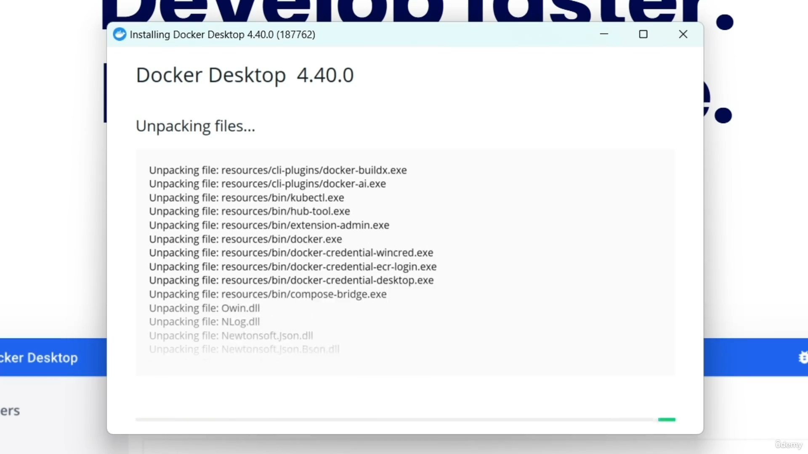
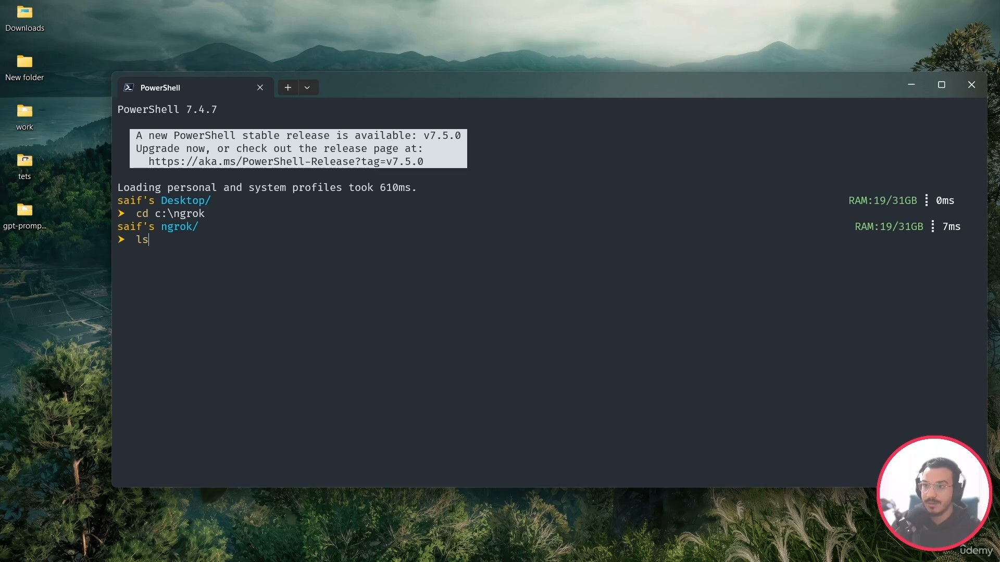
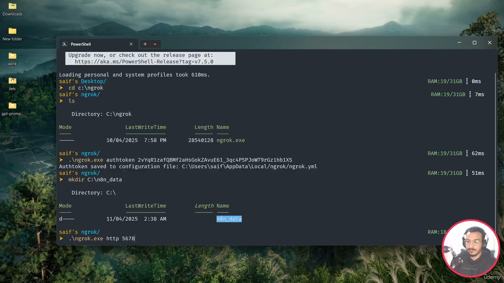
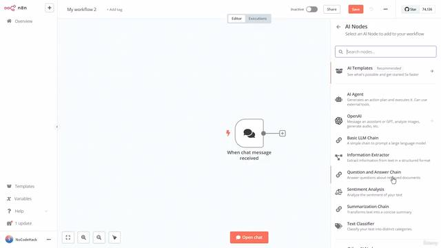
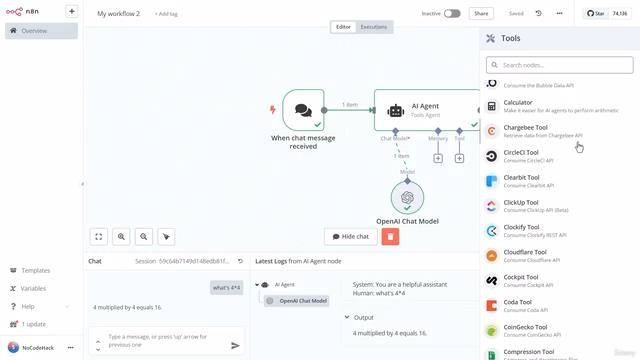
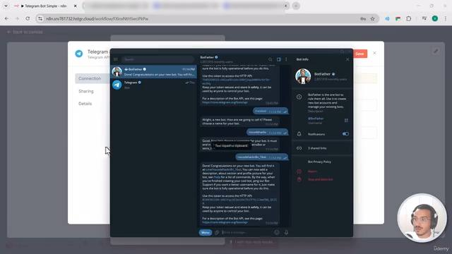
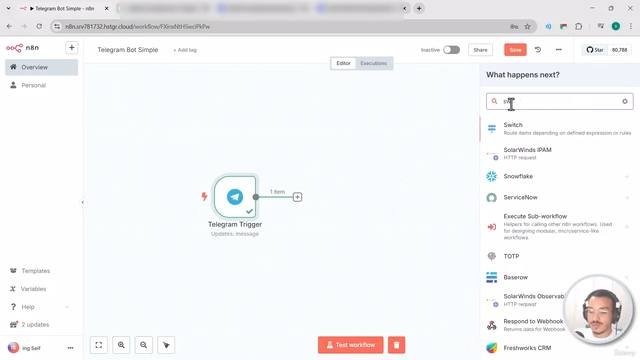
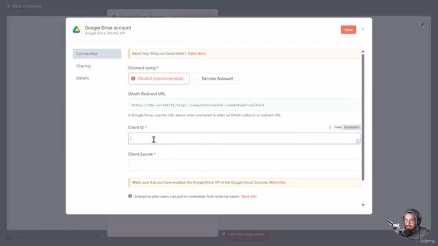
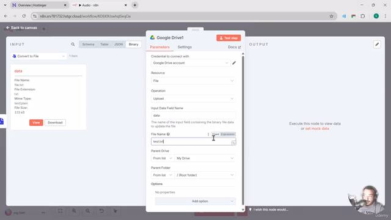
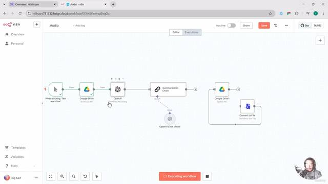

# n8n 本地部署与 AI 工作流实战（BV14nGw6DERu P1–P4）

> 说明：本文档按「照着做就能跑起来」的标准编写。逐字稿是英文语音自动转写，其中 `n8n` 被反复识别成 `NA10`、`N8N`、`ATAN`、`8n`、`n8n`，`ngrok` 被识别成 `Engroak`、`Engroc`、`Ngrok`。本文统一写成 **n8n** 和 **ngrok**，其余保留原意。

---

## 1. 这一节做什么

### 1.1 先纠正一个预期

课程标题写的是 **LLM Token Optimization（成本优化）**，但 P1–P4 的逐字稿里**没有出现** token 计数、prompt 压缩、上下文裁剪、缓存命中、按 token 计费对账这类内容。四集真正讲的是：

| 集数 | 实际内容 | 最终产物 |
|---|---|---|
| P1 | 在 Windows 上用 Docker 装 n8n，用 ngrok 打公网隧道 | 一个本机跑、外网能回调 webhook 的 n8n 实例 |
| P2 | n8n 画布、触发器、AI Agent、工具、记忆 | 一个会算数、会查 Wikipedia、能记住上一句的聊天机器人 |
| P3 | BotFather 建 Telegram 机器人 + Switch 分支 | 一个 7×24 在线的 Telegram 客服机器人 |
| P4 | Google Drive + OpenAI 转录/总结/翻译/语音合成 | 一条「丢进 mp3 → 自动出翻译语音」的全自动流水线 |

和「成本」沾边的只有一句讲师原话：选模型时用了 GPT-4o mini，理由是性价比（见第 2 节 p002 [05:42]）。除此之外，**课里没讲任何 token 优化手段**。本文档只写逐字稿里真实出现过的操作，课后要补的成本知识放在第 7 节。

### 1.2 最终你会得到什么

做完 P1–P4，你的机器上会有：

- `C:\ngrok\ngrok.exe`：隧道客户端
- `C:\n8n-data`：讲师让你建的「存 n8n 数据」的目录（注意：第 7 节会讲，光建目录不挂载是没用的）
- `http://localhost:5678`：n8n 的本地入口
- `https://xxxx.ngrok-free.app`：公网入口，每次重启会变
- 三个工作流：`AI Chat`、`telegram but simple`、`audio pipeline`

### 1.3 目录结构

```
C:\
├── ngrok\
│   ├── ngrok.exe
│   └── ...
└── n8n-data\            ← 讲师让你 mkdir 的目录
    └── (n8n 的用户数据，需要你自己挂载，见第 7 节)

Google Drive（云端）
├── (根目录)
│   ├── introduction-to-prompt-engineering.mp3   ← 演示素材
│   ├── test.txt / test.mp3 / test2.mp3          ← 流水线产物
└── audio\                ← 监听目录，新 mp3 丢这里触发
```

---

## 2. 讲师原话

下面按项目环节摘录，附时间戳。英文是逐字稿原文，方括号里是中文解释。

**关于为什么用 Docker 和 ngrok**

> "Docker lets us run application in containers which are like lightweight virtual machines." —— p001 [01:23]

> "Docker creates isolated environments called containers that package up all the dependencies needed to run an application. For an n8n, using Docker means we can get up and running quickly without complex installation steps." —— p001 [03:35]

> "Ngrok solves a different problem. When you run an n8n locally, external services can't reach your computer directly. Ngrok creates a secure tunnel from the internet to your local n8n installation and provides a public URL that external services can use to send webhooks." —— p001 [04:09]

**关于 docker run 每个参数**

> "dash IT makes the container interactive so we can see the output. Dash dash RM removes the container when it stops. Dash dash name n8n names the container n8n for easy reference. And dash P maps port 5678 from the container to your computer." —— p001 [05:39]

**关于 ngrok 换地址的坑**

> "each time you restart ngrok, you'll get a new URL. When that happens, you need to restart your n8n Docker container with a new URL in your environment variable. So you should change this webhook URL." —— p001 [06:06]

**关于注册邮箱**

> "Make sure to use your really mail address when signing up for n8n. This helps you get a proper API key that unlocks several premium features completely free in this local installation." —— p001 [06:35]

**关于模型选型（全场唯一和「成本」相关的话）**

> "We'll use GPT-4o mini for its great balance between speed, performance and cost." —— p002 [05:42]

**关于记忆为什么会话断掉**

> "Right now, your chatbot responds to messages independently. It doesn't remember what happened in earlier messages. Let's fix that by enabling memory in the AI agent." —— p002 [07:32]

> "It's already configured to remember the last five messages, which is OK for now." —— p002 [08:00]

**关于 Telegram token 的安全**

> "never share this token publicly. I'm only showing mine because I revoked it immediately after this demonstration. If someone gets your token they can receive messages meant for your bot, send messages as your bot and take complete control of your bot." —— p003 [02:21]

**关于自托管必须 HTTPS**

> "For self-hosted instance, make sure these URLs are using HTTPS as telegram requires secure connection." —— p003 [03:42]

**关于整条链路的执行顺序**

> "the telegram trigger captures the incoming message, the switch node evaluates the text and routes to the correct path, and the appropriate telegram send message node uses the original chat ID to reply to the same user." —— p003 [09:21]

**关于 OAuth 类型选择**

> "we have auth2 and service account. Keep it on auth2." —— p004 [00:28]

**关于总结链的分块策略**

> "The system takes large bodies of text, splits it into small parts, summarizes each piece, and then merges those into a final summary. It follows a method similar to MapReduce, very efficient for large scale text processing." —— p004 [09:23]

**关于自动触发条件**

> "I'm specifically selecting file created. This means that any time a new mp3 file is added to the audio folder, this node will fire and kick off the workflow." —— p004 [14:22]

> "anytime a new mp3 file is uploaded to the audio folder, the system will automatically transcribe it and save the transcribed version completely hands-free." —— p004 [16:21]

---

## 3. 从零复现

以下按 A→D 四段执行。每段结束都有一个「此时应该看到什么」，对不上就先别往下走。

### A 段：把 n8n 跑起来（P1）

**A1 前置条件**（讲师 p001 [00:56] 明确列出）

- Windows 10 或 11，有管理员权限
- 稳定网络
- 会开命令行（不会也没关系，命令下面都给了）

**A2 装 Docker Desktop**

浏览器打开 `docker.com`，点 Download Docker Desktop，选 Windows 版本，下载后运行安装包，一路 OK，如果提示重启就重启。重启后 Docker Desktop 一般会自启，没自启就到开始菜单里手动点开，点 Accept，可以注册/登录账号，也可以跳过。

**A3 验证 Docker**

开一个终端（cmd 或 PowerShell 都行），执行：

```bat
docker --version
```



能打印出 `Docker version xx.x.x` 就通过。报 `'docker' 不是内部或外部命令` 说明 Docker Desktop 没起来或者没加进 PATH，先检查托盘图标是不是绿的。

**A4 装 ngrok**

浏览器打开 `ngrok.com`，注册免费账号，进 Download 页下载 Windows 版 zip，解压到一个好找的位置。讲师选的是：

```
C:\ngrok\
```

解压完进那个目录看一眼，确认 `ngrok.exe` 在里面。

**A5 绑定 authtoken**

登录 ngrok 后台，首页能看到 `Your Authtoken`，复制。然后：

```bat
cd C:\ngrok
dir
ngrok.exe authtoken 你的TOKEN
```



**A6 建数据目录**

讲师原话是「create a directory to store n8n data, so it persists between container restarts」：

```bat
mkdir C:\n8n-data
```

> ⚠️ 这里有个大坑，见第 7 节 7.1。讲师建了目录，但 A8 那条 `docker run` 里**没有把目录挂载进容器**，所以数据其实没持久化。本文档先按讲师原样给命令，第 4 节再给修正版。

**A7 起隧道**

```bat
cd C:\ngrok
ngrok.exe http 5678
```



屏幕上会出现一个面板，找 `Forwarding` 那一行，形如 `https://xxxx-xx-xx-xx-xx.ngrok-free.app -> http://localhost:5678`。**复制 https 那一段**，下一步要用。**这个终端不要关。**

**A8 起 n8n 容器**

讲师说「Let's open a new command prompt」——另开一个终端窗口（A7 那个留着）：

```bat
docker run -it --rm --name n8n -p 5678:5678 -e WEBHOOK_URL=https://把A7复制的地址粘这里 n8nio/n8n
```

> 逐字稿里讲师没有念出镜像名，只说了「run n8n using docker with this command」。上面 `n8nio/n8n` 是 n8n 官方镜像名，逐字稿未提及，请以你拉取的镜像文档为准。容器名讲师念的是 `n8n`，端口是 `5678`。

**A9 打开并注册**

浏览器访问 A7 复制的那个 https 地址（不是 localhost），会看到 n8n 的注册表单，填邮箱、密码。讲师特别强调：**用真实邮箱**，能拿到免费的 API key，解锁一些本地版的高级功能（p001 [06:35]）。

**A10 验证**

浏览器再开 `http://localhost:5678`，能看到同一个工作台界面，A 段完成。

---

### B 段：第一个 AI Agent 聊天机器人（P2）

**B1 熟悉界面**：左侧 sidebar 有 Templates / Variables / Settings。点 Templates 能看到 1500+ 现成模板，可以按 Telegram 之类的关键词搜，也能一键导入。

**B2 新建工作流**：点顶部 `Create workflow`，得到一张空白画布。点右上角节点面板按钮，节点按 Triggers / Apps / Functions / AI 分类。

**B3 加触发器**：在 Triggers 分类里选 `On chat message`。讲师选它的理由：适合聊天机器人场景（p002 [02:53]）。

**B4 加 AI Agent**：点触发器右侧的 `+`，在面板里选 `Advanced AI` → `AI Agent`。这个节点会成为整个对话的核心（p002 [03:22]）。

**B5 配模型**：在 AI Agent 节点里点 `Chat Model` 的下拉，能看到 Anthropic、Deepseek、Google Gemini、Mistral、OpenAI 等一堆。选 `OpenAI`，点 `Create new credential`，把 OpenAI 的 API key 粘进去保存。



模型列表里选 **GPT-4o mini**。

**B6 第一次测试**：点 `Save`，再点 `Open chat`，输入 `what's 4 multiplied by 4`。链路是：chat trigger 收到消息 → 交给 AI Agent → Agent 调 GPT → 返回 `16`。

**B7 加工具**：回到画布，在 AI Agent 节点上点 `Tool` 按钮，会展开一大排内置集成（讲师列举：AOL、autopilot、AWS news、weather、web search API、自定义数据库等）。选 `Wikipedia`，保存。



再问 `who invented the phone`，这次执行路径会变成：trigger → Agent → Wikipedia → 模型 → 回答。这时候它就不是纯靠记忆答了。

**B8 加记忆**：点 AI Agent 上的 `Memory` 按钮，选最基础的 `Simple Memory`。讲师说它默认记住最近 5 条消息（p002 [08:00]）。保存、重启 chat。

**B9 验证记忆**：先问 `what is the capital of USA`，答 `Washington DC`；再问 `tell me a story`，它能知道 "it" 指的是 Washington。B 段完成。

---

### C 段：Telegram 机器人（P3）

**C1 建 bot**：打开 Telegram，搜索 `BotFather`。**认准蓝色认证标 + 官方头像 + 约 280 万月活**，讲师专门提醒有大量仿冒号在偷 token（p003 [00:28]）。

点 Start → 输入 `/newbot`（或点 New Bot 按钮）：

1. 输入 bot 名称：`testbot`
2. 输入 bot 用户名：必须**以 `bot` 结尾**。讲师试的 `testbot` 被占用，最后用了类似 `testbot9901_bot` 的名字
3. BotFather 立刻返回一串 token —— 这就是凭据

**C2 在 n8n 里存凭据**：随便开一个工作流，加一个 `Telegram` 节点（Send Message），顶部 Credential 下拉选 `Create new credential`，把 token 粘进 `Access Token`，保存。

**C3 建正式工作流**：`Create workflow`，命名 `telegram but simple`，加 `Telegram Trigger`，事件选 `On Message`。这个触发器会自动生成一个 HTTPS 的 webhook URL，Telegram 会在有人发消息时调它。



> 讲师原话：「If you're using the cloud version, these URLs are already set up for you. For self-hosted instance, make sure these URLs are using HTTPS as telegram requires secure connection.」——这就是 P1 非要 ngrok 不可的原因。

把 C2 的凭据挂到这个触发器上。

**C4 先看数据长什么样**：点 `Test step`，然后在 Telegram 里给 bot 发 `/start`，再发 `hello`。回到 n8n 看执行结果，会是一个 JSON。讲师指出三个关键字段（p003 [04:41]）：

- `chat.id` —— 会话唯一 ID，回消息必须用它
- `text` —— 消息正文
- `from` —— 发送者信息（名字、Telegram ID）
- `update_id` —— 这次更新事件的唯一 ID

**C5 加 Switch 分支**：加一个 `Switch` 节点，编辑路由规则，取值表达式指向 `text` 字段，三条规则都用 **equals**：

1. `hello`
2. `what time is it`
3. `what's your name`



讲师补充：真实场景可以用 `contains` 或者正则匹配同义句，这里为了演示保持精确匹配（p003 [06:31]）。

**C6 加三个回复节点**：每条分支接一个 `Telegram` → `Send Text Message`。配置方式：

- Chat ID：点 `Execute previous nodes`，从触发器输出里把 `chat.id` 拖进来
- Text：第一个填 `hello, nice to meet you`，第二个填 `it's currently 8 p.m.`，第三个填 `my name is n8n`

第二个节点讲师是直接复制第一个再改文案的（p003 [07:55]），三个节点的 Chat ID 配置完全一样。

**C7 去掉水印**：每个 Send Message 节点里 → `Add Field` → `Append n8n Attribution` → 关掉。三个节点都要做。

**C8 上线**：点 `Test workflow` 全链路测一遍，分别发 `hello` / `what time is it` / `what's your name`。都对之后，把右上角 `Active` 打开并确认。C 段完成，机器人 7×24 在线。

---

### D 段：Google Drive + OpenAI 音频流水线（P4）

这一段最长，分两次做：先做「手动触发」版本，再改成「自动触发」。

**D1 建 OAuth 凭据**：新建工作流，加 `Google Drive` 节点（随便一个），Credential 选 `Create new credential`，类型保持 `OAuth2`（讲师明确说不要选 Service Account）。页面上会出现一个 `OAuth Redirect URL`，**点一下复制，后面要用**。

**D2 在 Google Cloud 建项目**：打开 `console.cloud.google.com`，顶部项目选择器 → `New project` → 名字填 `n8n test` → Create。等几秒建好后点 `Select project`。

**D3 配 OAuth 同意屏幕**：左侧 `APIs & Services` → `Credentials` → `Create credentials` → `OAuth client ID`。它会先要求你配同意屏幕，点 `Configure consent screen` → `Get started`：

- App name：`n8n work`
- User support email：你的邮箱
- Audience：`External`（讲师说测试阶段选这个）
- 联系邮箱：你的邮箱
- 同意条款 → Continue
- 最后一步必须 `Add users`，把你的 Google 账号加进去并保存



**D4 创建客户端**：回到 Credentials → `Create client` → Application type 选 `Web application` → 滚到 `Authorized redirect URIs` → `Add URI` → **粘贴 D1 复制的那个地址** → Create。然后复制 `Client ID` 和 `Client secret`，回填到 n8n 的凭据表单，保存并 `Sign in with Google`。

**D5 启用 Drive API**：回 Google Cloud 控制台搜索 `Google Drive API`，点 `Enable`。**这步不做，后面下载文件会 403。**

**D6 准备素材**：把一个 mp3 传到 Google Drive 根目录（讲师用的是《introduction to prompt engineering》讲座录音）。右键 `Share` → 改成 `Anyone with the link` → 复制链接。**不改成公开，n8n 下载会失败。**

**D7 下载节点**：加 `Google Drive` 节点，Resource = `File`，Operation = `Download`，By 选 `URL`，粘贴 D6 的链接。点 `Test step`，能看到文件被下载下来。

**D8 转录节点**：加 `Advanced AI` → `OpenAI` → `Transcribe Recording`，Operation 保持 transcription（另外还有 generate / translate 两个选项）。输入直接引用上一步的文件数据。点测试。



讲师这里提到上传的是一个 **3MB** 的音频文件。执行完能看到完整转录文本。

**D9 文本转文件并回传**：加 `Convert to File` → `Convert to Text File`，格式 texт，跑一次；再加 `Google Drive` → `Upload File`，文件名 `test.txt`，输入引用上一步输出，测试。回 Drive 刷新，能看到这个 txt。

到这一步，「下载 → 转录 → 存回」的闭环已经通了。

**D10 加总结链**：在转录节点后面接一个 `Summarization Chain`。要点：

- 输入源：直接把上一步转录的文本传进去（讲师说这个节点也支持挂 file / document loader，能吃 PDF、txt 等）
- Chunking Strategy：保持 `Simple`（Advanced 可以自定义切分规则，讲师说这次不用）
- Characters Per Chunk：默认值不动
- Summarization 的 prompt：全部保持默认
- 模型：`OpenAI` → `GPT-4o mini`



讲师在这里解释了它的内部机制：把长文本切块 → 逐块总结 → 合并成最终摘要，类似 MapReduce（p004 [09:23]）。

**D11 加翻译链**：加 `Basic LLM Chain`，prompt 写 `Translate this text into French`（后面要切阿拉伯语就改成 `Translate this text to Arabic`）。输入引用总结结果。

**D12 加语音合成**：加 `Advanced AI` → `OpenAI` → `Generate Audio`，Text 输入引用翻译结果。

**D13 存回 Drive**：加 `Google Drive` → `Upload File`，文件名 `test.mp3`，**扩展名一定要改成 `.mp3`**（讲师专门改了这个），输入引用 TTS 的音频输出。测试 → 听一下，是法语的总结。然后把 D11 的 prompt 改成阿拉伯语，文件名改成 `test2.mp3`，再跑一遍，得到阿拉伯语版本。

**D14 改成自动触发**：先在 Google Drive 里建一个叫 `audio` 的文件夹，把 mp3 放进去。回 n8n：

1. 加 `Google Drive Trigger`，事件选 `Changes to a specific file`
2. Watch 范围选 `changes involving a specific folder`，文件夹选 `audio`
3. Event 选 `File Created`（讲师明确说了，其他选项还有 File Updated / Folder Created / Folder Updated）
4. 点 `Fetch Test Event`，会拿到一个包含文件元数据的 payload，里面有文件 ID
5. 把下面的 `Download` 节点的文件来源改成引用这个 ID，并确认关联的是自己的 Drive
6. 把最终输出的文件名改成 `new.mp3`
7. 点 `Activate`，然后重新往 `audio` 文件夹里丢一个 mp3

**D15 验证**：等大约 1 分钟（讲师原话「It should take about one minute to detect it」），去 Executions 看，整条链路会自动跑完，Drive 根目录出现 `new.mp3`。D 段完成。

---

## 4. 完整代码

> 本课程是图形化操作课，讲师全程没有展示过一行源码，所有工作流都是在画布上拖拽配置的。因此下面第 4.1–4.2 是把讲师口述的命令整理成**可直接保存执行的文件**；第 4.3 是节点配置表（等价于代码）；**4.4 的 JSON 是示意，逐字稿里没有导出过任何 workflow JSON**。

### 4.1 目录与文件清单

```
C:\ngrok\ngrok.exe          ← ngrok 官网下载解压
C:\n8n-data\                ← mkdir 出来的
C:\n8n\start-n8n.ps1        ← 本文档整理，课里没有这个脚本
C:\n8n\stop-n8n.ps1         ← 本文档整理，课里没有这个脚本
```

### 4.2 启动 / 停止脚本（完整文件）

**`C:\n8n\start-n8n.ps1`**

```powershell
# start-n8n.ps1
# 作用：一条命令完成 P1 的 A5~A8
# 注意：课里没有这个脚本，这是把讲师口述的命令整理成的可执行版本
# 用法：右键 -> 使用 PowerShell 运行；或在 PowerShell 里执行 .\start-n8n.ps1

$ErrorActionPreference = "Stop"

$NgrokDir    = "C:\ngrok"
$NgrokExe    = Join-Path $NgrokDir "ngrok.exe"
$DataDir     = "C:\n8n-data"
$ContainerNm = "n8n"
$LocalPort   = 5678
$Image       = "n8nio/n8n"

# 1) 前置检查
if (-not (Test-Path $NgrokExe)) { throw "找不到 $NgrokExe，请先把 ngrok 解压到 C:\ngrok" }
if (-not (Get-Command docker -ErrorAction SilentlyContinue)) { throw "docker 命令不可用，请先启动 Docker Desktop" }
if (-not (Test-Path $DataDir)) { New-Item -ItemType Directory -Path $DataDir | Out-Null }

# 2) 清掉同名旧容器（避免 --name 冲突）
$existing = docker ps -a --filter "name=^/$ContainerNm$" --format "{{.ID}}"
if ($existing) { docker rm -f $ContainerNm | Out-Null }

# 3) 起 ngrok，抓公网地址
Write-Host "正在启动 ngrok..." -ForegroundColor Cyan
$ngrokProc = Start-Process -FilePath $NgrokExe `
    -ArgumentList "http", "$LocalPort", "--log=stdout" `
    -RedirectStandardOutput "$env:TEMP\ngrok.log" `
    -PassThru -WindowStyle Hidden

$PublicUrl = $null
for ($i = 0; $i -lt 30; $i++) {
    Start-Sleep -Seconds 1
    if (Test-Path "$env:TEMP\ngrok.log") {
        $line = Select-String -Path "$env:TEMP\ngrok.log" -Pattern 'url=https://[^\s"]+' | Select-Object -Last 1
        if ($line) {
            $PublicUrl = [regex]::Match($line.Line, 'https://[^\s"]+').Value
            break
        }
    }
}
if (-not $PublicUrl) { throw "没能从 ngrok 日志里解析出公网地址，请手动执行 ngrok http 5678 看一眼" }
Write-Host "公网地址: $PublicUrl" -ForegroundColor Green

# 4) 起 n8n，把数据目录挂载进去（这一步课里没做，见第 7 节 7.1）
docker run -d `
    --name $ContainerNm `
    --restart unless-stopped `
    -p "${LocalPort}:5678" `
    -e WEBHOOK_URL=$PublicUrl `
    -e N8N_HOST=localhost `
    -e N8N_PORT=5678 `
    -e N8N_PROTOCOL=http `
    -v "${DataDir}:/home/node/.n8n" `
    $Image

Start-Sleep -Seconds 10
Write-Host ""
Write-Host "本地入口 : http://localhost:$LocalPort" -ForegroundColor Yellow
Write-Host "公网入口 : $PublicUrl"         -ForegroundColor Yellow
Write-Host "停止     : .\stop-n8n.ps1"      -ForegroundColor Yellow
```

**`C:\n8n\stop-n8n.ps1`**

```powershell
# stop-n8n.ps1
# 作用：停掉容器和 ngrok，清理干净
# 注意：课里没有这个脚本

$ContainerNm = "n8n"

docker rm -f $ContainerNm 2>$null | Out-Null
Get-Process ngrok -ErrorAction SilentlyContinue | Stop-Process -Force

Write-Host "已停止 n8n 容器与 ngrok 进程。" -ForegroundColor Green
```

**如果不写脚本，等价的手工命令**（就是讲师 P1 里念的那几条）：

```bat
:: 终端 1
cd C:\ngrok
ngrok.exe authtoken 你的TOKEN
ngrok.exe http 5678
:: 复制 Forwarding 后面的 https 地址

:: 终端 2
mkdir C:\n8n-data
docker run -it --rm --name n8n -p 5678:5678 ^
  -e WEBHOOK_URL=https://把上一步的地址粘这里 ^
  n8nio/n8n
```

### 4.3 环境变量清单

| 变量名 | 值 | 来源 | 说明 |
|---|---|---|---|
| `WEBHOOK_URL` | `https://xxx.ngrok-free.app` | 讲师 p001 [06:06] 讲到「change this webhook URL」，但**没有念出变量名** | n8n 用它拼对外回调地址；ngrok 一重启就变，必须跟着改 |
| `N8N_HOST` / `N8N_PORT` / `N8N_PROTOCOL` | 见脚本 | 课里没讲 | 本文档补充，本地访问用 |
| `N8N_ENCRYPTION_KEY` | 一串随机字符 | 课里没讲 | 存凭据用，不设的话容器重建后凭据解不开 |

所有 n8n 相关变量名，逐字稿中都未出现，请以你拉取的镜像文档为准。

### 4.4 节点配置表（等价于代码）

**工作流 1：AI Chat（P2）**

| # | 节点类型 | 关键配置 |
|---|---|---|
| 1 | On chat message（Trigger） | 无 |
| 2 | Advanced AI → AI Agent | Chat Model = OpenAI / `GPT-4o mini`；Tool = Wikipedia；Memory = Simple Memory（5 条） |

**工作流 2：telegram but simple（P3）**

| # | 节点类型 | 关键配置 |
|---|---|---|
| 1 | Telegram Trigger | Event = `On Message`；Credential = BotFather 给的 token |
| 2 | Switch | 取值 = `text`；规则 1 `equals hello` / 规则 2 `equals what time is it` / 规则 3 `equals what's your name` |
| 3 | Telegram → Send Text Message（分支 1） | Chat ID = 触发器输出 `message.chat.id`；Text = `hello, nice to meet you`；Append n8n Attribution = 关闭 |
| 4 | Telegram → Send Text Message（分支 2） | 同上；Text = `it's currently 8 p.m.` |
| 5 | Telegram → Send Text Message（分支 3） | 同上；Text = `my name is n8n` |

Chat ID 的表达式形态是 `{{ $('Telegram Trigger').item.json.message.chat.id }}`。讲师没有念出表达式原文，他只口述了查找路径：「Go back to the node named telegram trigger, look at its output data in the form of JSON, find the message object, then the chat object within it, and finally get the ID field」（p003 [07:29]）。实际以拖拽生成的结果为准。

**工作流 3：audio pipeline（P4）**

| 阶段 | 节点 | 关键配置 |
|---|---|---|
| 手动版 | Google Drive → Download File | Resource=File，Operation=Download，By=URL，URL=共享链接 |
| | Advanced AI → OpenAI → Transcribe Recording | 输入=上一步文件；文件 3MB mp3 |
| | Convert to File → Convert to Text File | 输出格式 = text |
| | Google Drive → Upload File | 文件名 `test.txt` |
| | Summarization Chain | 输入=转录文本；Chunking=Simple；模型 `GPT-4o mini`；prompt 全默认 |
| | Basic LLM Chain | prompt = `Translate this text into French`（后改 Arabic） |
| | Advanced AI → OpenAI → Generate Audio | Text = 翻译结果 |
| | Google Drive → Upload File | 文件名 `test.mp3` / `test2.mp3`，扩展名 **.mp3** |
| 自动版 | Google Drive Trigger | Event = `Changes to a specific file`；范围 = `changes involving a specific folder` → `audio`；动作 = `File Created` |
| | Google Drive → Download File | 文件 ID 引用触发器 payload |
| | …后续同手动版 | 输出文件名改 `new.mp3` |

### 4.5 凭据清单

| 凭据 | 从哪里拿 | 存在哪 |
|---|---|---|
| Docker | 不需要 | — |
| ngrok authtoken | ngrok 后台首页 | `C:\Users\<你>\.ngrok2\ngrok.yml`（自动写入） |
| OpenAI API Key | platform.openai.com | n8n Credentials |
| Telegram Bot Token | BotFather 生成 | n8n Credentials |
| Google OAuth Client ID / Secret | Google Cloud Console | n8n Credentials |

### 4.6 示意 JSON（课里没有，仅示意）

> **课里没有代码，以下为示意。** 讲师全程没有导出过 workflow，这个片段只是让你理解 n8n 的 workflow 文件大致长什么样，字段名以你实际导出的为准，**不要直接导入**。

```json
{
  "name": "telegram but simple",
  "nodes": [
    { "name": "Telegram Trigger", "type": "n8n-nodes-base.telegramTrigger",
      "parameters": { "updates": ["message"] } },
    { "name": "Switch", "type": "n8n-nodes-base.switch",
      "parameters": { "rules": [ { "value": "={{ $json.message.text }}", "operation": "equals", "value2": "hello" } ] } },
    { "name": "Send hello", "type": "n8n-nodes-base.telegram",
      "parameters": { "chatId": "={{ $('Telegram Trigger').item.json.message.chat.id }}",
                      "text": "hello, nice to meet you" } }
  ],
  "connections": {}
}
```

---

## 5. 逐行解释

### 5.1 `docker run` 那几个参数为什么这么写

讲师在 p001 [05:39] 自己解释了一遍，逐条对应：

- `-it`：让容器「交互式」，你在终端里能看到它的日志输出。不写的话容器在后台跑，出错了你什么都看不见。**在 Node 里类比：相当于 `node app.js` 直接前台跑 vs `pm2 start` 后台跑。**
- `--rm`：容器停止时自动删除。好处是不会有垃圾容器堆积；坏处是**里面的数据一起没了**——这正是第 7 节要讲的坑。
- `--name n8n`：给容器起名，之后 `docker stop n8n` / `docker logs n8n` 都能直接用名字，不用查 ID。
- `-p 5678:5678`：把容器的 5678 端口映射到宿主机的 5678。**左边是宿主机，右边是容器。** 这一步不做，你浏览器访问 `localhost:5678` 永远是拒绝连接。
- `-e WEBHOOK_URL=...`：注入环境变量。n8n 拿它来拼「别人该怎么回调我」的地址。

为什么 `WEBHOOK_URL` 必须填 ngrok 的 https 地址而不是 `localhost:5678`？因为 n8n 是要**告诉外部服务（Telegram、GitHub、Stripe）往哪儿发请求**。你写 `localhost`，Telegram 那边解析出来是它自己机器上的 localhost，请求永远到不了你电脑。ngrok 那个 https 地址才是全网可达的入口。

也正因为如此，**ngrok 一重启换了域名，容器里的 `WEBHOOK_URL` 就过期了**，必须重建容器。这是讲师反复强调的点（p001 [06:06]），也是最容易忽略的一步。

### 5.2 `ngrok.exe http 5678` 干了什么

它在你电脑和 ngrok 的边缘节点之间建一条长连接，把 `https://xxx.ngrok-free.app` 的流量转发到 `http://localhost:5678`。

**在前端视角可以这么理解：** 你本地 `npm run dev` 跑在 `localhost:3000`，同事想看效果但访问不到。ngrok 相当于给你发了一个公网 URL，谁点这个 URL 都等同于点了你本机的 `localhost:3000`。区别是它同时支持 HTTPS，这对 Telegram 这种强制要求加密回调的平台是刚需（p003 [03:42]）。

### 5.3 Switch 节点为什么要用 `chat.id`

Telegram 的 webhook 是**无状态**的——每条消息进来都是一个全新的 HTTP 请求，n8n 不知道这条消息是谁发的。`chat.id` 就是那个「回信地址」。三个回复节点都要拿它，才能保证「谁问的，答给谁」。

如果写错（比如手填一个 ID），结果就是所有人都收到同一个人的回复，或者干脆发不出去。讲师的原话是让 n8n「go back to the node named telegram trigger, look at its output data ... find the message object, then the chat object within it, and finally get the ID field」——这个查找路径就是 `message.chat.id`。

**JS 类比：** 就像后端从 `req.body.message.chat.id` 里取字段，只不过 n8n 用可视化的方式把这个取值过程拖出来了。

### 5.4 Memory 为什么默认是 5 条

讲师说得很直白：`It's already configured to remember the last five messages, which is OK for now`（p002 [08:00]）。

为什么会有这个默认值？因为对话历史是**整段塞回给模型**的。记住 5 条 = 每轮请求都带上最近 5 轮的原文。记住 50 条 = 每轮带上 50 轮原文。上下文越长：

1. 单次请求越贵（按输入 token 计费）
2. 越容易超出模型上下文窗口
3. 关键的早期信息会被稀释

所以 5 条是个折中。**这是全课程唯一一个真正意义上的「成本相关」设计点**，虽然讲师没有展开讲 token 计费。前端类比：就是你把 `messages` 数组 `slice(-5)` 之后再发给接口。

### 5.5 OAuth 的 Redirect URI 为什么必须一模一样

D1 从 n8n 复制的那个地址，和 D4 在 Google Cloud 填的那个地址，**必须逐字符相同**（包括末尾有没有斜杠、http 还是 https）。Google 在回调的时候会拿它做严格比对，差一个字符就报 `redirect_uri_mismatch`。

这个机制的作用是防止别人把你的 Client ID 拿去用——攻击者就算拿到了你的 Client ID，只要他没法控制那个预先登记好的回调地址，就拿不到授权码。

**JS 类比：** 相当于 CORS 的 `Access-Control-Allow-Origin`，白名单得精确匹配，不能写 `*`。

### 5.6 为什么总结链要做「分块」

p004 [09:23] 讲师说它「takes large bodies of text, splits them into small parts, summarizes each piece, and then merges those into a final summary, follows a method similar to MapReduce」。

原因很简单：一段 1 小时的讲座转录稿可能有上万字，直接丢给模型会超上下文。所以拆成若干 chunk（`Characters Per Chunk` 控制每块多大），每块单独总结出一小段，再把这一小段一小段合并成最终摘要。

**代价是：** chunk 越多，API 调用次数越多，成本和耗时都线性增长。这也是为什么讲师把 Chunking Strategy 留在 `Simple`——Advanced 模式下你可以自定义切分规则，切得更细更准，但调用次数也更多。

### 5.7 为什么最后一步要「改扩展名」

D13 里讲师专门把上传文件名从默认值改成 `test.mp3`。因为 `Generate Audio` 节点输出的是一段二进制音频流，n8n 默认给的文件名可能是 `audio` 或带别的后缀，存到 Drive 里就打不开了。改扩展名本质上是告诉操作系统「这段二进制该怎么解析」。

### 5.8 为什么触发条件选 `File Created` 而不是 `File Updated`

`File Updated` 在文件被重命名、移动、内容变化时都会触发，很容易造成**重复执行**——工作流自己往这个文件夹写文件，就会把自己再触发一次，形成死循环。

`File Created` 只在新建文件时触发，语义更窄更安全。讲师的场景是「用户往 `audio` 文件夹丢一个新 mp3」，所以 `File Created` 正好。

**JS 类比：** 相当于用 `fs.watch` 时只监听 `rename` 事件里的新建，而不是所有 `change` 事件。

---

## 6. 复现检查清单

### A 段（P1）

- [ ] `docker --version` 有输出
- [ ] Docker Desktop 托盘图标是绿的
- [ ] `C:\ngrok\ngrok.exe` 存在
- [ ] `ngrok.exe authtoken <TOKEN>` 执行成功，`C:\Users\<你>\.ngrok2\ngrok.yml` 里有 token
- [ ] `ngrok.exe http 5678` 的 Forwarding 行里有 `https://...ngrok-free.app`
- [ ] `C:\n8n-data` 目录存在
- [ ] `docker ps` 能看到名为 `n8n` 的容器在跑
- [ ] 浏览器打开 ngrok 的 https 地址，能看到 n8n 注册页
- [ ] 用真实邮箱注册成功
- [ ] `http://localhost:5678` 也能打开

### B 段（P2）

- [ ] 工作流里有 `On chat message` 触发器
- [ ] AI Agent 的 Chat Model 已选 `GPT-4o mini`，凭据测试通过
- [ ] `what's 4 multiplied by 4` 返回 `16`
- [ ] 添加 Wikipedia 工具后，`who invented the phone` 的回答里包含工具调用记录
- [ ] Simple Memory 已挂上
- [ ] 问完首都再问 `tell me a story`，回答能正确指代 Washington

### C 段（P3）

- [ ] BotFather 是带蓝标的官方号
- [ ] bot 用户名以 `bot` 结尾
- [ ] n8n 里 Telegram 凭据保存成功
- [ ] `Test step` 后 Telegram 发的消息能在 n8n 里看到 JSON
- [ ] JSON 里能定位到 `message.chat.id`、`message.text`
- [ ] Switch 三条 equals 规则都配了
- [ ] 三个 Send Message 的 Chat ID 都是拖拽进来的，不是手填
- [ ] 三个节点的 `Append n8n Attribution` 都关掉了（发出的消息底部没有 n8n 字样）
- [ ] 三条消息分别测试，回复都正确
- [ ] 右上角 `Active` 已打开
- [ ] 关掉 n8n 页面，从 Telegram 发消息仍能收到回复

### D 段（P4）

- [ ] Google Cloud 项目 `n8n test` 已创建并选中
- [ ] OAuth 同意屏幕已配，Audience = External，测试用户已添加
- [ ] OAuth 客户端类型 = Web application
- [ ]
- [ ] 已从 n8n 复制 `OAuth Redirect URL` 并保存
- [ ] Google Cloud 里 `Authorized redirect URIs` 填的就是那个地址，逐字符一致
- [ ] `Google Drive API` 已点 Enable
- [ ] 凭据表单填了 Client ID + Client secret，`Sign in with Google` 成功
- [ ] 演示用 mp3 已设为「Anyone with the link」
- [ ] `Download File` 节点测试能下载到文件
- [ ] `Transcribe Recording` 测试能出完整转录文本
- [ ] `Convert to Text File` + `Upload File` 后，Drive 里出现 `test.txt`
- [ ] `Summarization Chain` 输入接的是转录文本，模型是 `GPT-4o mini`
- [ ] `Basic LLM Chain` prompt 是 `Translate this text into French`
- [ ] `Generate Audio` 的 Text 输入接的是翻译结果
- [ ] 最终 `Upload File` 文件名以 `.mp3` 结尾，Drive 里能播放，内容是法语
- [ ] 改成阿拉伯语后能出 `test2.mp3`，播放是阿拉伯语
- [ ] `audio` 文件夹已建，mp3 已放进去
- [ ] `Google Drive Trigger` 的 Event = `File Created`，范围指向 `audio` 文件夹
- [ ] `Fetch Test Event` 能拿到带文件 ID 的 payload
- [ ] 下面的 `Download File` 已改成引用那个 ID
- [ ] 工作流已 `Activate`
- [ ] 重新往 `audio` 丢一个 mp3，约 1 分钟后 Executions 里出现一次成功执行
- [ ] Drive 根目录出现 `new.mp3`

---

## 7. 课里没讲但你会撞上的

这一节全部是逐字稿里**没有出现**的内容，是我按「照上面做一定会碰到」的顺序排的。凡是我拿不准具体数值的地方，都写成「以官方文档为准」，不给你编数字。

### 7.1 讲师建了 `C:\n8n-data`，但根本没挂载进去（最严重）

回看 P1 的两条命令：

```bat
mkdir C:\n8n-data
docker run -it --rm --name n8n -p 5678:5678 -e WEBHOOK_URL=https://xxx n8nio/n8n
```

第二条里**没有 `-v`**。也就是说 `C:\n8n-data` 这个目录建了白建，n8n 的数据（用户账号、所有凭据、所有工作流）全写在容器内部。而 `--rm` 又规定容器一停就删。

后果链条是这样的：

1. 你按讲师做法注册了账号、配好了 OpenAI key、Telegram token、Google OAuth、三个工作流
2. ngrok 重启，域名变了，你必须重启容器换 `WEBHOOK_URL`
3. 容器一停 → `--rm` 触发 → 容器连同里面所有数据一起被删
4. 新容器起来，打开 `http://localhost:5678` → **回到注册页，所有工作流和凭据清零**

讲师在 p001 [04:43] 说这个目录是为了「persists between container restarts」，但他给的命令没实现这件事。第 4.2 节的 `start-n8n.ps1` 已经补了 `-v "${DataDir}:/home/node/.n8n"`，建议直接用脚本，别手敲讲师那条命令。

顺带一提，`-it` 和 `--rm` 还有个连带问题：`-it` 让容器绑在你的终端上，你把那个 cmd 窗口关了，容器就停，数据就删。讲师演示时窗口一直开着所以没露馅。

### 7.2 ngrok 免费版每次重启都换域名，Telegram 会静默失联

这条讲师讲了（p001 [06:06]），但没讲「失联之后是什么现象」，很容易误判。

现象是：n8n 里工作流还是 Active 状态，Telegram 里发消息 bot 完全没反应，n8n 的 Executions 列表一条新记录都没有。原因是从 Telegram 服务端看，它还在往**旧域名**发 POST，而那个域名早就失效了。

排查顺序：

1. 看 ngrok 终端里有没有新的请求打进来 —— 没有，说明问题在外网这一侧
2. 对比当前 ngrok 的域名和容器里的 `WEBHOOK_URL` —— `docker inspect n8n` 能看到环境变量，如果对不上就是这个问题
3. 改 `WEBHOOK_URL` 重建容器
4. **重建之后，Telegram Trigger 节点要重新点一次 `Test step` 或重新激活工作流**，让它把新的 webhook 地址注册给 Telegram。只改环境变量不重新注册，还是不通

想彻底躲开这个循环有两条路，都是课里没提的：一是 ngrok 付费版可以固定域名，二是不用 ngrok，把 n8n 部署到有公网 IP 的服务器上直接暴露。

### 7.3 ngrok 免费版的浏览器中间页

用免费版 ngrok 时，从浏览器首次访问那个 https 地址，可能会先看到一个提示页，要你点一下才能继续。这个页面在 Telegram 的 webhook 请求上不会造成问题（服务端请求不带浏览器行为），但你自己调试时会被它挡一下，别以为是 n8n 挂了。

课里没讲这个，所以你在自己机器上看到时不用慌。

### 7.4 `redirect_uri_mismatch`

P4 最容易卡死的地方。错一个字符就是这样。

三个高频出错点：

- n8n 给的是一个带端口的地址，你在 Google Cloud 里手动改成了不带端口的版本
- 复制时末尾多带了空格或换行
- 你重建过容器、换过 ngrok 域名，n8n 的 redirect URL 跟着变了，但 Google Cloud 里还是旧的

处理办法只有一条：**从 n8n 那边重新复制一次，整段覆盖 Google Cloud 里的旧值**，不要手动改任何字符。

### 7.5 忘了 Enable Google Drive API

D5 那一步（搜索 `Google Drive API` → `Enable`）在讲师的流程里只占几秒，但漏掉的后果是：OAuth 授权能过，凭据显示成功，一到 `Download File` 执行就报错。

症状是节点红框 + 错误信息里提到 API 未启用或没有权限。回 Google Cloud 补上 Enable，等一两分钟生效，再重跑。

### 7.6 文件没设成「Anyone with the link」

D6 那步如果只复制了链接没改共享设置，`Download File` 一样会失败——n8n 拿的是一个匿名 URL，Google 会要求登录。

讲师的处理是 `Share` → `Anyone with the link`，注意新版 Drive 的文案可能叫 `Anyone with the link` 或 `Anyone`，选完记得点 `Done`/`Copy link` 再复制。

另外，P4 后半段走的是「用文件 ID 下载」而不是 URL，那条路径不受这个限制（因为走的是你自己的 OAuth 身份），所以你可能会遇到「自动版能跑、手动版跑不了」这种迷惑现象，根因就在这里。

### 7.7 Telegram 两个硬性规则

**用户名必须 `bot` 结尾。** 讲师 p003 [01:27] 现场演示了 `testbot` 被占用、`testbot9901` 不合法、最后加 `_bot` 才过。这不是命名习惯，是 Telegram 的硬校验，写错会一直提示你重输。

**token 泄露等于 bot 被别人接管。** 讲师的原话是「If someone gets your token they can receive messages meant for your bot, send messages as your bot and take complete control of your bot」（p003 [02:21]），并且他说自己演示完立刻 revoke 了。所以：

- 不要把 token 贴进 GitHub、贴进聊天记录、截进教程图
- 万一泄露，去 BotFather 用 `/revoke` 换一个新的，然后回 n8n 更新凭据
- 换 token 之后，所有引用这个凭据的节点都会自动沿用新值，不用逐个改

### 7.8 Google Drive Trigger 是轮询，别指望秒级

讲师说「It should take about one minute to detect it」（p004 [15:22]）。也就是说这个触发器不是实时推送，是 n8n 定期去问 Drive「有变化吗」。

所以：

- 你丢完文件别立刻断言失败，等够时间
- 同一分钟里丢多个文件，可能被合并成一次事件，也可能分多次，行为不完全可预测
- 手工测试时，`Fetch Test Event` 拿到的是历史事件，不代表实时链路通了；真正的验证方式是 `Activate` 之后真丢一个文件

### 7.9 OpenAI 音频接口有大小上限

讲师演示用的是 3MB 的文件（p004 [04:48] 提到），这个量级没问题。但如果你自己丢进去的是一小时的高码率录音，很可能超过接口上限而报错。

具体上限数字课里没讲，**请以 OpenAI 官方文档为准**，不要拿本文档当依据。工程上的稳妥做法是：上传前先压缩码率，或者长音频先切段再逐段转录。

### 7.10 时间那个回答是硬编码的

p003 [07:55] 讲师自己说了：「in production bot you would use date and time node or a function node to get the actual current time. But for this demonstration, we'll keep it simple with a static response.」

所以你的 bot 回答 `it's currently 8 p.m.` 是固定的，几点问都是这句。这不是 bug。

要改成真的，在 Switch 的第二条分支后面插一个 `Date & Time` 节点取当前时间，或者用 `Code` 节点写几行 JS（n8n 的 Code 节点就是跑 Node.js，对你来说是主场）：

```javascript
// n8n Code 节点示意，课里没有这段
// 返回当前时间字符串，供后面的 Telegram 节点引用
const now = new Date();
return [{ json: { timeText: now.toLocaleTimeString('zh-CN', { hour: '2-digit', minute: '2-digit' }) } }];
```

然后在 Send Message 的 Text 里引用 `{{ $json.timeText }}`。

### 7.11 Switch 用的是精确匹配，用户打字带标点就匹配不上

`equals hello` 意味着用户发 `Hello`、`hello!`、`hello `（带空格）全都不命中，会走到 Switch 的 fallback 分支（你没配的话就是工作流直接结束，用户得不到任何回复）。

讲师 p003 [06:31] 提了一句可以用 `contains` 或正则，但没展开。实操上建议至少改成：

- 注意 n8n Switch 里的表达式求值时，大小写敏感与否取决于你选的 operation
- 想宽松匹配就用 `contains`，或者先把输入 `toLowerCase()` 再比

**这里没有锁、没有事务、没有并发问题**，但有一个相近的坑：如果用户连发两条消息，n8n 会并发跑两次执行，两个执行各自拿自己的 `chat.id`，互不干扰。真正会打架的是「同一个会话的有状态记忆」——Simple Memory 在并发下可能读到旧快照。课里没涉及这个场景，量小的时候可以不管。

### 7.12 端口 5678 被占

如果你之前跑过别的东西占了 5678，`docker run` 会报端口冲突。查占用：

```bat
netstat -ano | findstr :5678
```

要么杀掉占用进程，要么把命令里的 `-p 5678:5678` 改成 `-p 5679:5678`，然后浏览器访问 `localhost:5679`。注意改完端口，`WEBHOOK_URL` 里的域名不用动（ngrok 转发的是它自己配置的那个本地端口，你在 A7 起 ngrok 时也要跟着改成 `ngrok.exe http 5679`）。

### 7.13 关于「成本优化」这件事，课里真的没讲

课程标题叫 LLM Token Optimization，但 P1–P4 四集的逐字稿里能沾上边的只有两处：

1. p002 [05:42] 选 `GPT-4o mini` 是因为「great balance between speed, performance and cost」
2. p002 [08:00] Simple Memory 默认记 5 条

除此之外，**没有任何 token 计数、上下文裁剪、prompt 压缩、批量合并、缓存复用的内容**。如果你是为了学成本优化来的，这四集给不了你。

基于这套已经跑起来的环境，你自己可以往下做的方向（这些是我根据项目结构提的，不是讲师讲的）：

- **换小模型做分流**：Switch 里能精确匹配的请求（`hello` 这种）根本不需要过模型，直接回固定文案。课里的 Telegram 工作流其实已经天然做到了这点，AI Agent 只在真的需要时才调用
- **给 Memory 设上限**：5 条是默认值，你可以按业务调到 3 条或 10 条，同一个 bot 的每轮成本会跟着变
- **减少转录的重复上传**：P4 里同一个文件如果反复触发会反复调 OpenAI 转录接口，加一层「文件 ID 已处理过就跳过」的判断能省不少
- **总结链的 chunk 大小**：`Characters Per Chunk` 调大 → chunk 数变少 → 调用次数少 → 便宜，但摘要质量可能下降；反过来则反之。这个权衡讲师没讲，但你调这个参数时能直接感受到

### 7.14 讲师没交代的一处细节：`--rm` 和 `--restart` 不能共存

第 4.2 节我的脚本里用了 `--restart unless-stopped`，同时**去掉了** `--rm`。原因是 Docker 不允许这两个同时用——`--restart` 要求容器停了之后还在，`--rm` 要求容器停了就删，语义矛盾，Docker 会直接拒绝启动并报错。

讲师用的是 `--rm`，所以他的容器**没有**自动重启能力：机器重启、Docker Desktop 重启、终端关掉，容器都不会自己起来，每次都要手敲一遍 `docker run`。这也是为什么他每次改完 `WEBHOOK_URL` 都是「重新跑一次命令」而不是「重启容器」。

你用脚本的话，机器重启后跑一次 `start-n8n.ps1` 就行，脚本会自动清旧容器、起 ngrok、抓新域名、再起新容器。

### 7.15 三轮配置的全部凭据，备份一下

按讲师的 `--rm` 跑法，你大概会在第三次「容器没了」之后开始后悔没备份。数据落在 `C:\n8n-data` 之后（7.1 修正过之后），这个目录里就是全部状态。

稳妥做法：

```bat
:: 关掉容器后，把数据目录打个包，存到别处
docker rm -f n8n
xcopy C:\n8n-data D:\backup\n8n-data-%date:~0,4%%date:~5,2%%date:~8,2%\ /E /I /H /Y
```

同一天里至少要备份一次，尤其是你刚配完 Google OAuth 之后——那套流程走一遍要十几分钟，重来一次很痛苦。

---

**结尾提示**：本文档 P1–P4 的全部操作路径都来自逐字稿，凡逐字稿未覆盖的地方（`n8nio/n8n` 镜像名、`N8N_*` 环境变量、卷挂载、API 限额、ngrok 中间页、成本优化手段）都在第 4 章和第 7 章明确标注了「课里没讲 / 本文档补充」。跑之前建议先按第 6 章 A 段走一遍检查清单，确认 Docker、ngrok、容器三件套都通了再进 B 段，否则后面 AI 节点报的错你分不清是模型问题还是隧道问题。