# LLM Token Optimization（BV14nGw6DERu）P5–P6 复现文档

> **先读这一句**：这门课标题叫 “LLM Token Optimization（成本优化）”，但 P5、P6 两集**实际交付的是两条可运行的自动化流水线**——一条是 n8n 上的「新闻 → AI 改写 → AI 配图 → 发布 WordPress」定时工作流，另一条是把 Hermes agent 部署到 VPS 上，用 Telegram 远程指挥它写稿、并让它把自己的做事规则写成磁盘上的技能文件。真正讲「价格怎么算」的只有 p006 [05:15] 一句「这些价格是按百万 token 计价的，不是按条消息……我们会在后面某一集做正经的成本计算」。所以本文按**能做出来**来组织，不按标题来组织。

---

## 1. 这一节做什么

这一节要产出两个可以跑起来的东西，互相独立，可以只做其中一个。

**工件 A：n8n 定时博客流水线。** 每天上午 9 点自动触发，向 newsdata.io 拉一条科技类英文新闻，交给 GPT-4o 改写成「完全原创、正好五段、每段包在 `<p>` 标签里」的博客正文，再让 DALL·E 3 依据标题和正文前 200 字生成配图，把图缩放到 1340×638，上传进 WordPress 媒体库拿到 media ID，最后用 media ID 作为 `featured_media` 发一篇正式发布的 WordPress 文章。整条链路共 9 个节点，中间用一个 Code 节点处理「模型返回的不是干净 JSON」这个坑（讲师在 p005 [07:02] 原话是「we have a problem」）。

**工件 B：Hermes agent + WordPress 技能。** 在 Hostinger 上开一台 KVM2 的 VPS，一键部署 Hermes agent，用 OpenRouter 的 key 接 Claude Sonnet 4.6 当大脑，把 Telegram 接成消息网关，然后：

1. 教它记住「我是谁」（写进 `/opt/data/memories/user.md`）；
2. 教它记住「它自己是什么」（写进 `/opt/data/memories/memory.md`）；
3. 把 WordPress 站点 URL / 用户名 / 应用程序密码接上去；
4. 让它**自己**把「怎么写一篇 SEO 文章并发到 WordPress 草稿」写成一份技能文件 `/opt/data/skills/wordpress-post-creator/skill.md`；
5. 之后你只需要在 Telegram 里说一句「create WordPress draft post titled xxx」，它会自动加载那份技能，产出 1400+ 词、带 H2/H3 结构、带特色图的草稿。

两者都绕不开同一个前置件：**WordPress 的应用程序密码（Application Password）**。P5 在 [00:00] 一上来就说这是「很多人卡住的关键一步」，P6 在 [12:43] 又把同一件事重做了一遍。所以第 3 节会先把它讲透，两个工件共用。

---

## 2. 讲师原话

> "好，我们先来正确地创建或配置 WordPress 凭据。这一步很关键，很多人都会在这里卡住。"
> —— p005 [00:00]

> "使用应用程序密码的好处在于，你随时可以到这里点击撤销来收回访问权限。相比分享主管理员密码，这能给你更好的安全控制。"
> —— p005 [01:52]

> "另外，如果你的网站不安全，可以勾选这个选项。它适用于只使用 HTTP 的网站。"
> —— p005 [02:19]

> "免费套餐每天给你 200 次请求，这意味着如果你想扩展这个工作流，理论上每天最多可以生成 200 篇不同的博客文章。"
> —— p005 [03:16]

> "看一下我们的输出，有个问题。OpenAI 返回的内容格式很复杂，我们需要清理一下。"
> —— p005 [07:02]

> "如你所见，文件大小从 187 降到了 152。"
> —— p005 [09:29]

> "所以这个 ID 对下一步至关重要。在创建 WordPress 文章之前，我们需要把博客内容和图片信息合并成一个数据项。这一步很关键，可以避免创建重复文章或没有图片的文章。"
> —— p005 [11:22]

> "KVM1 技术上也能用，但相信我，一旦你让 Hermes 做点正经事，比如读文件、运行技能或者进行较长的对话，KVM1 就撑不住了。所以还是用 KVM2 吧。"
> —— p006 [01:25]

> "第二点，这很重要，你看到的这些价格是按每百万 token 计算的，不是按每条消息。所以乍一看挺吓人，但一百万 token 其实很多。我们会在后面的视频里做详细的成本计算。"
> —— p006 [05:15]

> "Hermes 要的是你的 Telegram 数字用户 ID，不是你的 @ 用户名。所以如果你在这里粘贴你的用户名，它会静默失败，然后任何人都能进来。"
> —— p006 [07:35]

> "最后还有一件事，走之前先设置好。如果你的工作流需要一秒钟以内的实时响应，比如实时聊天组件、对价格波动做出反应的交交易机器人，任何即时性的场景，Hermes 都不是你的工具。"
> —— p006 [23:22]

---

## 3. 从零复现

### 3.0 前置清单

| 需要的东西 | 用途 | 备注 |
|---|---|---|
| 一个启用 HTTPS 的 WordPress 站点 | 收发文章、媒体 | HTTP-only 站点要在凭证里勾 insecure 选项 |
| WordPress 管理员账号 | 生成应用程序密码 | 讲师用的是站点邮箱当用户名 |
| newsdata.io 账号 + API key | 拉新闻 | 免费额度 200 次/天（p005 [03:16]） |
| OpenAI API key | GPT-4o 写文 + DALL·E 3 画图 | 同一个 key 两个节点共用 |
| 一个已可访问的 n8n 实例 | 跑工件 A | **课里没讲** n8n 的版本与部署方式，默认你已经有一个能打开的工作流编辑器 |
| Hostinger（或任意 VPS 商）账号 | 跑工件 B | 讲师用的是 Hostinger 一键模板 |
| OpenRouter API key | Hermes 的模型网关 | 一个 key 覆盖 200+ 模型 |
| Telegram 账号 | 远程指挥 Hermes | 需要能跟 @BotFather 对话 |
| Nano Banana Pro API key | Hermes 生成特色图 | 在写技能时才需要，Hermes 会主动来要 |

### 3.1 生成 WordPress 应用程序密码（两个工件共用）

1. 登录 WordPress 后台 → 左侧菜单 **Users → Profile**。
2. 拉到页面最下方，找到 **Application Passwords** 区块。
3. 在 Name 输入框填一个能认出用途的名字。P5 讲师填的是 `n8n test`，P6 填的是 `Hermes agent`。**建议按用途分开填**，因为后面要逐个 revoke。
4. 点 **Add Application Password**。
5. 屏幕上出现一串密码。**立刻复制走**——讲师在 p005 [01:25] 的原话是 “copy it somewhere safe because WordPress will only show it to you once”，P6 [13:12] 又强调了一遍 “WordPress generates it once and once only. You close the screen, it's gone.”
6. 顺手把 WordPress 登录邮箱也记下来，它就是后面所有 API 调用里的「用户名」。

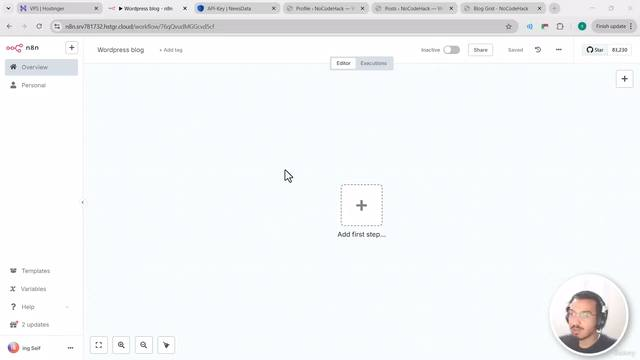

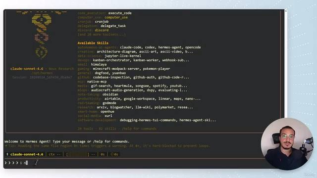

### 3.2 工件 A · 节点 1：Schedule Trigger

新建工作流，第一个节点搜 `Schedule Trigger`。Trigger 规则选 **Days**（讲师说也可以切 Weekly / Monthly），Hour 填 **9**。p005 [02:48] 的理由是「9 点是个发布新内容的好时间，你可以按你读者的活跃时间调整」。

配置完点一次 **Test step**，确认触发器本身没问题。

### 3.3 节点 2：HTTP Request 拉新闻

在触发器后点 `+`，加 **HTTP Request** 节点，接到 newsdata.io。

- **Method**：`GET`
- **URL**：newsdata.io 的基础端点。**注意：讲师在 p005 [03:42] 只说了一句「this is the base endpoint」然后就把地址粘进去了，没有逐字念出完整 URL**，请以你 newsdata.io 控制台给出的 base endpoint 为准。
- 打开 **Send Query Parameters**，逐条加：

| Name | Value |
|---|---|
| `apikey` | 你的 newsdata API key |
| `category` | `technology` |
| `language` | `EN` |
| `country` | `US` |
| `size` | `1` |

`size=1` 是关键：p005 [04:11] 说「我们现在每次只处理一篇文章」。这也直接决定了成本——一次 run 只消耗一次写作 + 一次画图。

点 **Test step**，返回体里应该能看到 `title`、`description`、`content`、`link`、`keywords` 这些字段。讲师在 p005 [04:40] 特意停下来让观众「take a look at the structure」，因为下一步的 prompt 就要引用 `title` 和 `description`。

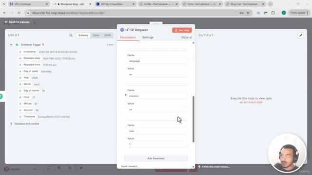

### 3.4 节点 3：OpenAI 写文章

点 `+`，搜 `OpenAI`，选 **Message a Model**。

- **Resource**：`Text`
- **Operation**：`Message a Model`
- **Model**：`gpt-4o`（讲师说这是质量最好的；`gpt-3.5-turbo` 也能用但质量差一档）
- **消息 1**：Role = `system`，Content = `You excel at transforming news into interesting articles without plagiarism.`
- **消息 2**：Role = `user`，内容按下图拼装：

```
Write a completely original blog post about this news.
Title: {{ 上一步的 title }}
Description: {{ 上一步的 description }}

Requirements:
- Create a unique and engaging title.
- Write exactly five separate paragraphs, each in its own <p> tag.
- Include your own analysis and perspective.
- Do not copy phrases from the original source.
- End with a thoughtful conclusion.

Parsing:
Format the response as clean JSON without backticks, with the fields "title" and "content".
```

三条约束要咬死：**正好五段**、**每段各自一个 `<p>` 标签**、**返回不带反引号的干净 JSON，字段名就叫 `title` 和 `content`**。第三条是下一步 Code 节点能不能跑通的前提。

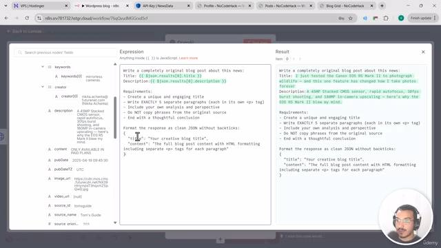

点 **Test step**。你会拿到一篇完整的文章——**但这时的输出结构是「乱的」**，正如 p005 [07:02] 所说。模型把 JSON 塞进了一段文本里，你没法直接拿 `title` 字段喂给后面的节点。

### 3.5 节点 4：Code 节点清洗

点 `+`，搜 `Code`（讲师点的是 `Function` → `Code`）。把第 4 节里 `parse-openai-response.js` 的完整内容粘进去。

这个节点干三件事：从上游 item 里取出模型返回的文本字符串 → 剥掉可能残留的 ```json 围栏 → `JSON.parse` → 只往下传 `{ title, content }` 两个字段。

点 **Test step**，输出应该一下子清爽成两个字段。

### 3.6 节点 5：OpenAI 生成配图

在 Code 节点后再加一个 OpenAI 节点：

- **Resource**：`Image`
- **Operation**：`Generate an Image`
- **Model**：`dall-e-3`
- **Prompt**（用表达式，不要手打，否则每篇文章配图都一样）：

```
{{ "Create a professional illustration showing " + $json.title + ". The image should reflect key themes from this content. " + $json.content.substring(0, 200) }}
```

拆开看就是三段拼接：固定前缀 + 标题 + 固定中缀 + 正文前 200 字。p005 [09:00] 说这招的效果是「每篇文章都会得到一张完全匹配的独特配图」。

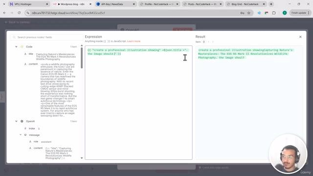

点 **Test step**，等几十秒，点开预览确认图出来了。

### 3.7 节点 6：Edit Image 缩放到 1340×638

再点 `+`，搜 `Edit Image`，Operation 选 **Resize**：

- **Width**：`1340`
- **Height**：`638`

p005 [09:29] 的实测结果：「the file size went from 187 to 152」——也就是说缩放不仅改了尺寸，还实打实压小了体积。这一步不是可选的：DALL·E 3 原生输出尺寸和 WordPress 主题期望的 1340×638 对不上，不缩放在前端会拉伸变形，而且上传体积更大。

### 3.8 节点 7：上传图片到 WordPress 媒体库

点 `+`，加 **HTTP Request**：

- **Method**：`POST`
- **URL**：`<你的站点地址>/wp-json/wp/v2/media`（p005 [10:26]：先选你的网站 URL 粘进来，再补上 `wp-json/wp/v2/media`）
- **Authentication**：`Predefined Credential Type` → 搜 `WordPress` → 选中你在 3.1 里建的那个凭证
- 打开 **Send Headers**，加一条：
  - Name：`Content-Disposition`
  - Value：`attachment; filename=image.png`
- 打开 **Send Body**：
  - Body Content Type：`n8n Binary File`
  - Input Data Field Name：`data`

点 **Test step**。返回体里会带一个媒体 **ID**。p005 [11:22] 原话：「This ID is crucial for the next step」——它就是最后发帖时的 `featured_media`。

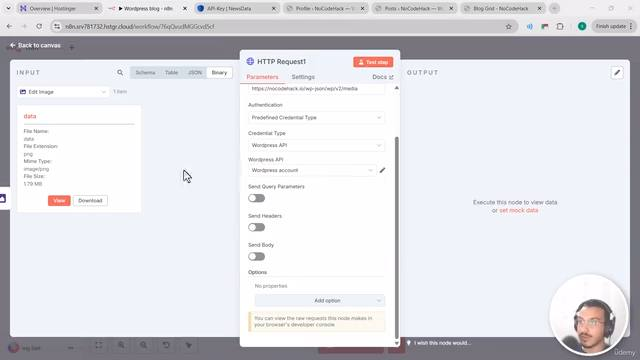

### 3.9 节点 8：Merge 把两条支路合流

到这一步，你手上是两条**平行**的支路：Code 节点输出 `{title, content}`，上传节点输出 `{id, ...媒体信息}`。如果直接把它们各自接到发帖节点，n8n 会当成两个独立 item，结果就是**发两篇文章，其中一篇没图**。

p005 [11:22] 把这一步叫「crucial step to avoid creating duplicate posts or posts without images」。

加 **Merge** 节点：

- **Mode**：`Combine`
- **Combine By**：`Position`
- **Number of Inputs**：`2`
- **Input 1** ← Code 节点的输出
- **Input 2** ← 上传媒体 HTTP 节点的输出

点 **Test step**，你应该看到**一个** item，里面同时有博客正文和媒体 ID。

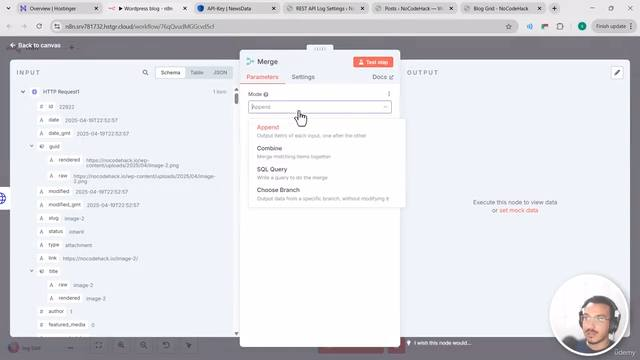

### 3.10 节点 9：发 WordPress 文章

最后加一个 **HTTP Request**：

- **Method**：`POST`
- **URL**：`<你的站点地址>/wp-json/wp/v2/posts`
- **Authentication**：`Predefined Credential Type` → `WordPress`（同一个凭证）
- 打开 **Send Body** → Body Content Type 选 `JSON` → 选 **Using Fields Below**：

| 字段 | 值 |
|---|---|
| `title` | Merge 输出里的 `title` |
| `content` | Merge 输出里的 `content` |
| `status` | `publish` |
| `featured_media` | Merge 输出里的媒体 `id` |

### 3.11 跑通 & 激活

保存 → 刷新页面 → 点 **Test workflow**，让它从触发器一路跑到发帖。p005 [13:45] 描述的全流程是：拉一条新科技新闻 → GPT-4o 改写成原创文章 → 生成匹配配图 → 缩放 → 上传媒体库 → 发布。

验证方式：去 WordPress 后台 **Posts**，刷新，应该多出一篇新文章，打开它确认**正文完整 + 特色图已设置**。

确认无误后，点右上角的开关 **Active**，之后就按每天 9 点自动跑。

### 3.12 工件 B · 部署 Hermes 到 VPS

1. 打开 Hostinger 的 Hermes 一键模板页面。
2. 选套餐：**KVM2**。p006 [01:25] 明确说 KVM1 技术上能跑，但一旦让它读文件、跑技能或做长对话就会「chokes」。
3. 计费周期拉到 24 个月（讲师算下来约 8 美元/月）。如果有优惠码输入框，讲师给了他自己的折扣码（10% off）。
4. 填支付信息。
5. 部署前**必须先设好 admin 用户名和密码**——这是你之后登录 Hermes 网页终端的唯一凭据。p006 [01:55] 原话：「save the password somewhere safe…… just don't lose it」。
6. 点 **Deploy**，Hostinger 会在后台创建 VPS 并部署 Hermes 容器，耗时约 **5–10 分钟**，完成后会发邮件。
7. 部署完成后，控制台里会看到**两个**项目：`Hermes agent` 和另一个叫 `Traffic` 的。p006 [02:53] 说 Traffic 只负责 HTTPS 连接（让你用浏览器打开 Hermes 时不报安全警告），不用管它。
8. 点 Hermes 的 **Open**，用第 5 步的用户名密码登录。

### 3.13 初始化向导（Quick Setup）

进去之后是一个**跑在 VPS 上、但在浏览器里显示的终端**。此时容器起来了、Hermes 装好了，但什么都没配。

1. 问 **Quick setup 还是 Full setup**：选 **Quick**。p006 [03:49] 说 Quick 覆盖 provider / model / messaging 三件事，Full 会深入到 terminal backend 和 agent settings。我们要的 Telegram + VPS 场景，Quick 足够。
2. 问 **Provider**：选 **OpenRouter**。p006 [04:19] 的理由是一个 key 能访问 200+ 模型，不被单一厂商锁死。
3. 粘 **OpenRouter API key**，回车。
4. 问 **默认模型**：讲师选的是 **Claude Sonnet 4.6**。这一屏的模型列表里能看到 Claude / GPT / Gemini / Grok / Kimi，底部还有一些免费的。**注意价格含义**：p006 [05:15] 强调「these prices you see are per million tokens, not per message」——这是按 token 计价，不是按次。
5. 因为选了 Quick，向导会自动套用推荐值：**Terminal backend 保持 local**（我们已经在 VPS 的 Docker 容器里了，不需要再嵌一层），**Agent settings 保持 recommended defaults**。
6. 向导回显全部配置，然后进入 **Messaging**。

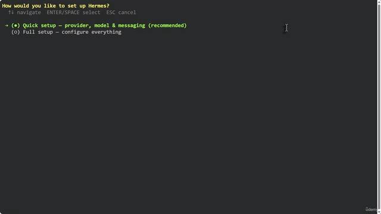

### 3.14 接 Telegram

**这一步有一个非常容易踩的坑：这个菜单不是单选按钮，是用空格勾选，回车是「确认整组选择并进入下一步」。** p006 [06:08] 专门提醒了这一点。

1. 在 Messaging 列表里，光标移到 `Telegram`，按**空格**（会看到勾选框被填上），再按**回车**。
2. 切到 Telegram App，搜索 **@BotFather**（Telegram 官方的建机器人账号）。确认名字旁边有蓝色认证标。
3. 发 `/newbot`。
4. BotFather 问 display name（别人看到的名字），讲师填的是 `No Code Hack Hermes`。
5. BotFather 问 username，**必须以 `bot` 结尾**，讲师填的是 `nocodehackhermesbot`。
6. BotFather 返回一串 **HTTP API token**。复制它，回终端粘贴，回车。
7. 接下来是**安全锁**：默认任何人搜到你的 bot 都能给它发消息。Hermes 要你填的是**数字形式的 Telegram user ID，不是 @ handle**。p006 [07:35] 原话：「if you paste your handle here, it just silently fails and lets anyone in」。
   - 拿 ID 的办法：在 Telegram 里搜 **@userinfobot**（官方 bot），给它发任意消息，它回你的数字 ID。
   - 把数字复制回终端，回车。**allow list 配置完成，此后只有这个 ID 能驱动 bot。**
8. 最后一个问题：**home channel**（Hermes 主动推送任务结果/通知的地方）。Telegram 私聊场景下就是你自己那个 user ID，直接按 `Y` 回车。
9. 向导结束，屏幕上列出配置文件、API key 文件、数据目录路径，以及三个随时可改配置的命令：
   - `hermes setup model` —— 换模型
   - `hermes setup terminal` —— 换终端后端
   - `hermes setup gateway` —— 换消息平台
10. 底部绿色字给出三个启动命令：
    - `hermes` —— 开始聊天
    - `hermes gateway` —— 启动消息网关
    - `hermes doctor` —— 出问题时排查
11. 回车重连，进入 Hermes 欢迎界面。

### 3.15 验证记忆系统

欢迎界面会显示 **29 tools / 82 skills** 的开箱即用清单（浏览器控制、代码执行、computer use、discord、github、obsidian、Google workspace 等），右下角显示当前模型。

1. 在对话框输入：

```
remember this about me: I run a YouTube channel called No Code Hack, I build automations
```

2. 观察输出里出现 `memory + user` 这一行——Hermes **不是复述你的话**，而是把关键信息抽出来写进了记忆，实时可见。
3. 去到终端执行 `cat /opt/data/memories/user.md`，应该只有一行，大致是「runs a YouTube channel called No Code Hack focused on building automations」。
4. 再输入一段「自我介绍」式指令，让它记住自己的运行环境：

```
you are an AI agent running on a VPS. Your task is to remember your current setup.
You are connected to Telegram. You are running Claude Sonnet 4.6 as your brain.
Save this to your memory.
```

5. 同样会看到 `memory` 行，内容被压缩成一句。执行 `ls /opt/data/memories`，应该看到**两个文件**：`user.md` 和 `memory.md`。`cat` 第二个，内容就是「deployment / running as an AI agent on a VPS / connected to Telegram / brain: Claude Sonnet 4.6 via OpenRouter」这类。

**这两个文件就是全部的区别**：`user.md` 记「你是谁」，`memory.md` 记「Hermes 知道自己是什么」。它们跨会话持久化，所以下次开新会话不用重新自我介绍。

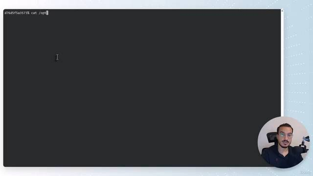

### 3.16 把 WordPress 接给 Hermes

1. 回到 Hermes 对话，输入：

```
I need to connect you to my WordPress website. What should I give you?
```

2. Hermes 会自己列出它需要三样东西：**Site URL / Username / Application Password**（就是 3.1 里生成的那串）。
3. 把三样发过去。
4. Hermes 会弹一个**安全警告**：它把即将执行的 `curl` 命令原样显示给你看（p006 [14:10]：「This is Hermes being transparent」）。选择 **low for this session** 并回车。
   - 注意语义：**low 只对当前这一个 session 有效**。下次在新会话（比如从 Telegram 发起）里，它会再问一遍——这是它**不跨会话明文存凭据**的设计，不是 bug。
5. 连接确认后，它会自动扫描站点并报出检测到的插件（讲师那次检测到 WooCommerce / Elementor / ACF 之类的），并把这批信息写进 memory。
6. 紧接着把**规则**也写进记忆：

```
Remember this: when I ask you to create a WordPress post, always use the REST API with
the credential in WP_SITE, WP_USER and WP_APP_PASSWORD environment variables.
Always create posts as drafts only.
After creating, return the post title, post ID and the WordPress edit link.
```

这条规则一存，往后每个会话都自动生效。

### 3.17 让 Hermes 自己写技能

这是整个 P6 的核心。你要的不是让它做一件事，而是让它**把做这件事的规则写成文件存到磁盘上**。

1. 发一段要求它「写技能」的指令，包含以下要素：
   - 最少 **1000 词**
   - **H2 / H3** 层级结构
   - SEO 优化、hook 开头、**meta description**
   - 用 **Nano Banana Pro** 生成特色图
   - **解码**图片后上传到 WordPress 媒体库
   - 设为文章的 featured image
   - 全部写进**一个技能**里
2. Hermes **不会直接动手**，它会先反问：**Nano Banana Pro 的 API key** 是什么、生成图片的 endpoint 确认一下。p006 [18:41] 的评语是「It's not assuming, it's asking」。
3. 把 key 发过去，并在同一条消息里补一句「keep it a memory. Never expose it in responses」。它会立刻把「key 已保存 + 永不打印」写进 memory。
4. 技能生成完毕，会是一个 **6 步**的流程：凭证准备 → 按 SEO 规则写文 → 调 Nano Banana Pro 生图 → 上传媒体库 → 创建草稿并设置 featured media → 确认并返回标题/ID/编辑链接。
5. 文件落在 VPS 上：`/opt/data/skills/wordpress-post-creator/skill.md`（讲师在 p006 [19:37] 念出的路径是「slash opt slash data slash skills slash WordPress WordPress post creator slash skill dot MD」，**目录名请以你实际生成的为准**）。

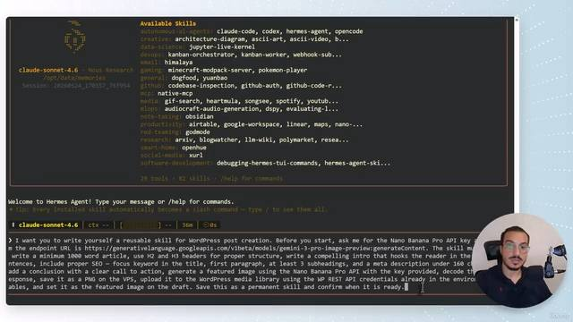

### 3.18 用技能出一篇稿

切到 Telegram，给刚才那个 bot 发一条最短的指令：

```
create WordPress draft post titled "How to automate your freelance business with AI in 2026"
target freelancers and small business owners
```

**不要给任何额外说明。** 你会看到 Hermes 自己打出 `skill: wordpress-post-creator`，说明它**自主加载了刚写的那份技能**，然后依次执行：写正文 → 调 Nano Banana Pro → 解码 base64 → 存图到 VPS → 上传媒体库 → 建草稿 → 设 featured image。

因为这是 Telegram 发起的新会话，它会**再问一次 WordPress 凭据**——把 site URL / 用户名 / 应用程序密码再发一遍。

完成后它返回三段东西：**post title、post ID、edit link**。点开 edit link，你会看到一篇 1400+ 词、带 H2/H3 层级、带开头 hook、带 meta description、带特色图、状态为 draft 的文章。讲师那次的结果：**1486 词 / 7 个小节 / meta description 127 字符**，SEO 分数从上一版随手写的 **45** 提到 **76**。

---

## 4. 完整代码

### 4.1 `code/parse-openai-response.js`

n8n Code 节点的完整内容。运行环境就是 Node.js，和你写前端脚本是同一套 JS。

```js
// n8n Code 节点 —— 把 OpenAI 返回的文本清洗成 { title, content }
// 上游：OpenAI "Message a Model"
// 下游：Merge（Input 1）
//
// 注意：item.json 里到底哪个字段装文本，取决于你用的 OpenAI 节点版本。
// 讲师在 p005 [07:02] 只说「takes the content string from the OpenAI response」，
// 没有念出字段名。所以这里做了三级兜底，跑之前请先 Test Step 看真实结构。

const results = [];

for (const item of $input.all()) {
  const raw =
    item.json.message?.content ??
    item.json.content ??
    item.json.text;

  if (typeof raw !== 'string') {
    throw new Error(
      'OpenAI 节点返回里找不到文本字段。请先点 Test Step 看真实输出结构，' +
      '再把上面三个字段名里的一个改成实际的那个。'
    );
  }

  // 模型被要求输出 "clean JSON without backticks"，
  // 但实际仍可能被 ```json ... ``` 包一层，先剥掉。
  const cleaned = raw
    .replace(/^\s*```(?:json)?/i, '')
    .replace(/```\s*$/, '')
    .trim();

  let parsed;
  try {
    parsed = JSON.parse(cleaned);
  } catch (err) {
    throw new Error('模型返回的不是合法 JSON，原始内容前 300 字：\n' + cleaned.slice(0, 300));
  }

  if (typeof parsed.title !== 'string' || typeof parsed.content !== 'string') {
    throw new Error('模型返回的 JSON 里缺少字符串类型的 title 或 content 字段');
  }

  results.push({
    json: {
      title: parsed.title,
      content: parsed.content,
    },
  });
}

return results;
```

### 4.2 `code/image-prompt-expression.txt`

OpenAI 图像节点的 Prompt 字段，**整段直接粘**（注意是 n8n 表达式语法，双花括号包住整个表达式）：

```
{{ "Create a professional illustration showing " + $json.title + ". The image should reflect key themes from this content. " + $json.content.substring(0, 200) }}
```

### 4.3 `scripts/check-wp.sh`

在本地先用手工 curl 把 WordPress 三个接口打通，能大幅缩短在 n8n 里瞎试的时间。三个端点全部来自 P5 的节点 7、节点 9 和 P6 的凭据验证。

```bash
#!/usr/bin/env bash
# 用法：
#   export WP_SITE="https://your-site.com"
#   export WP_USER="you@example.com"          # WordPress 登录邮箱
#   export WP_APP_PASSWORD="xxxx xxxx xxxx xxxx xxxx xxxx"   # 3.1 生成的应用程序密码
#   chmod +x check-wp.sh
#   ./check-wp.sh ./image.png

set -euo pipefail

: "${WP_SITE:?请先 export WP_SITE=https://your-site.com}"
: "${WP_USER:?请先 export WP_USER=你的 WordPress 登录邮箱}"
: "${WP_APP_PASSWORD:?请先 export WP_APP_PASSWORD=WordPress 生成的应用程序密码}"

AUTH="${WP_USER}:${WP_APP_PASSWORD}"
IMG="${1:-image.png}"

echo "== 1/3 验证凭证（读当前用户） =="
curl -sS -u "$AUTH" "${WP_SITE}/wp-json/wp/v2/users/me" | head -c 400
echo

echo "== 2/3 上传图片到媒体库 =="
# 这一行 Content-Type 是本文补的；Content-Disposition 的写法来自 p005 [10:47]
MEDIA_ID=$(curl -sS -u "$AUTH" \
  -H "Content-Disposition: attachment; filename=image.png" \
  -H "Content-Type: image/png" \
  --data-binary @"$IMG" \
  "${WP_SITE}/wp-json/wp/v2/media" \
  | python3 -c 'import sys,json; print(json.load(sys.stdin)["id"])')
echo "MEDIA_ID=$MEDIA_ID"

echo "== 3/3 用这个 media id 建一篇草稿 =="
# p005 的最后一节点用的是 status=publish，p006 的规则用的是 draft，两个值都来自逐字稿
curl -sS -u "$AUTH" \
  -H "Content-Type: application/json" \
  -d "{\"title\":\"草稿测试\",\"content\":\"<p>hello</p>\",\"status\":\"draft\",\"featured_media\":${MEDIA_ID}}" \
  "${WP_SITE}/wp-json/wp/v2/posts" | head -c 400
echo
```

### 4.4 `hermes/wordpress-post-creator.skill.md`

课里讲师用 `cat` 把这份技能文件念了一遍（p006 [21:56] 起）。下面是按他口述的「Purpose → Step 1–6 → Pitfalls」结构还原的骨架，可以直接拿去让 Hermes 照着写、或者让它自己生成后对照。

```markdown
# WordPress Post Creator

## Purpose
Write and publish a fully structured, SEO optimized blog post as a WordPress **draft**.

## Step 1 — Gather topic and focus keyword
- 确认文章标题、目标读者、focus keyword。
- 如果用户没给 focus keyword，从标题里推导一个，并在回复里说明。

## Step 2 — Write the article
- 最少 1000 词。
- 开头必须是 hook（示例：「What if you could run your entire freelance business while you sleep?」）。
- 使用 H2 / H3 两层标题结构，分 6–8 个小节。
- focus keyword 必须出现在：标题、第一段、以及多个 H2/H3 里。
- 结尾要有 conclusion + CTA。
- 生成 meta description，控制在约 130–160 字符。

## Step 3 — Generate featured image via Nano Banana Pro
- 调用 Nano Banana Pro 生成图片。
- 拿到响应后 **base64 解码**。
- 保存到 VPS 上的临时路径。

## Step 4 — Upload to WordPress media library
- POST 到 `<WP_SITE>/wp-json/wp/v2/media`
- 头：`Content-Disposition: attachment; filename=image.png`
- 从返回里取 media ID。

## Step 5 — Create the draft post
- POST 到 `<WP_SITE>/wp-json/wp/v2/posts`
- 字段：title / content / status=draft / featured_media=<上一步的 ID>

## Step 6 — Confirm and return
- 返回：post title、post ID、WordPress edit link。

## Pitfalls
- **Never print the API key.** 任何情况下不得在回复里显示 API key。
- **Always draft, never publish.** 状态只能是 draft。
- **Word-count check before submitting.** 提交前先数词，少于 1000 就补写。
```

---

## 5. 逐行解释

**`for (const item of $input.all())`** —— n8n Code 节点用的是「一次拿全部 item」的模式，`$input.all()` 返回上游所有 item 组成的数组。这里虽然 `size=1` 通常只来一条，但写成循环更稳。**给前端的类比**：这就是 `Promise.all` 之后拿到的结果数组，本质是纯数据遍历，没有任何锁和并发问题。

**`item.json.message?.content ?? item.json.content ?? item.json.text`** —— 三级兜底。为什么要兜底：讲师在 p005 [07:02] 只说了「从 OpenAI 响应里取 content 字符串」，**没有念出确切的字段路径**，而 n8n 不同版本、不同 operation 返回的包装层不一样。`??` 是空值合并，只在左边是
空值时取右边。**给前端的类比**：这就是你在 TS 里做的多层可选链 + 默认值，等价于 `a?.b || c?.d || e`，只是 `??` 不会把 `0`、`''` 这类「falsy 但合法」的值误判成缺失。这里必须用 `??` 而不是 `||`，因为如果模型返回了空字符串 `content`，用 `||` 会静默跳到下一级字段，最后抛出的错误信息会误导你去改字段名。

**`if (typeof raw !== 'string') throw ...`** —— 把「字段路径猜错」这件事变成**启动就炸**而不是**发出去一篇空文章**。这是整段代码里最值钱的一行：博客流水线跑在定时器上，你不在电脑前，如果它静默产出 `undefined` 标题，你要等到几天后看后台才发现。错误信息里明确写了「请先点 Test Step 看真实输出结构」，因为这是唯一可靠的定位手段。

**`.replace(/^\s*```(?:json)?/i, '')`** —— 剥掉开头可能存在的围栏。`(?:json)?` 是非捕获组加可选，能同时匹配 ` ``` ` 和 ` ```json `。`i` 让大小写不敏感（模型有时写 ` ```JSON `）。用**非捕获组**而不是捕获组，是因为这里只关心「删掉」，不关心「匹配到了什么」。

**`.replace(/```\s*$/, '')`** —— 剥掉结尾围栏。注意这里**没有加 `^`**，因为结尾可能还有换行或空格，`\s*$` 里的 `$` 在非 multiline 模式下锚定整个字符串末尾，`\s*` 吃掉它前面的空白。这两行是「讲师说的 clean JSON without backticks」在**工程上的兜底**：prompt 里要求了不带反引号，但模型不保证遵守，代码不能只靠 prompt。

**`JSON.parse(cleaned)` + try/catch** —— 不 catch 的话，一条格式坏掉的输出会让这个 Code 节点整体失败，整个工作流中断。catch 里抛出**带原始内容前 300 字**的错误，是为了让你在 n8n 的执行日志里直接看到模型到底吐了什么，不用再去翻上游节点。300 这个数字是经验值：够看到 JSON 的起始结构，又不至于把整篇文章刷满日志。

**`if (typeof parsed.title !== 'string' || typeof parsed.content !== 'string')`** —— 结构校验。为什么要单独校验：`JSON.parse` 只保证「是合法 JSON」，不保证「字段齐全」。模型有可能返回 `{ "title": "...", "body": "..." }`（字段名漂移），这时 `parsed.content` 是 `undefined`，如果不拦，它会一路流到 WordPress，最后你得到一篇标题正确、正文为空的文章——而这篇文章还是 `status=publish` 的，等于对外发了一篇空稿。

**`results.push({ json: { title, content } })`** —— n8n Code 节点的返回契约是「数组，每个元素形如 `{ json: {...} }`」。外层 `json` 是 n8n 的固定包装层，不是你的业务字段。**忘掉这层包装是新手最常犯的错**：直接 `return [{ title, content }]` 会让下游节点的表达式全部取不到值。

**图像 prompt 那一整行表达式** —— `{{ ... }}` 是 n8n 的表达式定界符，里面是 JS。`$json` 指**当前 item 的 json 数据**，也就是 Code 节点刚清洗完的输出，所以 `$json.title` 拿的是干净标题、`$json.content` 拿的是干净正文。`substring(0, 200)` 取前 200 字符——讲师在 p005 [09:00] 只说了「取 content 的前 200 字」，**没说为什么是 200**；从效果反推，200 字符大约是一到两句话，足够给模型定调，又不至于把整篇文章塞进图像 prompt（那样既贵又没意义，图像模型对长文本的理解收益远低于成本）。字符串用 `+` 拼接而不是模板字符串，是因为 n8n 表达式里反引号容易和 JSON 字段冲突，用 `+` 最不容易出错。

**`set -euo pipefail`** —— `-e` 任一命令失败即退出；`-u` 使用未定义变量即退出；`-o pipefail` 让管道里任何一段失败都算整体失败。这条在这份脚本里尤其重要：如果 `curl` 因为 401 失败，没有 `-e` 的话脚本会继续往下走，`MEDIA_ID` 变成空串，最后你拿着一个「成功创建但没图」的结果去排查 WordPress。

**`: "${WP_SITE:?...}"`** —— `:` 是 shell 的内置空命令（什么都不做但会展开参数），配合 `${VAR:?message}`，含义是「如果 `VAR` 未设置或为空，打印 message 并退出」。这是最紧凑的环境变量断言写法，比写三个 `if [ -z ... ]` 干净得多。三个变量名 `WP_SITE` / `WP_USER` / `WP_APP_PASSWORD` 就是 P6 [15:00] 里讲师让 Hermes 记住的那三个环境变量名，这样两边可以共用同一份 `.env`。

**`curl -u "$AUTH"`** —— `-u` 走 HTTP Basic 认证，curl 会自动把 `user:pass` 做 base64 塞进 `Authorization` 头。WordPress 的应用程序密码就是靠 Basic 认证工作的。**这里有个坑**：应用程序密码是「4 组 6 位、中间带空格」的形式，必须**原样保留空格**在引号里传，不要自己 `tr -d ' '` 去掉——课里没讲这点，但你去掉空格后大概率认证失败。

**`--data-binary @"$IMG"` 而不是 `-d @"$IMG"`** —— `-d`（即 `--data`）会剥掉换行、还会做 URL 编码，二进制文件用它会被破坏；`--data-binary` 原样发送。上传图片必须用后者。

**`| python3 -c 'import sys,json; print(json.load(sys.stdin)["id"])'`** —— 从媒体上传的响应里抠出 `id` 字段。课里 p005 [11:22] 说的是「这个 ID 对下一步至关重要」，但**没讲怎么在代码里取**。用 python3 是因为绝大多数 macOS/Linux 自带；如果你机器上有 `jq`，`| jq -r .id` 更短。两条路等价，随便选。

**`-d "{\"title\":...}"`** —— `-d` 在这里传 JSON **字符串**（不是 `@file`），所以用反斜杠转义双引号。同时必须显式加 `-H "Content-Type: application/json"`：`-d` 默认的 Content-Type 是 `application/x-www-form-urlencoded`，WordPress 收到表单内容类型会按表单解析，结果是文章字段全空。这个头**课里也没讲**，是我补的。

**`"status":"draft"` 与 p005 的 `publish`** —— 两个值都出自逐字稿：P5 的最后一个节点填的是 `publish`（[13:18]：让 status 填 publish），P6 给 Hermes 定的规则是 `Always create posts as drafts only`（[15:00]）。这份脚本按 P6 的稳妥做法用 `draft`，因为你本地调试时不该往生产站直接发正式文章。**这是两份材料给出不同值的地方，不是笔误**，请按场景选。

**技能文件里「`Always draft, never publish`」为什么单独成条** —— 因为这是唯一一条「错了会对外可见」的规则。词数不够、SEO 不够，你还能改；一旦 publish 出去，文章可能已经进了 RSS 和搜索引擎。同理「Never print the API key」必须是**文字规则**而不是靠模型自觉：Hermes 会把这条写进 memory，而 memory 是每个会话都加载的，等于给自己上了一道长期约束。

**技能文件里「Step 6 — Confirm and return：post title、post ID、edit link」** —— 这三样是**为人类验收设计**的，不是为程序。你从 Telegram 收到消息，点 edit link 就能直接看到草稿，不需要打开 WordPress 后台再搜索。凡是「agent 替你做事」的场景，返回值里都应该带一个**人类可点开的落地页**，这条经验值得迁移到你自己的 agent 项目里。

---

## 6. 复现检查清单

### 工件 A · n8n 博客流水线

**前置**

- [ ] WordPress 站点能正常打开，`/wp-json/wp/v2/posts` 返回的不是 404（说明 REST API 没被插件或安全策略关掉）
- [ ] 已在 Users → Profile 底部生成应用程序密码，并**已经复制到安全的地方**（关掉页面就再也看不到了）
- [ ] 记下了 WordPress 登录邮箱，知道它就是 API 的「用户名」
- [ ] `check-wp.sh` 三步全部跑通，第 3 步返回里有新草稿的 `id`
- [ ] 站点是纯 HTTP 的话，在 n8n 的 WordPress 凭证里勾了 insecure 选项

**逐节点**

- [ ] Schedule Trigger：Days / 9 点，Test step 通过
- [ ] HTTP Request（news）：GET + 5 个 query 参数（`apikey` / `category` / `language` / `country` / `size=1`），返回体里能看到 `title`、`description`、`content`
- [ ] OpenAI 写文：system 消息一句；user 消息里**五段、每段 `<p>`、返回干净 JSON 且字段为 `title`/`content`** 三条约束都在
- [ ] Code 节点：Test step 输出只剩 `title` 和 `content` 两个字段，且 `title` 不是 `undefined`
- [ ] OpenAI 画图：resource=image、operation=generate、model=dall-e-3，prompt 用的是表达式而不是手打的固定文字
- [ ] Edit Image：resize 到 1340×638，测试后文件体积有变化
- [ ] 上传媒体：POST `/wp-json/wp/v2/media`，`Content-Disposition: attachment; filename=image.png`，body 是 binary、字段名 `data`，返回里有 `id`
- [ ] Merge：Combine / By Position / 2 inputs，**Input 1 接 Code、Input 2 接上传节点**，测试输出**只有一个** item
- [ ] 发帖：POST `/wp-json/wp/v2/posts`，body 为 JSON using fields，四个字段 `title` / `content` / `status` / `featured_media` 都映射对了
- [ ] 全流程 Test workflow 跑通，WordPress 后台 Posts 里出现新文章，**正文完整 + 特色图已设置**
- [ ] 确认没问题后再打开右上角 Active 开关

**验收**

- [ ] 文章正文是五段，每段确实是 `<p>` 包着的（不是一整坨纯文本）
- [ ] 特色图内容和标题相关，不是一张万能占位图
- [ ] 没有出现两篇重复文章（出现就说明 Merge 接错了，或者两条支路各自接到了发帖节点）

### 工件 B · Hermes + WordPress

**部署**

- [ ] 套餐选了 KVM2（不是 KVM1）
- [ ] 部署前已设好 admin 用户名和密码，密码存在密码管理器里
- [ ] Hostinger 控制台里能看到 `Hermes agent` 和 `Traffic` 两个项目都在 running
- [ ] 用 admin 凭据能登进 Hermes 网页终端

**初始化**

- [ ] 选了 Quick setup
- [ ] Provider = OpenRouter，API key 已粘贴
- [ ] 默认模型 = Claude Sonnet 4.6（或你自己选的），知道屏幕上的价格是**按百万 token**
- [ ] Terminal backend 保持 local，agent settings 保持推荐值
- [ ] Telegram 是**按空格勾选**再回车（不是直接回车）

**Telegram**

- [ ] 和 @BotFather 走完 `/newbot`，拿到 HTTP API token，username 以 `bot` 结尾
- [ ] allow list 填的是**数字 user ID**（从 @userinfobot 拿的），不是 @ handle
- [ ] home channel 填的是自己的 user ID 并确认
- [ ] 从 Telegram 给 bot 发一条测试消息，它能回

**记忆与技能**

- [ ] `cat /opt/data/memories/user.md` 有内容，是你的人格描述
- [ ] `ls /opt/data/memories` 能看到 `user.md` 和 `memory.md` 两个文件
- [ ] `memory.md` 里有「部署在 VPS / 连了 Telegram / 用哪个模型」这类自我认知
- [ ] WordPress 三件套（site URL / username / app password）已给，连接确认后它自动报出了站点插件
- [ ] 「只建草稿、返回 title/ID/edit link」这条规则已进 memory
- [ ] 技能文件已生成在 `/opt/data/skills/.../skill.md`，用 `cat` 能看到 Purpose / Step 1–6 / Pitfalls
- [ ] Nano Banana Pro 的 key 已给它，并且明确要求「永不打印」
- [ ] 从 Telegram 发一条纯标题指令，日志里出现 `skill: wordpress-post-creator` 的自动加载
- [ ] 最终返回了 edit link，点开是 1000+ 词、有 H2/H3、有特色图、状态 draft 的文章

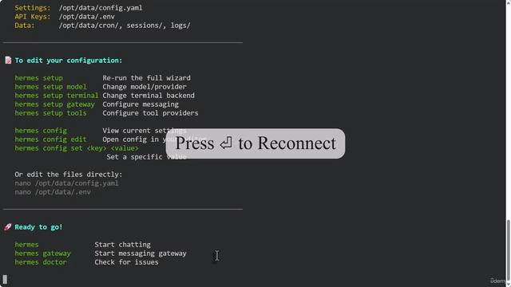

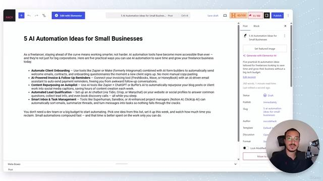

---

## 7. 课里没讲但你会撞上的

**1）n8n 本身怎么装、什么版本，课里完全没讲。** 两集都是打开一个已经能用的 n8n 就开始加节点。你会撞上的具体表现是：老版本的节点叫 **Function**，新版本叫 **Code**（p005 [07:02] 讲师口播的是「function, code」，说明他那会儿正处于改名过渡期）。如果你搜不到 `Function`，直接搜 `Code`。同理 OpenAI 节点的字段布局在不同版本间有差异，这也是 4.1 里要写三级兜底的原因。

**2）newsdata.io 的完整 base endpoint，讲师没念出来。** p005 [03:42] 只有一句「this is the base endpoint」然后就是粘贴动作。任何让你「照抄这个 URL」的二手教程都可能抄错，**请以你 newsdata.io 控制台文档里给的地址为准**。

**3）OpenAI 节点把文本放在哪个字段，课里没说。** 这是整条链路里最容易卡住的一步。判断方法只有一个：在 OpenAI 节点上点 Test step，把输出 JSON 展开，亲眼看到字符串挂在哪。不要猜。

**4）DALL·E 3 支持哪些尺寸，课里没说。** 讲师的做法是「先生成、再用 Edit Image 裁到 1340×638」，这个顺序本身就说明原生输出不等于目标尺寸。如果你跳过 Edit Image 直接上传，得到的可能是被主题硬拉伸变形的图。**这一点是从流程反推的，不是讲师明说的。**

**5）上传媒体的 `Content-Type: image/png`，课里没提。** 讲师只讲了 `Content-Disposition`。实际调 WordPress media 接口时，某些环境缺 Content-Type 会被拒或存成 `application/octet-stream`，导致媒体库里的图无法被主题识别为图片。我在 `check-wp.sh` 里补了这一行并做了标注。

**6）发帖时的 `Content-Type: application/json`，课里也没提。** n8n 的 HTTP Request 节点在选 `JSON` body 类型时会自动带上这个头，所以你跟着节点配就不会撞上；但如果你用 curl 手工调（比如跑我的 `check-wp.sh`），漏了它就会得到「文章创建成功但所有字段为空」这种极难排查的结果。

**7）WordPress 应用程序密码里的空格不能删。** 课里两次演示都是「复制整串粘过去」。你如果为了「干净」把空格去掉，Basic 认证会失败，而错误信息只会告诉你 401，不会告诉你是空格的问题。

**8）`size=1` 之外的情况，Merge 会错配。** 讲师全程用 `size=1`，所以 `Combine By Position` 是对的。**一旦你把 size 改成 5，一次 run 会拿到 5 篇新闻**，两条支路（5 篇正文 / 5 张图）按位置两两配对，只要中间任何一步失败或返回条数不一致，你就会得到「A 的正文配 B 的图」。这节课没有覆盖批量场景，**课里没讲批量怎么做**。如果你真要批量，得改成用某个稳定的业务键去 join，而不是按位置。

**9）定时任务在跑，你不在。** P5 结尾让你直接打开 Active 开关，但没讲失败重试。真实情况是：newsdata 限流、OpenAI 超时、WordPress 502 都会发生，而 n8n 默认不会告警。**课里没讲错误处理和通知**——讲师自己在 p005 [14:41] 的「可以怎么扩展」里倒是提了一句「可以加邮件通知当文章发布时」，但那只是一句设想，没有实现。

**10）Hermes 在别的 VPS 上怎么装，课里没讲。** 全程走的是 Hostinger 的一键模板，本质是「帮你在 VPS 上起一个 Docker 容器」。换到别的厂商，你需要自己起容器、自己配反向代理做 HTTPS（就是 Hostinger 那个 `Traffic` 项目干的事），**具体镜像名和启动参数课里一个都没给**。所以这份文档的工件 B 严格来说只在 Hostinger 模板上可复现。

**11）`/opt/data/...` 是容器内路径。** 你 SSH 到 VPS 宿主机 `cat /opt/data/memories/user.md` 大概率是空的或者不存在。要读这些文件，得通过 Hermes 的网页终端，或者 `docker exec` 进容器。课里讲师一直在网页终端里操作，所以这个坑不会暴露出来。

**12）Telegram 的 allow list 只保护了「谁能用」，没保护「token 泄露」。** bot token 一旦泄露，别人可以冒充你的 bot 收消息。课里没讲 token 轮换，但 @BotFather 有 `/revoke` 可以重置。

**13）`low for this session` 的语义值得再强调一次。** 它**不是**一个全局设置，而是「这一个会话内不再逐条确认」。你从 Telegram 发起的新会话会重新问。很多人会误以为配一次就永久生效，然后在自动化脚本里发现它卡在等确认——**如果你要无人值守，这里必须换成非交互的凭据注入方式，而课里没讲怎么做**。

**14）关于「成本优化」这个标题，课里只给了一句线索。** P6 [05:15] 明确说「这些价格是按百万 token 计价的，不是按条消息……我们会在一集专门做正经的成本计算」。也就是说**这一集没算**。你能从课程里拿到的、和成本直接相关的信息只有三条：① newsdata 免费额度 200 次/天（p005 [03:16]）；② `size=1` 决定每次 run 只处理一篇；③ 模型价格按百万 token。剩下的（一次 run 到底花多少 token、换小模型能省多少）**课里没讲，不要替讲师补**。如果你要自己估，唯一可靠的做法是去 n8n 的执行记录里看每个节点实际消耗的 token 数，而不是凭文章字数猜。

**15）关于并发和锁——这节课不涉及。** n8n 的工作流对 item 是串行处理的，你在界面里看到的就是一条流水线，没有多线程抢同一份数据的问题。**给前端的类比**：它更像一个 `for` 循环里 `await` 每一步，而不是 `Promise.all` 并发。真正需要你考虑竞态的是场景 8（批量 size>1）和你自己在 Node 服务里把这套逻辑重写一遍的时候——那时必须靠队列串行化或者给每篇文章加唯一键去重，否则同一个 news item 被处理两次就是两篇重复文章。