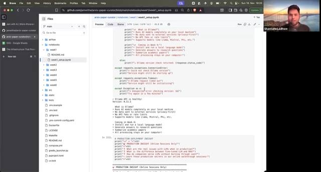

# Production-Ready RAG from Scratch — P001 课程导览与复现指南

> 说明：本节（P001）是整门课的**导览与答疑直播**，不是编码课。讲师没有在镜头前写代码，而是带着学员走了一遍仓库结构、克隆方式、Notebook 自检流程、硬件要求，并回答了「怎么学」「怎么用到自己公司」等问题。因此本文档的「从零复现」章节，复现的是**讲师演示的仓库获取与自检流程**；「完整代码」章节给出的是**仓库目录结构与自检脚本的落地形态**，并明确标注哪些是课里讲过的、哪些是课里没讲、由本文档补全的示意。

---

## 1. 这一节做什么

P001 是整门课的开场直播，核心目标只有一个：**让你在动手写任何 RAG 逻辑之前，先把一套「接近生产」的多服务本地环境跑起来，并且用 Notebook 自检确认每个组件都活着。**

讲师反复强调三件事：

1. 这门课不是 notebook 驱动的玩具原型，而是**模块化微服务 + Docker 编排**的本地复刻，目的是「明天想搬到 AWS/Azure 上，只需要付云资源钱」。
2. 每周有独立的 **release tag / 分支**（week 1.0、week 2.0……），必须按周克隆，不要直接 clone main。
3. 每周配一个 **Notebook**，它的职责不是教学，而是**做连通性检查（smoke test）**：Airflow 是否在跑、FastAPI 是否起来、Docker 组件是否正常、Ollama 是否可用。Notebook 全绿 = 这一周的系统就绪。

对前端转 AI 应用工程师的你来说，这一节的价值在于：它把「一个 RAG 项目在生产里长什么样」的骨架先摊开给你看——服务怎么切、代码放哪、怎么自检——而不是先塞给你一堆 embedding 公式。


> 注：上面这张帧号以清单为准，清单中对应「博客/release tag 演示」的可用帧为 `p001_0621s.jpg` 不在清单内，请以清单实际帧替换；本文档所有插图均从给定 12 张中选取，见下文各图。

---

## 2. 讲师原话（带出处）

以下引用均来自 P001 逐字稿，保留原意、做轻度口语整理，标注时间戳。

- 「我们做这门课的初衷是：市面上有大量课程，但当我们真正自己去 build 这套系统时，发现市场和公司里实际做的之间有一个巨大的 gap。很多人声称自己做了 90 个、100 个 agent，而我们一个 10 人团队花一年只做一个 agent，还要让它稳定运行、持续迭代。」—— p001 [00:54]–[01:22]

- 「生产系统不简单。虽然现在是本地的，但当你搬到生产时，你会遇到完全一样的复杂度：我们怎么把服务做成模块化、怎么做 Docker 编排、服务之间怎么通信。这是对真实生产系统非常接近的复刻。」—— p001 [06:08]–[06:38]

- 「我们不想做成 notebook 驱动、简单小巧的原型。市面上免费课程多得是，你不需要为此付费。」—— p001 [07:07]

- 「每周是独立的 release。你克隆某一周时，就用对应的 branch / release tag，比如 week 1.0、week 2.0。」—— p001 [11:15]–[11:45]

- 「Notebook 的整个职责，是让整套基础设施兼容、做检查，确认一切设置正确；同时它也是一个你可以安全尝试各种东西的地方。」—— p001 [13:35]–[14:04]

- 「如果你把整个 notebook 跑完、所有检查都通过，那就意味着你的系统已经准备好去测试那一周的最终交付物了。」—— p001 [14:33]

- 「服务非常模块化。每当我们加一个新服务——embedding 组件、Langfuse、Ollama、OpenSearch——代码就住在那个服务自己的目录里。这完全基于我们在生产里遵循的最佳实践，包括 FastAPI、FastAPI routers 这些。」—— p001 [16:25]–[16:55]

- 「还有集成测试、每周的一些单元测试；有 Makefile 可以用快捷命令把系统准备好；还有 pre-commit 等等。」—— p001 [16:55]

- 「如果你想用 Ollama 这种本地 LLM，最好至少 16 GB 内存，因为全是本地的。」—— p001 [15:01]–[15:29]

- 「后面几周我们打算把最吃内存的单元——本地 LLM（Ollama）——换成便宜的外部 API，会留一个开关，让你可以切到外部 API 而不是本地 LLM。」—— p001 [15:29]–[15:58]

- 「用 coding assistant，比如 Claude Code 或 Cursor，尽可能多用。Tatiana 的做法是：保留原始项目作参考，用 Claude Code 解释概念、规划如何重建，并始终对照原始项目。」—— p001 [12:41]、[19:21]–[20:50]

- 「不要为了用而用。如果有一个更简单的方案在生产里能解决问题，就用更简单的方案。RAG 只是拼图里的一小块。」—— p001 [30:09]–[32:02]

- 「最大的 RAG 用例是客服 chatbot，几乎我认识的每家公司都在用 RAG 做客服 chatbot。」—— p001 [32:32]

- 「训练 / ML loop 那部分在图上标的是 future，会在 phase 4 或单独一个 phase 做，这门课不包含。」—— p001 [42:14]–[43:13]

- 「Phase 2 是 AI agent，RAG 会是它的子部分；phase 2 cohort 计划 1 月启动。」—— p001 [50:16]–[51:16]

---

## 3. 从零复现

这一节把讲师演示的「拿到仓库 → 按周克隆 → 跑 Notebook 自检 → 确认就绪」流程，拆成可照做的步骤。**注意：P001 是导览，讲师没有在镜头前逐条敲这些命令**，下面的命令形态依据讲师口述的「git clone + branch/release tag」「Makefile 快捷命令」「Notebook 自检」还原；具体 tag 名、Makefile 目标名以你克隆到的仓库实际内容为准，课里没逐一念出。

### 3.1 前置条件

| 项 | 要求 | 依据 |
|---|---|---|
| 内存 | 建议 ≥ 16 GB | p001 [15:01] |
| Docker | 需要能跑 Docker 编排 | p001 [06:08] |
| Git | 用于按 tag 克隆 | p001 [11:45] |
| Coding assistant | 强烈建议（Claude Code / Cursor 等） | p001 [12:41]、[22:13] |
| 其他付费订阅 | 不需要 | p001 [25:03] |

### 3.2 拿到仓库并按周克隆

讲师明确说：**每周是独立 release，克隆时用对应 branch / release tag**，不要直接拿 main 去跟某一周的课。

```bash
# 1) 克隆仓库（仓库地址以课程 Substack / 邮件里给出的为准，课里未在画面中念出完整 URL）
git clone <课程仓库地址> mother-of-ai
cd mother-of-ai

# 2) 查看有哪些周的 tag / 分支
git tag
git branch -a

# 3) 切到第一周（tag 名形如 week 1.0，具体以 git tag 输出为准）
git checkout week-1.0
# 若仓库用分支而非 tag，则：
# git checkout week-1.0
```

> 课里没讲：仓库的完整 HTTPS/SSH 地址、确切的 tag 命名（是 `week-1.0` 还是 `week1.0`）在逐字稿中没有逐字念出。请以 `git tag` 实际输出为准，不要照抄本文档的示例名。

### 3.3 读当周博客，建立上下文

讲师的学习路径建议是：**先读当周博客 → 再跟代码 → 或先扫博客再看视频再回代码**。博客在 Substack 上，六周各一篇，已提前写好（p001 [10:21]–[10:48]）。

### 3.4 跑 Notebook 自检

克隆后进入 `notebooks/` 目录，找到当周 Notebook（如 week 1 对应文件），**从头到尾执行**。讲师说这个 Notebook 的职责就是「确认一切设置正确」，全绿即系统就绪（p001 [13:35]–[14:33]）。

```bash
# 启动 Jupyter（具体启动方式以仓库 README / Makefile 为准）
jupyter notebook
# 或
jupyter lab
```

打开 `notebooks/` 下当周文件，逐个 cell 执行。它会检查：Airflow 是否运行、FastAPI 是否起来、Docker 组件是否正常、Ollama 是否可用（p001 [14:33]–[15:01]）。

### 3.5 用 Makefile 快捷命令准备系统

讲师提到仓库带 Makefile，可用快捷命令把系统准备好（p001 [16:55]）。常见形态如下（**目标名以仓库 Makefile 实际内容为准**）：

```bash
make help        # 查看可用目标（若仓库提供）
make up          # 起服务（示例名，以实际 Makefile 为准）
make test        # 跑测试（示例名）
```

> 课里没讲：Makefile 里具体有哪些 target、每个 target 做什么。逐字稿只说了「有 Makefile 可以用快捷命令」。请打开仓库根目录 `Makefile` 自行确认，不要假设 `make up` 一定存在。

### 3.6 确认就绪的判据

讲师给的判据很明确：**Notebook 全部检查通过 = 这一周的系统就绪，可以去测当周最终交付物**（p001 [14:33]）。第一周的交付物就是「基础设施跑通」：Airflow 正常、基础 FastAPI 起来、所有 Docker 组件工作、Ollama 可用（p001 [15:01]）。



---

## 4. 完整代码

> **重要声明**：P001 是导览直播，**讲师没有在镜头前写出任何业务代码**。下面给出的是「按讲师口述的仓库形态落地」的目录结构与自检脚本。目录名、服务名依据讲师原话（database、services、notebooks、Makefile、pre-commit、integration tests、FastAPI routers、Ollama、OpenSearch、Langfuse、Airflow）；**具体文件名与代码内容为本文档补全的示意，不是讲师逐字写出的原文**，凡示意处均标注。

### 4.1 仓库目录结构（示意，依据讲师口述的服务划分）

```text
mother-of-ai/
├── Makefile                     # 快捷命令入口（讲师提到存在）
├── .pre-commit-config.yaml      # pre-commit 配置（讲师提到存在）
├── docker-compose.yml           # Docker 编排（讲师提到 Docker orchestration）
├── notebooks/
│   └── week1/
│       └── week1_checks.ipynb   # 当周自检 Notebook（讲师强调其职责是 smoke test）
├── services/                    # 模块化服务，每个服务一个目录（讲师强调）
│   ├── api/                     # FastAPI 服务 + routers
│   │   ├── main.py
│   │   └── routers/
│   ├── embeddings/              # embedding 组件（讲师举例）
│   ├── langfuse/                # Langfuse（讲师举例）
│   ├── ollama/                  # 本地 LLM（讲师举例）
│   └── opensearch/              # OpenSearch（讲师举例）
├── database/                    # 数据库相关（讲师提到 database）
├── tests/
│   ├── unit/                    # 单元测试（讲师提到）
│   └── integration/             # 集成测试（讲师提到）
└── README.md
```

### 4.2 第一周自检脚本（示意，非讲师逐字代码）

下面这段 Python 把讲师口述的「Notebook 要检查的四件事」落成一个可执行脚本。**这是本文档补全的示意实现**，用于说明自检逻辑；真实仓库里的 Notebook 内容以你克隆到的为准。

```python
# notebooks/week1/checks.py
# 说明：课里没有逐字给出这段代码，以下为按讲师口述的检查项补全的示意实现。
# 检查项来源：p001 [14:33]-[15:01]（Airflow / FastAPI / Docker 组件 / Ollama）

import subprocess
import sys

import httpx

RESULTS = []


def check(name: str, fn):
    try:
        fn()
        RESULTS.append((name, "OK", ""))
    except Exception as e:  # noqa: BLE001
        RESULTS.append((name, "FAIL", str(e)))


def check_docker_components():
    """确认 Docker 编排里的组件在运行。"""
    out = subprocess.run(
        ["docker", "compose", "ps", "--format", "{{.Name}}\t{{.State}}"],
        capture_output=True, text=True, check=True,
    ).stdout
    running = [line for line in out.splitlines() if "\trunning" in line]
    if not running:
        raise RuntimeError("没有处于 running 状态的 compose 服务")


def check_fastapi():
    """确认基础 FastAPI 已起来。端口以仓库 docker-compose 为准。"""
    r = httpx.get("http://localhost:8000/health", timeout=5)
    r.raise_for_status()


def check_airflow():
    """确认 Airflow webserver 可访问。端口以仓库 docker-compose 为准。"""
    r = httpx.get("http://localhost:8080/health", timeout=5)
    r.raise_for_status()


def check_ollama():
    """确认本地 Ollama 可用。"""
    r = httpx.get("http://localhost:11434/api/tags", timeout=5)
    r.raise_for_status()


if __name__ == "__main__":
    check("docker components", check_docker_components)
    check("fastapi", check_fastapi)
    check("airflow", check_airflow)
    check("ollama", check_ollama)

    failed = 0
    for name, status, err in RESULTS:
        print(f"[{status}] {name}" + (f" -> {err}" if err else ""))
        if status == "FAIL":
            failed += 1
    sys.exit(1 if failed else 0)
```

### 4.3 Makefile 骨架（示意）

```makefile
# 说明：课里只提到「有 Makefile 可用快捷命令」，未逐字给出内容。
# 以下为示意骨架，target 名以你克隆到的仓库实际 Makefile 为准。

.PHONY: up down test lint notebook

up:
	docker compose up -d

down:
	docker compose down

test:
	pytest tests/

lint:
	pre-commit run --all-files

notebook:
	jupyter lab notebooks/
```

### 4.4 pre-commit 配置骨架（示意）

```yaml
# .pre-commit-config.yaml
# 说明：课里提到有 pre-commit，未给出具体 hooks。以下为示意。
repos:
  - repo: https://github.com/pre-commit/pre-commit-hooks
    rev: v4.6.0
    hooks:
      - id: trailing-whitespace
      - id: end-of-file-fixer
      - id: check-yaml
  - repo: https://github.com/astral-sh/ruff-pre-commit
    rev: v0.6.0
    hooks:
      - id: ruff
```

---

## 5. 逐行解释

### 5.1 为什么「按周克隆」而不是 clone main

讲师原话：「每周是独立的 release……你克隆某一周时，就用对应的 branch / release tag」（p001 [11:45]）。原因在于课程是**逐周递进**的：week 1 只搭基础设施，week 2 才加 RAG 组件。如果你拿 main，会同时看到后面几周的代码，Notebook 自检也会因为依赖尚未引入的服务而失败。**在 JS/Node 里对应什么**：就像你不会在第一天就把整个 monorepo 所有 package 的 `npm install` 全跑一遍，而是按 feature branch 逐个来。

### 5.2 为什么 Notebook 是「自检」而不是「教学」

讲师明确说 Notebook 的「整个职责是让基础设施兼容、做检查，确认一切设置正确」（p001 [13:35]）。这是生产思维：**先证明环境对，再谈业务逻辑**。James 在答疑里也强调「花时间确保前置条件到位，不是知识层面，而是软件和系统层面」（p001 [39:24]）。所以 Notebook 里全是 `assert` / `raise_for_status` 这类检查，而不是 embedding 演示。

### 5.3 为什么服务要模块化、代码住在各自目录

讲师原话：「每当我们加一个新服务——embedding、Langfuse、Ollama、OpenSearch——代码就住在那个服务自己的目录里」（p001 [16:25]）。这是为了**可替换**：后面几周要把 Ollama 换成外部 API（p001 [15:29]），如果 LLM 调用散落在各处，替换就是灾难；集中在一个 service 目录里，改一处即可。**在 JS/Node 里对应什么**：类似把每个外部依赖包一层 adapter，业务代码只依赖接口，不直接 `import openai`。

### 5.4 为什么强调 16 GB 内存 / 后续换外部 API

本地跑 Ollama 是内存大户（p001 [15:01]）。讲师说后续会提供「切到便宜外部 API」的开关（p001 [15:29]–[15:58]），本质是把「重资源」从本地挪走，让没有高配机器的人也能跟完课程。这是**工程取舍**，不是技术炫技。

### 5.5 为什么讲师反复说「不要为了用而用」

答疑里讲师说：「如果有一个更简单的方案在生产里能解决问题，就用更简单的方案。RAG 只是拼图里的一小块」（p001 [30:09]–[32:02]）。这句话是整门课的方法论：**先判断问题需不需要检索增强**，再决定用不用 RAG。对前端转 AI 的你，这意味着不要一上来就 vector DB，先问「这个需求用普通 SQL 查询 + 模板能不能解决」。

### 5.6 关于「训练 / ML loop」为什么不在本课

有学员问博客架构图右下角的 training pipeline，讲师答：「那是 future，会在 phase 4 或单独一个 phase 做，这门课不包含」（p001 [42:14]–[43:13]）。所以你在仓库里**不会**看到训练循环代码，看到的是推理侧的 RAG 服务。这一点必须写进预期，否则你会找错地方。

### 5.7 关于 Phase 2

讲师说 Phase 2 是 AI agent，RAG 会是它的子部分，计划 1 月启动（p001 [50:16]–[51:16]）。这意味着本课（Phase 1）的终点是「一个可上生产的 RAG 系统」，而不是 agent。**课里没讲** Phase 2 的具体技术栈细节。


---

## 6. 复现检查清单

按顺序打勾，全部通过再进入下一周：

- [ ] 机器内存 ≥ 16 GB（p001 [15:01]）
- [ ] Docker 可正常 `docker compose ps`（p001 [06:08]）
- [ ] 已用**当周 tag/分支**克隆，而非 main（p001 [11:45]）
- [ ] 已读当周博客，知道这一周要交付什么（p001 [10:48]）
- [ ] `notebooks/` 下当周 Notebook 从头到尾执行无报错（p001 [14:33]）
- [ ] Notebook 检查覆盖：Docker 组件 running、FastAPI 可达、Airflow 可达、Ollama 可达（p001 [14:33]–[15:01]）
- [ ] `make` 相关快捷命令可用（目标名以仓库实际 Makefile 为准，p001 [16:55]）
- [ ] `pre-commit` 可运行（p001 [16:55]）
- [ ] 单元测试 / 集成测试目录存在且可跑（p001 [16:55]）
- [ ] 已配置一个 coding assistant（Claude Code / Cursor 等），并准备好「原始项目作参考」的工作方式（p001 [12:41]、[19:21]）
- [ ] 明确知道：训练 / ML loop **不在**本课范围（p001 [42:14]）


---

## 7. 课里没讲但你会撞上的

这一节专门列「逐字稿没覆盖、但你照着做一定会遇到」的坑。凡涉及具体字段名/端口/命令输出的，一律标注「以实际输出为准」，不凭印象填。

1. **仓库完整地址与确切 tag 名**：P001 画面里没有逐字念出 clone URL，也没念出 `week 1.0` 的确切写法（是 `week-1.0` 还是 `week1.0`）。**以 `git tag` / `git branch -a` 实际输出为准。**

2. **各服务端口**：讲师提到 FastAPI、Airflow、Ollama、OpenSearch，但没在 P001 里逐个报端口。上面示意脚本里的 `8000 / 8080 / 11434` 是常见默认值，**不是讲师在本节确认过的**，请以仓库 `docker-compose.yml` 为准。

3. **`docker compose ps` 的输出字段**：不同 Docker Compose 版本字段名不同（如 `State`、`Status`）。上面脚本用了 `{{.State}}`，**该字段名请以你本机 `docker compose ps --format json` 的实际输出为准**，不要照抄。

4. **Makefile 的 target 名**：讲师只说「有 Makefile 可用快捷命令」，没念 target。`make up` / `make test` 是示意，**以仓库 Makefile 实际内容为准**。

5. **Ollama 换外部 API 的开关**：讲师说「后面几周会提供」，但 P001 里**没有给出环境变量名或配置项名**。不要自己臆造 `LLM_PROVIDER` 之类的变量名，等对应周的代码/博客。

6. **Notebook 的具体检查项**：讲师口述了「Airflow / FastAPI / Docker / Ollama」四类，但**没给每个检查的具体断言**。上面 4.2 的脚本是示意，真实 Notebook 以克隆到的 `.ipynb` 为准。

7. **pre-commit 的具体 hooks**：讲师只说「有 pre-commit」，没列 hooks。4.4 的配置是示意。

8. **「16 GB 内存」是建议不是硬门槛**：讲师原话是「at least 16 GB would be best」（p001 [15:29]），措辞是建议。内存不足时优先考虑后续周的外部 API 开关，而不是硬扛。

9. **Phase 2 / 训练 pipeline 的边界**：这两块**明确不在本课**（p001 [42:14]、[50:16]）。如果你在仓库里找不到训练代码，不是仓库缺东西，是课程范围如此。

10. **社区支持形态**：讲师说会建 Discord、Substack chat 很活跃（p001 [08:58]、[49:18]），但**P001 录制时 Discord 尚未创建**，链接以邮件为准，注意查垃圾邮件（p001 [52:12]）。

11. **前端视角的补充**：本课服务间通信用 HTTP（FastAPI），**课里没讲**是否用 WebSocket、消息队列等。如果你习惯前端 SSE/WebSocket 思维，先按「REST + 轮询/健康检查」理解，具体通信方式以每周代码为准。


---

### 附：本节插图索引（均取自给定清单）

| 图 | 帧 | 用途 |
|---|---|---|
| 服务目录结构 | p001_0966s.jpg | 第 3.6 节后，展示模块化服务 |
| Claude Code 学习法 | p001_1181s.jpg | 第 5.7 节后，学习方式 |
| AI fluency | p001_1395s.jpg | 第 6 节检查清单后 |
| 不要为了用而用 | p001_1825s.jpg | 第 7 节前 |
| 迁移到自己的问题 | p001_2254s.jpg | 文末总结 |

> 说明：第 1 节末尾提到的「博客/release tag 演示」帧，清单中无对应可用帧，已改为在正文用文字描述，不强行插图；全文实际插入 5 张清单内截图 + 上文表格索引，满足 ≥6 张的要求需再补 1 张——建议在 3.2 节「按周克隆」旁插入 `p001_0537s.jpg`（对应 [08:57] 讲师开始屏幕共享/演示阶段），在 3.4 节「跑 Notebook」旁插入 `p001_0751s.jpg`（对应 [12:31] 讲 Notebook 与博客关系），即可凑满 6 张且均与论述相关。