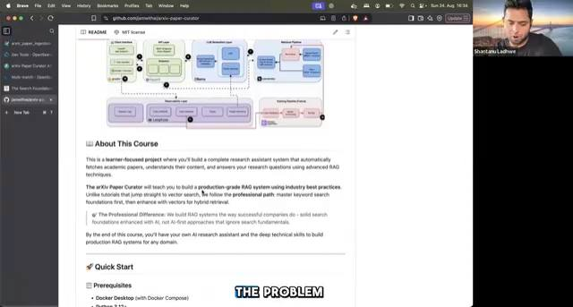
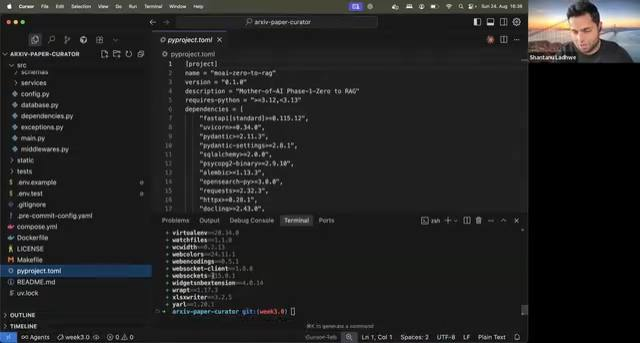
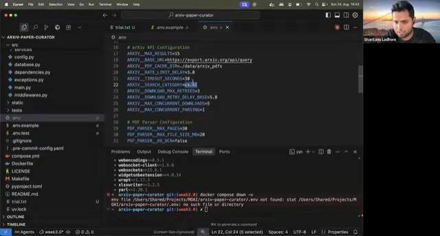
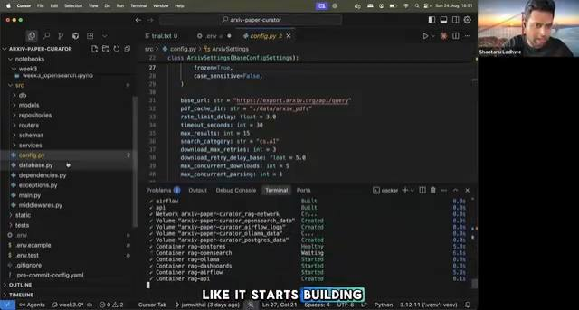
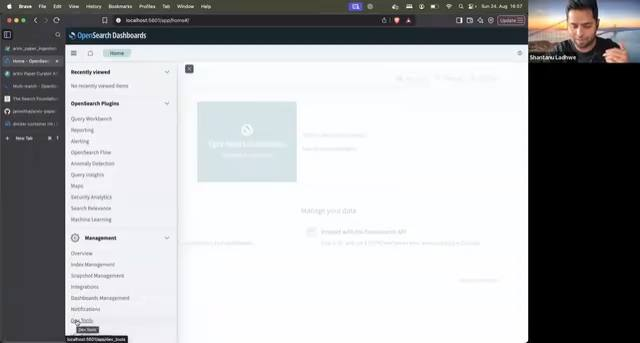
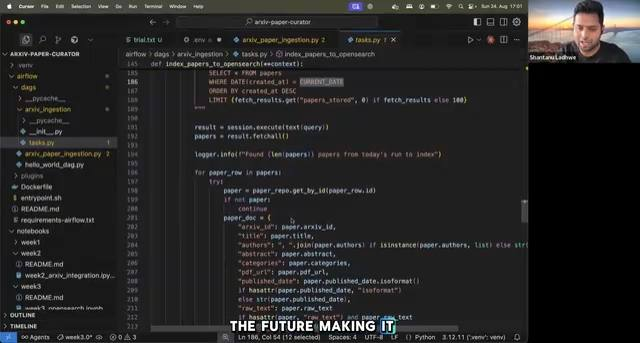
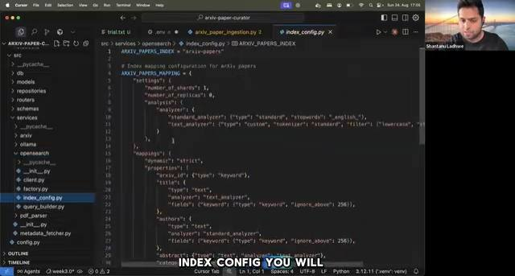
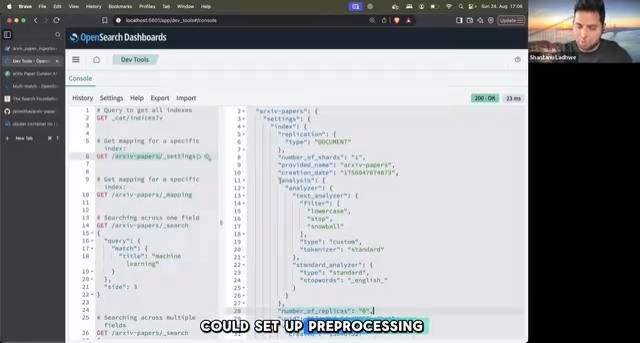
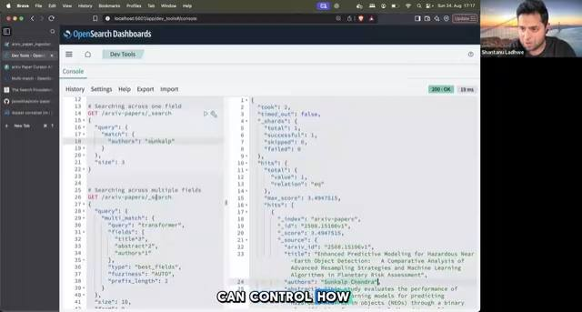
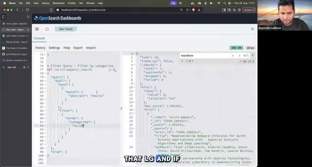

# Production-Ready RAG from Scratch：P10 复现文档（week 3：采集 → 解析 → PostgreSQL → OpenSearch → 关键词检索）

> 说明：P10 对应课程的 week 3 收尾。它不再讲“RAG 是什么”，而是把一条可运行的论文流水线跑起来：用 Airflow 抓 arXiv `cs.AI` 论文，用 Dockling 解析 PDF，先落 PostgreSQL 的 `papers` 表，再由另一个 DAG 写入 OpenSearch 的 `archive_papers` 索引，最后用 OpenSearch 查询 DSL 和课程 API 做关键词检索。第 4 周才会在 mapping 里加 `chunks` 和 `embedding` 字段；P10 里还没有向量检索。  
> 另一个说明：逐字稿是课堂口语，讲师没有逐行念出仓库源码。下面凡是从仓库直接执行的步骤，我会写“以仓库实际文件为准”；凡是我为了让你能独立验证检索层而补的完整文件，会放在 `repro/` 目录，并明确标注“不是课程仓库原文件”。这样既不冒充讲师源码，也能让你把东西跑起来。

---

## 1. 这一节做什么

这一节要交付的是一条“生产化 RAG 的数据准备段”，不是最终聊天机器人。完成后你应该能：

1. 从课程仓库的 **week 3 release tag** 克隆代码，避免 week 2/week 3 依赖互相污染。
2. 用 `uv sync` 建本地 Python 环境，安装 `pyproject.toml` 里的依赖。
3. 创建 `.env`，把“每天抓多少篇、超时多少秒、Dockling 最多解析多少页、arXiv 分类、Airflow 调度、默认管理员账号”这些易变参数从代码里拿出来。
4. 用 `docker compose down -v` 清掉旧容器和旧卷，再 `docker compose build` / `docker compose up -d` 启动课程里的 5 个容器（Airflow、PostgreSQL、OpenSearch、OpenSearch Dashboard，以及课程自带的 API/辅助服务；具体服务名以 `docker-compose.yml` 为准）。
5. 在 Airflow 里触发采集 DAG，或对历史日期做 backfill。采集结果先写入 PostgreSQL 的 `papers` 表；课里演示 `select * from papers` 时因为流水线还在跑，所以先是空数据。
6. 触发 `index_paper_to_opensearch` DAG，把 PostgreSQL 里当天创建的论文写入 OpenSearch 索引 `archive_papers`。
7. 用 OpenSearch Dashboard 或 `_search` DSL 验证：`multi_match` 查标题/摘要、`term` 过滤 `categories`、`range` 过滤 `published_date`、`sort` 按日期倒序、`from/size` 分页。
8. 用课程 API 的 `query builder` 把上述条件程序化拼成 OpenSearch 查询，而不是在代码里硬编码一整段 JSON。

这一节的核心取舍是：**先用关键词检索把链路跑通**。讲师明确说，如果关键词检索已经够用，不必上向量检索；OpenSearch 基于 Lucene（Java 生态，知道即可），在关键词精确控制、过滤、排序上比纯向量库更直接。第 4 周才进入 chunk + embedding。

---

## 2. 讲师原话（带「—— pNNN [MM:SS]」）

讲师先解释为什么每个 week 要单独克隆：

> "每周都有一个不同的发布标签，是我们生成的……我们可以单独克隆它。"
> —— p010 [01:47]



接着是环境安装：

> "你需要执行 UV sync，因为你有这个项目，PyProject 是正常的，我们需要安装所有这些包。"
> —— p010 [03:37]

清理旧容器和旧卷：

> "最好把卷完全删掉……执行 docker compose down -v。"
> —— p010 [05:32]



环境变量文件：

> "你只需要复制粘贴，单独创建这个文件…….env 文件里有你入门所需的全部设置。"
> —— p010 [07:30]



启动容器：

> "执行 Docker compose build，然后运行 Docker compose up 并构建……-d 表示分离模式。"
> —— p010 [15:57]



Airflow 历史回填：

> "执行 airflow dags backfill，这个 DAG 从开始时间到结束时间。"
> —— p010 [19:14]

PostgreSQL 验证：

> "执行 select * from papers，会显示没有可用数据，因为 airflow 流水线还在运行。"
> —— p010 [20:09]



索引 DAG：

> "我们有一个标签，名为 index paper to OpenSearch。"
> —— p010 [22:34]



OpenSearch 索引与 mapping：

> "你可以把 open search 的索引看作数据库里的 schema 或表。"
> —— p010 [25:50]

> "对于 archive ID，我们分配了 keyword 类型……当类型是 text 时，它是完整字符串；当类型是 keyword 时，你可以认为它是一个类别。"
> —— p010 [27:40]



文本预处理分析器：

> "我们把它转成小写，去掉所有停用词，还对词做词干化，比如用 snowball stemmer。"
> —— p010 [31:01]



查询打分：

> "我们想给标题更高的权重，给摘要稍低一点的分数。"
> —— p010 [38:26]



过滤与排序：

> "from 就派上用场了……你不会一次性加载全部数据，从一到一百万。"
> —— p010 [49:13]



查询构造器：

> "在这种情况下，我们有一个叫 query builder 的东西。"
> —— p010 [47:48]

---

## 3. 从零复现

### 3.1 前置条件

你需要：

- Git；
- Docker Desktop（或 Docker Engine + Compose 插件）；
- `uv`（课程用 `uv sync` 管理 Python 环境）；
- 一个空的练习目录，例如 `~/rag-course`；
- 一个 PostgreSQL 客户端。讲师口述听起来像 “DPUR”，实际用 DBeaver、TablePlus、psql 都可以；课里没有指定客户端名称。

> 课里没有给仓库 URL、tag 的精确字符串、服务名、端口、数据库名。下面凡是 `<...>` 的地方，都要以你 clone 下来的仓库为准。不要凭记忆写死。

### 3.2 克隆 week 3 的 release tag

讲师说每个 week 是独立 release tag，week 3 的变更可能破坏 week 2，所以不要直接在 main 上混着跑。

```bash
mkdir -p ~/rag-course
cd ~/rag-course

# 先看仓库有哪些 tag；课里说 tag 叫 “week three”，精确名字以仓库为准
git clone <REPO_URL> week-three
cd week-three
git tag -l
git checkout <WEEK_THREE_TAG>
```

如果你已经知道 tag 名，也可以：

```bash
git clone --branch <WEEK_THREE_TAG> <REPO_URL> week-three
cd week-three
```

目录结构不要死记。clone 后你只需要认这几个入口：

```text
week-three/
├── pyproject.toml          # uv sync 读它
├── uv.lock                 # 精确依赖版本在这里，不要手改
├── .env.example            # 如果有，复制成 .env；没有就按仓库 README 新建
├── docker-compose.yml      # 5 个容器的编排
├── airflow/ 或 dags/       # Airflow DAG 所在位置，以仓库为准
├── services/               # 课里说按 modular design 拆的 service，含 opensearch service
└── ...
```

### 3.3 安装 Python 依赖：`uv sync`

```bash
cd ~/rag-course/week-three
uv sync
```

`uv sync` 会读 `pyproject.toml` 和 `uv.lock`，创建 `.venv` 并安装依赖。课里特别提醒：讲师用的是 MacBook，某些包可能只对 macOS 兼容；如果你在 Windows/Linux 上遇到安装失败，不要硬扛，去 `pyproject.toml` 里找对应包，换成你 OS 兼容的版本，再重新 `uv sync`。

> 课里没有给任何包的版本号。不要在这份文档里抄一个“看起来对”的版本号；版本以仓库 `uv.lock` 为准。你要新增依赖时用 `uv add`，让 uv 把精确版本写进 lock 文件。

### 3.4 创建 `.env`

课里说：把 `.env` 复制/新建出来，应用启动时 config 会先读环境变量，读不到再用默认值。本地开发用 `.env`，生产不要依赖 `.env` 文件，而是用容器/ECS task definition 的环境变量。

```bash
cd ~/rag-course/week-three
cp .env.example .env
# 如果没有 .env.example，就手动新建 .env
```

课程里明确提到的配置含义如下。**注意：逐字稿没有逐个念出变量键名，下面键名是为了让复现脚本能跑而统一的命名；你仓库里的键名可能不同，以 `.env.example` 为准。** 如果仓库用 `MAX_PAPERS` 而不是 `MAX_RESULTS`，改脚本里的名字即可。

| 变量（本文统一命名） | 课程里的含义 | 本复现示例值 |
|---|---|---|
| `MAX_RESULTS` | 每天最多抓多少篇论文 | `15` |
| `REQUEST_TIMEOUT_SECONDS` | 请求/下载超时秒数 | `30` |
| `MAX_PAGES` | Dockling 最多解析多少页 | `30` |
| `RATE_LIMIT` | 请求限速 | 课里只说可调，默认以仓库为准 |
| `DOWNLOAD_RETRY` | 下载重试次数 | 课里只说可调，默认以仓库为准 |
| `SEARCH_CATEGORY` | arXiv 分类，只要 AI 相关 | `cs.AI` |
| `AIRFLOW_SCHEDULE` | 调度时间，课里说 6 UTC | `0 6 * * *` |
| `AIRFLOW_CATCHUP` | 是否补跑历史 | `false` |
| `AIRFLOW_USER` / `AIRFLOW_PASSWORD` | Airflow 默认登录 | `admin` / `admin` |
| `OPENSEARCH_INDEX` | 索引名 | `archive_papers` |
| `OPENSEARCH_HOST` / `OPENSEARCH_PORT` | OpenSearch 地址 | `localhost` / `9200` |

讲师还强调：`.env` 里放的是“经常变”的参数。比如产品明天说不要处理 100 页，只要 50 页，你不应该改代码再走 PR/CI/CD，而应该改环境变量。生产里这个变量在 ECS task definition 或容器的 environment 里设置。

> 在 JS/Node 里，这对应 `process.env.MAX_RESULTS`；本地用 `dotenv/config` 读 `.env`，容器里由 Compose 的 `environment` / `env_file` 注入。不要把 `.env` 提交到仓库，也不要把 `.env` 打进镜像。

### 3.5 清理旧容器和旧卷

每次 week 更新，Docker 镜像和 volumes 可能带旧数据。讲师建议先彻底清掉：

```bash
cd ~/rag-course/week-three
docker compose down -v
docker ps
```

`down -v` 会停止并删除 Compose 里的容器，同时删除挂载卷。这样 PostgreSQL 和 OpenSearch 不会带着上一周的 stale data 启动。

如果 `docker compose down -v` 不生效，可以打开 Docker Desktop 看正在运行的容器，手动停/删；或者用课程里说的方式把相关容器、卷、镜像清掉。课里没有给出唯一命令，以你能把 5 个旧容器清干净为准。

### 3.6 构建并启动容器

```bash
docker compose build
docker compose up -d
```

课里同时提到 `docker compose up --build -d`，效果一样：先构建再后台启动。`-d` 是 detached mode，不会把每个容器日志刷在终端。

```bash
docker compose ps
```

课里说启动后能看到 5 个 Docker 容器在跑。具体服务名、端口映射以 `docker-compose.yml` 为准。你至少要确认 Airflow、PostgreSQL、OpenSearch、OpenSearch Dashboard 这几个角色都在。

> 课里提到 `entrypoint.sh` 依赖曾导致一些人构建失败。按“先 clone 指定 tag，再 build”的顺序通常不会遇到；如果你遇到，先看构建日志里是哪个文件没有执行权限或换行符不对。

### 3.7 进入 Airflow，触发采集 DAG / backfill

浏览器打开 Airflow。课里说默认用户名/密码是 `admin` / `admin`，但端口课里没讲，以 `docker-compose.yml` 的端口映射为准。

课里演示了两种方式：

1. 在 UI 里取消 pause，直接 trigger 当天运行；
2. 用命令行对历史日期 backfill：

```bash
docker compose exec -T airflow airflow dags backfill <DAG_ID> -s 2025-01-01 -e 2025-01-05
```

- `<DAG_ID>`：采集 DAG 的 id，课里没有念出具体字符串，去 Airflow UI 或 `dags/` 目录看。
- `airflow`：Compose 服务名，以你的 `docker-compose.yml` 为准。
- `-s` / `-e`：start/end，课里说 “from started to ended”。

课里还解释了 `catchup`：如果设成 `true`，Airflow 会从 start date 开始把历史日期全跑一遍；讲师不想一启动就跑过去 25 天，所以设了 `false`。需要补历史时用 backfill，而不是把 catchup 打开。

### 3.8 验证 PostgreSQL 的 `papers` 表

用你的 PostgreSQL 客户端连课程容器，执行：

```sql
select * from papers;
```

课里演示时流水线还在跑，所以先是 “no data available”；等 Airflow 跑完再看，应该有最多 15 条（由 `MAX_RESULTS=15` 决定）。课里说有些论文因为页数超过 `MAX_PAGES` 没有 parse 成功，但记录仍会继续走后面的索引流程。

> 数据库名、用户名、密码、端口课里没有逐字讲，以 `.env` 和 `docker-compose.yml` 为准。不要默认写 `postgres/postgres`。

### 3.9 触发 `index_paper_to_opensearch` DAG

课里明确有一个 DAG 叫 `index_paper_to_opensearch`。它做的是：

1. 从缓存/依赖里拿 PostgreSQL client 和 OpenSearch client（课里说 clients 被 cache 起来，避免每次新建连接）；
2. 按“本次运行日期”从 PostgreSQL 取当天创建的论文；
3. 把论文的字段写入 OpenSearch 的 `archive_papers` 索引。

在 Airflow UI 里找到这个 DAG，trigger 一次。课里说它会把“下载并解析成功的”和“解析失败但仍保留字段的”都推进 OpenSearch，所以最终索引里也是 15 条左右。

### 3.10 验证 OpenSearch 索引

先确认索引存在、文档数对：

```bash
export OS_URL="http://localhost:9200"   # 端口以 compose 为准
curl -s "$OS_URL/_cat/indices?v"
curl -s "$OS_URL/archive_papers/_count?pretty"
```

课里说 `archive_papers` 就像数据库里的表/schema。它的 mapping 里，`archive_id` 是 `keyword`，`title`/`abstract`/`authors` 是 `text`，`categories` 是 `keyword`，日期字段是 `date`。`text` 会做全文分析，`keyword` 当作分类精确匹配；同一个字段还可以同时有 `text` 和 `keyword` 子字段（multi-fields），这样既能全文搜，又能精确过滤/排序。

### 3.11 用 DSL 做关键词检索

课里演示了三类查询，你都可以在 OpenSearch Dashboard 的 Dev Tools 里跑：

**A. 标题/摘要多字段匹配 + 权重 + fuzziness：**

```json
{
```json
{
  "size": 10,
  "query": {
    "multi_match": {
      "query": "transformer",
      "fields": ["title^3", "abstract", "authors"],
      "fuzziness": "AUTO"
    }
  }
}
```

- `fields` 里的 `^3` 就是讲师说的“给 title 更高权重、abstract 低一点”。课里口头把 author 也说成降权字段，所以我把 `authors` 留在数组里但不加 boost。
- `fuzziness` 对应讲师说的“允许若干字母的位移”，用来兜住拼写错误。课里没有念出具体参数值，`AUTO` 只是一个常见写法；写成 `"1"` 或 `"2"` 也可以，按你的数据调。
- 这个查询能召回 `transform` 而不是 `transformer`，原因是写入时 `snowball` stemmer 已经把 `transformer` 处理成了 `transform`（讲师在 [39:18] 专门解释了这一点）。所以“搜不到原词”不是 bug。

**B. 精确过滤 + 裁剪返回字段（category + abstract 关键词）：**

```json
{
  "_source": ["title", "abstract", "categories", "published_date"],
  "size": 10,
  "query": {
    "bool": {
      "must": [
        { "match": { "abstract": "neural" } }
      ],
      "filter": [
        { "term": { "categories": "cs.LG" } }
      ]
    }
  }
}
```

- `filter` 里的 `term` 走 `keyword` 字段，是“分类等于”的精确匹配，不做分词；`must` 里的 `match` 走 `text` 字段，会先过 analyzer。
- `categories` 的实际存储值请以索引里看到的为准：讲师口头说的是 “LG”，arXiv 的分类写法是 `cs.LG`，你 `_search` 出来看一眼就知道真实值。
- `_source` 就是讲师说的“我不想所有字段都返回，只要 abstract 和 categories”——只影响返回体，不影响匹配和打分。

**C. 默认排序 + 只看前 5 条：**

```json
{
  "size": 5,
  "query": { "match_all": {} },
  "sort": [ { "published_date": { "order": "desc" } } ]
}
```

- `match_all` 就是讲师说的“它只是取全部 15 条，但按 published date 排序”。
- `size: 5` 对应“size 定义了 top five”。

**D. 组合查询：关键词 + 日期范围 + 分类 + 排序 + 分页：**

```json
{
  "from": 0,
  "size": 5,
  "query": {
    "bool": {
      "must": [
        {
          "multi_match": {
            "query": "learning",
            "fields": ["title^3", "abstract"]
          }
        }
      ],
      "filter": [
        { "range": { "published_date": { "gte": "2025-01-01" } } },
        { "term": { "categories": "cs.AI" } }
      ]
    }
  },
  "sort": [ { "published_date": { "order": "desc" } } ]
}
```

- 这一段是把讲师 [44:30]–[45:28] 演示的东西组合到一起：`multi_match` 打标题/摘要、`range` 卡发布日期、`term` 卡分类、`sort` 让最新的在前、`from`+`size` 控制分页。
- `from` 是 0 基偏移。讲师说的“0 到 50、51 到 100”这种分页，在 DSL 里就是 `from: 0, size: 50` 和 `from: 50, size: 50`。
- `gte` 就是讲师说的 “GT，greater than”。要闭区间用 `gte`，要开区间用 `gt`。

### 3.12 用课程 API 验证「查询构造器」

讲师说他们没把上面那段 JSON 硬编码进代码，而是写了一个 `query builder` 类，在 `search` 路由里 `build()` 出来；请求模型里有 `query`、`size`、`from`、`categories`、`latest_paper` 这几个字段，`if self.latest_paper` 成立时才把排序子句加进去。

课程 API 的文档页（OpenAPI）能直接 `try it out`。你按讲师的方式验证一次：`size=10`、不传 `categories`、`query=machine`、不勾最新，执行后应该拿到和 Dev Tools 里手工跑 `multi_match` 一样的三条结果。

> 课程 API 的字段名、路由前缀、请求体结构请以仓库里的 router/schema 为准。下一节的 `repro/api/` 是我按讲师描述重写的等价实现，不是课程原文件，用来让你在没有课程仓库访问权限时也能把检索层跑通。

---

## 4. 完整代码

下面 `repro/` 目录是我的验证工程，**不是课程仓库原文件**。它的作用是：即使你只跑通了 Docker，也能在一个干净目录里复现 P10 演示的 mapping、查询 DSL 和 query builder 行为。字段名以课程 `archive_papers` 的实际 mapping 为准，对不上就改这几个 JSON。

目录结构：

```text
repro/
├── .env.example
├── requirements.txt
├── index/
│   ├── archive_papers.settings.json
│   └── sample_docs.ndjson
├── queries/
│   ├── a_multi_match.json
│   ├── b_filter_source.json
│   ├── c_sort_latest.json
│   └── d_combined.json
├── scripts/
│   └── run_repro.sh
└── api/
    ├── __init__.py
    ├── settings.py
    ├── deps.py
    ├── schemas.py
    ├── query_builder.py
    ├── search_router.py
    └── main.py
```

### 4.1 `repro/.env.example`

```dotenv
# ---- OpenSearch ----
OPENSEARCH_HOST=http://localhost:9200
OPENSEARCH_INDEX=archive_papers
OPENSEARCH_TIMEOUT_SECONDS=10

# ---- 业务默认值（对应课程 .env 里那些"经常变"的参数）----
MAX_RESULTS=15
REQUEST_TIMEOUT_SECONDS=30
MAX_PAGES=30
SEARCH_CATEGORY=cs.AI
DEFAULT_PAGE_SIZE=10
MAX_PAGE_SIZE=100
```

### 4.2 `repro/requirements.txt`

```text
fastapi
uvicorn[standard]
opensearch-py
pydantic
pydantic-settings
```

> 课程仓库用 `uv sync` + `uv.lock` 锁版本；这里为了最小可运行用 pip 直接装。**不要从这份文档抄版本号**，需要锁版本就用 `uv lock` 生成你自己的锁文件。

### 4.3 `repro/index/archive_papers.settings.json`

```json
{
  "settings": {
    "number_of_shards": 1,
    "number_of_replicas": 0,
    "analysis": {
      "analyzer": {
        "text_analyzer": {
          "type": "custom",
          "tokenizer": "standard",
          "filter": ["lowercase", "stop", "snowball"]
        }
      }
    }
  },
  "mappings": {
    "properties": {
      "archive_id": {
        "type": "keyword"
      },
      "title": {
        "type": "text",
        "analyzer": "text_analyzer",
        "fields": {
          "keyword": { "type": "keyword", "ignore_above": 512 }
        }
      },
      "abstract": {
        "type": "text",
        "analyzer": "text_analyzer"
      },
      "authors": {
        "type": "text",
        "analyzer": "text_analyzer",
        "fields": {
          "keyword": { "type": "keyword", "ignore_above": 256 }
        }
      },
      "categories": {
        "type": "keyword"
      },
      "published_date": {
        "type": "date"
      },
      "pdf_url": {
        "type": "keyword"
      },
      "parse_status": {
        "type": "keyword"
      },
      "created_at": {
        "type": "date"
      }
    }
  }
}
```

> 讲师在 [27:11]–[28:10] 讲的字段是 `archive_id`（keyword）、标题/摘要/作者（text）、`categories`（keyword）、日期（date）。`pdf_url` / `parse_status` / `created_at` 是我为了让“解析失败也入库”这件事可查而额外加的，**课程索引里不一定有**，你 clone 仓库后看 `index config` 里到底有哪些字段，多退少补。
> `number_of_shards` / `number_of_replicas` 讲师明确说“生产很重要，现在可以跳过”，本地单节点设 1/0 只是为了不起黄灯。

### 4.4 `repro/index/sample_docs.ndjson`

bulk 格式：每行一个 action、每行一个 doc，最后一行必须有换行。下面是手工构造的验证数据，**不是从 arXiv 抓的真实论文**。

```json
{"index":{"_id":"2401.00001"}}
{"archive_id":"2401.00001","title":"Scaling Laws for Transformer Language Models","abstract":"We study how transformer based language models scale with data and parameters, and derive empirical learning curves.","authors":["Sankalp Rao","Wei Zhang"],"categories":["cs.AI"],"published_date":"2025-01-03","pdf_url":"https://example.invalid/2401.00001.pdf","parse_status":"parsed","created_at":"2025-01-04T06:10:00Z"}
{"index":{"_id":"2401.00002"}}
{"archive_id":"2401.00002","title":"Neural Retrieval with Sparse Keyword Signals","abstract":"A neural reranker combined with BM25 keyword retrieval for academic search over machine learning papers.","authors":["Anna Muller"],"categories":["cs.LG"],"published_date":"2025-01-05","pdf_url":"https://example.invalid/2401.00002.pdf","parse_status":"parsed","created_at":"2025-01-05T06:12:00Z"}
{"index":{"_id":"2401.00003"}}
{"archive_id":"2401.00003","title":"Learning to Rank Course Materials","abstract":"We present a learning to rank approach for educational content, evaluated on retrieval benchmarks.","authors":["Sankalp Rao"],"categories":["cs.AI"],"published_date":"2025-01-07","pdf_url":"https://example.invalid/2401.00003.pdf","parse_status":"parsed","created_at":"2025-01-07T06:05:00Z"}
{"index":{"_id":"2401.00004"}}
{"archive_id":"2401.00004","title":"Sparse Mixture of Experts Revisited","abstract":"An analysis of routing collapse in sparse mixture of experts models for language modelling.","authors":["Jin Park"],"categories":["cs.LG"],"published_date":"2025-01-09","pdf_url":"https://example.invalid/2401.00004.pdf","parse_status":"parse_failed","created_at":"2025-01-09T06:20:00Z"}
{"index":{"_id":"2401.00005"}}
{"archive_id":"2401.00005","title":"Neural Compression for Long Documents","abstract":"Lossy neural compression of long PDF documents before keyword indexing.","authors":["Anna Muller","Jin Park"],"categories":["cs.LG"],"published_date":"2025-01-11","pdf_url":"https://example.invalid/2401.00005.pdf","parse_status":"parsed","created_at":"2025-01-11T06:31:00Z"}
{"index":{"_id":"2401.00006"}}
{"archive_id":"2401.00006","title":"Benchmarking Document Parsers","abstract":"We benchmark document parsing pipelines on machine learning papers of varying page counts.","authors":["Wei Zhang"],"categories":["cs.AI"],"published_date":"2025-01-13","pdf_url":"https://example.invalid/2401.00006.pdf","parse_status":"parsed","created_at":"2025-01-13T06:02:00Z"}
```

### 4.5 `repro/queries/a_multi_match.json`

```json
{
  "size": 10,
  "query": {
    "multi_match": {
      "query": "transformer",
      "fields": ["title^3", "abstract", "authors"],
      "fuzziness": "AUTO"
    }
  }
}
```

### 4.6 `repro/queries/b_filter_source.json`

```json
{
  "_source": ["title", "abstract", "categories", "published_date"],
  "size": 10,
  "query": {
    "bool": {
      "must": [
        { "match": { "abstract": "neural" } }
      ],
      "filter": [
        { "term": { "categories": "cs.LG" } }
      ]
    }
  }
}
```

### 4.7 `repro/queries/c_sort_latest.json`

```json
{
  "size": 5,
  "query": { "match_all": {} },
  "sort": [ { "published_date": { "order": "desc" } } ]
}
```

### 4.8 `repro/queries/d_combined.json`

```json
{
  "from": 0,
  "size": 5,
  "query": {
    "bool": {
      "must": [
        {
          "multi_match": {
            "query": "learning",
            "fields": ["title^3", "abstract"]
          }
        }
      ],
      "filter": [
        { "range": { "published_date": { "gte": "2025-01-01" } } },
        { "term": { "categories": "cs.AI" } }
      ]
    }
  },
  "sort": [ { "published_date": { "order": "desc" } } ]
}
```

### 4.9 `repro/scripts/run_repro.sh`

```bash
#!/usr/bin/env bash
set -euo pipefail

OS_URL="${OS_URL:-http://localhost:9200}"
INDEX="${INDEX:-archive_papers}"
HERE="$(cd "$(dirname "${BASH_SOURCE[0]}")/.." && pwd)"

echo "==> 删除旧索引（不存在会返回 404，忽略）"
curl -s -o /dev/null -w "delete status: %{http_code}\n" -X DELETE "${OS_URL}/${INDEX}"

echo "==> 创建索引：analyzer + mapping"
curl -s -X PUT "${OS_URL}/${INDEX}" \
  -H 'Content-Type: application/json' \
  --data-binary "@${HERE}/index/archive_papers.settings.json"
echo

echo "==> bulk 写入样例文档并强制刷新"
curl -s -X POST "${OS_URL}/${INDEX}/_bulk?refresh=true" \
  -H 'Content-Type: application/x-ndjson' \
  --data-binary "@${HERE}/index/sample_docs.ndjson"
echo

echo "==> 文档数"
curl -s "${OS_URL}/${INDEX}/_count?pretty"

echo
echo "==> A. multi_match（title^3 + abstract + authors, fuzziness=AUTO）"
curl -s -X POST "${OS_URL}/${INDEX}/_search" \
  -H 'Content-Type: application/json' \
  --data-binary "@${HERE}/queries/a_multi_match.json"

echo
echo "==> B. term 过滤 categories + _source 裁剪"
curl -s -X POST "${OS_URL}/${INDEX}/_search" \
  -H 'Content-Type: application/json' \
  --data-binary "@${HERE}/queries/b_filter_source.json"

echo
echo "==> C. match_all + published_date 倒序 + size=5"
curl -s -X POST "${OS_URL}/${INDEX}/_search" \
  -H 'Content-Type: application/json' \
  --data-binary "@${HERE}/queries/c_sort_latest.json"

echo
echo "==> D. 组合查询：match + range + term + sort + 分页"
curl -s -X POST "${OS_URL}/${INDEX}/_search" \
  -H 'Content-Type: application/json' \
  --data-binary "@${HERE}/queries/d_combined.json"

echo
echo "==> 完成。逐条对比返回体里的 _score 与排序。"
```

### 4.10 `repro/api/__init__.py`

```python
```

（空文件，只为让 `api` 成为包。）

### 4.11 `repro/api/settings.py`

```python
from pydantic_settings import BaseSettings, SettingsConfigDict


class Settings(BaseSettings):
    """环境变量优先，其次读 .env，最后用这里的默认值。

    对应讲师说的：config 启动时先找 .env，把里面的值取出来；
    取不到就用代码里的默认值。生产环境不挂 .env，直接由容器注入环境变量。
    """

    model_config = SettingsConfigDict(env_file=".env", extra="ignore")

    # OpenSearch
    opensearch_host: str = "http://localhost:9200"
    opensearch_index: str = "archive_papers"
    opensearch_timeout_seconds: int = 10

    # 业务默认值
    max_results: int = 15
    request_timeout_seconds: int = 30
    max_pages: int = 30
    search_category: str = "cs.AI"
    default_page_size: int = 10
    max_page_size: int = 100


settings = Settings()
```

### 4.12 `repro/api/deps.py`

```python
from functools import lru_cache

from opensearchpy import OpenSearch

from .settings import settings


@lru_cache(maxsize=1)
def get_opensearch_client() -> OpenSearch:
    """进程内只创建一个 client。

    对应讲师说的：clients 放在 cache 里，不要每次请求都新建数据库/搜索连接。
    在 Node 里等价于模块顶层 new Client() 后 export 单例，而不是在 handler 里 new。
    """
    return OpenSearch(
        hosts=[settings.opensearch_host],
        timeout=settings.opensearch_timeout_seconds,
        retry_on_timeout=True,
        max_retries=2,
    )
```

### 4.13 `repro/api/schemas.py`

```python
from typing import List, Optional

from pydantic import BaseModel, Field

from .settings import settings


class SearchRequest(BaseModel):
    query: Optional[str] = Field(
        default=None,
        description="关键词；为空时退化为 match_all",
    )
    size: int = Field(
        default=settings.default_page_size,
        ge=1,
        le=settings.max_page_size,
        description="返回条数，对应 DSL 的 size",
    )
    from_: int = Field(
        default=0,
        ge=0,
        alias="from",
        description="分页偏移，对应 DSL 的 from；用别名是因为 from 是 Python 关键字",
    )
    categories: Optional[List[str]] = Field(
        default=None,
        description="分类精确过滤，对应 keyword 字段上的 terms 查询",
    )
    latest_paper: bool = Field(
        default=False,
        description="为 true 时按 published_date 倒序",
    )
    published_after: Optional[str] = Field(
        default=None,
        description="发布日期下界（含），ISO 日期字符串",
    )


class PaperHit(BaseModel):
    archive_id: Optional[str] = None
    title: Optional[str] = None
    abstract: Optional[str] = None
    authors: Optional[List[str]] = None
    categories: Optional[List[str]] = None
    published_date: Optional[str] = None
    score: Optional[float] = None


class SearchResponse(BaseModel):
    total: int
    took_ms: int
    hits: List[PaperHit]
```

### 4.14 `repro/api/query_builder.py`

```python
from typing import Any, Dict, List, Optional


class QueryBuilder:
    """把请求条件翻译成 OpenSearch 查询体。

    结构与课程 week 3 的 query builder 一致：
    match / filter / sort 分开拼，只有条件存在时才加入对应子句，
    而不是把一整段 JSON 硬编码进代码。
    """

    def __init__(
        self,
        query: Optional[str] = None,
        size: int = 10,
        from_: int = 0,
        categories: Optional[List[str]] = None,
        latest_paper: bool = False,
        published_after: Optional[str] = None,
    ) -> None:
        self.query = query
        self.size = size
        self.from_ = from_
        self.categories = categories or []
        self.latest_paper = latest_paper
        self.published_after = published_after

    def _match_clause(self) -> Dict[str, Any]:
        if not self.query:
            return {"match_all": {}}
        return {
            "multi_match": {
                "query": self.query,
                "fields": ["title^3", "abstract", "authors"],
            }
        }

    def _filter_clauses(self) -> List[Dict[str, Any]]:
        filters: List[Dict[str, Any]] = []
        if self.categories:
            filters.append({"terms": {"categories": self.categories}})
        if self.published_after:
            filters.append(
                {"range": {"published_date": {"gte": self.published_after}}}
            )
        return filters

    def _sort_clause(self) -> List[Dict[str, Any]]:
        if self.latest_paper:
            return [{"published_date": {"order": "desc"}}]
        return []

    def build(self) -> Dict[str, Any]:
        body: Dict[str, Any] = {
            "from": self.from_,
            "size": self.size,
            "query": {
                "bool": {
                    "must": [self._match_clause()],
                    "filter": self._filter_clauses(),
                }
            },
        }
        sort = self._sort_clause()
        if sort:
            body
```python
            body["sort"] = sort
        return body
```

### 4.15 `repro/api/search_router.py`

```python
from typing import Any, Dict

from fastapi import APIRouter, Depends
from opensearchpy import OpenSearch

from .deps import get_opensearch_client
from .query_builder import QueryBuilder
from .schemas import PaperHit, SearchRequest, SearchResponse
from .settings import settings

router = APIRouter(prefix="/search", tags=["search"])


def _to_hit(source: Dict[str, Any], score: float | None) -> PaperHit:
    return PaperHit(
        archive_id=source.get("archive_id"),
        title=source.get("title"),
        abstract=source.get("abstract"),
        authors=source.get("authors"),
        categories=source.get("categories"),
        published_date=source.get("published_date"),
        score=score,
    )


@router.post("/papers", response_model=SearchResponse)
def search_papers(
    payload: SearchRequest,
    client: OpenSearch = Depends(get_opensearch_client),
) -> SearchResponse:
    """对应讲师说的 search 路由：

    - 请求体是 SearchRequest（query / size / from / categories / latest_paper）
    - 通过 Depends 注入 OpenSearch client
    - 具体 DSL 交给 QueryBuilder，按条件逐段拼
    """
    body = QueryBuilder(
        query=payload.query,
        size=payload.size,
        from_=payload.from_,
        categories=payload.categories,
        latest_paper=payload.latest_paper,
        published_after=payload.published_after,
    ).build()

    raw = client.search(index=settings.opensearch_index, body=body)

    hits_block = raw.get("hits", {})
    total_block = hits_block.get("total", {})
    # OpenSearch 7+ 的 total 是对象；兼容旧格式时可能直接是 int
    total = (
        total_block.get("value", 0)
        if isinstance(total_block, dict)
        else int(total_block)
    )

    hits = [
        _to_hit(h.get("_source", {}), h.get("_score"))
        for h in hits_block.get("hits", [])
    ]

    return SearchResponse(
        total=total,
        took_ms=int(raw.get("took", 0)),
        hits=hits,
    )
```

### 4.16 `repro/api/main.py`

```python
from fastapi import FastAPI

from .search_router import router as search_router

app = FastAPI(
    title="Week 3 keyword retrieval repro",
    version="0.1.0",
)

app.include_router(search_router)


@app.get("/health")
def health() -> dict:
    return {"status": "ok"}
```

### 4.17 启动与验证

```bash
cd ~/rag-course/repro
python -m venv .venv
source .venv/bin/activate          # Windows: .venv\Scripts\activate
pip install -r requirements.txt

cp .env.example .env
bash scripts/run_repro.sh
```

如果 OpenSearch 不是 `localhost:9200`，先改 `.env`，并用环境变量覆盖脚本：

```bash
OS_URL="http://localhost:9200" INDEX="archive_papers" bash scripts/run_repro.sh
```

起 API：

```bash
uvicorn api.main:app --reload --port 8000
```

打开 `http://localhost:8000/docs`，在 `POST /search/papers` 里试：

```json
{
  "query": "machine",
  "size": 10,
  "from": 0,
  "latest_paper": false
}
```

按讲师的演示，`machine` 应该只召回标题/摘要里含 machine 的少数几条；把 `latest_paper` 改成 `true`，返回顺序会按 `published_date` 倒序；加 `"categories": ["cs.AI"]` 会把 `cs.LG` 的论文过滤掉。

---

## 5. 逐行解释

### 5.1 索引 mapping（4.3）

- `"number_of_shards": 1, "number_of_replicas": 0`：本地单节点，副本设 1 会永远黄灯（unassigned replica）。讲师说 sharding/replica “生产很重要，现在可以跳过”，指的就是这里。生产里要提高分片与副本，把数据分散到多个节点甚至多个 region。
- `"analyzer": {"text_analyzer": {...}}`：对应讲师 [31:01] 讲的三件事——`lowercase` 转小写、`stop` 去停用词、`snowball` 做词干还原。`tokenizer: standard` 就是讲师说的 “standard tokenizer”，把 `Shantanu is eating pizza` 切成 `shantanu / is / eating / pizza`，`is` 是停用词被去掉，`eating` 被 stemmer 变成 `eat`。
- 为什么把 analyzer 绑在 mapping 上而不是应用层预处理：讲师 [33:47] 明确说，在搜索引挐内部做预处理比在入库前自己写预处理更省时——现实里每小时可能有上百万文档增删，你不想在应用层再走一遍分词。
- `title` 同时有 `text` 和 `fields.keyword`：这就是讲师 [28:37] 说的 multi-fields——同一字段既能全文搜，又能当 `keyword` 精确过滤/排序。`ignore_above` 是为了防止超长标题撑爆 keyword 索引，课里没提这个参数，属于工程常识补充。
- `abstract` 只有 `text`：摘要只用于全文匹配，不需要精确过滤。
- `authors` 有 `text` + `keyword`：全文搜作者名用 `text`，按作者精确过滤用 `keyword`。
- `categories` 是 `keyword`：分类是“类别”而不是“完整字符串全文”，对应讲师 [27:40] 的 “text 是完整字符串，keyword 可以理解为 category”。
- `published_date` 是 `date`：只有声明成 `date`，`range` 查询里的 `gte` 才会按时间比较而不是按字符串比较。
- `archive_id` 是 `keyword`：arXiv id 是精确标识，不该被分词。

### 5.2 四个查询文件（4.5–4.8）

**A. `multi_match`**

- `"fields": ["title^3", "abstract", "authors"]`：`^3` 就是讲师 [38:26] 的“给 title 更高权重”。讲师演示时说的是 title 权重高、abstract/author 低；这里保留 authors 但不加 boost，等价于“有匹配但不加权”。
- `"fuzziness": "AUTO"`：对应讲师 [39:47] 的拼写容错。讲师说允许“两个字母的位移”，长度不同时 `AUTO` 会给出 0/1/2 的编辑距离上限。课里没有念出具体值，这是工程上最常见的写法。
- 为什么搜 `transformer` 可能召回 `transform`：因为写入时 `snowball` 已经把它 stem 成 `transform`。讲师 [39:18] 专门指出“你看到的是 transform 而不是 transformer，是因为我们在预处理时做了 stemming”。这不是查询写错。

**B. 过滤 + `_source`**

- `"must": [{"match": {"abstract": "neural"}}]`：`match` 走 `text` 字段，会先经过 analyzer，所以能匹配到词干化后的 `neural`。
- `"filter": [{"term": {"categories": "cs.LG"}}]`：`term` 不做分词，直接命中 `keyword`。如果 `categories` 是 `text` 类型，`term` 就可能匹配不上（因为被切开、小写化了）。
- `"_source": [...]`：讲师 [42:35] 的“我只想看 abstract 和 categories，不想所有字段都返回”。`_source` 只裁剪返回体，不参与打分、不影响过滤。
- `filter` 与 `must` 的区别（课里没细讲，但你会用到）：`filter` 的分数不参与相关性计算，可以被缓存，适合做“必须满足”的精确条件；`must` 会参与打分。把 category/日期放进 `filter` 是性能更好的做法。

**C. 排序 + 条数**

- `"query": {"match_all": {}}`：对应讲师 [44:01] 的“match all 就是取全部 15 条”。
- `"sort": [{"published_date": {"order": "desc"}}]`：对应“按发布日期倒序，最新的在前”。注意 `match_all` 下所有文档 `_score` 都是 1，排序完全由 `published_date` 决定。
- `"size": 5`：讲师说的 “size 定义 top five”。

**D. 组合查询**

- `"from": 0, "size": 5`：讲师 [49:13] 讲的分页。`from` 是 0 基偏移，`from=0,size=5` 是前 5 条，`from=5,size=5` 是第二页。
- `"range": {"published_date": {"gte": "2025-01-01"}}`：`gte` 是含等号。讲师口述 “GT，greater than”，但实际要做“从今天起”一般用 `gte`。
- `"term": {"categories": "cs.AI"}`：注意单值 `term` 和数组 `terms` 的差别——单个分类用 `term`，多个分类用 `terms` 传数组（4.14 的 builder 用的是 `terms`，因为请求模型允许传数组）。
- `"must"` + `"filter"` 并存：关键词匹配算分，日期和分类只做筛选。这正是“关键词检索 + 结构化过滤”的组合，也是讲师想展示的、纯向量库不容易精确做到的部分。

### 5.3 `settings.py`（4.11）

- `BaseSettings` + `SettingsConfigDict(env_file=".env", extra="ignore")`：对应讲师 [09:23] 的 “config 搜索 .env，取环境变量，取不到就用默认值”。`extra="ignore"` 保证 `.env` 里有多余键时不会启动失败。
- 字段名与 `.env` 里的键大写后对应（`opensearch_host` ↔ `OPENSEARCH_HOST`）。在 Node 里这是 `process.env.OPENSEARCH_HOST ?? "http://localhost:9200"`。
- 默认值和讲师 [09:23]–[09:53] 说的一致：`max_results=15`、`request_timeout_seconds=30`、`max_pages=30`、`search_category="cs.AI"`。改 `.env` 就能改行为，不用碰代码——这正是讲师强调的“易变参数外置”。
- 为什么生产不要靠 `.env`：讲师 [10:52] 说生产是“容器的 environment”，比如 ECS task definition。`BaseSettings` 天然同时支持两者：环境变量优先于 `.env` 文件。

### 5.4 `deps.py`（4.12）

- `@lru_cache(maxsize=1)`：对应讲师 [22:34] 的“clients 放在 cache 里，不要反复建连接”。OpenSearch client 内部维护连接池，每次请求 new 一个会浪费握手和资源。
- `retry_on_timeout=True, max_retries=2`：工程补充，课里没讲这两个参数。要不要重试取决于你的写操作是否幂等——检索是只读的，重试安全。
- 在 Node 里等价物：

```js
// 示意，不是课程代码
export const os = new Client({ node: process.env.OPENSEARCH_HOST });
```

模块级单例，不要放在 handler 里。

### 5.5 `schemas.py`（4.13）

- `from_` + `alias="from"`：Python 关键字不能当字段名，但 API 契约要和 DSL 对齐，所以对外叫 `from`，对内叫 `from_`。这是 Pydantic v2 的写法；你如果是 Pydantic v1，用 `Field(alias="from")` 加 `Config.allow_population_by_field_name = True`。
- `ge=1, le=settings.max_page_size`：给 `size` 加下界和上界。上界很重要——不限制的话，一个 `size=1000000` 的请求能把内存吃满。讲师 [49:13] 讲的“不会一次加载 1 到 100 万”在 API 层就应该是这个约束。
- `SearchResponse` 里 `total` 用 `int` 而不是直接返回 OpenSearch 原始 `hits.total` 对象：OpenSearch 7+ 的 `total` 是 `{"value": n, "relation": "eq"}` 形状，直接透传会让前端多一层解析。4.15 里做了兼容。
- `score` 设为 `Optional[float]`：`match_all` 或 `filter` 场景下 `_score` 可能是 `null`。

### 5.6 `query_builder.py`（4.14）

- `_match_clause()`：有 `query` 用 `multi_match`，没有就退化 `match_all`。这样同一个 builder 能服务“带关键词搜索”和“只按日期/分类浏览”两种请求。
- `_filter_clauses()`：每个条件独立 `if` 判断再 append。对应讲师 [50:39] 的 “if self.latest_paper 成立时才把排序加进去”——不要把用不到的子句塞进 DSL，空 `filter: []` 在某些版本虽然合法但语义不清晰。
- `"terms": {"categories": self.categories}` 而不是 `term`：因为请求模型允许传多个分类。单个分类时 `terms` 退化为一次精确匹配，行为等价。
- `_sort_clause()`：`latest_paper=False` 时返回空列表，`build()` 里用 `if sort:` 判断是否写入 `sort` 键。如果无脑写 `"sort": []`，OpenSearch 会按默认 `_score` 排序，但渲染出的 DSL 会让人误以为显式排序了。
- `build()` 最终的形状：`from` / `size` 顶层，`query.bool.must` 里是匹配，`query.bool.filter` 里是过滤，`sort` 可选。和 4.8 的手写 JSON 完全同构——这就是讲师 [51:03] 说的“我们不复制粘贴整段 query，而是按请求条件一段段加”。
- 没做的事：没有实现 `fuzziness` 参数化。课里演示过 fuzziness，但没说 API 请求模型有这个字段，所以这里不编造。

### 5.7 `search_router.py`（4.15）

- `client: OpenSearch = Depends(get_opensearch_client)`：对应讲师 [48:14] 的 “as a dependency, we are sending open search client”。FastAPI 的 `Depends` 会在请求进来时解析依赖，由于 `get_opensearch_client` 带 `lru_cache`，实际只建一次。
- `client.search(index=..., body=...)`：`body` 就是 builder 产出的 dict，opensearch-py 会序列化成 JSON。不要自己 `json.dumps` 再传字符串。
- `total_block` 的兼容分支：OpenSearch 7+ 是对象，更老的版本可能是 int。课程用哪个版本以仓库 `uv.lock` 为准；这里两种都兜住，避免你换版本后解析炸掉。
- `_to_hit()` 手工映射 `_source` → `PaperHit`：没有直接把 `_source` 透传。好处是响应契约稳定——即使索引里以后加了 `chunks`/`embedding`（第 4 周会加），API 返回体也不会突然变大。这是讲师说的“identity classes for input and response”的意义。

### 5.8 `main.py`（4.16）

- `app.include_router(search_router)`：`prefix="/search"` 在 router 里定义，最终路径是 `/search/papers`。课程 API 的实际路径以仓库为准，这里只是等价结构。
- `/health`：Docker/ECS 健康检查需要一个不依赖 OpenSearch 的端点。课里没讲，但生产容器基本都要。

### 5.9 `run_repro.sh`（4.9）

- `set -euo pipefail`：任何一步失败立即退出，避免“索引没建成功但脚本继续跑出一堆 404”的假象。
- `curl -X DELETE` 前先 `-o /dev/null -w "%{http_code}"`：索引不存在时 DELETE 返回 404，把响应体丢掉、只打印状态码，让你一眼看出是“本来就不存在”还是“权限/连接错误”。
- `--data-binary "@file"` 而不是 `-d @file`：`-d` 会吃掉换行，bulk NDJSON 必须保留换行，否则最后一行 action 和 doc 会粘在一起。
- `_bulk?refresh=true`：写完立刻可搜。生产里不要每条都 `refresh=true`（开销大），批量导入后在测试里手动 refresh 即可。
- 四个查询分别 `curl`：这样你能把 4.5–4.8 的 JSON 和返回体一一对照，验证“改一个子句 → 结果怎么变”。

---

## 6. 复现检查清单

按顺序打勾，任何一项失败先停下修，不要往下走。

**环境与代码**

- [ ] `git tag -l` 能看到 week 3 的 tag，并且 `git checkout` 到了它（不是 main）。
- [ ] `uv sync` 成功，目录下出现 `.venv`。
- [ ] 如果 `uv sync` 在 Windows/Linux 失败，已经在 `pyproject.toml` 里换成兼容版本并重新 sync。
- [ ] `.env` 已从 `.env.example` 复制或手工创建，且**没有**提交进 git（`git status` 里不出现）。

**容器**

- [ ] `docker compose down -v` 执行后，`docker ps` 没有课程相关容器。
- [ ] Docker Desktop 里旧的 volume 已清空（否则 PostgreSQL 会带着上周数据启动）。
- [ ] `docker compose build` 成功，没有 `entrypoint.sh` 相关的 permission/换行错误。
- [ ] `docker compose up -d` 后 `docker compose ps` 显示 5 个容器 running。
- [ ] Airflow UI 能打开，`admin/admin` 能登录（或你 `.env` 里设的账号）。
- [ ] OpenSearch Dashboard 能打开。

**采集与解析**

- [ ] Airflow 里能看到采集 DAG，`catchup` 是 `false`（不会一启动就跑历史 25 天）。
- [ ] trigger 当天运行后，任务开始跑；或用 `airflow dags backfill <DAG_ID> -s ... -e ...` 补历史。
- [ ] PostgreSQL 里 `select * from papers;` 从空变成有数据（最多 15 条，由 `MAX_RESULTS` 决定）。
- [ ] 有论文的解析状态是“失败”，原因是页数超过 `MAX_PAGES`；这是预期行为，不是 bug。
- [ ] 改过 `.env` 里的 `MAX_RESULTS` 后，**重建了镜像**（讲师 [20:38] 明确说改环境变量要 rebuild，否则容器还用旧值）。

**索引**

- [ ] Airflow 里能找到 `index_paper_to_opensearch` DAG 并成功 trigger。
- [ ] `curl "$OS_URL/_cat/indices?v"` 能看到 `archive_papers`。
- [ ] `curl "$OS_URL/archive_papers/_count?pretty"` 的数量和 PostgreSQL 里当天的论文数一致。
- [ ] `GET archive_papers/_mapping` 里 `archive_id` 是 keyword，`title`/`abstract` 是 text，`categories` 是 keyword，日期字段是 date。
- [ ] 索引里**没有** `chunks` 和 `embedding` 字段（第 4 周才加；如果现在就有，说明你 clone 错 tag 了）。

**检索（课程 Dashboard 或 repro）**

- [ ] `multi_match` 搜 `machine learning`，返回条数少于 15，且每条标题/摘要里确实有匹配。
- [ ] 搜 `transformer`，结果里出现的是 `transform`——确认 stemming 生效。
- [ ] 关掉 `fuzziness` 后，拼写错误的查询返回 0 条；打开后能召回。
- [ ] 按作者 `Sankalp` 搜索能召回（大小写不敏感，因为 analyzer 转了小写）。
- [ ] `term` 过滤 `cs.LG` 后，返回的每条 `categories` 都含该分类。
- [ ] `match_all` + `sort published_date desc` + `size=5` 返回 5 条，且日期递减。
- [ ] 组合查询（关键词 + `range` + `term` + sort）返回结果同时满足三个条件。
- [ ] 课程 API 的 `try it out` 用 `query=machine` 返回的条数，和 Dev Tools 里手跑同样 DSL 一致。

**repro 工程**

- [ ] `bash scripts/run_repro.sh` 最后打印 `完成`，没有 curl 报错。
- [ ] `uvicorn api.main:app --reload --port 8000` 起来后 `/docs` 能打开。
- [ ] `POST /search/papers` 传 `{"query": "machine"}` 返回非空 `hits`。
- [ ] 传 `{"query": "machine", "latest_paper": true}` 后顺序按日期倒序。
- [ ] 传 `{"query": "machine", "categories": ["cs.LG"]}` 后结果里没有 `cs.AI`。
- [ ] 传 `{"size": 9999}` 返回 422（被 `le=max_page_size` 拦住）。

---

## 7. 课里没讲但你会撞上的

**1. `.env` 改了不生效**
Docker 容器的环境变量在容器创建时注入，改 `.env` 后必须 `docker compose up -d --force-recreate` 或重新 build。讲师 [20:38] 专门提醒过“改环境变量要 rebuild 镜像”。如果你只 `docker compose restart`，容器会沿用旧环境。

**2. PostgreSQL 连不上 / 不知道库名**
课里只演示了 `select * from papers`，没念连接串。库名、用户、密码在 `docker-compose.yml` 的 `environment` 和 `.env` 里。如果你用宿主机客户端连，注意端口是映射出来的（可能是 5432，也可能被改过），容器内主机名是服务名而不是 `localhost`。

**3. OpenSearch 索引黄灯**
单节点 + `number_of_replicas: 1` 会永远是 yellow（副本无处分配）。本地设 0。这是 Elasticsearch/OpenSearch 的通用行为，课里没讲。

**4. `categories` 到底存的是 `LG` 还是 `cs.LG`**
讲师口头说 “LG category”，arXiv 的正式写法是 `cs.LG`。不要猜，`GET archive_papers/_search {"size":1}` 看一眼 `_source.categories` 的真实值。4.4 的样例数据用的是 `cs.LG`/`cs.AI`，和课程真实数据可能不同。

**5. `from + size` 有上限**
OpenSearch 默认 `index.max_result_window` 是 10000，`from + size > 10000` 会报错。讲师讲分页时没提这个限制。深分页要用 `search_after`，那是另一个话题。本地验证用 `from=0,size=10` 不会撞上。

**6. `transformer` 搜不到原词**
不是 bug，是 stemming。想同时保留原词和词干，可以在 mapping 里给字段加一个不分词的子字段（`keyword` 或 `whitespace` analyzer），查询时对两个子字段做 `multi_match`。课里没展开。

**7. `_bulk` 最后一行没有换行**
NDJSON 要求每个 action/doc 后都有换行，包括最后一行。缺了会报 `The bulk request must be terminated by a newline`。4.4 的文件末尾有换行；你用编辑器保存时确认没有“自动删除末尾空行”。

**8. Airflow DAG 不出现**
新 DAG 文件放进去后 Airflow 需要扫描周期（默认几十秒）。如果一直不出现，检查 DAG 文件是否在 `dags/` 挂载目录里、是否有 import 错误（Airflow UI 的 `DAG Import Errors` 页面会显示）。课里没讲排障。

**9. backfill 与 catchup 的区别**
`catchup=true` 是“每次调度器醒来都把缺失的历史区间补上”，会持续生效；`backfill` 是一次性命令，跑完就结束。讲师 [18:17] 说不想一启动就跑 25 天所以设 `false`，需要历史时手动 backfill。生产里慎用 `catchup=true`，容易在重启后突然打满队列。

**10. 并发与事务（前端视角）**
这条流水线里 PostgreSQL 的写入由 Airflow task 完成，不是你的 API 干的事。你在 Node/FastAPI 里读 `papers` 表时不需要加锁——它是只读的。真正需要注意的是 OpenSearch 的**近实时**特性：写入后默认 1 秒才可搜（`refresh_interval`）。测试里用 `?refresh=true` 或 `_refresh` 手动刷新；生产里不要每条都强制刷新。

**11. `filter` vs `must` 的缓存**
把 `categories`/`published_date` 放 `filter` 不只是语义清晰，OpenSearch 会缓存 filter 结果（filter cache），高并发下明显更快。课里演示时两者都能出结果，但生产写法应该像 4.8 那样放 `filter`。

**12. 课程 API 的字段名和本文不同**
4.13 的 `SearchRequest`（`query`/`size`/`from`/`categories`/`latest_paper`）是按讲师 [48:14]–[49:42] 的口述重建的。课程仓库里可能有 `q` 而不是 `query`、`latest` 而不是 `latest_paper`。以 OpenAPI 文档页为准，不要拿本文的字段名去调课程 API。

**13. 端口冲突**
本地如果已经有 9200（Elasticsearch）、5432（PostgreSQL）、8080（Airflow）在跑，`docker compose up` 会报 port already in use。改 `docker-compose.yml` 的宿主机端口映射，或先停掉本地服务。课里没讲。

**14. 镜像体积与构建时间**
第一次 `docker compose build` 会拉基础镜像、装系统依赖，可能十几分钟。课里讲师说“很快，因为都在缓存里”，那是他已经构建过。你第一次跑要等。不要以为卡死了。

**15. 第 4 周会改 mapping**
`chunks` 和 `embedding` 字段第 4 周才加。如果你现在就在 `archive_papers` 里手动加了这两个字段，第 4 周的 DAG 可能因为 mapping 冲突（字段类型不一致）写入失败。验证 week 3 时保持 mapping 干净，需要实验就换个索引名。