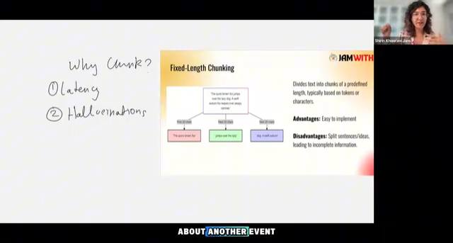
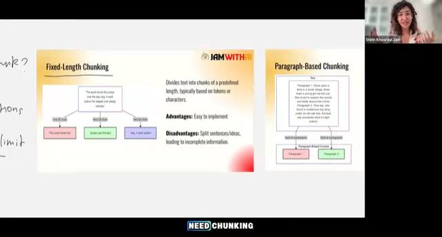
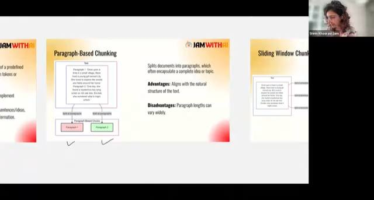
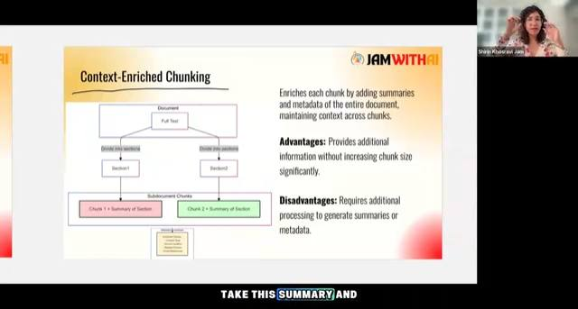
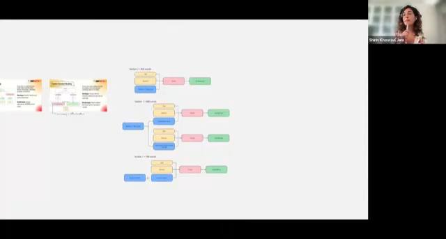

## 1. 这一节做什么

本节覆盖 **P11–P12**。P11 是一场问答：多语言 RAG、追问（follow-up questions）、过滤（filtering）、以及业界常见 RAG 技术路线。P12 进入 Week 4 的 **chunking（分块）**，并把上周的 BM25/OpenSearch 检索扩展为 **BM25 + 向量检索的混合检索**。逐字稿里 P11 基本没有代码，P12 也只给了策略描述和代码 walkthrough 的口头说明，没有在逐字稿中贴出完整源码、依赖版本、目录结构和 OpenSearch mapping。因此本文按「能跑起来」的目标，把 P12 讲师描述的 chunking 策略落成一个**可本地运行的最小复现项目**：解析 Markdown 文档、按 section 分块、短 section 合并、长 section 按 800 词切分并重叠、每个 chunk 附加 title/abstract 上下文，然后用本地 BM25 + sentence-transformers 向量做混合检索。课里真正用的是 OpenSearch 做 BM25 与向量检索；逐字稿没有给 OpenSearch 配置，所以第 3、4 节用本地可运行实现复现**分块与混合检索逻辑**，并在第 7 节明确写出「换成 OpenSearch 时你会撞上的事」。

这一节的核心产出不是「知道 chunking 有几种」，而是得到一个能打印 chunk 列表、能对 query 返回 top-k 的工程骨架。读者应能照着第 3 节从空目录开始，创建文件、安装依赖、运行命令，并看到短 section 被合并、长 section 被切分、检索结果带 BM25 分数与向量分数。

## 2. 讲师原话（带「—— pNNN [MM:SS]」）

P11 先回答多语言问题。讲师说：  
> "如果我们使用多语言模型来生成嵌入——现在这种做法越来越普遍——那么它能很好地处理这类情况。"
> —— p011 [00:52]

但紧接着有学员补充：即使用多语言 embedding，西班牙语 query 仍可能更偏向西班牙语文档，因为 embedding 会捕捉语言细微差异。讲师没有否认，而是把它归为需要额外过滤和业务逻辑的情况：  
> "有时并不会按那种方式运作，而这正是需要在那类场景中加入更多过滤条件和更多业务逻辑的地方。"
> —— p011 [02:18]

关于追问，讲师明确说课程不实现，但实现起来主要是 prompt engineering：  
> "至少我们不会实现这一点，因为……让大语言模型主动提出追问其实相当简单。"
> —— p011 [03:14]

关于「用户看到一堆过滤结果后再选择子过滤」的问题，讲师把它归入 agent workflow：  
> "你所解释的做法恰好也适用于代理工作流。通常会有两组过滤。"
> —— p011 [05:33]

关于业界常用 RAG 技术，讲师和 Shantanu 的判断是先从简单向量检索开始：  
> "大多数情况下只使用基于向量搜索的方案，因为它容易上手。"
P12 开场先说明本周把 BM25 保留下来，并加入向量检索：  
> "我们还增强了原本只支持 BM25 的 OpenSearch，使其包含向量搜索。因此并不是只使用向量搜索，而是把它作为补充。"
> —— p012 [00:00]

为什么还要 chunk？讲师给了三个理由。第一是延迟：  
> "分块的第一个实际用途是控制延迟，避免出现高延迟。"
> —— p012 [02:46]

第二是幻觉，上下文越多、相似段落越多，模型越可能抓错日期或事实：  
> "你给大语言模型的信息越多、且这些信息又相当相似，它就越容易产生幻觉或取到错误信息。"
> —— p012 [04:13]

第三是上下文窗口限制：  
> "大语言模型可接受的上下文窗口是有限的。"
> —— p012 [05:09]

策略部分，讲师先讲 fixed length：  
> "固定长度分块是开始做分块时最务实的方式。"
> —— p012 [06:04]

然后讲 paragraph-based，并说本周会用到：  
> "这也是我们在本周课程中会用到的方法。"
> —— p012 [09:41]

sliding window 用来解决「上一段开始、下一段继续」的上下文断裂：  
> "你希望第二段里的那个意思也能在一定程度上并入第一段，但又不是完全合并。"
> —— p012 [11:34]

semantic chunking 是把切分交给 LLM 或 embedding 相似度：  
> "你可以为每个段落生成嵌入，然后计算余弦相似度……或者完全交给大语言模型来处理。"
> —— p012 [14:22]

recursive chunking 强调保留文档结构，不在表格或子标题中间切：  
> "例如，你不会希望在一个表格中间做分块，也不会希望在小标题和下一个标题之间切分。"
> —— p012 [16:11]

context-enriched chunking 是给每个 chunk 附加全文摘要、标题、作者等元数据：  
> "你可以取出摘要，把它附加到每个块上，也就是每个段落上。"
> —— p012 [18:52]

最后落到课程策略：先有 fallback，再谈单一策略：  
> "任何时候都需要有备选方案。"










## 3. 从零复现

这一节按「先跑最小闭环，再替换成生产组件」的顺序复现。课里没有给依赖版本、环境变量名、目录结构、OpenSearch 配置、embedding 模型名，也没有给完整 chunker 源码；下面这些是本复现项目为了可运行而补的，不是逐字稿里的原始值。凡是逐字稿明确说过的策略参数（800 words、100 words、section 切分、附加 title/abstract、长 section 固定长度重叠），下面照做；逐字稿没给的（例如 overlap 具体多少词、embedding 模型、BM25 权重），下面写成可调参数并在第 7 节标注。

### 3.1 目录结构

```text
production-rag-chunking/
├── .env.example
├── requirements.txt
├── data/
│   └── sample_paper.md          # 首次运行会自动生成，也可手工放自己的 Markdown
└── src/
    ├── __init__.py
    ├── chunker.py
    ├── demo_data.py
    ├── embeddings.py
    ├── hybrid_retriever.py
    └── main.py
```

### 3.2 环境与依赖

要求 Python 3.11。创建虚拟环境并安装：

```bash
cd production-rag-chunking
python -m venv .venv
source .venv/bin/activate        # Windows: .venv\Scripts\activate
pip install -r requirements.txt
cp .env.example .env
```

`requirements.txt` 里给的是本复现项目可用的版本，不是课程指定版本：

```text
python-dotenv==1.0.1
numpy==1.26.4
rank-bm25==0.2.2
sentence-transformers==2.7.0
```

第一次运行 `sentence-transformers` 会下载 `paraphrase-multilingual-MiniLM-L12-v2`，需要网络。课里提到多语言 embedding 模型处理多语言检索更好，但没有在逐字稿里指定模型名；这里选多语言 MiniLM 是为了让示例能跑，并且呼应 P11 的多语言讨论。

### 3.3 环境变量

`.env.example`：

```text
EMBEDDING_MODEL=paraphrase-multilingual-MiniLM-L12-v2
TOP_K=5
BM25_WEIGHT=0.5
VECTOR_WEIGHT=0.5
MAX_SECTION_WORDS=800
MIN_SECTION_WORDS=100
OVERLAP_WORDS=50
```

对应含义：`MAX_SECTION_WORDS=800` 和 `MIN_SECTION_WORDS=100` 来自讲师原话；`OVERLAP_WORDS=50` 是复现示例默认值，课里只说「fixed length overlap」，没有给具体重叠词数，所以必须可调。`BM25_WEIGHT` 与 `VECTOR_WEIGHT` 是本地混合检索的权重，课里没有给具体权重，实际项目要评估后定。

### 3.4 启动命令

```bash
python -m src.main --query "Why do we chunk documents?"
```

也可以指定自己的 Markdown：

```bash
python -m src.main --doc data/my_paper.md --query "What is the method?"
```

首次运行会自动写入 `data/sample_paper.md`。这个示例文档故意包含：一个短于 100 词的 section、一个超过 800 词的 section、若干正常 section，用来触发三种 fallback。

### 3.5 复现顺序

1. 先只跑 chunker，观察打印出的 chunk 数和每个 chunk 的 `fallback` 标记。  
2. 再跑混合检索，观察 top-k 里 BM25 分数、向量分数、混合分数。  
3. 改 `.env` 里的 `MAX_SECTION_WORDS`、`MIN_SECTION_WORDS`、`OVERLAP_WORDS`，观察 chunk 数变化。  
4. 把 `data/sample_paper.md` 换成你的 PDF 转出来的 Markdown，再跑一次。课里没有讲 PDF 解析，PDF 转 Markdown 属于第 7 节的坑。  
5. 如果你要接 OpenSearch，把 `hybrid_retriever.py` 的本地 BM25/向量替换成 OpenSearch 查询；逐字稿没有给 OpenSearch mapping，需要自己补。

## 4. 完整代码

以下文件均为完整文件，可直接保存。说明：这是按逐字稿 P12 的策略描述复现的代码，不是课程原始仓库源码；课程原始代码没有在逐字稿中给出。

### `requirements.txt`

```text
python-dotenv==1.0.1
numpy==1.26.4
rank-bm25==0.2.2
sentence-transformers==2.7.0
```

### `.env.example`

```text
EMBEDDING_MODEL=paraphrase-multilingual-MiniLM-L12-v2
TOP_K=5
BM25_WEIGHT=0.5
VECTOR_WEIGHT=0.5
MAX_SECTION_WORDS=800
MIN_SECTION_WORDS=100
OVERLAP_WORDS=50
```

### `src/__init__.py`

```python
# 空文件，让 src 成为 package。
```

### `src/chunker.py`

```python
from __future__ import annotations

import re
from dataclasses import dataclass, field
from typing import List, Optional, Tuple


@dataclass
class Chunk:
    doc_id: str
    section_title: str
    text: str
    word_count: int
    fallback: str
    metadata: dict = field(default_factory=dict)

    @property
    def embedding_text(self) -> str:
        doc_title = self.metadata.get("doc_title", "")
        abstract = self.metadata.get("abstract", "")
        return (
            f"Title: {doc_title}\n"
            f"Abstract: {abstract}\n"
            f"Section: {self.section_title}\n"
            f"Content: {self.text}"
        )


def count_words(text: str) -> int:
    return len(text.split())


def parse_markdown(markdown_text: str) -> Tuple[str, str, List[Tuple[str, str]]]:
    lines = markdown_text.splitlines()
    doc_title = ""
    sections: List[Tuple[str, str]] = []
    current_title: Optional[str] = None
    current_lines: List[str] = []

    def flush() -> None:
        nonlocal current_title, current_lines
        if current_title is not None:
            sections.append((current_title.strip(), "\n".join(current_lines).strip()))
        current_title = None
        current_lines = []

    for line in lines:
        if line.startswith("# ") and not line.startswith("## "):
            if doc_title == "":
                doc_title = line[2:].strip()
            continue

        if line.startswith("## "):
            flush()
            current_title = line[3:].strip()
            continue

        if current_title is not None:
            current_lines.append(line)

    flush()

    abstract = ""
    for title, content in sections:
        if title.lower() == "abstract":
            abstract = content
            break

    return doc_title, abstract, sections


def split_words_with_overlap(text: str, max_words: int, overlap_words: int) -> List[str]:
    tokens = text.split()
    if len(tokens) <= max_words:
        return [text]

    overlap_words = max(0, min(overlap_words, max_words - 1))
    step = max(1, max_words - overlap_words)
    parts: List[str] = []

    for start in range(0, len(tokens), step):
        end = min(start + max_words, len(tokens))
        part = " ".join(tokens[start:end]).strip()
        if part:
            parts.append(part)
        if end == len(tokens):
            break

    return parts


def chunk_document(
    markdown_text: str,
    doc_id: str = "paper",
    max_section_words: int = 800,
    min_section_words: int = 100,
    overlap_words: int = 50,
) -> List[Chunk]:
    doc_title, abstract, raw_sections = parse_markdown(markdown_text)

    pieces: List[dict] = []

    for section_title, section_text in raw_sections:
        if section_title.lower() == "abstract":
            continue

        section_text = section_text.strip()
        if not section_text:
            continue

        wc = count_words(section_text)

        if wc < min_section_words:
            if pieces and pieces[-1]["word_count"] + wc <= max_section_words:
                previous = pieces[-1]
                previous["text"] = previous["text"].rstrip() + "\n\n" + section_text
                previous["section_title"] = previous["section_title"] + " + " + section_title
                previous["word_count"] = previous["word_count"] + wc
                previous["fallback"] = "merged_short_into_previous"
            else:
                pieces.append(
                    {
                        "section_title": section_title,
                        "text": section_text,
                        "word_count": wc,
                        "fallback": "short_section_kept",
                    }
                )
            continue

        if wc <= max_section_words:
            pieces.append(
                {
                    "section_title": section_title,
                    "text": section_text,
                    "word_count": wc,
                    "fallback": "whole_section",
                }
            )
            continue

        parts = split_words_with_overlap(section_text, max_section_words, overlap_words)
        for index, part in enumerate(parts, start=1):
            pieces.append(
                {
                    "section_title": f"{section_title} (part {index})",
                    "text": part,
                    "word_count": count_words(part),
                    "fallback": "split_long_section_with_overlap",
                }
            )

    chunks: List[Chunk] = []
    for piece in pieces:
        chunks.append(
            Chunk(
                doc_id=doc_id,
                section_title=piece["section_title"],
                text=piece["text"],
                word_count=piece["word_count"],
                fallback=piece["fallback"],
                metadata={
                    "doc_title": doc_title,
                    "abstract": abstract,
                },
            )
        )

    return chunks
```

### `src/demo_data.py`

```python
def build_demo_markdown() -> str:
    long_paragraphs = []
    for i in range(1, 12):
        long_paragraphs.append(
            f"Paragraph {i}. Retrieval practice is the process of selecting passages that answer a user question. "
            "A production system must balance latency, recall, and grounding. "
            "In this section we describe the design choices that matter when a paper is long. "
            "The chunker should preserve section boundaries, attach document context, and provide a fallback for oversized sections. "
            "These words are intentionally repeated with small variations so the demo document has a section above eight hundred words."
        )

    long_section = "\n\n".join(long_paragraphs)

    return f"""# A Small Paper on Retrieval Practice

## Abstract
This demo paper explains why a production RAG system chunks documents, how section-based chunking works, and how fallbacks handle very short and very long sections. It is a synthetic document for running the code, not the original course paper.

## 1. Introduction
Retrieval-augmented generation combines a retriever with a language model. The retriever finds passages, and the model answers from those passages. Chunking decides what a passage is. This section is intentionally normal length.

## 2. Method
We parse the document by markdown headings. Each heading starts a section. We count words with whitespace splitting. If a section is short, we merge it into the previous section when the previous section still has room. If a section is long, we split it at the maximum word count and keep an overlap. Every chunk receives the document title and abstract in its embedding text.

## 3. Tiny Note
This tiny note is shorter than one hundred words. It exists to trigger the short-section fallback.

## 4. Long Discussion
{long_section}

## 5. Conclusion
Section-based chunking is a pragmatic starting point. The numbers eight hundred and one hundred are parameters, not laws. Evaluate retrieval quality before making the pipeline more complex.
"""
```

### `src/embeddings.py`

```python
from __future__ import annotations

from sentence_transformers import SentenceTransformer
import numpy as np


class Embedder:
    def __init__(self, model_name: str):
        self.model = SentenceTransformer(model_name)

    def encode(self, texts: list[str]) -> np.ndarray:
        return self.model.encode(texts, normalize_embeddings=True)
```

### `src/hybrid_retriever.py`

```python
from __future__ import annotations

from typing import List, Tuple

import numpy as np
from rank_bm25 import BM25Okapi

from .chunker import Chunk
from .embeddings import Embedder


def tokenize(text: str) -> list[str]:
    return text.lower().split()


class HybridRetriever:
    def __init__(
        self,
        chunks: List[Chunk],
        embedder: Embedder,
        bm25_weight: float = 0.5,
        vector_weight: float = 0.5,
    ):
        self.chunks = chunks
        self.embedder = embedder
        self.bm25_weight = bm25_weight
        self.vector_weight = vector_weight

        self.corpus = [tokenize(chunk.embedding_text) for chunk in chunks]
        self.bm25 = BM25Okapi(self.corpus)
        self.chunk_vectors = embedder.encode([chunk.embedding_text for chunk in chunks])

    @staticmethod
    def _min_max_normalize(scores: np.ndarray) -> np.ndarray:
        minimum = float(scores.min())
        maximum = float(scores.max())
        if maximum - minimum < 1e-9:
            return np.zeros_like(scores)
        return (scores - minimum) / (maximum - minimum)

    def search(self, query: str, top_k: int = 5) -> List[Tuple[Chunk, float, float, float]]:
        query_tokens = tokenize(query)
        bm25_scores = np.array(self.bm25.get_scores(query_tokens), dtype=float)

        query_vector = self.embedder.encode([query])[0]
        vector_scores = np.array(self.chunk_vectors @ query_vector, dtype=float)

        bm25_norm = self._min_max_normalize(bm25_scores)
        vector_norm = self._min_max_normalize(vector_scores)

        hybrid_scores = (
            self.bm25_weight * bm25_norm
            + self.vector_weight * vector_norm
        )

        order = np.argsort(hybrid_scores)[::-1][:top_k]

        results: List[Tuple[Chunk, float, float, float]] = []
        for index in order:
            results.append(
                (
                    self.chunks[int(index)],
                    float(hybrid_scores[int(index)]),
                    float(bm25_scores[int(index)]),
                    float(vector_scores[int(index)]),
                )
            )
        return results
```

### `src/main.py`

```python
from __future__ import annotations

import argparse
import os
from pathlib import Path

from dotenv import load_dotenv

from .chunker import chunk_document
from .demo_data import build_demo_markdown
from .embeddings import Embedder
from .hybrid_retriever import HybridRetriever


def main() -> None:
    load_dotenv()

    parser = argparse.ArgumentParser()
    parser.add_argument("--query", default="Why do we chunk documents?")
    parser.add_argument("--doc", default="data/sample_paper.md")
    args = parser.parse_args()

    doc_path = Path(args.doc)
    if not doc_path.exists():
        doc_path.parent.mkdir(parents=True, exist_ok=True)
        doc_path.write_text(build_demo_markdown(), encoding="utf-8")

    markdown_text = doc_path.read_text(encoding="utf-8")

    max_section_words = int(os.getenv("MAX_SECTION_WORDS", "800"))
    min_section_words = int(os.getenv("MIN_SECTION_WORDS", "100"))
    overlap_words = int(os.getenv("OVERLAP_WORDS", "50"))

    chunks = chunk_document(
        markdown_text,
        doc_id=doc_path.stem,
        max_section_words=max_section_words,
        min_section_words=min_section_words,
        overlap_words=overlap_words,
    )

    print(f"Chunks: {len(chunks)}")
    for index, chunk in enumerate(chunks, start=1):
        print(
            f"[{index}] section={chunk.section_title!r} "
            f"words={chunk.word_count} fallback={chunk.fallback}"
        )

    embedding_model = os.getenv(
        "EMBEDDING_MODEL",
        "paraphrase-multilingual-MiniLM-L12-v2",
    )
    embedder = Embedder(embedding_model)

    retriever = HybridRetriever(
        chunks=chunks,
        embedder=embedder,
        bm25_weight=float(os.getenv("BM25_WEIGHT", "0.5")),
        vector_weight=float(os.getenv("VECTOR_WEIGHT", "0.5")),
    )

    top_k = int(os.getenv("TOP_K", "5"))
    results = retriever.search(args.query, top_k=top_k)

    print("\nQuery:", args.query)
    for rank, (chunk, score, bm25_score, vector_score) in enumerate(results, start=1):
        print(
            f"\n#{rank} score={score:.4f} "
            f"bm25={bm25_score:.4f} vector={vector_score:.4f}"
        )
        print(
            f"section={chunk.section_title!r} "
            f"words={chunk.word_count} fallback={chunk.fallback}"
        )
        print(chunk.text[:500].replace("\n", " "))


if __name__ == "__main__":
    main()
```

## 5. 逐行解释

`chunker.py` 的 `parse_markdown` 只认 `#` 一级标题作为文档标题、`##` 二级标题作为 section。讲师说课程按 section 切，逐字稿没有给原始解析器细节；这里用 Markdown 标题模拟「论文 section」。在真实 PDF 里，section 往往要依赖版式或 OCR 识别，第 7 节会讲这是坑。`abstract` 被单独抽出来，因为讲师明确说课堂场景幸运地有现成 abstract，可以把它附加到每个 chunk，不需要再调 LLM 生成摘要。`Chunk.embedding_text` 把 `Title`、`Abstract`、`Section`、`Content` 拼在一起，对应讲师说的 context-enriched chunking：每个 chunk 不只是段落本身，还带全文标题和摘要。注意，这段拼接只影响 embedding/BM25 的检索文本，`chunk.text` 仍是原始 section 文本。

`count_words` 用 `text.split()` 按空白数词，不是 tokenizer 的 token 数。讲师口头说 800 words、100 words，逐字稿没有说这是 token；所以这里严格按「词」实现。你接真实模型时要注意：embedding 模型限制的是 token，不是词，英文里 800 words 可能接近 1000+ tokens，中文更不一样。第 7 节会讲这个坑。

短 section 分支：`wc < min_section_words` 时，如果 `pieces` 里已有上一个 chunk，并且「上一个 chunk 的词数 + 当前短 section 词数 <= max_section_words」，就合并到上一个。讲师原话是「append it to the previous section，given that the previous section is also less than 800 words」。这里把「previous 小于 800」实现成「合并后不超过 800」，比单纯判断 previous 更保守，避免合并后超过上限。如果前面没有 chunk，或者合并后会超限，就保留为 `short_section_kept`。讲师没有讲「前一个不存在或前一个已经满 800」时怎么办，这是复现代码补的兜底分支。

正常 section 分支：`wc <= max_section_words` 时整段成为一个 chunk，`fallback="whole_section"`。这就是「if the section is less than 800 words，extract the entire section，attach the abstract and the title」。标题和摘要不是在 `pieces` 阶段拼进去，而是在最后构造 `Chunk` 时放进 `metadata`，由 `embedding_text` 统一附加。这样做的好处是原始文本和检索文本分离，后面要换拼接格式只改一个属性。

长 section 分支：`split_words_with
长 section 分支：`split_words_with_overlap` 先把文本按空白切成词列表，`overlap_words = max(0, min(overlap_words, max_words - 1))` 是防止你把 overlap 配成等于或大于 max_words，否则 `step` 会变成 0，`range` 直接报错。`step = max(1, max_words - overlap_words)` 决定窗口每次前进多少词：`max_words=800`、`overlap=50` 时，每次前进 750 词，第一块 0–800，第二块 750–1550，依此类推，块与块之间重叠 50 词。讲师说的是「break at the 800 word，and use a fixed length overlap，so that if your section is 900 words，you will break at the 800 words and then you somehow also want an overlap of the next two lines that are remaining」。这里的实现是标准滑窗，最后一块会自然包含剩余词；如果最后一块不足 800 词也照样输出，因为断点处必须把尾巴收进来。逐字稿没有给 overlap 的具体词数，也没有说尾部不足一块时是否丢弃，所以 `OVERLAP_WORDS` 做成环境变量，尾部保留是复现代码的选择。

`split_words_with_overlap` 里 `if end == len(tokens): break` 是为了避免最后一块之后再多输出一个只有重叠区的重复块。举例：`len(tokens)=900`、`max_words=800`、`overlap=50`、`step=750`，第一次 `start=0,end=800` 输出前 800 词；第二次 `start=750,end=900` 输出第 751–900 词，其中 751–800 是重叠区；`end==900` 触发 break。如果去掉这个 break，`range` 还会给 `start=1500`，直接超出长度，得到一个空 part 后被 `if part` 过滤掉，结果虽然一样但多一次无意义循环。这个 break 是性能与可读性考虑，不是逐字稿内容。

`chunk_document` 最后统一构造 `Chunk` 时，`doc_id` 由调用方传入，`metadata` 只放 `doc_title` 和 `abstract`。讲师在 context-enriched 部分还提到可以附加作者、标题等元数据，「you could also attach the authors」，但课程代码在逐字稿里没有展示作者字段怎么来、存在哪，所以这里不编造作者字段，只在第 7 节提醒你可以自己从文档 front matter 抽。`fallback` 字段是复现代码为了让你看见「哪条分支被触发」而加的，逐字稿没有这个字段名，它不影响检索，只是调试输出。

`demo_data.py` 的作用是让第一次运行不依赖外部文件。`long_paragraphs` 循环 11 次，每段大约 60–70 词，合计明显超过 800 词，因此 `## 4. Long Discussion` 一定会触发长 section 切分；`## 3. Tiny Note` 只有一句话，明显低于 100 词，会触发短 section 合并到前一个 `## 2. Method`；`## 1`、`## 2`、`## 5` 长度正常，走 `whole_section`。`Abstract` 那段既被 `parse_markdown` 抽成 `abstract`，又在 section 循环里被 `if section_title.lower() == "abstract": continue` 跳过，所以它不会单独成为一个 chunk，只会作为上下文拼进每个 chunk 的 `embedding_text`。这正对应讲师说的「the abstract is the summary and we have it available，so we append the section with the title and the abstract」。

`embeddings.py` 只有十几行，`SentenceTransformer(model_name)` 在构造时加载模型，`encode(texts, normalize_embeddings=True)` 返回已归一化的向量。归一化之后，两个向量的点积就等于余弦相似度，所以 `hybrid_retriever.py` 里可以直接写 `self.chunk_vectors @ query_vector`，不用再手写余弦公式。课里没有讲用的是哪个 embedding 库、要不要归一化；这是复现代码为了让本地向量检索跑通而做的选择。在 JS/Node 里对应的是 `@xenova/transformers` 或调用远端 embedding API，思路一样：文本进模型、出定长向量、做点积。

`hybrid_retriever.py` 的 `tokenize` 是 `text.lower().split()`，非常朴素。BM25 依赖词频，英文按空白切够用；中文如果不分词，整句会变成一个「词」，BM25 基本失效，这一点第 7 节会讲。`BM25Okapi(self.corpus)` 在构造时对每个 chunk 的 `embedding_text` 建索引，注意索引的是带 title/abstract 的文本，不是 `chunk.text`，这样标题里的关键词也能被 BM25 命中。这与讲师说的「BM25 仍然是系统的一部分」一致：BM25 负责精确关键词，向量负责语义相近。

`_min_max_normalize` 把 BM25 分数和向量分数各自压到 0–1。原因很实际：BM25 分数没有上界，可能几十也可能几百；余弦相似度通常在 -1 到 1 之间。直接相加会让 BM25 完全主导。`maximum - minimum < 1e-9` 时返回全零，是防止所有分数相同时除零。讲师在 P12 开场说这周是「BM25 和向量检索的 hybrid approach」，但逐字稿没有给权重公式，也没有说要不要归一化；这里的 min-max 加权求和是复现代码的方案，`BM25_WEIGHT` 和 `VECTOR_WEIGHT` 都可配。生产里还常见 RRF（reciprocal rank fusion），但课里没提，本文不把它写成讲师方案。

`search` 里 `np.argsort(hybrid_scores)[::-1][:top_k]` 是降序取 top-k。返回四元组 `(chunk, hybrid_score, bm25_score, vector_score)`，后两个是**未归一化**的原始分，方便你判断某条结果是关键词命中还是语义命中。如果只打印混合分，归一化之后你看不出原因。这个返回结构是复现代码定的，逐字稿没有对应的输出格式。

`main.py` 的流程是：读 `.env` → 解析参数 → 文件不存在就写 demo → 读 Markdown → 从环境变量读三个 chunk 参数 → 调 `chunk_document` → 打印 chunk 清单 → 加载 embedding 模型 → 建 `HybridRetriever` → 检索 → 打印 top-k。先打印 chunk 清单再加载模型，是为了让模型下载失败时你仍然能看到分块结果，不会以为什么都没跑。`argparse` 的 `--doc` 默认 `data/sample_paper.md`，所以你在项目根目录下运行 `python -m src.main` 就能直接跑，不必先手工建文件。

`chunk_document` 调用处把 `max_section_words`、`min_section_words`、`overlap_words` 都从环境变量读，默认值与 `.env.example` 一致。如果你在 `.env` 里改成 `MAX_SECTION_WORDS=300`，`## 4. Long Discussion` 会被切成更多块，`## 2. Method` 可能因为超过 300 而走长切分分支，短 section 合并的判断也会变。这正是讲师说的「this 800 words at the moment，we chose it arbitrarily，you can even increase it，decrease it」。

`print(chunk.text[:500].replace("\n", " "))` 只打印前 500 字符并把换行压成空格，纯粹是为了终端可读。`chunk.text` 没有截断，进 embedding 和进 BM25 的仍是完整文本。这一点容易误会：看到终端只显示 500 字符，不等于 chunk 只有 500 字符。

## 6. 复现检查清单

按顺序打勾，任何一项不通过就先修再往下走。

**环境层**

- [ ] `python --version` 输出 3.11.x（3.10 大概率也能跑，但 `sentence-transformers==2.7.0` 与更高 Python 版本的兼容性未验证）。
- [ ] `pip install -r requirements.txt` 无报错。
- [ ] `cp .env.example .env` 后，`.env` 里 7 个变量都在，且 `MAX_SECTION_WORDS=800`、`MIN_SECTION_WORDS=100` 没有被误改。
- [ ] 第一次运行能联网下载 `paraphrase-multilingual-MiniLM-L12-v2`；离线环境需要提前缓存模型，课里没讲离线方案。

**分块层**

- [ ] `python -m src.main --query "Why do we chunk documents?"` 输出第一行是 `Chunks: N`，N 大于 5。
- [ ] chunk 清单里能看到 `fallback=whole_section`。
- [ ] chunk 清单里能看到 `fallback=split_long_section_with_overlap`，且对应 section 名带 `(part 1)`、`(part 2)`。
- [ ] chunk 清单里能看到 `fallback=merged_short_into_previous`，且被合并的那条 `section=` 里出现 `+` 号，说明 `## 3. Tiny Note` 被并进了 `## 2. Method`。
- [ ] 没有任何 chunk 的 `words` 超过 `MAX_SECTION_WORDS`。如果超了，检查是不是 `OVERLAP_WORDS` 被配成了大于等于 `MAX_SECTION_WORDS`。
- [ ] `Abstract` 没有作为独立 chunk 出现。
- [ ] 把 `MAX_SECTION_WORDS` 改成 `300` 重跑，chunk 总数变大；改回 `800` 再跑，chunk 总数复原。这说明参数确实生效，不是写死的。

**检索层**

- [ ] 输出里有 `Query:` 行，且与你传入的 `--query` 一致。
- [ ] top-k 条数等于 `TOP_K`（chunk 总数少于 `TOP_K` 时，条数等于 chunk 总数）。
- [ ] 每条结果都打印了 `score=`、`bm25=`、`vector=` 三个数，且 `score` 在 0–1 之间。
- [ ] 用 `--query "八百词的重叠"` 这类关键词明显的查询，排第一的结果 `fallback` 是 `split_long_section_with_overlap`，说明 BM25 侧在起作用。
- [ ] 用 `--query "为什么延迟会成为分块的一个理由？"` 这类语义查询，结果里出现 `## 1. Introduction` 或 `## 2. Method` 附近的内容，说明向量侧在起作用。
- [ ] 把 `BM25_WEIGHT=1`、`VECTOR_WEIGHT=0` 重跑，再反过来跑一次，两次 top-1 应该可能不同；如果完全相同，说明权重没接上。

**文档替换层**

- [ ] 准备一份自己的 Markdown，至少有一个 `#` 标题、一个 `## Abstract`、三个以上 `##` section。
- [ ] `python -m src.main --doc data/my_paper.md --query "..."` 能跑通。
- [ ] 如果你的文档没有 `## Abstract`，程序不报错，只是 `abstract` 为空字符串，`embedding_text` 里 `Abstract:` 后面为空。这属于预期行为，不是 bug。

**可观测性**

- [ ] 你能说出本次运行触发了哪几种 `fallback`，各几条。
- [ ] 你能从 `bm25=` 和 `vector=` 两个原始分解释某条结果为什么排在前面。
- [ ] 你能把 chunk 清单贴出来，指出哪一条是「短 section 被合并」、哪一条是「长 section 被切分」。

## 7. 课里没讲但你会撞上的

这一节全部是逐字稿之外的工程现实，标注清楚哪些是课里提过方向但没给实现，哪些是完全没提。

**PDF 解析。** 课里说课程处理的是 archive research paper，也提到「when you extract PDFs or even when you crawl websites，you get an HTML format or remarked on format」——p012 [18:03]。但逐字稿没有给 PDF 解析库、没有给版面还原方案。你用 PyMuPDF、pdfplumber、unstructured 之类抽出来的文本，标题层级经常丢失，`##` 可能根本不存在，`parse_markdown` 会退化成「整篇一个 section」。这时要么先人工/半自动把 PDF 转成带标题的 Markdown，要么改成按字体大小、加粗、编号正则（`1.`、`2.1`）识别 section。这是第一大坑，课里只给了方向没给代码。

**800 words 不等于 800 tokens。** 讲师口头用 words，逐字稿没有出现 tokenizer 或 token 计数的讨论。真实 embedding 模型有 token 上限（不同模型不同，本文不编具体数字），英文 800 词通常在 1000 token 上下，中文按字算又完全是另一套比例。如果你的 chunk 在 embedding 阶段报超长，要么把 `MAX_SECTION_WORDS` 调小，要么把 `count_words` 换成用模型自带 tokenizer 计数。注意：改了计数方式，`MIN_SECTION_WORDS=100` 的含义也跟着变，两个参数要一起重新评估。

**中文分词与 BM25。** `tokenize` 是 `text.lower().split()`，英文够用，中文整句变一个 token，BM25 分数会接近随机。课里通篇是英文语料，没有讲中文场景。要修就接 jieba 之类的分词器，或在 `tokenize` 里对中文按字/双字切。这一步会直接改变混合检索的分数分布，改完要重新看 top-k。

**OpenSearch 的 mapping 和字段名。** 课里明确说「we have also enhanced our just BM 25 open search to include vector search」——p012 [00:00]，说明课程真实实现跑在 OpenSearch 上。但逐字稿没有给 index mapping、没有给 `knn` 字段名、没有给 hybrid query 的 DSL、也没有给版本号。本文的 `HybridRetriever` 是本地替身，不是 OpenSearch 客户端。你要换成 OpenSearch 时，必须自己写 mapping（文本字段用 `text` 类型给 BM25，向量字段用 `knn_vector` 并设维度）、自己决定是 `script_score` 还是 search pipeline 做归一化。这些字段名请以你实际使用的 OpenSearch 版本文档为准，不要照搬本文，因为本文没有从课程里拿到这些信息。

**归一化方式与权重。** 本文用 min-max 把两路分数拉到 0–1 再加权。课里只说 hybrid，没有说归一化方法，也没有给 `BM25_WEIGHT` / `VECTOR_WEIGHT` 的取值。生产里常见 RRF、z-score、或者让 OpenSearch 的归一化处理器来做，课里都没讲。你换成任何一种，top-k 排序都会变，所以必须配一份评估集再调权重，不能拍脑袋。

**overlap 的具体词数。** 讲师说「use a fixed length overlap」——p012 [24:58]，但没有说重叠多少词、也没有说重叠区是否要去重。本文默认 50 词并做成环境变量。重叠太大会让同一段信息在多个 chunk 里重复出现，讲师自己也提醒过 sliding window 的缺点是「you're kind of duplicating the information which is again unnecessarily increasing your context window」——p012 [13:25]。所以 50 只是起点，要用检索评估来定。

**短 section 合并的边界条件。** 讲师说「if the current section is less than 100 words，then we basically append it to the previous section，given that the previous section is also less than 800 words」——p012 [26:15]。但逐字稿没有讲：如果当前是文档第一个 section 且很短怎么办？如果前一个 section 合并后会超过 800 怎么办？如果连续三个短 section 怎么办？本文的处理是「能合并且不超 800 就合并，否则单独保留」，连续短 section 会依次往前并，直到装不下为止。这是复现代码的取舍，不是讲师原话，你在自己项目里要重新定。

**摘要从哪来。** 课里的场景「luckily in our use case，the abstract is the summary and we have it available」——p012 [23:35]，所以不调 LLM。但很多文档没有 abstract。这时要么按讲师说的用 LLM 生成 200 词摘要再附加，要么只附加标题不附加摘要。前者多一次 LLM 调用、有成本和幻觉风险，讲师在 semantic chunking 部分提醒过 LLM 可能「hallucinate it」——p012 [15:42]，同样适用于生成摘要。

**作者等额外元数据。** 讲师提到可以附加作者，「you could also attach the authors」——p012 [21:11]，但没给抽取方法。本文 `metadata` 只有 `doc_title` 和 `abstract`。如果要做，得从文档 front matter 或数据库里取，不要在 chunker 里硬编码。

**多语言。** P11 讲了多语言检索的两个现实：多语言 embedding 模型通常有帮助，但「the vector search tends to the Spanish documents still higher than the English documents」——p011 [01:19]，语言细微差异会让检索偏向同语言文档；讲师给的解法是「apply more filters and more business logic」——p011 [02:18]，而不是只换模型。本文示例用的是多语言 MiniLM，但没有实现任何语言过滤。如果你要做「德语提问、必须命中英文文档」，得在检索前加语言字段过滤，或做 query 翻译后再检索，课里没有给这条 pipeline 的代码。

**追问（follow-up questions）。** 讲师明确说「we are not going to implement that」——p011 [03:14]，并说主要靠 prompt engineering，在 RAG prompt 末尾加一段要求模型基于已收到的内容提 1–2 个追问，给 one-shot 示例即可。课里没有给这段 prompt 原文。你要加的话，注意 prompt 已经很长时再加指令会稀释原有指令，讲师也提到「unless your prompt is already gigantic and it has to do a lot of things」——p011 [03:44]。

**二次过滤 / 子过滤。** P11 讨论的「先返回 1000 条，再让用户选子过滤」被讲师归入 agent workflow，「there are usually two sets of filtering」——p011 [05:58]：第一组是用户不知道、程序自动加的（语言、设备等），第二组是基于用户选择的交互式过滤。课里没有给 agent 编排代码，也没有给「把候选集展示给用户再继续过滤」的接口设计。这是第 7 节里唯一一个「方向清楚但完全没有实现」的部分，不要以为跑通本文的 `HybridRetriever` 就有了 agentic RAG。

**评估。** 讲师反复说 chunking 要「evaluate your rack system and see how it's working」——p012 [06:56]，是迭代过程。但逐字稿没有给评估指标、没有给评估集构建方法、没有给阈值。本文也没有实现评估，只打印分数。你至少要准备 20–30 条「问题 + 期望命中的 section」的人工标注，改参数前后各跑一遍看 top-k 命中率，否则调 `MAX_SECTION_WORDS` 和权重就是盲调。

**Node/前端的对应关系。** 本文全部是 Python。你作为前端转 AI 应用工程师，如果要把这套逻辑搬到 Node：分块部分是纯字符串处理，直接翻译；BM25 可以用 `wink-bm25-text-search` 之类，向量可以用 `@xenova/transformers` 本地推理或调 API；`numpy` 的点积换成手写循环或 `ml-matrix`。课里没有 Node 版本，这一段是给你迁移用的，不是讲师内容。

**并发与锁。** 本文没有任何共享状态写入，`chunk_document` 是纯函数，`HybridRetriever` 构造完只读，所以不存在锁/事务问题。这一点在 Node 里同样成立：只要你不把 index 构建放在请求处理里、不在多请求间共享可变数组，就不需要锁。课里也没有涉及并发，这里只是明确告诉你「这套代码目前不需要考虑锁」，免得你按后端习惯去找事务边界。