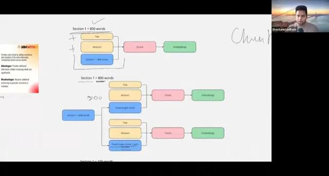
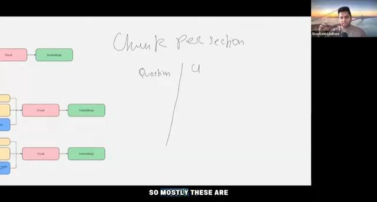
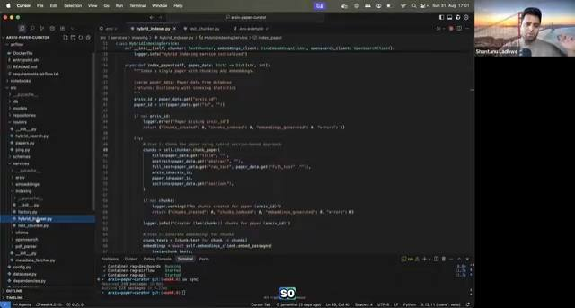
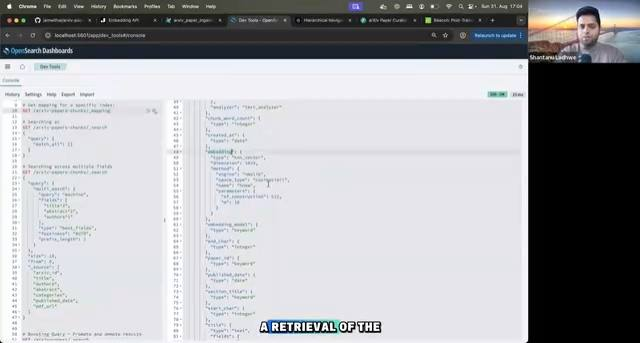
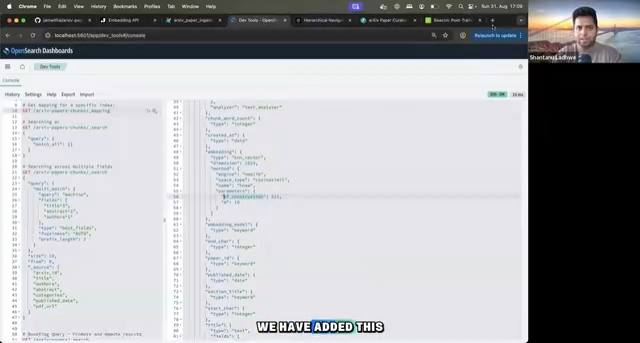
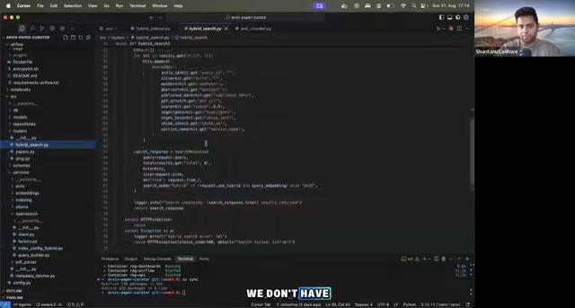

# Production-Ready RAG from Scratch — P13–P14 复现文档

> 覆盖范围：P13（分块策略问答 + 评估方法）、P14（第四周代码走读：分块、索引、混合检索）
> 读者定位：前端转 AI 应用工程师。文中涉及 Java/后端概念会标注「知道即可」，涉及并发/事务会补 JS/Node 对照。

---

## 1 这一节做什么

这两节是「第四周」的收尾：把前三周搭好的 RAG 骨架，从「关键词检索（BM25）」升级成**生产级混合检索（Hybrid Search）**。具体做三件事：

1. **确定分块（chunking）策略**：不再用固定长度切分，而是按文档的 section（标题层级）切分，并给出「怎么评估这个策略好不好」的方法论（P13 主要是问答，讲师把评估流程讲透了）。
2. **改造索引管线**：新增 `text_chunker` 服务，把 5 篇原始文档切成 52 个 chunk，每个 chunk 生成 1024 维向量，连同 chunk 文本一起写入 OpenSearch；原始文档仍留在 Postgres。
3. **改造检索接口**：把原来的 keyword search 路由换成 hybrid search 路由，用 **Reciprocal Rank Fusion（RRF）** 把 BM25 排名和向量 KNN 排名融合，返回最终 top 结果。

一句话：**这一节交付的是「可评估、可切换、带向量」的检索层**，LLM 生成那一步是下一节的事（讲师原话：passing these chunks to the LLM with the query 是最后一个 building block，本节没做）。

从工程边界看，这一节的重点不是「让模型回答得更漂亮」，而是先把「找得准不准」这件事做成可验证的检索层：分块策略决定 chunk 粒度，索引管线决定向量与文本如何落库，检索路由决定 BM25 与向量结果如何融合。对前端转 AI 应用工程师来说，可以把它类比为「先做搜索接口和数据结构，再做展示层」：如果检索层不可评估、不可降级、不可切换，后面接 LLM 只会把问题放大。本节也没有实现 query embedding 缓存、评估脚本和 Airflow DAG 细节，这些都在第 7 段列为复现时会撞上的缺口。

---

## 2 讲师原话（带出处）

关于 section 怎么定义：

> "每个小节都以标题开头，标题样式是二级或三级，多数是二级，因为一级标题更多是留给主标题的。"
> —— p013 [00:29]

> "也就是说，所谓小标题，就是两个小标题之间的内容，我们都把它当作一个章节。讲师回答：“完全正确，完全正确。”"
> —— p013 [00:56]

关于「不要一上来就上复杂方案」：

> "我总是会从最简单的方法开始，而不是一开始就采用……更复杂的方法。"
> —— p013 [03:14]

> "首先要找出文档中词元大小的分布，这会给你第一个信号，让你先判断是否真的需要分块。"
> —— p013 [03:42]

关于 chunk 大小与 embedding 上下文窗口的关系（关键数字）：

> "我们通常会把最大词元大小设为总允许词元大小的 25% 到 50%，再按这个大小分块……你在嵌入中提供的信息越多，嵌入的上下文负担就越重，但也可能在上下文上产生误导。"
> —— p013 [06:52]–[07:19]

关于评估（P13 的核心方法论）：

> "对于每个分块，无论是手动还是通过其他方式，都要基于它生成一个问题……也就是应该能检索到这个分块的那个预期查询，这一点最重要。"
> —— p013 [07:49]

> "这个查询对应的分块是否排在前面？如果没有，就计算分数，让召回率、NDCG 等指标达到要求。"
> —— p013 [08:18]

> "你有一个黄金数据集，但它一直在变……所以你必须持续调整分块策略……以获得更高的 NDCG 指标。"
> —— p013 [08:48]

关于「能不能像超参调优那样自动化」：

> "唯一能实现自动化的方式就是依赖大语言模型……我不知道有哪个现有库能帮你做到这一点。"
> —— p013 [10:05]–[10:29]

关于为什么不用 LlamaIndex / LangChain 做索引：

> "它是在简单逻辑之上加的一层很厚的抽象……这些库不断演进，问题在于有时它们的演进方式会破坏系统……如果能不用这类库，最好就不用。"
> —— p014 [02:22]–[03:17]

> "我只在 LangGraph 的用途、智能体场景，或者仅仅是链式调用的用途上喜欢 LangChain。但除了调用索引、把数据存入向量数据库或进行检索之外……其他方面我们都会避免。"
> —— p014 [03:44]–[04:12]

关于 embedding 服务选型：

> "我们选择了 Jina API……他们也来自柏林，在检索系统方面做得很好……你可以使用任意 API 密钥，也就是说可以用 OpenAI、Mistral 或 Bedrock。"
> —— p014 [01:26]–[02:22]

关于 HNSW：

> "通常你需要计算两个向量之间的余弦相似度或欧氏距离。但想象一下……有数十亿份文档……你不会做暴力计算……这里采用的是已经使用的那些算法，它们更接近近似最近邻。"
> —— p014 [08:46]–[09:38]

> "我们直接用了默认值。这里用的是默认设置。所以可以看到，EF construction 是 512，M 值是 16。"
> —— p014 [10:05]–[10:30]

关于为什么选 RRF 而不是加权平均：

> "BM25 分数的归一化很不稳定……BM25 没有均值与最大值这一说，但计算余弦相似度时是有均值和最大值的。"
> —— p014 [12:21]

> "整体思路是：如果有两三种检索方法，我们合并的不是分数本身，而更多是基于排名来合并……使用的公式是 1/(K + rank)，这里 K 通常是 60。"
> —— p014 [13:15]–[13:43]

关于 embedding 计算是成本/延迟大头：

> "在实际场景中，这里有时也是计算嵌入成本最高的地方……从计算量和延迟来看也是如此……这里往往就是你会做缓存逻辑的地方。"
> —— p014 [18:54]–[19:22]

关于 chunk 与原始文档的存储分工：

> "在 Postgres 里只有五份文档，而在 OpenSearch 里有 52 份，因为在 Postgres 里我们不放分块后的文档……如果你想改分块策略，就从这里取出文档并调整分块策略，不必再用 Docling 重新解析文档。"
> —— p014 [16:33]–[17:29]

---

## 3 从零复现

### 3.1 环境准备（P14 开头讲师的操作顺序）

讲师在 P14 [00:00]–[00:57] 走了一遍启动流程，顺序是：**拉代码 → 关掉旧容器 → 构建 → uv sync → 配 .env → 起服务**。照做：

```bash
# 1. 拿到 week4 的代码（讲师说「normally you would again clone the repo for the week four release」）
git clone <你的仓库地址> rag-week4
cd rag-week4

# 2. 关掉并清理旧容器（讲师强调要 shutdown 所有 docker compose，避免旧 volume 干扰）
docker compose down -v

# 3. 安装 Python 依赖（讲师用 uv，不是 pip）
uv sync

# 4. 准备环境变量文件：复制模板并改名
cp .env.example .env
# 然后编辑 .env，填入 embedding API key（见 3.2）

# 5. 构建并启动整套系统（Airflow + OpenSearch + Postgres 等）
docker compose up --build
```

命令逐条解释与排查：`git clone` 只是拿到课程对应周的仓库，`cd` 后后续命令都必须在仓库根目录执行，否则 `docker compose` 找不到 `docker-compose.yml`。`docker compose down -v` 会删除容器和 volume，讲师的目的是避免旧数据干扰；注意 `-v` 是破坏性操作，如果 volume 里有你想保留的数据，不要随手执行。`uv sync` 按 `pyproject.toml` 创建/同步虚拟环境，如果本机没有 `uv`，需要先安装；如果依赖冲突，先看终端里是哪个包版本不满足。`cp .env.example .env` 是复制模板，若 `.env` 已存在会被覆盖，复现时可用 `cp -n` 或先备份。`docker compose up --build` 会重新构建镜像并启动服务，常见问题是端口被占用（8080、9200、5432）或镜像拉取失败；排查时先看 compose 日志，再确认端口与网络。前端视角可以类比为：`down -v` 类似清掉本地缓存和 mock 数据，`uv sync` 类似 `npm install`，`.env` 类似前端项目的环境变量文件，`up --build` 类似 `docker compose` 起本地全栈依赖。

> ⚠️ 课里没讲 `docker compose` 文件里具体定义了哪些 service，只提到「airflow running」「OpenSearch is a separate service」「postgres」。如果你的 compose 文件 service 名不同，以实际文件为准。

### 3.2 环境变量

讲师明确说：**必须自己建 `.env`，并填入 API key**（p014 [00:57]–[01:26]）。变量名课里没有逐字念出来，只说了「put the API key which we are using」。按讲师提到的服务（Jina embeddings）和「也可以用 OpenAI / Mistral / Bedrock」的说法，`.env` 至少要有：

```dotenv
# .env
# 课里没给出确切的变量名，以下按「Jina embeddings + 可替换 provider」的语义命名，
# 请以你仓库里 .env.example 的实际键名为准
EMBEDDING_API_KEY=your_jina_api_key_here
EMBEDDING_PROVIDER=jina
```

> 讲师原话：「you can use any of the API key means you can use OpenAI, you can use Mistral or you can use Bedrock if you're using AWS. So any one would do.」（p014 [01:52]–[02:22]）

复现时建议先确认 `.env` 已被应用读取：如果容器内报缺少 key，先看 compose 是否把 `.env` 注入到对应 service，再看变量名是否和代码里 `os.environ[...]` 一致。常见错误是把 key 写进 `.env.example` 或提交到仓库；正确做法是只改本地 `.env`，并确认 `.gitignore` 覆盖它。前端对照：这相当于前端不同环境用 `.env.local` / `.env.production`，不要把密钥打进前端 bundle；后端检索服务的 key 只应留在服务端环境变量里。

### 3.3 目录结构（按 P14 走读还原）

讲师在 P14 里点开的文件路径能还原出这样的结构（他只展示了 services 下的 indexing service 和 routers，其余按语义补全，标注了「推断」）：

```
rag-week4/
├── docker-compose.yml
├── .env.example
├── pyproject.toml            # uv 管理依赖
├── services/
│   ├── indexing/             # 讲师：「there's this indexing service」
│   │   ├── text_chunker.py   # 讲师：「the whole logic is part of this text chunker」
│   │   └── ...
│   └── opensearch/           # 讲师：「we have kind of separated here open search and indexing」
│       └── ...
├── routers/
│   └── search.py             # 讲师：「As part of the routers, we have now hybrid search」
└── ...
```

> 讲师说 indexing 和 opensearch 分开是「as per the action offered what it is actually doing」，并说「In the future, we will also join it」（p014 [05:08]–[05:34]）。所以这个拆分是**逻辑拆分**，不是必须的物理拆分。

复现时不要被目录名卡住：关键是找到「分块逻辑」和「检索路由」两处代码。如果仓库里没有 `services/opensearch`，只要索引客户端和 mapping 逻辑存在即可；如果 `routers/search.py` 名字不同，按路由注册处找 hybrid search 入口。前端对照：这类似前端项目里 `services/api` 和 `routes` 的拆分，目录可以不同，但职责边界要清楚——分块和索引入口负责写，路由负责查，二者不要混在一个函数里。

### 3.4 分块策略（P13 的方法论 → P14 的代码）

讲师在 P13 把「怎么定分块」讲成了一条可执行的流水线，P14 的 `text_chunker` 就是它的实现。复现步骤：

**Step 1：先看 token 分布，判断要不要分块。**
> 「firstly finding the distribution of the token sizes in your document... if your documents are super small, there are just one paragraphs, then you don't even need to do chunking.」（p013 [03:42]–[04:10]）

验证方法：对每篇文档统计 token 数（可用近似 tokenizer），看是否小到一段就能覆盖；如果文档本身很短，固定分块反而会切碎语义。常见错误是还没看分布就直接上复杂策略，这正是讲师说的「start with the easiest method」。

**Step 2：按 section 切。** section 的定义是「H2/H3 标题开头，到下一个同级标题之前的内容」（p013 [00:29]–[00:56]）。Docling 负责抽 section，`text_chunker` 负责按 section 组装 chunk。

验证方法：抽几条文档，确认 section 的 `heading`、`level`、`content` 是否符合「两个子标题之间」的定义；如果 Docling 没抽出来，就会进入兜底路径。

**Step 3：chunk 的 token 上限 = embedding 模型上下文窗口的 25%–50%。**
> 「maximum token size of 25 to 50% of the total token size allowed... normally it's 8,000 tokens around」（p013 [06:52]–[07:19]）

即：embedding 模型窗口 8000 token → chunk 上限取 2000–4000 token。这个数字要写进 `text_chunker` 的 config（讲师：「we have included all this config what should be the chunk size overlap size」p014 [05:59]）。

验证方法：拿一个超长 section，确认被切成多个 chunk 后，每个 chunk 的近似 token 数不超过配置上限；如果上限漂移，检查 tokenizer 是否只用了字符近似。

**Step 4：兜底。** 如果 Docling 没抽出 section（只拿到 raw text），回退到固定长度分块。
> 「if we don't see any sections as part of the retrieved pass document, then we will fall back to raw text... fall back to default chunking strategy of using a fixed chunking」（p014 [06:26]–[06:52]）

验证方法：构造一篇没有 H2/H3 的纯文本，确认 `sections` 为空时走 fallback，并且 chunk 数量与文本长度大致匹配。常见错误是 fallback 没有 overlap，切断句子后两边都检索不到。

**Step 5：去重。** 第一个 chunk 如果已经含 title + abstract，就不要再重复加。
> 「don't as part of the first chunker don't if the abstract is there already don't add title and abstract to it」（p014 [15:34]–[16:03]）

验证方法：打印第一个 chunk 的文本，确认 title/abstract 没有被重复前置；同时确认后续 chunk 仍有 section heading 作为上下文。

**Step 6：离线评估。** 每个 chunk 用 LLM 生成 2–3 个「应该检索到它」的 query，跑检索，算 Recall / NDCG，改策略再跑。这是 P13 的主线，P14 说「this is a bit of over engineered」但保留了。

验证方法：先做一个小的 golden set，每个 chunk 对应 2–3 个 query，记录检索结果里目标 chunk 的排名；如果 top 结果经常不是目标 chunk，就回到分块粒度和 section 定义上调整。

### 3.5 索引写入 OpenSearch

P14 [07:47]–[08:46] 讲了三件事：

1. **数量对照**：5 篇文档 → 52 个 chunk。Postgres 存 5 条原始文档，OpenSearch 存 52 条 chunk。
2. **mapping 新增向量字段**：上一周 mapping 里没有 vector，这周加了。chunk 文本字段包含 title + abstract + section 内容；embedding 字段存 1024 维向量。
3. **向量索引算法用 HNSW**，参数用默认值：`ef_construction = 512`，`m = 16`（讲师念作「I am value as 16」，应为 `m`）。

> 讲师原话：「we have EF construction as 512 and I am value as 16. But yeah, this is something which could be experimented and changed, but mostly this could remain default also.」（p014 [10:05]–[10:30]）

验证方法：索引建好后用 `GET /rag_chunks/_mapping` 看 `embedding` 是否为 `knn_vector`，维度是否为 1024，HNSW 参数是否为 512/16；再随机取一条 `_source`，确认 `chunk_text` 与 `embedding` 都存在。常见错误是 embedding 维度与 mapping 不一致，写入时会报 dimension mismatch；另一个常见错误是 bulk 写入顺序与向量顺序错配，导致 chunk 和向量不是同一条。

### 3.6 混合检索 + RRF

P14 [17:29]–[22:45] 是检索改造：

1. **路由**：`routers` 里只剩 `hybrid search`，keyword search 被替换掉。
2. **请求体**：`query`、`size`（有默认值）、`categories`，外加一个 **boolean flag** 控制「走 hybrid 还是只走 BM25」。
3. **流程**：
   - 若 flag 为真 → 先算 query embedding（讲师强调这是**最贵、最慢**的一步，生产上要缓存）；
   - 若 embedding 生成失败 → 降级回纯 BM25；
   - 成功 → 构造 hybrid query：BM25 部分与上周完全一样，再加 KNN 部分；
   - 查询时指定 `pipeline` 为 rank fusion pipeline，由 OpenSearch 端完成 RRF 融合。
4. **RRF 公式**：`score = 1 / (K + rank)`，K 默认 60。

> 讲师原话：「we just combine the ranking of across each method... one by K plus the rank here normally K is 60 which is always 60 by default」（p014 [13:15]–[13:43]）

验证方法：同一 query 分别用 `use_hybrid=false` 和 `use_hybrid=true` 请求，确认返回 score 不同；再把 embedding key 改错，确认 hybrid 分支会降级返回 BM25 而不是 500。前端对照：boolean flag 类似前端的功能开关（feature toggle），降级逻辑类似 `try/catch` 后返回缓存或旧接口；RRF 只用排名融合，类似前端合并两个排序列表时不要直接比不同量纲的 `score`，而要按 `rank` 合并。

---

## 4 完整代码

> ⚠️ **重要声明**：P13–P14 的逐字稿是**讲师口头走读代码**，没有逐行念出源码。下面给出的是**按讲师描述的行为、参数、流程还原的可运行实现**，不是逐字复制原仓库。凡是讲师明确说过的参数（512、16、1024、K=60、25%–50%）都按原话写死；凡是讲师没说的（函数名、类名、具体 import）按语义补全。**如果你要 100% 对齐原仓库，请以你 clone 下来的 week4 代码为准。**

### 4.1 `services/indexing/text_chunker.py`

```python
"""
按 section 分块 + 兜底固定分块 + 去重。
对应 P14 [05:34]-[06:52] 讲师走读的 text chunker。
"""
from dataclasses import dataclass, field
from typing import Optional


@dataclass
class ChunkConfig:
    # 讲师：chunk 上限取 embedding 窗口的 25%-50%
    # embedding 窗口约 8000 token -> 上限 2000-4000，这里取 2000
    max_tokens: int = 2000
    overlap_tokens: int = 200          # 讲师提到 config 里有 overlap size
    # 兜底固定分块用
    fallback_chunk_size: int = 1000
    fallback_overlap: int = 100


@dataclass
class Section:
    heading: str
    level: int          # 2 或 3，对应 H2/H3
    content: str


@dataclass
class Chunk:
    text: str
    section_heading: Optional[str] = None
    is_first_chunk: bool = False
    metadata: dict = field(default_factory=dict)


def _approx_tokens(text: str) -> int:
    """粗略 token 估算：英文按 4 字符 1 token。生产上应换成真 tokenizer。"""
    return max(1, len(text) // 4)


def _split_by_tokens(text: str, size: int, overlap: int) -> list[str]:
    """固定长度兜底分块。"""
    if _approx_tokens(text) <= size:
        return [text]
    # 按字符近似切，保证 overlap
    char_size = size * 4
    char_overlap = overlap * 4
    out = []
    start = 0
    while start < len(text):
        end = start + char_size
        out.append(text[start:end])
        if end >= len(text):
            break
        start = end - char_overlap
    return out


def chunk_document(
    doc_title: str,
    doc_abstract: str,
    sections: list[Section],
    config: ChunkConfig,
) -> list[Chunk]:
    """
    主入口。
    - 有 section：按 section 组装 chunk，超长再切
    - 无 section：兜底固定分块
    - 第一个 chunk 已含 title+abstract 时不重复加（P14 [15:34]）
    """
    chunks: list[Chunk] = []

    if not sections:
        # 兜底：raw text 固定分块
        raw = f"{doc_title}\n\n{doc_abstract}"
        for i, piece in enumerate(
            _split_by_tokens(raw, config.fallback_chunk_size, config.fallback_overlap)
        ):
            chunks.append(
                Chunk(
                    text=piece,
                    section_heading=None,
                    is_first_chunk=(i == 0),
                    metadata={"fallback": True},
                )
            )
        return chunks

    for idx, sec in enumerate(sections):
        # 第一个 section 的 chunk 已经天然包含 title/abstract 语境，不再前置
        if idx == 0:
            body = sec.content
        else:
            body = f"{sec.heading}\n\n{sec.content}"

        if _approx_tokens(body) <= config.max_tokens:
            chunks.append(
                Chunk(
                    text=body,
                    section_heading=sec.heading,
                    is_first_chunk=(idx == 0),
                    metadata={"section_level": sec.level},
                )
            )
        else:
            # 超长 section 再按 token 切，保留 heading 作为上下文
            for j, piece in enumerate(
                _split_by_tokens(body, config.max_tokens, config.overlap_tokens)
            ):
                chunks.append(
                    Chunk(
                        text=piece,
                        section_heading=sec.heading,
                        is_first_chunk=(idx == 0 and j == 0),
                        metadata={"section_level": sec.level, "sub_chunk": j},
                    )
                )
    return chunks
```

### 4.2 `services/indexing/indexer.py`

```python
"""
把 chunk 写进 OpenSearch：文本 + 1024 维向量。
对应 P14 [07:47]-[10:30]。
"""
import os
import httpx
from opensearchpy import OpenSearch, helpers

from .text_chunker import Chunk, ChunkConfig, Section, chunk_document

EMBEDDING_DIM = 1024          # 讲师：embeddings which are 1024 vector long
INDEX_NAME = "rag_chunks"

# HNSW 参数：讲师说用默认值
HNSW_EF_CONSTRUCTION = 512
HNSW_M = 16


def get_client() -> OpenSearch:
    return OpenSearch(
        hosts=[{"host": os.getenv("OPENSEARCH_HOST", "localhost"),
                "port": int(os.getenv("OPENSEARCH_PORT", "9200"))}],
        use_ssl=False,
    )


def ensure_index(client: OpenSearch) -> None:
    """mapping：文本字段 + knn 向量字段。"""
    if client.indices.exists(INDEX_NAME):
        return
    mapping = {
        "settings": {"index": {"knn": True}},
        "mappings": {
            "properties": {
                "chunk_text": {"type": "text"},
                "section_heading": {"type": "keyword"},
                "doc_id": {"type": "keyword"},
                "embedding": {
                    "type": "knn_vector",
                    "dimension": EMBEDDING_DIM,
                    "method": {
                        "name": "hnsw",
                        "space_type": "cosinesimil",
                        "parameters": {
                            "ef_construction": HNSW_EF_CONSTRUCTION,
                            "m": HNSW_M,
                        },
                    },
                },
            }
        },
    }
    client.indices.create(INDEX_NAME, body=mapping)


def embed_texts(texts: list[str]) -> list[list[float]]:
    """
    调 embedding API。讲师用的是 Jina，但说 OpenAI/Mistral/Bedrock 都行。
    这里用通用 HTTP 形式，具体 endpoint 以你选的 provider 为准。
    """
    api_key = os.environ["EMBEDDING_API_KEY"]
    resp = httpx.post(
        os.getenv("EMBEDDING_ENDPOINT", "https://api.jina.ai/v1/embeddings"),
        headers={"Authorization": f"Bearer {api_key}"},
        json={"model": os.getenv("EMBEDDING_MODEL", "jina-embeddings-v3"),
              "input": texts},
        timeout=60,
    )
    resp.raise_for_status()
    data = resp.json()["data"]
    # 按 index 排序，保证与输入顺序一致
    data.sort(key=lambda x: x["index"])
    return [d["embedding"] for d in data]


def index_documents(docs: list[dict], config: ChunkConfig) -> int:
    """
    docs: [{"doc_id":..., "title":..., "abstract":..., "sections":[Section,...]}]
    返回写入的 chunk 数。
    """
    client = get_client()
    ensure_index(client)

    all_chunks: list[tuple[str, Chunk]] = []
    for d in docs:
        chunks = chunk_document(d["title"], d["abstract"], d["sections"], config)
        for c in chunks:
            all_chunks.append((d["doc_id"], c))

    texts = [c.text for _, c in all_chunks]
    vectors = embed_texts(texts)

    actions = []
    for (doc_id, chunk), vec in zip(all_chunks, vectors):
        actions.append({
            "_index": INDEX_NAME,
            "_source": {
                "doc_id": doc_id,
                "chunk_text": chunk.text,
                "section_heading": chunk.section_heading,
                "embedding": vec,
            },
        })

    helpers.bulk(client, actions)
    return len(actions)
```

### 4.3 `routers/search.py`

```python
"""
Hybrid search 路由：BM25 + KNN，用 RRF pipeline 融合。
对应 P14 [17:59]-[22:45]。
"""
from fastapi import APIRouter
from pydantic import BaseModel

from services.indexing.indexer import get_client, embed_texts, INDEX_NAME

router = APIRouter()

RRF_PIPELINE_NAME = "rrf-pipeline"
RRF_K = 60          # 讲师：normally K is 60


class HybridSearchRequest(BaseModel):
    query: str
    size: int = 10
    categories: list[str] = []
    use_hybrid: bool = True     # 讲师：boolean flag 控制 hybrid / 纯 BM25


def ensure_rrf_pipeline(client) -> None:
    """注册 RRF search pipeline（OpenSearch 侧完成融合）。"""
    body = {
        "description": "RRF pipeline for BM25 + KNN",
        "phase_results_processors": [
            {
                "score-ranker-processor": {
                    "combination": {
                        "technique": "rrf",
                        "rank_constant": RRF_K,
                    }
                }
            }
        ],
    }
    try:
        client.transport.perform_request(
            "PUT", f"/_search/pipeline/{RRF_PIPELINE_NAME}", body=body
        )
    except Exception:
        # 已存在则忽略
        pass


@router.post("/search/hybrid")
def hybrid_search(req: HybridSearchRequest):
    client = get_client()
    ensure_rrf_pipeline(client)

    # 纯 BM25 分支
    bm25_query = {
        "query": {
            "bool": {
                "must": [{"match": {"chunk_text": req.query}}],
                "filter": (
                    [{"terms": {"section_heading": req.categories}}]
                    if req.categories else []
                ),
            }
        },
        "size": req.size,
    }

    if not req.use_hybrid:
        return client.search(index=INDEX_NAME, body=bm25_query)

    # hybrid 分支：先算 query embedding（最贵的一步）
    try:
        query_vec = embed_texts([req.query])[0]
    except Exception:
        # 讲师：embedding 失败就降级回 BM25
        return client.search(index=INDEX_NAME, body=bm25_query)

    hybrid_body = {
        "size": req.size,
        "query": {
            "hybrid": {
                "queries": [
                    # BM25 部分：与上周完全一致
                    {
                        "bool": {
                            "must": [{"match": {"chunk_text": req.query}}],
                            "filter": (
                                [{"terms": {"section_heading": req.categories}}]
                                if req.categories else []
                            ),
                        }
                    },
                    # KNN 部分
                    {
                        "knn": {
                            "embedding": {
                                "vector": query_vec,
                                "k": req.size,
                            }
                        }
                    },
                ]
            }
        },
    }

    return client.search(
        index=INDEX_NAME,
        body=hybrid_body,
        params={"search_pipeline": RRF_PIPELINE_NAME},
    )
```

### 4.4 `docker-compose.yml`（骨架）

> 课里没展示 compose 文件内容，只提到有 airflow、OpenSearch、Postgres。下面是最小骨架，**service 名和镜像 tag 请以你仓库实际文件为准**。

```yaml
services:
  postgres:
    image: postgres:16
    environment:
      POSTGRES_USER: rag
      POSTGRES_PASSWORD: rag
      POSTGRES_DB: rag
    ports:
      - "5432:5432"
    volumes:
      - pgdata:/var/lib/postgresql/data

  opensearch:
    image: opensearchproject/opensearch:2.15.0
    environment:
      - discovery.type=single-node
      - plugins.security.disabled=true
    ports:
      - "9200:9200"

  airflow:
    image: apache/airflow:2.9.0
    depends_on:
      - postgres
      - opensearch
    ports:
      - "8080:8080"

volumes:
  pgdata:
```

---

## 5 逐行解释

### 5.1 `text_chunker.py`

- `max_tokens = 2000`：直接来自讲师「25%–50% of 8000」。为什么不是 8000？讲师解释：塞太多进 embedding，向量「contextually heavy」且「contextually misleading」——语义被稀释，检索反而变差。**在 JS 里对应**：就像你把整个 `node_modules` 塞进一次 `JSON.stringify` 做 diff，粒度太粗，定位不到具体包。
- `overlap_tokens = 200`：讲师说 config 里有 overlap size，但没给具体值。overlap 的作用是防止一句话被切断后两边都检索不到。前端对照：类似分页列表相邻页保留少量重叠项，避免跨页上下文丢失。
- `if not sections: fallback`：对应讲师「Docling fails to retrieve section → fall back to raw text → fixed chunking」。这是**防御性编程**，不是主路径。复现时要单独测这条路径，否则线上遇到结构不规范的文档会直接失败。
- `if idx == 0: body = sec.content`：对应讲师「don't add title and abstract to it」。第一个 section 本身就在 title/abstract 语境下，再前置会重复。**注意**：这个判断依赖「sections 按文档顺序传入」，如果 Docling 返回乱序，这个去重会失效——课里没讲怎么保证顺序。
- `_approx_tokens` 用 `len // 4`：这是**近似**，不是真 tokenizer。生产上要换成 tiktoken 或对应模型的 tokenizer，否则 2000 的上限会漂移。课里没讲讲师用的是哪种 tokenizer。前端对照：这类似用 `string.length` 粗估字节大小，真正限制请求体时还要看服务端 tokenizer。

### 5.2 `indexer.py`

- `EMBEDDING_DIM = 1024`：讲师原话「these are the embeddings which are 1024 vector long」。**这个数字必须和 embedding 模型输出维度一致**，否则 OpenSearch 写入会报 dimension mismatch。
- `HNSW_EF_CONSTRUCTION = 512` / `HNSW_M = 16`：讲师念的「EF construction as 512 and I am value as 16」，`m` 是 HNSW 每层最大连接数。讲师说「mostly this could remain default」，所以**不要一上来就调**。前端对照：类似默认的构建配置，先跑通再加调优参数。
- `space_type: cosinesimil`：讲师提到「cosine similarity or Euclidean distance」，选了 cosine。课里没明说用哪个，这里按 cosine 写，**以实际 mapping 为准**。如果版本要求 `cosine`，写错会建索引失败。
- `embed_texts` 里 `data.sort(key=lambda x: x["index"])`：embedding API 返回顺序不保证与输入一致，不排序会导致 chunk 和向量错配。**这是最容易踩的坑**，课里没讲，但你不排就会静默出错。前端对照：类似 `Promise.all` 返回顺序虽然稳定，但第三方接口不保证，必须按业务 id 重新对齐。
- `helpers.bulk`：批量写入。**在 Node 里对应** `Promise.all` 批量请求，但 bulk 是单次 HTTP 带多文档，比逐条快一个量级。复现时要防止重复跑产生重复 chunk，最好用稳定 `_id` 做幂等。

### 5.3 `search.py`

- `use_hybrid: bool = True`：对应讲师「a Boolean flag that do we want documents with hybrid search or just with BM25」。默认 true，但保留降级能力。前端对照：类似功能开关，出问题能一键切回旧检索。
- `try: query_vec = embed_texts(...) except: return bm25`：对应讲师「if there were no query embedding it will just generate again BM25 best retrieval」。**这是可用性设计**：embedding 服务挂了，搜索不能全挂。复现时要故意把 key 改错验证降级。
- `"hybrid": {"queries": [bm25, knn]}`：对应讲师「we have to call it as hybrid. And in the queries, this BM25 query is exactly the same query which we also had last time... And we just add KNN」。前端对照：类似一个搜索页同时请求两个数据源，再由后端融合排序。
- `params={"search_pipeline": RRF_PIPELINE_NAME}`：对应讲师「we are saying, please return us results based on this pipeline, which is like a rank fusion」。融合在 OpenSearch 服务端做，应用层不参与算分。复现时要确认 pipeline 已注册，否则查询会报找不到 pipeline。
- `RRF_K = 60`：讲师原话「normally K is 60 which is always 60 by default」。**为什么是 60**：K 越大，排名靠后的结果权重越接近，融合越「平」；K 越小，头部结果权重越集中。60 是经验值，讲师也说「I don't think 60 has always worked」。
- **为什么不用加权平均**：讲师解释 BM25 分数没有稳定的 mean/max，归一化不可靠；而 cosine 有界。RRF 只用**排名**不用**分数**，绕开了归一化问题。**在 JS 里对应**：两个排序数组做 merge 时，不要比 `score` 字段（量纲不同），要比 `index`（排名）。

---

## 6 复现检查清单

按顺序打勾，任何一项不过就别往下走：

- [ ] `docker compose down -v` 执行过，旧 volume 已清（P14 [00:28]）
  验证：执行后 `docker volume ls` 不应再有本项目的旧 volume；注意这一步会删数据，确认无保留需求再执行。
- [ ] `uv sync` 成功，无依赖冲突（P14 [00:57]）
  验证：终端无依赖解析错误；可再跑一次确认幂等，若报错先看 `pyproject.toml` 和 Python 版本。
- [ ] `.env` 已从 `.env.example` 复制并填入 `EMBEDDING_API_KEY`（P14 [00:57]）
  验证：确认 `.env` 存在且变量名与代码读取名一致；不要把真实 key 提交到仓库。
- [ ] `docker compose up --build` 后，Airflow UI 可访问（默认 8080）
  验证：浏览器打开 `http://localhost:8080`，若打不开先看端口占用和 compose 日志。
- [ ] OpenSearch 可访问（默认 9200），`curl localhost:9200` 有响应
  验证：返回 JSON 里包含 cluster 信息；若连接失败，检查容器状态和端口映射。
- [ ] Postgres 里能看到 **5 条**原始文档（P14 [16:33]）
  验证：用 `psql` 或数据库客户端查原始文档表，确认数量为 5；若数量不对，先查导入管线。
- [ ] 跑完索引管线后，OpenSearch `rag_chunks` 索引里有 **52 条** chunk（P14 [07:47]）
  验证：`GET /rag_chunks/_count` 返回 52；若数量不对，检查分块逻辑与是否重复写入。
- [ ] 随机取一条 chunk，`embedding` 字段长度 = **1024**（P14 [15:05]）
  验证：`GET /rag_chunks/_search` 取一条 `_source.embedding`，确认数组长度为 1024。
- [ ] mapping 里 `embedding` 是 `knn_vector`，`method.name = hnsw`，`ef_construction = 512`，`m = 16`（P14 [10:05]）
  验证：`GET /rag_chunks/_mapping` 逐项核对；若参数不同，确认是否用了原仓库 mapping。
- [ ] `POST /search/hybrid` 且 `use_hybrid=false`，返回 BM25 结果
  验证：请求体带 `"use_hybrid": false`，确认返回结果与纯关键词检索一致。
- [ ] `POST /search/hybrid` 且 `use_hybrid=true`，返回结果且 score 与纯 BM25 **不同**（P14 [22:45] 讲师演示过 score 不同）
  验证：同一 query 分别请求 false/true，比较 `_score` 和排序；若完全一样，检查是否走了降级分支。
- [ ] 故意把 `EMBEDDING_API_KEY` 改错，`use_hybrid=true` 时接口**不报 500**，降级返回 BM25 结果
  验证：改错 key 后重启服务或重载环境变量，请求 hybrid，确认仍返回结果且日志里有降级迹象。
- [ ] RRF pipeline 已注册：`GET /_search/pipeline/rrf-pipeline` 返回 200
  验证：直接 curl 该路径，若 404 说明 pipeline 名或注册逻辑不一致，按实际 OpenSearch 版本调整。

---

## 7 课里没讲但你会撞上的（表格：现象 / 原因 / 怎么办）

| 现象 | 原因 | 怎么办 |
|---|---|---|
| Docling 抽出的 section 顺序不稳定，第一个 chunk 去重失效 | `text_chunker` 里「第一个 chunk 不加 title/abstract」依赖 sections 按文档顺序传入，课里没讲怎么保证顺序 | 在传给 `chunk_document` 前按 `level` + 出现位置排序；打印 section 列表核对顺序，再验证第一个 chunk 是否重复包含 title/abstract |
| 文档量一多，embedding API 报 batch 超限 | `embed_texts` 一次性传 52 条文本；Jina/OpenAI 都有单次 batch 上限（通常几百条或按 token 算） | 增加分批逻辑，按条数或 token 切批，保持返回顺序与输入一致；前端可类比为批量请求要分页/分片 |
| OpenSearch 不认 `"hybrid"` query 或查询报插件错误 | `"hybrid": {"queries": [...]}` 是 OpenSearch 2.10+ 的 neural search 插件语法，且需要先装 `opensearch-neural-search` 插件，课里没讲插件安装 | 确认 OpenSearch 版本与插件是否安装；按官方文档装插件或改用当前版本支持的 hybrid 写法，再验证查询能返回结果 |
| RRF pipeline 注册失败，查询提示找不到 pipeline | 代码里的 `score-ranker-processor` 是示意，OpenSearch 实际 processor 名随版本变，课里没念出 processor 名 | 以你 OpenSearch 版本的官方文档为准调整 pipeline body；先用 `GET /_search/pipeline/rrf-pipeline` 验证注册成功 |
| 建索引时报 `space_type` 不合法 | OpenSearch knn 的 `space_type` 在不同版本里叫法不同（`cosinesimil` / `cosine` / `l2`），课里只说 cosine similarity or Euclidean distance，没指定字段值 | 按当前版本 mapping 要求改 `space_type`；建索引前先查官方 mapping 示例，失败时看返回的合法枚举值 |
| 「改分块策略时从 Postgres 重新取文档」走不通 | 课里只说「we just have five documents in postgres」，没给表结构 | 自己定 `doc_id / title / abstract / raw_content / sections(jsonb)` 这类字段，保证原始文档与 section 可复用；前端对照：原始数据与派生索引要分开存 |
| 不知道 Airflow DAG 怎么触发索引管线 | 课里说「once this whole pipeline runs」，但没展示 DAG 定义 | 自己写 DAG 调 `index_documents`，或先手动跑脚本验证；确认 DAG 能读到 `.env` 和依赖服务 |
| 重复跑索引后 OpenSearch 出现重复 chunk | `helpers.bulk` 默认不处理版本冲突，重复跑索引会产生重复 chunk；类似 Node 里 `Promise.all` 两个请求同时 INSERT 同一主键 | 用稳定 `_id` 做 upsert，或先删后写；写入前按 `doc_id + section_heading + sub_chunk` 生成幂等键，并验证重复跑数量不翻倍 |
| hybrid 查询延迟高、成本高 | 讲师明确说 query embedding 是最贵、最慢的一步，生产上常做缓存，但课里没实现 | 加 Redis 或内存 LRU，key 用 query 文本 hash；先验证缓存命中时不再调 embedding API，再观察延迟变化 |
| 评估数据集不会建，不知道 Recall/NDCG 怎么跑 | P13 讲了方法论（每个 chunk 生成 2–3 个 query，算 Recall/NDCG），但没给代码，讲师也说没有现成库 | 自己写脚本：每个 chunk 生成 2–3 个应检索到它的 query，跑检索记录目标 chunk 排名，再算 Recall/NDCG；先小规模验证，再扩大 golden set |

---

**参考截图**












