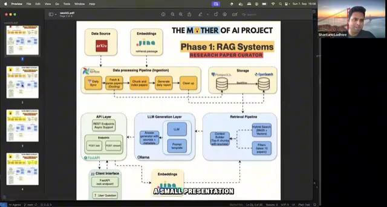
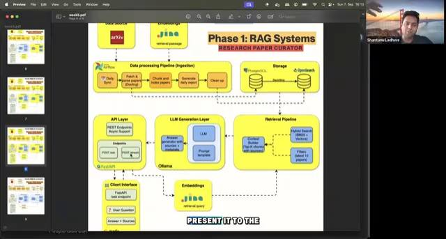
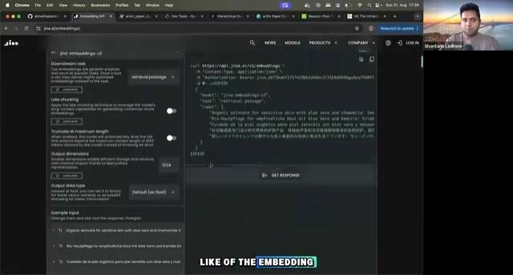
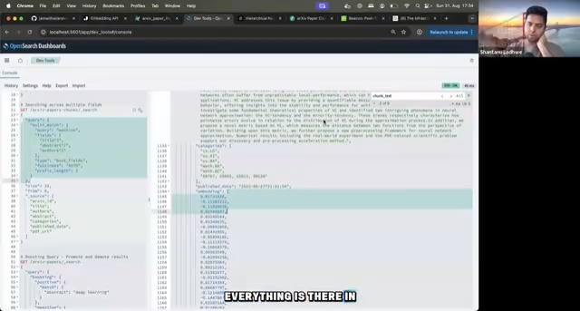
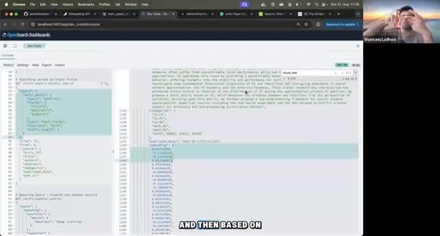
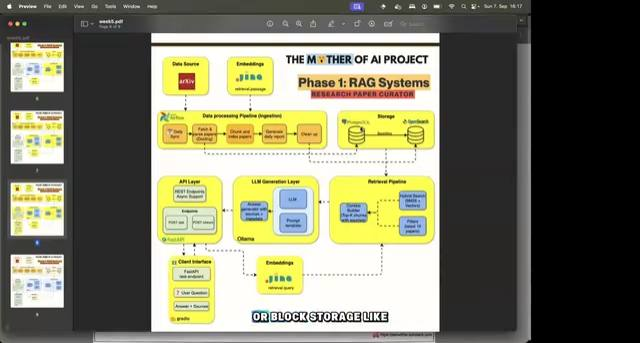
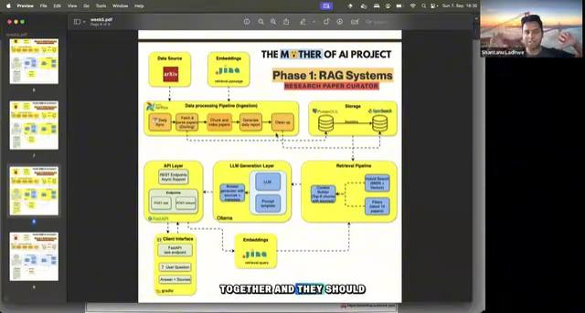
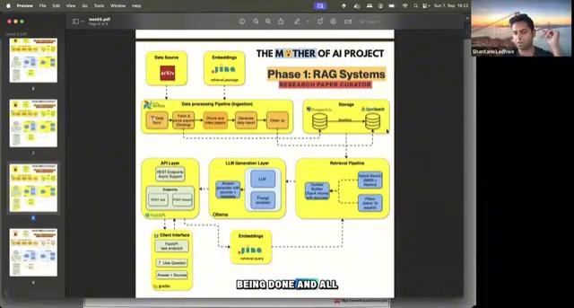

> **复现边界声明**：P15–P16 的逐字稿主要是答疑和项目复盘，**没有给出仓库源码、依赖版本、环境变量名、Docker Compose、OpenSearch mapping、Airflow DAG 文件或完整启动命令**。因此本文把“可复现”拆成两层：  
> 1）可照着复现的**系统设计规格、组件职责、数据契约、RRF 融合模块**；  
> 2）完整项目的启动命令和第三方客户端代码，逐字稿没讲，本文会明确写“课里没讲”，不把猜测写成事实。  
> 下面所有字段名、接口名、容量公式，除非引用讲师原话，否则都标注为“工程草案/示意”。

## 1. 这一节做什么

P15 是一场围绕 RAG 检索细节的问答：为什么 embedding 维度是 1024、OpenSearch 里到底存了什么、BM25 和向量检索如何混合、chunk size 和 overlap 怎么定、overlap 会不会造成重复上下文、低延迟场景是否可以把 chunk 摘要后再给 LLM。P16 是对上一阶段项目的整体复盘：arXiv 数据源、Airflow 每日管道、Docling OCR 解析、Gina embeddings、OpenSearch 混合检索、RRF 融合、LLM 生成层、`/ask` 与 `/stream` 两个端点、Streamlit 界面；后半段讨论 Postgres/S3/DynamoDB 的中间层选型、S3 事件触发 Lambda 与 Airflow DAG 的取舍、聊天中实时上传 PDF 是否要走完整 RAG 管道，以及 GraphRAG 是否值得加。



这一节的目标不是“再讲一遍概念”，而是把上一阶段的 RAG 项目拆成可落地的层：**数据源层 → 中间存储层 → 解析层 → 分块层 → 嵌入层 → 检索层 → 融合层 → 生成层 → API/UI 层**。你要复现时，先把每一层的输入输出对齐，再决定哪些层用现成工具、哪些层自己写。讲师在 P15 明确说过，这个项目里 chunk 文本和 embedding 都存在 OpenSearch，OpenSearch 同时承担 BM25 和向量检索，再用 reciprocal rank fusion 合并排名——这是整个复现的核心骨架。

## 2. 讲师原话（带「—— pNNN [MM:SS]」）

- 关于 embedding 维度：  
  > “the output dimension which we have set is like by default one zero two four vectors but this always depend on the output vector size like of the embedding model you're using”  
  —— p015 [00:27]  
  也就是说，1024 不是魔法数字，而是当前 Gina embedding 模型的输出维度；换模型就要换索引维度。

- 关于 1024 是否合适：  
  > “I think 1000 is a sweet spot there... for RAC system, because you have a chunks, bigger chunks than having a 1000 output dimension as good enough, means it's a good balance.”  
  —— p015 [01:48]–[02:47]  
  讲师同时说，降到 512 会减少存储、加快检索，但更难保留上下文；所以这是“存储/速度/语义容量”的取舍。

- 关于 OpenSearch 里存什么：  
  > “So basically the chunk data as well as the embedding data is sitting in OpenSearch... both are sitting in the same place.”  
  —— p015 [05:05]  
  当前方案不是“OpenSearch 存 chunk、ChromaDB 存向量”，而是一体化存储与检索。

- 关于混合检索：  
  > “we are also using BM25 plus the hybrid search as in vector retrieval. And we are just combining both of them using reciprocal rank fusion.”  
  —— p016 [03:50]  
  注意讲师强调的是“排名融合”，不是简单把 BM25 分数和余弦分数相加。

- 关于 chunk 与 overlap：  
  > “my dataset was of 5 books... I started with 1000, like chunk sizes, 1000 tokens and overlap was 100 chunks. And honestly, it kind of worked.”  
  —— p015 [11:03]  
  讲师和嘉宾的态度是：先用固定分块 + 100 token overlap 的务实方案，有评估集且效果达标就不要过度复杂化。

- 关于 overlap 的重复问题：  
  > “you can calculate the semantic similarity between like across different chunk... if the similarity between chunk one and chunk two which has a overlap is very high, then I think this is where the duplication would come.”  
  —— p015 [15:46]  
  也就是说，overlap 不是越大越好，要检查重复内容是否挤占上下文窗口。

- 关于低延迟时给 LLM 的内容：  
  > “you can also output just the summary... just a summary of that paragraph in two or three lines... to reduce latency.”  
  —— p015 [17:39]–[18:37]  
  检索可以取完整 chunk，但送进 LLM 的可以是压缩摘要，这是用户侧低延迟场景的优化点。

- 关于数据管道是否必需：  
  > “If it's a one time thing, then it's not a requirement. So data pipeline is only required if you have certain, every day they would be certain amount of files needs to be processed...”  
  —— p016 [06:11]  
  每日批量同步才需要 Airflow 这类管道；单文件上传可以走更轻的触发方式。

- 关于中间层选型：  
  > “if I have to split, I would put all the downloaded files in S3 bucket, and just the parsed PDFs, which gets passed by that document into Postgres.”  
  —— p016 [09:28]  
  讲师没有说 Postgres 是唯一标准；大体积原始文件更适合 S3，解析结果/元数据可以进 Postgres 或 DynamoDB。

- 关于实时上传 PDF：  
  > “whenever the user uploads a PDF... extract all the PDF contained and put it as part of the LLM generation layer... there's no need to do chunking and all those things for this case.”  
  —— p016 [20:16]  
  聊天里临时上传的 PDF 可以整文进上下文，不必走完整索引管道；代价是上下文窗口限制。

- 关于 GraphRAG：  
  > “GraphRAG is an addition to the retrieval, but not like just the only source in this case.”  
  —— p016 [29:38]  
  它是检索增强的扩展，不是当前 MVP 的必需项，而且会增加复杂度。

## 3. 从零复现

### 3.1 需求

你要复现的是一个“arXiv 论文 RAG 问答系统”：

1. 每天从数据源同步论文，保留原始文件和解析结果；
2. 用本地 OCR/解析工具把 PDF 转成文本；
3. 把文本切成 chunk，生成 embedding；
4. 把 chunk 文本和 embedding 一起写入 OpenSearch；
5. 查询时同时做 BM25 关键词检索和向量检索；
6. 用 RRF 合并两路排名；
7. 取 topK chunk 组装 prompt，交给 LLM 生成答案；
8. 提供普通问答端点和流式问答端点；
9. 用 Streamlit 做演示界面；
10. 可选：用 Airflow 每日调度，或用 S3 事件 + Lambda 处理上传；
11. 可选：实时聊天 PDF 走“整文入上下文”而非完整索引管道；
12. 可选：后续加 GraphRAG。



### 3.2 约束

- **Embedding 维度必须一致**：讲师说当前是 1024 维，但“取决于 embedding 模型输出”。索引 mapping、写入向量、查询向量三处必须同模型同维度。  
  
- **chunk 和 embedding 放同一检索引擎**：当前方案在 OpenSearch 内同时存文本和向量，便于 BM25 + 向量混合。  
  
- **RRF 只看排名**：讲师说“scoring doesn’t matter. It’s only ranking”，所以不要把不同引擎的原始分数硬相加。  
  
- **chunk 先务实**：1000 token + 100 token overlap 是讲师的起点；有评估集且效果达标就不要过度设计。  
  
- **数据管道按频率决定**：每日批量才用 Airflow；单次/上传触发不必硬上 DAG。  
  
- **实时 PDF 有上下文窗口上限**：整文进 LLM 简单，但受 context limit 限制。  
  

### 3.3 估算

课里没有给容量公式，以下是工程估算，用来决定你要不要降维、要不要拆存储。

| 项目 | 公式 | 说明 |
|---|---|---|
| chunk 数 | `N_chunks ≈ total_tokens / (chunk_tokens - overlap_tokens)` | 1000/100 时有效步长约 900 token；实际以 tokenizer 为准 |
| 向量原始存储 | `N_chunks × D × 4 bytes` | D=1024 且 float32；OpenSearch 还会有索引/副本开销 |
| topK 上下文 token | `K × chunk_tokens` | 还要减去去重和摘要后的实际 token |
| 查询检索耗时 | `T_embed(query) + max(T_bm25, T_vector) + T_rrf + T_llm_ttft` | 流式端点主要优化 `T_llm_ttft`，让用户先看到首 token |
| 降维收益 | 512 维约为 1024 维一半向量存储 | 讲师说检索更快、存储更少，但上下文表达能力可能下降 |

### 3.4 复现步骤

1. **建目录和契约**：先建 `contracts/` 和 `src/`，把接口、表结构草案固定下来，避免后面 OpenSearch、Postgres、API 字段各写各的。
2. **准备数据源**：按讲师复盘，数据源是 arXiv；每日同步后保留原始 PDF 和解析文本。课里没讲具体下载 API 和限流策略。
3. **加中间存储层**：小规模可先用 Postgres 存文件元数据和解析结果；大体积原始文件可放 S3。讲师明确说 S3 便宜、可做冷热分层；DynamoDB 这类 NoSQL 在字段频繁变化时更省迁移。  
   
4. **解析 PDF**：讲师项目里用 Docling 做本地 OCR/解析；实时聊天 PDF 场景他说可以用更轻更快的 parser，因为 Docling 不一定是最快。
5. **分块**：先固定 1000 token、100 token overlap。用 tokenizer 计数，不要用字符数假装 token 数。  
   
6. **生成 embedding**：调用 Gina embeddings；维度按模型输出，讲师当前是 1024。注意：讲师说 Gina 后来发布多模态/多语言 universal embeddings，但本项目当时使用 Gina embeddings。
7. **写 OpenSearch**：同一文档里存 `text` 和 `embedding_vector`；索引 mapping 的向量维度必须等于 embedding 维度。课里没给 mapping 文件。
8. **查询**：用户 query 同时走 BM25 和 query embedding 向量检索；query embedding 必须与 chunk embedding 同模型同维度。
9. **RRF 融合**：把 BM25 排名列表和向量排名列表交给 RRF，得到融合排名。
10. **组装 prompt**：取 topK，先做重复内容检查/去重；低延迟场景可以把 chunk 摘要后再送 LLM。
11. **生成答案**：演示可用 Llama 3.2 1B 这类小模型保证本地能跑；生产讲师更倾向 OpenAI 等基础模型 API。
12. **暴露端点**：`/ask` 返回完整答案；`/stream` 逐步返回生成内容，降低 time-to-first-token。流式传输协议课里没讲。
13. **Streamlit UI**：接 `/ask` 或 `/stream` 做演示界面。
14. **调度**：每日批量用 Airflow；单文件上传可用 S3 事件触发 Lambda，不必为每次上传跑 Airflow DAG。
15. **可选实时 PDF**：聊天中上传的 PDF 直接抽取全文拼进 prompt，不建索引、不分块；注意 context limit，并区分“用户临时 PDF”和“系统文档库 PDF”。
16. **可选 GraphRAG**：在实体/关系抽取基础上扩展检索，不是 MVP 必需。

### 3.5 取舍表

| 决策 | 讲师倾向 | 不这样会怎样 |
|---|---|---|
| 1024 维 vs 512 维 | 1024 是当前 sweet spot；512 更快更省但可能丢上下文 | 盲目降维可能召回下降；盲目升维存储和检索成本上升 |
| OpenSearch 一体 vs 分离向量库 | 当前一体，BM25+向量+RRF 都在 OpenSearch | 分离后要 router 并行查两边再融合，维护复杂；但可换专用引擎 |
| 固定 chunk vs 语义 chunk | 先用 1000/100，评估达标就别过度复杂 | 一上来做复杂分块，调参成本高，未必提升 |
| overlap 大 vs 小 | 检查重复是否挤占上下文 | overlap 太大导致重复 chunk 被同时召回，浪费 token |
| Airflow vs Lambda | 每日批量 Airflow；事件上传 Lambda 更轻 | 每次上传都跑 DAG，调度系统不适合高频事件 |
| Postgres vs S3 | 原始大文件 S3，解析/元数据 Postgres 或 NoSQL | 全塞 Postgres 成本和迁移压力大；全塞 S3 查询元数据不方便 |
| 实时 PDF 整文 vs 索引 | 聊天临时 PDF 整文入上下文 | 走完整管道会增加延迟，且用户临时文件不该混入系统库 |
| GraphRAG 加不加 | 作为检索补充，不是唯一来源 | 过早加会显著增加复杂度和维护成本 |

## 4. 完整代码

> **重要**：逐字稿没有给出项目源码，所以不存在“课程原始完整代码”可以抄。下面给出两个**可保存的完整文件**：一个是可运行的 RRF 示意模块，一个是接口/数据模型契约草案。它们不是讲师原代码，字段名也不是讲师说过的字段名；目的是让你先把复现骨架固定住。完整 OpenSearch、Airflow、Gina 客户端代码课里没讲，不能编造。

目录结构建议：

```text
rag-prod/
├── contracts/
│   └── rag_contracts.json
├── src/
│   └── rrf.py
└── README.md
```

运行环境：`rrf.py` 只用 Python 标准库；建议 Python 3.10+（这是示意运行环境，不是课程指定版本）。依赖版本：**课里没讲**。

### 文件 1：`src/rrf.py`

```python
from __future__ import annotations

from typing import Mapping, Sequence


def rrf_fuse(
    rankings: Mapping[str, Sequence[str]],
    k: int = 60,
) -> list[tuple[str, float]]:
    """
    Reciprocal Rank Fusion.

    rankings: {"bm25": ["chunk_2", "chunk_1"], "vector": ["chunk_1", "chunk_3"]}
    k: 演示常量。课里没有指定 k 的取值；生产环境请用评估集确定。
    """
    scores: dict[str, float] = {}

    for _source_name, docs in rankings.items():
        seen_in_this_source: set[str] = set()

        for rank, doc_id in enumerate(docs, start=1):
            if doc_id in seen_in_this_source:
                continue

            seen_in_this_source.add(doc_id)
            scores[doc_id] = scores.get(doc_id, 0.0) + 1.0 / (k + rank)

    return sorted(scores.items(), key=lambda item: (-item[1], item[0]))


if __name__ == "__main__":
    bm25_ranking = ["chunk_2", "chunk_1", "chunk_5"]
    vector_ranking = ["chunk_1", "chunk_3", "chunk_2"]

    fused = rrf_fuse(
        {
            "bm25": bm25_ranking,
            "vector": vector_ranking,
        }
    )

    for doc_id, score in fused:
        print(f"{doc_id}\t{score:.6f}")
```

启动命令：

```bash
cd rag-prod
python -m src.rrf
```

这个命令只验证 RRF 融合逻辑；完整 RAG 系统启动命令**课里没讲**，需要你根据自己选择的 OpenSearch、Airflow、Gina SDK、Web 框架补齐。

### 文件 2：`contracts/rag_contracts.json`

```json
{
  "note": "Engineering contract draft for the RAG course design. The lecture did not provide field names or a schema; names here are illustrative.",
  "endpoints": {
    "POST /ask": {
      "request": {
        "query": "string"
      },
      "response": {
        "answer": "string",
        "citations": [
          {
            "doc_id": "string",
            "chunk_id": "string",
            "page": "number|null"
          }
        ]
      }
    },
    "POST /stream": {
      "request": {
        "query": "string"
      },
      "response": {
        "note": "streaming protocol is not specified in the lecture",
        "chunks": [
          "string"
        ]
      }
    }
  },
  "tables": {
    "documents": {
      "doc_id": "string",
      "source_uri": "string",
      "title": "string|null",
      "content_hash": "string",
      "created_at": "string"
    },
    "chunks": {
      "chunk_id": "string",
      "doc_id": "string",
      "text": "string",
      "page": "number|null",
      "chunk_index": "number",
      "embedding_model": "string",
      "embedding_dim": "number",
      "content_hash": "string"
    },
    "ingestion_runs": {
      "run_id": "string",
      "started_at": "string",
      "finished_at": "string|null",
      "status": "string",
      "source_count": "number"
    }
  }
}
```

`POST /ask`、`POST /stream` 是讲师复盘里提到的两个端点方向；请求/响应字段是本文草案，**不是讲师给出的字段名**。

## 5. 逐行解释

### `rrf_fuse` 为什么这样写

- `rankings: Mapping[str, Sequence[str]]`：输入是“多路排名列表”，例如 BM25 一路、向量检索一路。讲师说 RRF 的价值是“scoring doesn’t matter. It’s only ranking”，所以函数只接收 doc/chunk id 的顺序，不接收原始分数。
- `k: int = 60`：这是演示常量。课里没有指定 RRF 的 k 值；真实项目要用评估集调。若你直接把这个值当课程结论，就是过度推断。
- `scores: dict[str, float] = {}`：用字典累计每个 chunk 的融合分；同一 chunk 在多路出现就累加。
- `seen_in_this_source`：同一路排名里如果重复出现同一个 id，只算第一次，避免同一路内部重复把分数抬高。
- `1.0 / (k + rank)`：排名越靠前贡献越大；`rank` 从 1 开始，避免除零。
- `sorted(..., key=lambda item: (-item[1], item[0]))`：先按融合分降序，分数相同按 id 字典序稳定输出。

在 JS/Node 里对应写法是：用 `Map<string, number>` 累加，两个检索用 `Promise.all([bm25Search(q), vectorSearch(q)])` 并行发，最后 `Array.from(map.entries()).sort(...)`。锁/事务这里不涉及；真正涉及并发写入的是 ingestion 层，课里没讲锁，工程上通常用 `content_hash` 唯一约束 + upsert 保证幂等。

### 设计表逐条解释

- **1024 维不是固定真理**：讲师说“取决于 embedding 模型输出”。所以你的 OpenSearch mapping、写入代码、查询代码三处必须用同一个 `embedding_dim`，否则查询会失败或结果错乱。
- **OpenSearch 同时存文本和向量**：这样 BM25 和向量检索在同一个引擎内完成，RRF 融合时只需拿两路排名。若拆成两个引擎，router 要并行查两边再融合，维护成本更高；讲师说也可以，但“maintenance wise, it's a bit cumbersome”。
- **1000 token + 100 overlap 是起点**：讲师和嘉宾都强调先用务实方案，有评估集且 90%/95% 情况正常就不要过度复杂化。这里的 90%/95% 是讲师口语里的评估达标说法，具体指标课里没定义。
- **overlap 要检查重复**：overlap 让相邻 chunk 共享内容，可能让同一段话被多个 chunk 带回；讲师建议算 chunk 间语义相似度，或检索后去重再送 LLM。
- **低延迟可以送摘要**：检索层保留完整 chunk 是为了召回；生成层可以只放 2–3 行摘要，减少 token 和首 token 延迟。
- **Airflow 不是所有场景都要**：每日批量同步才适合 DAG；聊天中一次上传一个 PDF，用 S3 事件触发 Lambda 更轻。课里也提到 Airflow 有 sensor，但讲师不建议高频事件都塞进 Airflow。
- **实时 PDF 不分块**：聊天里临时上传的 PDF 可以直接抽全文拼进上下文，简单但受 context limit 限制；同时要和系统文档库隔离，避免用户临时文件污染长期索引。

## 6. 复现检查清单

- [ ] 已确认数据源是 arXiv 或你自己的文档源，并保留原始文件与解析文本。
- [ ] 已建立中间存储层：小规模用 Postgres，大体积原始文件用 S3；字段变更频繁可考虑 DynamoDB。课里没给表结构，按你的实现定。
- [ ] PDF 解析器已选定：批量可用 Docling；实时聊天 PDF 可用更轻更快的 parser。
- [ ] chunk 策略已固定：先用 1000 token、100 token overlap；用 tokenizer 计数。
- [ ] 已检查 overlap 是否造成重复：抽几组相邻 chunk 算语义相似度或人工看重复内容。
- [ ] embedding 模型已固定：当前讲师方案是 Gina embeddings，维度约 1024；换模型必须重建索引。
- [ ] OpenSearch 索引 mapping 的向量维度 = embedding 输出维度。
- [ ] 同一文档同时写入 chunk 文本和 embedding 向量。
- [ ] 查询时 query 也转成同模型同维度 embedding。
- [ ] BM25 一路、向量检索一路都已跑通。
- [ ] 两路排名进入 RRF，而不是原始分数直接相加。
- [ ] topK 数量已用评估集检查：K 太大上下文分散、可能增加 hallucination；K 太小召回不足。
- [ ] 检索后已做重复 chunk 去重，或至少人工检查重复率。
- [ ] 低延迟场景已评估“送完整 chunk”还是“送摘要”。
- [ ] `/ask` 返回完整答案；`/stream` 能逐步返回生成内容。流式协议课里没讲，按你的 Web 框架实现。
- [ ] Streamlit 界面能调用端点并展示答案。
- [ ] 每日批量任务已用 Airflow 调度；若只是上传触发，已评估 S3 事件 + Lambda。
- [ ] 聊天中临时 PDF 已与系统文档库隔离；整文入上下文时已检查 context limit。
- [ ] GraphRAG 仅作为可选扩展，没有阻塞 MVP。
- [ ] 已建立离线评估集；课里提到 90%/95% 口语标准，但具体指标和阈值需你自己定义。

## 7. 课里没讲但你会撞上的

1. **依赖版本和启动命令**：逐字稿没有给 `requirements.txt`、Docker Compose、OpenSearch 版本、Airflow 版本、Gina SDK 版本。你不能把本文的 `rrf.py` 当成完整项目启动脚本。
2. **OpenSearch mapping 字段名**：讲师只说存 chunk 和 embedding，没有给 mapping。向量字段名、相似度算法、副本数、分片数都要你自己定。
3. **Gina API 的鉴权、限流、重试**：讲师提到 Gina 用 API key，但环境变量名、endpoint、批量限制课里没讲。
4. **tokenizer 差异**：1000 token 是讲师口语起点；不同模型 tokenizer 不同，实际 chunk 边界会变。
5. **PDF 解析质量**：Docling 是项目里的选择，但扫描版、表格、公式、多栏论文的解析质量需要单独评估。
6. **去重策略**：讲师建议检查语义相似度、检索后去重，但没有给阈值和算法。
7. **流式端点的传输协议**：讲师说要有 streaming endpoint 降低 time-to-first-token，但没说用哪种协议、如何断线重连、如何做前端渲染。
8. **鉴权和多租户**：生产 RAG 要给 API 加鉴权；课里没讲。
9. **并发写入和幂等**：每日同步可能重复处理同一论文；工程上要用内容哈希/唯一键 upsert。课里没讲锁和事务，Node 里可用唯一索引 + `upsert`。
10. **Airflow sensor 与高频事件**：讲师说 Airflow 更适合批处理，高频上传事件不建议都塞 DAG；但具体阈值课里没给。
11. **Lambda 冷启动**：讲师说冷启动通常可接受，也可用 warm 技巧；但真实延迟要压测。
12. **上下文窗口成本**：topK 越大，token 成本越高，且多 chunk 可能让 LLM 拼凑答案；讲师提醒要最小化 chunk 数并做评估。
13. **GraphRAG 的实体/关系抽取**：讲师只说要扩展到 GraphRAG，没有给 schema、图数据库选型或抽取流程。
14. **评估指标**：讲师口语提到 90%/95%，但没有定义是召回率、答案正确率还是人工通过率；你需要自己建评估集。