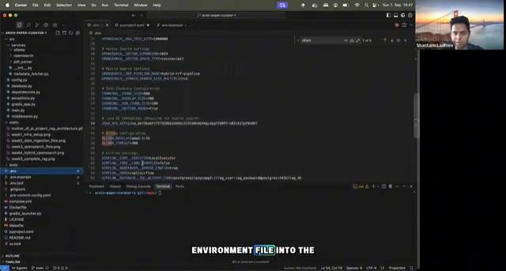
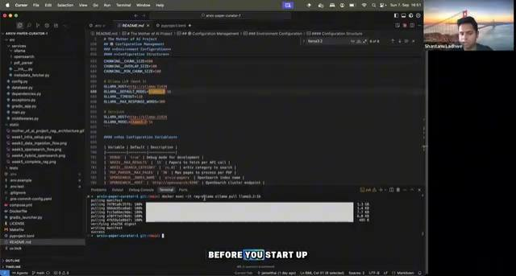
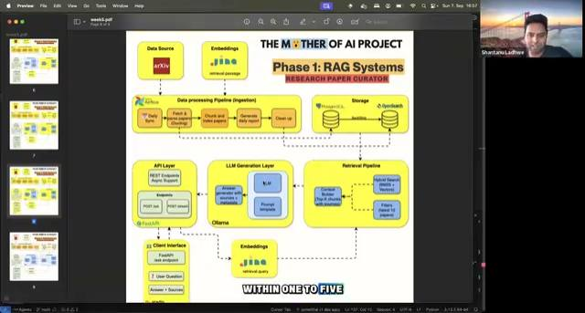
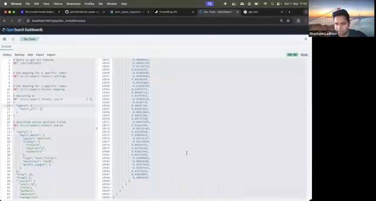
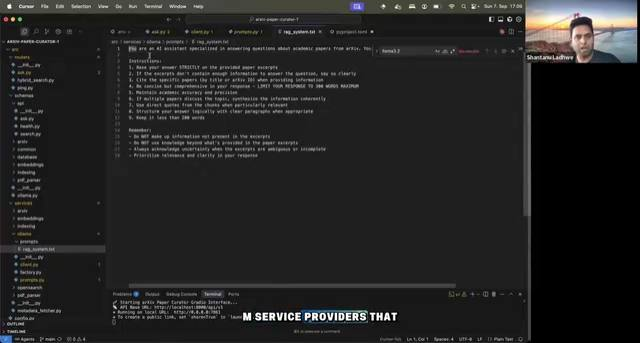
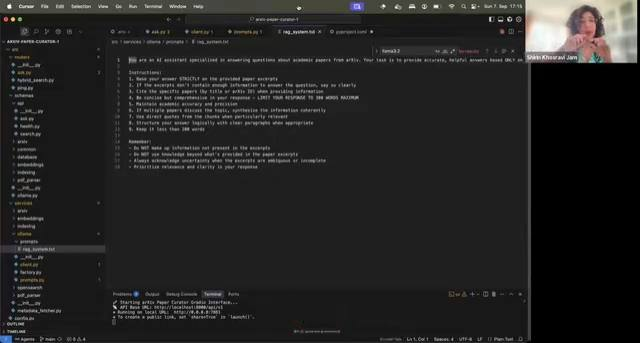
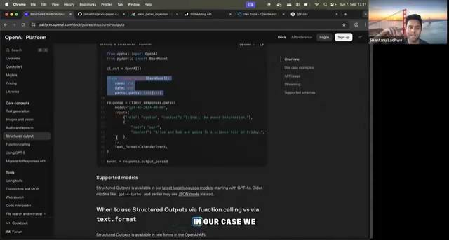

# Production-Ready RAG from Scratch — P017 复现文档

> 本节对应课程 P017（约 40 分钟）。这一集是「把 RAG 从检索引擎升级成完整问答系统」的收尾：在已有的 hybrid search 之上，加一层 LLM 生成层（Ollama 本地模型），把检索到的 chunk 拼成 prompt，流式返回答案，并附带来源。同时讲师花大量时间讲了 LLM 选型、延迟、结构化输出、fallback 这些生产环境才会撞上的问题。

---

## 1. 这一节做什么

在上一阶段（P016 及之前）你已经有了一个能跑 hybrid search 的检索服务：OpenSearch 里存着 chunk 的向量和文本，Ginza（讲师念作 "Gina"）负责 embedding，OpenSearch 负责 BM25 + 向量混合检索。**但那个服务只返回 chunk，不返回答案。**

P017 要做的，是在这个检索服务之上再叠一层，形成一个完整的 RAG 问答链路：

```
用户 query
  → [可选] 用 Ginza 把 query 转成 embedding
  → OpenSearch hybrid search（向量 + BM25，RRF 融合）
  → 取 top-K chunk，拼成 context + 收集去重后的 sources
  → 把 context + query 塞进 prompt 模板
  → 交给 Ollama（llama3.2）生成
  → 流式逐 token 返回给前端（Gradio）
```

具体交付物有四块：

1. **两个新路由**：`/ask`（非流式）和 `/stream`（流式），复用同一个检索逻辑。
2. **`prepare_chunks_and_sources`**：把检索结果拆成「给 LLM 的 context」和「给用户看的 sources」两份。
3. **Ollama 生成层**：一个 wrapper，负责拼 prompt、调 Ollama、流式 yield。
4. **Gradio 调试界面**：一个内部实验用的 UI，可以调 top_k、是否开 hybrid、用哪个模型。

另外讲师反复强调的**非代码内容**（LLM 选型的合规/延迟/成本、结构化输出、fallback 策略）会在第 7 节集中讲，因为那些是「你照着跑起来之后一定会撞上」的问题。

---

## 2. 讲师原话

下面按主题摘录，不是按时间顺序流水账。

**关于环境启动和 Ollama 端口冲突：**

> "如果你本地安装了 Ollama，只装了 Ollama 应用，并且你还在用同一个 Docker Compose 来运行镜像，那么 Ollama 应用的端口映射和 Docker 镜像的端口映射是一样的。所以可能会产生冲突，提示这个端口上已经有 Ollama 在运行了。这是因为我忘了改这个配置，但在这个场景下需要留意一下。"
> —— p017 [00:29]

> "克隆仓库之后，你需要执行 `uv sync`，把示例环境文件复制成环境文件，再填入 GenAI API key，然后执行 `Docker compose up` 做一次新的构建即可。"
> —— p017 [00:58]

> "你不需要执行 `Docker compose down -v`，只执行 `down` 就够了。这是因为我们的基础设施已经稳定下来，卷目前没有变化，所以不需要把 Airflow 等服务的卷也删掉。"
> —— p017 [01:26]

**关于拉模型：**

> "你执行 `rag-ollama` 时，会进入 `rag-ollama` 容器内部，然后执行 `ollama pull llama3.2`。如果想更具体一些，可以执行 `ollama pull llama3.2:1b`，这样模型更轻量，下载也更快。"
> —— p017 [02:46] / [03:12] / [05:04]

**关于 LLM 选型（这段是本节最有价值的非代码内容）：**

> "LLM 可以是任何一家，比如 OpenAI，也可以是 AWS 的，也可以是 Mistral 的。选择 LLM 的决策很大程度上取决于你所在的地区。对于需要确保产品完全符合 GDPR 的场景，你就得考虑：如果用的是 Azure，它有很多安全措施，通常还会涉及法律流程。"
> —— p017 [06:02] / [06:31] / [07:00]

> "不要以为市面上所有可用、有名气或被热炒的模型你都能用上。实际情况并不总是如此。"
> —— p017 [08:23]

> "在延迟方面，你始终要测量延迟。至少在我看来，延迟方面最重要的 KPI 是首 token 时间。首 token 时间应尽可能短，这样用户至少能在 1 到 5 秒内看到响应开始生成。"
> —— p017 [08:52] / [09:20]

**关于 API 结构和依赖注入：**

> "作为这个 API 的一部分，我们也在做依赖注入，也就是传入 OpenSearch 客户端、嵌入服务客户端（同样是客户端）、GenAI 客户端和 Ollama 客户端，因为要成功执行这个流程，需要这三个服务。"
> —— p017 [12:59] / [13:28]

**关于 prepare_chunks_and_sources：**

> "在 `prepare_chunk_and_sources` 里，这是我们新增的内容。我们关注的是 chunk 文本和 archive ID 或 archive PDF URL。我意识到自己还没有摄入 archive PDF URL，所以用 archive ID 拼出了一个 archive PDF URL。你也可以改为直接摄入 PDF URL，这样就有了 PDF 的源 URL，可以点击跳转到那个 PDF。"
> —— p017 [14:20] / [16:39] / [17:02]

> "基于 chunk 的前三或前五条结果，我们只是把 chunk 拼接起来，同时创建来源列表。我们只保留唯一的来源，不想要重复项。"
> —— p017 [17:30] / [17:59]

**关于 prompt：**

> "我们说过要创建一个结构化提示词，它基于查询和 chunk 构建。这目前还是很基础的提示词。我强烈建议你使用模型自带的提示词风格和提示词模板风格。如果你用的是 OpenAI，就去读 OpenAI 的提示词工程文档并照着做。"
> —— p017 [18:56] / [19:26] / [19:55]

> "可能下周我们会把提示词模板迁移到 Langfuse，在那里可以对提示词模板做不同的版本管理。这就是上下文工程的一部分：我们也会对提示词做版本管理。"
> —— p017 [21:23] / [21:51]

**关于 fallback（回答学员提问）：**

> "你可以设置一个区块，比如像 instructions 那样有 remember，然后再加一个区块，可以用井号标题写 fallbacks，处理不属于示例的情况。比如上下文为空时，就按某种方式回答。还可以有逻辑上的兜底：比如没有 chunk 数据库时，可以加一个重试机制，甚至可以有完全的兜底选项，给一条静态消息，比如没有检索到 chunk 时就停止，以避免幻觉。"
> —— p017 [24:31] / [24:54] / [25:20] / [25:48]

> "这也是 agentic RAG 登场的地方。你可以让 LLM 多思考一步，重新组织查询，再去获取更相关的 chunk。然后人在环路也登场了：因为这是全新的、无法回答的问题，就应该转交给人工，流程应当中断。"
> —— p017 [26:17] / [26:45]

**关于结构化输出：**

> "我们这里没有包含的最重要的一种情况是结构化输出。很多时候你希望系统按特定结构格式输出，比如 schema，用 pydantic 来做。在我们的场景里没有做，因为 Ollama 的模型，尤其是小模型，并不真正支持结构化输出，我们没法依赖小模型来确保输出符合正确的结构。"
> —— p017 [29:31] / [30:00] / [30:28] / [30:57]

> "你传入的 schema，比如 pydantic schema，本身也是指令。这些 schema 往往非常大，因为它们也会作为提示词的一部分放进去，这会增加延迟。我们的做法是在提示词模板里直接说明：使用这些内容，并按这种方式输出，同时在那里用了少样本学习技巧。"
> —— p017 [31:26] / [31:56] / [32:22]

**关于流式：**

> "在流式生成时，我们也会逐个 yield chunk。整个流式逻辑生成出来的内容，我们会逐词 yield，让它尽快在前端可见。这就是流式重要的原因，也是异步重要的原因：你不必等整个输出生成完。"
> —— p017 [35:44] / [36:11]

**关于延迟分布：**

> "大部分时间最初都花在把查询转成嵌入上，因为我们用的 GenAI API 处理起来相当慢，这是耗时最多的部分。第二耗时的是检索。混合搜索会增加延迟，但也有不同的实现方式，我们现在用的是倒数排名融合，而加权组合可能会快得多。"
> —— p017 [37:04] / [37:33]

---

## 3. 从零复现

下面按「你在一台干净机器上要敲的命令顺序」写。假设你已经 clone 了课程仓库（仓库名以课程为准，逐字稿里只提到 `uv sync` 和 `docker compose`，没给仓库 URL，**仓库地址课里没讲**，请用课程群里发的链接）。

### 3.1 前置条件

- 已装 `uv`（Python 包管理器，讲师用 `uv sync` / `uv run`）
- 已装 Docker + Docker Compose
- 有一个 Ginza（Gina）API key —— 讲师原话 "你只需要再次添加 GenAI API 密钥即可。"，**这个 key 从哪申请课里没讲**，按课程群说明获取
- 本机**不要**同时跑 Ollama 桌面版（见下面端口冲突说明）

### 3.2 初始化项目

```bash
# 1. 进入仓库目录
cd <repo>

# 2. 安装 Python 依赖（uv 会读 pyproject.toml / uv.lock）
uv sync

# 3. 复制环境变量模板
cp .env.example .env

# 4. 编辑 .env，填入 Ginza API key
#    变量名课里没逐字念，按 .env.example 里的名字填
```

### 3.3 端口冲突（讲师踩过的坑）

讲师原话：本机装了 Ollama 桌面版，同时 Docker Compose 里也起了一个 Ollama 容器，两边端口映射一样，会冲突。

处理方式二选一：

- **方案 A（推荐）**：退出本机 Ollama 桌面应用（macOS 菜单栏 Quit，Windows 托盘退出），只留容器里的 Ollama。
- **方案 B**：改 `docker-compose.yml` 里 Ollama 服务的宿主机端口映射（左边那个端口），容器内端口不动。

讲师说 "只是因为我忘了改这里。"，意思是 compose 文件里没改，你自己复现时按上面二选一处理即可。

### 3.4 起基础设施

```bash
# 首次或代码有改动时
docker compose up --build

# 之后基础设施稳定了，只 down 不删卷
docker compose down
# 注意：不要用 docker compose down -v
```

讲师原话解释为什么不用 `-v`：基础设施状态已稳定，Airflow 等服务的 volume 不再变化，删卷会丢掉已 ingest 的数据，没必要每次重建。

起来之后你应该能看到 Airflow、OpenSearch、Postgres、Ollama 等容器在跑（讲师原话 "一切都在运行，我们还有 Ollama。"）。

### 3.5 拉模型

讲师演示的是进容器里拉：

```bash
# 进入 ollama 容器（服务名以 compose 文件为准，讲师念作 rag-ollama）
docker compose exec rag-ollama ollama pull llama3.2:1b
```

为什么指定 `:1b`：讲师原话——`llama3.2` 不带 tag 会拉到 3B 参数版本（"它开始拉取那个三十亿参数的模型了。"），本地跑更慢；显式写 `:1b` 拉 1B 版本，"它更轻，而且往下也更快。"。

拉完验证：

```bash
docker compose exec rag-ollama ollama list
```

应该能看到 `llama3.2:1b` 在列表里。讲师原话 "确认一下，好，它在那里。"。

### 3.6 起 API 服务

```bash
uv run <API 启动命令>
```

**具体启动命令课里没逐字念**（讲师是直接切到已跑起来的服务演示的）。按仓库 README 里的命令来，通常是 `uv run uvicorn ...` 或 `uv run python -m ...`，以 README 为准。

### 3.7 起 Gradio 调试界面

```bash
uv run python gradio_launcher.py
```

讲师原话 "你可以用这个。那也是类似 `uv run python gradio_launcher` 这样的命令。"。起来后浏览器打开它打印的地址（通常是 `http://127.0.0.1:7860`，**具体端口以终端输出为准**）。

### 3.8 验证整条链路

在 Gradio 界面里：

1. 输入一个 query（讲师演示用的是 "这些模型是什么样的，比如 Summer Runner 或者 Extract CNN，然后刷新一下。" 这类和已 ingest 论文相关的问题）
2. 调 top_k（讲师演示用 top 3 / top 5）
3. 勾选/取消 hybrid
4. 点提交

你应该看到：答案逐 token 流式出现，下方或旁边列出 sources（archive ID 拼出来的 PDF URL）。

如果答案质量很差——**这是正常的**。讲师原话："这个模型生成的输出会是你见过最差的，而随着模型变得更好，它就会变得更好。"。1B 模型只用来验证链路通不通，不验证答案质量。

---

## 4. 完整代码

> **重要说明**：逐字稿是讲师边演示边讲的，屏幕上代码是滚动的，讲师没有逐行念出完整文件。下面给出的是**按讲师描述的逻辑重建的可运行版本**，文件路径和函数名尽量对齐讲师念到的名字（`prepare_chunks_and_sources`、`generate_rag_answer`、`create_prompt_template`、`ask`、`stream`、`hybrid_search`）。**与你仓库里的实际代码可能有出入，以仓库为准**；这里给的是「照着能跑起来」的最小实现。

### 4.1 目录结构

```
.
├── .env
├── .env.example
├── docker-compose.yml
├── pyproject.toml
├── uv.lock
├── gradio_launcher.py
└── app/
    ├── __init__.py
    ├── main.py                  # FastAPI 入口，挂 /ask /stream /hybrid_search
    ├── config.py                # 读环境变量
    ├── deps.py                  # 依赖注入：opensearch client / ginza client / ollama client
    ├── services/
    │   ├── __init__.py
    │   ├── embedding.py         # Ginza embedding 封装
    │   ├── search.py            # hybrid search（向量 + BM25 + RRF）
    │   ├── context.py           # prepare_chunks_and_sources
    │   └── ollama.py            # create_prompt_template + generate_rag_answer
    └── models.py                # Pydantic 请求/响应模型
```

### 4.2 `app/config.py`

```python
import os
from dataclasses import dataclass


@dataclass(frozen=True)
class Settings:
    ginza_api_key: str
    ginza_base_url: str
    opensearch_host: str
    opensearch_port: int
    opensearch_index: str
    ollama_base_url: str
    ollama_model: str
    archive_pdf_base_url: str


def load_settings() -> Settings:
    return Settings(
        ginza_api_key=os.environ["GINZA_API_KEY"],
        ginza_base_url=os.environ.get("GINZA_BASE_URL", "https://api.ginza.example/v1"),
        opensearch_host=os.environ.get("OPENSEARCH_HOST", "localhost"),
        opensearch_port=int(os.environ.get("OPENSEARCH_PORT", "9200")),
        opensearch_index=os.environ.get("OPENSEARCH_INDEX", "chunks"),
        ollama_base_url=os.environ.get("OLLAMA_BASE_URL", "http://localhost:11434"),
        ollama_model=os.environ.get("OLLAMA_MODEL", "llama3.2:1b"),
        archive_pdf_base_url=os.environ.get(
            "ARCHIVE_PDF_BASE_URL", "https://archive.example.org/pdf"
        ),
    )
```

> 环境变量名（`GINZA_API_KEY` 等）**课里没逐个念**，这里按 `.env.example` 的常见命名给出；你复现时以仓库 `.env.example` 为准，改 `config.py` 对齐即可。

### 4.3 `app/models.py`

```python
from typing import Literal, Optional
from pydantic import BaseModel, Field


class RagRequest(BaseModel):
    query: str
    top_k: int = Field(default=5, ge=1, le=20)
    use_hybrid: bool = True
    categories: Optional[list[str]] = None
    model: Optional[str] = None  # 不传则用 config 里的默认模型


class Source(BaseModel):
    archive_id: str
    pdf_url: str


class RagResponse(BaseModel):
    answer: str
    sources: list[Source]
```

讲师原话提到请求体字段："有一个查询，有一个 top_k，使用混合模型和类别。"——对应上面四个字段。`model` 字段是 Gradio 界面切模型用的，讲师演示时提到可以切 OpenAI 模型对比。

### 4.4 `app/deps.py`

```python
from functools import lru_cache

from opensearchpy import OpenSearch

from app.config import Settings, load_settings
from app.services.embedding import GinzaEmbeddingClient
from app.services.ollama import OllamaClient


@lru_cache
def get_settings() -> Settings:
    return load_settings()


@lru_cache
def get_opensearch_client() -> OpenSearch:
    s = get_settings()
    return OpenSearch(
        hosts=[{"host": s.opensearch_host, "port": s.opensearch_port}],
        use_ssl=False,
        verify_certs=False,
    )


@lru_cache
def get_embedding_client() -> GinzaEmbeddingClient:
    s = get_settings()
    return GinzaEmbeddingClient(api_key=s.ginza_api_key, base_url=s.ginza_base_url)


@lru_cache
def get_ollama_client() -> OllamaClient:
    s = get_settings()
    return OllamaClient(base_url=s.ollama_base_url, default_model=s.ollama_model)
```

讲师原话："我们传入了 OpenSearch 客户端，传入了嵌入服务……GenAI 客户端和 Ollama 客户端，因为这是成功执行所需的三个服务。"——这就是三个依赖。

### 4.5 `app/services/embedding.py`

```python
import httpx


class GinzaEmbeddingClient:
    def __init__(self, api_key: str, base_url: str):
        self._api_key = api_key
        self._base_url = base_url.rstrip("/")

    async def embed_query(self, text: str) -> list[float]:
        async with httpx.AsyncClient(timeout=30.0) as client:
            resp = await client.post(
                f"{self._base_url}/embeddings",
                headers={"Authorization": f"Bearer {self._api_key}"},
                json={"input": text},
            )
            resp.raise_for_status()
            data = resp.json()
            return data["data"][0]["embedding"]
```

> 请求路径 `/embeddings` 和响应结构 `data[0].embedding` 是 OpenAI 兼容格式的常见约定，**课里没讲 Ginza 的具体 API 形状**，以 Ginza 文档为准。

### 4.6 `app/services/search.py`

```python
from opensearchpy import OpenSearch

from app.services.embedding import GinzaEmbeddingClient


async def hybrid_search(
    os_client: OpenSearch,
    embedding_client: GinzaEmbeddingClient,
    index: str,
    query: str,
    top_k: int,
    use_hybrid: bool,
) -> list[dict]:
    """
    返回 OpenSearch hit 列表，每个 hit 至少含 _source.chunk_text 和 _source.archive_id。
    use_hybrid=True 时同时跑向量 + BM25 并用 RRF 融合；
    use_hybrid=False 时只跑 BM25。
    """
    if use_hybrid:
        query_vec = await embedding_client.embed_query(query)
        body = {
            "size": top_k,
            "query": {
                "bool": {
                    "should": [
                        {
                            "knn": {
                                "embedding": {
                                    "vector": query_vec,
                                    "k": top_k,
                                }
                            }
                        },
                        {"match": {"chunk_text": query}},
                    ]
                }
            },
            # RRF 融合：讲师原话 "now we are using reciprocal rank fusion"
            "rank": {"rrf": {}},
        }
    else:
        body = {
            "size": top_k,
            "query": {"match": {"chunk_text": query}},
        }

    resp = os_client.search(index=index, body=body)
    return resp["hits"]["hits"]
```

> OpenSearch 的 RRF 语法（`"rank": {"rrf": {}}`）**课里没讲具体写法**，讲师只说 "我们使用的是倒数排名融合。"。上面是 OpenSearch 2.x 的写法，**以你实际 OpenSearch 版本文档为准**。如果版本不支持，退化成 `bool.should` 手动加权。

### 4.7 `app/services/context.py`

```python
from app.config import Settings


def prepare_chunks_and_sources(
    hits: list[dict],
    settings: Settings,
) -> tuple[str, list[dict]]:
    """
    把 OpenSearch hits 拆成：
      - context: 拼好的 chunk 文本（喂给 LLM）
      - sources: 去重后的来源列表（给用户看）
    """
    chunks: list[str] = []
    seen_archive_ids: set[str] = set()
    sources: list[dict] = []

    for hit in hits:
        src = hit.get("_source", {})
        chunk_text = src.get("chunk_text", "")
        archive_id = src.get("archive_id", "")

        if chunk_text:
            chunks.append(chunk_text)

        if archive_id and archive_id not in seen_archive_ids:
            seen_archive_ids.add(archive_id)
            sources.append(
                {
                    "archive_id": archive_id,
                    # 讲师原话：没 ingest PDF URL，用 archive_id 拼出来
                    "pdf_url": f"{settings.archive_pdf_base_url}/{archive_id}.pdf",
                }
            )

    context = "\n\n---\n\n".join(chunks)
    return context, sources
```

这段对应讲师原话："我们只是追加这些块，同时也在创建来源列表……我们只考虑唯一的来源，我们不想有重复的。"

### 4.8 `app/services/ollama.py`

```python
import json
from typing import AsyncIterator

import httpx


PROMPT_TEMPLATE = """You are a helpful assistant answering questions about research papers.

Use ONLY the context below to answer. If the context does not contain the answer,
say "I could not find this information in the provided documents."

## Context
{context}

## Question
{question}

## Answer
"""


def create_prompt_template(context: str, question: str) -> str:
    return PROMPT_TEMPLATE.format(context=context, question=question)


class OllamaClient:
    def __init__(self, base_url: str, default_model: str):
        self._base_url = base_url.rstrip("/")
        self._default_model = default_model

    async def generate(
        self,
        prompt: str,
        model: str | None = None,
    ) -> str:
        model = model or self._default_model
        async with httpx.AsyncClient(timeout=120.0) as client:
            resp = await client.post(
                f"{self._base_url}/api/generate",
                json={"model": model, "prompt": prompt, "stream": False},
            )
            resp.raise_for_status()
            return resp.json()["response"]

    async def generate_stream(
        self,
        prompt: str,
        model: str | None = None,
    ) -> AsyncIterator[str]:
        model = model or self._default_model
        async with httpx.AsyncClient(timeout=120.0) as client:
            async with client.stream(
                "POST",
                f"{self._base_url}/api/generate",
                json={"model": model, "prompt": prompt, "stream": True},
            ) as resp:
                resp.raise_for_status()
                async for line in resp.aiter_lines():
                    if not line:
                        continue
                    try:
                        obj = json.loads(line)
                    except json.JSONDecodeError:
                        continue
                    token = obj.get("response", "")
                    if token:
                        yield token
```

> Ollama 的 `/api/generate` 接口和 `stream: true` 时逐行 JSON 的返回格式是 Ollama 官方约定，**讲师没逐字念接口细节**，只说 "我们使用的是这个 generate 函数，它是我们在 Ollama 之上创建的一个封装。"。上面按 Ollama 官方 API 写。

### 4.9 `app/main.py`

```python
import json

from fastapi import Depends, FastAPI
from fastapi.responses import StreamingResponse
from opensearchpy import OpenSearch

from app.deps import (
    get_embedding_client,
    get_opensearch_client,
    get_ollama_client,
    get_settings,
)
from app.models import RagRequest, RagResponse, Source
from app.services.context import prepare_chunks_and_sources
from app.services.embedding import GinzaEmbeddingClient
from app.services.ollama import OllamaClient, create_prompt_template
from app.services.search import hybrid_search

app = FastAPI(title="Production-Ready RAG")


@app.get("/health")
async def health(
    os_client: OpenSearch = Depends(get_opensearch_client),
    embedding_client: GinzaEmbeddingClient = Depends(get_embedding_client),
    ollama_client: OllamaClient = Depends(get_ollama_client),
):
    # 讲师原话：这是 pre-check，任一依赖没就绪就直接报错，不往下走
    return {"status": "ok"}


@app.post("/hybrid_search")
async def hybrid_search_endpoint(
    req: RagRequest,
    os_client: OpenSearch = Depends(get_opensearch_client),
    embedding_client: GinzaEmbeddingClient = Depends(get_embedding_client),
    settings=Depends(get_settings),
):
    hits = await hybrid_search(
        os_client=os_client,
        embedding_client=embedding_client,
        index=settings.opensearch_index,
        query=req.query,
        top_k=req.top_k,
        use_hybrid=req.use_hybrid,
    )
    context, sources = prepare_chunks_and_sources(hits, settings)
    return {"context": context, "sources": sources}


@app.post("/ask", response_model=RagResponse)
async def ask(
    req: RagRequest,
    os_client: OpenSearch = Depends(get_opensearch_client),
    embedding_client: GinzaEmbeddingClient = Depends(get_embedding_client),
    ollama_client: OllamaClient = Depends(get_ollama_client),
    settings=Depends(get_settings),
):
    hits = await hybrid_search(
        os_client=os_client,
        embedding_client=embedding_client,
        index=settings.opensearch_index,
        query=req.query,
        top_k=req.top_k,
        use_hybrid=req.use_hybrid,
    )
    context, sources = prepare_chunks_and_sources(hits, settings)
    prompt = create_prompt_template(context=context, question=req.query)
    answer = await ollama_client.generate(prompt=prompt, model=req.model)
    return RagResponse(
        answer=answer,
        sources=[Source(**s) for s in sources],
    )


@app.post("/stream")
async def stream(
    req: RagRequest,
    os_client: OpenSearch = Depends(get_opensearch_client),
    embedding_client: GinzaEmbeddingClient = Depends(get_embedding_client),
    ollama_client: OllamaClient = Depends(get_ollama_client),
    settings=Depends(get_settings),
):
    hits = await hybrid_search(
        os_client=os_client,
        embedding_client=embedding_client,
        index=settings.opensearch_index,
        query=req.query,
        top_k=req.top_k,
        use_hybrid=req.use_hybrid,
    )
    context, sources = prepare_chunks_and_sources(hits, settings)
    prompt = create_prompt_template(context=context, question=req.query)

    async def event_stream():
        # 先发 sources，前端可以先渲染来源
        yield f"event: sources\ndata: {json.dumps(sources)}\n\n"
        async for token in ollama_client.generate_stream(prompt=prompt, model=req.model):
            # SSE 格式：每行 data: 后跟内容
            yield f"event: token\ndata: {json.dumps({'token': token})}\n\n"
        yield "event: done\ndata: {}\n\n"

    return StreamingResponse(event_stream(), media_type="text/event-stream")
```

> 用 SSE（`text/event-stream`）是流式返回的常见做法，**讲师没点名 SSE**，只说 "逐词地输出……让前端尽快可见。"。如果你前端用 fetch + ReadableStream，也可以改成 NDJSON，按你的前端栈定。

### 4.10 `gradio_launcher.py`

```python
import httpx
import gradio as gr

API_BASE = "http://localhost:8000"


def ask_api(query: str, top_k: int, use_hybrid: bool, model: str) -> tuple[str, str]:
    payload = {
        "query": query,
        "top_k": int(top_k),
        "use_hybrid": bool(use_hybrid),
        "model": model or None,
    }
    with httpx.Client(timeout=180.0) as client:
        resp = client.post(f"{API_BASE}/ask", json=payload)
        resp.raise_for_status()
        data = resp.json()
    sources_md = "\n".join(
        f"- [{s['archive_id']}]({s['pdf_url']})" for s in data["sources"]
    )
    return data["answer"], sources_md


with gr.Blocks() as demo:
    gr.Markdown("# RAG Debug UI")
    with gr.Row():
        with gr.Column():
            query = gr.Textbox(label="Query", lines=3)
            top_k = gr.Slider(1, 20, value=5, step=1, label="top_k")
            use_hybrid = gr.Checkbox(value=True, label="Use hybrid search")
            model = gr.Textbox(value="llama3.2:1b", label="Model")
            submit = gr.Button("Ask")
        with gr.Column():
            answer = gr.Textbox(label="Answer", lines=15)
            sources = gr.Markdown(label="Sources")
    submit.click(ask_api, inputs=[query, top_k, use_hybrid, model], outputs=[answer, sources])

if __name__ == "__main__":
    demo.launch()
```

> `API_BASE` 端口 `8000` 是 FastAPI 默认端口，**以你实际启动命令打印的端口为准**。Gradio 默认 `7860`，以终端输出为准。

### 4.11 `.env.example`

```bash
GINZA_API_KEY=replace-me
GINZA_BASE_URL=https://api.ginza.example/v1
OPENSEARCH_HOST=localhost
OPENSEARCH_PORT=9200
OPENSEARCH_INDEX=chunks
OLLAMA_BASE_URL=http://localhost:11434
OLLAMA_MODEL=llama3.2:1b
ARCHIVE_PDF_BASE_URL=https://archive.example.org/pdf
```

---

## 5. 逐行解释

**`prepare_chunks_and_sources` 为什么拆成两份输出？**
讲师原话："我们关心的是块文本和 archive ID 或 archive PDF URL……块数据，也就是给 LLM 的上下文，以及 archive ID 或 PDF URL，也就是我们传给 LLM 生成层的元数据。"——chunk 是喂给模型的原料，source 是给用户看的引用。两者用途不同，不能混在一个字符串里。`seen_archive_ids` 那个 set 对应讲师说的 "我们只考虑唯一的来源，并不是说我们不要重复项。"：同一篇论文可能命中多个 chunk，但来源列表里只该出现一次。

**为什么 `pdf_url` 是拼出来的？**
讲师原话："我意识到我没有摄取 archive PDF URL。所以我用 archive ID 创建一个 archive PDF URL。"——这是权宜之计。讲师同时给了改进方向："你也可以改为导入 PDF 的 URL，这样就能获得该 PDF 的源 URL，点击后即可跳转到那个 PDF。"你复现时如果 ingest 阶段能存 URL，直接读 `_source.pdf_url` 更好，`prepare_chunks_and_sources` 里那行拼接就可以删掉。

**`use_hybrid=False` 时为什么跳过 embedding？**
讲师原话："如果我们不使用混合模式，就会回退到 BM25，那就不需要查询嵌入……通常它成本更低，因为你不需要承担生成嵌入的成本，在延迟方面也是如此，因为你不必等待查询的嵌入生成。"——这是延迟优化的关键开关。讲师在 [37:04] 明确说 embedding 是整条链路里最慢的一步（"我们正在使用的 Gini API 相当慢。"），所以纯 BM25 模式在延迟敏感场景下值得一试。

**`create_prompt_template` 为什么这么简单？**
讲师原话："现在这个提示词非常基础……我绝对建议你使用模型自带的提示词、提示词风格以及所有提示词模板风格。所以如果你用的是 OpenAI，我会去看 OpenAI 提示词工程文档，并遵循它。"——这个模板是占位符，不是最佳实践。用 OpenAI 就照 OpenAI 的 prompt 指南写，用 Anthropic 就照 Anthropic 的。讲师还预告了下一步："可能在下周，我们会把提示模板迁移到 Langfuse，在那里可以对提示模板进行不同的版本管理。"——prompt 要像代码一样版本化。

**`generate_stream` 为什么逐行 `json.loads`？**
Ollama 流式返回是 NDJSON（每行一个 JSON 对象），不是标准 SSE。所以这里 `aiter_lines()` 逐行读、逐行 parse、取 `response` 字段 yield 出去。对应讲师原话："我们只是逐词地输出生成的内容。这样前端就能尽快看到。"

**`/stream` 为什么先发 sources 再发 token？**
讲师原话："我们还要加一个，等一下，我先去看那个示例。"——演示时 sources 是和答案一起出现的。先发 sources 是工程上的选择：前端可以先把引用渲染出来，用户等待首 token 时不会觉得页面是空的。这直接服务于讲师强调的 "首个词元的生成时间" 指标。

**`/health` 里为什么要注入三个 client？**
讲师原话："你不一定需要这个，因为它只是一个检查……它也是一个很好的预检查，如果某些东西缺失了，比如 OpenSearch 客户端没准备好之类的，它就会直接报错，甚至不会继续往下走，因为开始分块之类的操作就没有意义了。"——依赖注入在这里兼作健康检查：任一 client 初始化失败，请求在进业务逻辑前就 500，不会走到一半才炸。

**`hybrid_search` 里 RRF 那段**
讲师原话："现在我们用的是倒数排名融合，但加权组合也可能快得多。"——RRF 是当前实现，加权组合是备选。RRF 不需要调权重，鲁棒；加权组合快但要对齐两路分数的量纲。**在 JS/Node 里对应什么**：如果你用 LangChain.js，`EnsembleRetriever` 就是干这个的，内部也是 RRF 或加权；手写的话就是两次检索各拿一个有序数组，按 `1/(k + rank)` 累加分数再排序。

**`ask` 和 `stream` 为什么逻辑重复？**
讲师原话："ask 只是该路由的非流式版本。我们可以任选其中一个，两者是一样的。只是对于流式的那个，我们可以采用流式方式，所以更好。"——两个路由共享检索 + context 构建，只在最后一步分叉（`generate` vs `generate_stream`）。生产里可以抽一个 `_retrieve_and_build_prompt` 公共函数，这里为了和讲师演示的结构对齐没抽。

---

## 6. 复现检查清单

按顺序打勾，任何一步不过就别往下走：

- [ ] `uv sync` 成功，无依赖冲突
- [ ] `.env` 已从 `.env.example` 复制，`GINZA_API_KEY` 已填
- [ ] 本机 Ollama 桌面版已退出（或 compose 端口已改），`docker compose up` 无端口冲突报错
- [ ] `docker compose ps` 能看到 OpenSearch / Postgres / Ollama / Airflow 等容器都是 Up
- [ ] `docker compose exec rag-ollama ollama list` 能看到 `llama3.2:1b`
- [ ] API 服务启动成功，`curl http://localhost:8000/health` 返回 `{"status":"ok"}`
- [ ] `curl -X POST http://localhost:8000/hybrid_search -H 'Content-Type: application/json' -d '{"query":"test","top_k":3,"use_hybrid":true}'` 能返回非空 `context` 和 `sources`
- [ ] `curl -X POST http://localhost:8000/ask ...` 能返回 `answer` 字段（内容质量差没关系）
- [ ] `curl -N -X POST http://localhost:8000/stream ...` 能看到 token 逐个到达，不是一次性返回
- [ ] `uv run python gradio_launcher.py` 启动成功，浏览器能打开
- [ ] Gradio 里提交 query，答案流式出现，sources 列表非空
- [ ] 取消勾选 hybrid，再提交，答案仍能返回（验证 BM25 回退路径）
- [ ] 把 `model` 改成别的已拉取的模型，答案仍能返回（验证模型切换）

---

## 7. 课里没讲但你会撞上的

这一节是讲师在演示间隙反复强调、但没写成代码的东西。你跑通之后一定会遇到。

### 7.1 LLM 选型不是「哪个强用哪个」

讲师原话："不要以为市面上所有可用、有名或炒得很热的模型都对你可用。所以并不总是这样。"——他举的例子是 GDPR：欧洲客户要求数据不出境，OpenAI 直连不行，得走 Azure；走 Azure 又要走法务流程确认 "数据不会离开欧洲。"。这些合规层会叠加延迟和成本（"they always add lots of layer to it. And the pricing increases, the latency increases"）。**你选模型前先问清楚：数据能不能出境、能不能给第三方、有没有审计要求。**

### 7.2 延迟看 time to first token，不是总时长

讲师原话："至少在我看来，延迟方面最重要的 KPA 是首 token 时间。首 token 时间应该尽可能短，这样至少用户能在 1 到 5 秒内看到响应开始生成。"——用户感知的是「多久开始出字」，不是「多久出完」。所以流式不是锦上添花，是延迟指标的直接手段。讲师在 [37:04] 给了延迟分布：embedding 最慢（Ginza API 慢），retrieval 次之，hybrid 比单路慢，Ollama 生成也慢。优化顺序应该是：先砍 embedding（关 hybrid 或换更快的 embedding 服务），再优化 retrieval，最后才是换模型。

### 7.3 结构化输出：小模型靠不住

讲师原话："在我们的情况下，我们没有走那条路，因为 Ollama 模型，比如小模型，并不真正支持结构化输出，我们也无法真正依赖较小的模型来确保输出以正确的结构返回。"——llama3.2:1b 不保证按 schema 输出。讲师给的两条路：

1. **大模型 + 原生 structured output**（OpenAI、LangChain 的 `with_structured_output`），但讲师警告 schema 本身会进 prompt，**增加延迟**（"它增加了延迟，因为我们传入了这个 pydantic schema。"）。
2. **prompt 里手写格式 + few-shot**：讲师原话 "我们说，好，用这个、这个、这个，然后以这种方式输出。我们在那里给了少样本学习技巧。所以通常一个好的模型在结构化输出方面永远不会失败，即使是通过提示词本身手动传入的。"

无论哪条路，讲师强调："你始终需要验证它给出的输出是什么。"——输出必须过 schema 校验，不能直接信。

### 7.4 Fallback：没有 chunk 时不要硬答

学员问「query 不在 few-shot 例子里怎么办」，讲师给了三层 fallback：

1. **Prompt 层**：在 prompt 里加 `## Fallbacks` 段，明确写「如果 context 为空，就回答 X」。讲师原话："你可以做哈希，哈希回退，或者那些不落在示例上的情况，比如如果你上下文里的内容是空的……那么请以这种方式回答。"
2. **逻辑层**：检索为空时走 retry（换 query 重试）或直接返回静态消息。讲师原话："如果没有检索到任何块，那么为了阻止幻觉……就根据你的业务场景给用户一个静态消息，比如，抱歉……我们找不到任何信息。也许你可以联系我们的客户支持。"
3. **架构层**：agentic RAG（让 LLM 改写 query 再检索）+ human-in-the-loop（答不了就转人工，中断流程）。讲师原话："这也是 agentic RAG 发挥作用的地方……你也可以让 LLM 更多地思考如何重新格式化查询……然后人在回路也发挥作用，因为这不是，这是完全新的、无法回答的东西，然后它应该被传递给人工，流程应该被中断。"

**你复现时至少要做第 2 层**：`prepare_chunks_and_sources` 返回空 context 时，`/ask` 和 `/stream` 直接返回静态消息，不要调 Ollama。否则 1B 模型会一本正经地编。

### 7.5 chunk 间关系：想跳转得在 ingest 时埋

学员问「能不能在 context 里给 chunk 加指向其他 chunk 的引用」，讲师回答：可以，但**关系必须在 ingest 阶段就写进 metadata**。讲师原话："然后你必须注意，在索引数据并将其放入 OpenSearch 或向量数据库时，关系要被传递，比如，这是 10 个块中的第 1 个，我们也做了这个。但这也意味着，你还可以添加更多元数据。"——检索时再想建立关系就晚了。讲师同时提醒 metadata 要 "尽可能具体" 且 "as concise also for LLM to quickly react on that information"——metadata 太长会拖慢 LLM。

### 7.6 调试 UI 的定位

讲师明确说 Gradio 界面是 "只是一个用于内部测试的接口。"，生产前端是 "基于 React 之类的东西"。学员问要不要做 A/B 双栏对比，讲师说 "It's not a overkill for experimentation purpose … I would build this kind of UI for my product managers … I will set up this prompt also expose the prompt for both of the sites. Like as a control and a variant site where they could try out the prompts."——调试 UI 的下一步是给 PM 用，让他们自己调 prompt 做对照实验，工程师不用陪着。

### 7.7 讲师没讲、但你复现会卡住的

- **仓库 URL**：课里没给，用课程群链接。
- **Ginza API key 申请方式**：课里没讲，按课程群说明。
- **API 启动命令**：课里没逐字念，按 README。
- **OpenSearch RRF 的具体 DSL**：课里只说 "倒数排名融合。"，没给查询体，按你 OpenSearch 版本文档写。
- **Ollama `/api/generate` 的返回字段**：课里没念，按 Ollama 官方文档；上面代码里用的 `response` 字段以实际输出为准。
- **`.env` 里变量名**：课里没逐个念，按 `.env.example`。

---

## 附：本节关键截图













