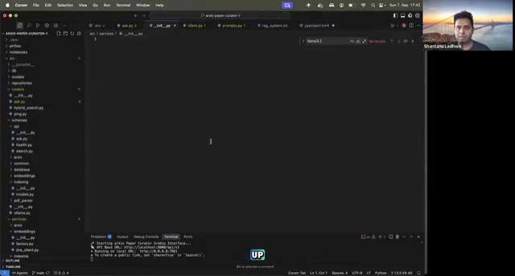
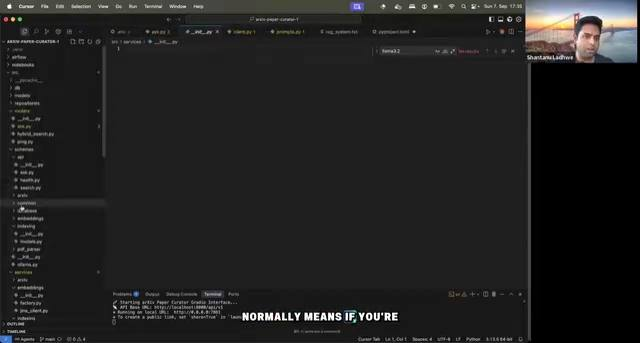
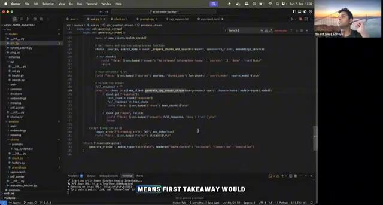
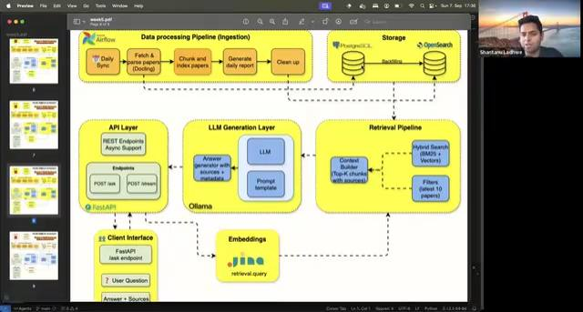
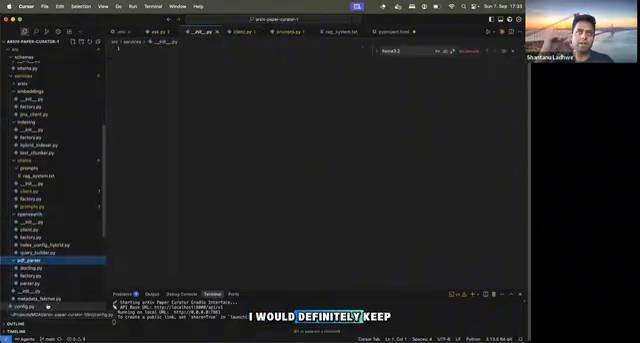
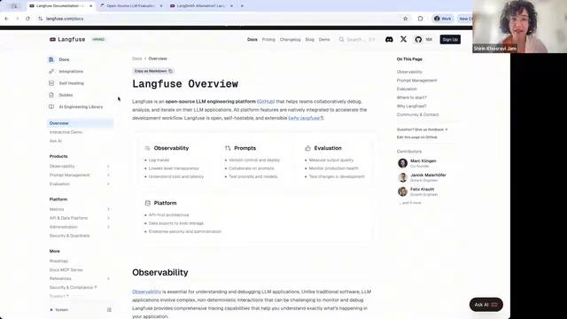
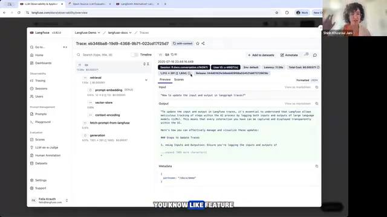
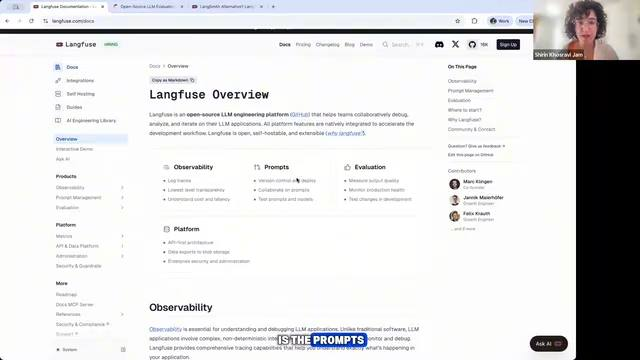
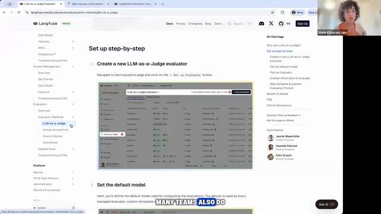
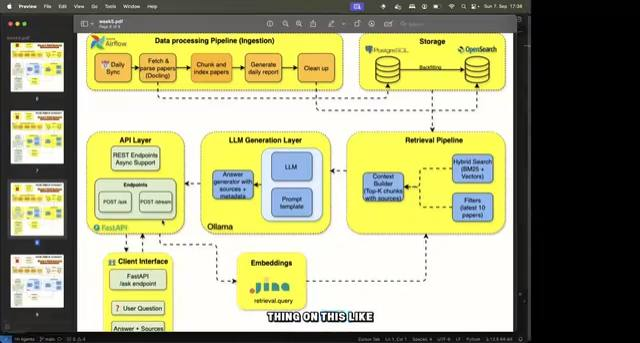

先说明一个关键前提：P18–P19 是答疑与工具概览，逐字稿里没有可执行代码、安装命令、依赖版本或配置文件。因此本文不会伪造一套“课程源码”。第 4 节按纯讲解课的要求，把讲师给出的方案落成设计决策表、组件职责表、接口草案、估算表和验收清单；凡是我补的示意，都会明确标注「课里没有代码，以下为示意」。

# 1. 这一节做什么

这一节要解决两个落地问题：第一，P18 回答“一个 RAG POC 怎么长成可维护的 production-ready 代码库”，讲师给出的主线是模块化、先验证业务、四层骨架、增量加复杂度；第二，P19 讲 Langfuse 为什么在 Gen AI 应用里重要，以及它最值得用的三类能力：可观测性、提示词管理、评估。

把两段合起来看，这一节不是教你“再写一个 RAG demo”，而是教你给已有 RAG 项目补上工程骨架和可观测性。读者照着做，应得到三样产物：

1. 一张需求与演化假设表：先明确业务目标、数据源、查询类型、未来可能要加的 Graph RAG、自定义路由、重排序/微调，避免一开始把代码写死。
2. 一套四层模块边界：API 层、LLM generation 层、retrieval pipeline 层、storage 层；UI 层在讲师讨论中也出现过，但属于可替换外层。每个模块只在自己的边界内变更。
3. 一张 Langfuse 接入验收表：trace 能定位到 session、user、environment、latency、cost；prompt 能版本化并用 production label 回滚；评估能覆盖 LLM as judge、人工标注、自定义评分。

需要特别提醒：这节课没有给 Langfuse 的 SDK 包名、环境变量名、API 字段名，也没有给 FastAPI 路由、OpenSearch/Qdrant 索引结构、Airflow DAG。下面凡是涉及这些具体实现的地方，我都会写“课里没讲”，不会替讲师补一个看似权威的版本。

# 2. 讲师原话（带「—— pNNN [MM:SS]」）

> "始终尽量搭建模块化的代码库，让每项服务都能作为独立实体添加进去"
> —— p018 [00:28]

讲师把“模块化”放在第一条经验。不是先追求复杂架构，而是让索引、嵌入、解析、检索、生成这些服务有独立边界；以后改嵌入模型或改索引逻辑时，改动被限制在一个模块内。

> "无论如何都需要四层，比如接口层、大语言模型生成……检索流水线和存储层"
> —— p018 [04:50]

这是本节的骨架。讲师认为无论具体项目怎么变，API 层、生成层、检索流水线、存储层通常都跑不掉；复杂度是在这四层之上增量加的。

> "一开始可以先用 PostgreSQL，之后如果需要，再增加更复杂的向量引擎"
> —— p018 [04:38]

讲师建议先用简单方案验证，比如关键词搜索、数据库过滤，甚至先用 Postgres 的向量搜索能力；不要一开始就上更复杂的向量引擎。注意：讲师说 Postgres 向量搜索的“包名我忘了”，所以本文不会猜插件名。

> "通常 Airflow 那套逻辑会放到比较后面再做……有一段时间你会使用静态文档列表……之后再通过交互式笔记本导入 OpenSearch"
> —— p018 [02:16]

POC 阶段可以先用 notebook、静态文档列表做 chunking 和 indexing，把数据灌进 OpenSearch 或类似存储；等业务价值被证明后，再把 Airflow 这类数据流水线工程化。

> "一个三人团队搭建这个基础版本至少需要一个月"
> —— p018 [07:04]

讲师给的估算很保守：三人团队至少一个月才能把基础版跑起来；项目要稳定可靠可能拖到六个月。原因包括基础设施、边界情况、日志监控等生产事项，而后者在这节课里没有展开。

> "需求收集应当从业务侧充分开展"
> —— p018 [08:25]

需求收集要提前做透。讲师甚至说，自己参与的项目常会花一到两个月做需求与研究，先想清楚未来可能加 Graph RAG、机器学习模型、反馈通道时怎么加。

> "Langfuse 是一个可观测性工具"
> —— p019 [00:29]

P19 的定位很明确：Langfuse 是面向 Gen AI 应用的可观测性平台。它不只是“看日志”，而是看 trace、成本、用户问题、延迟、会话，以及后面的提示词和评估。

> "可观测性……提示词……评估"
> —— p019 [01:20] / [01:48] / [03:12]

讲师把 Langfuse 的价值归成三类：可观测性、提示词管理、评估。后面所有展开都围绕这三类，不再另起炉灶。

> "无需重新部署即可编辑提示词……更改生产标签"
> —— p019 [12:15] / [13:05]

提示词管理的核心不是“有个输入框”，而是版本化、production label、快速回滚。生产环境改 prompt 不必走完整代码发布链路，出问题切回旧版本。

> "让大语言模型担任评审……人工标注……自定义评分"
> —— p019 [14:21] / [16:06] / [17:04]

评估有三条路：LLM as judge（可在线也可离线）、人工标注、以及通过 API 把后端自定义指标写回 Langfuse。课里没有给具体评分脚本。

# 3. 从零复现

这一节按“纯讲解课”的方式复现讲师的推导过程。你不需要先装某个包，而是按顺序产出决策和边界。

## 3.1 先写需求与演化假设，不要先写 Airflow

讲师反复强调 requirement gathering。复现动作是建一张一页纸的需求表，至少写清：

- 业务问题是什么，RAG 要改善哪个 KPI；
- 用户会问哪几类问题，是事实问答、论文检索、最新论文查询，还是多轮对话；
- 数据源有哪些，文档是否静态，更新频率如何；
- 未来半年最可能加什么：Graph RAG、按发布日期路由“最新 10 篇论文”、重排序模型、微调嵌入、反馈通道；
- 哪些查询需要自定义预处理和路由，而不是普通向量检索。

这一步的产物不是代码，而是“演化假设”。讲师说，设计时要把 base scenario 和最复杂 scenario 都想到，这样后面加 Graph RAG 或机器学习模型时，不用把底座推翻。



## 3.2 用 notebook 做 POC，先证明业务价值

POC 阶段不要直接上完整数据管道。讲师的做法是：先有静态文档列表，用 notebook 做 chunking 和 indexing，把数据写入 OpenSearch 或类似存储；检索侧先用关键词搜索、数据库过滤，或者 Postgres 的向量搜索能力。等业务 case 和 KPI 被证明，再投入 Airflow 和复杂向量引擎。

复现顺序：

1. 准备一小批静态文档，不要接实时数据源。
2. 在 notebook 里完成解析、分块、嵌入、写入检索存储。
3. 用业务验收问题集跑通“query → 检索 → 生成回答”。具体问题数量课里没讲，别把某个数字当课程结论。
4. 记录失败案例：是解析错、分块错、检索没召回，还是生成不 grounded。这个记录表会成为后面评估数据集的种子。



## 3.3 建四层骨架，并固定变更边界

讲师给出的四层是：

| 层 | 职责 | 变更边界 |
|---|---|---|
| API 层 | 接收 query，组织调用，返回答案 | 路由、鉴权、错误码、请求/响应契约 |
| LLM generation 层 | 拼 prompt、调用 LLM、生成答案 | 模型、prompt 模板、输出格式 |
| Retrieval pipeline 层 | query 预处理、检索、过滤、重排 | 检索策略、过滤条件、候选数量、重排逻辑 |
| Storage 层 | 文档、chunk、向量、元数据、索引 | 存储引擎、索引结构、写入/读取接口 |

讲师还提到 UI 层，但它属于外层，可以替换。真正要守住的是上面四层之间的接口：API 不直接拼 SQL，generation 不直接操作向量库，retrieval 不关心前端长什么样。





## 3.4 模块再往下拆：索引、嵌入、解析各自独立

讲师在 [02:04] 左右解释：索引逻辑、embedding 逻辑、parsing 逻辑应该独立。比如把嵌入从某个模型换成 OpenAI embedding，方法名大体不变，只改 embedding 模块内部；解析器换格式也只改 parsing 模块。复现时至少拆出：

- `indexing`：chunk 切分、索引构建；
- `embeddings`：把 chunk 和 query 转成向量；
- `parsing`：PDF/HTML/文本解析；
- `retrieval`：召回、过滤、重排；
- `generation`：prompt 与 LLM 调用；
- `api`：对外接口；
- `prompts`：默认 prompt 与版本管理；
- `eval` / `tracing`：评估与可观测性接入。

目录名可以不同，但边界要能一眼看出来。课里没有给官方目录树，本文第 4 节会给一个“落地目录草案”，它是我为复现整理的，不是讲师原文件。



## 3.5 接入 Langfuse：先接 trace，再接 prompt 和评估

P19 的顺序是先讲可观测性，再讲 prompt management，最后讲 evaluation。复现也建议按这个顺序，否则一上来做评估会缺少数据。

第一步，让每次用户请求形成可追踪的 trace。讲师在 [04:05]–[04:42] 提到要能看到 input/output、session、user ID、environment（prod/staging/local）、latency、total cost、release tag、tags/feature flags。这里的具体字段名和 SDK 调用课里没讲，落地时以 Langfuse 文档为准。





第二步，把 prompt 从“只能改代码”变成“可版本化、可切换”。讲师说可以在 Langfuse UI 里编辑、创建新版本，并用 production label 指向当前生产版本；出问题时把 label 切回旧版本。注意：课里没讲代码里如何 fallback、如何拉取 prompt、SDK 怎么初始化，这些都要另查文档。



第三步，做评估。讲师给的三条路线是：

- LLM as judge：可在线，每个 trace 打分；也可离线，对数据集跑。
- 人工标注：专家看 trace，标记 hallucination、toxic、jailbreak 等，并写评论。
- 自定义评分：后端脚本按小时拉 trace，算答案长度、faithfulness 或产品指标，再通过 API 写回 Langfuse。



## 3.6 复杂度增量加：Graph RAG、自定义路由、微调

讲师明确说，复杂能力不要一开始全上。可增量加的例子包括：

- Graph RAG：当前没加，未来可作为扩展；
- 自定义路由：用户说“给我最新 10 篇论文”时，不走普通 chunk 检索，而是按 published date 取最新论文；
- 重排序：先向量检索出 50–100 个 chunk，再用重排序模型取 top 5；
- 微调嵌入/双塔模型：当 BM25 和向量搜索仍不够好，且有大量“query–chunk 是否匹配”的标注数据时再考虑；
- 微调 LLM：当 prompting 和 RAG 仍无法让模型按业务风格回答时，用业务问答数据微调开源 LLM。

讲师也提醒，微调会引入 MLOps、更多延迟和标注成本；标注数据需要成千上万条，不是几十条就能做。


## 3.7 时间与团队估算

讲师的口径是：

- 需求与研究：他自己参与的项目常花一到两个月；
- 基础版：三人团队至少一个月；
- 可靠生产：项目可能持续六个月；
- 评估数据：需要超过数千条标注样本；
- 日志、监控、失败处理：这节课没覆盖，但生产必须有。



# 4. 完整代码

课里没有代码，所以这里不伪造 `requirements.txt`、`docker-compose.yml` 或 Langfuse SDK 调用。下面给出可直接拿去开会的落地产物。所有 TypeScript 接口和目录树都是「课里没有代码，以下为示意」，用于把讲师的设计落成可执行契约。

## 4.1 落地目录草案（示意，不是讲师原文件）

```text
rag-app/
  api/                 # FastAPI 或 Node BFF 对外接口
  retrieval/           # query 预处理、召回、过滤、重排
  indexing/            # chunking、索引构建
  embeddings/          # chunk/query 向量化
  parsing/             # PDF/HTML/文本解析
  generation/          # prompt 拼装、LLM 调用、答案后处理
  prompts/             # 默认 prompt、版本说明、回滚说明
  storage/             # OpenSearch/Qdrant/Postgres 访问封装
  eval/                # 离线评估、LLM as judge 脚本
  tracing/             # Langfuse 等可观测性接入
  docs/
    decisions.md       # 设计决策表
    runbook.md         # 复现与验收清单
```

这份目录只表达边界，不表达技术栈。课里没有规定必须用 FastAPI 之外的框架；FastAPI 是讲师在 P18 提到的服务化方式之一。

## 4.2 设计决策表

| 决策 | 讲师依据 | 复现动作 | 不这样会怎样 |
|---|---|---|---|
| 模块化，每个服务独立 | p018 [00:28] | 索引、嵌入、解析、检索、生成分目录 | 改一个嵌入模型牵动全仓库 |
| 先 POC notebook，后 Airflow | p018 [02:16] | 静态文档列表 + notebook 灌数据 | 业务没验证就投入数据管道 |
| 四层骨架 | p018 [04:50] | API、generation、retrieval、storage | 层级混乱，API 直接写检索 SQL |
| 先简单检索，后复杂向量引擎 | p018 [04:38] | 关键词/过滤/Postgres 起步 | 过早引入运维复杂度 |
| 复杂度增量加 | p018 [05:08] | Graph RAG、自定义路由、重排按需加 | 第一版过重，迭代慢 |
| 需求先行 | p018 [08:25] | 写业务目标、数据源、未来扩展 | 需求一变就推翻底座 |
| 三人至少一个月做基础版 | p018 [07:04] | 排期按基础版和生产化分开 | 把 POC 当生产交付 |
| Langfuse 三类能力 | p019 [01:20] | 先 trace，再 prompt，再 eval | 只做日志，无法闭环改进 |
| Prompt 版本化 + production label | p019 [13:05] | 每次变更记录版本和回滚点 | 线上 prompt 出错只能重新发版 |
| 评估三条路线 | p019 [14:21] | LLM judge、人工标注、自定义分数 | 没有质量闭环，只靠感觉调参 |

## 4.3 组件职责表

| 组件 | 输入 | 输出 | 允许变更什么 | 课里依据 |
|---|---|---|---|---|
| API 层 | 用户 query、user/session 标识 | 答案、引用、错误 | 路由、鉴权、响应格式 | p018 [04:50] |
| Retrieval pipeline | query、过滤条件、候选数 | 召回 chunk、分数、元数据 | 召回策略、过滤、重排 | p018 [04:50] |
| Storage | 文档、chunk、向量、索引请求 | 检索结果、文档元数据 | 存储引擎、索引结构 | p018 [04:50] |
| Indexing | 原始文档、chunk 配置 | chunk 集合、索引任务 | 分块规则、索引构建 | p018 [02:04] |
| Embeddings | chunk 文本、query 文本 | 向量 | 嵌入模型、批处理 | p018 [02:04] |
| Generation | query、context、prompt 版本 | 回答、引用、原始输出 | 模型、prompt、输出解析 | p018 [04:50] |
| Observability | trace 事件、session/user、环境 | trace、成本、延迟 | 追踪哪些步骤、标签 | p019 [04:05] |
| Prompt management | prompt 文本、版本、label | 生产/预发 prompt | 版本、label、回滚 | p019 [13:05] |
| Evaluation | 数据集、trace、人工标注、后端分数 | 分数、评论、数据集 | judge 方式、评分维度 | p019 [14:21] |

## 4.4 接口/数据模型草案（示意）

以下字段名是本文为内部契约起的名字，不是 Langfuse 官方 API 字段；Langfuse 实际字段名与 SDK 用法请以文档为准。

```ts
// 课里没有代码，以下为示意：RAG 内部请求/响应契约
type Environment = "local" | "staging" | "prod";

interface RagRequest {
  query: string;
  userId: string;
  sessionId: string;
  environment: Environment;
  tags?: string[];
}

interface RetrievedChunk {
  chunkId: string;
  text: string;
  source: string;
  score?: number;
  publishedAt?: string; // 用于“最新论文”这类自定义路由
}

interface RagResponse {
  answer: string;
  citations: RetrievedChunk[];
  traceId?: string; // 便于回到可观测性平台排查
}
```

```ts
// 课里没有代码，以下为示意：prompt 版本与评估数据
interface PromptVersion {
  name: string;
  version: string;
  label: "production" | "staging";
  text: string;
}

interface EvalRecord {
  query: string;
  answer: string;
  chunk: string;
  label: 0 | 1; // 1=匹配，0=不匹配；用于重排/双塔训练
  annotator: string;
}
```

上面 `publishedAt` 对应讲师提到的“最新 10 篇论文”自定义路由；`label: 0|1` 对应讲师说的 query–chunk 是否匹配标注。课里没有给具体 schema，这只是把讨论落成可讨论的草案。

## 4.5 容量与时间估算表

| 项目 | 讲师口径 | 复现时怎么用 |
|---|---|---|
| 需求与研究 | 一到两个月，视项目 | 先排需求调研，不要直接排开发 |
| 基础版 | 三人团队至少一个月 | 只承诺“能跑通基础链路” |
| 可靠生产 | 可能持续六个月 | 把日志、监控、失败处理另列里程碑 |
| 评估数据 | 超过数千条样本 | 先规划标注人力，不要假设少量样本够 |
| Graph RAG/自定义路由 | 增量加 | 作为后续迭代，不阻塞第一版 |
| 微调/重排 | 检索仍不够好时再上 | 先积累标注数据，再谈模型 |

## 4.6 Langfuse 接入验收表

| 能力 | 最小验收证据 | 课里是否给代码 |
|---|---|---|
| Trace | 每次 query 能看到 input/output 与调用链 | 没给 |
| Session/User | 能按 session 或 user ID 过滤 | 没给 |
| Environment | 能区分 prod/staging/local | 没给 |
| Latency/Cost | 能看到总延迟与总成本，按模型看成本 | 没给 |
| Tags/Release | trace 能带标签或 release tag | 没给 |
| Prompt 版本 | 能看到 prompt 版本并切换 production label | 没给 |
| 回滚 | 线上 prompt 异常时切回旧 label | 没给 |
| LLM as judge | 在线或离线对 trace/数据集打分 | 没给 |
| 人工标注 | 专家可标记 hallucination/toxic/jailbreak 等 | 没给 |
| 自定义分数 | 后端脚本算分并通过 API 写回 | 没给 |

# 5. 逐行解释

这一节逐条解释上一节每个决策和字段为什么这样定，不这样会怎样。

**模块化不是“目录好看”，而是变更边界。** 讲师第一条经验就是每个 service 独立。对前端转 AI 的读者，可以把它类比成前端项目里的 `api/`、`components/`、`store/`：目的不是分层好看，而是改一个地方时不牵动全站。RAG 里最常变的是嵌入模型、分块规则、检索策略、prompt；如果这些逻辑混在一个大文件里，每次实验都会变成全量回归。

**四层骨架是为了让 API 不碰检索细节。** API 层只负责收 query、组织调用、返回响应；generation 层只负责 prompt 和 LLM；retrieval 层只负责召回与重排；storage 层只负责数据访问。这样换 OpenSearch、Qdrant 或 Postgres 时，只动 storage 和 retrieval 的适配；换模型时只动 generation。课里没有规定层与层之间必须用什么协议，但边界要先立住。

**先 POC notebook 再 Airflow，是因为业务价值未证明前不值得建管道。** 讲师说通常 Airflow 逻辑会晚很多，先有静态文档列表，notebook 灌数据。这样做的好处是实验快、失败便宜；坏处是 notebook 不可直接上生产。复现时要把 notebook 当“实验记录”，不是当最终服务。

**先关键词/过滤/Postgres，再复杂向量引擎，是为了避免过早运维。** 讲师说 Postgres 也支持向量搜索，但包名忘了。这里要诚实：本文不填插件名。对读者的动作是——先用现有数据库能力做基线，等召回质量不够再换专用向量引擎。不要因为“RAG 必须上向量库”就跳过基线对比。

**需求先行一到两个月，是为了给未来扩展留接口。** 讲师说设计时要把 base scenario 和最复杂 scenario 都想到。对应到代码，就是 retrieval 层要能接受过滤条件、路由条件、候选数量；storage 层要能存 published date 这类元数据；generation 层要能切换 prompt 版本。这样以后加“最新 10 篇论文”的自定义路由，不需要重写整条链路。

**三人一个月是基础版，不是生产版。** 讲师把基础版和生产可靠分开：基础版至少一个月，项目可能六个月。复现排期时不要把“demo 能回答”当成“生产可交付”。日志、监控、失败处理在 P18 里被明确说成“还没覆盖”，所以必须另列任务。

**Langfuse 先 trace 再 prompt 再 eval，是因为没有 trace 就没有评估素材。** trace 里能看 session、user、environment、latency、cost、tags；这些信息让“用户为什么点踩”可追查。没有 trace 就直接做 LLM judge，等于对空气打分。

**Prompt 的 production label 是回滚开关。** 讲师说改 prompt 不必走完整代码发布链路，出问题切 production label 回旧版本。复现时要记录：当前生产 label 指向哪个版本、谁改的、为什么改、回滚版本是什么。课里没讲具体审批流，但至少要有变更记录。

**`userId` / `sessionId` / `environment` 不是装饰字段。** 它们对应 Langfuse 里按用户、按会话、按环境过滤的能力。没有这些字段，线上出问题只能看一堆无主 trace。`traceId` 回传是为了让 API 响应能关联到可观测性平台，方便客服或开发定位。

**`publishedAt` 是为自定义路由预留的元数据。** 讲师举的“最新 10 篇论文”不是普通向量相似度能解决的，需要按发布日期取。这个字段现在可以不用，但存储层要能存，否则以后加路由要回填全量数据。

**`EvalRecord` 的 0/1 标签对应重排/双塔训练。** 讲师说需要大量“query 匹配 chunk / 不匹配 chunk”的正负样本，成千上万条。这个 schema 只是最小草案；真正标注还要考虑多人一致性、难例、去重。课里没有给标注平台和流程。

**LLM as judge、人工标注、自定义分数是三条互补路线。** LLM judge 快、可在线，但可能偏；人工标注准、但贵；自定义分数贴合产品指标，但需要后端脚本。讲师说很多团队也会在 CI/CD 里自己写 judge 脚本，这取决于公司习惯。课里没有给 judge prompt，也没有给 API 调用示例。

**微调不是第一天的方案。** 讲师说只有 BM25 和向量搜索仍不够好，才考虑重排序模型或双塔嵌入微调；微调 LLM 则是在 prompting 和 RAG 仍无法满足业务风格时。微调会引入 MLOps、延迟和标注成本，所以先积累数据，再谈模型。

本节没有锁、事务、并发控制的内容；如果你在 Node 里写 storage 适配，数据库连接池和事务属于工程实现细节，但课里没有讲，别把本节的四层骨架当成并发方案。

# 6. 复现检查清单

## 阶段 A：需求与边界

- [ ] 写清业务目标与 KPI，明确 RAG 要改善什么。
- [ ] 列出数据源、更新频率、文档格式、权限要求。
- [ ] 列出未来可能加的扩展：Graph RAG、自定义路由、重排序、微调、反馈通道。
- [ ] 为每个扩展标注“现在做/以后做”，避免第一版过重。
- [ ] 画出 API、generation、retrieval、storage 四层边界。
- [ ] 确认索引、嵌入、解析、检索、生成各自独立目录或模块。

## 阶段 B：POC

- [ ] 用静态文档列表，不接实时数据源。
- [ ] 在 notebook 完成解析、分块、嵌入、写入检索存储。
- [ ] 用业务问题集跑通 query → 检索 → 回答。
- [ ] 记录失败类型：解析、分块、召回、生成不 grounded。
- [ ] 保留基线：关键词/过滤/现有数据库检索至少跑一种。
- [ ] 业务价值未证明前，不投入 Airflow 等重管道。

## 阶段 C：服务化

- [ ] API 层不直接拼检索 SQL，不直接操作向量库。
- [ ] generation 层只接收 context 和 prompt 版本。
- [ ] retrieval 层支持过滤条件、候选数量、重排扩展点。
- [ ] storage 层能存 chunk、向量、source、publishedAt 等元数据。
- [ ] prompt 有默认版本和回滚说明。
- [ ] 请求契约包含 userId、sessionId、environment、traceId。

## 阶段 D：Langfuse 验收

- [ ] 每次 query 形成 trace，能看到 input/output。
- [ ] 能按 session、user ID 过滤。
- [ ] 能区分 prod/staging/local。
- [ ] 能看到延迟与成本；多模型时能按模型看成本。
- [ ] trace 能带 tags 或 release tag。
- [ ] prompt 能版本化，production label 可切换。
- [ ] 线上 prompt 异常时可回滚到旧版本。
- [ ] 能配置 LLM as judge 做在线或离线评估。
- [ ] 人工标注能标记 hallucination、toxic、jailbreak 等并写评论。
- [ ] 自定义分数能通过后端脚本定时写回。
- [ ] 评估结果能反馈到 prompt、检索或代码变更。

## 阶段 E：增量迭代

- [ ] 只有检索仍不够好时，才评估重排序模型。
- [ ] 只有积累足够 query–chunk 标注后，才评估双塔/嵌入微调。
- [ ] 只有 prompting 和 RAG 仍不能满足业务风格时，才评估 LLM 微调。
- [ ] 加 Graph RAG 或自定义路由前，先确认存储层元数据够用。
- [ ] 为 MLOps、延迟增加、标注成本单独排期。

# 7. 课里没讲但你会撞上的

1. **Langfuse 的安装与部署方式没讲。** 是云服务还是自托管、SDK 包名、初始化参数、环境变量名，逐字稿都没有。本文不编造 `LANGFUSE_PUBLIC_KEY` 之类变量名；落地时以官方文档为准。
2. **Langfuse API 的字段名没讲。** 讲师提到 trace、session、user ID、environment、latency、cost、tags、release tag、production label、dataset、scores，但没有给 API 字段。第 4 节的 TypeScript 字段是内部契约示意，不是 Langfuse 官方字段。
3. **FastAPI 的具体路由、鉴权、限流、错误码没讲。** 讲师只说通常需要 FastAPI 服务或 endpoint。`/query` 这类路径是我为了说明写的，不是课程规定。
4. **OpenSearch / Qdrant 的部署、索引 mapping、混合检索参数没讲。** 讲师只把它们作为可选存储/向量引擎提到。不要以为课程给了生产配置。
5. **Postgres 向量搜索的插件名没讲。** 讲师明确说“包名我忘了”。本文不填，避免误导。
6. **Airflow DAG 写法没讲。** 只讲“Airflow 逻辑通常晚点做”，没有 DAG、Operator、调度配置。
7. **LangSmith 和 Comet 只提了名字。** 讲师说 Comet 是替代方案，LangSmith 是 LangChain 的闭源平台；具体差异、迁移方式、定价都没讲。
8. **评估数据集怎么建没讲。** 只说要成千上万条 query–chunk 匹配标注，以及人工标注 trace。标注规范、一致性、难例挖掘、存储格式都没给。
9. **LLM as judge 的 judge prompt、模型选择、偏差处理没讲。** 只讲了在线/离线两种用法和需要启用 LLM provider、提供 key。
10. **微调与双塔模型的训练代码没讲。** 讲师讲了 two-tower 架构、正负样本、重排序模型和 MLOps 成本，但没有训练脚本、数据格式、评估方法。
11. **生产日志、监控、告警没讲。** P18 明确说这些“没有覆盖”，但它们是生产系统必需。你需要另补：失败重试、超时、降级、告警、审计。
12. **安全与权限没讲。** 包括 PII、多租户、prompt injection 的防护实现。P19 提到人工标注可标记 jailbreak，但没有给防护方案。
13. **并发、事务、锁没讲。** 本节是架构与可观测性讨论，不涉及这些。若你在 Node 里实现存储层，连接池、事务、幂等属于另补的工程知识，不能从本节推导。