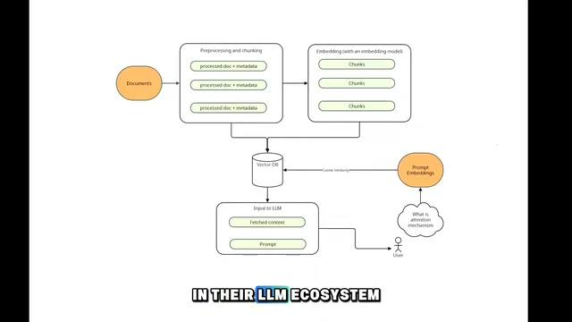
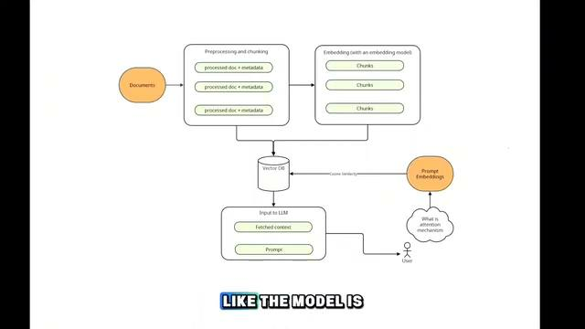
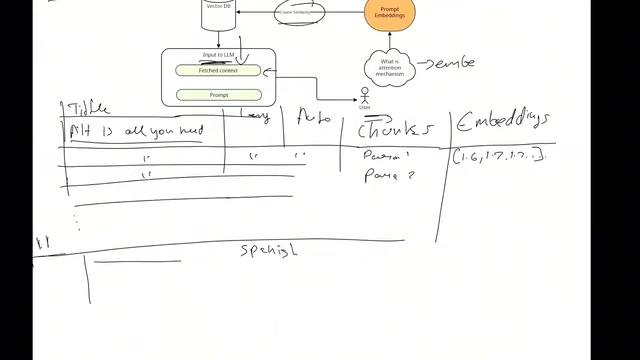
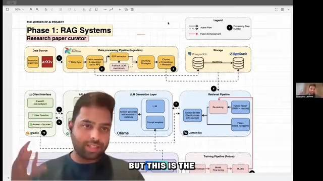
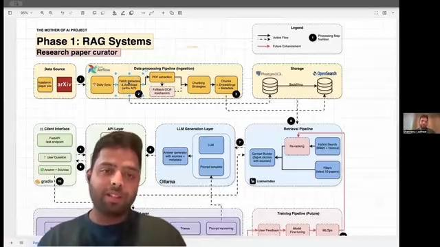
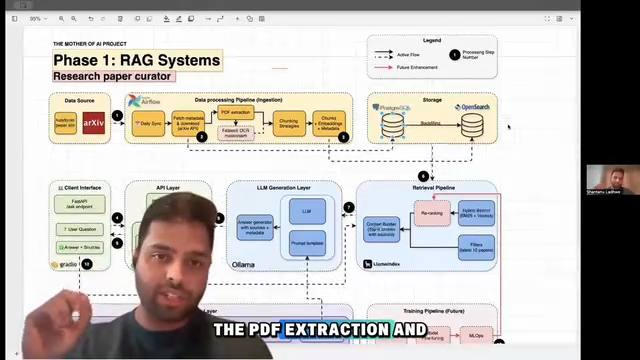
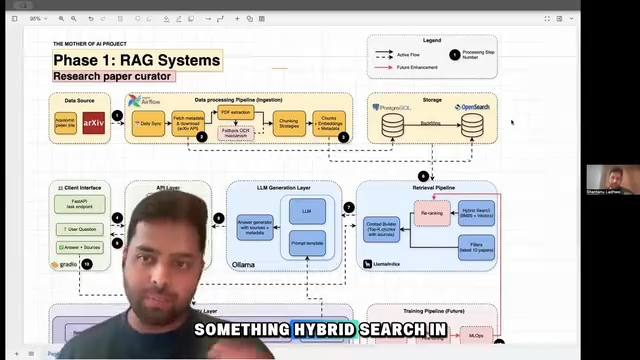
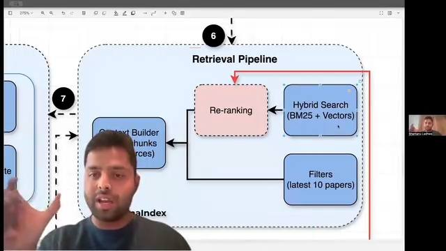
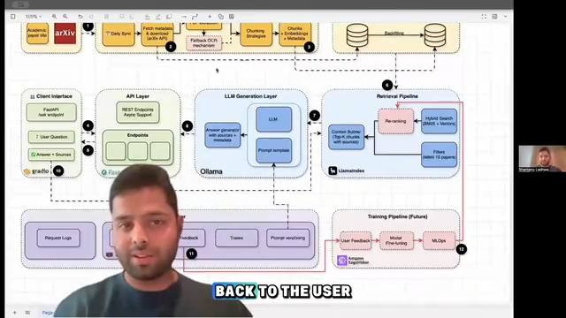

# Production-Ready RAG from Scratch：P2–P3 系统总览与架构定稿

这两节课（P2、P3）**没有可执行代码**。P2 前半段是 RAG 的通用原理（由 Shireen 讲），中间是问答，后半段由 Shantanu 接手，讲“我们要解决什么问题”；P3 整节讲的是**生产级 RAG 的架构图**：数据源、ETL 编排、PDF 文本抽取、中间层、向量库、混合检索、API、前端、可观测性。

所以本文的定位是：**把讲师在这两节里讲出的每一个技术选型和硬约束，落成一份可以照着搭的工程说明**，并给出一套**可运行的最小骨架**用来验证架构中的关键假设（限流、切分后的行结构、混合检索的打分）。真正的完整业务代码从后续课程才开始，这两节的任务是“把图纸定死”。

## 1. 这一节做什么

一句话：**把“问一个问题，从 2017 年那篇 Attention Is All You Need 里取出对应段落来回答”这件事，拆成一条能在公司里每天自动跑的生产流水线。**

讲师给的目标场景非常具体（p003 [00:54]）：arXiv 每天新增 80–100 篇 AI 论文，作为技术管理者必须跟踪最新研究；用 Google 搜，拿到的是“一个月前发布、SEO 做得好”的随机结果。所以要自建一个本地系统，问“什么是 attention mechanism”，系统去 2017 年那篇论文里捞出对应 chunk 来回答。

这条流水线在 P3 里被完整画出来，按数据流动方向是：

```
arXiv 公开 API
   ↓（Airflow 每日 DAG；并发下载之间冷却 3 秒）
PDF 下载
   ↓
Docling 抽取文本（OCR / 版面解析）
   ↓
预处理：清洗（去 HTML 标签、多余空白）+ 抽 metadata（title / authors / abstract / language）
   ↓
Chunking：按段落切，一篇 11 段 → 11 行
   ↓
Postgres：存原文 + metadata（不存 embedding），作为可回填的中间层
   ↓
Embedding 模型编码每个 chunk
   ↓
OpenSearch：存 chunk + embedding + metadata
   ↑
用户问题 → Gradio → FastAPI → 用同一个 embedding 模型编码 query
   → OpenSearch（先按 metadata 过滤，再 BM25 关键词 + 向量相似度）
   → top-k chunk → 塞进 prompt template（system prompt + context）
   → LLM（本地 Ollama，Llama 3.2）→ 回答
   → FastAPI response → Gradio 展示
   ↑
全链路日志 + Langfuse（LLM 层可观测性）
```



对前端转 AI 应用工程师的读者，先建立三个类比，后面会反复用到：

- **FastAPI ≈ Express**：一层薄薄的 HTTP 路由 + 请求校验，不承担业务逻辑。
- **Langfuse ≈ Sentry**：不是业务日志，而是专门记录“这次请求检索到了什么、prompt 长什么样、模型回了什么”。
- **Airflow ≈ 带 UI 和重试的 cron**：你要的不是定时，而是“失败了能在界面上看到哪一步挂了”。

这一段最容易被误解成“搭一个 RAG Demo”。Demo 和本文说的系统差别不在模型，而在**数据入口和失败恢复**。前端项目里，页面能跑不代表能上线，还要有构建、缓存、错误上报、回滚；RAG 项目里，模型能答不代表能用，还要有增量摄取、文本抽取失败处理、切分策略回填、索引一致性、检索链路日志。讲师在 P3 把架构图画全，本质上就是把“能答一次”变成“每天都能答、答错了能查”。

这条流水线可以分成三个平面：**数据平面**负责 arXiv 下载、Docling 抽取、清洗、切分、写 Postgres、写 OpenSearch；**查询平面**负责 FastAPI 接收问题、编码 query、混合检索、拼 prompt、调用 Ollama；**可观测平面**负责日志和 Langfuse。前端开发者熟悉的是查询平面里的 HTTP 接口，但真正决定系统能不能长期运行的是数据平面。如果数据平面没有中间层，换一次切分策略就要重新下载、重新抽取三个月的数据；如果限流没做好，arXiv 会拒绝请求；如果 metadata 不随 chunk 重复存，检索时就没法先过滤再算相似度。

本文后续的“复现”不是复现完整业务，而是验证五个假设：限流是否真的串行、一篇论文切分后是否一段一行、metadata 是否随行重复、混合检索是否同时保留关键词分和向量分、首 token 延迟是否可观测。把这五个假设跑通，再去接 Docling、Postgres、OpenSearch、Ollama，就不会在错误的地基上堆组件。

## 2. 讲师原话

> "第一个大的局限是存在知识截止时间。……第二个局限，也是最大的局限，是幻觉。那么缓解这两个主要问题的办法，可以是使用 RAG 系统。"
> —— p002 [06:11]

这是整门课的立论：LLM 有知识截止，会幻觉，RAG 是对这两个问题的工程化解法。注意讲师没有说 RAG 能“消灭”幻觉，只说 mitigate（缓解）。



> "一种办法是对模型做微调。但这样做成本很高，也很耗时，因为你需要先收集训练数据、编写提示词、生成回复……更简单的做法是使用 RAG 系统， basically 让这个 LLM 能够访问一个存放公司内部知识的数据库。"
> —— p002 [07:07]

讲师的取舍逻辑：微调要造数据集、要开源权重、周期长；RAG 只是“给模型开一个数据库的访问权”。这是本课所有设计的上位决策。

> "我们做分块的原因当然是……存在幻觉问题……还有一个问题是成本。每次你把一些 token 作为输入传给 LLM，都会产生费用。"
> —— p002 [16:56]

> "除了成本，我们也关心延迟。……首 token 时间非常重要。当用户输入一个查询，如果要等 10 秒左右，那基本就已经没戏了。很多时候我们希望它非常快，比如 5 秒以内。"
> —— p002 [18:44]

chunking 有**三个**理由，不只一个：幻觉、token 成本、首 token 延迟。这三条后面会直接决定 chunk 大小和 top-k 的取值。

> "如果你说有 100 份文档，每份平均五页，我会说你只需要一个分类器之类的东西加一个特征提取器，然后用它来代替向量，因为现在如果用向量数据库，会带来额外成本，也需要大量维护。"
> —— p002 [21:31]

这是全课最容易被忽略的一句：**向量库不是默认答案**。文档小、可分类时，用分类器 + 整篇喂给 LLM 更划算。

> "我们把它们全部存进元数据，全部存进向量数据库。……一次调用，我们想检索出所有信息。我们不希望有多次调用。"
> —— p002 [22:23]

这解释了为什么后面那张表里，metadata 会在每个 chunk 行上**重复存 11 次**。

> "想象一下有很多论文……用不同语言写成。……先在这个元数据上应用过滤，也就是你的语言。做完这一步，你就缩小了搜索范围。而元数据通常就是在应用余弦相似度之前缩小搜索范围的一种手段。"
> —— p002 [23:44]



> "Archive 提供公开的 API 访问，并且有速率限制。所以我们不能并发下载或访问论文、发起多次 API 调用。我们每做一次并发下载都必须冷却，中间要冷却三秒。否则网站会拒绝我们的 API 调用。"
> —— p003 [02:47]

**这是全课唯一一个写死的数值约束：3 秒冷却。** 它是整条 ETL 的节拍器。



> "这恰恰是很多课程遗漏的地方。他们完全忽略了这条数据摄取流水线，因为它必须每天更新，或者也许每五分钟更新一次。"
> —— p003 [04:44]

讲师明确把“摄取流水线”当成这门课区别于其他教程的核心卖点。

> "我们这里会用 Docling 作为 OCR 库，因为我们用很多其他库做了大量测试，觉得 Docling 非常有用，也容易配置。但……还有另一个库叫 GROBID，专门针对学术论文。……但问题是，如果我们配置两种 OCR 方法，输出数据就必须保持一致。所以这就是为什么我们目前只用 Docling。"
> —— p003 [05:42]

原本设计是 GROBID 主 + Docling 兜底，最终因为**两种抽取器输出格式不一致**而砍成一个。这是一个非常真实的工程决策。



> "假设将来我们说要彻底改变分块策略。……那么再重新下载所有论文、提取所有论文、重新做一遍分块策略就不合理了。所以你需要在某处有一个中间层……这就是我们用 Postgres SQL 作为中间层的原因。"
> —— p003 [07:36]

Postgres 存在的唯一理由：**换切分策略时不重跑三个月的数据**。它不存 embedding。



> "我们选择 OpenSearch 的原因是……我们想用混合搜索。……OpenSearch 后来也加入了向量检索。所以 OpenSearch 的好处不只是向量检索，还有关键词检索。……有时候会出现这种情况：当你只基于嵌入做检索时，它不会检索出措辞完全一致的那份文档。"
> —— p003 [09:32]

选 OpenSearch 不是因为向量检索强，而是因为**关键词检索 + 向量检索在同一套系统里**，省掉一个组件。讲师也给了替代品：Qdrant、Pinecone、Weaviate（逐字稿把这几个名字转写成了 Qtrent / PineCon / VV8，具体拼写课里没说清）。



> "BM25 是关键词搜索机制。它是一种非常流行、非常古老的机制，效果很好。……BM25 的设计目标就是在几分之一秒内给你找到包含那个特定关键词的文档。"
> —— p003 [16:07]

> "有一种东西叫重排序策略……但它的计算和延迟成本更高。……我现在不想深入讲，但这会在后续系列中涉及。"
> —— p003 [17:58]

**本阶段只做一阶段混合检索，不做 rerank。** 这是一个明确的边界，不要自己加戏。



> "我们还会在最后一部分引入 Langfuse，它更多是用来理解用户问了什么查询，以及基于 OpenSearch 的检索是如何完成的。"
> —— p003 [20:24]

> "护栏主要是在……我们想确保 LLM 不会生成任何荒谬答案的时候使用。……在这个案例中，我们不考虑护栏，但我们计划在下一阶段考虑。"
> —— p003 [22:15]

Langfuse 本阶段有，guardrails 本阶段**没有**。




这些原话放在一起看，会发现讲师的取舍顺序很稳定：先判断问题是不是真的需要 RAG（文档小就别上向量库），再判断 RAG 的瓶颈在成本还是延迟（chunking 同时服务三个目标），再判断哪些组件能合并（OpenSearch 同时做关键词和向量），最后给本阶段划边界（不做 rerank、不做 guardrails）。前端开发者可以把这理解成技术选型评审：不是“哪个库最火”，而是“这个阶段要验证什么、哪些能力可以延后、哪些约束不能碰”。3 秒冷却是硬约束，Postgres 中间层是回滚能力，Langfuse 是排查能力，rerank 和 guardrails 是下一阶段能力。

## 3. 从零复现

这两节课是纯架构讲解，没有可运行代码，所以“复现”在这里的含义是：**按讲师给出的推导顺序，把架构决策一步步推出来，然后把能被验证的部分跑通**。下面严格按 需求 → 约束 → 估算 → 方案 → 取舍 走。

### 步骤 1：把需求钉成一句可测试的话

需求：输入一个问题（例如“what is the attention mechanism”），系统从本地已入库的 AI 论文里取出最相关的段落，让本地 LLM 基于这段上下文回答。

可测试的验收标准（讲师在 p003 [01:52] 给的例子就是验收用例）：

- 问 `what is the attention mechanism`，返回的检索结果里必须包含来自 2017 年《Attention Is All You Need》的 chunk；
- 回答里必须能看出它引用了检索到的文本，而不是纯粹靠模型记忆；
- 从发出请求到第一个 token，目标是 5 秒以内（讲师在 p002 [18:44] 明确说“below five seconds”是心理线，10 秒就“lost cause”）。

把这三条翻译成工程检查：第一条看 `/search` 返回的 `paper_id` 和 `chunk_id`，不能只看最终回答；第二条看 prompt 里是否真的拼进了 context，Langfuse 或本地日志要能打印 prompt；第三条在 FastAPI 响应或 Langfuse trace 里记录 `time_to_first_token`，不能只记录总耗时。前端对照：这就像验收搜索页，先看接口返回的列表是否正确，再看页面渲染；只截一张“答案看起来对”的图不算验收。

### 步骤 2：列出外部约束（这些不是我们能选的）

| 约束 | 出处 | 对设计的影响 |
|---|---|---|
| arXiv 每天新增 80–100 篇 AI 论文 | p003 [00:54] | 每天至少一次增量摄取，不能手动跑 |
| arXiv API 公开但限流，并发请求之间必须冷却 3 秒 | p003 [02:47] | 摄取循环必须是串行 + sleep，不能用 `Promise.all` 式并发 |
| 论文是 PDF，必须先抽文本 | p003 [05:14] | 需要一个 PDF 抽取器（Docling） |
| LLM 上下文窗口有限，且输入 token 计费 | p002 [16:56] | 必须切分，不能整篇喂 |
| 用户等不了 | p002 [18:44] | top-k 和 chunk 大小都要压小 |

在 JS/Node 里，第一条约束对应的反例就是 `await Promise.all(ids.map(download))` —— 这正是会把 arXiv 打到 429 / 拒绝服务的原因。正确写法是一个 `for...of` 循环里 `await sleep(3000)`。

命令层面可以这样理解：`for...of` 保证一个请求结束再进入下一个；`await sleep(3000)` 保证两个下载动作之间有至少 3 秒墙钟时间；日志里要同时打印 `start`、`end`、`status`，否则你只能看到“失败了”，不知道是冷却没生效还是别的原因。排查时先看日志时间戳差值是否 ≥3 秒，再看 HTTP 状态码；如果出现 429，不要立刻把并发调大“重试”，而应该维持串行并加退避，记录失败论文 ID，下一轮 DAG 再补。前端对照：这类似前端请求队列和节流，不是 UI 上的 loading 动画能解决的问题。

### 步骤 3：做容量估算（算式都写出来）

以下数字的口径：论文篇数、每篇段落数来自讲师；token 与字数换算是本文件的估算口径，**课里没有给**，我在每条后面标了。

- 每日新增论文：取上限 100 篇/天。
- 每日 PDF 下载耗时（串行 + 3 秒冷却）：`100 × 3s = 300s ≈ 5 分钟`。这只是冷却时间，实际还要加下载和解析耗时。
- 每篇的 chunk 数：讲师给的例子是“一篇 11 段 → 11 行”（p002 [12:19]），所以 `100 篇 × 11 = 1100 chunk/天`。
- 一年累积 chunk 数：`1100 × 365 ≈ 40 万 chunk`。按每个 embedding 768 维 float32 计算，纯向量体积 `40 万 × 768 × 4B ≈ 1.2 GB`；实际索引会膨胀 2–4 倍。**结论：单机 OpenSearch 完全放得下，不需要分布式。** 这也解释了讲师为什么敢说“less than a million of documents”（p003 [17:31]）时一阶段检索够用。
- 单次查询的输入 token（估算口径，课里没给）：5 个 chunk × 每 chunk 约 500 token = 2500 token 上下文 + 系统提示约 200 token。如果把整篇 5 页论文（约 3300 token）直接塞进去，看起来差别不大——但乘以每天百万级查询，成本差异就是量级差异。因此一阶段用 top-k + chunk 大小控制上下文，不把整篇论文塞进去。

这些估算的作用不是精确预测，而是决定“要不要分布式”。40 万 chunk 这个量级，单机 OpenSearch 和单机 Postgres 都足够；如果一上来就上集群，维护成本会超过收益。前端对照：这像判断一个前端项目要不要上微前端，先看页面数量和团队边界，而不是因为“微前端听起来高级”。

### 步骤 4：把架构拆成可验证的假设

在写完整业务代码之前，先验证五个假设：

1. **限流假设**：串行下载 + 3 秒冷却能跑通，日志时间差可检查。
2. **切分行结构假设**：一篇 11 段切完是 11 行，每行都带完整 metadata。
3. **过滤假设**：metadata 里的 language 能在打分前先过滤，减少候选集。
4. **混合打分假设**：同一个 query 下，关键词分和向量分都能被记录，最终分数可解释。
5. **延迟假设**：从请求到首 token 的耗时能被记录，而不是只记录总耗时。

这五个假设对应本文第 4 节的最小骨架。骨架用内存数据模拟 Postgres 和 OpenSearch，不声称替代生产组件；它的价值是让你在没有 Docling、没有 OpenSearch、没有 Ollama 的情况下，先把数据形状和打分流程跑通。等接真实组件时，你只需要替换“存储”和“编码”两处，不用重写业务逻辑。

### 步骤 5：按失败概率排序验证

建议顺序是：先离线切分 → 再 Postgres 行结构 → 再 embedding 维度 → 再 OpenSearch mapping → 再混合检索 → 最后接 API 和前端。原因是越靠左的错误越便宜。切分错了只改代码；索引 mapping 错了要重建索引；前端联调时才发现 metadata 没带，就要回头改 ETL。前端对照：像联调接口，先用 mock 数据确认字段，再接真实后端，不要等页面写完才发现字段名不一致。

## 4. 完整代码

再次强调：P2/P3 **没有可执行代码**。下面代码是本文给出的**最小验证骨架**，只验证限流、切分后的行结构、metadata 过滤和混合打分，不是课程完整业务代码，也不替代 Docling、Postgres、OpenSearch、Ollama、Gradio、Langfuse。它使用内存数据模拟中间层，方便你先跑通流程。

```python
# app.py
from __future__ import annotations

import hashlib
import logging
import math
import re
import time
from typing import Any

from fastapi import FastAPI, HTTPException
from pydantic import BaseModel

logging.basicConfig(level=logging.INFO, format="%(asctime)s %(levelname)s %(message)s")
LOGGER = logging.getLogger("rag-skeleton")

COOLDOWN_SECONDS = 3.0
app = FastAPI(title="RAG P2-P3 skeleton")


class SearchRequest(BaseModel):
    query: str
    language: str | None = None
    top_k: int = 5


def download_serial(paper_ids: list[str]) -> list[dict[str, Any]]:
    """串行下载模拟：第二个及之后的下载前冷却 3 秒。"""
    docs: list[dict[str, Any]] = []
    for idx, pid in enumerate(paper_ids):
        if idx > 0:
            LOGGER.info("cooldown %.1fs before %s", COOLDOWN_SECONDS, pid)
            time.sleep(COOLDOWN_SECONDS)
        LOGGER.info("download %s", pid)
        paragraphs = [f"paragraph {i} of {pid}" for i in range(1, 12)]
        if pid == "1706.03762":
            paragraphs[0] = "the attention mechanism is a key component of transformer"
        docs.append({"paper_id": pid, "title": f"paper-{pid}", "paragraphs": paragraphs})
    return docs


def chunk_paragraphs(paper: dict[str, Any]) -> list[dict[str, Any]]:
    """按段落切分：一篇 11 段 -> 11 行，metadata 在每行重复。"""
    rows: list[dict[str, Any]] = []
    for i, para in enumerate(paper["paragraphs"], start=1):
        rows.append(
            {
                "paper_id": paper["paper_id"],
                "chunk_id": f'{paper["paper_id"]}-{i:03d}',
                "title": paper["title"],
                "language": "en",
                "text": para,
                "metadata": {
                    "title": paper["title"],
                    "language": "en",
                    "paper_id": paper["paper_id"],
                },
            }
        )
    return rows


def tokens(text: str) -> list[str]:
    return re.findall(r"[a-z0-9]+", text.lower())


def hash_vector(text: str, dim: int = 64) -> list[float]:
    """仅用于验证流程的伪向量，不是生产 embedding。"""
    vec = [0.0] * dim
    for tok in tokens(text):
        h = int(hashlib.md5(tok.encode()).hexdigest(), 16)
        vec[h % dim] += 1.0
    norm = math.sqrt(sum(x * x for x in vec)) or 1.0
    return [x / norm for x in vec]


def cosine(a: list[float], b: list[float]) -> float:
    return sum(x * y for x, y in zip(a, b))


def keyword_score(query: str, text: str) -> float:
    q = set(tokens(query))
    t = tokens(text)
    if not q or not t:
        return 0.0
    hit = sum(1 for tok in t if tok in q)
    return hit / (len(t) ** 0.5)


def hybrid_search(
    query: str,
    rows: list[dict[str, Any]],
    language: str | None = None,
    top_k: int = 5,
    alpha: float = 0.5,
) -> list[dict[str, Any]]:
    candidates = rows
    if language:
        candidates = [r for r in rows if r["metadata"]["language"] == language]

    qv = hash_vector(query)
    scored: list[dict[str, Any]] = []
    for r in candidates:
        ks = keyword_score(query, r["text"])
        vs = cosine(qv, hash_vector(r["text"]))
        score = alpha * vs + (1 - alpha) * ks
        scored.append({**r, "keyword_score": ks, "vector_score": vs, "score": score})

    scored.sort(key=lambda x: x["score"], reverse=True)
    return scored[:top_k]


# 内存数据模拟 Postgres / OpenSearch 的中间结果，仅用于验证流程。
PAPERS = download_serial(["1706.03762", "2401.00001"])
ROWS: list[dict[str, Any]] = []
for p in PAPERS:
    ROWS.extend(chunk_paragraphs(p))


@app.get("/health")
def health():
    return {"ok": True, "rows": len(ROWS), "cooldown_seconds": COOLDOWN_SECONDS}


@app.get("/debug/chunk/{paper_id}")
def debug_chunk(paper_id: str):
    rows = [r for r in ROWS if r["paper_id"] == paper_id]
    if not rows:
        raise HTTPException(status_code=404, detail="paper_id not found")
    return {"paper_id": paper_id, "chunk_count": len(rows), "rows": rows}


@app.post("/search")
def search(req: SearchRequest):
    if not req.query.strip():
        raise HTTPException(status_code=400, detail="query is empty")
    hits = hybrid_search(req.query, ROWS, language=req.language, top_k=req.top_k)
    return {"query": req.query, "top_k": req.top_k, "hits": hits}
```

运行命令：

```bash
python -m pip install fastapi uvicorn
uvicorn app:app --reload --port 8000
```

另开一个终端验证：

```bash
curl -s http://127.0.0.1:8000/health
curl -s http://127.0.0.1:8000/debug/chunk/1706.03762
curl -s -X POST http://127.0.0.1:8000/search \
  -H 'Content-Type: application/json' \
  -d '{"query":"attention mechanism","language":"en","top_k":5}'
```

命令解释：`python -m pip install` 用当前解释器安装依赖，避免 `pip` 指向另一个 Python；`uvicorn app:app` 表示从 `app.py` 导入 `app` 对象，`--reload` 只用于本地开发，`--port 8000` 指定端口；`curl -s` 静默模式只输出响应体；`-X POST` 指定方法；`-H` 设置 JSON 请求头；`-d` 传请求体。前端对照：这段 `curl` 相当于浏览器里的 `fetch('/search', { method: 'POST', headers: { 'Content-Type': 'application/json' }, body: JSON.stringify(...) })`。

## 5. 逐行解释

`COOLDOWN_SECONDS = 3.0` 对应讲师在 p003 [02:47] 的硬约束。它不是“建议值”，而是整条 ETL 的节拍器。注意代码把它放在下载循环里，而不是放在 HTTP 请求处理函数里；生产环境里这个循环应该在 Airflow worker 里跑，不能阻塞用户查询接口。

`download_serial` 用 `for idx, pid in enumerate(...)` 串行遍历，`if idx > 0` 保证第一个下载不等待，后续每个下载前 `time.sleep(COOLDOWN_SECONDS)`。日志打印 `cooldown` 和 `download`，是为了让你用时间戳验证冷却是否生效。常见错误是把 `time.sleep` 写成“每次请求后睡 3 秒”，那样最后一个请求后也睡，虽然不致命，但会拖慢任务；更严重的错误是用 `asyncio.gather` 并发请求，再在外部统一 sleep，这没有做到“请求之间冷却”。排查时看日志时间差：第二个 `download` 的时间戳减去第一个 `download` 的时间戳，应该大于等于 3 秒。

`chunk_paragraphs` 是切分后的行结构验证。它返回的每一行都有 `paper_id`、`chunk_id`、`title`、`language`、`text`、`metadata`。metadata 在每行重复，对应讲师在 p002 [22:23] 说的“one call, we want to retrieve all the information”。如果只把 metadata 存在论文表里，检索到 chunk 后还要回表拼信息，就变成多次调用。常见错误是 `chunk_id` 只用段落序号，导致不同论文的 `chunk_id` 冲突；正确做法是 `paper_id + 序号`。前端对照：这像列表接口把展示需要的字段一次性返回，而不是让前端拿到 ID 后再逐个请求详情。

`tokens` 和 `hash_vector` 只是为了验证混合打分流程。`hash_vector` 不是生产 embedding，它没有语义能力，只保证同一段文本每次得到相同向量。你接真实 embedding 模型时，要替换这里，并确保**索引时和查询时用同一个模型、同一维度**。常见错误是换模型后没重建 OpenSearch 索引，导致维度不匹配或分数失真。排查时记录模型名、维度、索引名。

`keyword_score` 是简化的关键词命中分，不是完整 BM25。它用来验证“关键词分和向量分同时存在”。真实 OpenSearch 里应使用 BM25 查询，并记录两路分数。常见错误是把两路分数直接相加但不归一化，导致 BM25 分数尺度压过 cosine 分数；骨架里用 `alpha` 加权，生产里要根据离线评估调权重。前端对照：这像搜索页同时有“相关度”和“时间”两个排序因子，必须明确权重，不能凭感觉。

`hybrid_search` 先按 `language` 过滤，再对候选集打分排序取 top-k。这个顺序对应讲师在 p002 [23:44] 说的“先 metadata filter，再 cosine similarity”。常见错误是过滤写在最终排序之后，或者根本没把 language 写进 metadata。排查时构造两种 language 的数据，查 `language=zh` 不应返回 `en` 行；如果返回了，先看过滤条件是否在候选集生成前执行。

FastAPI 的 `/health` 用于确认服务启动和行数；`/debug/chunk/{paper_id}` 用于验证一篇论文是否 11 行；`/search` 用于验证混合检索返回结构。常见错误是请求体不是合法 JSON、`Content-Type` 没设、`top_k` 传了负数或过大。生产里还要加 CORS、认证、超时和限流；骨架没有加，是为了保持最小可验证。

## 6. 复现检查清单

1. **确认 P2/P3 没有可执行代码**：检查课程资料和仓库，本文代码只作验证骨架。验证方法：在文档里明确标注“不是课程完整业务代码”，不要把骨架当成最终交付。
2. **串行 + 3 秒冷却生效**：运行 `download_serial` 或看 `/health` 启动日志，用时间戳计算相邻下载差值 ≥3 秒；检查代码里没有 `Promise.all`、`asyncio.gather` 或线程池并发下载。
3. **一篇 11 段切完是 11 行**：请求 `/debug/chunk/1706.03762`，检查 `chunk_count == 11`；检查每行 `metadata.paper_id` 一致且 `chunk_id` 唯一。
4. **metadata 随 chunk 重复**：在 `/debug/chunk` 返回里检查每行都有 `title`、`language`、`paper_id`；如果只有第一行有，说明你还在用文档级 metadata。
5. **language 过滤先于打分**：用 `{"query":"attention","language":"en"}` 和 `{"query":"attention","language":"zh"}` 分别请求，后者不应返回 `en` 行；检查 `hybrid_search` 里 `candidates` 在打分前生成。
6. **混合检索两路分数可解释**：`/search` 返回的每条 hit 都应包含 `keyword_score`、`vector_score`、`score`；用专有名词查询时，关键词分应明显；用近义表达查询时，向量分应参与排序。
7. **top-k 不失控**：请求 `top_k=5`，检查返回条数不超过 5；再把 `top_k` 调大，观察响应体大小和耗时变化，提醒自己生产要按 token 预算压 top-k。
8. **首 token 延迟可观测**：在真实链路里记录请求开始、检索结束、LLM 首 token 时间；骨架没有接 LLM，但 `/search` 的耗时可以作为检索阶段基线。验证方法：用 `curl -w '%{time_total}'` 看总耗时，再接 Langfuse 看分段。
9. **OpenSearch 维度一致**：接真实 embedding 后，记录模型名和维度，检查 index mapping；换模型必须重建索引。验证方法：写入一条后查 mapping，再查询同一向量维度。
10. **Postgres 中间层可回填**：检查 Postgres 是否存原文和 metadata、不存 embedding；模拟换 chunk 策略，只从 Postgres 读原文重新切分，不重新下载 PDF。
11. **失败可追踪**：下载失败、抽取失败、切分失败、索引失败都要有日志和论文 ID；验证方法：人为传一个不存在的 `paper_id`，看是否返回 404 且日志可定位。
12. **本阶段边界清楚**：检查代码和文档里没有偷偷加 rerank、guardrails；如果加了，标注为下一阶段，不要混淆本阶段验证结果。

## 7. 课里没讲但你会撞上的（表格：现象 / 原因 / 怎么办）

| 现象 | 原因 | 怎么办 |
|---|---|---|
| arXiv 返回 429 或直接拒绝请求 | 并发下载或冷却未生效 | 保持串行，下载之间 `sleep(3000)`，记录状态码和论文 ID；失败不丢，下一轮补 |
| 下载成功但 Docling 抽不出文本 | PDF 是扫描件或版面复杂，未启用 OCR | 开启 OCR，抽样人工检查；失败进入死信队列，不要静默跳过 |
| 同一篇论文两次抽取格式不一致 | 同时用 GROBID 和 Docling 两套抽取器 | 按讲师决策本阶段只用 Docling，固定版本；输出结构统一后再考虑双路 |
| 换 chunk 策略要重新下载三个月数据 | 没有 Postgres 中间层，原文只存在 PDF 或索引里 | Postgres 存原文 + metadata，不存 embedding；回填只重跑切分和索引 |
| 检索时拿不到 title/language | metadata 只存在文档表，没有随 chunk 重复 | 每个 chunk 行冗余存 metadata，保证一次检索拿到全部展示字段 |
| OpenSearch 写入报维度不一致 | 换了 embedding 模型或索引 mapping 固定旧维度 | 先定模型和维度，再建 mapping；换模型必须重建索引并回填 |
| 关键词检索搜不到专有名词 | 字段分词、大小写、analyzer 配置不对 | 用 `Attention Is All You Need` 这类专有名词测试；确认 text 字段和查询方式 |
| 混合检索分数不可比 | BM25 与 cosine 量纲不同，直接相加 | 分别记录两路分数，归一化或加权；用离线样本调 `alpha` |
| top-k 太大导致慢且贵 | 上下文 token 超预算，LLM 首 token 延迟上升 | 按 token 预算压 top-k，调整 chunk 大小；不要整篇论文直接塞 |
| 前端 10 秒超时 | 后端串行检索 + LLM 慢，没有流式返回 | 后端设超时和分段日志，前端显示检索中间态；必要时流式输出 |
| Langfuse 看不到数据 | key、endpoint、网络或 flush 配置问题 | 本地先打日志确认 trace 生成，再检查 Langfuse 配置和网络 |
| 以为 RAG 已经解决安全问题 | 本阶段明确不做 guardrails | 上线前加输入输出校验；不要把“有 RAG”当成“有安全边界” |
| 多语言过滤没生效 | metadata language 不统一，或过滤写在排序后 | 抽取时统一 ISO 码；过滤必须在候选集生成前执行 |
| Postgres 与 OpenSearch 不一致 | 写入失败、重试不幂等或回填中断 | 用 `paper_id + chunk_id` 幂等 upsert，定时对账，保留回填任务日志 |
| 骨架代码被直接上线 | 内存检索和伪向量不是生产实现 | 明确标注验证用途；生产替换为 Postgres、OpenSearch、真实 embedding 和 Ollama |