> 说明：逐字稿是课堂口述，**没有贴出仓库里的完整 Python 源码**。所以本文把「能照着执行的复现顺序、配置检查点、可保存运行的辅助脚本」写全；应用源码请从课程提供的 Google Drive 获取。凡是逐字稿没给出的内容，我会明确写「课里没讲」，不替讲师补实现。

## 1. 这一节做什么

P20–P22 不是从零再讲 RAG 原理，而是在前六周已经跑通的 RAG 项目上，补三块「生产化」能力：

1. **加 Redis 精确缓存**：同一个用户、或任何用户，只要请求的 query、model、top_k 以及 API 请求体里的参数完全一样，就直接返回缓存结果，跳过 query embedding、OpenSearch hybrid search、LLM 生成。
2. **接 Langfuse 观测**：把一次 RAG 拆成 `query embedding`、`search retrieval`、`prompt construction`、`LLM generation` 四类 span，记录每段耗时、输入输出摘要，用来找瓶颈。
3. **加 Agentic RAG + Telegram**：用 LangGraph 把 guardrail、retrieve、grade documents、rewrite query、answer/farewell 串成图；guardrail 分数低于 60% 直接拒绝；retrieve 工具有计数器，最多调用两次；grade documents 输出 yes/no；no 就 rewrite query 再检索。

复现完成后，你应该能：从仓库启动 Docker Compose 全套服务；填 `.env`；拉 Ollama 模型；在 Airflow 里 backfill 至少一天；打开 FastAPI OpenAPI 界面和 Gradio；在 Langfuse 里看到四段 trace；用同一个 query 测出缓存命中；在 Gradio 里测 agentic RAG 的通过/拒绝/重写/兜底流程。

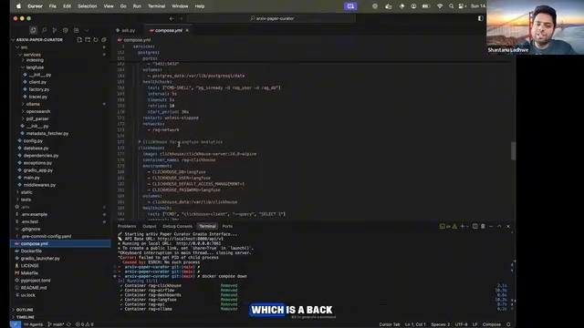

## 2. 讲师原话

P20 主要是 Q&A，先定生产约束：

> "通常，首次发布时我们会保留 100% 的数据。之后最多只保留 2% 到 5%，因为没必要保留那么多。它会占用大量存储，而且成本很高。"
> —— p020 [00:27]

> "尤其是在欧洲，还要处理《通用数据保护条例》相关要求……当用户请求删除其数据时，这一要求也适用于聊天追踪。"
> —— p020 [01:20]

> "我们只授予预发布环境中 Langfuse 的访问权限……一旦效果不错，并且他们向我们证明这套流程确实有效，开发团队就会接手那个提示词。"
> —— p020 [06:27]


P21 进入代码走读，先讲 Docker 依赖和缓存：

> "我们在 Docker Compose 文件中添加了更多依赖。现在有 ClickHouse、Langfuse，我们还添加了一个 Postgres，另一个新增的是 Redis。"
> —— p021 [00:58]

> "我们运行着九个镜像、九个容器。"
> —— p021 [03:50]

> "我们根据用户查询、模型以及用户请求体生成缓存键……在顶层情况下，也就是所有传入参数都参与。"
> —— p021 [10:57]

> "每当请求首次进入时……先检查它是否已经在缓存中……如果存在，就直接在这里返回响应……它不会进入下一阶段，也就是去获取嵌入、调用 OpenSearch 执行混合搜索，然后再交给大语言模型。"
> —— p021 [11:25]

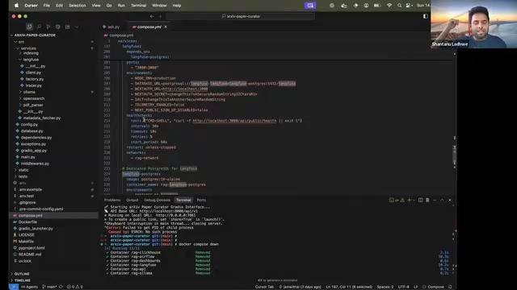

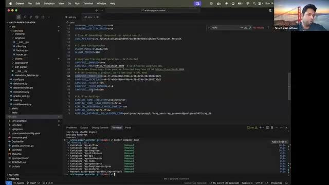

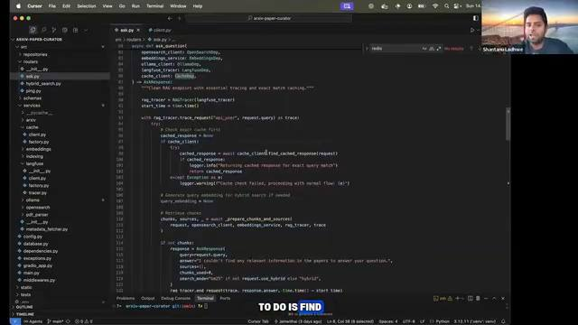

P21 后半段讲 Langfuse 的四段 trace：

> "我们会在查询嵌入、搜索检索、提示词构建以及大语言模型生成这几个环节收集追踪。"
> —— p021 [22:03]

> "查询嵌入生成本身耗时 1.13 秒……搜索检索耗时 22 毫秒……大语言模型生成耗时 55 秒。"
> —— p021 [22:32] / [23:01] / [24:58]

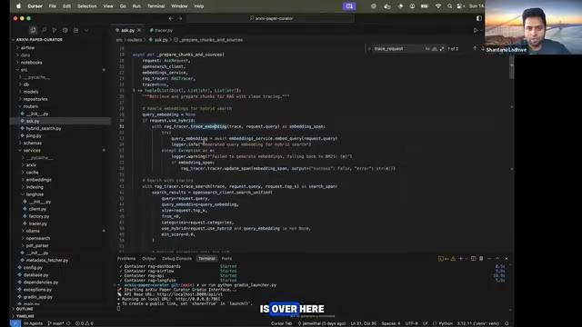

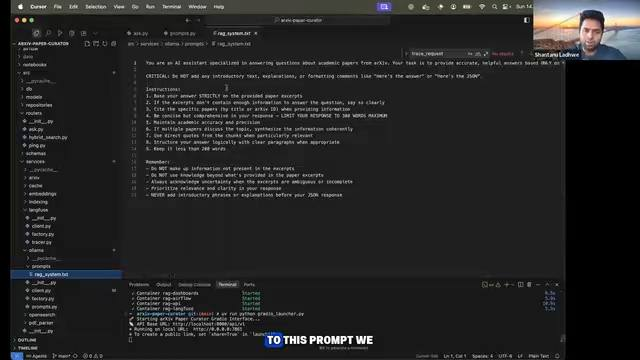

P22 讲 Agentic RAG：

> "智能体式方案并不总是必要……当你想在工作流中增加额外节点或额外工具时，智能体式方案才变得必要。"
> —— p022 [01:19]

> "如果分数低于 60%，我们就拒绝该查询……如果分数高于 60%，则进入下面的检索部分。"
> —— p022 [04:06]

> "这个检索步骤有一个计数器，并且最多只能发起两次工具调用。"
> —— p022 [05:05]

> "我们会评估检索到的前 K 个片段是否能够回答用户查询……结果是二元的，是或否。"
> —— p022 [06:26]

> "重写用户查询，然后回到检索步骤。"
> —— p022 [07:25]

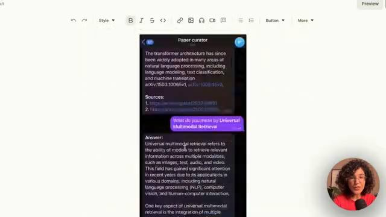


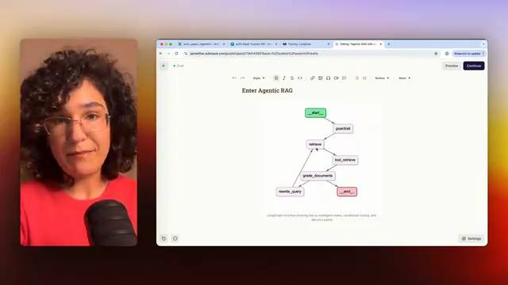

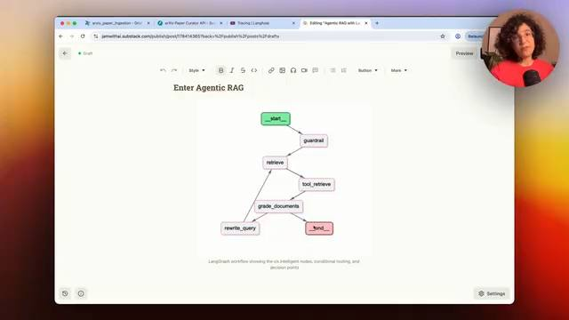

P22 最后讲启动：

> "首先要做的是，从 Google Drive 获取代码并在集成开发环境中打开……复制到环境文件……添加三四个环境变量……Gemini API 密钥……Langfuse 的公钥和私钥……Telegram 机器人令牌。"
> —— p022 [12:25] / [12:51]

> "通过运行 Docker Compose 来启动 Docker，并构建新容器。"
> —— p022 [13:47]

> "确保 Ollama 中已有该模型……这里我用了 Llama 3.2 的 30 亿参数版本。但由于这种智能体式检索增强生成可能非常重，所以我会建议使用 10 亿参数版本。"
> —— p022 [14:16] / [14:44]

> "确保你已经在 Airflow 上运行过一些任务……至少回填一天，这样 OpenSearch 和 Postgres SQL 中就会有一些文件可用。"
> —— p022 [15:14]

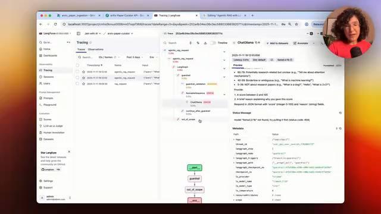

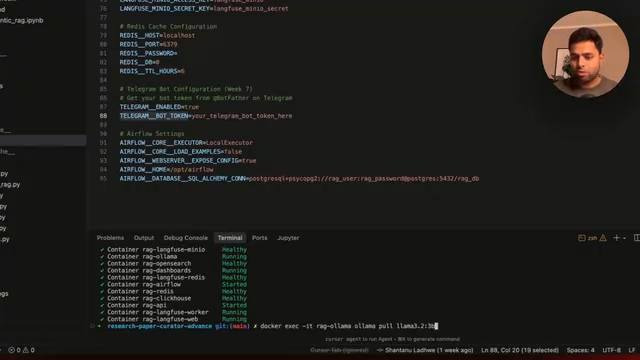

## 3. 从零复现

### 3.1 准备仓库和目录

1. 从课程资料里的 Google Drive 下载代码，解压到本地。P22 明确说代码在 `code and restricted access` 里，先拿代码再谈启动。
2. 用 IDE 打开仓库根目录。下面所有命令都在仓库根目录执行。
3. 确认本机有 Docker / Docker Compose、Python 与 `uv`。P22 口述启动 Gradio 使用 `uv run python ...`，所以 `uv` 是课程预期工具之一。

### 3.2 复制环境变量并填 key

讲师原话是复制 environment example 文件为 environment 文件。按仓库实际文件名操作，通常是：

```bash
cp .env.example .env
```

然后编辑 `.env`，至少填三类值：

| 用途 | 讲师口述内容 | 你要做什么 |
|---|---|---|
| Gemini / Gini API | P21、P22 都提到要拿 API key | 按仓库 `.env.example` 的变量名填写 |
| Langfuse | public key + secret key | 在 Langfuse 创建 project 后复制 |
| Telegram | bot token | P22 说要填 Telegram bot token，仓库里有 step-by-step guide |

注意：**变量名不要照抄本文猜测**。逐字稿只说了 key 的用途，没有逐字念出变量名。以仓库 `.env.example` 为准。

P21 特别说明：public key 不是只在页面用，它会被 Langfuse Tracer 消费。所以你改完 `.env` 后要重建镜像，不能只重启容器：

```bash
docker compose down
docker compose build
docker compose up -d
docker compose ps
```

### 3.3 启动 Docker Compose 全套服务

P21 说 compose 里新增了：

- ClickHouse：Langfuse 的 analytics 后端依赖；
- Langfuse：观测工具；
- Postgres：Langfuse 默认数据库；
- Redis：缓存。

加上原有 RAG 服务、OpenSearch、Ollama、Airflow 等，P21 口述「九个容器」。P22 因为升级 Langfuse v3，容器数量可能更多，具体数量以 `docker compose ps` 为准。

启动顺序按讲师操作：

```bash
docker compose down
docker compose build
docker compose up -d
docker compose ps
```

如果改过 `.env` 里的 Langfuse key，务必再 `docker compose build`。P21 说他自己就是重新 build 镜像，确保 key 被应用消费。

### 3.4 登录 Langfuse 并拿 key

P21 的操作是：打开本机 Langfuse，注册 admin 用户，创建 organization，再创建 project，然后复制 public key 和 secret key 到 `.env`。P21 口述地址是 `localhost:3000`；P22 又说 Langfuse 在 `localhost:3001` 看 traces。这不是矛盾，而是不同版本/不同 compose 端口映射的差异。**以你仓库 compose 的实际端口为准**。

流程：

1. 打开 Langfuse 页面；
2. 注册 admin；
3. 创建 organization；
4. 创建 project，名字可以沿用课程里的 archive paper curator 之类；
5. 复制 public key、secret key；
6. 写进 `.env`；
7. `docker compose down && docker compose build && docker compose up -d`。

### 3.5 拉 Ollama 模型

P21 遇到过一个真实错误：应用启动后提问失败，原因是本地没有 Llama 3.2 模型。他执行拉取模型后恢复。P22 建议 agentic RAG 很重，用 1B 参数模型，不要一上来用 3B。

执行：

```bash
docker compose exec ollama ollama pull llama3.2:1b
```

如果你的 compose 服务名不是 `ollama`，先 `docker compose ps` 看服务名，再替换命令里的 `ollama`。模型 tag 也以仓库 README / compose 为准；P22 只说了 Llama 3.2 的 3B 和 1B，没有逐字念出完整 tag。

### 3.6 跑 Airflow backfill，让 OpenSearch/Postgres 有数据

P22 明确说：必须在 Airflow 里跑一点任务，或者至少 backfill 一天，让 OpenSearch 和 Postgres 里有 chunk 文件。否则 RAG 检索没有数据，agentic RAG 也跑不起来。

课里没讲具体 DAG 名和 backfill 命令，所以这里不编命令。你需要在 Airflow UI 里找到课程仓库对应的 DAG，执行一次 backfill / trigger，确认：

- Postgres 里有论文/文档记录；
- OpenSearch 里有 chunk；
- 后续 FastAPI 检索能返回结果。

### 3.7 检查 FastAPI、Langfuse、Gradio

P22 的检查顺序：

1. 打开 FastAPI 的 OpenAPI 界面，确认 API 服务起来；
2. 打开 Langfuse，确认 traces 页面能访问；
3. 打开 Gradio，分别试基础 RAG 和 agentic RAG。

Gradio 启动，P22 口述是：

```bash
uv run python gradio_launcher.py
```

实际文件名以仓库为准。如果入口名不同，用你的仓库文件名替换。

### 3.8 测缓存

P21 的缓存逻辑是「精确匹配」：

- 用 query、model、top_k、以及 API 请求体里的参数生成 hash key；
- 第一次请求走完整 RAG：embedding → OpenSearch hybrid search → prompt construction → LLM；
- 响应写回 Redis；
- 第二次完全相同的请求，先查缓存，命中就直接返回，跳过后面所有步骤；
- Langfuse 里不会出现 cache span，因为 P21 说缓存没有纳入 tracing。

测试方法：在 Gradio 或 API 里连续问两次完全相同的问题，参数不要变。第二次应该明显更快。注意：只要 query 改一个字、model 改一个、top_k 改一个，就是新 key，不会命中。

### 3.9 测 Agentic RAG

P22 的图执行顺序：

1. 用户 query 进入 graph；
2. 先过 guardrail；
3. guardrail 给 score，小于 60% 直接拒绝；
4. 大于 60% 进入 retrieve；
5. retrieve 是 LLM 节点，可调用 RAG tool；
6. retrieve 有 counter，最多调用 tool 两次；
7. 检索到文档后进入 grade documents；
8. grade documents 输出 yes/no；
9. yes 就生成最终回答；
10. no 就 rewrite query，回到 retrieve；
11. 第二次仍不相关，走 farewell，告诉用户没找到。

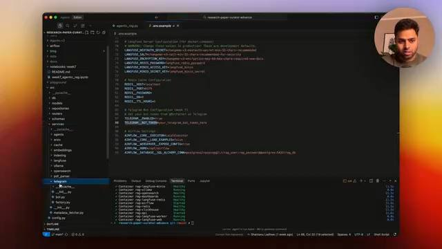

### 3.10 Telegram 接入

P22 说新增两个 service：`telegram` 和 `agent`。Telegram 代码全部放在 telegram service 里，agentic RAG 放在 agent service 里。你需要：

1. 按仓库 guide 创建 Telegram bot，拿 token；
2. 写入 `.env`；
3. 重新 build/up；
4. 在 Telegram 里给 bot 发消息测试。

课里没讲 webhook 还是 polling、端口怎么映射、token 变量名具体叫什么，这些以仓库代码为准。

## 4. 完整代码

> 再次说明：逐字稿没有给出仓库 Python 源码，不能凭空补出讲师的 `agent`、`cache`、`streaming` 文件。下面给的是**可直接保存运行的复现脚本**，把 P21/P22 口述的启动、重建、拉模型、Gradio 检查串起来；以及一个按 P21 缓存键逻辑写的独立校验脚本，用来确认「同一请求体 → 同一 key」。

### 4.1 `scripts/reproduce.sh`

保存为仓库根目录下的 `scripts/reproduce.sh`，然后 `chmod +x scripts/reproduce.sh`。

```bash
#!/usr/bin/env bash
set -euo pipefail

cd "$(dirname "$0")/.."

if [[ ! -f .env ]]; then
  echo "缺少 .env：请先从仓库的 environment example 文件复制，并填写 Gemini / Langfuse / Telegram 所需变量。"
  exit 1
fi

OLLAMA_SERVICE="${OLLAMA_SERVICE:-ollama}"
OLLAMA_MODEL="${OLLAMA_MODEL:-llama3.2:1b}"
GRADIO_ENTRY="${GRADIO_ENTRY:-gradio_launcher.py}"

echo "1/8 停止旧容器"
docker compose down

echo "2/8 重建镜像：改过 .env 后必须做，P21 明确说 Langfuse key 会被 Tracer 消费"
docker compose build

echo "3/8 启动全部服务"
docker compose up -d

echo "4/8 查看容器状态"
docker compose ps

echo "5/8 拉取 Ollama 模型；服务名不同请用 OLLAMA_SERVICE 覆盖，模型 tag 不同请用 OLLAMA_MODEL 覆盖"
docker compose exec "$OLLAMA_SERVICE" ollama pull "$OLLAMA_MODEL"

echo "6/8 请打开 Langfuse：P21 口述 localhost:3000，P22 口述 localhost:3001，以 compose 端口为准"
echo "7/8 请打开 FastAPI 的 OpenAPI 界面，并在 Airflow 中 backfill 至少一天"
echo "8/8 Gradio 入口：文件名不同请用 GRADIO_ENTRY 覆盖"

if [[ "${RUN_GRADIO:-0}" == "1" ]]; then
  uv run python "$GRADIO_ENTRY"
else
  echo "手动运行：uv run python $GRADIO_ENTRY"
fi
```

### 4.2 `tools/cache_key.py`

这个脚本不是讲师仓库原文件，而是按 P21 口述的「query + model + top_k + 所有参数 → hash key」写的最小校验器。真实字段名以你的 API request body 为准。

```python
import hashlib
import json
from typing import Any, Mapping


def make_cache_key(request_body: Mapping[str, Any]) -> str:
    canonical = json.dumps(
        request_body,
        sort_keys=True,
        separators=(",", ":"),
        ensure_ascii=False,
    )
    return hashlib.sha256(canonical.encode("utf-8")).hexdigest()


if __name__ == "__main__":
    body = {
        "query": "What are transformers in machine learning?",
        "model": "llama3.2:1b",
        "top_k": 5,
    }
    print(make_cache_key(body))
```

运行：

```bash
python tools/cache_key.py
```

把 `body` 改一个字段，再运行一次，key 必须变化。这就是 P21 说的「完全相同的 query 和参数才命中」。

## 5. 逐行解释

先解释 `scripts/reproduce.sh`：

- `set -euo pipefail`：任何一步失败就停，避免 Docker build 失败后还继续 up。
- `cd "$(dirname "$0")/.."`：保证脚本从仓库根目录执行，`docker compose` 才能找到 compose 文件。
- `if [[ ! -f .env ]]`：P21/P22 都强调 environment file 是前置条件。没有 `.env` 就不要启动。
- `docker compose down`：P21 自己就是先 down，再 rebuild。改 key 后不能只 `restart`，因为镜像里/容器里的旧配置可能还在。
- `docker compose build`：P21 明确说 public key 会被 Langfuse Tracer 消费，所以改 `.env` 后要重建镜像。
- `docker compose up -d`：启动 ClickHouse、Langfuse、Postgres、Redis、Ollama、OpenSearch、Airflow、API、Gradio/Telegram 等服务。P21 口述九个容器，P22 升级 Langfuse v3 后可能更多。
- `docker compose ps`：检查容器是否真的起来。不要只看命令有没有报错。
- `docker compose exec "$OLLAMA_SERVICE" ollama pull "$OLLAMA_MODEL"`：P21 因为缺 Llama 3.2 模型导致提问失败；P22 建议 agentic 用 1B。服务名和 tag 不同就用环境变量覆盖。
- `RUN_GRADIO=1` 才真正启动 Gradio；否则只打印命令，避免脚本一跑就卡在交互界面。

再解释 `tools/cache_key.py`：

- `json.dumps(..., sort_keys=True)`：把请求体字段排序，避免 `{"query":..., "model":...}` 和 `{"model":..., "query":...}` 生成不同 key。
- `separators=(",", ":")`：去掉多余空格，保证序列化稳定。
- `ensure_ascii=False`：中文 query 不转义，便于调试。
- `hashlib.sha256(...).hexdigest()`：生成定长 key。P21 说用 hash key 作为 Redis 的唯一 key，这里就是等价逻辑。
- 这个实现是**精确缓存**，不是 semantic cache。P21 明确说语义缓存要另一个 vector database，还要设 90% 阈值，课里没做，只提了方向。

在 JS/Node 里对应什么：Redis
在 JS/Node 里对应什么：Redis 的读写就是 `ioredis` 的 `redis.get(key)` / `redis.set(key, value)`；哈希用 Node 内置的 `crypto.createHash('sha256')`。要注意 JS 里对象 key 顺序不保证，`JSON.stringify` 前必须自己按 key 排序，否则同一个请求体可能生成两个 key——这正是上面 Python 版用 `sort_keys=True` 的原因。另外，P21 说的「精确匹配」在 Node 里天然会踩一个坑：如果你把请求体里的 `undefined` 字段也序列化进去，序列化结果会和不带该字段的请求不同，等于人为制造了缓存不命中。

再解释 Agentic RAG 那几个决策为什么这样定：

- **guardrail 放在图的最前面**：P22 说「every workflow, all this has a guardrail」，理由是真实业务里有些问题根本不该回答。放在最前面而不是检索之后，是因为检索本身要花 embedding、OpenSearch、LLM 的钱；先拒掉不相关问题，等于把成本挡在门外。如果你放到后面，就是先花完钱再拒，纯浪费。
- **阈值定 60%**：P22 原话是「if the score is less than 60%, then we reject」，并强调这是「in our case」。所以 60 不是行业标准，是课程用的默认值，你要按自己的语料调。调低会放进更多边缘问题，调高会误杀正常问题。
- **guardrail 用 structured / pedantic output**：P22 说「it's a pedantic output at the end so that the LLM doesn't hallucinate」。意思是不要让它自由输出一段话再去正则抠分数，而是让它按固定 schema 输出分数和理由。Langfuse 里能看到「score of 80」加一段 reason，就是这个结构的产物。
- **retrieve 是一个「带工具的 LLM 节点」，而不是直接调 RAG 函数**：这是 agentic 和普通 RAG 的分界线。普通 RAG 是代码里写死「先 embed 再搜」，agentic 是让 LLM 自己决定「我要不要调这个工具、用什么参数调」。代价是多一次 LLM 调用，所以 P22 反复提醒要用 1B 小模型。
- **计数器设 2**：P22 的理由非常具体——「you do not want to be in this infinite loop」。因为当前这个 agent 只有 RAG 一个工具，一旦检索不到，LLM 很容易反复重试同一个工具，形成死循环。计数器是硬刹车：第二次还失败，直接走 farewell，给用户一句「抱歉没找到」，而不是让请求挂死。这在 Node 里等价于给重试加 `maxRetries`，绝不能裸写 `while(true)`。
- **grade documents 只输出 yes/no**：P22 说「it's a binary outcome, yes or no」。不做 0–100 分，是因为下一步只有「答」和「重写」两个分支，二值判断让条件边的判断逻辑最简单，也最不容易被模型输出格式搞崩。
- **rewrite query 单独成节点**：P22 提到也可以把 rewrite 逻辑塞进 retrieve 里，但单独成节点的好处是 Langfuse 里能一眼看出「这次失败了，失败在哪一步」。这是可观测性驱动的拆法。
- **answered vs farewell 分开**：P22 说有些地方不需要 LLM，就直接「generating a fallback or our own organized text」。兜底文案不要交给模型写，否则模型可能又编出一个答案。

再解释 Langfuse 四段 span 的取舍：

- **为什么只切四段**：query embedding、search retrieval、prompt construction、LLM generation。P21 说「we wanted to just capture only the most important steps」，没有细到每个函数。
- **为什么不把完整 embedding 记进 output**：P21 说「You could also log as the output, the whole embeddings and all, but we are keeping it very simple」。embedding 是几百上千维的 float 数组，写进 trace 只会撑爆存储。
- **为什么 LLM generation 反而记了完整 prompt**：P21 说「in the LLM generation, we have kept everything what goes as part of the user as part of the Olama prompt」。因为排查回答质量问题时，你必须看到模型实际收到的 prompt，包括拼接进去的检索上下文。
- **为什么缓存不记 trace**：P21 明确说「we have not included the caching part as part of the tracing」。所以你在 Langfuse 里看不到 cache hit 的 span，缓存命中时整条 trace 直接不产生。这是个已知缺口，不是你的配置错了。

## 6. 复现检查清单

按顺序打勾，任何一项没过就不要往下走。

**环境与配置**

- [ ] 已从课程 Google Drive 拿到代码，并在 IDE 打开仓库根目录。
- [ ] 已把 environment example 文件复制成 `.env`。
- [ ] `.env` 里 Gemini（Gini）API key 已填。
- [ ] `.env` 里 Langfuse public key、secret key 已填，且来自同一个 project。
- [ ] `.env` 里 Telegram bot token 已填（不测 Telegram 可先跳过，但容器可能因此起不来）。
- [ ] 变量名是照着仓库 `.env.example` 填的，不是照本文猜的。

**容器**

- [ ] `docker compose down` 无报错。
- [ ] `docker compose build` 成功，尤其是改过 key 之后重跑过。
- [ ] `docker compose up -d` 后，`docker compose ps` 里所有服务都是 running / healthy，没有反复重启。
- [ ] 能数出 P21 说的那批服务：ClickHouse、Langfuse、Postgres、Redis、Ollama、OpenSearch、Airflow、API 等；数量以 `ps` 实际输出为准。
- [ ] 本机内存够。P21 说这套「quite a bloated application」，在他 MacBook 上跑得动，换一台机器可能就卡。

**模型**

- [ ] 已进 Ollama 容器 pull 到 Llama 3.2 模型。
- [ ] 用的是 1B，不是 3B（P22 明确建议 agentic 用 1B）。
- [ ] 拉完后在应用里提问不再报「模型不存在」这类错。P21 就是踩了这个坑。

**数据**

- [ ] Airflow 里跑过任务或 backfill 至少一天（P22 原话）。
- [ ] Postgres 里有记录。
- [ ] OpenSearch 里有 chunk。
- [ ] FastAPI 的检索接口能返回非空结果——这一步不通过，agentic RAG 一定跑不通。

**Langfuse**

- [ ] 能打开 Langfuse 页面（端口以 compose 为准，P21 说 3000，P22 说 3001）。
- [ ] 注册 admin、创建 organization、创建 project 已完成。
- [ ] 跑一次提问后，traces 列表里出现新记录。
- [ ] 点进去能看到四类 span：query embedding、search retrieval、prompt construction、LLM generation。
- [ ] 能看到每个 span 的耗时；P21 给的参考值是 embedding 1.13s、retrieval 22ms、LLM 55s（本地机器，仅供对比，不是目标值）。

**缓存**

- [ ] 用 `tools/cache_key.py` 验证过：同一请求体 key 一致，改任一字段 key 变化。
- [ ] 在应用里连续问两次完全相同的问题，第二次明显更快。
- [ ] 第二次提问在 Langfuse 里**没有**新 trace（因为缓存不接 tracing，P21 明说）。

**Agentic RAG**

- [ ] 问一个明显超出范围的问题（P22 举的例子是 “what is a dog”），guardrail 拒绝，返回礼貌拒答。
- [ ] 问一个正常业务问题（P22 举例 “what are transformers in machine learning”），guardrail 通过，走完 retrieve → grade → answer。
- [ ] 在 Langfuse 里能看到 guardrail 的分数和理由。
- [ ] 故意问一个库里没有的问题，观察是否触发 rewrite query 和第二次 retrieve，最终走 farewell 而不是无限重试。

**Gradio / 前端**

- [ ] `uv run python <入口文件>` 能启动。
- [ ] 界面上基础 RAG 和 agentic RAG 两个入口都能用。
- [ ] 提问有流式输出（P21 说用户看到首 token 就该知道在生成）。

## 7. 课里没讲但你会撞上的

**1）端口到底 3000 还是 3001。** P21 说 Langfuse 在 localhost:3000，P22 说在 localhost:3001。课里没有解释为什么改。你自己以 `docker compose ps` 里的端口映射为准，不要硬套。

**2）改 `.env` 只 `restart` 会不生效。** P21 的做法是 `docker compose down` 再 rebuild。如果你只 `docker compose restart`，容器里还是旧的环境变量，Langfuse 会一直认证失败，而报错信息通常不会告诉你「是 key 旧了」。

**3）Langfuse v2 与 v3 的差异。** P21 明说当前用的是 v2，「some of the things which are missing in here are like LLM as a judge」；P22 说已经升级到 v3 以获得更详细的 logging/tracing，并且因为升级，容器变多了。所以你拿到的代码是哪个版本，直接决定你能不能用 eval、LLM-as-a-judge 这些功能。课里没讲 v2 升 v3 的具体迁移步骤。

**4）ClickHouse 吃内存。** P21 说 ClickHouse 是 Langfuse 的 analytics 后端依赖。加上 Postgres、Redis、Ollama、OpenSearch，本地机器很容易 OOM。P21 自己承认这套东西「could give issues on another's laptop」。课里没给降低内存的配置方案，只说了未来会支持换成 OpenAI API、不本地跑 Ollama。

**5）缓存只对「一字不差」的重复问题有效。** P21 反复强调这点。真实用户很少重复同一句话，所以生产上命中率可能极低。P21 提到的 semantic caching（用向量库 + 90% 相似度阈值）课里**没有实现**，只讲了思路。你自己加的话，要额外维护一个缓存向量库，或者复用现有 OpenSearch 集群——这是 P21 提到的选项，但没有代码。

**6）缓存并发下的击穿问题。** 课里没讲。真实情况下，如果两个用户同时问同一个新问题，两边都会缓存未命中，都会跑完整条 RAG，然后都写一次缓存。在 Node 里这叫 cache stampede，常见做法是加一个短 TTL 的分布式锁（`SET key value NX PX 5000`）。注意这是**我补的工程常识，不是讲师讲的**。

**7）没有对话记忆。** P21 里有听众问「we don't have memory here」，讲师确认「in this rack system, we have not introduced memory」，并说计划放到第二季。所以你现在测的时候，第二轮追问会被当成全新问题，指代词（「它」「这个」）会失效。P21 提到未来可能用 Memo 这类框架，也提到「Lama index 只是 wrapper，我一般不喜欢」，但都没有落地。

**8）Prompt 在 Langfuse 里改会和代码脱节。** P20 讨论得很细：他们只给 staging 环境的 Langfuse 权限，让产品/其他团队在 dev 环境试 prompt，验证有效后由工程团队接手；紧急情况才先改生产 Langfuse，但同时必须开 ticket，且 ticket 的完成定义是「把这个改动同步回代码」。否则「Langfuse is like 10 versions ahead」。如果你自己一个人做项目，这条规则可以先简化成：**prompt 只改代码，不改平台**。

**9）Trace 的采样率与合规。** P20 给的经验值是：上线初期 100% 全采，稳定后降到 2%–5%，因为存储成本高；用托管方案（Langfuse Cloud 等）更贵。另外欧洲有 GDPR，用户要求删数据时，聊天 trace 也要一起删。课里没给具体的脱敏或删除实现。

**10）MLflow 不能替代 Langfuse 做 trace。** P20 有听众问能不能用 MLflow，讲师回答：MLflow 有 prompt management，但「they don't have functionality to do logging... the observability, the tracing」。它是管实验、模型注册、部署的。所以别指望一个工具全包。

**11）Airflow 的 DAG 名和 backfill 命令课里没给。** P22 只说「run something on airflow... backfill it at least for one day」。你得自己在 Airflow UI 里找，或者在仓库的 `dags/` 目录里翻。

**12）Telegram 是 webhook 还是 polling，课里没讲。** P22 只说代码全在 telegram service 里，token 怎么拿有 guide。如果你在本地跑，webhook 通常需要公网地址，polling 不需要——这会影响你在笔记本上能不能测通。以仓库实现为准。

**13）Agentic RAG 慢到你会以为卡死。** P22 明说「most of these nodes are using LLM to process it... the output takes a lot of time and it's also very compute intensive」。一个请求要过 guardrail、retrieve、grade、可能的 rewrite、再 retrieve、再 grade、最后 answer，等于五六次 LLM 调用。用 3B 模型在笔记本上基本不可用，这就是为什么反复强调 1B。

**14）Langfuse 里看不到缓存命中，别以为是 bug。** 再强调一次：P21 说缓存没接入 tracing。想加的话，P21 说改动只在 streaming 那个文件里，「every change would happen in this file only」。