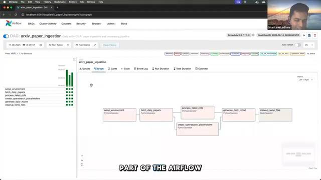
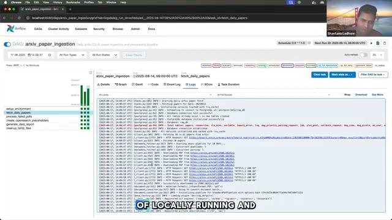
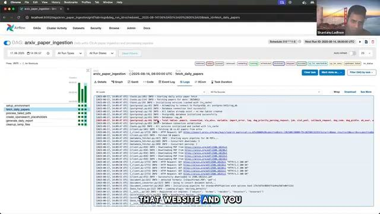
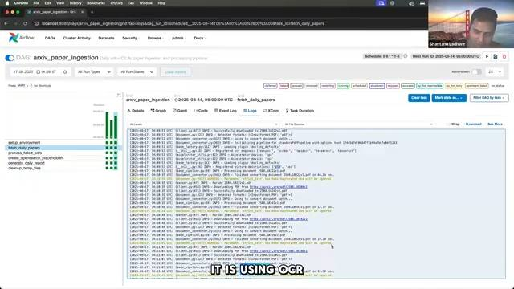
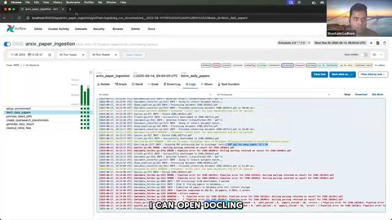
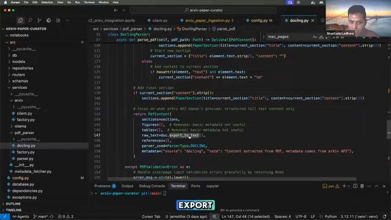
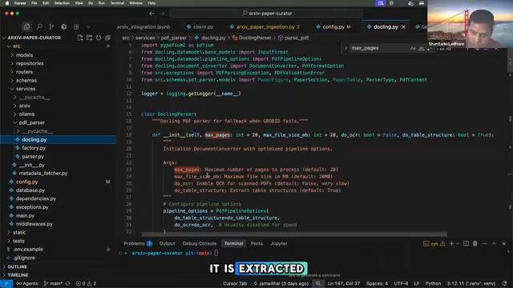
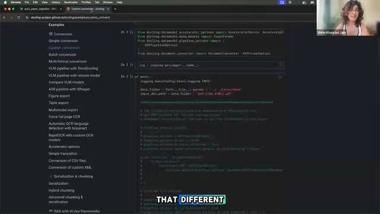
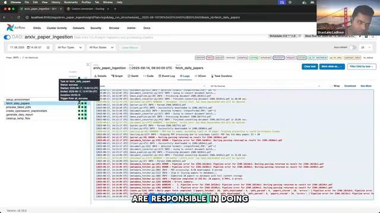

# Production-Ready RAG from Scratch：P7 数据摄取流水线复现文档

> 范围说明：本文只覆盖 P7。P7 是一次围绕“RAG 的数据摄取层”做的代码走读与架构讨论，逐字稿里没有给出可逐行复制的源码、仓库路径、依赖版本、环境变量名和启动命令。因此本文不会伪造这些硬信息；能确定的设计决策、配置口径、数据模型和复现步骤会写全，不能确定的会明确标注“课里没讲”。读者应把它当作“照着搭流水线”的施工图，而不是对课程仓库源码的逐字转录。

## 1. 这一节做什么

这一节要做的不是“调用大模型回答问题”，而是把 RAG 系统最前面、也最耗工程时间的那段做出来：**每天把论文元数据和 PDF 正文抓进来，解析成可存储、可检查、后续可分块和可检索的数据**。讲师在 P7 里反复强调，真正的工作量不在最后的 LLM 问答，而在数据摄取：抓取、下载、缓存、解析、校验、入库、统计、为后续 OpenSearch 检索留位置。

整条链路的业务目标可以概括为：

1. 用 Airflow 建一个每天运行的 DAG，按提交日期抓取“昨天的论文”。
2. 先调用 archive 网站的 API 拿元数据，包括标题、URL、作者、摘要/摘录等；API 拿不到 PDF 全文。
3. 根据 URL 下载 PDF，下载时做本地缓存，已存在就跳过；下载和解析要有重试。
4. 用 Docling 把 PDF 解析成文本，尽量保留 section、表格等结构；研究论文的 figure 不作为重点，因为论文正文通常会解释 figure 的上下文。
5. 解析结果先写入 PostgreSQL 的 `papers` 表，作为“中间层”：保留元数据、原始文本、解析方法、分块方法等信息，避免未来换 chunking/embedding 策略时重新下载、重新解析。
6. 在 Airflow 里保留 OpenSearch 的 placeholder，后续再做关键词检索、混合检索。
7. 输出抓取数、下载数、解析数等统计，便于做数据质量报告。

讲师在 P7 开头先给了整体图：Airflow 只负责数据摄取；后面的检索、OpenSearch、关键词匹配、混合检索是下一阶段。这个顺序很重要：**先保证数据能稳定进来，再谈 RAG 效果**。

## 2. 讲师原话（带「—— pNNN [MM:SS]」）

下面引用逐字稿中能确定设计口径的原话，保留英文原句，后面给中文解释。引用只用于锁定事实，不把讲师没说过的话安到他头上。

> "如你在这里所见，我们目前使用 Airflow 仅用于数据摄取流水线。"
> —— p007 [00:00]  
> 中文：Airflow 在这里只负责数据摄取流水线，不是整个 RAG 系统的全部。

> "我们会确保 Airflow 有向无环图运行所需的环境全部配置就绪，否则它一开始就会失败……"
> —— p007 [01:39]  
> 中文：DAG 一开始先做环境检查，避免 OpenSearch、Postgres、FastAPI 等依赖没起时，错误拖到后面的步骤才爆。

> "它每天在协调世界时上午 6 点运行。"
> —— p007 [02:05]  
> 中文：这个抓取 DAG 按每天 UTC 早上 6 点调度；本地跑则要保证 Docker 里的 Airflow 实例是启动状态。

> "第一部分只根据提交日期，通过 arXiv 的 API 获取元数据。"
> —— p007 [03:32]  
> 中文：抓取分两段，第一段只通过 archive API 按提交日期拿元数据，不拿全文。

> "只是为了运行并做演示，我们把它配置为只处理 10 篇论文。"
> —— p007 [04:25]  
> 中文：课程演示在 Airflow 里把最大结果数设成 10；配置里默认可以是 100，但 Docling 解析很吃 CPU。

> "我们还在每次请求之间设置 3 秒延迟，因为 arXiv 论文接口有速率限制。"
> —— p007 [06:16]  
> 中文：请求 archive 时要加 3 秒延迟，因为对方有速率限制。

> "如果它已经存在，就会直接跳过。"
> —— p007 [08:08]  
> 中文：下载前先看本地缓存里 PDF 是否已存在，存在就跳过，避免重复下载。

> "我们不想提取任何超过 30 页的便携式文档格式文件中的数据。"
> —— p007 [12:25]  
> 中文：解析设置里有页数上限，超过 30 页的 PDF 不进入正常解析；本地机器弱时讲师建议把上限降到 10 页。

> "我还会把光学字符识别设为 false，因为它同样非常消耗处理器资源。"
> —— p007 [15:15]  
> 中文：本地复现时把 OCR 关掉，因为 OCR 非常吃 CPU。

> "我们还把这些数据存入 PostgreSQL。"
> —— p007 [30:24]  
> 中文：解析后的数据写入 PostgreSQL，作为后续可回填、可换策略的中间层。

> "大约 85% 的工作量都花在数据摄取上，整个代码更侧重处理数据摄取，而不是检索增强生成系统如何配合大语言模型和分块工作。"
> —— p007 [33:13]  
> 中文：大部分工程 effort 在数据摄取，不在最后的 LLM 和 chunk 问答本身。

## 3. 从零复现

这一节按“纯讲解课”的方式复现讲师的推导过程：先明确需求和约束，再做量级估算，最后落到方案和取舍。注意：逐字稿没有给实际命令，所以这里不写假的 `docker compose up` 或假的依赖版本；你应当按照自己项目的实际仓库补命令。

### 3.1 需求：每天把论文变成可检索的数据

需求可以拆成五件事：

1. **定时**：每天运行一次，讲师口径是 UTC 早上 6 点。业务上不要求“源数据一更新就立刻进系统”，每日更新即可。
2. **抓元数据**：按提交日期抓“昨天”的论文，预期每天约 100 篇；演示环境限制为 10 篇。
3. **抓正文**：元数据里没有 PDF 全文，所以必须根据 URL 下载 PDF，再用解析器提取文本。
4. **保留结构**：解析结果要尽量保留 section、表格等结构；表格最好以 Markdown 形式保留，便于后续 chunk 和 LLM 理解。
5. **可回填**：解析后的原始文本和元数据先入 PostgreSQL，未来换 chunking/embedding 策略时不用回到互联网重新抓。

### 3.2 约束：CPU、速率限制、本地机器

讲师明确提到的约束有：

- archive API 有速率限制，请求之间要加 3 秒延迟。
- Docling 解析 PDF 非常吃 CPU，尤其带 OCR 时；本地笔记本会发热，所以多进程要设成 1。
- 课程演示把最大结果数降到 10，就是因为解析成本高；配置默认可以是 100。
- 单 PDF 页数上限是 30 页；本地机器弱时建议降到 10 页。超过上限的 PDF 会报警/不通过，不会硬解析。
- 生产环境可以把解析任务放到更强 CPU 的按需实例上，不必 24 小时常驻；本地则要接受“跑一两个小时甚至更久”的可能。
- GPU 只在用 VLM 时可能更有价值；基础 Docling OCR 路线是 CPU 密集型，讲师说自己没试过 GPU 方案。

### 3.3 估算：先把量级算出来

| 项目 | 讲师口径 | 复现时的用法 |
|---|---|---|
| 每日论文量 | 约 100 篇/天 | 生产配置按 100 估；本地演示设 10 |
| 调度 | 每天 06:00 UTC | 逻辑上等价于每天 6 点；逐字稿未给 cron 原文 |
| 请求延迟 | 3 秒/次 | 用于 archive 请求节流 |
| 页数上限 | 30 页 | 超过则 warning/不解析；本地建议 10 |
| 解析并发 | 1 个 Docling 进程 | 避免本地 CPU 过热 |
| 解析耗时 | 可能 1–3 小时甚至更久 | 业务允许每日更新，不要求实时 |

按最朴素的串行等待估算：100 篇 × 3 秒 = 300 秒 = 5 分钟。但这只是“请求间隔”的量级，不是总耗时承诺；讲师明确说下载和 Docling 解析才是主要成本，尤其解析是 CPU 密集型。因此本地用 10 篇、30 页上限、OCR 关闭，是为了让复现能跑完，而不是为了模拟生产吞吐。

### 3.4 方案：按 DAG 任务顺序搭

**第 0 步：准备依赖服务。**  
按讲师描述，至少有 Airflow、PostgreSQL、OpenSearch，以及一个独立的 PDF parser 服务；parser 服务用 FastAPI 组织，讲师提到生产结构里会用 dependency 和 lifespan。具体 Docker 镜像、端口、环境变量，逐字稿没给。

**第 1 步：DAG 第一个任务做环境检查。**  
先确认 OpenSearch 是否在跑、Postgres 是否初始化、FastAPI 是否可用。这样依赖没起时，DAG 在第一步就失败，而不是抓到一半才报错。

**第 2 步：抓元数据。**  
调用 archive API，按“昨天的 submitted date”查询，拿标题、URL、作者、摘要/摘录等。Airflow 里最大结果数设 10；配置默认 100。API 调用逻辑里要做 URL 编码，讲师提到代码里有这部分逻辑。

**第 3 步：下载 PDF。**  
根据元数据里的 URL 下载 PDF。下载前检查本地缓存：如果 PDF 已存在就跳过。请求之间加 3 秒延迟；下载失败要有重试。讲师说下载也可以并发，但解析才是瓶颈。

**第 4 步：Docling 解析。**  
把 PDF 交给 Docling，提取文本、section、表格等。设置页数上限 30；本地建议 10；OCR 本地设 false；表格结构相关开关可配。Docling 的 multiprocessing 设为 1，避免本地过热。超过页数上限的 PDF 发 warning，不进入正常解析。

**第 5 步：校验解析质量。**  
讲师说这是最容易花时间的地方。课程里对小项目采用手动方式：把 PDF 和抽取文本一起给 ChatGPT，用“LLM as a judge”的 prompt 问抽取质量，再根据结果改代码。生产里应做成工作流，但小项目不必过度自动化。

**第 6 步：写入 PostgreSQL。**  
每篇解析后的论文写入 `papers` 表，保存标题、作者、摘要、原始文本、解析方法、分块方法等。这个表是中间层：未来换 chunking/embedding 时，从这里重新处理，不回到互联网。

**第 7 步：输出统计。**  
记录抓了多少、下载了多少、解析了多少、哪些失败。讲师说可以把最后统计以 CSV 放 S3，再用 Grafana 或内部 dashboard 做报表。

**第 8 步：保留 OpenSearch placeholder。**  
P7 只创建占位，真正的关键词检索、混合检索下一阶段做。讲师明确说下一阶段先做 keyword matching，再做 keyword + embedding 的 hybrid retrieval。

### 3.5 取舍：为什么不是“更先进的全自动方案”

- **Airflow vs Prefect/Dagster**：讲师说自己用 Airflow 七年，公司里也有大量 legacy pipeline；工具由公司技术栈决定，原则可以迁移。不是非 Airflow 不可。
- **Docling vs 云 OCR / LlamaParse**：云 OCR 更可靠但绑定云；LlamaIndex/LlamaParse 的端到端体验好，但抽象层可能过高。选型看质量、成本、长期维护、抽象控制力。
- **一个 parser vs fallback**：讲师提过 Grobit/Grobet + Docling 的 fallback 思路，后来为简化只留一个 parser。生产系统建议有简单 fallback OCR，至少别丢信息。
- **表格特殊 chunk vs 普通 chunk**：如果只有少量文档有表格，不必为表格单独造一套 chunking；把整张表作为一个 chunk，不拆断即可。如果文档大量表格化，才需要按文档结构做预处理。
- **每日更新 vs 实时更新**：讲师明确说不要过度复杂化；业务只要每日更新， pipeline 跑几小时也可接受。

## 4. 完整代码

> 重要说明：P7 逐字稿没有给出一段可保存运行的源码，也没有给仓库路径、依赖版本、环境变量名、Airflow connection id、Docker compose 文件或启动命令。因此本节不伪造“完整代码”。下面给出的是按讲师描述落成的**设计决策表、组件职责表、DAG 任务表、配置契约、数据模型草案和统计口径**。你拿这些表去写代码，才不会把架构写歪；但具体语法必须回到课程仓库或你自己的项目。

### 4.1 组件职责表

| 组件/逻辑模块 | 职责 | 逐字稿依据 |
|---|---|---|
| Airflow DAG | 每天调度数据摄取；记录每个 step 的日志 | 讲师说用 Airflow 做 data ingestion pipeline，DAG 可看每步日志 |
| 环境检查任务 | 检查 OpenSearch、Postgres、FastAPI 等依赖 | 讲师说否则会在 start 就 fail |
| archive API client | 按 submitted date 查元数据；处理 URL 编码 | 讲师说 API 调用需要编码 URL |
| 下载器 | 下载 PDF；3 秒延迟；缓存命中则跳过；失败重试 | 讲师明确说 3 秒延迟、缓存、重试 |
| PDF parser 服务 | FastAPI + Docling；独立服务；解析 PDF | 讲师说 PDF parser 是 separate service，FastAPI 有 dependency/lifespan |
| PostgreSQL repository | 写入 `papers` 表，保存元数据、原始文本、解析/分块方法 | 讲师说存 Postgres 作为 middle layer |
| 报表/统计 | 统计 fetch/download/parse 数量；CSV 到 S3；dashboard | 讲师说 reporting 很重要 |
| OpenSearch placeholder | 为后续关键词/混合检索留位置 | 讲师说 P7 只 create placeholder |

### 4.2 DAG 任务表（逻辑任务，不是实际 task_id）

| 顺序 | 逻辑任务 | 输入 | 输出 | 失败策略 |
|---|---|---|---|---|
| 1 | `env_check` | 依赖服务地址 | 通过/失败 | 失败立即终止，不进入抓取 |
| 2 | `fetch_metadata` | 昨天日期、max_results | 元数据列表 | 记录失败；可重试 |
| 3 | `download_pdfs` | 元数据 URL | 本地 PDF 缓存 | 已存在跳过；失败重试 |
| 4 | `parse_pdfs` | PDF 文件 | 文本/section/表格 | 超页数 warning；失败重试 |
| 5 | `persist_papers` | 元数据 + 解析结果 | `papers` 表记录 | 记录错误，不丢原文 |
| 6 | `create_opensearch_placeholder` | 无 | 占位资源 | 失败不阻塞入库 |
| 7 | `report_counts` | 各步计数 | CSV/日志/dashboard 数据 | 只报告，不阻断主流程 |

### 4.3 配置契约

| 配置项 | 课程口径 | 说明 |
|---|---|---|
| 调度 | 每天 06:00 UTC | 逐字稿原话；cron 原文课里没给 |
| 查询日期 | 昨天 submitted date | 抓“昨天的论文” |
| `max_results` | Airflow 里 10；配置默认 100 | 演示降载；生产按 100 估 |
| 请求延迟 | 3 秒 | archive 速率限制 |
| 本地缓存 | PDF 存在则跳过 | 避免重复下载 |
| 页数上限 | 30 页 | 超过发 warning，不通过 |
| 本地页数建议 | 10 页 | 讲师建议弱机器降低 |
| OCR | 本地 false | 太吃 CPU |
| 表格结构 | 有开关 | 具体值课里没讲 |
| Docling multiprocessing | 1 | 避免本地过热 |
| 重试 | 下载/解析有重试 | 次数课里没讲 |
| OpenSearch | placeholder | P7 不实现检索 |

### 4.4 PostgreSQL 数据模型草案

讲师明确说表叫 `papers`，保存元数据、原始文本、解析方法、分块方法。下面字段是“逻辑字段”，实际列名课里没讲，不能当成课程仓库的真实 schema。

| 逻辑字段 | 来源 | 说明 |
|---|---|---|
| 标题 | archive 元数据 | 讲师明确提到 title |
| 作者 | archive 元数据 | 讲师明确提到 authors |
| 摘要/摘录 | archive 元数据 | 讲师提到 abstract/extract |
| URL | archive 元数据 | 用于下载 PDF |
| 原始文本 | Docling 解析 | 中间层核心 |
| 解析方法 | 解析阶段 | 讲师说保存“which method we use for parsing” |
| 分块方法 | 后续 chunk 阶段 | 讲师说保存“which method we use for chunk” |
| 提交日期 | archive 元数据 | 按 submitted date 抓取 |
| 下载/解析状态 | 工程建议 | 课里未明确；用于报表和重试 |

### 4.5 统计口径

| 指标 | 来源 | 用途 |
|---|---|---|
| fetch 数 | 元数据抓取 | 判断 API 是否正常 |
| download 数 | PDF 下载 | 判断缓存和网络 |
| parse/pass 数 | Docling 解析 | 判断解析质量 |
| 失败/跳过数 | 下载、页数上限、解析错误 | 做数据质量报表 |
| CSV 到 S3 | 讲师提到的报表落点 | 接 Grafana/内部 dashboard |

## 5. 逐行解释

这一节没有“代码行”可逐行解释，所以按决策逐条解释：每条为什么这样定、不这样会怎样。

1. **为什么 DAG 第一步做环境检查？**  
   因为 Airflow 任务失败在第一步，日志最干净；如果 OpenSearch 没起、Postgres 没初始化、FastAPI 没工作，却在抓了 80 篇 PDF 后才失败，会浪费大量时间和缓存。对应到前端/Node 世界，相当于服务启动时先做 health check，而不是用户点按钮时才报数据库连不上。

2. **为什么按“昨天 submitted date”抓？**  
   业务要每日更新，不要求实时。按提交日期抓昨日数据，DAG 简单、可重复、可回填。如果追求“源站一更新就立刻进系统”， pipeline 会复杂很多，讲师明确说这是很多人过度设计的点。

3. **为什么 Airflow 里只抓 10 篇，配置默认 100？**  
   因为 Docling 解析 PDF 很吃 CPU，课程演示要保证学生能跑完。生产可以按 100 估，但本地 10 篇是降载。这个设计和“抓取能力”无关，是“解析能力”约束。

4. **为什么先抓元数据再下载？**  
   archive API 只给标题、URL、作者、摘要等元数据，不给全文。必须先拿 URL，才能下载 PDF，再解析正文。这个两段式也让缓存和失败重试更好做：元数据可以先拿到，下载失败只影响单篇。

5. **为什么加 3 秒延迟？**  
   对方有速率限制。无限速并发请求可能被封或失败。讲师说元数据 API 如果没限速可以更快，但下载/解析阶段才是瓶颈，所以不要为了“快”破坏对方规则。

6. **为什么下载前查本地缓存？**  
   同一篇论文重复跑 DAG 时不该重复下载。缓存让 DAG 具备一定幂等性：PDF 已存在就跳过，后续只补缺失的。注意逐字稿没讲数据库唯一键和事务，这部分要你自己补。

7. **为什么页数上限是 30，本地建议 10？**  
   Docling 解析复杂 PDF 很吃 CPU，页数越多越慢。超过 30 页直接 warning/不通过，避免一个超大 PDF 拖垮整批任务。本地降到 10 是让笔记本能跑完。讲师提到课程里就有 50 页 PDF 因为超过 30 页而不通过。

8. **为什么本地把 OCR 设为 false？**  
   OCR 是 CPU 密集型操作。研究论文大多是文本型 PDF，不一定需要 OCR；关掉 OCR 能显著降载。生产是否开 OCR 取决于文档类型和资源，讲师没给统一答案。

9. **为什么表格建议 Markdown、且不要拆断？**  
   讲师说表格用 Markdown 表达，LLM 更容易理解结构；表格作为一个整体 chunk 比拆散更合理。如果文档大量表格化，才需要按标题/表格边界做预处理 chunk；如果只是少量表格，不必过度设计。

10. **为什么把解析结果先写 PostgreSQL？**  
    这是中间层。未来换 chunking 或 embedding 策略时，不必重新下载、重新解析。讲师说很多公司花大量成本做 backfill，如果有原始文本和元数据层，回填会便宜很多。前端同学可以把它理解成“先落原始数据表，再派生搜索索引”，不要每次都回源站。

11. **为什么 Docling 多进程设为 1？**  
    讲师说设成 2–3 时 MacBook Pro 明显发热。这个流水线不是必须并行处理大量文档，设 1 更稳。生产可以按需上更强 CPU，但本地不要硬堆并发。

12. **为什么只留一个 parser，不实现 fallback？**  
    讲师说原本考虑 Grobit/Grobet 作为初始 parser、Docling 作为 fallback，后来为简化去掉。生产系统建议有 fallback OCR，至少丢信息时还有兜底；但课程为了易复现没有做。

13. **为什么 OpenSearch 只做 placeholder？**  
    P7 的目标是数据摄取；关键词检索、混合检索是下一阶段。讲师说下一阶段先做 keyword matching，再做 keyword + embedding 的 hybrid retrieval。不要在这一节提前把检索逻辑写死。

14. **为什么统计报表重要？**  
    你需要知道抓了多少、下载了多少、解析了多少、失败多少。讲师说可以把统计 CSV 放 S3，再用 Grafana/内部 dashboard 展示。没有统计，流水线“跑完了”不等于“数据完整”。

15. **为什么讲师说 85% effort 在数据摄取？**  
    因为真实系统里，抓取、解析、清洗、chunk、存储、回填、报表都很琐碎；LLM 调用只是最后一段。这个判断决定了学习重点：先把数据层做稳，再调 RAG 效果。

## 6. 复现检查清单

下面按“能跑起来”的顺序检查。打勾前不要跳步。

- [ ] **确认范围**：只复现 P7 数据摄取，不把 OpenSearch 检索、embedding、LLM 问答混进来。
- [ ] **依赖服务**：Airflow、PostgreSQL、OpenSearch、FastAPI PDF parser 服务都已启动；具体命令按你项目实际环境执行，逐字稿没给。
- [ ] **环境检查任务**：DAG 第一步能检查 OpenSearch/Postgres/FastAPI；任一不可用则立即失败。
- [ ] **调度配置**：DAG 逻辑上每天 06:00 UTC 运行；本地可手动 trigger 测试。
- [ ] **查询日期**：按昨天 submitted date 查询，不是抓全部历史。
- [ ] **结果上限**：本地/Airflow 演示设 10；配置默认 100 不要直接用于弱机器。
- [ ] **请求延迟**：archive 请求间隔 3 秒，避免触发速率限制。
- [ ] **缓存检查**：PDF 已存在则跳过，不重复下载。
- [ ] **下载重试**：下载失败会重试；重试次数按你项目配置，课里没讲具体值。
- [ ] **解析重试**：解析失败会重试；课里没讲具体次数。
- [ ] **页数上限**：默认 30；本地弱机器改 10；超过上限发 warning，不硬解析。
- [ ] **OCR 开关**：本地设 false；开 OCR 前先确认 CPU 能扛。
- [ ] **表格结构**：Docling 表格结构开关按需开启；实际值课里没讲，以你的 Docling 配置为准。
- [ ] **多进程**：Docling multiprocessing 设 1，避免本地过热。
- [ ] **PostgreSQL 入库**：`papers` 表能保存标题、作者、摘要、原始文本、解析方法、分块方法等。
- [ ] **中间层可用**：不重新下载即可从 Postgres 重跑 chunk/embedding 实验。
- [ ] **OpenSearch 占位**：placeholder 创建成功，但不要求 P7 实现检索。
- [ ] **统计输出**：能输出 fetch/download/parse 数量；可按讲师口径落 CSV 到 S3。
- [ ] **质量校验**：抽 3–5 篇 PDF，用 LLM as judge 检查抽取文本是否完整、section/表格是否合理。
- [ ] **异常测试**：超过 30 页的 PDF 被跳过；重复运行不重复下载；依赖服务未起时第一步失败。

## 7. 课里没讲但你会撞上的

这一节必须单独写，因为 P7 是“走读 + 讨论”，不是手把手命令行课。以下内容逐字稿没有给，不能假装有。

1. **真实仓库路径、文件名、依赖版本、环境变量名、启动命令全部没讲。**  
   你不能从 P7 逐字稿里推出 `docker compose up` 的具体文件，也不能推出 Airflow connection id。需要回到课程仓库的 week two notebook/代码；讲师在 [33:13] 提到 week two notebook 里有内容，但逐字稿没有贴出路径。

2. **Airflow DAG 的 cron 原文没给。**  
   只能确定“每天 06:00 UTC”。实际写 `0 6 * * *` 还是别的表达式，以仓库为准；本文不把它伪装成课程原文。

3. **Docling 的配置键名和取值没给全。**  
   讲师提到 do table structure、OCR、PDF pipeline options、max size、max page 等，但逐字稿没有给出准确字段名。写代码时要查 Docling 文档或课程源码，不要凭记忆填。

4. **PostgreSQL 的真实表结构、主键、唯一约束、事务、并发写入没讲。**  
   讲师只说 `papers` 表保存元数据、原始文本、解析/分块方法。实际生产要自己补：论文唯一标识、重复运行幂等、失败重试状态、事务边界。给前端/Node 同学的对照：Node 里用 `pg` 写库时，别在并发任务里裸插；要用唯一键/事务防止同一篇论文重复入库。课里没讲锁和事务，这部分属于你落地时要补的工程细节。

5. **OpenSearch 的 mapping、安全、索引设计没讲。**  
   P7 只做 placeholder。下一阶段才做 keyword retrieval 和 hybrid retrieval；不要在这一节猜 OpenSearch 字段。

6. **chunking 和 embedding 的具体实现没讲。**  
   讲师讨论了表格 chunk、摘要 metadata、embedding 实验，但没有给代码。P7 的交付物是“原始文本 + 元数据 + 中间层”，不是最终向量库。

7. **报表落 S3、Grafana dashboard 只是口径，不是实现。**  
   讲师说可以把统计 CSV 放 S3，用 Grafana/内部 dashboard 看；具体权限、bucket、上传代码没讲。

8. **GPU/VLM 没有实测结论。**  
   讲师说如果使用 VLM，GPU 可能更好；但基础 Docling OCR 路线是 CPU 密集型，他自己没试过 GPU 方案。不要把“GPU 一定更快”写成课程结论。

9. **Grobit/Grobet 的拼写和 fallback 没有落地。**  
   逐字稿里出现 Grobit/Grobet，疑似学术 PDF 解析器；原本想做 fallback，后来为简化移除。P7 没有实现 fallback，生产是否要加由你判断。

10. **Firecrawl、网页抓取只是扩展方向。**  
    讲师提到 Firecrawl 做 web scraping 很有前景，但强调要保证不同数据源的解析一致性，否则后续无法做通用 chunk/embedding。P7 没有实现网页抓取。

11. **本地机器性能问题会先于代码问题出现。**  
    如果你按 100 篇、30 页、OCR 开启、Docling 多进程跑，笔记本很可能发热、耗时很长。按讲师口径先降到 10 篇、10 页、OCR false、multiprocessing 1，再逐步加负载。

12. **“跑完”不等于“数据正确”。**  
    讲师反复说解析质量要花时间验证，课程只用少量 PDF 验证过，并用 ChatGPT 做 judge。你复现时至少抽几篇人工看：标题、作者、section、表格、正文有没有缺。没有这一步，后面的 RAG 效果不可信。

总的来说，P7 的复现重点不是“把 LLM 接上”，而是把 **Airflow 调度、archive 元数据、PDF 缓存下载、Docling 解析、PostgreSQL 中间层、统计报表、OpenSearch 占位** 这条数据摄取链做稳。把这条链跑通，再进入下一节的关键词检索和混合检索，才是讲师说的 production-ready 路线。