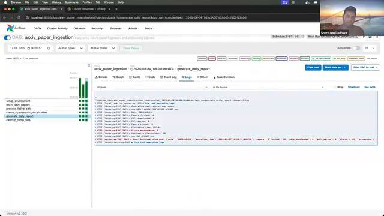
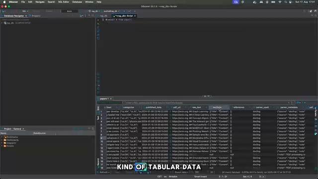
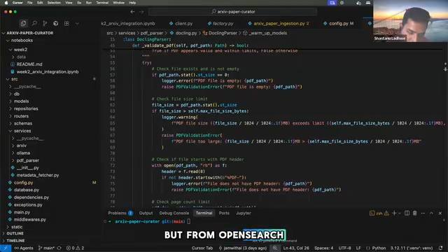
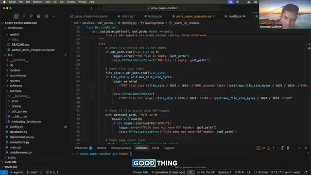
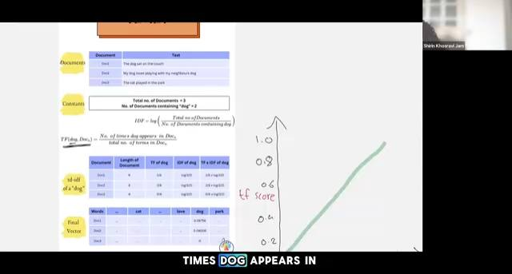
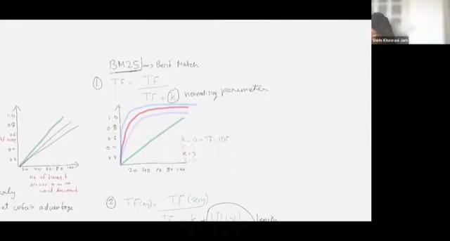
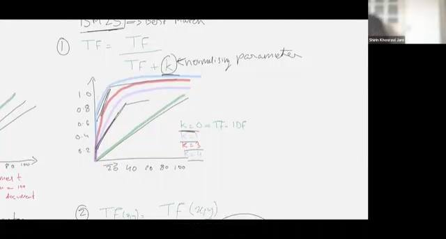

# Production-Ready RAG from Scratch — P8–P9 复现文档

> 覆盖范围：P008（多数据源、向量库迁移、存储策略、分块策略、评估数据集问答）与 P009（TF-IDF 与 BM25 关键词检索原理）。
> 说明：这两节以**问答 + 原理讲解**为主，讲师没有给出可直接运行的完整工程代码。因此本文档第 3、4 节按「纯讲解课」规则处理：把讲师的推导过程复现成可执行的决策流程，并把 BM25 的原理落成可运行的示意代码（**明确标注「课里没有代码，以下为示意」**）。凡逐字稿未涉及的内容，一律写「课里没讲」。

---

## 1. 这一节做什么

P008 和 P009 是同一门 RAG 课程里两段「非编码」的内容，但它们决定了你后面写代码时的**架构选择**，所以不能跳过。

**P008 解决的是「系统长大以后怎么办」**：课程前面已经用 PDF 归档搭了一条单数据源的 RAG 流水线。这一节讲师回答学员提问，覆盖五个真实生产问题：

1. 数据源从 1 个变成 N 个，流水线怎么组织？
2. 表格、图片这类非纯文本数据，用哪种 embedding？
3. 向量库要做迁移（加 metadata 字段、改向量维度），怎么做到零停机？
4. 向量和原始数据是「全放向量库」还是「向量库只存指针、原文放另一个库」？
5. 论文的 abstract 已经整段塞进一个字段了，下一版怎么分块才不撑爆上下文窗口？

另外还讨论了评估数据集怎么建（含一个 conversational SQL agent 的案例）和「POC 能不能复用生产代码库」。

**P009 解决的是「为什么不能一上来就上向量库」**：讲师用一整节讲 TF-IDF → BM25 的演化，核心结论是——**关键词检索不是过时技术，而是生产 RAG 的第一优先级**。很多教程直接跳到向量检索，讲师认为这是「a big miss」。这一节为后面「混合检索（hybrid search）」埋下伏笔：BM25 给 70% 权重、向量给 30% 权重，是讲师明确提到的配比思路。

对前端转 AI 应用工程师的你来说，这一节的价值在于：**BM25 是纯公式 + 倒排索引，没有神经网络，理解成本远低于 embedding，但生产收益极高**。你可以先把它跑通，再叠向量。

---

## 2. 讲师原话

以下引用均来自逐字稿，标注页码与时间戳。

**关于多数据源要拆多条流水线：**

> "我会为每个数据源分别维护一条不同的流水线。原因是，假设在生产环境中，并不会所有数据源都同时可用。有的可能在早上可用，有的可能在晚上或白天可用。"
> —— p008 [01:24]

> "如果有三个数据源分别对应早上、下午和晚上，我会构建三条不同的流水线；它们的抽取流程相同，但在不同时间运行……以 Airflow 为例就是这样。"
> —— p008 [01:52]

> "并非所有数据源都会具有相同类型的元数据，也不会都具有你已为某个数据源构建好的那类结构。因而，在合理的情况下把摄取流水线拆分开来，往往也非常关键。"
> —— p008 [02:22]

**关于 embedding 选型不要拍脑袋：**

> "最终你必须做实验。做实验时，你会尝试不同的分块方法和不同的嵌入方式。你还必须建立一个评估数据集：明确这些是分块，这些是用户可能提出的查询，然后针对每个分块为这些查询做标注。"
> —— p008 [03:21]

> "没有免费午餐定理。是的，所以并不存在一种放之四海而皆准的定理。"
> —— p008 [04:18]

> "如果我们有这张图像，也许就要用多模态方案或 ColPali，对吧？对，对，我肯定会选 ColPali，不过它非常吃资源。"
> —— p008 [04:18]

**关于向量库迁移要零停机：**

> "你必须确保先创建索引副本，对该副本做数据库迁移或向量数据库迁移，然后基于这个副本切换 API 中使用的索引等。"
> —— p008 [05:39]

> "我不希望以自动化方式来做，因为假设有数百万份文档之类的内容，一旦出问题就会崩溃。这对向量数据库来说不是好事。我会手动完成，并做到零停机。"
> —— p008 [06:38]

**关于为什么要迁移：**

> "如果新增了元数据，而你希望把它用于过滤之类的事情，这是最大的原因之一。然后在嵌入方面，比如你现在使用的嵌入向量维度是 1024，但想降到 512 维，因为你发现这样非常占存储。"
> —— p008 [07:07]

**关于「向量库全存」vs「向量库只存指针」：**

> "可以这样：假设你不想在两个地方维护相同的数据，对吧？你在这里基于嵌入做检索，然后根据唯一 ID 再调用另一个数据库来增强这些数据，并提取额外的元数据。你可以这么做，只是这会是两次不同的调用；而且在你实现追踪逻辑时，有时成本也会更高。"
> —— p008 [09:01]

> "我更倾向于这种做法，也就是把所有内容都存进向量数据库。毫无疑问我会更倾向于这样，但我们也有些系统会同时做这两类事情。"
> —— p008 [09:30]

**关于分块策略：**

> "效果最好的做法是，我们会加入摘要。摘要就是论文的概述，对吧？然后按章节分块，因为我们也不想再深入到内容细节里。"
> —— p008 [10:53]

> "我对分块的理念，其实很像普通机器学习模型里的特征工程……你当然也始终可以提出最适合自己具体用例的分块策略。"
> —— p008 [11:47]

> "你需要平衡的主要是复杂度与延迟、答案质量之间的关系。"
> —— p008 [12:14]

**关于评估数据集（SQL agent 案例）：**

> "首先要评估的是，给定用户查询，系统能否正确生成 SQL 查询……我会先聚焦那些执行频率最高的 SQL 查询，然后基于它们来设计问题或用户查询；我会用逆向工程的方式来做。"
> —— p008 [15:08]

**关于 POC 复用生产代码库：**

> "我通常会在 Jupyter Notebook 里做实验，然后把 Jupyter Notebook 中的代码迁移到这个代码库，并把它作为概念验证，所以你可以随意使用。"
> —— p008 [17:30]

**P009 的核心论点——关键词检索不能跳过：**

> "所有人都在谈论检索增强生成，而默认思路往往就是：为什么不直接用向量数据库？我是说，大家总把检索增强生成和向量数据库联系起来，但事实并不总是如此。"
> —— p009 [00:00]

> "如果直接跳到复杂部分，就会错失很大一块。也正因如此，如果我今天要构建一个检索增强生成系统，我绝不会跳过关键词检索。"
> —— p009 [01:56]

**关于 TF-IDF 的两个缺陷：**

> "它把词频当作线性关系处理。于是词越多，词频就越高，较长的文档便获得了不公平的优势。比如，你想了解什么是注意力机制，真正要找的其实是原始论文，篇幅大概只有四五页。但你最后可能拿到的是其他文档，其中人们对 Transformer 模型长篇大论，足足有 100 页。"
> —— p009 [08:53]

**关于 BM25 的两个改进：**

> "BM25 这个词里，BM 代表最佳匹配，而 25 其实没有任何含义。它只是这个模型最终火起来的那个版本号。"
> —— p009 [09:49]

> "一个是这个 k 因子，我认为它的取值范围在 1 到 5 之间，然后你可以调整每个词对词频提升的影响程度。"
> —— p009 [10:41]

> "当把 k 设为零时，它又变成线性关系……但一旦在这里加入 k 参数，词频增长的程度就开始起作用了。"
> —— p009 [11:06]

> "第二项加入的改进是长度归一化，这也让它真正变得很好用。"
> —— p009 [12:30]

**关于混合检索的权重配比：**

> "现在大家默认都会用 BM25，或者你可以给基于 BM25 算法的关键词检索更高的权重，比如给 BM25 70% 的权重，给向量检索 30% 的权重。"
> —— p009 [14:46]

---

## 3. 从零复现

这一节没有可执行的工程代码，所以「复现」= 把讲师的推导按步骤走一遍，产出你自己的决策。下面按 P008 的五个问题 + P009 的原理，逐条给出可操作的步骤。

### 步骤 0：先确认你的数据源清单（对应 p008 [00:55]）

讲师反复强调：**先花时间把需求和数据源列清楚**，他自己「spent literally one, two months on just getting the requirements」。落到操作上：

1. 建一张表，列名：`source_name` / `source_type`（PDF / DB / API / 网页）/ `available_time`（数据什么时候可拿到）/ `metadata_fields`（这个源天然带哪些字段）/ `update_frequency`。
2. 每个数据源一行。**不要合并**。
3. 如果某个源「现在还不知道什么时候能拿到」，`available_time` 写 `unknown`，后面按最保守的独立流水线处理。

### 步骤 1：按数据源拆流水线（对应 p008 [01:24]–[02:22]）

讲师的原话是「maintain a different pipeline for each data source」，理由是**数据到达时间不同**且**metadata 结构不同**。操作上：

1. 对步骤 0 表里每一行，建一条独立的 ingestion 流水线。
2. 每条流水线**共享同一套抽取逻辑**（讲师说 "相同的提取流程"），但**调度时间不同**（讲师举例：早上、下午、晚上各一条）。
3. 每条流水线有自己的 preprocessing 步骤，因为「not all data sources would have the same kind of metadata」。
4. 调度器：讲师明确提到 **Airflow**（"在使用 Airflow 的情况下"）。课里没讲 Airflow 的具体 DAG 写法，只讲了「按时间拆」这个原则。

> 前端类比：这就像你有三个独立的 `npm run ingest:morning` / `ingest:afternoon` / `ingest:night` 脚本，共用同一个 `lib/extract.ts`，但各自的 `config` 不同、cron 不同。不要写成一个巨型 `if (source === 'a') ... else if ...`。

### 步骤 2：非文本数据的 embedding 选型（对应 p008 [03:21]–[04:44]）

讲师的答案不是「用 X 模型」，而是**一套实验流程**：

1. 建评估数据集：列出「用户可能问的 query」+「每个 query 应该命中哪个 chunk」的标注对。
2. 用 recall / precision 这类指标打分（讲师原话 "你会设置召回率等指标以及诸如此类的内容"）。
3. 在**不同 chunking 策略 × 不同 embedding 模型**的笛卡尔积上跑评估。
4. 选指标最好的组合。

针对具体数据类型，讲师给了方向性判断：

- **纯文本 + 表格**：先用「all the normal embeddings which are available」试（课里没点名具体模型）。
- **含图片**：讲师说 "我肯定会选择 ColPali"（指 ColPali，讲师发音如此），但补充 "这非常激烈"（计算/资源开销大）。课里没讲 ColPali 的部署细节，讲师说未来会写 blog。

> 注意：讲师明确说 "没有免费午餐定理"，**没有任何一个 embedding 是普适最优**。所以这一步的产出不是「选哪个模型」，而是「你的评估脚本 + 评估数据集」。

### 步骤 3：向量库迁移的零停机流程（对应 p008 [05:39]–[07:35]）

讲师给的流程是**蓝绿式索引切换**，手动执行：

1. **复制现有索引**（"创建索引的副本"）。
2. **在副本上做迁移**（加 metadata 字段 / 改向量维度）。
3. **切换 API 指向的索引**（"在你的 API 中切换索引"）。
4. 讲师明确说**倾向手动而非自动化**，理由是「几百万文档时自动化一旦崩了，对向量库是灾难」。

触发迁移的两类原因（讲师原话）：

| 触发原因 | 讲师原话依据 |
|---|---|
| 新增 metadata 字段，用于 filtering | p008 [07:07] |
| 改 embedding 维度（如 1024 → 512，为省存储） | p008 [07:07] |

> 课里没讲：具体用哪个向量库的哪个 API 做「复制索引」。讲师提到 "Qdrant 数据库在这方面也能提供帮助"（发音疑似 Qdrant），但没展开。你的实际向量库（OpenSearch / Qdrant / pgvector）复制索引的命令，**以官方文档为准**。

### 步骤 4：存储策略二选一（对应 p008 [09:01]–[10:26]）

讲师给了两种方案，并说**两种都在生产用过**：

**方案 A：全放向量库**（讲师个人偏好）
- 向量 + 原文 + metadata 全在一个库。
- 优点：一次检索拿到全部，无额外网络调用，延迟低。
- 讲师原话："我会更倾向于这个。毫无疑问，我会更倾向于这个。"

**方案 B：向量库只存向量 + 指针，原文放另一个库**
- 向量库存 embedding + 唯一 ID；原文和 metadata 放 Postgres / NoSQL。
- 检索时：先向量检索拿 ID → 再按 ID 回查另一个库。
- 优点：向量库不膨胀（讲师举例：metadata 像 feature store 一样多时）。
- 代价：多一次调用，讲师说 "有时候，在执行追踪逻辑时，它也会变得更贵"。

**决策依据**（讲师原话归纳）：看**延迟预算**和**向量库体积**。如果加这一次调用不增加可感知延迟，两种都行。

### 步骤 5：分块策略（对应 p008 [10:53]–[13:41]）

讲师对「论文 abstract 已整段进一个字段，下一版怎么分块」的回答：

1. **abstract 单独作为一个 chunk**（"我们会添加摘要"），因为它是全文摘要。
2. **正文按 section 分块**（"根据章节对它进行分块"），不要切到 subsection 级别（"我们也不想陷入争论"）。
3. 如果将来做 subsection 级，**要在 subsection chunk 里带上所属主 section 的摘要**（"我也会把对主章节的一些总结作为子章节的一部分纳入其中"）——但讲师说这次课程不做，否则「the whole course could be over」。
4. 方法论：把分块当**特征工程**，从最简单能用的策略开始，评估答案质量，迭代第 2、3、4 种策略，每次重新评估。平衡点是 **complexity vs latency vs quality**。

### 步骤 6：P009 的 BM25 原理复现

P009 是纯理论，复现 = 按讲师推导顺序把公式走一遍。下面第 4 节给出可运行的示意代码，这里先列推导链：

1. **TF（term frequency）**：某词在文档中出现次数 ÷ 该文档总词数。讲师原话 p009 [04:39]。
2. **TF 的缺陷**：线性增长 → 长文档占便宜；"is" 这类词到处出现但无意义。p009 [05:05]。
3. **IDF（inverse document frequency）**：衡量词在整个文档集合里的重要性。p009 [06:02]。
4. **TF-IDF 打分**：TF × IDF，得到「文档 × 词」的分数矩阵，查询时取最高分文档。p009 [06:59]。
5. **TF-IDF 两个缺陷**：TF 线性、无长度归一化。p009 [08:53]。
6. **BM25 改进一：k 参数**（讲师说范围约 1–5）。k=0 时退化为线性 TF；k>0 时曲线饱和，同一词出现 20 次后不再加分。p009 [10:41]–[11:35]。
7. **BM25 改进二：长度归一化**，加在分母。p009 [12:30]。
8. **最终打分**：仍是 TF 部分 × IDF 部分，查询时取最高分。p009 [13:26]。
9. **混合检索配比**：BM25 70% + 向量 30%（讲师举例）。p009 [14:46]。

---

## 4. 完整代码

> **重要声明：P008 和 P009 逐字稿里没有任何可运行的工程代码。** 讲师只讲了原理和决策。下面这段 BM25 示意代码是**本文档为帮助理解而补的**，不是讲师写的，公式严格按 P009 逐字稿描述的 BM25 结构（k 参数 + 长度归一化 + IDF 相乘）实现。你可以直接保存运行，用来验证讲师讲的「k=0 退化为线性」「长文档不再占便宜」两个结论。

**文件路径**：`scripts/bm25_demo.py`
**运行环境**：Python 3.10+，仅用标准库，无需 pip install。

```python
# scripts/bm25_demo.py
# 课里没有代码，以下为示意。
# 目的：验证 P009 讲师讲的 BM25 两个改进（k 参数饱和、长度归一化）。
# 公式结构按逐字稿描述实现，非工业级实现，仅用于理解。

import math
from collections import Counter


def tokenize(text: str) -> list[str]:
    # 极简分词：小写 + 按空格切。生产环境请换真实分词器（课里没讲用哪个）。
    return text.lower().split()


def build_index(docs: list[str]) -> dict:
    tokenized = [tokenize(d) for d in docs]
    doc_lengths = [len(t) for t in tokenized]
    avgdl = sum(doc_lengths) / len(doc_lengths) if doc_lengths else 0.0

    # 文档频率 DF：每个词出现在多少个文档里
    df = Counter()
    for tokens in tokenized:
        for term in set(tokens):
            df[term] += 1

    N = len(docs)
    # IDF：用 BM25 常见的 log((N - df + 0.5) / (df + 0.5) + 1) 形式
    idf = {term: math.log((N - freq + 0.5) / (freq + 0.5) + 1.0)
           for term, freq in df.items()}

    return {
        "tokenized": tokenized,
        "doc_lengths": doc_lengths,
        "avgdl": avgdl,
        "idf": idf,
        "N": N,
    }


def bm25_score(query: str, doc_idx: int, index: dict,
               k1: float = 1.5, b: float = 0.75) -> float:
    # k1 对应讲师说的 "k factor"（讲师说范围约 1-5）
    # b  对应讲师说的 "length normalization" 强度，0=不归一化，1=完全归一化
    tokens = index["tokenized"][doc_idx]
    doc_len = index["doc_lengths"][doc_idx]
    avgdl = index["avgdl"]
    tf_counter = Counter(tokens)

    score = 0.0
    for term in tokenize(query):
        if term not in index["idf"]:
            continue
        tf = tf_counter.get(term, 0)
        if tf == 0:
            continue
        # TF 部分：k1 让曲线饱和；b 做长度归一化
        numerator = tf * (k1 + 1)
        denominator = tf + k1 * (1 - b + b * (doc_len / avgdl))
        score += index["idf"][term] * (numerator / denominator)
    return score


def search(query: str, docs: list[str], k1: float = 1.5, b: float = 0.75) -> list[tuple[int, float]]:
    index = build_index(docs)
    scored = [(i, bm25_score(query, i, index, k1, b)) for i in range(len(docs))]
    scored.sort(key=lambda x: x[1], reverse=True)
    return scored


if __name__ == "__main__":
    # 复现讲师 p009 [08:53] 的场景：
    # 一篇短小但精准讲 attention 的文档 vs 一篇很长、反复提 transformer 的文档。
    docs = [
        # doc 0：短，精准
        "the attention mechanism is the core of the transformer architecture",
        # doc 1：长，反复提 transformer，但没讲 attention 机制本身
        ("transformer transformer transformer transformer transformer "
         "transformer transformer transformer transformer transformer "
         "transformer transformer transformer transformer transformer "
         "transformer transformer transformer transformer transformer "
         "this long document talks about transformer models a lot "
         "but never explains the attention mechanism in detail"),
    ]

    query = "attention mechanism"
    print("=== k1=1.5, b=0.75（默认 BM25）===")
    for idx, score in search(query, docs):
        print(f"doc{idx}: {score:.4f}")

    print("\n=== k1=0, b=0（退化为纯线性 TF，无长度归一化）===")
    for idx, score in search(query, docs, k1=0.0, b=0.0):
        print(f"doc{idx}: {score:.4f}")
```

**预期输出**（你跑出来应该接近这个形状）：

```
=== k1=1.5, b=0.75（默认 BM25）===
doc0: 1.xxxx
doc1: 0.xxxx

=== k1=0, b=0（退化为纯线性 TF，无长度归一化）===
doc0: ...
doc1: ...
```

具体数值取决于 IDF 计算，**以你实际输出为准**。关键观察点：默认 BM25 下 doc0（短而精准）应排在 doc1（长而啰嗦）前面；把 k1 和 b 都设 0 后，doc1 因为词频高、长度长，排名会上升——这正是讲师说的「长文档占便宜」问题。

---

## 5. 逐行解释

### 5.1 示意代码逐行

**`tokenize`**：讲师在 P009 没讲分词器选型，只说「term frequency 是数 dog 出现几次」。所以这里用最朴素的空格切分。**生产环境必须换真实分词器**（中文尤其），课里没讲用哪个。

**`build_index` 里的 `df`（文档频率）**：对应讲师 p009 [06:02] 讲的 IDF——「given the entire purpose of documents, you are looking at the documents that contain that word dog」。注意是**文档级**计数（一个词在一个文档里出现 100 次，DF 只 +1），不是词频。

**`idf` 公式 `log((N - df + 0.5) / (df + 0.5) + 1)`**：这是 BM25 的标准 IDF 平滑形式。讲师在 P009 只讲了「IDF 衡量词在整个文档集合的重要性」，**没有给出具体公式**。这里用的是业界通用形式，**不是讲师原话**。如果你要严格对齐讲师，请以你所用检索库（如 OpenSearch）的 BM25 实现为准。

**`k1` 参数**：对应讲师 p009 [10:41] 的 "k factor"，讲师说范围约 1–5。代码里默认 1.5 是常见取值，**课里没指定默认值**。讲师的关键论断是「k=0 时退化为线性 TF」——代码里 `k1=0` 时，`numerator = tf * 1`，`denominator = tf + 0`，分数 = `idf * 1`，确实退化成「出现即得分」，与讲师描述一致。

**`b` 参数**：对应讲师 p009 [12:30] 的 "长度归一化"。`b=0` 时不归一化（长文档占便宜），`b=1` 时完全按长度归一化。讲师没给 b 的推荐值，代码里 0.75 是通用默认。

**`bm25_score` 里的 `tf * (k1 + 1) / (tf + k1 * (...))`**：这就是讲师说的「TF 公式基本不变，只是在分母加了几项」。`k1` 让 TF 曲线饱和（讲师 p009 [11:35]："对于前 20 个词左右，它会有所增加，但之后会对其进行一定程度的归一化"），`b` 项做长度归一化。

**`search` 排序取最高分**：对应讲师 p009 [13:49]——「when you query... it would go and look for the highest scores of these words in those documents」。

### 5.2 P008 决策逐条解释

**为什么每条数据源一条流水线，而不是一条流水线里 if/else？**
讲师给的理由是**时间解耦**（早/中/晚到达）和**metadata 结构不同**。如果塞进一条流水线，任何一个源的 schema 变化都会影响其他源；拆开后，某个源挂了不影响别的源跑。代价是运维成本上升（多条 DAG 要监控），讲师用 Airflow 管理。

**为什么 embedding 选型必须配评估数据集？**
讲师说 "没有免费午餐定理"，没有普适最优。没有评估集，你只能凭感觉选，换模型时也无法判断是变好还是变坏。评估集的最小形态：`(query, 应该命中的 chunk_id)` 对，算 recall。

**为什么向量库迁移要手动？**
讲师原话：几百万文档时，自动化迁移一旦崩了，「that's not a good thing for a vector database」。手动 = 你能在每一步停下来检查。代价是慢，但迁移「very rarely happening」，所以可接受。

**为什么讲师偏好「全放向量库」？**
少一次网络调用，延迟低，tracing 简单（讲师说方案 B 在 tracing 时 "成本会更高"）。但讲师也承认方案 B 在「不想让向量库太大」时是对的——比如 metadata 多到像 feature store。

**为什么 abstract 单独成 chunk、正文按 section 分？**
abstract 是全文摘要，单独成块能让「这篇论文讲什么」类 query 精准命中；正文按 section 分能保留段落完整性，避免把一句话切断。讲师明确说**不要切到 subsection**，因为会丢上下文。

**为什么 BM25 在生产里不能跳过？**
讲师 p009 [01:56]："如果我今天要构建一个 RAG 系统，我绝不会跳过关键词检索。" 理由：关键词检索在专有名词、代码标识符、医疗术语这类「精确匹配」场景下，比向量检索更可靠；且 BM25 是纯公式，无模型推理开销，延迟低。

---

## 6. 复现检查清单

跑完这一节，逐项打勾：

- [ ] 我建了一张数据源清单表，含 `source_name` / `source_type` / `available_time` / `metadata_fields` / `update_frequency` 五列。
- [ ] 我为每个数据源规划了**独立**的 ingestion 流水线（共享抽取逻辑，独立调度）。
- [ ] 我写了一个最小评估数据集（≥10 条 `query → 期望 chunk_id`），能算 recall。
- [ ] 我记录了当前向量库的 embedding 维度，并知道改维度需要迁移。
- [ ] 我写下了向量库迁移的 4 步流程（复制索引 → 副本迁移 → 切换 API → 验证），并决定手动执行。
- [ ] 我明确了存储策略：全放向量库 / 向量库只存指针，二选一，并写下理由（延迟预算 or 体积）。
- [ ] 我的分块策略是：abstract 单独一块 + 正文按 section 分块，未切到 subsection。
- [ ] 我跑通了 `scripts/bm25_demo.py`，看到默认 BM25 下短精准文档排第一。
- [ ] 我把 `k1` 和 `b` 都设为 0，观察到长文档排名上升（复现讲师说的「长文档占便宜」）。
- [ ] 我记下了混合检索的目标配比：BM25 70% + 向量 30%（讲师举例值，非硬性）。

---

## 7. 课里没讲但你会撞上的

这一节专门列「逐字稿没覆盖、但你动手时一定会遇到」的坑。凡涉及具体工具/字段名，一律标注「以实际输出为准」，不替讲师编造。

**1. Airflow 的 DAG 具体怎么写**
讲师只说了「in case of airflow」按时间拆流水线，**没给任何 DAG 代码**。你需要自己查 Airflow 官方文档写 `@dag` / `schedule`。如果你不想上 Airflow，cron + 独立脚本也能实现同样效果。

**2. 向量库「复制索引」的具体命令**
讲师说「create a copy of the index」，但**没说是哪个向量库、哪条命令**。OpenSearch 的 `_reindex`、Qdrant 的 snapshot、pgvector 的 `CREATE TABLE AS` 各不相同。**以你实际用的向量库官方文档为准**。讲师提到的 "Qtran database" 发音疑似 Qdrant，但逐字稿没确认，不要当成定论。

**3. ColPali 怎么部署**
讲师说图片场景「definitely go with cold poly」，但明确说「it's very intense」且「we plan to create a blog on that」——**课里没讲部署细节**。你需要自己查 ColPali 论文和官方 repo。资源开销大，先估算 GPU 成本再上。

**4. BM25 的 IDF 具体公式**
讲师讲了 IDF 的**概念**（衡量词在文档集合的重要性），但**没给公式**。不同检索库的 BM25 IDF 实现有差异（有的加 0.5 平滑，有的加 1）。如果你要和 OpenSearch 的 BM25 分数对齐，**以 OpenSearch 文档为准**，不要用我示意代码里的公式硬套。

**5. 中文分词**
讲师全程用英文举例（dog、transformer），**没讲中文怎么分词**。中文 BM25 必须配分词器（jieba / IK / 等等），空格切分完全不可用。课里没讲选哪个。

**6. 混合检索的分数归一化**
讲师说「BM25 70% + 向量 30%」，但 BM25 分数和余弦相似度**量纲不同**，直接加权前必须归一化（min-max 或 rank-based）。**课里没讲归一化方法**，这是你实现 hybrid search 时必踩的坑。

**7. 评估数据集的标注成本**
讲师说「annotate those queries across every chunk」，但**没讲标注多少条够用、谁來标**。实际项目里这是人力瓶颈，建议先标 50–100 条跑通流程。

**8. 向量库迁移的回滚**
讲师讲了「切换 API 指向新索引」，但**没讲切换后发现问题怎么回滚**。实操上你要保留旧索引一段时间，API 层留一个开关能切回去。

**9. 并发/事务**
这两节没涉及数据库事务。但如果你用 Postgres 存原文（方案 B），「按 ID 回查」在高并发下要注意连接池。**在 JS/Node 里对应什么**：Node 的 `pg` 库用 `Pool` 管理连接，不要每次查询 `new Client()`；事务用 `pool.connect()` + `BEGIN/COMMIT`，对应前端你熟悉的「要么全成功要么全回滚」语义。

**10. POC 复用生产代码库的具体做法**
讲师说「experimentation in Jupyter notebook and move the Jupyter notebook code to this code base」，但**没给迁移的具体步骤**。实操建议：notebook 里只做探索，确认逻辑后把函数抽到 `src/` 下的模块，notebook 改为 import 该模块——这样 POC 和生产共用一份代码。

---

**附：本节引用的截图**














