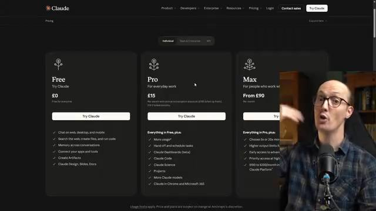
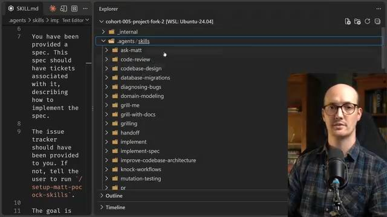
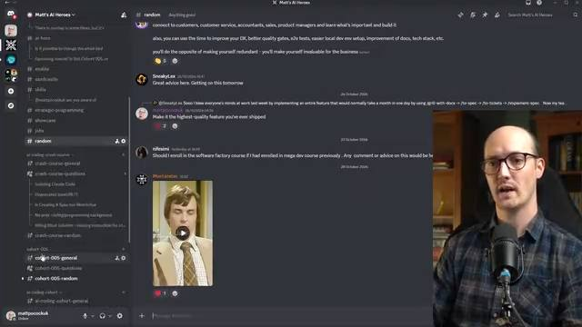
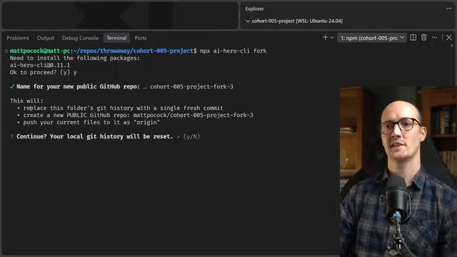
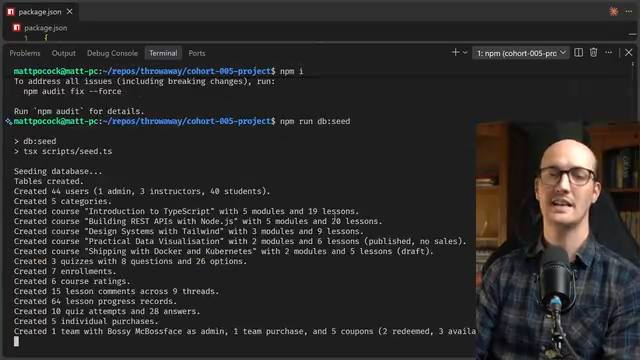
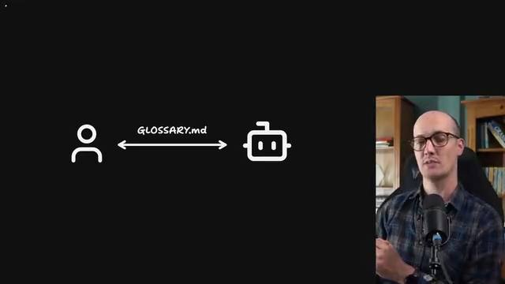
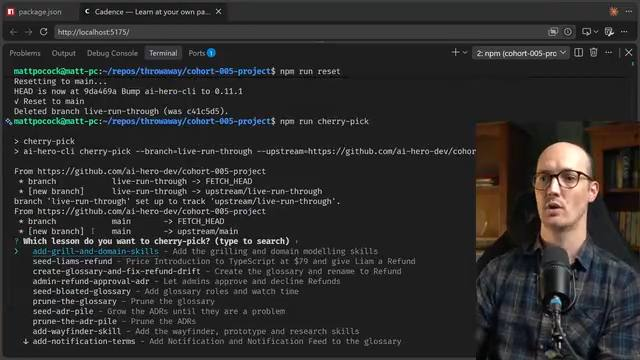
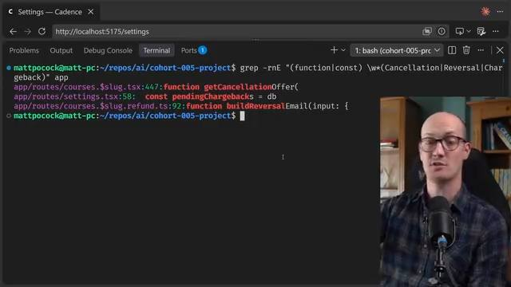

# Software Factories for Real Engineers（Part 1）复现文档

> 覆盖 P001–P008。这一部分**不是写业务代码的课**，而是「把软件工厂的地基搭起来」：选模型与订阅、清理 agent 全局配置、加入社区、把课程仓库 fork 成你自己的 GitHub 仓库、跑起本地开发服务器、掌握三套同步命令、以及建立一套共享词汇表（glossary）。下面按「照着做就能跑起来」的方式重组。

---

## 1. 这一节做什么

这 8 集的目标只有一个：**让你和讲师处在完全相同的起跑线上**，然后你才有资格在后面用 agent 批量产出代码。具体交付物是四样东西：

1. 一个**能跑起来的本地应用**（Cadence 课程平台的一个「平行宇宙」版本），地址 `localhost:5175`，数据来自本地 SQLite。
2. 一个**属于你自己的 GitHub 公开仓库**，里面有你自己的一套 issues 和 pull requests，后面要当工单系统用。
3. 一套**代码同步机制**（`npm run reset` / `npm run cherry-pick` / `npm run pull`），保证你随时能对齐到讲师在某一集的代码状态，又不会把自己的改动弄丢。
4. 一个**共享词汇表** `glossary.md` + `docs/adr/` 决策记录目录，用来解决「同一个东西有三个名字」这种语言层面的 bug。

需要提前说清楚的一点：**这 8 集里没有业务代码**。讲师在这一段做的是环境准备和理念铺垫，真正的 `glossary.md` 内容、`grill with docs` 技能文件，是在后续集数里逐步写出来的。所以本文第 4 节「完整代码」给出的，是**这一段里真实出现过的命令、配置与目录结构**，以及一个基于讲师描述的最小 `glossary.md` 骨架（会明确标注哪些是课里没写的）。

---

## 2. 讲师原话

关于这门课的整体定位：

> "智能体的核心承诺是速度……但我认为，很多团队发现这很难。你如何对智能体建立足够的信任，以至于真的能放心让它交付？"
> —— p001 [00:00]

> "如果我们把软件工厂看作既有加速器——也就是让它提速的东西——又有刹车，那么第一周我们会先关注刹车。"
> —— p001 [01:07]

也就是说，第一部分讲的是**刹车**（review、code-based design、domain language、用 Wavefinder 规划大块工作），不是油门。这一点决定了你读后面所有内容的心态：先建立可信度，再谈并行 50 个 agent。

关于模型和订阅，讲师的态度很明确：

> "我们计划在这项工作中使用 Opus 级模型。所以在我看来，这意味着由于 Opus 级模型要贵一些，你大概至少需要每月 100 美元的套餐。"
> —— p002 [00:37]

> "API 最终为完成同样的工作所花的钱，会远多于你购买个人订阅或团队、企业订阅的情况。"
> —— p002 [01:24]

关于 agent 环境，讲师要求你先「清空」：

> "我想让你警惕你已在机器上全局安装的其他技能、设置或配置……我会给你一段提示词，你可以把它传给智能体，用来临时把全局配置重置为默认值。"
> —— p003 [00:39]

关于仓库 fork，讲师解释了为什么必须做、且必须公开：

> "你不仅需要这个仓库的代码，还需要你自己的一组议题和拉取请求。"
> —— p006 [00:59]

> "我们之所以要把它设为公开，是因为课程后面会依赖 GitHub Actions。而 GitHub Actions 对公开仓库其实是免费的。"
> —— p006 [02:15]

关于三套同步命令的区别，这是本段最需要记牢的一句话：

> "npm run reset 会替换你的工作内容，npm run cherry pick 会在其之上进行拣选，而 npm run pull 会拉取上游变更。"
> —— p007 [03:43]

关于语言问题，讲师给了一个非常具体的反面例子：

> "撤销资格包络由取消门控评估；一旦权益租约释放，取消门控便转交给退单结算处理器。"
> —— p008 [00:24]

这句话里有四个**代码库里根本不存在的名字**。讲师说 agent 这么干是因为「token efficient」，但对读代码的人是灾难。

> "解决这个问题的方法是：在弄清楚你想构建什么的同时，也要弄清楚你想用什么语言来构建它。"
> —— p008 [03:14]

---

## 3. 从零复现

下面按顺序执行。每一步都给出**预期结果**，对不上就停下来排查，不要往下走。

### 步骤 0：前置条件

- Node.js（课里没给具体版本号，以仓库 `package.json` 的 `engines` 字段为准；课里没讲）
- Git
- 一个 GitHub 账号
- 一个**付费**的 AI 编程订阅（讲师用 Claude Code，Opus 级模型，建议 $100/月档起步）
- 一个终端 + 一个编辑器（讲师用 VS Code，非强制）

### 步骤 1：确认模型与订阅

打开你所用 agent 的定价页，确认你至少能用到 Opus 级别的模型。讲师提到可以用 DeepSWE 这类 benchmark 看模型排名，判断标准是「落在右上象限」。如果你只想先试试，可以先买便宜档，用完再升级——这是讲师明确允许的路径。



### 步骤 2：临时清空 agent 的全局配置

讲师在 p003 给了一段 prompt，让你贴进 agent，把全局配置重置为默认，并**包含一个确定性的恢复步骤**，课程结束后把你的东西还原。课里没有逐字给出这段 prompt 的文本内容（视频里是「below 的 prompt」），所以这里不编造。你要做的是：

1. 找到该课页面下方的 prompt 文本；
2. 贴进 agent 执行；
3. **记下它做了什么**，尤其是它把你的全局配置备份到了哪里——恢复要靠这个。



> 为什么必须做：你机器上装的全局 skills / settings 会干扰 agent 的行为，导致你的结果和讲师不一致。课程用到的 skills **全部在仓库里提供**，不需要你全局安装任何东西。

### 步骤 3：加入 Discord（可选但强烈建议）

讲师强调「At some point, you are going to get stuck. Everybody does.」问题是主要入口。你需要拿到 `Cohort 005` 这个 role 才能看到对应频道；role 通过购买后的链接分配，另有一个链接把 AI Hero 账号和 Discord 关联起来。看不到频道就先双重检查，再发邮件到 `team@aihero.dev`。



### 步骤 4：克隆课程仓库

```bash
git clone <课程仓库的 HTTPS URL>
cd cohort-005-project
code .
```

讲师明确建议用 **HTTPS** 而不是 SSH。`code .` 是 VS Code 的命令，用别的编辑器就跳过。

### 步骤 5：fork 成你自己的 GitHub 仓库

这是本段最关键的一步。在仓库根目录执行：

```bash
npx ai-hero-cli fork
```

交互过程（按讲师的实际操作顺序）：

1. 提示安装 `ai-hero-cli` 的某个版本 → 同意；
2. 询问仓库名 → 讲师填的是 `cohort-005-project-fork-3`（因为他做过好几次了，你填什么都行）；
3. 提示「将用单个全新 commit 替换本文件夹的 git 历史」→ 同意；
4. 提示「创建新的公开 GitHub 仓库并把文件作为 origin 推送」→ 同意；
5. 最后确认 `Y`。

完成后终端会打印 `your public repo is ready`。



> **看起来吓人但没问题**：重置的只是这个项目文件夹的 git 历史。仓库里预置了一些自定义命令，保留了指回原始 upstream 仓库的链接，所以后面 `npm run pull` 才能拉到讲师的更新。

> **必须公开**：后面要用 GitHub Actions，公开仓库免费。私有仓库有免费额度但「not terribly generous」。

### 步骤 6：安装依赖、建库、起服务

```bash
npm install
npm run db:seed
npm run dev
```

预期结果：

- `npm install` 会打印一些 deprecation warning 和 vulnerabilities —— 讲师说不用管；
- `npm run db:seed` 会 seed 一个**本地 SQLite 数据库**；
- `npm run dev` 之后访问 `http://localhost:5175`，应该看到 Cadence 平台首页。



### 步骤 7：验证应用能复现那个「语言 bug」

这是检验你环境是否正确的**功能性验收**，比看首页有没有渲染更可靠：

1. 用 Liam Thompson 登录；
2. 进入 courses，打开 "TypeScript 入门" 课程；
3. 点 "取消我的购买"；
4. 观察：界面上出现 "待处理的拒付"，终端里能看到发给他的邮件，邮件里写的是 "冲正请求待处理"。

同一个动作，三个名字。这就是 p008 要解决的问题。



再在代码里 grep 一下，确认这三个名字真的散落在代码中：

```bash
grep -rn "cancellation\|reversal\|chargeback" --include="*.ts" --include="*.tsx" .
```

讲师在视频里看到的三个符号是 `getCancellationOffer`、`pendingChargebacks`、`buildReversalEmail`。你的实际输出以仓库当前状态为准。

### 步骤 8：掌握三套同步命令

```bash
npm run reset        # 列出所有可重置的课程检查点
npm run cherry-pick  # 把某一集的 commit 叠到你当前工作之上
npm run pull         # 拉取讲师在课程进行中发布的修复
```

`npm run reset` 的交互：先选一个检查点（例如 `add-grill-and-domain-skills`），再选「重置当前分支」或「从该 commit 新建分支」，最后确认要丢弃的 commit。

**reset 之后必须补三步**，否则数据库和依赖会对不上：

```bash
npm install
npm run db:migrate
npm run db:seed
```

讲师的原话是 reset 只改源码，不重装包、不跑迁移、不重新 seed。



### 步骤 9：建立共享词汇表

在仓库根目录创建 `glossary.md`，并创建 `docs/adr/` 目录。讲师说明 `grill with docs` 技能会在 grilling 过程中**主动挑战你的用词**，一旦某个术语「crystallize（定型）」，就立刻写进 `glossary.md` 和 `docs/adr/`。其他所有 skill 都从这个 glossary 读取，以保证用词一致。



### 步骤 10（后续会用到，先注册）

- **Knock**：通知系统，注册免费 developer 账号，不需要信用卡，但要邮箱。
- **TL Draw**：后面白板环节用，Google 账号登录即可。

---

## 4. 完整代码

### 4.1 目录结构（本段涉及的）

```
cohort-005-project/
├── .git/
├── docs/
│   └── adr/                    # 决策记录，由 grill with docs 写入
│       └── .gitkeep
├── glossary.md                 # 共享词汇表
├── package.json                # 含 reset / cherry-pick / pull / db:* 脚本
├── node_modules/
└── ...（应用源码，本段不涉及）
```

### 4.2 `package.json` 中你需要用到的脚本

课里没有完整展示 `package.json` 全文，但讲师**逐条念出了**下面这些脚本名，可以据此确认你的仓库里有它们：

```json
{
  "scripts": {
    "dev": "……",
    "db:seed": "……",
    "db:migrate": "……",
    "reset": "……",
    "cherry-pick": "……",
    "pull": "……"
  }
}
```

> 各脚本的具体命令体课里没讲，不要自己改写它们——它们内部封装了与 upstream 仓库的交互逻辑。

### 4.3 `glossary.md` 骨架

> **课里没有给出 glossary.md 的完整内容**，讲师只说明了它的作用和写入时机。下面是一个符合讲师描述的最小骨架，字段名（Term / Definition / Avoid）是本文为可操作性补的，**不是讲师原话**。

```markdown
# Glossary

> 本文件是本项目的 ubiquitous language（通用语言）。
> 所有 skill、所有代码、所有面向用户的文案，都必须使用这里的术语。
> 新增或修改术语前，先在 grilling 中确认它已经「定型」。

## 术语表

| Term | Definition | Avoid（禁止使用的同义词） |
| --- | --- | --- |
| Refund | 学员主动申请退回已支付款项的**业务动作** | reversal, cancellation |
| Chargeback | 支付渠道侧发起的**争议扣款**，与 Refund 不是一回事 | — |
| Learner | 使用 Cadence 学习课程的人 | user, student, customer |

## 命名规则

1. 一个概念只允许一个名字。发现第二个名字时，先改代码，再改文案。
2. 面向用户的文案必须与代码中的类型名/函数名使用同一个词根。
3. 不确定某个词是否已存在时，先 grep 本文件，再 grep 代码库。
```

### 4.4 `docs/adr/` 中的一条决策记录模板

> 同样，**课里没有给出 ADR 模板**。讲师只说这个目录用来存 decision records。下面是通用 ADR 格式，供你起步用。

```markdown
# ADR-0001: 统一使用 "Refund" 表示学员主动退款

## 状态
Accepted

## 背景
同一业务动作在系统中存在三个名字：
- 界面文案：cancel my purchase
- 邮件文案：reversal request pending
- 代码符号：getCancellationOffer / pendingChargebacks / buildReversalEmail

## 决策
统一为 `Refund`。`Chargeback` 保留，但仅指支付渠道侧的争议扣款。

## 后果
- 需要重命名上述三个代码符号
- 需要同步修改界面与邮件文案
- 需要更新 glossary.md
```

### 4.5 完整命令清单（可直接复制执行）

```bash
# 1. 克隆
git clone <HTTPS_URL>
cd cohort-005-project
code .

# 2. fork 成自己的公开仓库
npx ai-hero-cli fork

# 3. 初始化
npm install
npm run db:seed
npm run dev
# → http://localhost:5175

# 4. 验证术语问题
grep -rn "cancellation\|reversal\|chargeback" --include="*.ts" --include="*.tsx" .

# 5. 日常同步
npm run reset          # 丢弃本地改动，对齐到某个检查点
npm run cherry-pick    # 保留本地改动，叠加某个检查点
npm run pull           # 拉取 upstream 修复

# 6. reset 之后必须补跑
npm install
npm run db:migrate
npm run db:seed
```

---

## 5. 逐行解释

**`git clone <HTTPS_URL>`**
用 HTTPS 不用 SSH，是讲师在 p006 的明确偏好。原因课里没细说，但从「后面要频繁和 GitHub 交互、还要跑 Actions」这个上下文看，HTTPS 少一层 key 配置的坑。

**`npx ai-hero-cli fork`**
`npx` 会临时下载并执行 `ai-hero-cli`，所以第一次运行会问你要不要安装某个版本——同意即可。这个命令做了四件事：重置本地 git 历史为单个 commit、创建公开 GitHub 仓库、把文件推上去作为 `origin`、保留指回原始 upstream 的链接。**第四件事是后面 `npm run pull` 能工作的前提**，所以不要手动去改 remote。

**`npm install`**
会报 deprecation 和 vulnerability。讲师说不用管。对前端背景的你来说这不陌生——这是依赖树里传递依赖的老问题，不影响运行。

**`npm run db:seed`**
seed 一个**本地 SQLite** 数据库。注意顺序：先 seed 再 dev。如果你先 dev 后 seed，页面可能是空的。

**`npm run dev` → `localhost:5175`**
端口是 5175，不是常见的 3000/5173。看到 Cadence 界面就说明整条链路（依赖 → 数据库 → 前端）都通了。

**`npm run reset`**
等价于 `git reset` 的破坏性版本：**删掉你所有未提交和已提交的本地工作**。讲师的原话是「It's kind of like git reset if you've ever used that」。所以有想保留的东西，先 commit 或开分支。

**`npm run cherry-pick`**
把某一集的 commit **叠在**你当前工作之上。讲师现场演示：把 `package.json` 里的 "出色的课程平台" 改成 "Awesome Horse 平台" 并提交，然后 cherry-pick，改动还在；而 reset 之后改动就没了。代价是**可能产生 merge conflict**。

**`npm run pull`**
用于讲师在课程进行中发现问题、往 upstream 推了修复的场景。它和 cherry-pick 一样会尝试保留你的工作，不会像 reset 那样删东西。

**reset 之后的三条补跑命令**
`npm install` 拉新依赖，`npm run db:migrate` 补数据迁移，`npm run db:seed` 把数据库 seed 成该集期望的状态。**漏掉任何一条，你看到的界面都可能和讲师不一样**，然后你会以为是 agent 的问题。

**`glossary.md` 与 `docs/adr/`**
讲师的核心论点是 DDD 里的 **ubiquitous language**：这个词必须「everywhere」一致——团队怎么聊、产品怎么显示、代码怎么命名，三者必须完全对齐。他特别强调自己只取了 DDD 里的一两个想法，**没有**碰 aggregates、event sourcing 这些重家伙。所以你的 glossary 不需要复杂，一张表就够。

**为什么 agent 会自己造词**
讲师的解释是 token efficiency：把很多含义压进一个短名字，agent 就能反复复用而不必每次自我解释。这对 agent 是优化，对人是灾难。所以 glossary 本质上是**给人看的、用来约束 agent 的接口契约**。

> 给前端的一句话类比：`glossary.md` 就像你项目里的 design token 文件——所有组件都从它取值，不允许组件里写死 `#3b82f6`。术语也一样，不允许在某个文件里私自叫它 `reversal`。

---

## 6. 复现检查清单

按顺序打勾，任何一项不过就别往下走：

- [ ] 你的订阅能选到 Opus 级模型
- [ ] 你执行了 p003 的全局配置重置 prompt，**并且知道怎么恢复**
- [ ] `git clone` 成功，`cd` 进去后 `code .` 能打开项目
- [ ] `npx ai-hero-cli fork` 打印出 `your public repo is ready`
- [ ] 打开 GitHub，能看到你自己的仓库，且**是 public**
- [ ] 仓库里有 issues 和 pull requests（不是空的）
- [ ] `npm install` 完成（有 warning 属正常）
- [ ] `npm run db:seed` 完成
- [ ] `npm run dev` 后 `http://localhost:5175` 能打开 Cadence
- [ ] 用 Liam Thompson 登录 → 取消购买 → 同时看到 "待处理的拒付"（界面）、"冲正请求待处理"（邮件）、`getCancellationOffer` 等（代码）
- [ ] `npm run reset` 能列出检查点列表
- [ ] 你亲手试过一次 `cherry-pick`，确认自己的改动被保留
- [ ] 你亲手试过一次 `reset`，确认自己的改动被删除
- [ ] 你知道 reset 之后要补跑 `npm install` + `db:migrate` + `db:seed`
- [ ] `glossary.md` 和 `docs/adr/` 已创建
- [ ] （可选）Knock 免费账号已注册
- [ ] （可选）TL Draw 能登录

---

## 7. 课里没讲但你会撞上的

**1. Node 版本**
课里从头到尾没提 Node 版本要求。你大概率会在 `npm install` 阶段撞上 native 模块编译失败或 `engines` 不匹配。处理方式：看 `package.json` 的 `engines` 字段，用 nvm/fnm 切过去。这条**课里没讲**。

**2. `npx ai-hero-cli fork` 的权限问题**
这个命令要创建 GitHub 仓库，必然需要 GitHub 认证（token 或 OAuth）。课里没讲它怎么拿凭证。如果卡住，先确认 `gh auth status` 是通的。

**3. 端口 5175 被占用**
课里没讲怎么改端口。Vite 类工具通常支持 `--port`，但具体到这个仓库的 `dev` 脚本怎么传参，**以实际 `package.json` 为准**。

**4. SQLite 文件的位置与重置**
`db:seed` 会在某处生成一个 `.db` 文件（课里没说路径）。如果你发现 seed 之后数据还是旧的，先找到这个文件删掉再 seed。这是本地开发的常见坑，**课里没讲**。

**5. cherry-pick 的冲突解决**
讲师明确说 cherry-pick「at the potential cost of merge conflict」，但**没有演示怎么解**。对前端来说这就是普通 git 冲突，按你平时的方式解即可。注意：解完之后不要 `reset`，否则白解。

**6. `glossary.md` 到底该写多细**
讲师只说了「一张表 + 决策记录」，没给粒度标准。实践建议：**只收录那些已经出现过两个以上名字的概念**。不要一上来就把整个领域模型写进去，那会变成没人维护的文档。

**7. 关于「锁 / 事务 / 并发」**
本段完全没有涉及。如果你在后续集数里遇到数据库事务相关的内容，记住一条 JS/Node 侧的对应关系：Node 是单线程事件循环，但 `await` 之间会让出控制权，所以「读-改-写」不加事务一样会出竞态——这和你写前端 `setState` 时的心智模型是相通的。

**8. 讲师提到的 "Wavefinder"**
p001 提到用它来规划大块工作，但**这 8 集里没有展开**，也没有安装或配置步骤。不要在这一段去找它。

**9. Opus 5.5 不在 benchmark 榜上**
讲师自己说「The model I used, which is opus 5.5 is not actually on this list anywhere」。所以别拿榜单当唯一标准，看「右上象限」这个大致方向就行。

**10. 公开仓库的隐私顾虑**
讲师要求 public，理由是 Actions 免费。但你的 fork 里会有你自己的 commit 历史。如果你在意，可以在 fork 完成后再决定要不要把某些实验推到别的分支——**课里没讨论这个权衡**。

---

**下一步**：环境通了之后，进入 `grill with docs` 的实操——用 `domain modeling` skill 在 grilling 过程中把 Liam 这个退款案例的三个名字收敛成一个，并把结果写进 `glossary.md` 和 `docs/adr/`。那才是这门课真正的「第一行代码」。