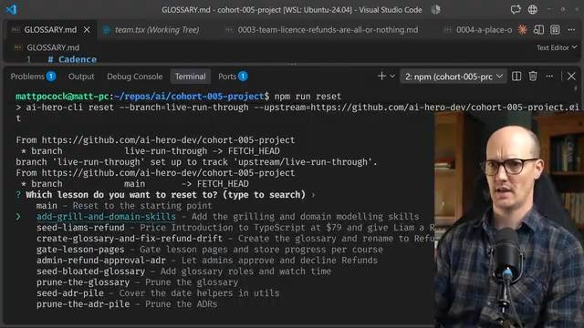
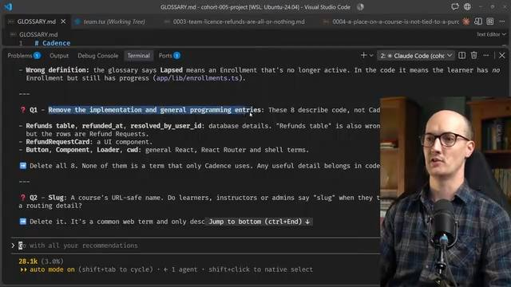
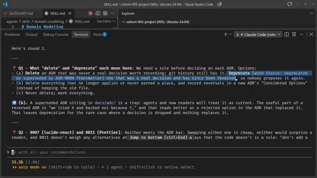
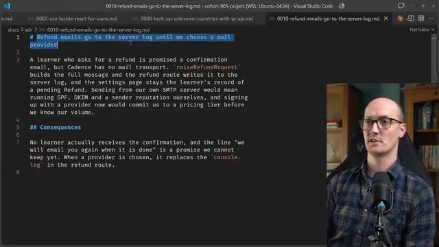
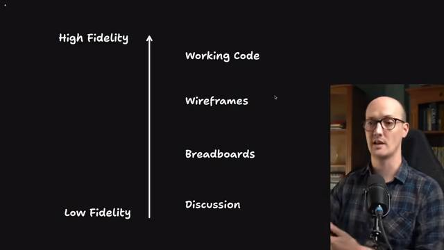

# Software Factories for Real Engineers part1 — P14–P19 复现文档

> 课程：BV1dJsF6dEeR ｜ 覆盖 P14–P19
> 读者画像：前端转 AI 应用工程师。本文档按「把项目跑起来」组织，而不是按「讲了哪些知识点」组织。
> 说明：本段课程是**以 agent 工作流为主**的实操课，核心产物是 `glossary.md`、`docs/adr/*`、`AGENTS.md` 这些仓库内文件，以及「grill with docs」这套会话流程。逐字稿里没有给出完整源码，因此第 4 节给出的是**可直接落盘的仓库文件与命令**，凡是逐字稿没讲的实现细节，都会明确标注「课里没讲」。

---

## 1. 这一节做什么

P14–P19 这一段，讲师把镜头对准了「软件工厂」里最容易被忽视、但最影响 agent 产出质量的两样东西：**领域词汇表（glossary）** 和 **架构决策记录（ADR）**。整段可以拆成四个可交付的动作：

1. **P14–P15：修剪膨胀的 glossary。** 仓库里有一个被 agent 塞满垃圾条目的 `glossary.md`（讲师叫它 "预置一份臃肿的术语表"），你要用一次 "grill with docs" 会话把它从 113 行压到 87 行，并顺手统一全仓库的术语（student vs learner、place on a course vs enrollment）。
2. **P16–P17：清理堆积如山的 ADR。** 仓库里被塞进一大堆 ADR（"seed ADR pile"），你要按「三段测试」（hard to reverse / surprising / real trade-off）逐条判断：**删除**还是**标记废弃（deprecate）**，并把过时的决策用一条新 ADR 反转掉。
3. **P18：把上面两件事沉淀成规则。** 一个 glossary 够不够？什么时候 split 成多个 bounded context？glossary 什么时候提交？agent 能不能自己拥有 glossary？——这一节是纯讲解，没有代码。
4. **P19：引出下一段的 Wayfinder。** 解释为什么单会话 grilling 会撞上上下文上限，以及为什么要按「fidelity（保真度）」分层规划。这一节同样是纯讲解，是下一段的引子。

**最终你要得到的东西**：一个精简、术语统一、被 ADR 和代码注释共同引用的 `glossary.md`；一个条目数量健康、过时决策被显式反转的 `docs/adr/` 目录；以及一套你能重复执行的「grill with docs → 修剪 → 统一术语」的操作流程。

从复现角度看，这一段不是「写一个功能」，而是「整理仓库的语义层」。因此每一步都要留下可检查的证据：`glossary.md` 的行数和条目类型、`docs/adr/` 的文件数量、`student`/`learner` 的检索结果、`place on a course` 是否还被引用。只要这些证据能稳定复现，就算跑通；不要只凭 agent 说「已经改好了」就结束。



---

## 2. 讲师原话（带出处）

下面按主题摘录，不按 P 号流水账排列。摘录保留原话的判断标准，方便你在复现时逐条对照；如果你听到的版本与逐字稿有细微差异，以课程视频为准，但不要改变本文列出的判断规则。

**关于 glossary 为什么会膨胀：**

> "如果你给我一个抽屉，我最终会把它塞满线缆；如果你给智能体一个 Markdown 文件，它最终会把它塞满垃圾。"
> —— p014 [00:00]

> "对任何 Markdown 文件来说，这都是很自然的事，尤其是在仓库频繁变动的情况下。……我见过一些文件长达数百行甚至数千行，塞满了术语表条目，其中很多根本没人用。"
> —— p014 [00:46]

**关于 glossary 不该放什么：**

> "术语表不应包含实现细节。实现细节的特点就是一直在变。因此，如果把实现细节放进术语表，就意味着每次实现变化时，术语表都得跟着更新。"
> —— p015 [00:20]

> "这里还有一些术语过于泛泛，对领域模型没有帮助。比如这里的按钮……我觉得到现在大家都知道按钮是什么了。"
> —— p015 [00:43]

> "构建术语表是一门艺术，而不是科学。把 slug 纳入其中可能也有其道理。但我喜欢尽可能让术语表保持简短。"
> —— p015 [02:09]

**关于实现细节写进 glossary 会立刻过期：**

> "术语表里写的是两小时，但代码现在用的是一小时。……这实际上是把实现细节塞进了术语表条目，而它现在已经过时了。……它建议去掉这个数字。这样，每次限制变化时，术语表就不会过期。"
> —— p015 [02:38]

**关于术语统一（student vs learner）：**

> "看起来代码其实已经基本认同用 student 来表达这个概念了。learner 只出现了 8 次，而 student 出现了 180 次。所以看起来应该统一围绕 student 来命名。"
> —— p015 [05:13]

> "注释也是强化领域语言的一个非常好的地方。"
> —— p015 [06:04]

**关于 ADR 的三段测试与两种处置：**

> "架构决策记录必须难以逆转，必须出人意料，而且必须是真正权衡的结果。……我们可以把文件整个删掉……也可以把它标记为已弃用。换句话说，如果其中某条架构决策记录值得保留，但已经不再代表当前最新的决策，那我们可能只想把它标记为“代码中已不再存在”。"
> —— p016 [00:22]

**关于「被取代的 ADR 是个陷阱」：**

> "它推荐 B，是因为把一条已被取代的架构决策记录留在 docs/adr 目录里是个陷阱。智能体和新的读者会把它当成当前有效的决策。"
> —— p017 [00:29]

**关于反转决策要写新 ADR：**

> "如果我们删掉一条架构决策记录，它并没有消失，对吧？它仍然在提交历史里，需要的话你仍然可以回去查看。"
> —— p017 [02:15]

> "这几乎不可能从代码本身看出来，因为这是一个“决定不做某事”的决策。现在我们把这件事记在这里，智能体就不会再尝试这么做了。"
> —— p017 [04:27]

**关于 bounded context（P18 纯讲解）：**

> "Eric Evans 在领域驱动设计中谈过这一点，他说任何大型项目里都会有多个模型同时发挥作用。……在领域驱动设计中，每一个这样的模型被称为限界上下文，也就是公司中那部分业务运作所处的上下文。"
> —— p018 [01:18]

> "你有一个 glossary map.md，它可以映射到应用不同部分的不同术语表。……规则是，只要你感觉有两个限界上下文正试图挤进同一个术语表，就应该拆分。"
> —— p018 [02:29]

**关于什么时候提交 glossary 更新：**

> "一旦你做出决定，并且可能已经和团队达成一致，确定这就是你想使用的术语表条目，那么你就要把它落实，甚至要在写规格说明之前就做。"
> —— p018 [03:08]

**关于 agent 能不能自己拥有 glossary：**

> "在我看来，这是把你的术语表变成一团糟的最快方式。……如果智能体自己跑去做一套自己的术语，那团队肯定不会买账。"
> —— p018 [06:02]

**关于 P19 为什么要引出 Wayfinder：**

> "Grilling 只持续一个会话。因此，随着你回答更多问题、提出更多问题，并与智能体聊得更多，最终你会到达一个点：进入“变笨区”。"
> —— p019 [00:29]

> "这是一种规划技能，让你可以跨多个会话规划任何规模的工作，并且会为计划的每个部分选择合适的精细度。"
> —— p019 [03:59]

---

## 3. 从零复现

这一节是「照着敲就能跑」的部分。**注意**：讲师在视频里用的是他自己的仓库（Cadence，一个课程管理应用），仓库本身不在逐字稿里。下面给出的是**复现这套工作流所需的最小仓库骨架**，以及每一步要执行的命令。凡是逐字稿没交代的（比如 `npm run reset` 的具体实现、agent 工具的具体名字），都会标注「课里没讲」。

复现时建议把「命令执行」和「agent 会话」分开记录：命令负责把仓库切到正确状态，agent 会话负责逐条提问和改文件。这样一旦结果不对，你可以先判断是仓库状态错了，还是会话里的判断标准跑偏了。前端同学可以把这一步理解成：先确保本地分支和 mock 数据正确，再启动页面；不要一边改数据一边怀疑组件。

### 3.1 环境与前置

- Node.js：课里没讲具体版本，建议用当前 LTS（≥20）。
- 一个支持「grill with docs」这类 skill 的 agent 工具：课里没讲具体是哪个工具，只说「open your agent」。你需要一个能读仓库文件、能多轮提问、能改文件的编码 agent。
- 一个 git 仓库，且**至少有两个可 reset 到的提交**：`seed-bloated-glossary` 和 `seed-adr-pile`。这两个提交是讲师预置的，课里没讲它们怎么造出来，所以下面 3.3 给出等价的手工造法。

如果你执行 `node -v` 发现版本过低，常见表现是脚本里的 ESM 语法或 `node:` 前缀导入报错；这时先升级 Node，而不是改脚本。若 agent 工具打不开仓库，先确认它是否在仓库根目录启动，以及是否有读取 `docs/` 的权限。课里没有展开这些环境细节，但它们属于复现前置条件。

### 3.2 目录结构（复现用最小骨架）

```
cadence/
├── AGENTS.md
├── package.json
├── glossary.md
├── docs/
│   └── adr/
│       ├── 0005-....md
│       ├── 0006-....md
│       ├── 0007-lucid-react.md
│       ├── 0008-....md
│       ├── 0009-....md
│       ├── 0010-....md
│       ├── 0011-prettier.md
│       └── 0012-....md
└── src/
    └── ...（业务代码，课里没给）
```

这个骨架的重点不是目录名本身，而是让 agent 能同时读到 `glossary.md`、`docs/adr/` 和 `src/`。如果 agent 只能读单个文件，它就无法做「全仓库统一术语」这类需要跨文件检索的判断。前端对照：这类似你在一个 monorepo 里同时打开组件、样式和 mock 文件，而不是只打开一个 `.tsx`。

### 3.3 造出「膨胀的 glossary」和「ADR 堆」

课里用 `npm run reset` + 选提交来切换状态。等价的手工做法：

**第一步：初始化仓库并提交一个干净基线。**

```bash
mkdir cadence && cd cadence
git init
printf '# Glossary\n\n## Enrollment\nA student'"'"'s place on a course.\n' > glossary.md
mkdir -p docs/adr src
git add -A && git commit -m "clean baseline"
```

这里 `git init` 初始化仓库，`printf` 写入一个最小 glossary，`mkdir -p` 一次创建多级目录，`git add -A` 暂存全部改动，`git commit` 形成基线。常见错误是当前目录已有 `.git`，再次 `git init` 会复用旧仓库，导致提交历史混在一起；遇到这种情况先 `pwd` 和 `git rev-parse --show-toplevel` 确认仓库根目录。

**第二步：造「膨胀的 glossary」提交。** 往 `glossary.md` 里追加一批**实现细节**和**过于通用的词**——这正是 p015 里被逐条砍掉的东西：

```bash
cat >> glossary.md <<'EOF'

## Other terms

### Refunds table
Columns: refunded_at, resolved_by_user_id.

### Button
A clickable element that fires an action when the user presses it.

### Component
A reusable piece of UI.

### CWD
Current working directory.

### Loader
Shows a spinner while data loads.

### Slug
URL-safe name.

### Watch limit
With under two hours watch.
EOF
git add -A && git commit -m "seed bloated glossary"
```

`cat >>` 是追加写入，不会清空原文件；`<<'EOF'` 表示使用字面量 heredoc，避免 shell 展开变量。常见错误是误写成 `>`，那会把原 glossary 覆盖掉。提交信息 `seed bloated glossary` 是后面 `reset` 脚本的检索依据之一，建议保持一致。

**第三步：造「ADR 堆」提交。** 按 p017 里被点名的几条造出来（Prettier、Lucid、IP API、邮件日志）：

```bash
cat > docs/adr/0007-lucid-react.md <<'EOF'
# 0007 Use Lucid React for icons

We looked at Hero Icons, Phosphor and Lucid. Lucid has the widest set and
matches the Shad CN UI components we already use. So icons come from Lucid React.
EOF

cat > docs/adr/0008-ip-api-for-country.md <<'EOF'
# 0008 Look up country via IP API

When the request doesn't carry a country, we look it up with an IP API.
EOF

cat > docs/adr/0010-refund-emails-to-log.md <<'EOF'
# 0010 Refund emails go to the server log

Refund emails go to the server log until we choose a mail provider.
EOF

cat > docs/adr/0011-prettier.md <<'EOF'
# 0011 Use Prettier

Use Prettier and leave its settings alone. Each file is formatted with
Prettier with the .prettierrc the repo started with.
EOF
git add -A && git commit -m "seed ADR pile"
```

现在你有两个可切换的状态，等价于课里的两个 seed 提交。验证方式是 `git log --oneline --decorate -n 5`，应能看到 `seed bloated glossary` 和 `seed ADR pile` 两条提交。若看不到，检查是否在正确目录提交，以及提交信息是否被改过。

### 3.4 执行 P14–P15：修剪 glossary

1. 切到膨胀状态：`git checkout seed-bloated-glossary`（或 `git reset --hard <该提交>`）。
2. 打开 agent，发起一次 **grill with docs** 会话，提示词就用讲师那句：

   > "Could we take a look at the glossary.md? It feels a little bit bloated and I think there's stuff in there that's not specific to our domain. Nice and simple, no need to over complicate things."

3. agent 会**逐条提问**（p015 里它问了 9 个问题）。你要逐条回答，判断标准只有两条：
   - **是不是实现细节？**（refunds 表的列名、watch limit 的具体小时数 → 删）
   - **是不是过于通用、不属于本领域？**（button、component、CWD、loader、slug → 删）
4. 术语统一：先让 agent 统计 `student` 和 `learner` 在代码里的出现次数（p015 里是 180 vs 8），再决定统一到 `student`。
5. 让 agent 把 `place on a course` 全部改成 `enrollment`，**包括 ADR 正文和代码注释**。
6. 检查结果：`glossary.md` 应从 113 行降到 87 行左右（p015 [04:48]）。

这一步的关键是「逐条回答」而不是「让 agent 自己决定」。你可以用 `wc -l glossary.md` 看行数变化，用 `grep -Rni "课程名额" .` 查残留，用 `grep -Rni "learner" src docs` 查术语是否统一。常见错误是只改了 `glossary.md`，却漏掉 ADR 和注释；这些位置正是 p015 [06:04] 说的「comments are a really great place to reinforce domain language」要覆盖的地方。



### 3.5 执行 P16–P17：清理 ADR 堆

1. 切到 ADR 堆状态。
2. 发起 grill with docs 会话，提示词：

   > "We have a bunch of ADRs in this repo, and I want to prune them down a little bit, either by deleting them or deprecating them."

3. 对每条 ADR 过**三段测试**：
   - **hard to reverse？** 容易回退的（Prettier 配置、图标库）→ 不够格。
   - **surprising？** 大多数仓库都这么做的 → 不够格。
   - **real trade-off？** 没有真实取舍的 → 不够格。
4. 处置方式二选一：
   - **删除**：从来没真正值得记录的决策（0007 Lucid、0011 Prettier、0010 邮件日志）。
   - **写新 ADR 反转**：曾经是真决策、后来被推翻的（0008 IP API → 改成「不带国家就收全价」）。**不要**把旧 ADR 留在 `docs/adr/` 里当「已废弃」——p017 [00:29] 明确说这是 trap。
5. 顺手让 agent 把 ADR 里的术语对齐 glossary（`platform admins`、`instructors`、`enrollment`）。
6. 检查：`docs/adr/` 最终剩 8–9 条（p017 [04:52]）。

执行时建议先让 agent 输出一张临时判断表：ADR 编号、决策内容、是否 hard to reverse、是否 surprising、是否有 real trade-off、建议删除还是反转。你确认后再让它改文件。常见错误是把「已经过时但曾经重要」的 ADR 直接删掉却不写新 ADR，这样代码里看不到「为什么现在不查 IP API」；相反，p017 [04:27] 强调新 ADR 要保留「考虑过但放弃」的选项，防止 agent 重新引入。



### 3.6 执行 P18–P19：把规则写下来（纯讲解，无命令）

P18、P19 没有可执行命令。你要做的「复现」是把讲师给的规则**落成仓库里的文档**：

- 在 `AGENTS.md` 里写清楚：glossary 由人类拥有，agent 只能提议、不能自决（p018 [06:02]）。
- 如果将来出现两个 bounded context，就新建 `glossary-map.md` 指向各自的 glossary（p018 [02:29]）。
- 把「glossary 更新在 spec 之前提交」写进团队流程（p018 [03:08]）。

这一段虽然没有命令，但可以验证：打开 `AGENTS.md`，确认其中明确写了 glossary 的所有权和 ADR 的三段测试；如果团队将来新增术语，流程上应先更新 glossary，再写 spec。P19 只作为引子，复现时不要在这里寻找 Wayfinder 的具体命令，它不在本段。


---

## 4. 完整代码

> **重要声明**：逐字稿里**没有给出任何源码**，讲师展示的是他仓库里 `glossary.md`、`docs/adr/*.md`、`AGENTS.md` 的**内容片段**。下面给出的是**可直接落盘的完整文件**，其中 glossary 和 ADR 的内容严格依据 p015/p017 里讲师逐条点评过的条目重建；`package.json` 和 `AGENTS.md` 是复现工作流所必需的脚手架，**课里没讲**其原文，标注为「复现用，非课里原文」。

这些文件的目标是「可执行、可检查」，不是逐字复制讲师仓库。若你的项目已有自己的 glossary 或 ADR 模板，保留你的模板字段，只把本文的判断标准和条目内容迁过去。前端对照：这像你把一套 ESLint 规则落到仓库里，规则文本可以不同，但检查目标要一致。

### 4.1 `glossary.md`（修剪后的目标形态）

依据 p015 [07:12] 讲师对最终状态的描述（watch limit 并入 refund 区、顶部有 enrollment 区、people 区含 student/instructor/platform admin/team admin）重建：

```markdown
# Glossary

## Enrollment
A student's place on a course.

## Refund
A request to reverse a charge, and its outcome.

## Watch limit
How much of a course a student may watch. (No specific number — the number
lives in code, not here.)

## Lapsed
A student who has lost their enrollment on a course but still has progress on it.

## People

### Student
Someone who takes courses on Cadence.

### Instructor
Someone who teaches courses on Cadence.

### Platform admin
An administrator for the whole platform. Never referred to on its own as "admin".

### Team admin
An administrator for a single team. Never referred to on its own as "admin".

## Avoid
- "place on a course" → use **enrollment**
- "learner" → use **student**
- bare "admin" → always qualify as **platform admin** or **team admin**
```

### 4.2 `docs/adr/0012-charge-full-price-without-country.md`（反转 0008 的新 ADR）

依据 p017 [04:27] 讲师对这条 ADR 的描述重建（旧实现查 IP API，后来改为直接收全价）：

```markdown
# 0012 Charge full price when the request carries no country

## Status
Accepted

## Context
ADR 0008 said: when the request doesn't carry a country, look it up with an
IP API. That decision has since been reversed.

## Decision
When the request carries no country, charge full price. Do not call an IP API.

## Considered options
- **Look up the first X-Forwarded-For address on ipapi.com.** This is what we
  used to do. We dropped it. (Kept here so nobody re-introduces it.)
- **Charge full price.** What we do now.
```

### 4.3 `AGENTS.md`（复现用脚手架，非课里原文）

```markdown
# Agent instructions

## Domain language
- `glossary.md` is owned by humans. Propose changes; never rewrite it unilaterally.
- Use glossary terms in code, comments, ADRs and UI copy.
- If two bounded contexts emerge, add `glossary-map.md` and split.

## ADRs
- An ADR must be hard to reverse, surprising, and the result of a real trade-off.
- If it fails that test, delete it.
- If a real decision was reversed, write a new ADR and delete the old one.
```

### 4.4 `package.json`（复现用脚手架，非课里原文）

课里反复用 `npm run reset` 切换 seed 提交。下面是一个等价的最小实现：

```json
{
  "name": "cadence",
  "private": true,
  "scripts": {
    "reset": "node scripts/reset.mjs"
  }
}
```

### 4.5 `scripts/reset.mjs`（复现用脚手架，非课里原文）

```javascript
import { execSync } from "node:child_process";

const seeds = {
  "seed-bloated-glossary": "seed bloated glossary",
  "seed-adr-pile": "seed ADR pile",
};

const pick = process.argv[2];
const msg = seeds[pick];
if (!msg) {
  console.error(`usage: npm run reset -- <${Object.keys(seeds).join("|")}>`);
  process.exit(1);
}
const sha = execSync(`git log --format=%H --grep="${msg}" -n 1`).toString().trim();
if (!sha) {
  console.error(`no commit matching "${msg}"`);
  process.exit(1);
}
execSync(`git reset --hard ${sha}`, { stdio: "inherit" });
console.log(`reset to ${pick} (${sha.slice(0, 7)})`);
```

用法：`npm run reset -- seed-bloated-glossary`。

使用前确认 `scripts/reset.mjs` 路径与 `package.json` 中的 script 一致；如果 `npm run reset -- seed-adr-pile` 报 `no commit matching`，先用 `git log --oneline --all` 看提交信息是否被改过。这个脚本会执行 `git reset --hard`，所以运行前最好 `git status` 确认没有未提交改动。

---

## 5. 逐行解释

### 5.1 glossary 条目为什么这么写

- **`## Enrollment` 只写一句 "一名学生在某门课程中的名额"** —— 对应 p015 [03:24]：把 "安排到课程中" 这个短语压缩成单词 `enrollment`。glossary 条目要短，因为它的作用是**统一叫法**，不是写文档。
- **`## Watch limit` 故意不写具体小时数。** —— 对应 p015 [02:38]：原来写 "under two hours"，代码改成 1 小时后 glossary 立刻过期。讲师的原话是 "drop the number"，让 glossary 不随实现变化而腐烂。**这是本节最重要的一条规则**：凡是会变的数字、字段名、表名，都不进 glossary。
- **`## People` 下四个条目，且 `Avoid` 里禁止裸用 "admin"。** —— 对应 p018 [00:28]：`platform admin` 和 `team admin` 永远带前缀，从不单独叫 `admin`。这是「用前缀消歧」的范式，将来 `quiz question` vs `discussion question` 也用同一招。
- **`Avoid` 段是显式的负向清单。** —— 对应 p015 [05:37]：讲师最终选择 `student` 而非 `learner`（因为代码里 180 vs 8）。把「不要用什么」写下来，agent 下次就不会再犯。

前端对照：glossary 更像「设计系统里的 token 命名」，而不是「组件实现文档」。token 只约定 `color-primary` 这类语义名，不写具体色值；glossary 也只约定 `enrollment` 这类领域名，不写表结构。语义名稳定，实现可以变；反过来就会每次改代码都改文档。

### 5.2 ADR 0012 为什么这么写

- **`## Considered options` 里保留「旧实现」。** —— 对应 p017 [04:27]：讲师说这条 ADR "无法仅从代码本身判断出来，因为这是一个选择不做某件事的决定"。代码里看不到「我们曾经查 IP API 然后放弃了」，只有 ADR 能记住。保留它是为了**阻止 agent 重新引入**。
- **旧 ADR 0008 被删除，而不是标 deprecated。** —— 对应 p017 [00:29]：agent 推荐方案 B，理由是 "一份已被取代的 ADR 留在 Docs ADR 里是个陷阱。智能体和新的读者会把它当成当前有效的。"。删除不等于丢失，git 历史里还在（p017 [02:15]）。
- **Status 只写 `Accepted`。** —— 课里没讲 ADR 模板的完整字段集，这里只保留讲师实际用到的。你若用 MADR 模板，字段名请以你选的模板为准。

前端对照：这类似你在代码里删掉一个废弃的 feature flag，但把「为什么废弃」写进变更记录；如果只把 flag 标成 deprecated 却留在配置里，下一个人或 agent 仍可能把它当成可用开关。

### 5.3 `reset.mjs` 逐行

- `execSync("git log --format=%H --grep=...")`：按提交信息找 SHA。**课里没讲** `npm run reset` 的真实实现，这是等价替代。
- `git reset --hard`：**会丢弃工作区改动**。在 JS/Node 里没有「锁」的概念，但 `reset --hard` 相当于一次不可回滚的写操作——执行前先 `git stash` 或确认没有未提交改动。这一点课里没讲，但你会撞上（见第 7 节）。

另外，`process.argv[2]` 取的是 `npm run reset -- seed-bloated-glossary` 中 `--` 后面的第一个参数；如果你直接运行 `node scripts/reset.mjs seed-adr-pile`，也能得到同样效果。`stdio: "inherit"` 让 git 的输出直接显示在终端，便于确认 reset 是否成功。常见错误是参数拼错，脚本会打印 usage 并退出；这时不要改脚本逻辑，先检查参数名。

### 5.4 给前端同学的对照

- 课里说的 "grill with docs" 是**多轮问答式会话**，不是一次性 prompt。在 Node 里你可以把它理解成「一个带状态的 async 循环」：agent 提问 → 你回答 → agent 再提问，直到收敛。没有并发、没有锁，所以不涉及事务问题。
- `git reset --hard` 在 JS 里最接近的类比是「直接覆盖内存里的对象引用」——旧值没了，除非你提前存了快照（stash / commit）。

再补一个对照：glossary 的「统一术语」类似前端项目里统一 `props` 命名或事件名。你当然可以在一个组件里叫 `onClick`、另一个叫 `handlePress`，但跨文件检索和 agent 生成代码时会变得不稳定；统一到 `student`、`enrollment` 后，检索、替换和审查都更容易。

---

## 6. 复现检查清单

跑完 P14–P19，逐条打勾。每条都给出验证方式，避免「看起来改了」但实际没改干净。

- [ ] 仓库里有两个可 reset 的 seed 提交：`seed bloated glossary`、`seed ADR pile`。验证：`git log --oneline --all | grep -E "seed bloated glossary|seed ADR pile"`。
- [ ] `npm run reset -- seed-bloated-glossary` 能成功切过去。验证：执行后看终端是否打印 `reset to seed-bloated-glossary`，再 `git log -1 --oneline` 确认 HEAD。
- [ ] 修剪后 `glossary.md` 行数明显下降（课里是 113 → 87，你的绝对值会不同，但应显著变短）。验证：修剪前后各跑一次 `wc -l glossary.md` 并记录。
- [ ] `glossary.md` 里**没有任何**表名、列名、具体小时数、具体组件名。验证：人工通读，并用 `grep -niE "refunded_at|resolved_by_user_id|两小时|按钮|组件|加载器" glossary.md` 检查，应无命中。
- [ ] `glossary.md` 里**没有** button / component / CWD / loader / slug 这类通用词。验证：`grep -niE "按钮|组件|CWD|加载器|slug" glossary.md`。
- [ ] 全仓库 `student` 与 `learner` 已统一（用 `grep -r learner src docs | wc -l` 验证，应为 0 或仅剩历史 ADR）。验证：再跑 `grep -rni "learner" src docs` 人工确认剩余命中是否合理。
- [ ] `place on a course` 已全部替换为 `enrollment`，**包括 ADR 正文和代码注释**。验证：`grep -Rni "课程名额" .`，应无命中；若有，逐条改掉。
- [ ] `docs/adr/` 里每条 ADR 都过得了三段测试（hard to reverse / surprising / real trade-off）。验证：让 agent 输出判断表，你逐条复核，不能只看文件标题。
- [ ] 被反转的决策（0008 IP API）已用**新 ADR** 记录，旧文件已删除。验证：`ls docs/adr/` 确认没有 `0008-ip-api-for-country.md`，同时存在 `0012-charge-full-price-without-country.md`。
- [ ] `docs/adr/` 里**没有**「已废弃但还留着」的 ADR。验证：`grep -Rni "已弃用|已被取代" docs/adr`，若命中，按 p017 [00:29] 的原则处理。
- [ ] `AGENTS.md` 写明 glossary 由人类拥有。验证：打开文件搜索 `owned by humans` 或等价表述。
- [ ] 你能说清楚：glossary 更新应在 spec **之前**提交（p018 [03:08]）。验证：用自己的话复述一遍，并检查团队流程文档是否写了顺序。



---

## 7. 课里没讲但你会撞上的

下面把复现中最容易卡住的问题汇总成表。表中的「怎么办」是复现建议，不是讲师逐字稿原文；凡涉及课程未展示的实现，仍按「课里没讲」理解。

| 现象 | 原因 | 怎么办 |
| --- | --- | --- |
| `npm run reset` 找不到提交，或 reset 后不是预期状态 | 课里只演示了「运行它、选提交」，没给脚本；本文 4.5 的等价实现依赖提交信息里的固定字符串，你的仓库提交信息不同就会 `--grep` 不到 | 先用 `git log --oneline --all` 手动找 SHA，再 `git reset --hard <sha>`；或修正脚本里的 `seeds` 映射，保持提交信息稳定 |
| 不知道怎么发起「grill with docs」 | 课里只说 "open your agent"、"grill with docs session"，没讲具体产品、skill 安装方式 | 需要一个能读多文件、能多轮提问、能写文件的编码 agent；把「grill with docs」理解为一种会话模式：agent 逐条提问、你逐条回答，而不是某个固定命令 |
| `git reset --hard` 把工作区改动丢了 | 课里没提醒 `reset --hard` 会覆盖未提交改动 | 执行前先 `git status` 确认干净，或 `git stash` 保存改动；reset 后再按需 `git stash pop` |
| `student` / `learner` 统计结果和课里对不上 | 课里说 "112 times across 23 files"、"180 occurrences of student"，但没说统计命令；大小写、词边界、是否包含 `StudentCard` 都会影响结果 | 用 `grep -ro '\bstudent\b' src docs \| wc -l` 这类带词边界的命令，并人工抽查 `StudentCard`、`students` 是否应计入 |
| 照抄 ADR 模板后字段对不上 | 课里只展示了 `Status`、`Context`、`Decision`、`Considered options` 这几个标题，没给完整模板 | 若用 MADR / Nygard 模板，字段名以你的模板为准；不要为了照抄本文而破坏团队已有模板 |
| 想新建 `glossary-map.md` 但不知道格式 | p018 [02:29] 提到它存在，但课里没给文件内容 | 先按最小格式自拟：列出各目录或 bounded context，再指向对应 glossary 路径；等后续 Wayfinder 段落如有补充再调整 |
| 在 P19 里找不到 Wayfinder 的可执行命令 | P19 只是引出，讲了「单会话 grilling 会进 dumb zone」「按 fidelity 分层」「Wayfinder 能跨会话规划」，但没有给命令或文件 | 不要在本段找 Wayfinder 代码；把 P19 当作下一段的引子，真正的实操在后续 P 段 |
| 不理解 fidelity 的五个层级怎么落地 | p019 [02:47] 只列了 discussion（grilling）→ breadboarding（boxes and arrows）→ wireframes → prototyping → working code，没给每层产出物模板 | 先按字面理解层级顺序；复现本段只需把 grilling 会话跑通，fidelity 的细化留给 Wayfinder 段落 |

---



**一句话总结这一段**：P14–P17 是两场「大扫除」（glossary 和 ADR），P18 是把扫除规则写成制度，P19 是告诉你「单会话规划不够用，下一段上 Wayfinder」。照着第 3、4 节敲完，你手里应该有一个精简的 `glossary.md`、一个健康的 `docs/adr/`，以及一套能重复执行的修剪流程。