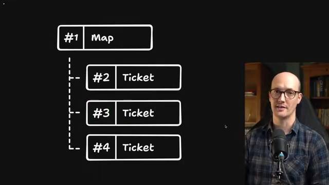
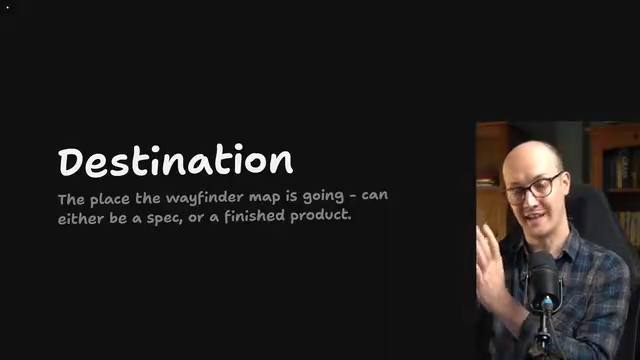
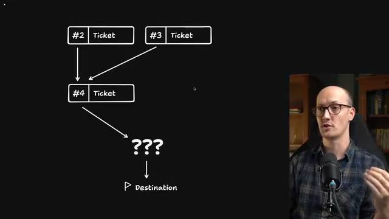
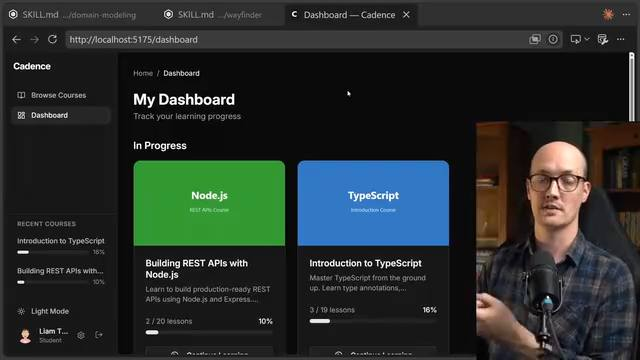
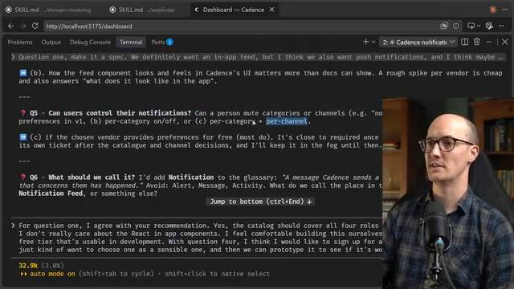
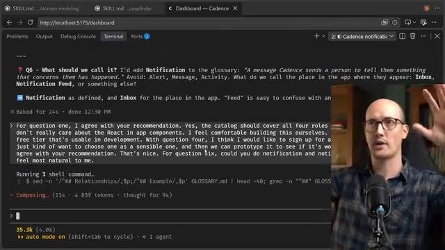
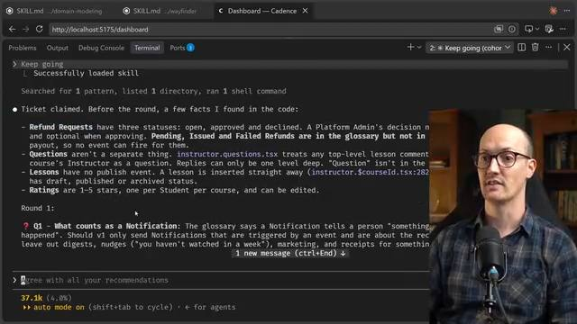
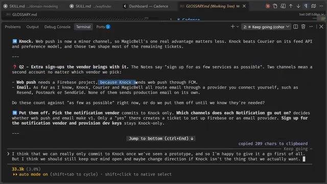
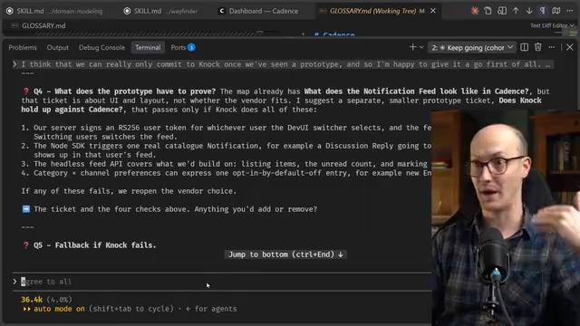

# Software Factories for Real Engineers part1 · P20–P26
## 用 Wayfinder 把「一团雾」拆成一份可执行的 spec

---

## 1. 这一节做什么

P20 到 P26 是 Wayfinder 的**第一次完整实操**。你要跟着讲师把一件「说不清楚要怎么做」的功能——给 Cadence 加站内通知——从一句模糊需求，变成一张 GitHub issue 地图（map）加一堆可执行的子 issue（decision ticket），最后收敛成一份 spec。

这一节你要亲手产出下面这些东西，缺一样都算没跑通：

| 产物 | 在哪里 | 长什么样 |
|---|---|---|
| Wayfinder skill | 你所用 CLI agent 的 skills 目录 | 装好之后，agent 里能直接喊 `Wayfinder` |
| 一张 map | GitHub issue，带 `Wayfinder map` 标签 | 里面有 destination、notes、decisions so far、not yet specified、out of scope、tickets 六块 |
| 7 张左右的子 ticket | map 下面的子 issue | 四种类型：grilling / prototype / research / task |
| 两份 research 结论 | 一张一次性的 git 分支里的真实文件 | 一份选 vendor（Knock vs Novu Cloud vs MagicBell），一份算 web push 能覆盖到哪 |
| 一份通知目录 | 第一张 grilling ticket 的 resolution 评论 | 一张大表格：什么事件、通知谁、能不能关 |
| 一份术语表增量 | `glossary.md` | `notification`、`notification feed`、`discussion question`、`discussion reply` |
| 一张被扩展过的 map | 同一个 map issue | 关掉 1 张 ticket 后，又长出 task + prototype + grilling 三张新 ticket |

一句话概括这一节的心智模型：**你不是在写代码，你是在「探路」。** 目的地（destination）在第一次会话里就定死，然后你一次只清掉眼前一小片雾，雾散开之后新的路才会出现。



---

## 2. 讲师原话（带出处）

下面这些是我从逐字稿里挑出来的关键句，后面所有复现步骤都是围绕这几句话展开的。

**关于 Wayfinder 的两个数据结构：**

> "它描述了一张地图。然后是这张地图对应的决策工单……这里的每一个在技术上都是你问题跟踪器里的工单。所以在我们的场景里，这些会是 GitHub issue。地图本身是一个 GitHub issue，而每个决策工单也是它下面的一个 GitHub issue。"
> —— p020 [00:31]

> "地图是这个仓库问题跟踪器里一个单独的 issue，标记为 Wayfinder map。然后它的决策工单是这张地图的子 issue。"
> —— p020 [01:17]

**关于 destination（目的地）：**

> "从这里到目的地的路径还看不见。寻路就是找到那条路。目的地因每次任务而异，而命名目的地是绘制地图的第一步。它决定了每一张工单的形态。"
> —— p020 [01:14]

> "我推荐用 Wayfinding 做编码的方式，也是我们在这门课里要用的方式，是把目的地设为一个 spec。"
> —— p020 [01:38]



**关于雾（fog of war）和依赖：**

> "你在任何时候其实只能看到眼前的几个决策。你看不到整块棋盘。所以我把这个概念叫作战争迷雾——随着你在地图上前进，你会逐步揭开更多地图。"
> —— p020 [03:19]

> "我们可以利用问题跟踪器原生的依赖跟踪能力。比如 GitHub 有一个 blocked by 功能，允许工单被其他工单阻塞。当所有阻塞它的工单都关闭时，这张工单就解除阻塞了。我们还有一个前沿的概念。前沿就是那些处于打开状态、未被阻塞、未被认领的子工单。"
> —— p020 [03:47]



**关于四种 ticket 类型：**

> "最常见的工单类型是拷问工单。在拷问工单里，你基本上是在一个 agent 会话中回答一组问题，也就是一次标准的带文档拷问会话。"
> —— p020 [05:26]

> "原型工单让你在确实需要看到东西跑起来的问题上提高保真度。所以原型工单通过做一个廉价、粗糙但具体的产物供人反馈，从而提高了讨论的保真度。"
> —— p020 [06:05]

> "研究工单类型，这是用于当你需要第三方信息或数据、而本地无法获取的时候……和其他类型不同，这个类型实际上不需要你去帮它。它是 AFK，也就是离开键盘。它由一个子 agent 立即解决。"
> —— p020 [06:34]

> "这一种其实不算决策工单，更像是这里有一组手动步骤。agent 会给你创建一份要执行的步骤清单，好让你去开通服务或完成需要做的事。"
> —— p020 [07:08]（讲 task ticket）

**关于怎么调用它：**

> "使用 Wayfinder 有两种模式，它会自己判断当前在做什么。所以如果你只输入 Wayfinder 加一段提示词，它就会为你创建一张新的 Wayfinder 地图……一旦你用这种方式创建了地图，你就可以在新会话里运行 Wayfinder，并传入你想处理的工单编号。"
> —— p020 [07:38]

**关于安装：**

> "你可以自己运行 `npm run reset add Wayfinder skill` 来获取它。我要重置当前分支，然后我的 agent 技能文件里就会有一些技能，或者更准确地说，是 Wayfinder 技能。"
> —— p020 [00:00]

**关于这一节具体要跑的东西：**

> "具体来说，cadence 里有一个我很想做的功能，就是应用内通知。我们需要让学习者持续回来。我们需要在有人评论时提醒讲师。"
> —— p021 [00:00]

> "记住，你在这里的任务是弄清楚目的地，而我们想要的目的地不是完成后的功能。我们希望目的地是一个 spec。所以务必在初始提示词里把这一点写明确。"
> —— p021 [00:46]

**关于第一张 ticket 怎么开：**

> "我要复制这个 issue 的链接，复制链接地址。然后我要在我的 agent 里打开它。关键是，我不会从上次中断的地方继续。我要在这里执行 clear，然后直接运行 Wayfinder，把 issue 的 URL 传进去，马上开始。"
> —— p023 [00:15]

**关于 research ticket 的产物落点：**

> "它会给你一份所发现内容的摘要，但完整的研究成果，它实际上会保存到一个一次性分支里的真实文件中。任何 agent 都可以去看完整的研究内容。它甚至会在上面链接回原始来源。"
> —— p022 [06:27]

**关于 map 会自己长大：**

> "你学得越多、做出的决策越多，地图就能扩展得越大。我希望你也能感受到，我们对实际要构建的东西越来越清晰了。"
> —— p026 [02:58]

---

## 3. 从零复现

下面每一步都可以照着敲。你的 ticket 编号会跟讲师不一样，这是正常的——讲师在 p022 [06:04] 明确说了："你最后得到的 Wayfinder 地图可能和我的大不相同。"。**关键是流程一致，不是编号一致。**

### 3.0 前置条件

你需要：

- 一个能装 skill、能跑 shell、能读写 git 仓库的 CLI 编码 agent（讲师用的是 "Claw code" 这个转写，实际就是他手上的那个 CLI agent；按你手上的 agent 来，skill 目录位置以它的约定为准）
- 一个 git 仓库，仓库里有一个 Cadence 项目（前端 + 后端都在里面，课里没讲它的技术栈细节）
- 这个仓库托管在 GitHub 上，且 agent 有权限**读写 issue**（Wayfinder 的 map 和 ticket 全是 GitHub issue）
- Node + npm（因为安装命令是 npm 脚本）
- 一个干净的 git 工作区——第一件事就是 reset 分支

### 3.1 建目录骨架

在你仓库根目录建这几个目录。它们是给「人」看的记录层，跟 GitHub 上的 issue 互为镜像——讲师在 p022 [06:04] 说他把每一张 map、每一张 ticket、每一次更新都存下来了，你也应该这么做，否则后面复盘没法查。

```bash
mkdir -p prompts docs/wayfinder/tickets scripts
```

最终结构：

```
cadence/
├── package.json
├── scripts/
│   └── wayfinder-reset.sh
├── prompts/
│   ├── 01-chart-map.md
│   └── 02-run-ticket.md
└── docs/wayfinder/
    ├── map.md
    ├── glossary.md
    └── tickets/
        └── 016-pick-notification-vendor.md
```

### 3.2 重置到干净状态并装 skill

讲师的原话命令是：

```bash
npm run reset add Wayfinder skill
```

> ⚠️ 这条命令是从逐字稿直接抄的，转写可能有误差（`npm run reset` 后面接 `add ... skill` 这种参数形式不太像标准 npm scripts 的用法）。**它的作用只有一个：把 Wayfinder 这个 skill 装进你 agent 的 skills 目录。** 如果你仓库里的 `reset` 脚本不接受这个参数，就改用 `npx` 或者你 agent 自带的 skill 安装命令，效果一样。第 7 章会讲怎么判断装没装上。

装之前先 reset 分支，讲师自己也做了这一步（"我要重置当前分支。"）：

```bash
git status
git checkout .
git clean -fd
```

### 3.3 起一张 map

在 agent 里新开一个会话，把 `prompts/01-chart-map.md` 的内容整段贴进去。

注意讲师在 p021 [00:46] 的提醒：**一定要在初始 prompt 里写清楚目的地是 spec，不是能跑的功能。** 如果不写，agent 会默认你要「一个能工作的 build」，后面每张 ticket 的问法都会跟着偏。

贴完之后，agent 会连续问你几轮问题。这是 Wayfinder 的第一阶段：**charting（画图）**，本质是一次 Grill with Docs 会话，只是外面套了一层探路的框架。



### 3.4 回答第一轮问题（决定 scope 的那一轮）

讲师实际被问到的问题和回答，按 p022 的时间顺序：

| 轮次 | 问题 | 讲师的选择 |
|---|---|---|
| Q1 | What does Done look like for this map? | 选 "make it a spec" |
| Q2 | 什么算 in-app？范围到哪 | 要 in-app feed；也要 push notifications；email 可以探索。但 Cadence 没有移动端，所以 push 到底可不可行是个未知数，可能要退回 email |
| Q3 | vendor 还开着吗 | 选 vendor 是这张 map 的一部分，由 research ticket 驱动；要 hosted 第三方，**不自建** |
| Q4 | Cadence 现在用的是 dev UI 的 user switcher，不是真 auth，这个 spec 要不要按生产级做 | 要生产级 |

第二轮（p022 [01:48] 附近）：

| 轮次 | 问题 | 讲师的选择 |
|---|---|---|
| Q1 | 第二个渠道怎么定（in-app feed 已固定） | 同意 agent 建议：开一张 research ticket 去查 |
| Q2 | 哪些角色在范围内 | glossary 里有 student / instructor / platform admin / team admin，四个全要 |
| Q3 | vendor 要支持什么（比如预制的 React 组件） | 不关心 React 组件，自己写；**关键是要有能在开发环境用的免费额度** |
| Q4 | 选之前要不要先上手试 | 不想注册一堆服务，先选一个合理的，再 prototype 验证 |
| Q5 | 用户能不能自己控制通知 | 同意 agent 建议 |
| Q6 | 术语叫什么 | 讲师否掉了 agent 推荐的 `notification` + `inbox`，改成 `notification` + `notification feed` |

这一步有个细节值得记住：讲师在 Q2 里主动用了上一门课做 domain modeling 时留下的 glossary（student / instructor / platform admin / team admin），agent 直接把它们捞了出来。**glossary 是跨课程复用的资产，不是这一节现造的。**



### 3.5 看着它建 map

答完最后一轮，agent 会说「我们达成共识了」，然后一次性创建：

- 一张 map issue
- 约 7 张子 ticket，**四种类型全部出现**（讲师在 p022 [04:20] 特别高兴这一点：prototype / grilling / task / research 都有）
- 一个 `not yet specified` 区域，也就是「雾」
- glossary.md 的增量

然后在你说「go ahead」之后，**两张 research ticket 会立刻被派给后台 subagent 并行跑**，你不用管。



### 3.6 读 map（这一步别跳过）

map 建好后，去 GitHub 上把这张 issue 从头读一遍。你应该能看到六块内容：

1. **Destination** — 讲师这张写的是「production grade notifications in cadence, delivered through one hosted third party vendor」+ spec
2. **Notes** — 画图阶段聊过的零散记忆
3. **Decisions so far** — 此时是空的
4. **Not yet specified** — 雾
5. **Out of scope** — 讲师的有三条：不做原生移动端、不自建 vendor、不自己搭投递基础设施
6. **Tickets** — 带状态：open / blocked / 已被 subagent 认领

等几分钟，两张 research ticket 会自动关闭。

### 3.7 打开第一张 grilling ticket

按 p023 的做法：

```bash
# 在 GitHub 上打开那张 grilling ticket，复制它的完整 URL
# 回到 agent，先清空上下文
/clear
```

然后：

```text
Wayfinder <你刚刚复制的 issue URL>
```

**关键点：不要接着上一个会话继续。** 讲师原话是 "关键在于，我不会从上次停下的地方继续，而是要在这里清空重来。"。原因是上一个会话的上下文是「画图」，这次是「解一张票」，混在一起会让 agent 分不清当前在干什么。

这张票的标题是「which notifications does Cadence send and to whom」。你会被问 15 个左右的问题，涉及：

- 什么算一条通知
- 退款申请的各种结果要不要通知
- 平台管理员要不要收到退款相关通知
- refund payouts（glossary 里有，但跑着的代码里还没有）怎么处理 → 讲师选了放进 `not yet specified`
- 已占用的席位、team admin
- 讲师收到每一条新报名通知，能不能按人关掉 → 讲师选了「可按讲师自定义」
- 问答回复要不要通知
- 课程被打分要不要通知讲师
- 学生加课要不要通知
- 平台管理员的各类通知
- 编辑/删除一条讨论问答要不要发通知
- 平台管理员和其他讲师发的讨论问题要不要通知

回答完之后，agent 会：

1. 把整份「通知目录」作为 resolution 评论贴到这张 ticket 上
2. 关掉这张 ticket
3. 更新 map 的 `Decisions so far`，加一行摘要
4. 更新 `glossary.md`，加 `discussion question` / `discussion reply`



### 3.8 打开第二张 grilling ticket（选 vendor）

同样 `/clear`，同样传 issue URL 或编号。讲师这里用的是编号：

```text
Wayfinder with issue number 16
```

这张票问的问题少一些，但信息密度更高：

- **要不要现在就承诺用 Knock？** 讲师的说法很关键：「我们其实是在错误的保真度上做这个决定，只有真上手试过才知道能不能承诺」，所以答案是「先用 prototype 验证，但保留换方向的余地」
- **额外注册**：web push 需要 Firebase 项目（因为 Knock 通过 FCM 发 web push）；而且 Knock / Courier / MagicBell 都不自己发生产邮件，邮件要你自己接一个供应商。讲师的回答：**先不注册，等确认需要了再说**
- **每月 250 美元这个价格悬崖能不能接受？** 可以
- **prototype 要证明什么？** map 里已经有一张「通知 feed 在 Cadence 里长什么样」的票，但那是 UI 和布局，不是「vendor 合不合适」。所以**再开一张更小的 prototype**，专门验「Knock 撑不撑得住 Cadence 的场景」
- **Knock 挂了怎么办？** 讲师接受了一个 fallback 候选（这段逐字稿转写成 "career"，上下文前面列的候选是 Knock / Courier / MagicBell，你自己定一个就行）
- **哪些票等 prototype？** 接受 agent 建议的依赖图



答完之后会出现：

- 一张新的 **task ticket**：sign up for the notification vendor + provision dev keys
- 一张新的 **prototype ticket**：Knock 撑不撑得住 Cadence
- 那张 prototype ticket 上有 **blocked by** 关系，指向上面那张 task ticket



### 3.9 手动做掉那张 task ticket

到这一步你就得离开 agent 了：真去 Knock 注册账号，真去 Firebase 建项目，把 dev 环境的 key 拿到手。**具体要开哪些环境变量、叫什么名字，课里没讲**——这一段只创建了 task ticket，没有执行。

做完之后，把 task ticket 勾掉、关闭，那张被 blocked 的 prototype ticket 会自动解锁，进入 frontier。

到这里这一节就结束了。后续的 prototype、剩下的 grilling、以及最后把 map 转成 spec（讲师用的是 `to spec` 这个 skill），在后面的课里。

---

## 4. 完整代码

下面每个文件都可以直接保存运行/直接使用。凡是我补的、课里没给的，都在文件头注明了。

### 4.1 `package.json` 的 scripts 段

```json
{
  "name": "cadence",
  "private": true,
  "scripts": {
    "reset": "bash scripts/wayfinder-reset.sh",
    "reset:hard": "bash scripts/wayfinder-reset.sh --hard"
  }
}
```

把这段合并进你现有的 `package.json`，不要整个覆盖掉（Cadence 原本的 `dev` / `build` 别丢）。

### 4.2 `scripts/wayfinder-reset.sh`

> ⚠️ **课里没给这个脚本的内容**，讲师只说了 "下面有一个你可以运行的脚本。"。下面是按它的用途补的最小实现，示意用，你可以按自己仓库改。

```bash
#!/usr/bin/env bash
# scripts/wayfinder-reset.sh
# 把工作区恢复到「开始跑 Wayfinder 之前」的状态。
# 用法：
#   bash scripts/wayfinder-reset.sh          # 软重置：只清工作区改动
#   bash scripts/wayfinder-reset.sh --hard   # 硬重置：连本地 docs/wayfinder 记录一起清掉

set -euo pipefail

HARD=0
if [[ "${1:-}" == "--hard" ]]; then
  HARD=1
fi

echo "==> 当前分支：$(git rev-parse --abbrev-ref HEAD)"

echo "==> 丢弃未暂存改动"
git checkout -- .

echo "==> 清理未跟踪文件（保留 .env*）"
git clean -fd -e '.env*' -e 'node_modules'

if [[ "$HARD" == "1" ]]; then
  echo "==> 删除本次 Wayfinder 的本地记录"
  rm -rf docs/wayfinder/tickets
  mkdir -p docs/wayfinder/tickets
  # map.md 与 glossary.md 保留空壳，下次直接往里写
  : > docs/wayfinder/map.md
fi

echo "==> 完成。别忘了去 GitHub 上把这次的 map / ticket 归档（close 或加 archived 标签）"
```

### 4.3 `prompts/01-chart-map.md`

> 这段 prompt 的核心句子来自讲师 p022 [00:00] 的原话，末尾的 Destination 一段是按 p021 [00:46] 的要求补的。

```markdown
Wayfinder

I want to build in-app notifications inside cadence. I want a real third party
service to handle this. I want to figure out what kind of notifications I want to
send. We'll need to figure out what it actually looks like in the application.

And I think actually that's probably enough of that. In-app notifications are
sort of well known. We don't need to over-specify at this point.

---

DESTINATION (read this before you ask anything):

The destination of this map is a SPEC, not a working build.

This map must end with a written specification for production-grade in-app
notifications in Cadence, delivered through one hosted third-party vendor, that
I can then hand off to agents to implement.

Not in scope for the destination: native mobile apps, self-hosting a notification
vendor, building our own delivery infrastructure.

Start the charting session. Grill me on scope before you create any tickets.
```

### 4.4 `prompts/02-run-ticket.md`

> 两种调用方式，讲师都用过：p023 [00:15] 用 URL，p026 [00:07] 用编号。

```markdown
<!-- 方式 A：按 issue URL（讲师在 p023 用的） -->
Wayfinder <在这里粘贴 ticket 的完整 GitHub issue URL>

<!-- 方式 B：按编号（讲师在 p026 用的） -->
Wayfinder with issue number <NN>

---

约束（每次跑都贴上，避免 agent 越界）：

- 只解这一张票。不要顺手开始实现功能。
- 如果这张票的答案依赖我本地没有的信息，开一张 research ticket，不要猜。
- 如果这个问题在 grilling 的保真度上根本答不了，开一张 prototype ticket。
- 如果需要我本人去做一件手工事（注册服务、开权限、搬数据），开一张 task ticket。
- 结束时：把结论作为 resolution 评论贴到票上，然后关闭它，并更新 map 的
  "Decisions so far"。
```

### 4.5 `docs/wayfinder/map.md`（map 的本地镜像模板）

> 六块结构完全按讲师在 p022 [04:49] 展示的那张 map 来。

```markdown
# Wayfinder Map — In-app notifications in Cadence

**GitHub issue:** #<map-issue-number>
**Label:** `Wayfinder map`
**Status:** charting → in progress

## Destination

A spec for production-grade in-app notifications in Cadence, delivered through
one hosted third-party vendor.

## Notes

- Cadence currently has no mobile app; auth is a dev-UI user switcher, not real
  auth. This spec is nonetheless production grade.
- Learners need to be pulled back; instructors need to be alerted on comments.
- In-app feed is fixed. Push and email are open questions driven by research.
- Free tier usable in development is a hard requirement for vendor selection.
- We do not care about pre-built React feed components; we will build the UI.

## Decisions so far

<!-- 每关掉一张 ticket，就在这里加一行，链接到那张 issue -->

| # | Decision | Ticket |
|---|---|---|
| — | （还没有） | — |

## Not yet specified

<!-- 这就是 fog of war。这里的东西不是「不做」，是「还不知道」。 -->

- Push notification reach without a native app
- Whether email is a first-class channel or a fallback
- Refund payouts (in glossary, not yet in running code)
- Notification feed UI and placement

## Out of scope

- Native mobile apps
- Self-hosting a notification vendor
- Building our own delivery infrastructure

## Tickets

<!-- 状态：open / blocked / assigned / closed -->

| # | Title | Type | Blocked by | Status |
|---|---|---|---|---|
| — | （创建后填） | grilling / prototype / research / task | — | — |
```

### 4.6 `docs/wayfinder/glossary.md`

> 只收录讲师在这一节里明确加进去的术语。命名上讲师否掉了 agent 推荐的 `inbox`，用了 `notification feed`（p022 [03:38]）；`discussion question` / `discussion reply` 是为了跟 quiz question 区分（p024 [01:47]）。

```markdown
# Cadence Glossary

<!-- 已有术语（来自之前的 domain modeling，本文件在讲师仓库里已存在） -->
## Roles
- **student** — 学习者
- **instructor** — 讲师
- **platform admin** — 平台管理员
- **team admin** — 团队管理员

## Commerce
- **enrollment** — 学生加入一门课
- **claimed seat** — 团队席位被占用
- **refund request** — 退款申请
- **refund payout** — 退款打款（glossary 中存在，running code 中尚未实现，标记为 not yet specified）

## Discussions  <!-- 本节新增 / 修订 -->
- **discussion question** — 课程讨论区里的提问。
  必须带 `discussion` 前缀，因为应用里还有 quiz question。
- **discussion reply** — 对 discussion question 的回复。

## Notifications  <!-- 本节新增 -->
- **notification** — 一条要送达某个用户的事件记录。
- **notification feed** — 应用内的通知列表，notification 的落地位置。
  （不用 `inbox` 这个词。）
```

### 4.7 `docs/wayfinder/tickets/016-pick-notification-vendor.md`

> 这张票的内容全部来自 p022 [06:27] 与 p026 的问答。

```markdown
# #016 — Pick the notification vendor

**Type:** grilling
**Label:** `Wayfinder grilling`
**Parent:** #<map-issue-number>
**Status:** closed

## Question

Which hosted notification vendor fits Cadence?

## Research input

- `research/hosted-notification-vendor-comparison.md`（research ticket 产出，
  存放在一次性分支上）
- 对比对象：Knock、Novu Cloud、MagicBell
- `research/web-push-reach-without-native-app.md`

## Decisions

1. **候选锁定 Knock。** 但这不是终局承诺——只有在 prototype 验完之后才算数。
   如果 Knock 撑不住，允许改方向。
2. **现在不注册任何服务。** web push 需要 Firebase 项目（Knock 通过 FCM 发
   web push）；Knock / Courier / MagicBell 都不自己发生产邮件，邮件供应商要
   我们自己接。这些等确认需要了再开 task。
3. **每月 250 美元的价格悬崖可以接受。**
4. **拆两张 prototype：**
   - 一张验 UI / 布局（map 里已有）
   - 一张验「Knock 撑不撑得住 Cadence」（本节新增，粒度更小）
5. **Fallback 候选：** 保留一个备选 vendor（讲师选的是 Courier 那一档）。
6. **依赖关系：** 两张 prototype 都被 task ticket
   「sign up for the notification vendor + provision dev keys」阻塞。

## Resolution

见上方 Decisions。已关票。
```

---

## 5. 逐行解释

### `scripts/wayfinder-reset.sh`

- `set -euo pipefail` —— 任何一条命令失败就整个脚本停。重置脚本最怕「删到一半失败了还继续跑」，后面几步会在错误的状态上继续动手。
- `git checkout -- .` —— 只丢**已跟踪文件**的改动。不会碰你的未跟踪文件，比 `git reset --hard` 安全。
- `git clean -fd -e '.env*' -e 'node_modules'` —— 清掉未跟踪文件，但白名单保护环境变量文件和依赖目录。**这一步很重要**：如果 agent 在跑的过程中往仓库里丢了一堆临时文件（这是常态），不清掉的话下一次 reset 会被自己上一次的垃圾绊住。
- `rm -rf docs/wayfinder/tickets` 只在 `--hard` 下执行 —— 软重置只动 git，不动你的记录。因为记录是你自己写的笔记，比代码更值得留。
- 最后那句 echo 提醒你去 GitHub 上归档 issue —— **脚本管不了 GitHub。** 这是最容易漏的一步：本地重置干净了，GitHub 上还挂着一张上次的 map 和一堆 ticket，下次 `Wayfinder` 起新图的时候 agent 会把它们一起读进来，上下文直接翻倍。

### `prompts/01-chart-map.md`

- 第一行就一个词 `Wayfinder` —— 这就是讲师说的「两种模式」里的模式一（p020 [07:38]）。agent 认这个关键词来决定是「起新图」还是「解某张票」。**它必须是第一句、单独一行**，塞在段落中间识别率会下降。
- 中间那段需求描述基本逐字抄讲师 p022 [00:00] 的原话。特别注意最后那句 "而且我觉得，这部分其实差不多就够了。应用内通知算是大家都比较熟悉的，现阶段我们不需要过度细化。" —— 这不是废话，这是**主动关闭过度描述**。你在这里写越多，agent 越倾向于把你想好的东西当成既定事实，反而不去 grill 你。探路阶段你要的是它来问你，不是你去喂它。
- `DESTINATION` 那一段是这份 prompt 里最不能省的部分。回到 p021 [00:46] 的原话：「make sure you're specific with that in your initial prompt」。如果不写，agent 默认目的地是「能跑的功能」，接下来每张 ticket 的提问角度都会朝实现偏，你就拿不到一份干净的 spec。
- 最后一句 "在创建任何工单之前，先就范围对我刨根问底。" —— 这是把讲师描述的流程（先 chart，再建票）显式写死。默认情况下 agent 有可能一口气把票也建了，而这时候 scope 还没定，建出来的票全是废的。

### `prompts/02-run-ticket.md`

- 开头两种调用形式都留着，是因为它们对应不同的工作场景：**换会话重开时你手上只有 URL**（从 GitHub 复制，p023 的做法），**同一台机器连续解票时你只记得编号**（p026 的做法）。两种 agent 都认。
- 「只解这一张票，不要顺手开始实现功能」—— 对应讲师在 p024 [03:13] 的那句感慨："注意我们在这里能多么有效地停留在智能区。我们并不担心把这个拷问环节变成一次实现会话。" 这句话看起来是常识，但不写它 agent 十有八九会开始改代码。
- 「依赖我本地没有的信息就开 research ticket，不要猜」—— 对应 p022 [02:13] 讲师夸 agent 的那句："注意，它对自己掌握的东西表现得有点谦虚……有时它们会在没有信息的情况下直接贸然推进。"
- 「保真度不够就开 prototype ticket」—— 对应 p020 [06:05] 对 prototype ticket 的定义："在那些你确实需要看到某个东西运行起来的问题上，提高精确度。"。
- 「需要我手工做事就开 task ticket」—— 对应 p020 [07:08]。
- 最后三条收尾动作是必须的：**贴 resolution、关票、更新 map 的 Decisions so far**。少了第三步，map 会停在「Decisions so far 是空的」状态，你就失去了这张图最核心的价值——它是所有决策的索引（p020 [01:17]: "这张地图就像一个索引，列出了已经做出的所有决策。"）。

### `docs/wayfinder/map.md`

- `Destination` 放最上面，是因为它「shapes every ticket」（p020 [01:14]）。它是唯一一个在建图第一分钟就定死、之后不再改的字段。
- `Notes` 这个字段讲师的原话是 "这里有一些模糊的笔记，这挺好。它有点像在记住我们在绘制地图时做出的决策。"（p022 [04:49]）。**允许模糊**，这是它的设计意图，不要试图把它写成决策。
- `Decisions so far` 一开始是空的，这不是没写完，是正常状态。
- `Not yet specified` 就是雾的落点。注意讲师把自己的 `refund payouts` 放进这里而不是删掉（p024 [00:51]）—— 理由是「glossary 里有，但跑着的代码里还没有」。**雾 ≠ 不做，雾 = 现在还不知道。**
- `Out of scope` 跟 `Not yet specified` 是两回事。讲师明确写死了三条不做的事，这是**已经知道的边界**，用来防止 scope 一路膨胀。
- `Tickets` 表里我加了 `Blocked by` 和 `Status` 两列，因为讲师的 map 上能看到「哪些开着、哪些被阻塞、哪些已经被 subagent 认领」（p022 [05:33]）。

### `docs/wayfinder/glossary.md`

- `discussion question` 加 `discussion` 前缀，原因在 p024 [01:47]：「应用里还有 quiz question，我不想这两个词互相踩」。
- `notification feed` 而不是 `inbox`：agent 推荐的是 `notification` + `inbox`，讲师明确否掉了。这是**人在回路里做最终命名裁决**的典型场景 —— agent 给的建议合理但不合你的直觉，改。
- `refund payout` 标 `not yet specified` 而不是删掉：术语表是「我们说好的词」，不是「已经实现的词」，两者不要混。

### `docs/wayfinder/tickets/016-*.md`

- `Question` 与 `Decisions` 分开写，是因为 GitHub issue 本身的结构就是这样：issue 正文是问题，resolution 评论是结论。本地镜像保持同构，方便你后面 `to spec` 时直接拼。
- 第 1 条「候选锁定 Knock，但这不是终局承诺」是整个 p026 最重要的一句。讲师原话是「我们其实是在错误的保真度上做这个决定」——**在 grilling 的保真度上，你根本不该做「就用它了」这种决定。** 正确做法是先降级成「先按它走，prototype 验完再说」。
- 第 6 条的依赖关系决定了你下一步该做什么。`blocked by` 一旦建立，那张 prototype 就不在 frontier 里了，你**不能**去做它 —— 只能先去做那张 task ticket。这就是 p020 [04:14] 讲的机制："当一个工单的所有阻塞工单都已关闭时，该工单就解除阻塞。"

---

## 6. 复现检查清单

一条条勾过去，全勾上才算这一节跑通了。

**安装与重置**

- [ ] `git status` 显示工作区干净
- [ ] Wayfinder skill 已经在你 agent 的 skills 目录里，在 agent 里输入 `Wayfinder` 能被识别（不是被当成普通文本）
- [ ] `npm run reset` 能跑通；如果报错，你已经按第 7 章第 1 条处理过

**起图**

- [ ] 初始 prompt 里明确写了 `Destination: a spec`
- [ ] agent 确实**先 grill 你**，而不是直接建票
- [ ] 第一轮问题里出现了「What does Done look like」，你选了 spec
- [ ] 你至少答了 5 个以上的问题才让它建图
- [ ] `glossary.md` 里出现了 `notification` 和 `notification feed`（不是 `inbox`）

**map 与 ticket**

- [ ] GitHub 上有了一张带 `Wayfinder map` 标签的 issue
- [ ] 子 ticket 数量在 5–10 之间（讲师的样本是 7）
- [ ] 四种 ticket 类型**至少出现了三种**；如果只出现 grilling，说明你的 prompt 写得太窄，雾没被识别出来
- [ ] map 里六块内容都在：Destination / Notes / Decisions so far / Not yet specified / Out of scope / Tickets
- [ ] `Decisions so far` 此刻是空的（正常）

**research**

- [ ] 至少有一张 research ticket 被自动派给 subagent
- [ ] 这些 research ticket **不需要你介入**就自己关掉了
- [ ] 有一个一次性分支，里面有真实的 research 文件
- [ ] research 结论里包含了 vendor 对比（Knock / Novu Cloud / MagicBell 这一档）

**第一张 grilling**

- [ ] 你是 `/clear` 之后新开会话跑的，不是接着上一个会话
- [ ] 传的是 issue URL 或编号，不是重新描述需求
- [ ] 回答过程中出现了一句「我不知道」或者你主动否掉了 agent 的建议（这是正常的，也是应该的）
- [ ] ticket 关闭了，resolution 是一份完整的通知目录表格
- [ ] map 的 `Decisions so far` 多了一行，带摘要和指向该 ticket 的链接
- [ ] `glossary.md` 里多了 `discussion question` / `discussion reply`

**第二张 grilling（选 vendor）**

- [ ] 你没有被要求「现在就拍板用 Knock」，而是被问「要不要现在承诺」
- [ ] 出现了「额外注册成本」（Firebase / FCM / 邮件供应商）这条信息
- [ ] 出现了「每月 250 美元价格悬崖」这个数字
- [ ] 答完之后**新建了至少两张 ticket**：一张 prototype、一张 task
- [ ] 那张 prototype 上有 `blocked by` 指向 task ticket
- [ ] 在 GitHub 上能肉眼看到 `blocked by` 关系

**收尾**

- [ ] `docs/wayfinder/` 下有你手写的 map 镜像和至少一张 ticket 镜像
- [ ] 你手动去做的那张 task ticket（注册服务、拿 dev key）已经关掉，prototype 自动解锁
- [ ] 课里没讲的部分（比如 dev key 的环境变量名），你已经自己定了并记录下来

---

## 7. 课里没讲但你会撞上的

**1）`npm run reset add Wayfinder skill` 这条命令大概率跑不通。**
`npm run <script>` 后面接的 `add Wayfinder skill` 会被当成传给脚本的参数，除非你的 `reset` 脚本恰好解析 `add`。从上下文看，这一步的真实作用是**装 skill**，跟 reset 是两件事。分两步做：先 `git checkout . && git clean -fd` 重置，再用你 agent 自己的 skill 安装方式装。判断装没装上的标准很简单：**在 agent 里输入 `Wayfinder` 一个词，看它有没有按「起图 / 解票」两种模式来理解你。**

**2）GitHub 的 `blocked by` 不是所有仓库默认都开。**
讲师说「我们可以用 issue tracker 原生的依赖追踪，GitHub 就有 blocked by 功能」（p020 [03:47]）。但这是 GitHub 的较新功能，在部分账号类型或仓库设置下不一定可见。撞上的话：先在 issue 侧边栏找找有没有 "Blocked by" 区块；找不到就用正文里写死的方式（`Blocked by: #123, #124`）+ 一个 label 兜底。**兜底不会影响 agent 理解，它读正文一样能读出依赖关系。**

**3）多个 agent 抢同一张票，没有原子性。**
这是从 Node 转过来最容易踩的坑。在 Node 里你写 `if (!task.claimed) task.claim()` 是安全的，因为事件循环是单线程的。但**多个 agent 进程是多个进程**，它们同时读 GitHub issue 列表、同时判定「这张是 open 的」、同时去认领——**这就是一个没有锁的 read-modify-write**。表现是：两张票被同一个 agent 干了两遍，或者 A 干到一半发现 B 也在干。

课里没有正面处理这个（讲师只说了 "前沿就是那些打开、已解除阻塞且**未认领**的子工单。"，`unclaimed` 是关键，但没展开）。实际能救你的只有两样：把 GitHub 的 assignee 当成乐观锁（先 `assign` 成功的人算赢，抢之前重读一次），以及**一次只让一个 agent 跑 grilling**，research 才并行。

**4）多个 agent 同时写 `glossary.md`。**
这也是同一个问题：research subagent 和主 agent 可能同时改同一个文件。落到 git 上就是冲突。你的 `prompts/02-run-ticket.md` 里最好显式约束「只允许主会话写 glossary.md，subagent 只读」。这在 JS 里的对应物是「只让一个 async 任务持有写权限」，只不过这里没有 `await` 能帮你排队。

**5）一次性分支会越堆越多。**
讲师说 research 的完整结果存在一个 "一次性分支。" 里（p022 [06:27]）。跑几十张票之后你会有几十个这种分支。**要建一个定期清理的习惯**，比如每次 `to spec` 完成之后把这次的所有 research 分支合并成一棵 `research/` 目录后删掉。否则光 `git branch` 的输出就能刷满一屏。

**6）上下文成本会爆。**
讲师说地图 "上面可以有五六十张工单。"（p020 [04:26]）。如果 agent 每开一张票都把全部 60 张票的正文读一遍，一个会话几分钟就撑爆了。你能做的：**把 map 正文写薄**——只放索引和决策摘要，详细内容全放在子 ticket 里。这就是讲师说的 "整张地图是一个低分辨率视图"（p020 [02:47]）的真正意义：它不只是给人看的，也是给 agent 省 token 的。

**7）每月 250 美元那个坎是真的。**
p026 [01:17] 讲师确认了这个数字。如果你只是自己练手，**先用免费额度跑完整流程**，别为了跟课去付费。Knock 的免费层够跑完这一节的 grilling 了——注意 vendor 选择的硬性条件里就有一条「free tier that's usable in development」（p022 [02:47]）。

**8）web push 没有移动端，能覆盖到哪是个真实的未知。**
讲师专门开了一张 research ticket 去查这个（p022），结论是：**email 应该是 Cadence 默认的站外渠道；web push 只能作为用户主动 opt-in 的额外渠道；而且所有发出去的东西都要同时落进 notification feed。** 如果你照着做但跳过了这张 research ticket，会在选 vendor 之后才发现要开 Firebase 项目——那是最难受的时刻。

**9）vendor 不代发邮件。**
Knock / Courier / MagicBell 都不自己发生产邮件，你得另外接一个邮件供应商。这条信息在 p026 [00:47] 出现。**它不影响这一节，但会直接影响你后面 spec 的范围**，早一点知道早一点把它写进 `Not yet specified`。

**10）spec 谁来评审，课里没讲。**
整个 P20–P26 的终点是「一份 spec」，但讲师没说这份 spec 写完给谁看、怎么判断它够不够。你自己最好定一条门槛，比如：**spec 里每一条需求都能追溯到某张已关闭的 ticket；反过来每张已关闭的 ticket 的结论都进了 spec。** 对不上就是漏了。

**11）中文环境下，issue 标题和术语要额外定一次。**
讲师的整套命名（"Cadence 会发送哪些通知，发送给谁？"）是英文的，agent 在这个语言下表现很好。如果你用中文写 ticket 标题，`glossary.md` 里最好中英并列一次，否则后面 `to spec` 生成的 spec 会在中英之间反复横跳。

**12）这一节完全没有测试。**
从头到尾没有任何自动化校验。这意味着 **map 和 ticket 的质量全靠你当场判断**。唯一能兜底的是第 6 章那份检查清单——跑完对一遍，比什么自动化都实在。