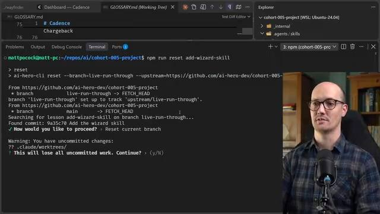
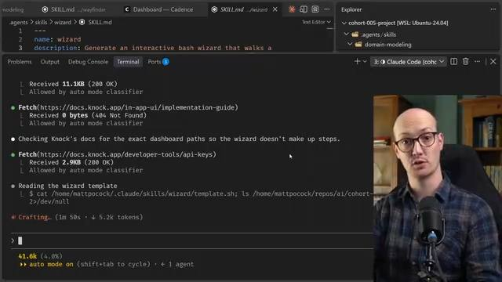
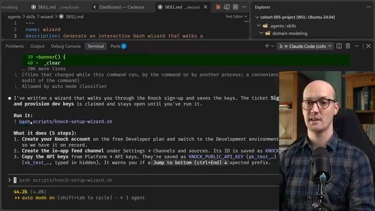
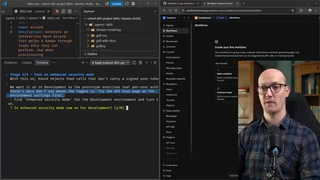
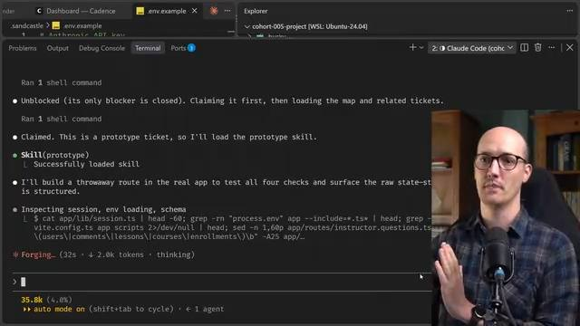
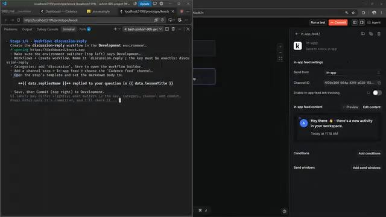
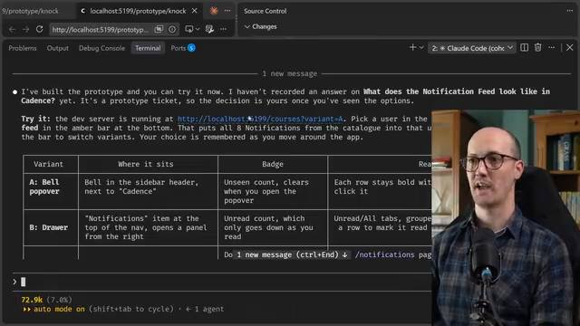
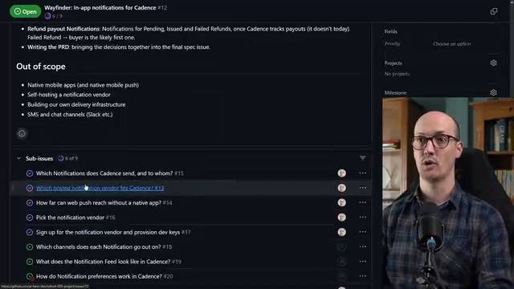

# Software Factories for Real Engineers part1｜P27–P32 复现文档：用 Wizard 开通 Knock，并用原型 Spike 收掉决策

> 范围：P27–P32。  
> 目标产物：本地 `.env` 中 4 个 Knock 开发值、一个可运行的原型 Spike、一轮通知 UI 原型、若干条被写回 Wayfinder map 的决策，以及一张清空 “not yet specified” 雾区的完整 map。  
> 说明：逐字稿没有给出完整仓库源码、Wayfinder 的确切 CLI、wizard 脚本源码和 `.env` 变量名。下面凡逐字稿没有明说的内容，我都会标注“课里没讲”或“示例路径”，不把猜测写成讲师原话。

## 1. 这一节做什么

这一节不是从零讲一个框架，而是把一张 Wayfinder map 从“还有任务没做”推进到“可以交给实现 agent 的完整上下文”。它包含三段工作。

第一段是 P27–P28 的 **Knock 开户与开发密钥 provisioning**。看板上有一个 task ticket，要求注册 Knock 并准备开发密钥。讲师先运行 `npm run reset add wizard skill`，在仓库里加入一个 wizard skill。这个 skill 会生成一个交互式 bash wizard，专门带人完成“只有人才能做”的步骤：注册第三方服务、在陌生 dashboard 里点选、配置凭据、写 CI secrets、做一次性迁移等。随后用 Wayfinder 处理 ticket，agent 生成一个 Knock 设置向导。向导不能放在 agent 的 bash 模式里跑，必须开一个新终端，因为它是交互式的。向导会自动打开 `dashboard.knock.app`，一步步要求创建组织、选择 development 环境、创建 in-app feed channel、复制 public key、secret key、application signing key，并最终把 4 个值写入 `.env`。这 4 个值分别是 feed channel ID、public API key、secret API key、Knock signing key。`.env` 必须被 gitignore。最后回到 agent 让它本地验证；讲师遇到长 signing key 被截断，于是让 agent 只告诉他手动步骤，重新复制 single-line base64 signing key，再让 agent 验证。agent 甚至发了一个真实 signed token 请求到 Knock API，确认本地设置可用，并把 resolution 写回 map。

第二段是 P29–P30 的 **Knock 原型 Spike**。prototype ticket 的目标不是“写生产代码”，而是用更高保真度看东西。讲师明确说 prototype 要 token expensive、要 vibe coding、要不停说“不，我不喜欢这个，给我那个”，直到决策进入代码和 UI。原型不会进主 checkout，而是像 research 文件一样放在随机分支里，agent 可以引用，但不会误认为是正式代码。agent 会 claim prototype skill，在真实 app 里建一个 throwaway route，测试 4 个 check。第一个 check 是 signed user tokens：token 里只有 public key，user two 能读自己的 feed，通过。checks 2–4 需要去 Knock 里配置，于是讲师让 agent 再生成一个 wizard。这个向导带他创建 `discussion reply` workflow、添加 discussion category、加 in-app feed channel step、选择 Cadence Feed、设置 markdown body、commit 到 development；再创建 enrollment workflow、设置 markdown body、commit、trigger；然后处理 platform preferences。中途讲师在 Knock UI 里迷路，直接让 agent 帮忙；最后发现 enrollment 默认关闭不需要在 Knock 里设，Cadence 同步 instructor 到 Knock 时会写入 enrollment off，用户 opt-in 后翻成 1，所以可以跳过 wizard stage three。之后做了一轮很脏但很有价值的 QA：切换 Liam Thompson、Sarah Chen、Olivia Martinez、Emma Wilson、Marcus Johnson、James Park，测 reply 通知、headless feed 刷新、mark read/unread/mark all seen、enrollment notify、opt-in 后再 enroll 是否出现新通知。原型里出现了 `catch null` 这类“忽略错误”的捷径，讲师说这在原型里没关系，但在 review 里会被抓。最后把 learnings 写回 map，ticket 关闭。核心发现是 “off by default” 由 Cadence 设置，不由 Knock 设置；还留下 gotchas 给后续实现 ticket。

第三段是 P31–P32 的 **剩余 ticket 收尾与清雾**。先做 grilling ticket：“每个通知走哪些 channel？”决策是：所有通知都进 notification feed；email 不进 v1；web push 不进 v1；退款相关邮件不要新造 “transactional email” 术语，而是先走 notifications，之后扩展 notification system 加 email；refund approved/declined email 在 notification 有 email channel 时移除；refund requested receipt 也做成 notification，之后再扩展 email；email 在 map 上放 out of scope。然后做 notification feed 的 prototype：agent 生成 A/B/C 变体，包括 bell popover、drawer/inbox、toasts；可以 seed feed、seed 8、seed 100；讨论 badge counts、deleted comments 是否消失、点击是否到最具体位置、pagination、infinite scroll、keep all history；最后选 A2 作为 canonical version，保留 all history，关闭 ticket。最后一个 grilling 是 notification preferences：大部分直接同意，但讲师额外要求“任何触碰 Knock 的代码都要放在 interface 后面”，方便以后换 provider。最后清 context，用 Wayfinder 对 spec number 做最终 grilling，把 “not yet specified” 里的雾全部问掉；所有问题基本 obvious yes，agent 创建并 claim plumbing ticket，雾清空，map 完成。



## 2. 讲师原话（带「—— pNNN [MM:SS]」）

> "如果你运行 npm run reset add wizard skill，就会发生一些有意思的事情。"
> —— p027 [00:00]

> "这会生成一个交互式 bash 向导，引导用户逐步完成只有他们才能执行的步骤。适用于配置基础设施、设置凭据或持续集成密钥，以及在陌生的第三方仪表盘中逐步操作时。"
> —— p027 [00:29]

> "你需要新开一个终端来运行这个向导，因为向导是交互式的，所以你无法在 Claude Code 内的 bash 模式或你自己的智能体中运行它。"
> —— p027 [01:15]

> "我们已经把四个值写入了 .env。现在我的 .env 文件是这样的：信息流频道标识、公开 API 密钥、机密 API 密钥和 Knock 签名密钥。"
> —— p028 [03:22]

> "这个原型会放在主检出目录之外，只放在一个随机分支里。这样智能体可以引用它，但不会把它误认为实际代码。"
> —— p029 [01:16]

> "它在一个一次性的 prototype knock spike 分支上构建了这项技术验证，并替我们运行了开发服务器。所以它实际运行在 localhost:5199 上。"
> —— p030 [01:16]

> "换句话说，我们实际上完成了传统敏捷软件开发中所说的技术验证。我们已经完成了最艰难的部分，好让后续开发变得轻松。"
> —— p030 [11:13]

> "我想对这些尚未明确的内容做最后一次检查。"
> —— p032 [10:42]

## 3. 从零复现

下面按“先开通、再验证、再原型、再收尾”的顺序写。你不需要完全照讲师的屏幕布局，但建议至少准备：一个 agent 窗口、一个普通终端、一个浏览器。向导会自动打开 URL，浏览器放右边，终端放左边，操作最顺。

### 3.0 准备仓库与目录

在课程仓库根目录执行。逐字稿没有给仓库 URL、Node 版本、依赖安装命令，也没有展示 `package.json` 内容；这些以你手上的课程仓库为准。下面用 `<course-repo>` 表示仓库根目录。

```bash
cd <course-repo>
node -v
npm -v
```

建议准备一个示例目录结构。注意：`scripts/` 和下面的文件名是本文为了复现给的示例路径，逐字稿没有规定 wizard 脚本必须叫什么。

```text
<course-repo>/
├── package.json
├── .env                         # wizard 写入，必须 gitignore
├── scripts/
│   ├── knock-setup-wizard.sh    # 从 agent 输出复制，文件名可自定
│   └── verify-env.mjs           # 本文辅助检查脚本
└── ...
```

如果 `.env` 还没有被忽略，先确认 `.gitignore` 里有它。逐字稿明确说 `.env` 是 git ignored，不会进 public repo。

```bash
grep -n '^\.env$' .gitignore || echo '.env' >> .gitignore
```

### 3.1 加入 wizard skill

在仓库根目录运行逐字稿明确给出的命令：

```bash
npm run reset add wizard skill
```

预期：本地目录里出现一个新的 wizard skill。具体目录名、文件结构，逐字稿没有展示，以命令输出和你的文件树为准。这个 skill 的描述大意是：生成交互式 bash wizard，带人完成 provisioning infrastructure、设置 credentials/CI secrets、走陌生第三方 dashboard、做一次性迁移或 cutover。因为它是 model invoked skill，模型通常会在合适时机自己调用它。


### 3.2 用 Wayfinder 处理 Knock 开户 ticket

打开看板上的 task ticket。逐字稿说它带 Wayfinder task label，是 uncleaned、ready to go。然后在 agent 里调用 Wayfinder，把 ticket 编号传进去。逐字稿没有给 Wayfinder 的确切命令，所以下面给的是可直接粘贴的提示词，不是伪造 CLI。

```text
Use Wayfinder on ticket <TICKET_ID>.

This is a task ticket: sign up for Knock and provision development keys.
Generate an interactive bash wizard for the human-only steps, and write the resulting keys to .env.
```

agent 应该会读取 research、Wayfinder map、依赖 ticket，知道当前已经选好 Knock，并去查 Knock 文档里的准确 dashboard path，避免向导编造步骤。逐字稿说当时大约 44k tokens 就生成了一个 Knock setup wizard 的 bash script。



### 3.3 在新终端运行 wizard

不要把它放在 agent 的 bash 模式里跑。复制 agent 输出的脚本，保存成例如 `scripts/knock-setup-wizard.sh`，然后开一个新终端：

```bash
chmod +x scripts/knock-setup-wizard.sh
bash scripts/knock-setup-wizard.sh
```

`chmod +x` 是本文补的常规步骤；逐字稿只说复制脚本、开终端运行。向导会打开 `dashboard.knock.app`，并给出一串步骤。按逐字稿，操作顺序是：

1. 注册或登录 Knock，为 Cadence 创建 account organization。
2. 留在 free developer plan，不要开 trial 或 paid plan。
3. 用左上角 environment switcher 选 development 环境。
4. 把地址栏里的 dashboard URL 粘贴回向导，留档。
5. 左侧栏底部 Settings → Channels and sources → 创建 channel，类型选 in-app feed，名字叫 `Cadence Feed`。如果已经有现成的 in-app feed channel，也可以直接粘贴 channel ID。
6. 左侧栏 Platform API keys，复制 public key。
7. 向导会接收 private key / secret key。逐字稿的原话是“The process has received my private key and my secret key”，具体字段名以 Knock 页面为准。
8. 同一 API keys 页面找 application signing keys，generate a key，复制 single-line base64 encoded version。
9. 打开 enhanced security mode。向导很诚实地提示：Knock docs 没说 toggle 在哪，先试 API keys 页面或 environment settings。讲师实际是在 API keys 页面找到的。
10. 向导完成后会往 `.env` 写 4 个值：feed channel ID、public API key、secret API key、Knock signing key。

这里有一个重要安全点：向导不连接 agent，所以可以往里粘贴 secrets；它不会把 secrets 发给 agent，也就不会发到 Anthropic。但 `.env` 本身必须被 gitignore。



### 3.4 回到 agent 做本地验证

向导跑完后，回到 agent，粘贴逐字稿里的验证请求：

```text
Okay, successfully run the wizard. Can you just verify that everything looks good locally?
```

agent 应该会验证 signing key 格式但不把 key 显示出来。逐字稿里 agent 确实尝试“without revealing it”，因为 agent 知道不要把 key 读进环境变量再打印。讲师遇到的问题是：长的 signing key 没有正确加载，被截断了。于是他换了一种问法：

```text
Could you just tell me how to do that step manually?
```

然后回到 Knock 的 Platform API keys 页面，重新复制 signing key，手动粘贴回 `.env`。再让 agent 验证：

```text
Could you now verify it again? I've just copy and pasted it.
```

预期结果：agent 说一切 checks out，并且发一个真实的 signed token 调用到 Knock API。逐字稿说“it even made a real signed token call to NOx”，这里 NOx 是语音转写噪声，实际就是 Knock API。最后 agent 会把 resolution 记录到 map 上，ticket 关闭。



### 3.5 进入 Knock 原型 Spike

先清 agent context，再用 Wayfinder 处理 prototype ticket。逐字稿里这个 ticket 的问题是“does it hold up against cadence”，也就是用原型验证 Knock 是否撑得住 Cadence 的通知需求。提示词可以这样写：

```text
Use Wayfinder on ticket <PROTOTYPE_TICKET_ID>.

Build a throwaway route in the real app to test all four checks.
Keep the prototype outside the main checkout in a random branch, like the research files.
Run the dev server and tell me the URL.
```

agent 会 claim prototype skill。逐字稿说它安装了 Knock 的 Node SDK，在 `prototype knock spike` 分支上建 spike，并启动 dev server，地址是 `localhost:5199`。第一个 check 是 signed user tokens：token 里只有 public key，user two 能读自己的 feed，通过。checks 2–4 需要去 Knock 里配置。



### 3.6 为 checks 2–4 再生成一个 wizard

讲师直接对 agent 说：

```text
Could you create a wizard for me to set up the thing I need for checks two to four?
```

新终端运行新 wizard。逐字稿里的步骤包括：

1. 创建 workflow，命名为 `discussion reply`。
2. 添加 discussion category，保存，进入 workflow builder。
3. 添加 channel step，选 in-app feed，选 `Cadence Feed`。
4. 打开 steps template，把 markdown body 设置为向导给的内容。
5. Save changes，然后右上角 commit 到 development。
6. 创建新的 enrollment workflow，同样设置 steps template 的 markdown body，commit，trigger。
7. 在 platform preferences 里添加 workflow category `enrollment`，并在其下把 in-app feed channel 的 in-app feed 关掉。
8. 这一步讲师在 Knock UI 里迷路，把整个 stage 复制给 agent，让 agent 帮忙。最后结论是：不需要在 Knock 里设默认关闭，Cadence 同步 instructor 到 Knock 时会写入 enrollment off，用户 opt-in 时翻成 1，所以可以跳过 wizard stage three。



### 3.7 跑原型 QA

讲师用原型 UI 做了很细的 QA。复现时至少覆盖这些状态：

- 以 Liam Thompson 登录，能切换 Sarah Chen。
- 以 Sarah Chen 回复 Emma Wilson 的问题，再切到 Emma，看 headless feed 是否在约 3 秒内出现。
- 以 Sarah Chen notify Olivia Martinez，再切到 Olivia，看 headless feed 是否有通知。
- 在 Olivia 下点 mark read、mark unread、mark all seen。逐字稿发现 mark all seen 不工作。
- 以 Olivia 或任意学生 enroll and notify Marcus Johnson。Marcus 不应收到新通知。
- 以 Marcus 点 opt-in enrollment。再从 James Park enroll and notify Marcus Johnson，Marcus 应看到来自 James Park 的新 enrollment。
- 注意 Knock 里 seen 和 read 不一样：mark as seen 不会让 item 变红，只有 read items 会 dim。这是原型里看起来“坏”的原因之一。
- 原型里可能有 `catch null` 这类忽略错误的写法。讲师明确说 prototype 可以这样，生产 review 会抓。

QA 完成后，回 agent 说：

```text
Okay, I'm pretty happy with this prototype. I think we've done enough QA on it. Let's save our learnings back to the map.
```

agent 会关闭 prototype ticket，把 resolution 写到 map。核心发现是 “off by default” 由 Cadence 设置，不由 Knock 设置；还会留下 gotchas 给后续实现 ticket。逐字稿说这就是传统 agile 里的 spike：先把硬仗打完，让未来开发变简单。

### 3.8 做 notification feed 的 UI 原型

清 context，继续用 Wayfinder 抓下一个 prototype ticket：“what would the notification feed actually look like?”。agent 会生成多个 UI 变体。逐字稿里看到的是 A/B/C：

- A：bell popover。
- B：drawer / 更大面板，可 seed my feed，seed 后出现 8 条通知。
- C：inbox + toasts，可筛选、mark all read、打开链接。

讲师会 seed 8、seed 100，观察 9+ badge、load more、infinite scroll、see all。然后给视觉反馈：不要顶部 totals、不要 unread button、read button 改成更明确的 `mark all as read`、图标小一点。还会问：100 条通知怎么分页？deleted comments 是否从 feed 消失？点击是否去最具体位置？refund request confirmation 是否直接 mark read？最后选择 A2 作为 canonical version，保留 all history，关闭 ticket。



### 3.9 收掉 grilling ticket 和最后的雾

先做 “which channels does each notification go out on?” 的 grilling。逐字稿里的决策是：

- 每个 notification 都落在 notification feed。
- email 不进 v1。
- web push 不进 v1。
- 不新造 “transactional email” 术语。退款相关邮件先走 notifications，之后扩展 notification system 加 email。
- refund approved/declined email 在 notifications 有 email channel 时移除。
- refund requested receipt 也做成 notification，之后可扩展 email。
- email 在 map 上放 out of scope。
- 三个简单 implementation 问题直接同意。
- shared understanding，无 glossary / ADR 变更，resolve ticket。

然后做 notification preferences grilling。大部分直接同意，但讲师额外要求：任何触碰 Knock 的代码都要放在某种 interface 后面，方便以后换 provider。理由是 Knock 目前看起来够用，但如果 pricing 变得奇怪，可能以后要换。最后对 Q9 做一个小 follow-up，关闭 ticket。

最后清 context，对 spec number 做最终清雾：

```text
We've closed every ticket, but there's still some stuff left over in the not yet specified section. Can we have a grilling session about that?
```

逐字稿说 agent 问了一堆 mop up 问题，基本都是 obvious yes。然后 agent 创建并 claim plumbing ticket，map 上的 fog 清空。到这里，所有 grilling、prototyping、决策都变成一个很详细的 map，可以交给实现 agent。



## 4. 完整代码

逐字稿没有贴出 wizard 的 bash 源码，也没有展示 `.env` 的变量名。下面给出两类可直接保存的东西：一类是逐字稿明确出现的命令；另一类是我为了复现检查补的辅助脚本和提示词文件，均标注“课里没有”。

### 4.1 逐字稿明确出现的命令

```bash
# 在课程仓库根目录
npm run reset add wizard skill
```

```bash
# 向导脚本复制并保存后，在新终端运行
# 文件名课里没规定，下面只是示例
chmod +x scripts/knock-setup-wizard.sh
bash scripts/knock-setup-wizard.sh
```

### 4.2 辅助检查脚本 `scripts/verify-env.mjs`

课里没有这段代码。它只做一件事：检查 `.env` 里至少有 4 个非空赋值行，并把值遮住，不打印 secret。它不替代 wizard，也不校验 Knock 是否真的接受这些值。

```js
#!/usr/bin/env node
import { readFileSync } from 'node:fs';

const file = process.argv[2] ?? '.env';
const raw = readFileSync(file, 'utf8');
const lines = raw.split(/\r?\n/);

const entries = lines
  .map((line, index) => ({ line: line.trim(), index }))
  .filter(({ line }) => {
    if (!line) return false;
    if (line.startsWith('#')) return false;
    return /^[A-Za-z_][A-Za-z0-9_]*=/.test(line);
  });

if (entries.length < 4) {
  console.error(
    `[FAIL] ${file} 只检测到 ${entries.length} 个赋值行；` +
    `向导应写入 4 个值（feed channel ID、public API key、secret API key、Knock signing key）。`
  );
  process.exit(1);
}

let emptyCount = 0;

for (const { line, index } of entries) {
  const eq = line.indexOf('=');
  const key = line.slice(0, eq);
  const value = line.slice(eq + 1).trim();

  if (!value) {
    emptyCount += 1;
    console.error(`[EMPTY] 第 ${index + 1} 行 ${key} 的值为空`);
  } else {
    console.log(`[OK] ${key}=<hidden:${value.length} chars>`);
  }
}

if (emptyCount > 0) {
  console.error(`[FAIL] 有 ${emptyCount} 个空值，请重新运行向导或手动补全。`);
  process.exit(1);
}

console.log(
  '[PASS] 至少检测到 4 个非空赋值。' +
  '注意：本脚本不校验值是否真的被 Knock 接受，真实校验仍以 agent 的 signed token 调用为准。'
);
```

运行：

```bash
node scripts/verify-env.mjs .env
```

### 4.3 可直接粘贴的提示词文件 `prompts.md`

课里没有这个文件，但下面的话大部分直接来自逐字稿。把 `<TICKET_ID>`、`<PROTOTYPE_TICKET_ID>` 换成看板上的编号。

```markdown
# Knock 开户与开发密钥

Use Wayfinder on ticket <TICKET_ID>.

This is a task ticket: sign up for Knock and provision development keys.
Generate an interactive bash wizard for the human-only steps, and write the resulting keys to .env.

# 向导运行后的本地验证

Okay, successfully run the wizard. Can you just verify that everything looks good locally?

# 长 signing key 被截断时

Could you just tell me how to do that step manually?

# 手动粘贴后再次验证

Could you now verify it again? I've just copy and pasted it.

# 为 checks 2-4 生成向导

Could you create a wizard for me to set up the thing I need for checks two to four?

# 保存原型学习

Okay, I'm pretty happy with this prototype. I think we've done enough QA on it. Let's save our learnings back to the map.

# 清空 not yet specified

We've closed every ticket, but there's still some stuff left over in the not yet specified section. Can we have a grilling session about that?
```

### 4.4 `.env` 应该有什么

逐字稿只说了四个语义值，没有给出变量名。不要为了“看起来完整”而随便改名；变量名以 wizard 实际写入的为准。你应该在 `.env` 里看到四类值：

```text
# 课里没有给出变量名，下面只写语义，不要照抄成真实配置。
# 1. feed channel ID
# 2. public API key
# 3. secret API key
# 4. Knock signing key（single-line base64）
```

如果你运行 `node scripts/verify-env.mjs .env`，它只会告诉你检测到几个非空赋值，并遮住值。它不能告诉你变量名对不对，因为课里没给变量名。

## 5. 逐行解释

先解释逐字稿明确的命令。

`npm run reset add wizard skill`：这是课程仓库里的 npm script。逐字稿没有展示 `package.json` 的实现，所以不能推断它内部做了什么；从结果看，它会把一个 wizard skill 加进本地目录。这个 skill 的用途不是普通代码生成，而是生成一个交互式 bash wizard，把人类必须手动做的第三方 dashboard 操作串起来。它的描述里明确包含 provisioning infrastructure、设置 credentials/CI secrets、走陌生 dashboard、一次性迁移或 cutover。

`chmod +x scripts/knock-setup-wizard.sh`：这是本文补的常规权限设置。逐字稿只说复制脚本、开新终端运行。加可执行权限是为了后面能直接 `bash` 或 `./` 运行；如果你的脚本本来就能被 `bash` 读取，这一步不是课程重点。

`bash scripts/knock-setup-wizard.sh`：必须在普通终端跑，不能在 agent 的 bash 模式里跑。原因是向导是交互式的，会等待输入、打开 URL、要求你粘贴 dashboard URL、channel ID、API key、signing key。agent 的 bash 模式不适合这种交互。向导不连接 agent，所以你可以放心把 secrets 粘进去；它不会把 secrets 发回 agent。

再解释 `scripts/verify-env.mjs`。

`import { readFileSync } from 'node:fs';`：只用 Node 内置模块，不引入 dotenv 等依赖。这样你不需要额外安装包就能跑。读者是前端转 AI 应用工程师，可以把它理解成 Node 里读文件，类似浏览器里没有的 `fs`。

`const file = process.argv[2] ?? '.env';`：允许 `node verify-env.mjs .env`，也允许不传参数默认读 `.env`。

`raw.split(/\r?\n/)`：同时兼容 Windows 和 Unix 换行。`.env` 经常在复制粘贴时混入 `\r`，这行避免把 `\r` 当成值的一部分。

`.filter(({ line }) => { ... })`：过滤空行、注释行，只保留 `KEY=VALUE` 形式。正则 `^[A-Za-z_][A-Za-z0-9_]*=` 是环境变量常见命名规则。它不验证变量名是否真的是 Knock 的变量名，因为课里没给变量名。

`if (entries.length < 4)`：逐字稿明确说向导写了 4 个值，所以少于 4 个赋值行就报失败。注意这是“至少 4 个”，不是“恰好 4 个”；如果你的 `.env` 还有其他变量，脚本不会误报。

`const eq = line.indexOf('=');`：只按第一个等号切分，值里允许出现 `=`。base64 signing key 可能包含 `=` 填充，这样切不会把值截断。

`value = line.slice(eq + 1).trim()`：去掉值两边空白。长 signing key 被截断时，常见原因就是复制时带了换行或空格；这个脚本能发现空值，但发现不了“值少了几个字符”。所以最终仍要靠 agent 发 signed token 调用来验证。

`console.log(\`[OK] ${key}=<hidden:${value.length} chars>\`)`：只打印 key 和值长度，不打印值。这和讲师让 agent “verify without revealing it” 是同一个安全原则。你在 Node 里也不要写 `console.log(process.env)`，那等于把 secrets 打进日志。

`console.log('[PASS] ...')`：明确告诉读者，这个脚本只检查“有 4 个非空值”，不检查 Knock 是否接受。真实校验是 agent 发 signed token 请求到 Knock API，逐字
……逐字稿说 agent 在本地验证时发了一个真实 signed token 调用到 Knock API，确认本地设置可用，并把 resolution 写回 map。你的复现也应以这个“真实调用成功”为验收点，而不是以脚本打印 PASS 为验收点。

`prompts.md` 里每段提示词的作用不同，不要一次性全粘给 agent：

- `Use Wayfinder on ticket <TICKET_ID>.` 这一句是入口。逐字稿里讲师反复说“call Wayfinder with the ticket number”，说明 ticket 编号是 agent 定位上下文的钥匙。没有 ticket 编号，agent 可能不知道要读哪条依赖、哪份 research、当前 map 走到哪一步。
- `This is a task ticket: sign up for Knock and provision development keys.` 是对 ticket 类型的补充说明。逐字稿里讲师能看出它是 task，是因为看板上有 Wayfinder task label；提示词里再写一遍，是防止 agent 把 task ticket 当成 decision ticket 去 grill。
- `Generate an interactive bash wizard for the human-only steps, and write the resulting keys to .env.` 是让 agent 调用 wizard skill 的关键。逐字稿里讲师没有手写“请调用 wizard skill”，但因为 skill 是 model invoked，描述里又包含 provisioning、credentials、third-party dashboard 这些触发词，agent 自己就抓到了。你如果发现 agent 没抓，可以把这句话原样粘进去；这不算改变课程流程，只是把讲师的意图显式化。
- `Okay, successfully run the wizard. Can you just verify that everything looks good locally?` 是向导跑完后的验证请求。它故意说“locally”，因为 secrets 只在本地；agent 要验证的是格式、是否写入、能否签 token，而不是把值读出来展示。
- `Could you just tell me how to do that step manually?` 是讲师遇到 signing key 截断后的降级策略。它的价值不是“让 agent 重做”，而是让 agent 输出人类可执行的手动步骤。你遇到向导卡住、UI 改版、字段找不到时，都可以用这个句式，把问题从“自动完成”降级为“给我操作说明”。
- `Could you now verify it again? I've just copy and pasted it.` 是手动修复后的二次验证。它明确告诉 agent 你刚做了什么，避免 agent 以为环境没变。
- `Could you create a wizard for me to set up the thing I need for checks two to four?` 是原型阶段复用 wizard skill 的入口。逐字稿里讲师说自己“lazy”，不想手点，于是直接让 agent 生成第二个向导；这说明 wizard 不是一次性脚本，而是可以按当前卡点反复生成的。
- `Okay, I'm pretty happy with this prototype... Let's save our learnings back to the map.` 是关闭原型 ticket 的动作。逐字稿里 agent 随后写了 resolution comment，包含 “off by default 由 Cadence 设置” 和给后续 ticket 的 gotchas。你如果只说“做完了”，agent 不一定会把经验写回 map；明确说“save our learnings back to the map”很重要。
- `We've closed every ticket, but there's still some stuff left over in the not yet specified section...` 是最终清雾入口。逐字稿里讲师强调“before I close the map or before I consider the map to be done”，说明清雾是 map 完成前的最后一道工序，不是可选项。

`.env` 那四行注释也要解释清楚。逐字稿只给出语义，不给变量名，所以复现时不要自己发明一套“看起来很像”的名字然后写进文档当事实。正确的做法是：向导写什么名字就用什么名字；你的验证脚本只数非空赋值，不猜名字。四类值的用途分别是：

- feed channel ID：告诉应用往哪个 in-app feed channel 发通知。逐字稿里讲师在 Knock 里创建或找到了 `Cadence Feed`，并把 channel ID 粘回向导。
- public API key：可以出现在客户端或 signed token 流程里的公开标识。逐字稿第一个原型 check 就是“token 里只有 public key，user two 能读自己的 feed”。
- secret API key：服务端使用，不能进前端 bundle，不能进日志。逐字稿里向导接收了 private key / secret key，并强调向导不连接 agent，所以 secrets 不会离开本机。
- Knock signing key：用于签 user token。逐字稿里它是 single-line base64 encoded version，讲师遇到过长 key 被截断的问题。它也是四个值里最容易因为复制换行而坏掉的一个。

`.gitignore` 里加 `.env` 这一行，逐字稿没有展示具体命令，但明确说 `.env` 是 git ignored，“not going to be saved to our public repo when we commit”。复现时不要跳过。你可以在提交前用 `git status --short` 确认 `.env` 没有出现在 untracked 列表里；如果出现了，说明 ignore 没生效。这个检查命令是本文补的，课里没讲。

原型分支的行为也要解释。逐字稿说 prototype 像 research 一样，放在“random branch”里，agent 可以探索、拉文件，但它不在 main checkout，所以不会混淆成正式代码。这不是单纯的 git 技巧，而是上下文隔离：实现 agent 以后读到 map 上的 resolution 和 gotchas，但不会把 spike 里的 `catch null`、throwaway route、测试按钮当成生产代码。你在复现时不要图省事把 spike 合进主分支；一旦合进去，后续 agent 很可能把原型代码当既有实现继续改。

`localhost:5199` 这个端口是逐字稿明确出现的，但它只是当时 dev server 的端口，不是课程要求。你的 dev server 起在哪个端口，以终端输出为准。不要因为文档写了 5199 就去改项目配置；如果 5199 被占用，按框架默认行为换端口即可。课里没有讲端口配置。

原型里的 “seen” 和 “read” 也要解释。逐字稿里讲师一开始以为 mark all seen 坏了，后来 agent 解释：marking items as seen doesn't make them read，只有 read items 才 dim；Knock 里 seen 和 read 是两种状态。这个区别直接影响 UI 验收：你点 “mark all as seen” 后，badge 数字可能消失，但条目仍有未读圆点；这不是 bug，而是产品语义。复现时要把这两个状态分开测，不要用一个“已读”按钮覆盖两种行为。

“off by default 由 Cadence 设置”这个结论也要解释。讲师在 Knock 的 preference center 里创建了 enrollment 的 preference，但找不到哪里改默认值；agent 最后说不需要在 Knock 里设默认关闭，因为 Cadence 同步 instructor 到 Knock 时会写入 enrollment off，用户 opt-in 时翻成 1。这个结论的价值在于：它把一条产品规则从第三方 dashboard 挪回了自己的代码边界。以后实现 ticket 不需要去 Knock 里找默认开关，而要在 Cadence 同步逻辑里保证写入。逐字稿没有给同步代码，所以复现文档不能编造具体函数名；你只需要把这个 decision 记进 map。

“任何触碰 Knock 的代码都要放在 interface 后面”也要解释。逐字稿里讲师在 notification preferences grilling 时额外加了这个要求，理由是 Knock 目前够用，但 pricing 变奇怪时可能要换 provider。对前端转 AI 应用工程师来说，这相当于在 TypeScript 里定义一个 `NotificationProvider` 接口，再写一个 `KnockNotificationProvider` 适配器；业务代码只依赖接口，不直接 import Knock SDK。课里没有给接口代码，所以第 4 章没有编一段“完整实现”。你只要在实现 ticket 里把这条约束写清楚即可。Java 里对应 interface + implementation，知道即可；Node 里就是普通的对象/类加依赖注入，不需要 Spring 那一套。

## 6. 复现检查清单

下面按阶段列。每一项都尽量对应逐字稿里可观察的结果；课里没给的细节，我会标明“以实际输出为准”。

### 6.1 环境与 skill

- [ ] 在课程仓库根目录执行 `npm run reset add wizard skill`，命令成功退出。
- [ ] 本地目录出现新的 wizard skill。具体路径以命令输出和文件树为准，课里没展示目录名。
- [ ] 能说清这个 skill 的用途：生成交互式 bash wizard，带人做 provisioning、credentials/CI secrets、陌生第三方 dashboard、一次性迁移或 cutover。
- [ ] 知道它是 model invoked skill，agent 可能自己调用；如果没调用，可以把第 4.3 节的提示词粘进去。
- [ ] `.gitignore` 包含 `.env`。提交前 `git status --short` 里看不到 `.env`。

### 6.2 Knock 开户与 `.env`

- [ ] 用 Wayfinder 处理 task ticket，agent 能读到 research、map 和依赖 ticket，知道已经选了 Knock。
- [ ] agent 生成 Knock setup wizard 的 bash 脚本。逐字稿里大约 44k tokens 时生成；你的 token 数会不同，以实际为准。
- [ ] 把脚本保存到本地，例如 `scripts/knock-setup-wizard.sh`，在新终端运行，不在 agent 的 bash 模式里运行。
- [ ] 向导自动打开 `dashboard.knock.app`。
- [ ] 完成注册/登录，为 Cadence 创建 organization。
- [ ] 留在 free developer plan，没有开 trial 或 paid plan。
- [ ] 左上角 environment switcher 选中 development。
- [ ] 把 dashboard URL 粘回向导留档。
- [ ] 创建或找到 in-app feed channel，名为 `Cadence Feed`，拿到 channel ID。
- [ ] 在 Platform API keys 页面拿到 public key。
- [ ] 向导接收 private key / secret key。字段名以 Knock 页面为准。
- [ ] 生成 application signing key，复制 single-line base64 encoded version。
- [ ] 打开 enhanced security mode。逐字稿里 toggle 在 API keys 页面；Knock 文档没写位置，向导也提示先试 API keys 页面或 environment settings。
- [ ] 向导完成后 `.env` 里有四个语义值：feed channel ID、public API key、secret API key、Knock signing key。
- [ ] 运行 `node scripts/verify-env.mjs .env`，至少检测到 4 个非空赋值，且输出没有泄露值。
- [ ] 回 agent 做本地验证，agent 不打印 secret。
- [ ] 如果 signing key 被截断，让 agent 给手动步骤，回 Knock 重新复制，再让 agent 验证。
- [ ] 最终 agent 发出真实 signed token 调用到 Knock API 并成功。逐字稿里这是“everything checks out”的依据。
- [ ] agent 把 resolution 写回 map，ticket 关闭。

### 6.3 原型 Spike

- [ ] 清 agent context，用 Wayfinder 处理 prototype ticket。
- [ ] agent claim prototype skill，在真实 app 里建 throwaway route。
- [ ] 原型在独立分支，例如逐字稿里的 `prototype knock spike`，不在主 checkout。
- [ ] agent 安装 Knock 的 Node SDK。版本课里没给，以仓库 `package.json` / lockfile 为准。
- [ ] dev server 启动，逐字稿里是 `localhost:5199`；你的端口以终端输出为准。
- [ ] check 1 通过：signed user token 里只有 public key，user two 能读自己的 feed。
- [ ] checks 2–4 需要 Knock 配置时，能让 agent 再生成一个 wizard。
- [ ] 在 Knock 里创建 `discussion reply` workflow，添加 discussion category，添加 in-app feed channel step，选择 `Cadence Feed`，设置 markdown body，commit 到 development。
- [ ] 创建 enrollment workflow，设置 markdown body，commit，trigger。
- [ ] 处理 platform preferences 时如果迷路，把当前 stage 复制给 agent，让 agent 给操作说明或程序化方案。
- [ ] 确认 “enrollment 默认关闭不需要在 Knock 里设” 这个结论，并理解它由 Cadence 同步逻辑写入。
- [ ] 能切换 Liam Thompson、Sarah Chen、Olivia Martinez、Emma Wilson、Marcus Johnson、James Park 等身份。
- [ ] Sarah Chen 回复 Emma Wilson 后，Emma 的 headless feed 在约 3 秒内出现通知。
- [ ] Sarah Chen notify Olivia Martinez 后，Olivia 的 headless feed 出现通知。
- [ ] Olivia 下 mark read、mark unread 可工作；mark all seen 在逐字稿里不工作，后来确认是 seen/read 语义差异。
- [ ] Olivia enroll and notify Marcus Johnson 时，Marcus 不应收到新通知。
- [ ] Marcus opt-in enrollment 后，James Park enroll and notify Marcus Johnson，Marcus 应看到新 enrollment。
- [ ] 原型里存在 `catch null` 这类忽略错误的捷径。知道它在 prototype 可接受、生产 review 会被抓。
- [ ] 回 agent 说 “save our learnings back to the map”，prototype ticket 关闭，resolution 里包含 off-by-default 结论和 gotchas。

### 6.4 Notification feed UI 原型

- [ ] 清 context，用 Wayfinder 抓 notification feed prototype ticket。
- [ ] agent 生成多个变体，至少看到 bell popover、drawer/大面板、inbox + toasts 三类。
- [ ] 能 seed feed，逐字稿里有 seed 8 和 seed 100。
- [ ] 观察 9+ badge、load more、infinite scroll、see all 等分页/截断方案。
- [ ] 能回答 badge counts 怎么显示。
- [ ] 能回答 deleted comments 是否从 feed 消失；逐字稿里讲师同意“应消失”。
- [ ] 能回答点击通知是否去最具体位置；逐字稿里讲师同意“应去最具体位置”。
- [ ] 能回答 refund request confirmation 是否直接 mark read；逐字稿里讲师同意。
- [ ] 最终选 A2 作为 canonical version，保留 all history。
- [ ] ticket 关闭，决策写回 map。

### 6.5 最后两张 grilling 与清雾

- [ ] “which channels does each notification go out on?” 的决策全部记录：全进 feed；email 不进 v1；web push 不进 v1；退款邮件先走 notifications；refund approved/declined email 等有 email channel 时移除；refund requested receipt 也做成 notification；email 放 out of scope。
- [ ] notification preferences grilling 完成，记录“Knock 代码必须在 interface 后面”的约束。
- [ ] 清 context，对 spec number 发起最终 grilling。
- [ ] agent 问完 not yet specified 里的 mop up 问题，基本都是 obvious yes。
- [ ] agent 创建并 claim plumbing ticket。
- [ ] map 上的 fog 清空，所有 sub issue 关闭。
- [ ] 能指出 map 已包含每次 grilling、prototype、gotchas，足够交给实现 agent。

### 6.6 最终自检

- [ ] `.env` 没进 git。
- [ ] 原型 spike 没合进主分支。
- [ ] 没有把 agent 打印出的 secret 粘进文档、issue 或聊天记录。
- [ ] 没有把课里没给的变量名、SDK 版本、Wayfinder 命令写成确定事实。
- [ ] 能复述四个核心结论：wizard 用于人类步骤；secrets 不进 agent；原型放独立分支；清雾后才算 map 完成。

## 7. 课里没讲但你会撞上的

这一节专门写“逐字稿没提，但照着复现很可能卡住”的点。它们不是讲师原话，属于工程补充；遇到时不要误以为课程遗漏了关键步骤。

**第一，`npm run reset add wizard skill` 是课程仓库私有脚本，不是通用 npm 命令。** 你在自己的项目里直接运行会报 “Missing script: reset”。逐字稿只说明它会把 wizard skill 加进目录，没有给脚本实现、skill 目录名、文件格式。复现时必须在课程仓库里跑；如果你要移植到自己的仓库，需要自己实现等价的 skill 安装逻辑，或者手动把 agent 生成的 wizard 脚本保存下来。课里没讲怎么移植。

**第二，wizard 脚本的文件名、参数、退出行为都没有规定。** 逐字稿只说复制脚本、开新终端运行。你保存成什么名字、要不要 `chmod +x`、脚本是否会自动打开浏览器、是否会覆盖已有 `.env`，都以 agent 实际输出为准。不要假设它幂等；重复运行前先备份 `.env`，或者先看一眼脚本会不会 `>` 覆盖。这个备份建议是本文补的。

**第三，agent 不一定每次都自动调用 wizard skill。** 逐字稿说它是 model invoked，描述里有 provisioning、credentials、CI secrets、third-party dashboard 这些触发词，所以“usually apply this at the right moments”。但“usually”不是“always”。如果你发现 agent 直接开始手写步骤、没有生成向导，可以把第 4.3 节的第一段提示词原样粘进去，明确要求生成 interactive bash wizard。课里没有讲如何调试 skill 触发；这是实际使用中最常见的偏差。

**第四，向导不连接 agent，所以可以粘 secrets；但你的终端历史和剪贴板仍然可能泄露。** 逐字稿的安全点是“不会发给 Anthropic”。它没有说“终端历史安全”。如果你用 `export KEY=...` 或把值写进命令行参数，shell history 可能留下记录；如果你把向导输出整段复制到聊天窗口，也可能泄露。复现时尽量让向导自己写 `.env`，不要手动 `echo` secret。这个提醒是本文补的，课里没讲。

**第五，Knock dashboard 的 UI 会变，逐字稿里的路径不是永久契约。** 讲师自己就遇到 “Knock docs don't say where the toggle is”，还在 preference center 迷路。你复现时如果找不到 `Channels and sources`、`Platform API keys`、`application signing keys`、`enhanced security mode`，不要硬按逐字稿的点击顺序；把当前页面和 stage 描述复制给 agent，让它基于最新文档给路径，或者让它给程序化方案。逐字稿里讲师就是这么做的。

**第六，signing key 被截断不是罕见问题。** 逐字稿里长 key 没正确加载，讲师重新复制 single-line base64 才修好。常见原因：复制时带换行、终端折行、编辑器自动格式化、`.env` 解析器把 `#` 当注释、值里有未加引号的空格。复现时把 signing key 放在一行，不要手动换行；如果 `.env` 解析器要求引号，以项目实际解析器为准。课里没讲 `.env` 解析器是哪一种，也没给变量名，所以不要照抄网上的 dotenv 示例当事实。

**第七，原型 spike 的依赖安装可能污染主分支的 lockfile。** 逐字稿说 agent 安装了 Knock 的 Node SDK，但没说装在哪、是否改了主分支 `package.json`。如果 spike 在独立分支，依赖变更应跟着 spike 分支走；如果你在 main 上装 SDK 再切分支，lockfile 可能已经变了。复现时先确认当前分支，再让 agent 安装依赖。课里没讲 Monorepo / workspace 的处理方式；如果你的仓库是 monorepo，SDK 应该装在哪个 package，以仓库结构为准。

**第八，`localhost:5199` 可能被占用或被框架忽略。** 逐字稿只记录当时 dev server 跑在 5199。Vite、Next.js、Astro 等不同框架的端口行为不同；课里没讲用的是哪个框架，也没给启动命令。你以终端输出的 `Local: http://localhost:xxxx` 为准。如果 agent 说“running on 5199”但浏览器打不开，先看终端真实输出，不要反复改配置。

**第九，原型里的按钮和身份切换是 spike 专用，不是产品需求。** 逐字稿明确说 prototype skill 被要求“take shortcuts and not worry about creating production ready code”，所以会出现 `catch null`、throwaway route、一堆测试按钮。你复现 QA 时不要把这些按钮当成最终 UI；它们的目的是让你把逻辑跑坏、看失败模式。真正要写回 map 的是决策和 gotchas，不是 spike 代码。课里没讲 spike 代码的保留期限；按讲师的做法，它留在独立分支供参考，不进主 checkout。

**第十，seen 和 read 是两套状态，不要用一个布尔值硬套。** 逐字稿里 mark all seen 看起来不工作，后来确认 Knock 里 seen 和 read 不同：seen 只影响 badge，read 才让条目 dim。你在自己的通知系统里如果只存一个 `isRead`，就复现不出这个差异，也会误解 QA 结果。课里没讲 Knock 的数据模型字段名，所以文档不写具体字段；实现时以 Knock SDK / API 文档为准。前端类比：这就像“已送达”和“已读”回执，不是同一个状态。

**第十一，enrollment 默认值不要在 Knock 里硬设。** 逐字稿的结论是：Cadence 同步 instructor 到 Knock 时写入 enrollment off，用户 opt-in 时翻成 1，所以 Knock 里的默认值可以跳过。你如果在 Knock 后台又设了一个默认关闭，可能出现两处真相，之后很难排查。实现时把这条规则放在 Cadence 的同步/偏好写入逻辑里，并在 map 的 gotchas 里写清楚。课里没有给同步代码，也没有给偏好字段名，不要编造。

**第十二，interface 抽象不是“多此一举”。** 讲师在最后一个 grilling 里明确要求任何触碰 Knock 的代码放在 interface 后面，理由是 pricing 可能变、provider 可能换。前端转 AI 应用工程师容易直接在组件里 `import { Knock } from '@knocklabs/node'`，然后到处调用；一旦要换 provider，改动面会扩散到 UI。正确做法是业务层只依赖一个窄接口，例如“发通知”“读 feed”“更新偏好”“签 user token”，Knock 适配器实现这些方法。课里没给接口定义，本文也不编造；你只需要把约束带进实现 ticket。TypeScript 里用 `interface`，Node 里用依赖注入；Java 里就是 interface + implements，知道即可。

**第十三，token 预算会比你预期高。** 逐字稿里 Knock 设置向导约 44k tokens，原型加 QA 约 107k tokens，UI 原型到 72.9k tokens 时已经生成第一版。讲师说原型阶段“token expensive”“really churn through some tokens”是预期行为。你如果按普通问答的预算去跑，很容易在 QA 中途被截断。实际建议：原型阶段单独开 session，清 context 再进；每完成一轮 QA 就把 learnings 写回 map，不要把所有历史都拖在上下文里。课里没有给 token 上限或模型配置；这些数字只是讲师当时的观察，不是承诺。

**第十四，Wayfinder 的命令形态课里没给。** 逐字稿反复说 “run Wayfinder passing in this ticket”“call Wayfinder with the ticket number”，但没有展示 CLI 是 `wayfinder <ticket>`、还是斜杠命令、还是自然语言提示。本文因此只给提示词模板，不给伪造命令。你复现时以课程仓库的 README / agent 配置为准；如果 agent 不认识 “Use Wayfinder on ticket …”，就看仓库里 skill 的触发词，或者直接说“读取这张 map 上编号为 X 的 ticket 并继续”。不要把本文的提示词当成唯一语法。

**第十五，清雾不是“再问十个问题”的形式主义。** 逐字稿最后对 “not yet specified” 做了一轮 grilling，问题大多是 mop up，答案基本是 obvious yes，然后 agent 创建并 claim plumbing ticket，fog 清空。它的作用是防止 map 关了但还有隐含假设没记录。你复现时如果跳过这一步，实现 agent 可能在遇到未记录的小决策时自己猜；猜错后又要回头改 map。清雾的成本很低，收益是让 map 真正可交接。课里没讲 plumbing ticket 的具体内容；以 agent 实际创建为准。

**第十六，map 是历史记录，不是一次性看板。** 逐字稿提到可以把旧的、已经通过 PR 关闭的 Wayfinder map 拿出来，把当时 out of scope 的东西重新 scope in，扩展出新的 map。这意味着 email、web push 这些被放到 out of scope 的项不会消失，而是留在历史里，等 v2 再开。你复现时不要把 out of scope 的条目删掉；删掉就失去了“当时为什么不做”的上下文。课里没讲 map 的存储格式；它放在 issue tracker 里，这是逐字稿明确说的。

最后给一个最小验收口径：如果你能在一个新终端里跑通向导、在 `.env` 里看到四个非空值且 `.env` 没进 git、让 agent 发出真实 signed token 调用成功、在独立分支跑起原型并完成 4 个 check、把 off-by-default 和 seen/read 两个 gotcha 写回 map、最后清空 not yet specified，那么这一节的项目就算复现成功。其余 UI 变体长什么样、Knock 后台按钮叫什么、token 花了多少，都是过程量，不是验收标准。