# Software Factories for Real Engineers part1（P33–P39）复现文档

> 课程：BV1dJsF6dEeR ｜ 覆盖 P33–P39 ｜ 读者定位：前端转 AI 应用工程师
> 说明：本段课程是「Wayfinder 全流程收尾 + 软件工厂刹车系统」的讲解与演示课。P33–P34 演示把 Wayfinder map 转成 spec、再转成 tickets、再并行实现并产出 PR 的完整链路；P35–P39 讲决策树（one-shot / grill-with-docs / Wayfinder）与三道刹车（automated checks / automated review / human review），并演示 PR skill。**课里没有给出可独立运行的完整源码**，因此第 4 节「完整代码」按课程实际产物给出：可复制的命令序列、PR skill 模板结构、以及标注为「示意」的脚本骨架。凡逐字稿未讲的内容，本文一律标注「课里没讲」。

---

## 1. 这一节做什么

这一段课程解决两个问题。

**第一个问题：把已经规划好的东西真正变成代码和 PR。** 在 P33 之前，讲师已经用 Wayfinder 流程产出了一张 map（包含大量 decision tickets、prototype 分支、研究结论）。P33–P34 演示的是收尾动作：用 `toSpec` 把 map 压成一份 spec，用 `/toTickets` 把 spec 拆成可并行执行的 tickets，清空上下文后跑 `/implementSpec`，让一组 agent 并行实现、自动合并、自动 code review、自动修复 review findings，最终产出一个可以 QA 的 PR。讲师在 P34 末尾亲自在浏览器里验证了通知功能（发讨论问题 → 对方收到通知 → 关掉某类通知后不再收到），证明整条链路端到端可用。

**第二个问题：给软件工厂装刹车。** P35 给出「什么时候 one-shot、什么时候 grill with docs、什么时候上 Wayfinder」的决策树；P36 提出三道刹车：automated checks（只烧 CPU 不烧 token）、automated review（agent 驱动）、human review（人来看）；P37–P39 深入 human review，讲如何用 PR skill 让 PR body 自带可视化摘要、before/after 证据、以及 merge danger（one-way door / two-way door + blast radius），从而让 review 更快、并且把 review 精力优先分配给真正危险的 PR。

对前端转 AI 应用工程师来说，这一节的价值不在于某个框架 API，而在于**一套可迁移的工作流**：如何把「规划产物」喂给 agent、如何让 agent 并行干活并自动合并、如何用 PR body 的结构化模板降低人的认知负担。这些和你写 React 组件时的「先定 props 契约再写实现」是同一类思维。

---

## 2. 讲师原话（带出处）

关于整条链路的目标，讲师说得很直接：

> "我们的 Wayfinder 地图已经完成，现在需要基于它创建规格说明。为此，我会运行 /to-spec，并把 Wayfinder 地图传进去。创建好规格说明后，我会用 /to-tickets 基于它创建工单。工单创建完成后，我会再次清空上下文，然后运行 /implement-spec。"
> —— p033 [00:00]

> "到本课结束时，我们会得到一个已经实现、并会以拉取请求提交到我们仓库的规格说明；我们可以对它做质量检查并检出查看。"
> —— p033 [00:28]

关于 spec 的作用（为什么不让 agent 直接读 map）：

> "你也许可以把地图直接交给一个智能体，然后只说“好，就实现这个”；但我觉得，有了规格说明之后，整件事就变得平顺多了。这有点像把饭喂到智能体嘴边，基本上就是让它们能非常容易地找到自己需要的信息。"
> —— p034 [01:27]

关于并行实现与自动合并：

> "/implement-spec 会并行运行其中许多任务，而且可以看到，这里实际上有五项任务都可以并行运行。"
> —— p034 [01:38]

> "它会在每个分支完成后就直接合并。这真的很不错。"
> —— p034 [04:01]

关于自动 code review 抓到的问题：

> "它发现了两处严重违反编码规范和 glossary.md 的问题。"
> —— p034 [04:21]

> "修复智能体修复了全部 50 条审查发现，剩下的就是去掌握我曾说过要保留的那五件事。"
> —— p034 [04:43]

关于为什么值得为「不想点 UI」去折腾 Management API：

> "事实证明，管理 API 能做到仪表板向导所做的一切。太好了。这意味着，我们实际上可以用智能体把 Knock 工作流写成代码，然后运行脚本。"
> —— p034 [06:42]

关于把新发现固化成 skill：

> "这看起来正是我们应该写成一项技能的事情，只为确保智能体今后知道这一点。"
> —— p034 [07:11]

关于 agent 能自己试错的价值：

> "让智能体进入这些循环——在这些循环中，它对自己正在做什么拥有完整信息，并且能够安全地按下按钮去尝试——意味着你不可避免地会逐步优化，逼近一个真正有效的解决方案。"
> —— p034 [08:24]

关于决策树的核心判断：

> "你要创建的就是那份代码差异吗？它很小吗？……如果那份差异真的很小，那么即使它毫无价值，也多少无所谓。"
> —— p035 [00:37]

> "我其实建议，所有你不打算一次性完成的会话，都先用 Grill with Docs 开始。……你随时可以从 Grill with Docs 进阶到 Wayfinder 会话。"
> —— p035 [01:46]

关于三道刹车：

> "首先，我们有自动化检查，也就是检查代码质量的确定性检查。……这些检查极其有用，因为它们只消耗处理器周期，不消耗词元。"
> —— p036 [00:29]

关于 PR body 的痛点：

> "智能体仍然很不擅长撰写拉取请求说明。它们写出的拉取请求正文往往全是垃圾内容，非常难以审查。"
> —— p037 [00:13]

关于 show me skill 与 PR skill 的关系：

> "我拿了这个“展示给我看”技能，决定把它改造成用于拉取请求的版本。如果你进入项目并运行 npm run reset add PR skill，我们就能看到它。"
> —— p037 [01:46]

关于 one-way door / two-way door：

> "每个拉取请求要么是一扇单向门，要么是一扇双向门。……双向门是一扇你可以穿过去、需要时还能走回来的门。……单向门是一扇只能朝一个方向走的门。你穿过那扇门后，就会因此发生某些事情。它可能是数据丢失，可能产生一些成本，也可能带来安全影响。"
> —— p037 [04:18]

关于 blast radius：

> "如果出了问题，潜在后果是什么？……对于一扇影响范围极大的单向门，你最好相信，我会非常仔细地审查那个拉取请求。"
> —— p037 [05:12]

关于 PR skill 的实际效果（用 glossary 里的词）：

> "注意，这里说的不是“学习者”，而是“学生”，因为拉取请求技能实际上会查看你的词汇表，以确保使用的是你的领域语言。"
> —— p039 [00:50]

---

## 3. 从零复现

这一节按「你手上已经有一张 Wayfinder map」为起点，复现 P33–P34 的收尾链路，以及 P38–P39 的 PR skill 试用。**注意：课里没有给出 `toSpec`、`/toTickets`、`/implementSpec`、`create PR` 这些脚本的源码**，它们属于讲师所在 cohort 项目自带的工具。下面写清楚每一步「你敲什么、看到什么、下一步依赖什么」，并在第 4 节给出可复制的命令与模板。

### 3.1 前置条件

- 你已经在 cohort 项目仓库里，且仓库里存在一张 Wayfinder map（P33 开头讲师说 "我们的 Wayfinder 地图已经完成"）。
- 仓库里已经装好 cohort 的 npm scripts（P34 里出现了 `npm run knock:push workflows`、P38 里出现了 `npm run create PR`、P37 里出现了 `npm run reset add PR skill`）。这些 script 的具体实现课里没讲，你需要在 cohort 项目里确认它们存在。
- 一个可用的 agent 会话（讲师用的是 Claude 系工具，P34 提到 "Claude 工作树"）。
- 如果要跑 P34 后半段的 Knock 工作流推送，需要一个 Knock 账号，并在 dashboard 里创建 service token（见 3.4）。

### 3.2 第一步：map → spec

在 agent 会话里执行：

```
toSpec <你的 Wayfinder map>
```

讲师的实际观察（p034 [00:00]–[00:19]）：`toSpec` 会去读所有 decision tickets；它本身「doesn't actually know anything about Wayfinder」，只是看到有一堆 decision tickets 就去全部拉取；然后它会 **propose seams**（提出模块边界/接缝），让你先过目。

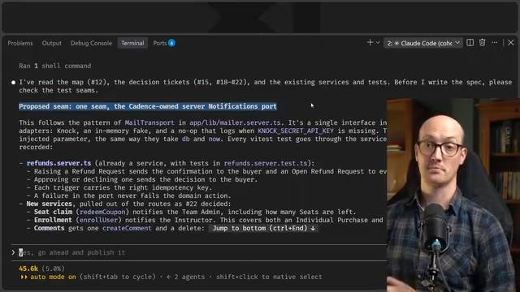

你确认 seams 没问题后，spec 生成。讲师产出的 spec 里包含（p034 [00:40]–[01:27]）：

- 问题陈述（"处于节奏中的人无法察觉与他们相关的事情已经发生"）
- 61 条 user stories
- 一组 implementation decisions（例如 "通知只存在于 knock 中"）
- 完整的 notification catalog
- services that fire notifications
- preferences 章节
- user sync、client feedback、feed UI
- 底部的 references：prototype 分支被显式列出，整张 map 被压缩进来

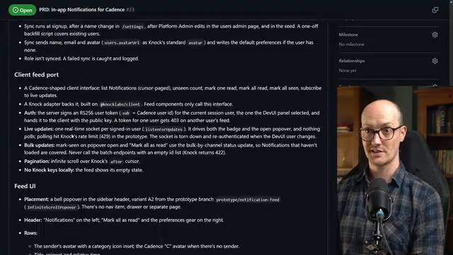

**关键点**：spec 是 map 的「压平版」。讲师的原话是 "手把手喂给智能体"，目的是让 agent 容易找到需要的信息。

### 3.3 第二步：spec → tickets

回到 agent 会话，执行：

```
/toTickets
```

讲师观察（p034 [01:38]–[02:34]）：tickets 被拆成很多小 ticket；`implementSpec` 会把能并行的并行跑，当时看到「5 个可以并行」；讲师觉得 12 个太多，手动收敛到 8 个左右；tickets 之间有 blocking 关系（和 decision tickets 一样的机制）；最前面是 tracer bullets（先打通一条端到端细线）。

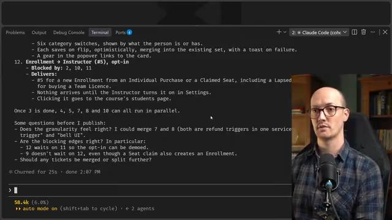

### 3.4 第三步：清空上下文，跑 implementSpec

讲师强调「clear the context again」再跑，避免把前面的规划对话带进实现阶段：

```
/implementSpec <spec 编号>
```

然后**不要盯着**（"我不打算一直盯着这个"）。讲师离开几小时，回来做 autopsy。实际发生的动作（p034 [02:43]–[05:13]）：

1. 探索 Knock prototypes，把探索笔记保存到 cohort 的 notes 目录（逐字稿说的是 "超过五条笔记的群组"，具体路径以你项目实际为准）。
2. 创建 Implementer，合并第一块实现；再合并第二块。
3. orchestrator 发现前一个 Implementer 有问题：它把 Claude work trees 里的 test 文件也扫进去了，导致 test count 出现重复。于是让 follow-up agent 在 vitest config 里排除那个目录。
4. 后续 implementer 继续建 tracer bullet，merger agent 合并进 `feature notifications` 分支。
5. 一次并行实现 5 个 ticket（feed、full behavior、discussion questions、refund notifications、seek claim 等）。
6. 合并策略：**谁先完成先合谁**（"它只是每完成一个分支就合并"）。
7. 全部合并后跑 code review skill：spec review + standards review。
8. review 抓到 2 个 coding standards / glossary.md 的硬违规（例如新文案用了 glossary 说不要用的词；test helper 里加了不该加的东西；`seek claim server.ts` 的错误信息有问题），还有一些 smells 和 spec 差异。
9. 派一个 fix agent 修掉 50 条 review findings，保留讲师指定要留的 5 条。

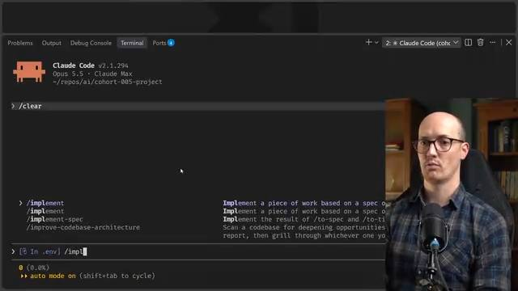

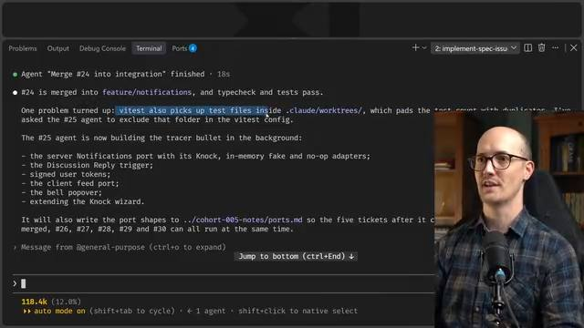

### 3.5 第四步：Knock 工作流用代码管理（可选，但讲师强烈推荐）

讲师不想再点一遍 Knock UI wizard，于是让 agent 研究 Knock 的 Management API 和 CLI。结论（p034 [05:38]–[06:42]）：Management API 能做 dashboard wizard 的所有事，于是可以把 workflow 写成 JSON 文件，用脚本推送。

操作步骤：

1. 在 Knock dashboard 里创建 service token：路径是 **Cadence settings → Service tokens → Add service token**，名字随便（讲师用了 "local agent"）。
2. 把 token 写进 `.env`，变量名讲师用的是 `KNOCK_SERVICE_TOKEN`（逐字稿原话 "把 knock 服务令牌添加到 .env"，变量名以你项目实际为准）。
3. 跑 `npm run knock:push workflows`（逐字稿里写作 "Knock：推送工作流"，即 `knock:push` 这个 script 加 `workflows` 参数）。
4. 第一次跑报错，缺 action URL 之类的必填项；把报错贴回 agent，agent 自己修，再跑，8 个 workflow 全部创建并提交到 development 环境。

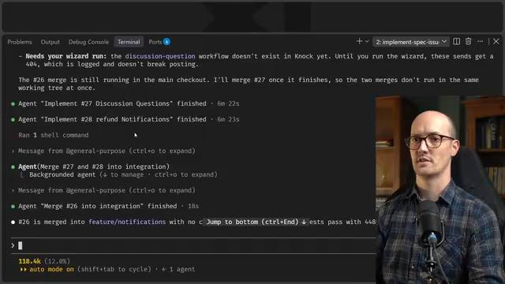

同时让 agent 写一个**很短的 skill**（约 25 行）来固化这件事，skill 的描述大意是：从代码创建/修改 Knock workflow 时使用；当新增 notification kind、改 workflow template 或 category、或 trigger 返回 404（workflow 缺失）时使用。讲师原话见 p034 [08:05]–[08:24]。

### 3.6 第五步：浏览器 QA

讲师用 Marcus Johnson 登录，点左上角通知铃铛，进入 notification settings，看到 enrollments / discussion questions / discussion replies 等开关；用 Emma Wilson 账号在某节课下发一条讨论问题；切回 Marcus 收到通知，点进去直达评论；回复后切回 Emma，Emma 也收到通知（带头像）；然后在 Emma 的设置里关掉 discussion replies，再让 Marcus 回复，Emma 不再收到通知。

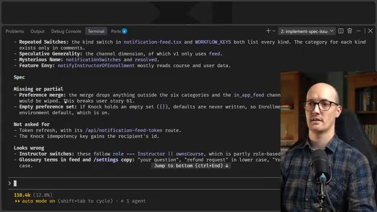

这一段是整条链路的验收标准：**通知能发、能点、能按偏好关闭**。

### 3.7 第六步：试用 PR skill（P38–P39）

1. 跑 `npm run create PR`。它会基于某个 commit 创建 base 分支和 PR 分支，生成一个 draft PR，但 **PR body 是空的**。讲师这次拿到的是 PR #34。
2. 回到 agent，说：「take PR number 34 and write a PR body for it」。agent 会自动加载 PR skill（`PR skill MD` 文件），并跑 type check 和 test suite 作为证据。
3. agent 给出 proposed body，确认后 post。
4. 读 PR body：先看 summary 里的 JSX 风格 diff 图，再看 evidence（before/after），最后看 merge danger（one-way / two-way + blast radius）。

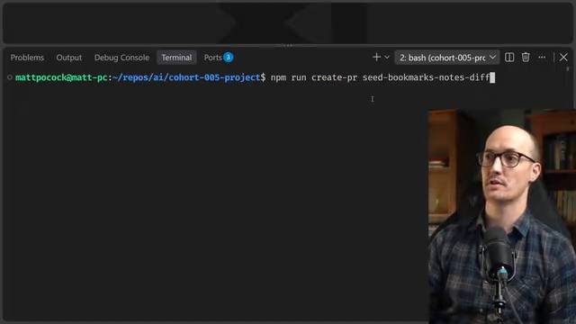

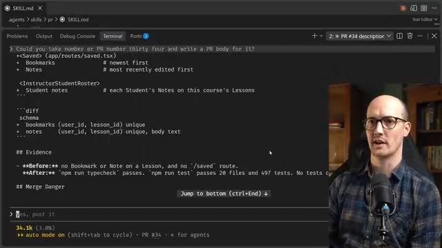

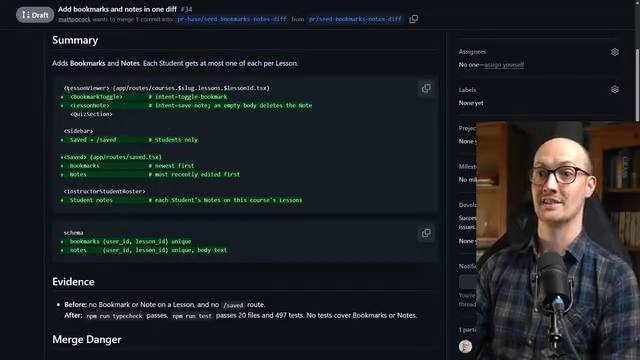

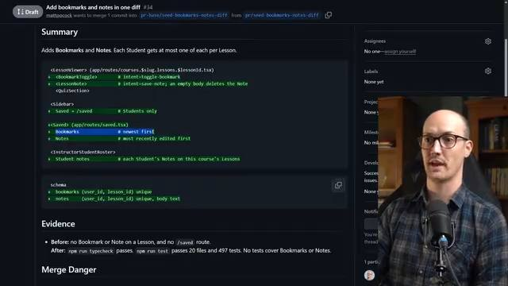

---

## 4. 完整代码

> **重要声明**：P33–P39 的逐字稿里**没有出现任何完整源码文件**。`toSpec`、`/toTickets`、`/implementSpec`、`create PR`、`reset add PR skill` 都是 cohort 项目自带的 npm script / skill，其实现课里没讲。下面第 4.1 节是**可直接复制执行的命令序列**（这是本段课程真正可复现的部分）；第 4.2 节是 PR skill 的**模板结构**（依据 p037 讲师对模板的描述重建，标注为「按讲师描述重建」）；第 4.3 节是**示意代码**，用于帮助前端读者理解「并行实现 + 先完成先合并」的逻辑，**课里没有这段代码**。

### 4.1 可复制执行的命令序列

```bash
# 0. 前置：确认你在 cohort 项目根目录，且 node_modules 已安装
pwd
ls package.json

# 1. map -> spec（在 agent 会话里执行，不是 shell）
#    toSpec <wayfinder-map>

# 2. spec -> tickets（在 agent 会话里执行）
#    /toTickets

# 3. 清空上下文后，跑实现（在 agent 会话里执行）
#    /implementSpec <spec-number>

# 4. （可选）Knock 工作流用代码管理
#    4.1 在 Knock dashboard: Cadence settings -> Service tokens -> Add service token
#    4.2 把 token 写进 .env（变量名以你项目实际为准，讲师用的是 KNOCK_SERVICE_TOKEN）
echo 'KNOCK_SERVICE_TOKEN=你的token' >> .env
#    4.3 推送 workflow
npm run knock:push workflows

# 5. 创建 draft PR（PR body 为空）
npm run create PR

# 6. 在 agent 会话里让 agent 写 PR body
#    "take PR number <N> and write a PR body for it"

# 7. （可选）把 PR skill 装进项目
npm run reset add PR skill
```

### 4.2 PR skill 模板结构（按讲师 p037 描述重建）

讲师在 p037 [01:46]–[03:22] 描述了 PR skill 的组成：顶部 summary（来自 show me skill 的可视化解释器）、evidence 段（before 失败 / after 成功）、merge danger 段（door + blast radius）。下面按这个结构写成一份可用的 skill 模板文件。**文件路径课里没讲**，按 cohort 惯例放在 skills 目录下；内容是按讲师描述重建，不是逐字稿原文。

```markdown
---
name: pr-body
description: Used when writing a PR body. Produces a visual summary, before/after evidence, and a merge danger assessment.
---

# PR Body Writer

Write the PR body in this exact order. Skip preamble. Keep prose brief. Prefer visual pseudo-code explainers over paragraphs.

## 1. Summary (get the "why" fast)

Use visual pseudo-code explainers, not prose:

- UI changes: JSX-style before/after sketch of the component tree
- File responsibility changes: a file layout diff
- Component interaction: a mermaid diagram
- Call tree / call stack changes: an indented call tree diff
- Data model changes: a schema diff

Keep each block short. The reader should understand the intent of the change before reading any code.

## 2. Evidence (prove the change works)

Two subsections, both required:

### Before
Show the failure. For bug fixes: the failing test output or the broken behavior.
For new features: the absence (e.g. "no bookmark toggle exists on lesson viewer").

### After
Show the success. Rank evidence quality:

- S tier: screenshots, when the change is visual and the environment supports it
- A tier: execution-based evidence — console output, test results, the exact test that now passes

If evidence is weak, say so explicitly. Do not fake it.

## 3. Merge danger (how much review does this need)

### Door
- one-way door: merging causes something irreversible — data loss, cost, security implication, mass email, breaking change in a public library
- two-way door: can be merged and unmerged safely

### Blast radius
If this goes wrong, what are the ramifications? Small / medium / large, with one sentence of justification.

### Priority
Combine door + blast radius into a review priority: high / medium / low.
Two-way door with small blast radius may be reviewed on main.

## 4. Domain language

Use the project glossary. If the glossary says a word is forbidden, do not use it.
```

### 4.3 示意代码：并行实现 + 先完成先合并（课里没有代码，以下为示意）

这段代码**不是课程内容**，只是把 p034 描述的「implementSpec 并行跑、谁先完成先合谁」翻译成前端读者熟悉的 Node 写法，帮助你理解编排逻辑。真实实现课里没讲。

```javascript
// orchestrator.demo.mjs —— 示意，非课程源码
// 目的：演示 p034 描述的「并行实现 + 先完成先合并」编排逻辑

const tickets = [
  { id: 'T1', deps: [] },
  { id: 'T2', deps: ['T1'] },
  { id: 'T3', deps: ['T1'] },
  { id: 'T4', deps: ['T1'] },
  { id: 'T5', deps: ['T1'] },
];

// 模拟一个 agent 实现一个 ticket，返回耗时
function implement(ticket) {
  const ms = 100 + Math.random() * 400;
  return new Promise((resolve) =>
    setTimeout(() => resolve({ ticket: ticket.id, ms: Math.round(ms) }), ms)
  );
}

// 模拟合并进集成分支
function merge(result) {
  console.log(`merged ${result.ticket} (took ${result.ms}ms)`);
}

async function run() {
  const done = new Set();
  const running = new Map();

  while (done.size < tickets.length) {
    // 找出依赖已满足、且没在跑的 ticket
    const ready = tickets.filter(
      (t) => !done.has(t.id) && !running.has(t.id) && t.deps.every((d) => done.has(d))
    );

    // 全部塞进并行池（p034 里一次并行 5 个）
    for (const t of ready) {
      const p = implement(t).then((r) => {
        merge(r);          // 谁先完成先合谁
        done.add(t.id);
        running.delete(t.id);
        return r;
      });
      running.set(t.id, p);
    }

    if (running.size === 0 && done.size < tickets.length) {
      throw new Error('deadlock: 有 ticket 的依赖永远无法满足');
    }

    // 等任意一个完成，再进入下一轮调度
    await Promise.race(running.values());
  }

  console.log('all tickets merged');
}

run().catch((e) => {
  console.error(e.message);
  process.exit(1);
});
```

运行方式（Node 18+）：

```bash
node orchestrator.demo.mjs
```

输出形如：

```
merged T1 (took 213ms)
merged T3 (took 187ms)
merged T2 (took 402ms)
merged T5 (took 355ms)
merged T4 (took 298ms)
all tickets merged
```

（具体顺序和耗时每次不同，因为用了随机数。）

---

## 5. 逐行解释

### 5.1 命令序列（4.1）

- `toSpec <wayfinder-map>`：把 map 压成 spec。讲师强调 `toSpec` 本身不懂 Wayfinder，它只是「看到一堆 decision tickets 就全拉过来」。所以你的 map 里 decision tickets 写得越结构化，spec 质量越高。
- `/toTickets`：把 spec 拆成带 blocking 关系的小 ticket。讲师手动把 12 个收敛到 8 个，理由是「picking these numbers out of the air, just based on what feels right」——**这一步没有硬性公式，是经验判断**。
- `/implementSpec <spec-number>`：并行实现。讲师特意先 clear context，因为前面的规划对话对实现阶段是噪音。
- `npm run knock:push workflows`：把 JSON 定义的 workflow 推到 Knock。第一次会因缺 action URL 失败，把报错贴回 agent 让它自己修——这正是 p034 [08:24] 说的「agent 有完整信息 + 能安全按按钮 = 必然爬向可用解」。
- `npm run create PR`：生成 draft PR，**body 为空**。这是设计上的：body 交给 PR skill 写。
- `npm run reset add PR skill`：把 PR skill 装进项目。讲师说这个 skill「mostly a copy of show me」。

### 5.2 PR skill 模板（4.2）

- **为什么 summary 用 JSX 风格 diff 而不是文字**：p037 [01:18] 讲师说 "我一下子就更快地理解了这次变更的意图"。前端读者对此应该很熟——你看一个组件的 before/after 结构图，比读三段文字快得多。
- **为什么 evidence 必须有 before**：p037 [02:56] "我们需要之前的状态，这样智能体才能证明之前发生的事情确实是坏的。" 没有 before，agent 可以声称「修好了」但你没证据。这对 bug fix 是硬要求。
- **为什么 evidence 分 S/A  tier**：p037 [03:22] 截图是 S tier（视觉改动 + 环境支持），执行证据是 A tier（跑代码拿 console output / test result）。分级的作用是让你知道「这条证据有多硬」。
- **为什么 merge danger 要拆成 door + blast radius 两个维度**：p037 [05:12] 讲师明确说这两个是不同概念——「You can have a two-way door that if it goes wrong, it could be bad, but you can easily walk it back. But a one-way door that has a massive blast radius, you better believe that I'm gonna review that PR very closely.」两个维度组合才得出 review priority。
- **为什么模板里要写「Use the project glossary」**：p039 [00:50] 讲师发现 PR skill 自动用了 glossary 里的 "students" 而不是 "learners"，这是它读 glossary 的结果。把这条写进模板，是把这个行为固化。

### 5.3 示意代码（4.3）

- `tickets` 数组里的 `deps` 对应 p034 说的 "阻塞关系"。
- `implement()` 用 `setTimeout` 模拟 agent 耗时，因为真实 agent 调用是异步且耗时不可预测的。
- `merge(r)` 在 `.then` 里立即调用，对应 p034 [04:01] "它只是每完成一个分支就合并"——**不是等全部完成再合，是完成一个合一个**。
- `Promise.race(running.values())` 是调度核心：每轮等「任意一个」完成，然后重新计算 ready 集合。这对应 p034 里「5 个并行、完成一个补一个」的行为。
- `deadlock` 检查：如果还有 ticket 没做但没有任何在跑，说明依赖成环。真实编排器也需要这个保护，否则会静默挂起。
- **在 JS/Node 里对应什么**：这段代码本身就是 Node。如果你在浏览器里做类似编排，`Promise.race` 同样可用；区别是浏览器没有 `process.exit`，用 `throw` 即可。

### 5.4 决策树（P35）的落地解释

讲师给的判断顺序是：

1. diff 是不是 tiny？是 → one-shot，直接让 agent 干，事后 review。
2. 不是 tiny → 从 grill with docs 开始。
3. 在 grill with docs 过程中发现「雾比想象中大」→ 升级成 Wayfinder。

为什么「不要一上来就 Wayfinder」：p035 [02:34] "如果你从 Wayfinder 开始，然后意识到哦其实我刚做了所有这些仪式、创建了这张大图，而它实际上比我想的简单得多……那就很难补救了"。**降级比升级难**，所以从轻的开始。

### 5.5 三道刹车（P36）的落地解释

- **automated checks**：unit test、type check、linter。讲师的原话是「only cost CPU cycles. They don't cost tokens」——所以可以「go nuts」，堆很多。
- **automated review**：agent 驱动的 review，就是 P34 里 code review skill 干的事（spec review + standards review）。
- **human review**：人看。P37–P39 整段都在优化这一层：用 PR skill 让人的时间花在「判断」而不是「理解」上。

三者的关系是：automated checks 最便宜、最确定；automated review 次之；human review 最贵，所以要用前两者把明显问题挡掉，人只看真正需要判断的（尤其是 one-way door + 大 blast radius）。

---

## 6. 复现检查清单

按顺序打勾，任何一项不过就不要进下一步。

**链路部分（P33–P34）**

- [ ] 仓库里存在一张 Wayfinder map，且 map 里有 decision tickets
- [ ] `toSpec` 能跑通，且它提出了 seams 供你确认
- [ ] 生成的 spec 里能看到：问题陈述、user stories、implementation decisions、notification catalog、references（含 prototype 分支列表）
- [ ] `/toTickets` 生成的 tickets 带 blocking 关系，且最前面有 tracer bullet
- [ ] 跑 `/implementSpec` 前清空了上下文
- [ ] 实现过程中能看到：探索原型 → 写笔记 → 建 implementer → merger 合并 → 并行实现多个 ticket
- [ ] 合并策略是「先完成先合并」，不是等全部完成
- [ ] 全部合并后跑了 code review（spec review + standards review）
- [ ] review findings 被 fix agent 处理，且你确认了「要保留的几条」确实被保留
- [ ] （若做 Knock）service token 已创建并写入 `.env`
- [ ] （若做 Knock）`npm run knock:push workflows` 最终成功，8 个 workflow 在 development 环境可见
- [ ] 浏览器 QA：A 用户发讨论问题 → B 用户收到通知 → 点通知直达评论 → B 回复 → A 收到通知 → A 关掉某类通知 → B 再回复 → A 不再收到

**PR skill 部分（P38–P39）**

- [ ] `npm run create PR` 生成了 draft PR，且 body 为空
- [ ] agent 能自动加载 PR skill（不需要你手动 invoke）
- [ ] PR body 的 summary 用了可视化解释器（JSX 风格 diff / mermaid / 文件布局 diff 之一）
- [ ] PR body 有 before 和 after 两段 evidence
- [ ] PR body 有 merge danger 段，明确写了 one-way / two-way 和 blast radius
- [ ] PR body 使用了 glossary 里的词（没有用 glossary 禁用的词）
- [ ] 你能仅凭 PR body 判断「这个 PR 需要多少人工 review」

**决策树部分（P35）**

- [ ] 你能对最近 5 个任务分别判断：该 one-shot / grill with docs / Wayfinder
- [ ] 你知道从 grill with docs 升级到 Wayfinder 的具体触发条件（雾比预期大）

---

## 7. 课里没讲但你会撞上的

这一节列的是逐字稿没覆盖、但你照着做一定会遇到的问题。**以下内容不是讲师原话**，是复现时的事实提醒。

1. **`toSpec` / `/toTickets` / `/implementSpec` / `create PR` 的源码课里没讲。** 它们是 cohort 项目自带的 npm script 和 skill。你如果不在 cohort 项目里，需要自己实现或找等价工具。本文第 4.3 节的示意代码只演示编排逻辑，不包含 agent 调用、worktree 管理、review skill 等真实实现。

2. **`npm run knock:push workflows` 的 script 名和参数格式课里没讲全。** 逐字稿说的是 "Knock：推送工作流"，本文按 npm script 惯例写成 `npm run knock:push workflows`。你项目里的实际名字请以 `package.json` 为准。

3. **`.env` 里的变量名课里没明说。** 讲师只说 "把 knock 服务令牌添加到 .env"。本文用 `KNOCK_SERVICE_TOKEN` 是合理推测，**请以你项目实际读取的变量名为准**。

4. **Knock Management API 的具体 endpoint、认证 header 格式课里没讲。** 讲师只说「Management API 能做 dashboard wizard 的所有事」，并让 agent 去研究。你需要让 agent 读 Knock 官方文档。

5. **`create PR` 生成的 PR 编号是动态的。** 讲师这次是 #34，你跑出来可能是别的号。后续让 agent 写 body 时要把实际编号传进去。

6. **PR skill 的文件路径课里没讲。** 本文 4.2 节的文件头（`name` / `description`）是按常见 skill 格式写的，**不是逐字稿原文**。`npm run reset add PR skill` 具体把文件放到哪，以你项目为准。

7. **`show me` skill 是 Dex Horthy（HumanLayer）的作品，课里只是引用。** 讲师说 PR skill「mostly a copy of show me」。如果你要追溯原始 skill，需要去 HumanLayer 的公开资料找，课里没给链接。

8. **agent 并行实现时的 worktree 隔离课里没细讲。** p034 提到 "Claude 工作树" 和「test 文件被重复扫入」的问题，但没有给出 worktree 的创建/清理命令。你实际跑的时候大概率要自己处理 worktree 生命周期，否则会残留目录。

9. **review findings 的「50 条」和「保留 5 条」是讲师那一次的具体数字。** 你跑出来的数量会不同，不要拿这个数字当验收标准。

10. **P35 的决策树是经验判断，不是公式。** 讲师自己说 ticket 数量是 "凭空挑出这些数字"。你需要在自己的项目里校准「tiny / medium / huge」的阈值。

11. **P36 提到的 automated checks 具体清单（unit test / type check / linter）课里只列了名字，没给配置。** 讲师说这部分「will be done in the feedback loop section later」，也就是本段课程之外。

12. **one-way door / two-way door 的概念讲师说「comes from AWS I think」**（p037 [04:18]），课里没有给原始出处。如果你要在团队里引用，建议自己补一下 AWS 的原文。

---

**小结**：P33–P39 是一条「规划产物 → 代码 → PR → 人的 review」的完整收尾链路，外加一套「什么时候用多重流程、什么时候踩刹车」的判断框架。真正可复制的是命令序列（4.1）和 PR body 的结构（4.2）；编排逻辑（4.3）是示意，帮你理解 p034 描述的行为。照着第 6 节清单走一遍，你就能把这条链路在自己的项目里跑通。