# Software Factories for Real Engineers part1：自动化评审、Retro 与“战略编程”落地手册

> 覆盖 P040–P046。这一段的主题不是“再讲一遍怎么写代码”，而是把**自动化评审（automated review）→ 人工评审（human review）→ 复盘（retro）→ 反哺编码规范**这条闭环真正跑起来，并且用 John Ousterhout 的“战术编程 vs 战略编程”给整条闭环一个理论底座。
>
> 说明：本课是**流程/工作流课**，逐字稿里出现的“代码”主要是 skill 文件、`codingstandards.md`、PR 评论、以及 agent 会话产物，而不是一个从零手写的应用。因此第 3、4 节按“纯讲解课”的写法处理：把讲师的推导过程复现成可执行步骤，把方案落成可用的产物（规范条目表、skill 触发方式、检查清单）。凡逐字稿没讲的，一律标注“课里没讲”。

---

## 1. 这一节做什么

这一段要解决一个非常具体的问题：**在把 PR 交给人类之前，怎么让机器先把质量抬到尽可能高，并且让每一次人类评审都变成系统的一次升级，而不是一次重复劳动。**

拆成四件事：

1. **建立自动化评审层**（P040）。讲师的核心论点是：工作从 automated checks → automated review → human review 逐级流转，每一级质量都应上升；到人类手上时，代码应该已经“尽可能好”，不要浪费人的时间去评审垃圾代码。自动化评审之所以值得单独做，是因为**实现 agent 和评审 agent 的上下文是分开的**：实现 agent 要探索代码库、实现、调试，任务很重；而评审 agent 拿到的是现成的 diff，不需要找、不需要探索、不需要改文件，于是可以把大量指令（规范、模式、要删的东西）压进它的上下文里。
2. **跑一次真实的自动化评审**（P041–P042）。拿一个“质量可疑地低”的 PR，用 `code review PR号` 触发，并且明确要求 **“and fix what you find”**——讲师强调自动化评审应当**主动修复**，而不是只产出一堆评论再丢给人。评审是**两轴**的：coding standards（规范）+ spec（需求规格）。
3. **把人工评审变成系统改进**（P043–P045）。讲师说这是他一直“burying the lead”的第三件事：人工评审不只是检查代码对不对，更是**改进产出代码的那个系统**。原则是“**你永远不应该把同一条评论留两次**”。落地工具是 retro skill。
4. **给这一切一个理论解释**（P046）。vibe coding 出来的代码库为什么难用？因为 agent 是“**战术龙卷风（tactical tornado）**”——产出极快、只盯着眼前任务、不思考代码库长期健康。战略工作必须由人承担。

---

## 2. 讲师原话（带出处）

> "随着工作从自动检查推进到自动评审，最后再到人工评审，每个阶段的质量都会提高；等到进入人工评审时，你希望代码已经尽可能好。换句话说，你不希望浪费人力去评审垃圾代码。"
> —— p040 [00:00]–[00:22]

> "代码评审代理不需要寻找差异，也不需要探索差异。它已经就在代码库中正确的位置。它没有任何真正需要修改的文件。而且你完全可以在代码评审中加入大量指令。"
> —— p040 [01:01]

> "CodeReview 会在子代理中运行自己的 CodeReview。也就是说，它当场就会获得一个全新的上下文窗口。"
> —— p040 [01:29]

> "它会查看 codingstandards.md。换句话说，任何我们希望在自动评审步骤中被识别出来的内容，都可以放进 codingstandards.md。"
> —— p040 [01:29]–[01:55]

> "我完全不介意把这些代码标准对实现代理隐藏起来……这意味着实现代理可以自由地产出一个粗略草稿，然后代码评审……可以再来把它打磨好；换句话说，实现环节只是负责让它能用，而代码评审负责让它变好。"
> —— p040 [02:18]–[02:51]

> "我还会加上一句……并修复你发现的问题。我认为在自动评审中，代理应该主动尝试修复它注意到的问题。"
> —— p041 [00:12]–[00:18]

> "它用来比较的内容构成双轴评审。我们已经谈过编码标准，但可能还需要一份规范作为评审依据。"
> —— p041 [00:43]–[01:05]

> "你绝不应该被迫把同一条评论提两次。"
> —— p043 [00:29]–[00:56]

> "人工评审不仅是为了改进代码，也是为了改进自动评审和改进自动检查。"
> —— p043 [01:08]

> "代理通常会默默忍受，不会向你抱怨它们的配置实际上有多糟糕。"
> —— p043 [02:27]–[02:55]

> "复盘环节可能会陷入一种奇怪的循环，不断尝试改进，结果却进入更糟的状态。"
> —— p045 [03:19]

> "代理是战术龙卷风。它们不知疲倦地工作，能产出无穷无尽的代码，但它们不会进行战略性思考。"
> —— p046 [03:38]–[04:02]

> "那些程序员需要有人替他们进行战略性思考。"
> —— p046 [04:41]

---

## 3. 从零复现

这一节按“你坐在电脑前，从空目录开始，一步步把这条流水线搭起来”的顺序写。命令与文件名严格取自逐字稿；逐字稿没给的（比如仓库怎么初始化、Node 版本）标注“课里没讲”。

### 3.1 前置条件

- 一个**已有代码库**，且已经能跑测试、能跑类型检查。逐字稿里讲师用的是 TypeScript 项目（提到 `save.tsx`、`bookmarks.server.test.ts`、`save.tsx` 里的重复代码、`db.insertSchema`、branded types），所以本文按 TypeScript 项目写。
- 一个**能开 PR 的远端仓库**（讲师在 GitHub 上留 PR 评论，见 p044 [00:25]）。
- 一个**带 skill 机制的 coding agent harness**。逐字稿里反复出现 `npm run cherry-pick add retro skill`、`npm run reset add retro skill` 这类命令，说明这个仓库里有一套 npm script 用来把 skill 装进项目。**这套 script 的具体实现课里没讲**，你需要在你的 harness 里找到等价物（例如把 skill 目录复制到项目的 skills 目录）。下文用“安装 skill”指代这一步。
- 一个**spec 的存放位置**。讲师的做法是：把 spec 写成 issue，然后把 issue 号传给 agent（p041 [01:15]–[01:45]）。

### 3.2 第一步：写 `codingstandards.md`

这是整条流水线的“规范轴”。讲师在 p040 [01:55]–[02:18] 明确说：code review skill 会去读 `codingstandards.md`，**任何你希望在自动评审阶段被识别出来的东西，都写进这个文件**。

讲师当时仓库里已经有的条目（原话转述）：

- 不要写 `any`；不要写 `!`（用来防止它在 TypeScript 上“作弊”）；
- 失败时 **throw**，不要 return 一个值；
- 不可信输入必须过 schema 校验。

讲师还提到一个关键取舍：**很多人会把这些规范放进 `agents.md`，那样每个 agent 都会读到；但他不介意对 implementer 隐藏这些规范**，让 implementer 先出草稿，由 code review 来打磨。也就是说：

| 文件 | 谁读 | 作用 |
|---|---|---|
| `agents.md` | 所有 agent（含 implementer） | 通用协作约定 |
| `codingstandards.md` | 主要给 code review skill | 评审时的“打磨清单” |

> 注意：`agents.md` 与 `codingstandards.md` 的确切路径，逐字稿只给了文件名，**目录位置课里没讲**。按你 harness 的约定放（通常是仓库根目录）。

### 3.3 第二步：准备 spec（规格轴）

讲师的做法（p041 [01:15]–[01:45]）：

1. 用 “typical to spec to ticket layout” 写一份 spec（这个 layout 的具体模板课里没讲）；
2. 用一个脚本把 spec 内容**复制进一个 issue**；
3. 拿到 issue 号（讲师的是 **35**）；
4. 把这个 issue 号作为 spec 传给 agent。

所以复现时你要准备的是：**一个 issue，里面是这份 PR 本该实现的需求**。没有 spec 也能跑（讲师说有时你就是从 grilling session 直接进实现），但那就只剩规范一轴。

### 3.4 第三步：触发自动化评审

讲师的原话命令形态（p041 [00:04]–[00:18]）：

```
code review PR号 and fix what you find
```

讲师的实际 PR 号是 **34**，spec issue 是 **35**，所以完整意图是：

```
code review 34 and fix what you find
原始 spec 是 issue 35
```

执行后你会看到（p042 [00:00]–[00:29]）agent 的行为序列，这是你判断“跑对了没有”的依据：

1. **先确定 fixed point**——本例是 `main`，也就是 PR 的 base；
2. **并行启动两个评审**：standard review 和 spec review，讲师说它们是 **background agents**；
3. 两份报告回来后，**直接去修**两边的 issue（“Notice how proactive it is. It is in the make it good phase.”）。

### 3.5 第四步：读报告，分类处理

p042 给出的报告结构，是你要照着核对的模板：

**A. 违反仓库已文档化规则（standards 轴）** —— 讲师这次命中的具体项：

- 缺 lesson 时 **return error 而不是 throw**，违反了 `codingstandards.md` 里的响应规则；
- 用了 **learner**，但 glossary 要求说 **student**；
- 违反了 glossary 自己对 **note** 的定义：glossary 说 note 是“写它的学生私有的”，但代码把 note 展示给了 instructor；
- **大约十几条注释与旁边的代码矛盾**。

**B. 需要人判断的 judgment calls** —— 讲师列出的：

- `save.tsx` 里有重复代码；
- saved 上有 **N+1 查询**；
- bookmark 和 note 的逻辑写在 route 文件里、**没有测试**；
- 讲师所谓的 **data clumps**：一个 inline 的 `body` 和 `updatedAt` 类型在两处重复声明。

> 讲师特别说明：**data clumps 这个词来自 code review skill 自带的 code smells 清单**，这份清单是他加的、他认为跨项目通用的；所以**即使你没有 `codingstandards.md`，它也能查出东西**。他还说这些很多来自 Martin Fowler 的《Refactoring》。

**C. spec 轴：缺失/部分实现**

- lesson 页面从不显示 note 最后编辑时间；
- note 框在 lesson 内容下面，而不是在视频下面；
- 实现了 spec 没要求的东西：instructor/student notes 区块；
- 实现错了：上限写成 **5000** 而不是 **2000**；
- **两个 action 都没检查 content access**，任何登录用户都能对任意 lesson 做 bookmark 或 note。

**D. 变更摘要 + 底部 decisions 列表** —— 讲师在这里做了三件事：同意“保存空 note”的处理、要求**更新 PR 描述**、以及把 **foreign key 的 `on delete no action`** 拿出来讨论（他说“this one does seem really, really bad … I'm not quite sure what”，于是进入对话）。

### 3.6 第五步：让 agent 推回 PR

讲师确认后说 “can you push to the PR yourself”，agent 询问是否开 follow-up issue，讲师说不用（并补了一句：真实工作中 code review 是发现 follow-up issue 的好时机）。随后 PR 34 被更新，PR body 被重写，测试被执行。

### 3.7 第六步：人工评审 + 留 PR 评论（为 retro 准备输入）

p044 [00:00]–[00:25] 的操作顺序：

1. 复制 PR 号（34）；
2. 跑 `retro all the sessions that went into creating PR 34`，并**额外要求 “grab all the PR comments too”**；
3. 在 GitHub 上对 diff **逐行留评论**（讲师示范：“use bookmarks instead”）。

讲师强调：评论要**面向流程**，不要面向实现细节。他现场删掉了一条“太 code / implementation focused”的评论，理由是——我们要找的是**能进 coding standards、能变成规则、让同一条评论不再出现第二次**的东西。

### 3.8 第七步：跑 retro

命令形态（p043 [00:00]–[00:29]、p045 [01:55]）：

```
npm run cherry-pick add retro skill
```

或

```
npm run reset add retro skill
```

讲师明确说：**用 cherry-pick 不用 reset，因为不想丢掉 PR 里已有的好东西**。装完后你会得到 `retro/skill.md`。

然后：

```
retro all the sessions that went into creating 34
```

p045 [02:13]–[02:57] 描述了 retro 的执行细节，这些是你判断它是否正常工作的观察点：

- 它**立刻加载 writing-for-agents skill**（因为那个 skill 教它怎么设计好 skill、怎么写 `agents.md`、怎么判断仓库里看到的东西）；
- 它找到了 **PR 34 背后的全部 6 个 session**（含 code review 派生的 sub-agent 会话）；
- 它读取你的 PR 评论；
- 讲师提醒：**retro 很费 token**；如果对 25 个 session 做 retro，应该**批到 sub-agent 里**（用 4–5 个 sub-agent 去看 transcript）。

### 3.9 第八步：审阅 retro 报告，只采纳你认可的部分

p045 [02:57]–[06:32] 是这一段最有价值的部分。讲师拿到的报告里，他**拒绝**了第 1 条、**采纳**了第 2、5、6 条：

- **第 1 条（拒绝）**：retro 说 code review 修完东西后没有**再跑一次** standards 检查，建议给 code review skill 加一个“修完重跑”的最终步骤。讲师评价：“a little bit too hardcore”，并明确说 **不要改 code review skill**。
- **第 2 条（采纳）**：你的偏好没写下来，而现有代码在教相反的东西。证据是：讲师评论说“让代码自己说明，别写注释”，但 agent 模仿了项目里 server 模块的**大横幅注释**，修复 commit 反而**多加了 32 行注释**；另一条评论说“测试要通过模块自己的函数来 setup”，但一堆测试直接 `db.insertSchema`。retro 建议把这两条都写进 `codingstandards.md`，措辞是：
  - “let the code explain itself. Name and extract until the comment is unnecessary. A comment earns its place only for a why that the code cannot express.”（讲师补了一句：如果代码表达不了 why，你需要的可能是一份 **ADR**，而不是注释）
  - “arrange tests through the module under test. Test setup calls the module's own functions; when the function you need doesn't exist, add it to the module rather than inserting rows directly.”
- **第 5 条（采纳）**：**一个共享的 test DB 类型**（讲师在 p045 [00:36] 的人工评审里就评论过 `bookmarks.server.test.ts` 里就地创建的 test DB 类型“应该放在更全局的地方”）。
- **第 6 条（采纳）**：**branded types**——在类型系统里区分 plain text 和 markdown（讲师自称前 TypeScript 讲师，“gotta flex those muscles”）。
- 另外 retro 还指出：应该**把 5 个模块里的横幅注释删掉**，否则每个新模块都会复制它们、reviewer 又会一直标记“implementer 明明是在模仿”。

讲师最后给 agent 的指令大意是：**做第 2 条，但不要改 code review skill；然后做第 5、6 条。**

### 3.10 第九步：验证闭环生效

p045 [06:03]–[06:32] 的验收信号：

- branded types 被加进去（`body` 被标成 markdown）；
- 一个共享 test DB 类型落地；
- 模块横幅注释被删除；
- `codingstandards.md` 新增两条规则。

讲师的原话总结：**下次 code review 时，`codingstandards.md` 会更贴近你真正想要的东西。**

---

## 4. 完整代码

> **课里没有给出可直接运行的应用程序代码。** 本节给的是这条流水线里**真实存在的产物文件**：`codingstandards.md` 的完整可用版本、retro 的调用约定、以及 PR 评审报告的结构模板。凡是我补的示意内容，都会明确标注。

### 4.1 `codingstandards.md`（完整文件，可直接保存）

内容全部来自逐字稿中讲师明确列出的条目 + retro 采纳后新增的两条。路径按你的 harness 约定，通常放仓库根目录。

```markdown
# Coding Standards

本文件由 code review skill 读取。任何你希望在自动评审阶段被识别出来的规则，都写在这里。
注意：本文件**不必**推给 implementer agent —— 让 implementer 出草稿，让 code review 来打磨。

## TypeScript

- 不要写 `any`。
- 不要写非空断言 `!`。
  （以上两条用于防止模型在 TypeScript 上"作弊"。）

## 错误处理

- 失败时 **throw**，不要 return 一个错误值。
- 不可信输入必须通过 schema 校验后再使用。

## 术语（Glossary）

- 说 **student**，不要说 learner。
- **note** 是写它的学生私有的。不得向 instructor 或 platform admin 展示 note 正文。
- UI 文案必须使用 glossary 里的词（例如 **bookmarks**、**notes**），不要自造同义词（例如不要用 "saved" 指代 bookmark 页）。

## 注释

- 让代码自己说明。通过命名与抽取，直到注释变得不必要。
- 注释只有在表达"代码无法表达的 why"时才有资格存在。
  （如果代码表达不了 why，你需要的可能是一份 ADR，而不是一条注释。）
- 不要写与相邻代码矛盾的注释。
- 不要给每个模块加大横幅注释头。

## 测试

- 测试的 setup 必须通过被测模块自己的函数完成。
- 当需要的函数不存在时，**把它加到模块里**，而不是直接插数据库行。
- 业务逻辑（bookmark、note 等）不要写在 route 文件里；route 文件里没有测试的逻辑视为未完成。

## 数据与类型

- 在类型系统里区分 **plain text** 与 **markdown**（使用 branded types）。
- 测试用的 DB 类型只声明一次，放在共享位置。
- 避免 data clumps：同一个字段组合（例如 inline 的 `body` 与 `updatedAt`）不要在两处重复声明。
```

### 4.2 retro skill 的安装与调用（命令即产物）

```bash
# 安装 retro skill（讲师用 cherry-pick，避免丢掉 PR 里已有的改动）
npm run cherry-pick add retro skill

# 备选（讲师提到但明确不推荐用于本场景，因为会丢东西）
# npm run reset add retro skill

# 安装后产物：
#   retro/skill.md
```

```text
# 对单个 PR 背后的所有 session 做 retro，并让它读取 PR 评论
retro all the sessions that went into creating PR 34, grab all the PR comments too

# 对最近若干 session 做 retro（讲师提到 25 这个量级；量大时要批到 sub-agent）
retro look at my last 25 sessions
```

> `npm run cherry-pick` / `npm run reset` 这两个 script 的**具体实现课里没讲**。它们的作用是把 skill 装进项目；在你的 harness 里找等价操作即可。

### 4.3 自动化评审的调用（命令即产物）

```text
code review 34 and fix what you find
原始 spec 是 issue 35
```

### 4.4 评审报告结构模板（照 p042 归纳，可直接当 checklist 用）

```markdown
## Standard Report
### 违反已文档化规则
- [ ] 错误处理方式（throw vs return）
- [ ] 术语是否符合 glossary
- [ ] 是否违反 glossary 自身的语义（如 note 的私密性）
- [ ] 注释是否与相邻代码矛盾

### Judgment calls（需人确认）
- [ ] 重复代码
- [ ] N+1 查询
- [ ] 业务逻辑在 route 文件里且无测试
- [ ] data clumps（类型在多处重复声明）

## Spec Report
### 缺失 / 部分实现
- [ ] 逐条对照 user story
### 规格外实现
- [ ] 有没有做 spec 没要求的东西
### 实现错误
- [ ] 常量/上限是否与 spec 一致
- [ ] 权限检查是否到位（如 content access）

## Changes
- 新增模块：
- 新增测试：
- 路由改动：

## Decisions（需要人拍板）
- [ ] ...
```

### 4.5 示意：branded types（**课里没有代码，以下为示意**）

讲师只说了“在类型系统里区分 plain text 和 markdown，用 branded types”，**没有给出实现**。下面是最小示意，帮助理解他想要的效果：

```ts
// 课里没有代码，以下为示意
declare const brand: unique symbol;

export type PlainText = string & { readonly [brand]: 'PlainText' };
export type Markdown  = string & { readonly [brand]: 'Markdown' };

export const asPlainText = (s: string): PlainText => s as PlainText;
export const asMarkdown  = (s: string): Markdown  => s as Markdown;

// 这样函数签名就能表达"我要的是 markdown，不是随便一个 string"
export function renderNote(body: Markdown): string {
  // ...
  return '';
}
```

> 在 JS/Node 里对应什么：TypeScript 的 branded type 在运行时**不存在**，它纯粹是编译期约束，编译后就是普通 `string`。所以它不会给你运行时校验——运行时校验仍然要靠 4.1 里那条“不可信输入必须过 schema”。

---

## 5. 逐行解释

### 5.1 为什么要把 implement 和 code review 拆开

讲师给的论证是**上下文经济学**，不是“两个 agent 更聪明”：

- implementer 的上下文里塞满了：探索代码库的路径、试错、调试输出。它的注意力被摊薄。
- reviewer 的上下文里只有：一个现成的 diff。它不需要找 diff、不需要探索、不需要改文件。**省下来的上下文预算全部可以拿来装指令**（规范、要删的模式、要报的问题）。

所以这不是“多一道保险”，而是**把有限的上下文预算花在它最擅长的事上**。这也解释了为什么 `codingstandards.md` 是给 reviewer 读的，而不是给 implementer 读的：implementer 读了会分心，reviewer 读了会变严。

在 JS/Node 里对应什么：可以类比“lint 规则不要写进业务代码注释里，写进 eslint 配置”——执行者不需要知道全部规则，检查者需要。

### 5.2 为什么 reviewer 要跑在 sub-agent 里

讲师原话：CodeReview 在 sub-agent 里跑自己的 CodeReview，**因此当场拿到一个全新的 context window**。

这一句是整段的技术核心。如果 reviewer 复用 implementer 的上下文，它会“记得”自己刚才为什么这么写，于是倾向于为自己的实现辩护——这是所有 LLM 自我评审的通病。**清空上下文 = 强制它用陌生人的眼光看 diff。**

在 JS/Node 里对应什么：类似你把 code review 做成一个独立的 CI job，而不是在同一个进程里 `eval` 一下自己的输出。

### 5.3 为什么评审必须是两轴

讲师说得很直白：**造代码的过程很复杂，agent 有时会走不该走的捷径**，所以要对着写下来的 spec 验。规范轴管“写得像不像这个仓库的代码”，spec 轴管“做的是不是这件事”。

只有规范轴 → 代码很漂亮但功能不对（p042 里“上限 5000 不是 2000”“两个 action 都没检查 content access”就是这类）。
只有 spec 轴 → 功能对但代码风格漂移、术语乱用、注释和代码打架。

### 5.4 为什么“and fix what you find”是必须的

讲师的推理链：如果自动评审只产出一堆评论，你再把这些评论转给人类，**整个流程变慢了**。目标是让人工评审尽可能快，所以自动评审要**主动修**，只在“有点可疑 / 它不确定”时才交给人。

这直接解释了 p042 里那个行为序列：两份报告一回来，它**立刻去修**，而不是等你点确认。也解释了为什么报告底部会有一个 **Decisions** 区——那是它主动挑出来“我不确定，你来定”的部分（foreign key 的 `on delete no action` 就是典型）。

### 5.5 为什么 retro 要用 cherry-pick 而不是 reset

讲师一句话带过但很关键：**不想丢掉 PR 里已有的好东西**。`reset` 语义上是把工作区回到某个干净状态，`cherry-pick` 是只挑你要的那部分。装 skill 这件事不应该以牺牲已有改动为代价。

### 5.6 为什么 retro 要读 PR 评论

因为**评论就是“人类偏好的原始数据”**。retro 的价值不在于它自己有多聪明，而在于它能把“你这次口头说的一句话”沉淀成“下次自动执行的规则”。没有 PR 评论，它只能从 transcript 里猜你的偏好；有了评论，它拿到的是你明确表达过的判断。

### 5.7 为什么讲师拒绝第 1 条建议

retro 建议：给 code review skill 加一个“修完再跑一次 standards 检查”的最终步骤。讲师的评价是“too hardcore”。

这里的判断标准值得学：**retro 会倾向于无限自我改进，而无限自我改进会进入更糟的状态**（讲师原话：endlessly try to improve things and then get into a worse situation）。所以 retro 的输出**必须经人过滤**，不能自动 apply。讲师甚至专门回答过“为什么不让它直接改代码库”——因为会进循环。

### 5.8 为什么第 2 条建议最重要

retro 的原话大意：**你的偏好没写下来，而现有代码在教相反的东西。**

证据链非常硬：

- 你评论说“让代码自己说明，别写注释”；
- 但项目里 server 模块有一堆**大横幅注释**；
- agent 模仿了项目惯例，修复 commit **多加了 32 行注释**；
- 于是你的自动评审和你的真实偏好**方向相反**。

结论不是“骂 agent”，而是：**要么改规范，要么改代码，最好两个都改**。讲师采纳的正是这个双改方案——往 `codingstandards.md` 加两条规则，同时**删掉那 5 个模块的横幅注释**，否则“每个新模块都会复制它们，reviewer 又会一直标记 implementer 明明是在模仿”。

这条对前端转 AI 工程的人特别重要：**你的仓库里已有的代码，就是 agent 的事实规范**。规范文件写得再好，也打不过 50 个现成的坏例子。

### 5.9 为什么“同一条评论不留两次”是整段的纲领

因为它把人工评审的**成本模型**改了。传统上人工评审是纯消耗：你看一遍、留评论、改、再看。讲师的模型是：每一条评论都是一次**对系统的投资**，它应该变成 `codingstandards.md` 里的一行、或者 code review skill 里的一个 code smell、或者一条 automated check。

于是人工评审从“重复抓同样的错”变成“让下一次不需要抓”。讲师说他现在**对做人工评审感到兴奋**，原因就在这。

### 5.10 为什么 agent 是 tactical tornado

p046 的论证链：

1. 代码库就是 agent 的**环境**（它看到的代码、能跑的数据、测试、类型检查、自动检查）；
2. 环境如果是漫不经心造出来的，agent 在里面就会很难受；
3. 复杂度 = 任何让系统**难以理解和修改**的结构性因素；好代码库 = 容易改的代码库；
4. 编程有两种活动：**tactical**（修 bug、发功能、让测试过）和 **strategic**（让代码库长期健康）；
5. agent 只做 tactical，因为**它只看得到眼前的任务**，它不会问“代码库是不是变差了”；
6. 排行榜（讲师举了 Deep SWE benchmark）测的也是 tactical——**任务完成没有**，而不是**完成后代码库变好还是变坏**；
7. 所以 strategic 的活必须由人承担。你现在有“一百个随叫随到的 tactical 程序员”，但他们需要有人替他们做战略思考。

这也解释了为什么 p046 要放在这一段最后：前面所有工具（automated review、retro、coding standards）本质上都是**人把战略判断注入系统**的通道。

---

## 6. 复现检查清单

按顺序打勾，任何一项不过就别往下走。

**准备**

- [ ] 仓库能跑测试、能跑类型检查
- [ ] 有一个能开 PR 的远端仓库
- [ ] 已安装 code review skill
- [ ] 已安装 retro skill（`retro/skill.md` 存在）
- [ ] `codingstandards.md` 已创建，且至少包含 4.1 里的 TypeScript / 错误处理 / 术语 三节
- [ ] 已确认 `codingstandards.md` **没有**被塞进 `agents.md`（或至少没有推给 implementer）

**自动化评审**

- [ ] 有一个 spec issue，记下了 issue 号
- [ ] 触发命令包含 PR 号 + `and fix what you find` + spec issue 号
- [ ] 观察到 agent **先确定 fixed point**（本例是 `main`）
- [ ] 观察到 standard review 与 spec review **并行**启动
- [ ] 报告里同时出现 **Standard Report** 和 **Spec Report**
- [ ] 报告里出现 **Judgment calls** 区（重复代码 / N+1 / route 里无测试的逻辑 / data clumps）
- [ ] 报告里出现 **Decisions** 区，且你逐条回应了
- [ ] agent 把修复**推回了 PR**，PR body 被更新
- [ ] 测试被执行（不是只声称通过）

**人工评审 + retro**

- [ ] 在 GitHub diff 上留了 3–5 条**面向流程**的评论（不是实现细节）
- [ ] 删掉了任何“太 implementation focused”的评论
- [ ] retro 命令里带了 `grab all the PR comments too`
- [ ] retro 找到了 PR 背后的**全部 session**（本例是 6 个，含 sub-agent）
- [ ] retro 报告里能看到它引用了 `codingstandards.md` 和 `agents.md`
- [ ] 你**逐条**审阅了 retro 建议，明确标出采纳/拒绝
- [ ] 拒绝的理由写下来了（例如“不改 code review skill”）

**闭环验证**

- [ ] `codingstandards.md` 新增了规则
- [ ] 导致“教坏 agent”的现有代码被清理（本例：删掉 5 个模块的横幅注释）
- [ ] 共享 test DB 类型已抽出
- [ ] branded types 已落地（plain text vs markdown）
- [ ] 下一次 code review 时，之前那几条评论**没有再出现**

---

## 7. 课里没讲但你会撞上的

1. **`npm run cherry-pick` / `npm run reset` 的真实实现。** 逐字稿只给了命令形态，没说这两个 script 在 `package.json` 里长什么样、skill 被装到哪个目录。你需要在你的 harness 里找等价机制。撞上时：先 `cat package.json` 看 scripts，再找 skills 目录约定。

2. **`codingstandards.md` 和 `agents.md` 的确切路径。** 讲师只给了文件名。不同 harness 对“项目级”和“全局级”的约定不同（p043 提到 retro 会看“your global agents.md”，说明存在全局与项目两级）。撞上时：先确认你的 harness 读哪个路径，再决定放哪。

3. **“typical to spec to ticket layout” 的具体模板。** 讲师说 spec 是用这个 layout 写的，但**没给模板内容**。撞上时：先用最简单的 user story 列表顶上，格式不重要，重要的是“有写下来的东西可对照”。

4. **code review skill 自带的 code smells 清单全文。** 讲师说 data clumps 来自这份清单，且清单“很多来自 Martin Fowler 的《Refactoring》”，但**没有列出全部条目**。撞上时：去读你装上的 skill 文件本身。

5. **retro 的 token 成本。** 讲师明确说“pretty spendy”，并建议 25 个 session 时批到 4–5 个 sub-agent。但他**没给具体数字**。撞上时：先拿单个 PR 的 session 试，观察消耗再决定批量策略。

6. **retro 的“自我改进循环”没有硬性防护。** 讲师只是说“不要让它自动 apply”，并亲自拒绝了第 1 条建议。**课里没讲**怎么在工具层面加限制。撞上时：把“retro 输出必须人工逐条确认”写进你的流程，别做成自动 PR。

7. **`on delete no action` 的外键问题最终怎么解。** p042 里讲师把它抛出来讨论，agent 给了“保持现状”的建议，讲师说“that all sounds good”——但**具体的技术方案课里没讲**。撞上时：这是数据库层面的取舍，需要你自己按业务语义定（在 JS/Node 生态里，Prisma/Drizzle 的 relation 配置对应这个语义，但本课没提任何 ORM 名字，别把工具名安到讲师头上）。

8. **“content access” 检查的具体实现。** p042 说“两个 action 都没检查 content access，任何登录用户都能 bookmark 或 note 任意 lesson”，修复是“actions now call require content access”。但 `requireContentAccess` 的**签名和实现课里没讲**。撞上时：按你项目的鉴权模型自己写，核心是“在 action 入口处校验，而不是在 UI 层藏按钮”。

9. **branded types 的运行时行为。** 讲师只说“用 branded types 区分 plain text 和 markdown”，**没给代码**（本文 4.5 是示意）。撞上时注意：它在运行时不存在，不能替代 schema 校验。

10. **“一百个 tactical 程序员”是修辞不是配置。** p046 这句话是比喻，**课里没讲**怎么真的并行开一百个 agent。别把它当成部署建议。

11. **Deep SWE benchmark 的具体指标。** 讲师只说了它“测 tactical 不测 strategic”，**没给指标定义**。撞上时以榜单原文为准。

---

### 附：本段截图索引（按论述位置）

- 自动化评审的分层理论：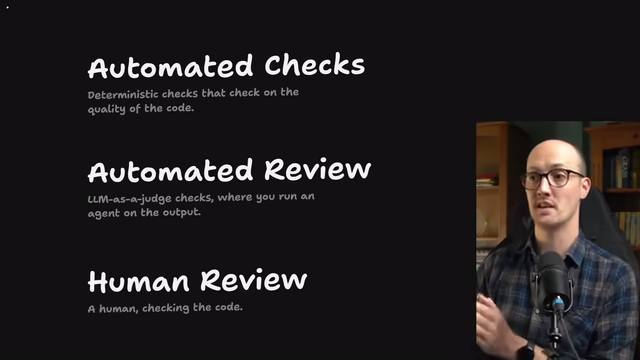
- reviewer 拿到现成 diff、上下文更省：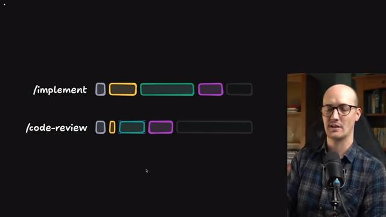
- code review 跑在 sub-agent 里拿全新上下文：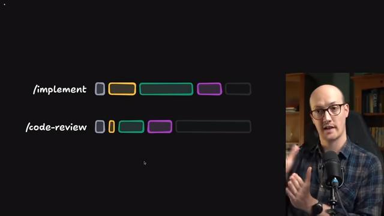
- `codingstandards.md` 是评审的规范来源：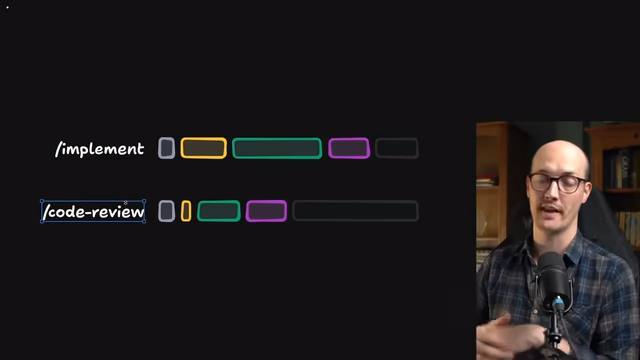
- 触发命令与 “and fix what you find”：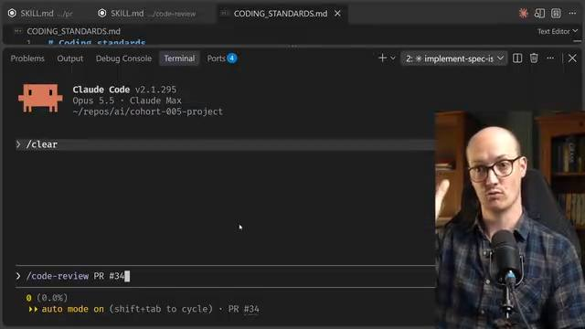
- 两轴评审（standards + spec）：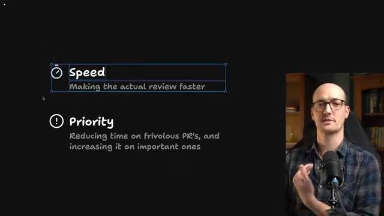
- 评审报告里的 judgment calls 与 data clumps：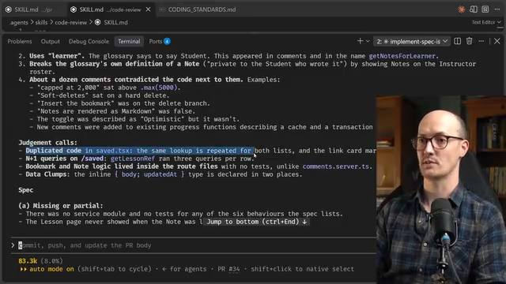
- spec 轴的缺失与实现错误：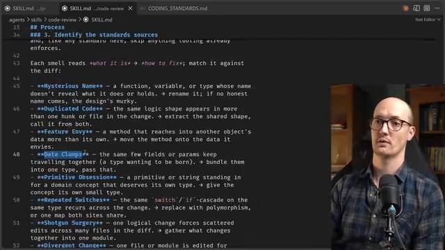
- 修复推回 PR 后的 body 重写：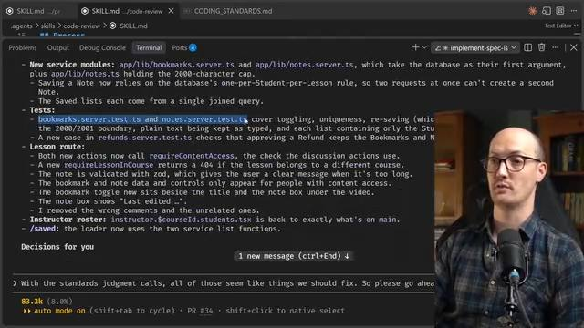
- “同一条评论不留两次”：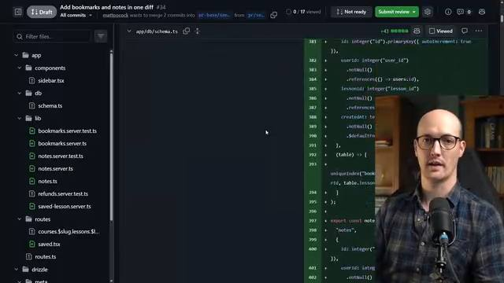
- retro skill 的安装命令：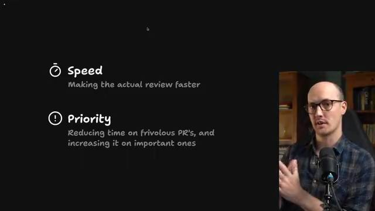
- 在 GitHub diff 上留流程向评论：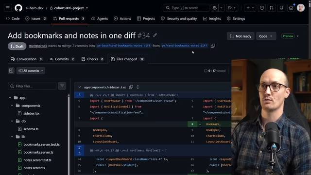
- retro 找到 6 个 session 并读取 PR 评论：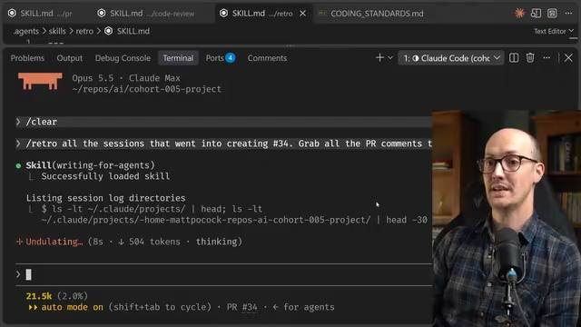
- 采纳第 2/5/6 条、拒绝第 1 条：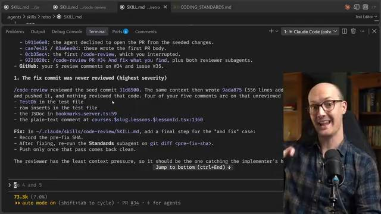
- agent 是 tactical tornado：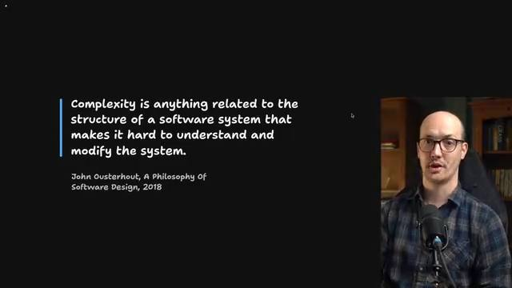
- 战略工作必须由人承担：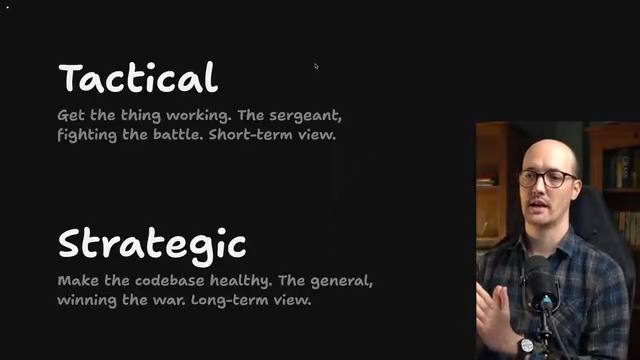