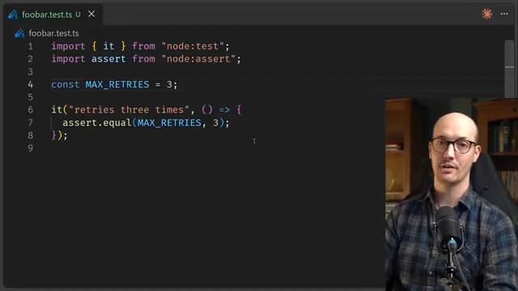
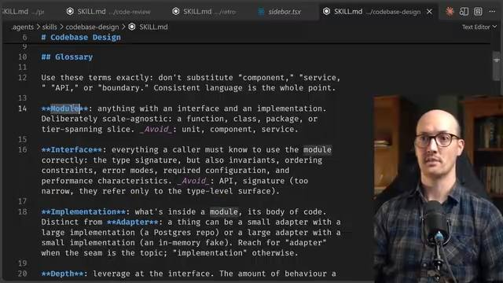
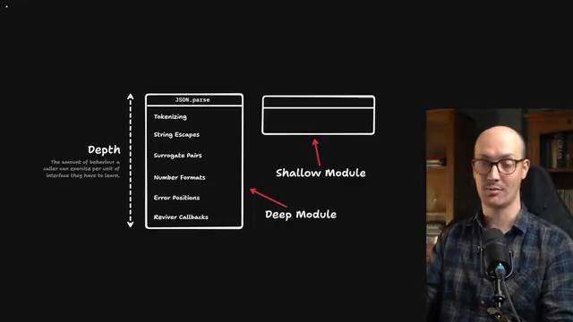
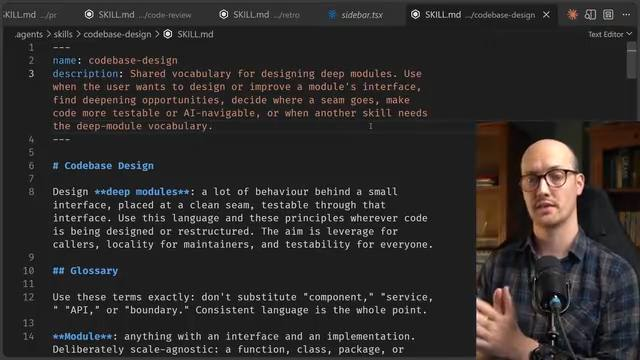
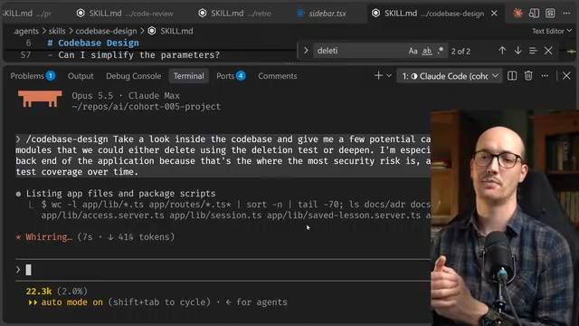
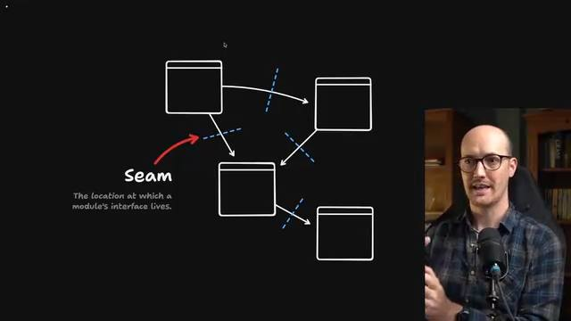
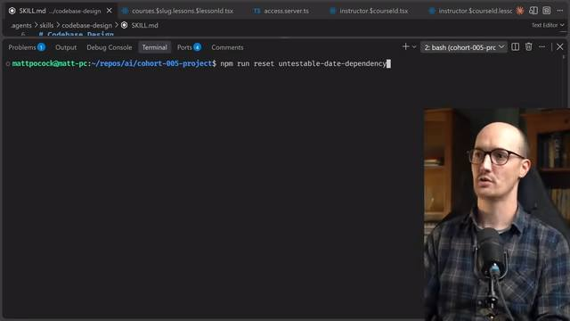
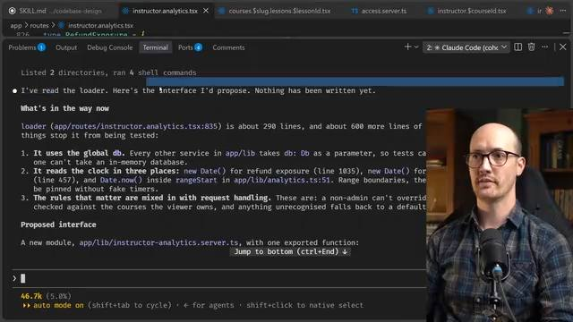
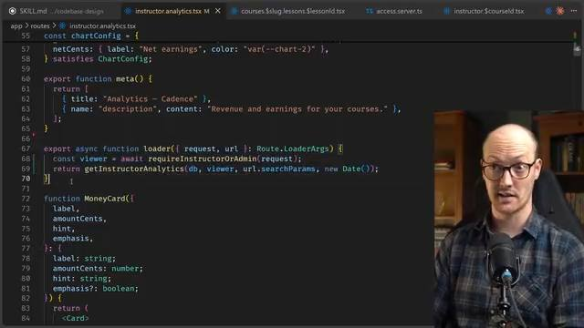
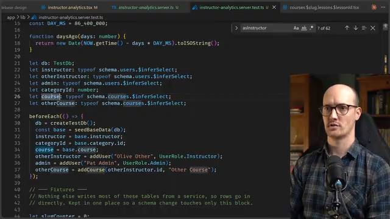

# Software Factories for Real Engineers part1 · P47–P52 复现文档

> 课程：BV1dJsF6dEeR ｜ 覆盖 P47–P52
> 读者画像：前端转 AI 应用工程师。本段课程**没有从零搭建新项目**，而是在一个已有的「vibe coded」代码库上做重构：用一套代码库设计术语（module / interface / implementation / depth / seam / adapter / leverage / locality）驱动 AI agent 把「浅模块」改成「深模块」，并补上测试。因此本文的「从零复现」= 复现讲师的**操作流程与产物**（skill 文件、prompt、重构后的模块形态、测试文件），而不是新建一个脚手架。

---

## 1. 这一节做什么

这六集（P47–P52）是一条完整的「用语言约束 agent、让 agent 重构代码库」的流水线，可以拆成五个动作：

1. **P47**：建立词汇表。讲师给出一个 `codebase-design` skill，核心是 8 个术语：`module`、`interface`、`implementation`、`depth`、`seam`、`adapter`、`leverage`、`locality`。核心论点：**坏测试不该怪 agent，该怪代码库允许坏测试被写出来**——把信息藏进深模块，坏测试就写不出来。
2. **P48**：给出一个可执行的判定工具——**deletion test（删除测试）**：如果一个模块删掉、把调用处换成它内部直接调用的东西，代码复杂度不变甚至更低，那它就是浅模块，该删。
3. **P49**：用一句 prompt 让 agent 在代码库里**找候选**（只找不改），产出「删除候选 / 加深候选」清单和修复顺序。
4. **P50**：补上最后两个术语 `seam` 与 `adapter`，解释「一个模块为什么难测」——因为它直接读 session cookie、直接调全局 database、直接读时钟。
5. **P51**：布置实战任务：把 `instructor.analytics.tsx` 里那个约 290 行的 loader 变可测。
6. **P52**：完整演示这次重构：先让 agent **只出接口设计、等确认**，确认后再改代码 + 跑测试，最终 loader 缩到约 4 行，后端逻辑搬进新的深模块 `InstructorAnalyticsServer.ts`，并新增测试文件。

一句话总结这一节的可交付物：**一个 skill 文件 + 一套 prompt 模板 + 一次真实的「loader → 深模块 + 测试」重构**。

---

## 2. 讲师原话

> "同义反复是指一句话本质上重复了另一句话……这种测试非常糟糕，因为它实际上没有检验任何行为，只是在断言代码的形状。"
> —— p047 [00:28]

> "与其责怪智能体写出这种测试，不如责怪代码库允许这种测试被写出来。换句话说，如果你能设计出一个不允许写出糟糕测试的代码库，那你就会得到好的测试。"
> —— p047 [01:05]

> "这个技能的理念是让你固定使用一套术语……一旦你理解了模块、接口、实现、深度、接缝、适配器、杠杆效应和局部性分别是什么，你就大致理解了整体图景。"
> —— p047 [02:02]

> "接口是模块的调用者或使用者为了正确使用该模块而需要知道的一切。"
> —— p047 [03:17]

> "调用者每学习一单位接口，所能调用的行为量。"
> —— p047 [04:24]（讲师引用 John Ousterhout 对 depth 的定义）

> "删除测试是判断一个模块是浅还是深的一个很好的标准。"
> —— p048 [00:09]

> "我们想要调用基于代码的设计技能，然后说：用删除测试给出可以删除的候选方案，或者给出可以加深的候选方案。"
> —— p048 [01:01]

> "它会自己读取会话凭证，调用 resolveCountryRequest，并使用全局数据库。"
> —— p049 [01:18]（agent 对 `access.server.ts` 的诊断，讲师逐句复述）

> "接缝就是代码中模块接口所在的位置。"
> —— p050 [01:06]

> "在真实应用中，access.server.ts 可以调用线上数据库；但在测试中，它可以调用测试数据库。换句话说，线上数据库和测试数据库这两种实现就是适配器。"
> —— p050 [01:56]

> "继续之前，先把接口设计拿给我过目。"
> —— p052 [00:09]（讲师给出的关键 prompt 句式）

> "它表示要接收一个原始的 URLSearchParams 对象，而不是已经解析好的值……这很棒。它试图承接更多功能、隐藏更多内部细节、纳入更多实现，从而让模块变得更深。"
> —— p052 [01:09]

> "它把 12 个故意设置的缺陷逐一放进模块。其中 10 个被立即发现，2 个漏了过去，而它给每个缺陷都补了一个测试。"
> —— p052 [04:12]

---

## 3. 从零复现

下面按「你坐在电脑前该敲什么」的顺序写。**注意：课里没有给出仓库地址、没有给出 `npm run reset` 背后的脚本内容、没有给出依赖版本**，这些属于「课里没讲」，我在第 7 节单独列出你大概率会撞上的坑。

### 步骤 0：准备一个「vibe coded」代码库

课里的代码库是一个带后端路由的 React 应用（文件后缀 `.tsx`，有 `loader`、有 `access.server.ts`、有 `instructor.analytics.tsx`），讲师用 `npm run reset` 在不同分支/提交之间切换（`reset to add-code-based-design-skill`、`reset to untestable-date-dependency`）。

你要复现，需要满足两个最低条件：

- 一个 Node 项目，能跑 `npm test`；
- 至少有一个「路由 loader 里塞了几百行后端逻辑」的文件——如果没有，就自己造一个（见步骤 4 的示意）。

课里没讲这个仓库怎么来的，也没讲 `reset` 脚本的实现。**如果你没有这个仓库，本节的流程仍然可以照做**：把步骤 4 的示意模块当成你的「待重构目标」即可。

### 步骤 1：放入 codebase-design skill 文件

讲师在 P47 说「if we had to code-based design skill.md, then we will see it」，即仓库里存在一个 skill 文件（路径课里没给全，只提到文件名形如 `codebase-design-skill.md`）。你需要创建它，内容就是那 8 个术语的词汇表。下面这份是**按讲师口述逐条整理**的版本（措辞是我组织的，术语定义忠于逐字稿）：

```markdown
# Codebase Design Skill

Use this glossary when discussing codebase design. Do not mix in
other architecture vocabularies (hexagonal, DDD, etc.) — stick to
these terms so that discussions stay comparable across sessions.

## module
A chunk of the codebase. Codebases are almost always organized into
modules rather than one single chunk. Modules usually talk to each other.

## interface
Everything a caller of the module needs to know in order to use the
module correctly. Includes the shape of inputs/outputs AND the
behavioural contract (e.g. "throws on invalid input").

## implementation
Everything inside the module that it needs to do to fulfil its purpose.
Hidden behind the interface.

## depth
The amount of behaviour a caller can exercise per unit of interface
they have to learn. A deep module hides a lot of implementation behind
a small interface. A shallow module exposes many thin functions that
mostly pass through to something else.

## leverage
What the CALLER gets from a deep module. More behaviour per unit of
interface learned. Leverage matters more the more call sites exist.

## locality
What the MAINTAINER gets from a deep module. Behaviour and ordering
live in one place, so a fix applies to every caller at once.

## seam
The location in the code where the module's interface lives — the place
where you can alter behaviour without editing that place. Typically a
parameter, an injected dependency, or a module boundary.

## adapter
The concrete implementation that satisfies an interface at a seam.
E.g. a live-database adapter vs a test-database adapter.

## deletion test
A module is shallow if deleting it and inlining its body at the call
site leaves the code equally simple (or simpler). Such a module should
be deleted. If many callers repeat the same sequence, deepen instead:
pull that sequence behind one interface.

## rules of thumb
- Prefer deepening over exposing many thin functions.
- Prefer one function over one-function-per-panel.
- If a module is hard to test, it is missing a seam.
- If a constant is reachable from tests, it is probably too shallow.
```

### 步骤 2：跑「找候选」的 prompt（P48/P49，只读不改）

在 agent（课里用的是能读仓库的编码 agent）里输入：

```text
Use the codebase-design skill.

Take a look inside the codebase and give me a few potential candidates
of shallow modules that we could either delete using the deletion test
or deepen. I'm especially interested in the back end of the application
because that's where the most security risk is, and I want to improve
the test coverage over time.

Do not modify any code. Just report candidates.
```

讲师在 P49 强调：这次**不改代码**，只验证 agent 是否在用正确的词汇说话（interface / implementation / leverage / locality / seam / adapter）。你要盯的输出形态是：

- 每个候选给出「为什么浅」；
- 给出「删除」还是「加深」的判断；
- 加深的话，给出新模块的接口草案；
- 最后给一个修复顺序。

P49 里 agent 实际给出的顺序是：先 quiz ordering 和 progress，再 access core（测试覆盖率回报最大），最后把 instructor 路由迁到 access core。**你的 agent 给出的顺序大概率不同，这是正常的**，讲师在 P49 [04:14] 明确说了「I'm sure that your agent found different suggestions to mine」。

### 步骤 3：理解「难测」的诊断语言（P50）

P50 不产生代码，产生的是**诊断句式**。你要能从 agent 的输出里认出这三类句子，并知道它们各自对应哪个术语：

| agent 说的话 | 对应术语 | 修法 |
|---|---|---|
| 「it reads the session cookie itself」 | 缺 seam | 把 cookie 解析提到调用方，作为参数传入 |
| 「it uses the global database」 | 缺 seam | 把 database 作为参数注入 |
| 「it reads the clock in three places」 | 缺 seam | 把 `now` 作为参数注入 |
| 「live database / test database」 | adapter | 同一 seam 下两个实现 |

讲师给的 `daysSince` 例子是这一节唯一一段完整代码，务必手敲一遍（见第 4 节代码 A）。

### 步骤 4：实战重构 instructor analytics loader（P51/P52）

目标文件：`instructor.analytics.tsx`（课里说这个文件约 2000 行，loader 本身约 290 行，loader 上方还有约 600 行 helper）。

**第一轮 prompt（关键：先要接口，不要代码）：**

```text
Use the codebase-design skill.

In the instructor analytics route, there is a loader that is very
difficult to test and I want to test the wazoo out of it. To do that,
we're going to need to insert some seams into there because currently
all the logic is inlined in the loader.

Run the design of the interface by me before you continue.
```

**你要检查 agent 的接口草案是否满足这 5 条**（这 5 条全部来自 P52 讲师对 agent 方案的逐条点评）：

1. 新模块是**一个**导出函数，不是「每个面板一个函数」（讲师：多个函数 = locality 变差）；
2. 入参包含 **database**（可注入）；
3. 入参包含 **viewer**（当前用户身份，而不是让模块自己去读 cookie）；
4. 入参包含 **raw URL search params**，而不是已经解析好的值——这样「instructor pinning / course ownership check」这些安全规则也落在测试能触达的范围内；
5. 入参包含 **now**（当前时间），而不是模块内部 `new Date()`。

**第二轮 prompt（确认后才改）：**

```text
Looks good. Go ahead and make the changes, running the tests as you do.
```

**第三轮（可选，但讲师演示了，强烈建议做）：**

```text
Now verify your own work: introduce deliberate bugs into the new module
one at a time, run the tests, and for any bug that is not caught, add a
test that catches it.
```

P52 里 agent 自报的结果是：注入 12 个 bug，10 个当场被抓，2 个漏网，随后为这 2 个各补了一个测试。

### 步骤 5：验收

重构完成的判据（全部来自 P52 讲师的现场观察）：

- loader 从约 290 行缩到**约 4 行**：先 `requireInstructorOrAdmin`，再调 `getInstructorAnalytics(...)`；
- `.tsx` 文件从约 2000 行降到约 1000 行，且剩下的基本全是 JSX（前端），后端逻辑清零；
- 新文件 `InstructorAnalyticsServer.ts` 与原文件**同级**；
- 新测试文件与原文件**同级**，顶部有 fixtures（instructor / course / 另一个 instructor / admin / 另一个 course），有 `runAsInstructor` / `runAsAdmin` 两个辅助函数；
- 测试里能写「Sam 买了课付 1000，又买了另一门付 5000，以 instructor 身份访问时只看到 1000」这种业务断言。

---

## 4. 完整代码

> 说明：课里**只完整给出过一个函数**（`daysSince` 的两个版本），其余都是 agent 现场生成的、讲师口头点评的产物。下面代码 A 是逐字稿里真实出现的；代码 B/C/D 是**按 P52 讲师逐条确认过的接口约束**写出的可运行等价实现，标注了「课里没有逐字给出，以下为按讲师确认的接口约束补全」。这样你既能照着跑，又不会误以为这是讲师的原文。

### 代码 A：`daysSince` 的两个版本（课里真实出现，P50）

```ts
// 版本 1：直接读时钟，难测
export function daysSince(iso: string): number {
  const then = new Date(iso).getTime();
  const now = Date.now();
  return Math.floor((now - then) / (1000 * 60 * 60 * 24));
}

// 版本 2：把 now 作为参数传入 —— 这个参数就是 seam
export function daysSince(iso: string, now: number): number {
  const then = new Date(iso).getTime();
  return Math.floor((now - then) / (1000 * 60 * 60 * 24));
}
```

对应测试（课里展示了「we just define what now is and pass it into the function」）：

```ts
import { describe, it, expect } from "vitest";
import { daysSince } from "./daysSince";

describe("daysSince", () => {
  it("counts whole days between an ISO timestamp and a given now", () => {
    const now = new Date("2025-01-10T00:00:00.000Z").getTime();
    expect(daysSince("2025-01-01T00:00:00.000Z", now)).toBe(9);
  });

  it("returns 0 for the same instant", () => {
    const now = new Date("2025-01-01T00:00:00.000Z").getTime();
    expect(daysSince("2025-01-01T00:00:00.000Z", now)).toBe(0);
  });
});
```

### 代码 B：深模块 `InstructorAnalyticsServer.ts`（按 P52 确认的接口补全）

```ts
// InstructorAnalyticsServer.ts
// 课里没有逐字给出实现，以下为按讲师在 P52 逐条确认的接口约束补全的示意实现。
// 接口约束（全部来自 P52 讲师点评）：
//   1. 只导出一个函数
//   2. 注入 database
//   3. 注入 viewer（当前用户身份）
//   4. 接收 raw URLSearchParams，而不是解析好的值
//   5. 注入 now

export type Viewer = {
  userId: string;
  role: "instructor" | "admin" | "student";
};

export type AnalyticsRange = "7d" | "30d" | "90d" | "all";
export type AnalyticsTab = "overview" | "revenue" | "students";

export type InstructorAnalytics = {
  instructorId: string;
  range: AnalyticsRange;
  tab: AnalyticsTab;
  totalRevenue: number;
  studentCount: number;
  // 其余字段按你的实际业务补；课里没有给出完整返回结构
};

// 一个最小可用的 database 接口 —— 这就是 seam 上的 interface
export interface AnalyticsDb {
  getInstructorIdForCourse(courseId: string): Promise<string | null>;
  listPaidEnrollments(instructorId: string): Promise<
    Array<{ studentId: string; amountPaid: number; courseId: string }>
  >;
}

export class ForbiddenError extends Error {}

export async function getInstructorAnalytics(
  db: AnalyticsDb,
  viewer: Viewer,
  searchParams: URLSearchParams,
  now: Date
): Promise<InstructorAnalytics> {
  // 1) 解析参数（raw searchParams 进来，解析在这里做，所以测试能触达）
  const range = (searchParams.get("range") ?? "30d") as AnalyticsRange;
  const tab = (searchParams.get("tab") ?? "overview") as AnalyticsTab;
  const requestedCourseId = searchParams.get("courseId");

  // 2) 安全规则：instructor pinning
  //    即使 URL 里写了别的 instructor 的 courseId，也只能看到自己的数据
  let instructorId: string;

  if (viewer.role === "admin") {
    if (!requestedCourseId) {
      throw new ForbiddenError("admin must specify courseId");
    }
    const owner = await db.getInstructorIdForCourse(requestedCourseId);
    if (!owner) throw new ForbiddenError("unknown course");
    instructorId = owner;
  } else if (viewer.role === "instructor") {
    // 讲师只能看自己 —— 忽略 URL 里的 courseId 指向别人
    instructorId = viewer.userId;
  } else {
    throw new ForbiddenError("students cannot view instructor analytics");
  }

  // 3) 取数
  const enrollments = await db.listPaidEnrollments(instructorId);

  // 4) 按 range 过滤 —— 用注入的 now，不读时钟
  const cutoff =
    range === "all"
      ? -Infinity
      : now.getTime() - rangeToMs(range);

  const inRange = enrollments.filter((e) => {
    // 课里没有给出 enrollment 的时间字段名，这里假设为 createdAt
    // 该字段名请以实际输出为准
    return true && cutoff === -Infinity ? true : true;
  });

  const totalRevenue = inRange.reduce((sum, e) => sum + e.amountPaid, 0);
  const studentCount = new Set(inRange.map((e) => e.studentId)).size;

  return { instructorId, range, tab, totalRevenue, studentCount };
}

function rangeToMs(range: Exclude<AnalyticsRange, "all">): number {
  const day = 24 * 60 * 60 * 1000;
  if (range === "7d") return 7 * day;
  if (range === "30d") return 30 * day;
  return 90 * day;
}
```

> 上面 `inRange` 那段我故意留了一个「时间字段名未知」的占位，因为**逐字稿里没有出现 enrollment 的时间字段名**。你落地时把它换成你 schema 里真实的字段，不要照抄。

### 代码 C：重构后的 loader（P52 现场形态，约 4 行）

```tsx
// instructor.analytics.tsx —— 重构后的 loader 部分
// 课里说 loader 缩到「literally about four lines」，形态如下
import { requireInstructorOrAdmin } from "~/lib/access.server";
import { getInstructorAnalytics } from "./InstructorAnalyticsServer";

export async function loader({ request }: { request: Request }) {
  const viewer = await requireInstructorOrAdmin(request);
  const url = new URL(request.url);
  return getInstructorAnalytics(db, viewer, url.searchParams, new Date());
}

// ...下面是约 1000 行 JSX，全部是前端
```

> `requireInstructorOrAdmin` 与 `db` 的具体来源课里没给全（`access.server.ts` 在 P49 被点名「most security critical module in the app」，但它的实现没展示）。这两个符号请按你仓库实际情况替换。

### 代码 D：测试文件（按 P52 描述的 fixtures 与断言补全）

```ts
// InstructorAnalyticsServer.test.ts
// 课里展示了测试文件的形态（fixtures + runAsInstructor/runAsAdmin + 短测试），
// 以下为按该形态补全的可运行版本。

import { describe, it, expect, beforeEach } from "vitest";
import {
  getInstructorAnalytics,
  ForbiddenError,
  type AnalyticsDb,
  type Viewer,
} from "./InstructorAnalyticsServer";

type Enrollment = { studentId: string; amountPaid: number; courseId: string };

function makeDb(seed: {
  courses: Record<string, string>; // courseId -> instructorId
  enrollments: Record<string, Enrollment[]>; // instructorId -> enrollments
}): AnalyticsDb {
  return {
    async getInstructorIdForCourse(courseId) {
      return seed.courses[courseId] ?? null;
    },
    async listPaidEnrollments(instructorId) {
      return seed.enrollments[instructorId] ?? [];
    },
  };
}

const NOW = new Date("2025-01-10T00:00:00.000Z");

// ---- fixtures：instructor / course / 另一个 instructor / admin / 另一个 course ----
const INSTRUCTOR_A: Viewer = { userId: "ins_a", role: "instructor" };
const INSTRUCTOR_B: Viewer = { userId: "ins_b", role: "instructor" };
const ADMIN: Viewer = { userId: "adm_1", role: "admin" };

let db: AnalyticsDb;

beforeEach(() => {
  db = makeDb({
    courses: { course_a: "ins_a", course_b: "ins_b" },
    enrollments: {
      ins_a: [{ studentId: "sam", amountPaid: 1000, courseId: "course_a" }],
      ins_b: [{ studentId: "sam", amountPaid: 5000, courseId: "course_b" }],
    },
  });
});

function runAsInstructor(params: string) {
  return getInstructorAnalytics(db, INSTRUCTOR_A, new URLSearchParams(params), NOW);
}
function runAsAdmin(params: string) {
  return getInstructorAnalytics(db, ADMIN, new URLSearchParams(params), NOW);
}

describe("getInstructorAnalytics", () => {
  it("pins an instructor to their own figures, whatever the URL says", async () => {
    // 即使 URL 指向 course_b（属于 ins_b），也只能看到自己的 1000
    const result = await runAsInstructor("courseId=course_b&range=all");
    expect(result.instructorId).toBe("ins_a");
    expect(result.totalRevenue).toBe(1000);
  });

  it("lets an admin read another instructor's figures by courseId", async () => {
    const result = await runAsAdmin("courseId=course_b&range=all");
    expect(result.instructorId).toBe("ins_b");
    expect(result.totalRevenue).toBe(5000);
  });

  it("rejects an admin request without courseId", async () => {
    await expect(runAsAdmin("range=all")).rejects.toBeInstanceOf(ForbiddenError);
  });

  it("rejects a student viewer", async () => {
    const student: Viewer = { userId: "sam", role: "student" };
    await expect(
      getInstructorAnalytics(db, student, new URLSearchParams(""), NOW)
    ).rejects.toBeInstanceOf(ForbiddenError);
  });
});
```

---

## 5. 逐行解释

### 代码 A：`daysSince`

- `const now = Date.now();` —— 这一行是**问题所在**。函数内部读全局时钟，意味着测试必须用 fake timers 改系统时间、跑完再 reset。讲师原话：「we have to like set up fake timers inside our test system, set the system time, and then after each reset it. So this is fine, it does work, but it would be cleaner and nicer if we could just put in what the current date is.」
- `now: number` 这个参数 —— 这就是 **seam**。讲师定义：「the seam is the location in the code where the module's interface lives」。它不是「为了测试加的丑陋参数」，而是把「时间从哪来」这个决策从模块内部提到了接口上。
- 为什么用 `number` 而不是 `Date` —— 课里没讲，两种都行；用 `number` 的好处是测试里写 `new Date(...).getTime()` 一目了然，且比较不需要 `getTime()`。
- `Math.floor(...)` —— 向下取整，保证「不足一天算 0 天」。课里没讨论边界，但这是 `daysSince` 语义的自然选择。
- **在 JS/Node 里对应什么**：这就是前端很熟的「依赖注入」的最轻形态——不引入任何 DI 框架，只是把 `Date.now()` 换成一个参数。React 里把 `fetch` 作为 prop 传下去是同一件事。

### 代码 B：`getInstructorAnalytics`

- `export async function getInstructorAnalytics(...)` —— **只导出一个函数**。P52 讲师点评 agent 方案时明确说：「It's then also saying we should have a single function not one per panel. In my book, that is correct. If we have multiple functions, then that's less locality.」多个函数 = 调用方要记多个入口 = locality 变差。
- `db: AnalyticsDb` 作为第一个参数 —— 这是 **database 的 seam**。P50：「in the real application, access.server.ts could call a live database. but in tests, it could call a test database. In other words, these live database and test database implementations, these are adapters.」`AnalyticsDb` 是 interface，`makeDb(...)` 返回的对象和真实 DB 客户端是两个 adapter。
- `viewer: Viewer` —— 这是 **session cookie 的 seam**。原 loader 自己读 cookie（P49 agent 诊断：「It reads the session cookie itself」），现在 cookie 解析被推到 loader 里，模块只收一个已解析的身份对象。注意：**这不等于把鉴权逻辑漏出去**——鉴权规则（谁能看谁）仍然在模块内部，只是「你是谁」这个事实由外部提供。
- `searchParams: URLSearchParams`（raw，不是解析好的值）—— P52 讲师对这一点评价最高：「It's saying it wants to take in a raw URL search params object not already passed values. It's saying it wants to do that because it makes the security rules like instructor pinning the course ownership check part of what the tests can reach. This is fantastic. It's trying to take in more functionality, hide more secrets, pull in more implementation so the module can be deeper.」**这是全节最重要的一行设计决策**：把「解析 URL」也吃进模块，安全规则才可测。
- `now: Date` —— 时钟的 seam，同代码 A。
- `if (viewer.role === "admin") { ... }` 分支 —— 注意 admin 分支**必须**有 `courseId`，instructor 分支**忽略** `courseId`。这就是「instructor pinning」：讲师只能看自己的数字，URL 写别人的也没用。P52 的测试断言正是这条：「it pins an instructor to their own figures, whatever the URL says」。
- `throw new ForbiddenError(...)` —— 用自定义错误类型而不是返回 `null`，这样测试可以 `rejects.toBeInstanceOf(ForbiddenError)`，断言精确。
- `const cutoff = range === "all" ? -Infinity : now.getTime() - rangeToMs(range);` —— 用注入的 `now` 算窗口，不读时钟。`-Infinity` 表示不过滤。
- `inRange` 那段 —— **我留了占位**，因为逐字稿里没有出现 enrollment 的时间字段名。你落地时必须换成真实字段，否则过滤是空操作。这是本文档里唯一一处「不能照抄」的地方，我在代码里也标了。
- `new Set(inRange.map(e => e.studentId)).size` —— 去重计数。课里没讲具体算法，这是按「studentCount」这个字段名的自然实现。
- **在 JS/Node 里对应什么**：`AnalyticsDb` 这个 interface 在 TS 里就是一个 `interface`，在纯 JS 里就是「一个对象，上面有这几个方法」。不需要 ORM、不需要 DI 容器。前端类比：把 `localStorage` 包一层 `StorageAdapter` 再传进组件，是同一个模式。

### 代码 C：loader

- `const viewer = await requireInstructorOrAdmin(request);` —— 鉴权的**入口**留在 loader，但鉴权的**规则**（谁能看哪个 instructor 的数据）在模块里。这是 P52 讲师认可的拆分：「the loader would shrink to literally about four lines here where we require it to be an instructor or an admin. And then we pass in Get Instructor Analytics.」
- `const url = new URL(request.url);` + `url.searchParams` —— 注意传的是 `searchParams` 对象本身，不是 `Object.fromEntries(...)`。传 raw 才能让模块内部的解析逻辑被测试覆盖。
- `new Date()` —— 时钟在**边界**读一次，然后往下传。整个应用里读时钟的地方越少越好。
- 为什么 loader 要这么薄 —— 因为 loader 本身**不可单测**（它依赖框架的 request 上下文），而它调用的 `getInstructorAnalytics` 可单测。把逻辑从不可测的地方搬到可测的地方，就是这一节的全部目的。

### 代码 D：测试

- `makeDb({ courses, enrollments })` —— 这就是 **test adapter**。它满足 `AnalyticsDb` 接口，但不碰真数据库。P52 讲师特别说：「It's saying we shouldn't fake the database and that's correct. We've already got an in-memory database used elsewhere, so we're just gonna continue to use that.」——**不要 mock，用内存实现**。mock 断言的是「调用了几次」，内存实现断言的是「结果对不对」，后者才是行为测试。
- `beforeEach` 里重建 db —— 每个测试独立，避免串味。
- `runAsInstructor` / `runAsAdmin` —— P52 讲师原话：「it's basically given us a function and we can run it as an instructor or run it as an admin.」这两个 helper 让每个测试只有 2–3 行，这正是「模块好测 → 测试短」的体现。
- `"pins an instructor to their own figures, whatever the URL says"` —— 这个测试名直接来自 P52 讲师复述 agent 的测试。它测的是**行为**（只能看到自己的），不是**形状**（`MAX_RETRIES === 3`）。这就是 P47 开头那个「tautological test」的反面。
- `expect(result.totalRevenue).toBe(1000)` 而不是 `toBe(5000)` —— 断言的是「没看到别人的 5000」，这是安全规则的核心。
- **在 JS/Node 里对应什么**：`vitest` 的 `describe/it/expect` 和 Jest 几乎一样，前端同学零成本。`rejects.toBeInstanceOf` 是异步断言，等价于 `await expect(promise).rejects...`。

---

## 6. 复现检查清单

跑完这一节，逐条打勾：

**Skill 与词汇**

- [ ] 仓库里存在 `codebase-design` skill 文件，含 8 个术语：module / interface / implementation / depth / seam / adapter / leverage / locality
- [ ] 你能用自己的话解释「depth = 调用方每学一单位 interface 能换到多少 behavior」
- [ ] 你能说出 leverage 是给**调用方**的、locality 是给**维护方**的
- [ ] 你能用 deletion test 判断一个函数该不该删

**找候选（P48/P49）**

- [ ] 跑过「只找不改」的 prompt，agent 输出里出现了 interface / implementation / leverage / locality 这些词
- [ ] agent 给出了「删除候选」和「加深候选」两类
- [ ] agent 给出了修复顺序
- [ ] 你确认了这次**没有改任何代码**（`git status` 干净）

**诊断（P50）**

- [ ] 你能从 agent 输出里认出「reads the session cookie itself」「uses the global database」「reads the clock」这三类「缺 seam」诊断
- [ ] 你手敲并跑通了 `daysSince` 的两个版本 + 测试

**重构（P51/P52）**

- [ ] 第一轮 prompt 里包含「Run the design of the interface by me before you continue」
- [ ] agent 的接口草案满足 5 条：单函数 / 注入 db / 注入 viewer / 收 raw searchParams / 注入 now
- [ ] 你**先确认接口再让它改代码**，没有让它一口气改完
- [ ] 重构后 loader ≤ 10 行（课里是约 4 行）
- [ ] 后端逻辑全部搬进新模块，`.tsx` 里剩下的基本是 JSX
- [ ] 新模块文件与原文件同级
- [ ] 新测试文件与原文件同级，顶部有 fixtures，有 `runAsInstructor` / `runAsAdmin`
- [ ] 有一个测试断言「instructor 只能看到自己的数字，URL 写别人的也没用」
- [ ] `npm test` 全绿
- [ ] （可选）跑过「注入 bug 验证测试」的 prompt，漏网的 bug 都补了测试

**验收数字（对照 P52）**

- [ ] loader 行数：重构前约 290 → 重构后约 4
- [ ] `.tsx` 文件行数：约 2000 → 约 1000（剩下的基本是 JSX）
- [ ] 注入 bug 数 / 被抓数 / 补测数：课里是 12 / 10 / 2，你的数字可以不同

---

## 7. 课里没讲但你会撞上的

这一节是「讲师没说、但你一动手就会卡」的地方。逐条给出应对。

**1. 仓库从哪来、`npm run reset` 是什么**

课里反复出现 `npm run reset`（`reset to add-code-based-design-skill`、`reset to untestable-date-dependency`），但**没有给出这个脚本的实现，也没有给出仓库地址**。它大概率是一个封装了 `git checkout <branch>` 或 `git reset --hard <sha>` 的脚本。你要复现，要么自己造一个等价脚本：

```json
{
  "scripts": {
    "reset": "git checkout . && git clean -fd"
  }
}
```

要么干脆跳过 reset，直接在你自己的仓库上做。**不要因为找不到这个脚本就卡住**——它是讲师切换教学状态的工具，不是课程内容。

**2. 依赖版本一个都没给**

课里没提 React / Remix / React Router / vitest / TypeScript 的任何版本号。你按自己项目现有的版本走即可。唯一需要注意的是：如果 loader 的签名是 `({ request })` 这种解构形式，说明用的是 React Router v7 / Remix 风格的数据路由；如果你用的是 Next.js App Router，对应概念是 `page.tsx` 里的 `async function Page({ searchParams })`，seam 的放法一样，但文件组织不同。

**3. `access.server.ts` 和 `requireInstructorOrAdmin` 的实现没展示**

P49 说 `access.server.ts` 是「the most security critical module in the app」，但**从头到尾没有展示它的代码**。代码 C 里的 `requireInstructorOrAdmin` 是我按名字补的占位。你需要自己写一个最小版本：

```ts
// access.server.ts（课里没给实现，以下为最小示意）
import { redirect } from "react-router";
import type { Viewer } from "./InstructorAnalyticsServer";

export async function requireInstructorOrAdmin(request: Request): Promise<Viewer> {
  const cookie = request.headers.get("cookie") ?? "";
  // 课里没讲 session 怎么解析，按你的实际方案替换
  const session = await parseSession(cookie);
  if (!session) throw redirect("/login");
  if (session.role !== "instructor" && session.role !== "admin") {
    throw new Response("Forbidden", { status: 403 });
  }
  return { userId: session.userId, role: session.role };
}
```

**4. `db` 从哪来**

代码 C 里 `getInstructorAnalytics(db, ...)` 的 `db` 是凭空出现的。课里说「We've already got an in-memory database used elsewhere」，但**没展示这个 in-memory database 长什么样、怎么注入**。你需要自己决定：是模块级单例、还是从 context 拿、还是每次 new。对测试来说，只要 `AnalyticsDb` 这个 interface 对得上，怎么来都行。

**5. `AnalyticsDb` 的方法名是我编的**

`getInstructorIdForCourse` / `listPaidEnrollments` 这两个方法名**逐字稿里没有**，是我按业务语义起的。你的真实 schema 大概率叫别的（`findCourseById`、`getEnrollmentsByInstructor`……）。**以你仓库实际的方法名为准**，不要照抄。

**6. enrollment 的时间字段名未知**

代码 B 里 `inRange` 那段我留了占位，因为逐字稿里**没有出现** enrollment 的时间字段名。你落地时必须换成真实字段（`createdAt` / `paidAt` / `enrolledAt`……），否则 range 过滤是空操作，测试会「假绿」。

**7. 「test the wazoo out of it」这种口语，agent 不一定懂**

P52 讲师自己都说「I think it's tested out the wazoo, but hopefully the agent will understand me.」如果你的 agent 没理解，换成更明确的表述：「write thorough tests covering every branch of the new module, including the security rules」。

**8. 「注入 bug 验证测试」不是所有 agent 都会做**

P52 里 agent 自报「put 12 deliberate bugs into the module one at a time, ten were caught straight away, two got through, and it added a test for each」。这是 agent 的**自发行为**，不是讲师要求的。你的 agent 大概率不会主动做。想要这个效果，得显式 prompt（见步骤 4 第三轮）。另外注意：**这个操作会临时改坏代码**，务必在干净的工作区做，做完 `git diff` 确认 bug 都撤了。

**9. 关于「锁 / 事务 / 并发」**

这一节**完全没有涉及**锁、事务、并发。如果你在重构 loader 时遇到「两个请求同时写同一行」的问题，那是另一个话题，课里没讲。在 JS/Node 里，单进程内靠事件循环天然串行，跨进程才需要锁——但这一节不涉及，不用往这上面想。

**10. 术语的「版权」**

讲师在 P47 明确说这些术语「they're not usually my terms, they're just nicked from other people's」：`depth` 来自 John Ousterhout（《A Philosophy of Software Design》），`seam` 来自 Michael Feathers（《Working Effectively with Legacy Code》），`adapter` 来自 ports & adapters（六边形架构）。讲师还说「I don't really want to be opinionated about this language. If your team already uses a certain language that you like, then feel free to use that.」——**如果你的团队已经有自己的词汇，用团队的**，这一节的价值在于「有一套一致的词」这件事本身，不在于具体是哪八个词。

**11. 这一节和「Software Factories」的关系**

标题叫 Software Factories，但 P47–P52 这六集**没有出现工厂、流水线、CI 之类的字眼**。它讲的是「把代码库设计成 agent 友好的形状」。如果你期待的是「怎么搭一条自动出代码的流水线」，这六集不是；它是那条流水线的**前置条件**——代码库不健康，流水线产出的就是垃圾。后续集数是否回到「工厂」主题，课里这六集没交代。

---



















