# Software Factories for Real Engineers part1（P53–P57）复现文档

> 课程范围：P53–P57。主题是「把深模块（deep module）锁死」——用 dependency-cruiser 建立自动化边界检查，再用 `improve-codebase-architecture` 技能把浅模块可视化地重构成深模块，最后走完 grill → spec → tickets → implement 的完整流程。
>
> 读者背景：前端转 AI 应用工程师。文中涉及 Node/TypeScript 生态，遇到并发/事务类概念会补一句 JS/Node 对应物。

---

## 1. 这一节做什么

前几节已经把 `instructor-analytics` 从路由里抽成了一个深模块，并且让 loader 通过深模块拿数据。但代码「变好」是一次性的，下一个 agent 来了照样会把数据库调用塞回路由里。这一节解决的就是**如何让深模块保持深**，分四步：

1. **P53–P54：建立自动化边界检查。** 用 `dependency-cruiser` 在 TypeScript 仓库里强制「每个 package 是一个深模块，实现藏在 `lib/`，外部只能从 `index.ts` / `client.ts` 入口导入」，并且额外加一条规则禁止 `instructor-analytics` 路由自己去查数据库。检查接进 `npm run check`，同时写进 `AGENTS.md` 和 `coding-standards.md` 作为第二道防线。
2. **P55–P56：可视化地找下一个重构目标。** 用 `improve-codebase-architecture` 技能扫描 `access.server.ts`，产出一份 HTML 报告，列出「4 个路由 import 了它，但 25 个路由各自重新实现了访问逻辑，15 份 `getUserById` 拷贝，`access.server.ts` 零测试」这类数据，并给出 before/after 图和候选方案。
3. **P57 前半：grill + domain modeling。** 对候选方案逐条追问，产出术语（`person`、`purchasing power price`、`country lock`），更新 `glossary.md`，写 ADR。
4. **P57 后半：to-spec → to-tickets → implement-spec。** 生成 GitHub issue（spec #36）、11 张互相依赖的 ticket（DAG），清空上下文后按 spec 实现，最终 `npm run check` 通过 644 个测试，新模块落在 `app/modules/permissions/`。

最终产物是一个**被规则锁死的深模块目录结构** + 一个**新的 `permissions` 深模块**（入口 `person.server.ts`、`course-permissions.server.ts`，暴露 `decide` / `getCourseDecisions` / `requireCapability`）。

---

## 2. 讲师原话（带出处）

> 「我们的代码已经变漂亮了……你下一个问题大概是：我们怎么让它保持这样？下一个 agent 来了，会想重复之前那套错误。」—— p053 [00:00]

> 「我们总是希望把检查从人工评审挪到自动评审，再从自动评审挪到自动检查，因为自动检查跑起来更便宜，而且每次行为一致。」—— p053 [00:47]

> 「在 TypeScript 里，这个场景我要推荐的是 dependency cruiser。」—— p053 [01:05]

> 「每个 package 都是一个深模块，实现藏在子目录里，只能通过它的入口文件访问。」—— p053 [02:03]

> 「我们还要确保 Instructor Analytics 这个根不会 import 它不该 import 的东西……用 dependency cruiser 阻止 Instructor Analytics 自己去查数据库。」—— p053 [03:00]

> 「进去跟你的 agent 说：set up TS deep modules，用目录 `app/modules`，把刚从 analytics 路由里抽出来的 instructor analytics 模块移进去，并且阻止那个路由自己查数据库。」—— p053 [03:29]

> 「它创建了 `dependency-cruiser.cjs`，把 dependency cruiser 装进了 `package.json`，还建了一个示例模块……`toSlug` 在 `slugify` 里面。」—— p054 [00:00]

> 「`package.json` 里多了一个 `lint:boundaries`，内容是 `depcruise app`。跑 `npm run lint:boundaries`，可以看到 no dependency violations are found。」—— p054 [01:18]

> 「如果我去 `instructor-analytics` 的 `lib` 里导出 `parseId`，然后在根里调用它……再跑 `npm run lint:boundaries`，就会报错。也就是说整个 app 不该能伸进去抓它。」—— p054 [01:43]

> 「那模块自己的测试套件里呢？应不应该允许？……跑完发现有两个 dependency violations。也就是说你必须通过入口点来跑测试，不能把接口背后的实现细节掏出来玩、拿来测。这补上了我们这一整节一直开着的环：怎么阻止 agent 写烂测试。」—— p054 [02:34]

> 「我在 `instructor-analytics` 里还是能 import DB……它现在不警告我了。这应该是个 error，因为阻止了它，这个模块就很难再变浅。所以我说：你还没做一条 dependency cruiser 规则阻止 instructor analytics import DB，去修一下。」—— p054 [03:22]

> 「配置长这样：每条规则有个名字，`InstructorAnalyticsRootNoDB`。InstructorAnalyticsRoot 从 InstructorAnalyticsModule 拿数据，绝不自己查。然后有一个 from 的 regex 和一个 to 的 regex。」—— p054 [03:50]

> 「我们在这里保守了一点，只限制了 instructor analytics 这一个路由。你可以想象把它放宽到所有路由都只能从深模块 import。现在不做，因为那会是一场大重构。」—— p054 [04:20]

> 「`AGENTS.md` 里加了 `lint:boundaries`，也加进了 `npm run check`。这样它就成了 agent 每次提交前跑的标准测试集的一部分。」—— p054 [05:13]

> 「agent 很容易作弊绕过自动检查——它可以直接去那个文件里把不想处理的东西注释掉。所以我们大概需要第二道防线……把这条信息也加进 coding standards。」—— p054 [05:13]

> 「代码库设计有个烦人的地方：很难把你在做的改动可视化，看不出它到底会不会改善东西。」—— p055 [00:00]

> 「这是我最有名的技能之一，叫 improve code base architecture……它让你把架构摩擦暴露出来，提出深化机会，把浅模块重构成深模块。」—— p055 [00:22]

> 「它有一条明确指令：用 code-based design 调用 skill tool，把整个 glossary 拿过来，这样它用的就是我们学过的术语。先定范围再扫描（scope before you scan）。」—— p055 [00:42]

> 「第二步，它把候选方案呈现成一份 HTML 报告。这样你在决定选哪个之前，能先可视化地看到这些改动。」—— p055 [01:05]

> 「之后进入 grill with doc 会话……再调 domain modeling，因为把模块拼起来、做成深模块时，你常常要琢磨该给它们起什么名字。」—— p055 [01:34]

> 「我们的用例是已经有明确目标：`access.server.ts`。跑一下，看 HTML 报告，但先别改代码。」—— p055 [02:10]

> 「报告顶部有不错的统计：4 个路由 import 了 access server，但 25 个路由重新实现了它。有 15 份 `getUserById` 函数的拷贝，`access.server.ts` 上零测试。这看起来确实很糟。」—— p056 [00:49]

> 「after 之后是一个单一模块回答『may they?』这个问题——用这个词说授权挺可爱的。它提议在 course access 模块上开一个小接口，lesson 路由、5 个 instructor 路由、course 路由都能调它。数据库注入进去，测试里用 `createTestDB`。」—— p056 [01:27]

> 「问题：模块是浅的，只有 4 个路由用它。每个调用方自己算访问，规则互相打架，lesson 路由还会把 lesson body 发给看不了内容的访客。方案：把『这个人在这个课上能做什么』移进 `app/modules` 下的模块，数据库注入方式和 instructor analytics 一样。」—— p056 [01:40]

> 「locality 收益：所有访问规则集中一处，删掉 9 份函数拷贝。leverage 收益：一个接口、15 个调用点。」—— p056 [02:10]

> 「第二个提案：现在每个路由都传 request 本身，自己抓 cookie user id、自己抛 401，18 个 throw、4 种不同措辞。之后是一个把 request 变成 viewer 的单一函数。」—— p056 [02:40]

> 「第三个只值得探索一下：给 purchase country 规则命名并统一。glossary 里 PPP block 没有名字，三个调用点用不同规则比较国家。」—— p056 [03:31]

> 「它最后给出 top recommendation：把 per-course access 收进一个深模块，同时说应该做第二个 viewer seam。我同意。我打算一、二、三都做。」—— p056 [04:14]

> 「refactor 很吃 token，所以我几乎总是默认走 spec 和 tickets。」—— p056 [04:50]

> 「Q2 问要一个模块还是两个。候选二把 request 变成 viewer，候选一决定 viewer 在这个课上能做什么。它推荐 B：一个模块两个入口点。我觉得对，因为这段代码属于一起。」—— p057 [00:23]

> 「Q9：签到的这个人叫什么，而不是 viewer？glossary 已经有四个角色——student、instructor、platform admin、team admin——但没有一个词指『这个请求来自谁』。它已经非正式地用了 person。我同意推荐 person。」—— p057 [02:39]

> 「Q12：规则在 glossary 里叫什么？它推荐 purchasing power price——按买家国家设定的折扣价；以及 country lock——以 purchasing power price 买的购买只能从购买国使用。这些术语太棒了。」—— p057 [02:58]

> 「有个很妙的小技巧藏在 code base design 或 improve code base architecture 技能里：should it design the interface twice。意思是把同一个接口设计两遍，然后挑最好的想法。AI 时代这不过是 token 而已，派两个 sub-agent 各做一个接口，再挑。」—— p057 [03:53]

> 「它做了三个：一个接口尽可能小，一个为灵活性设计，一个让最常见的调用方变得 trivial。这个函数很重要，几乎每个路由以后都会调它，所以值得烧 token 拿到对的那个。」—— p057 [05:13]

> 「spec 发布成 GitHub issue，有一个 needs action：glossary 改动和新 ADR 需要进 main。我一般乐意直接提交到 main。」—— p057 [07:35]

> 「看这个，一张描述所有 ticket 相互关系的漂亮 DAG。11 张 ticket。refactor 很吃 token，所以我一般比较宽容，不太细审。」—— p057 [08:05]

> 「清空上下文，按 spec 36 实现。spec 在本地分支 `spec-36-permissions`，`npm run check` 通过，644 个测试。新模块在 permissions 里，入口是 `person.server.ts` 和 `course-permissions.server.ts`。」—— p057 [08:35]

> 「它显式描述了自己需要什么、依赖是什么——这个 database——所以这里有个内建的 seam。接口暴露的是 decide、get course decisions、require capability。」—— p057 [09:10]

> 「在 `course-lessons-quiz.tsx` 里，我们基于 request 要求某人 manage this course 的 capability。这从一堆路由里干掉了一大坨代码。」—— p057 [09:32]

> 「测试里能看到很细的测试……`permissions.decide`，`createCoursePermissions`，『这个人或没人能否 view、take、manage 这个课』。」—— p057 [10:01]

---

## 3. 从零复现

### 3.1 前置条件

- 一个已有的 TypeScript 项目（课程里是一个 React Router / Remix 风格的 app，路由在 `app/routes/`，已有 `app/modules/instructor-analytics/` 这个深模块，以及一个 `app/routes/.../analytics` 路由）。
- Node 18+，npm。
- 一个能跑 skill 的 agent 环境（课程里用的是带 skill tool 的 agent；`set-up-ts-deep-modules`、`improve-codebase-architecture`、`grill-with-doc`、`domain-modeling`、`to-spec`、`to-tickets`、`implement-spec` 都是仓库里已有的 skill）。**课里没讲这些 skill 文件的具体内容**，只讲了它们的调用方式和产出。
- 项目里已有 `glossary.md`、`AGENTS.md`、`coding-standards.md`、`package.json` 里的 `check` 脚本。

### 3.2 第一步：装 dependency-cruiser 并建立深模块骨架

在 agent 里输入（讲师原话，p053 [03:29]）：

```
set up TS deep modules, use the directory app/modules,
move in the instructor analytics module we just pulled out of the analytics route,
and stop that route from querying the database itself.
```

agent 会做四件事，你要逐项核对：

1. 安装 `dependency-cruiser` 到 `package.json` 的 devDependencies。
2. 生成配置文件 `dependency-cruiser.cjs`（讲师念作 "dependency-cruiser.cjs"，实际文件名以你仓库为准，通常是 `.cjs`）。
3. 在 `app/modules/` 下建一个示例模块（课程里是 `slugify`：`lib/` 里放 `toSlug`，`index.ts` 作为入口，旁边放测试）。
4. 把 `instructor-analytics` 移进 `app/modules/instructor-analytics/`，入口是 `index.server.ts`，导出若干类型和 `createInstructorAnalytics(database)`，返回带 `get` 的对象；并让 loader 不把 database 打进 client bundle。

### 3.3 第二步：确认 lint 脚本

`package.json` 里应出现：

```json
{
  "scripts": {
    "lint:boundaries": "depcruise app",
    "check": "npm run lint:boundaries && ...其余原有检查..."
  }
}
```

跑：

```bash
npm run lint:boundaries
```

期望输出（讲师原话）：

```
no dependency violations are found
```

> 注意：`depcruise app` 里的 `app` 是扫描根目录，按你项目实际源码目录改。

### 3.4 第三步：故意制造违规，验证规则真的生效

**验证 A：外部不能伸进 `lib/`。**

1. 在 `app/modules/instructor-analytics/lib/` 里导出一个函数（课程里叫 `parseId`）。
2. 在 `app/modules/instructor-analytics/` 的根（入口层）里 import 它并调用 `parseId("foobah")`。
3. 再跑 `npm run lint:boundaries`，应报错——app 整体不该能伸进 `lib`。

**验证 B：模块自己的测试也不能伸进 `lib/`。**

1. 在 `instructor-analytics.test.ts` 里 import `parseId`。
2. 再跑，应出现**两个** violation。结论：测试必须走入口点，不能把实现细节掏出来测。讲师说这补上了「怎么阻止 agent 写烂测试」这个环。

**验证 C：路由不能自己查 DB。**

1. 在 `instructor-analytics` 路由里 import `db`。
2. 此时**不会**报错——因为还没有这条规则。这正是讲师故意留的坑。
3. 对 agent 说：「你还没做一条 dependency cruiser 规则阻止 instructor analytics import DB，去修一下。」
4. agent 会加一条规则（见 4.2），加完后同样的违规应报错；删掉违规代码后恢复干净。

### 3.5 第四步：把检查接进标准流程 + 第二道防线

- `AGENTS.md` 里加入 `lint:boundaries` 的说明。
- `npm run check` 里加入 `lint:boundaries`，这样 agent 每次提交前都会跑。
- 对 agent 说：「could you also add some information about this into coding standards to make sure we have a second line of defense?」——因为 agent 可以直接把检查注释掉作弊，所以 `coding-standards.md` 末尾要加一段文字约束。

### 3.6 第五步：跑架构改进技能，产出 HTML 报告

对 agent 说（p055 [02:10]）：

```
run improve codebase architecture, target access.server.ts.
Show me the HTML report. Make no code changes yet.
```

agent 会：调 `code-based-design` 拿整个 glossary → scope before you scan → 读 `glossary.md` → 产出 HTML 报告。

报告里应能看到（讲师念出的数字，你的仓库数字会不同）：

- 4 routes import access server
- 25 routes re-implemented
- 15 copies of `getUserById`
- 0 tests on `access.server.ts`
- 候选一：course access 深模块，接口回答「may they?」，数据库注入，测试用 `createTestDB`
- 候选二：把 request 变成 viewer 的单一函数，统一 401 和错误措辞（现状是 18 个 throw、4 种措辞）
- 候选三（仅探索）：给 purchase country / PPP 规则命名并统一
- 候选四（speculative，跳过）：team admin 的单一定义

### 3.7 第六步：grill + domain modeling

对 agent 说「explore one, two and three」，进入 grilling。逐条回答（讲师的选择）：

| 问题 | 讲师选择 |
|---|---|
| Q1 access bug 这次修吗 | 修 |
| Q2 一个模块还是两个 | B：一个模块两个入口点 |
| Q3 viewer 是否携带 current country | 担心 `resolveCountry` 被不必要地调用；若调用不贵则不必担心 |
| Q4 owning instructor / platform admin 叫什么 | B：不起新词，直接命名 capability（`can manage the course`、`can moderate discussions`） |
| Q5 course access 抛错还是返回 decision | 返回 plain decision |
| Q6 seat claim 比 play content 更严 | 是，现状「team license country 与 student country 不同就 block」是意外 bug，要改 |
| Q7 team admin 没有自己的 purchase，`getAccess` 从不 block 他们 | 同意推荐（保持现状） |
| Q8 platform admin 被挡在一些东西外 | 是 bug，platform admin 应能访问一切 |
| Q9 签到的这个人叫什么 | `person` |
| Q10 模块回答哪些 per-course capability | 同意推荐 |
| Q11 某些代码放哪 | 同意推荐 |
| Q12 规则在 glossary 里叫什么 | `purchasing power price` + `country lock` |
| Q13 空状态 | 同意 |
| Q14 | 同意 |
| Q18/Q19 怎么跟踪工作 | 走 spec + tickets |
| Q24 | 受益于新 glossary：`country locked student` |
| ADR | 记录「team license 的 country lock 只在 claim seat 时生效」 |

grill 过程中 agent 会调 `domain-modeling` 更新 `glossary.md`。讲师做了一次快速扫描，发现 `country lock` 条目「有点胖」，让它精简成：

> The country lock is the rule that a purchase made at a purchasing power price only works for the country it was bought in.

（不含实现细节，实现变了它也不用改。）

### 3.8 第七步：design it twice

grill 里会问「should it design the interface twice」。讲师说 yes。agent 派 sub-agent 做了**三个**接口：

- **A 灵活性**：`await coursePermissions.require(person, slug, permission: "lesson.complete")` 这类按 action 问。
- **B 最小**：`decide` 函数 + `courseCapabilitiesOf`。
- **C 最常见调用方**：`requireCapability` + `requirePlatformAdmin`。

最终推荐 **B 和 C 的混合**，并给了 depth / locality 对比。

### 3.9 第八步：to-spec → to-tickets → implement-spec

1. `to-spec`：它会问你「想在哪些 seam 上测」，全部接受；发布成 GitHub issue（课程里是 **spec #36**）。有一个 needs action：glossary 改动和新 ADR 需要进 main，讲师直接 commit 到 main。
2. `to-tickets`：产出 **11 张 ticket** 和一张 DAG。讲师说 refactor 吃 token，所以宽松审。
3. 清空上下文，`implement-spec`，输入 issue number 36。
4. 结果：本地分支 `spec-36-permissions`，`npm run check` 通过 **644 个测试**，新模块在 `app/modules/permissions/`。

### 3.10 最终目录结构（复现目标）

```
app/
├── modules/
│   ├── instructor-analytics/
│   │   ├── lib/                      # 私有实现，外部不可 import
│   │   │   └── ...
│   │   ├── index.server.ts           # 唯一入口
│   │   └── instructor-analytics.test.ts
│   ├── slugify/                      # 示例模块
│   │   ├── lib/
│   │   │   └── slugify.ts            # toSlug
│   │   ├── index.ts                  # 只导出 toSlug
│   │   └── example.test.ts
│   └── permissions/                  # P57 新增
│       ├── person.server.ts          # 入口一：request → person
│       ├── course-permissions.server.ts  # 入口二：person 在课上能做什么
│       └── ...tests
├── routes/
│   └── ...                           # 不再直接 import db
dependency-cruiser.cjs
glossary.md
AGENTS.md
coding-standards.md
package.json
```

---

## 4. 完整代码

> 说明：课程是「agent 生成 + 讲师口述」的形式，逐字稿里**没有逐字贴出完整文件内容**。下面给出的是**可保存运行的最小复现版本**，字段名、函数名、规则名严格取自逐字稿里出现过的（`InstructorAnalyticsRootNoDB`、`createInstructorAnalytics`、`decide`、`getCourseDecisions`、`requireCapability`、`person`、`purchasing power price`、`country lock`、`createTestDB`、`lint:boundaries`、`depcruise app`）。凡逐字稿没给的实现细节，用注释标「课里没讲，此处为最小实现」。

### 4.1 `package.json`（片段）

```json
{
  "name": "software-factory-app",
  "private": true,
  "type": "module",
  "scripts": {
    "dev": "vite dev",
    "build": "vite build",
    "lint:boundaries": "depcruise app",
    "check": "npm run lint:boundaries && tsc --noEmit && vitest run"
  },
  "devDependencies": {
    "dependency-cruiser": "^16.0.0",
    "typescript": "^5.4.0",
    "vitest": "^1.6.0"
  }
}
```

> `check` 里除 `lint:boundaries` 外的命令按你项目原有脚本保留；课程里只说「加进 npm run check」，没念完整脚本。

### 4.2 `dependency-cruiser.cjs`

```js
// dependency-cruiser.cjs
// 规则名与思路来自 p054 [03:50]；regex 细节课里没逐字念，此处为可运行的最小实现。
/** @type {import('dependency-cruiser').IConfiguration} */
module.exports = {
  forbidden: [
    {
      name: 'no-circular',
      severity: 'error',
      from: {},
      to: { circular: true },
    },
    {
      // 深模块：外部不能 import 任何模块的 lib/ 内部实现
      name: 'no-reaching-into-module-lib',
      severity: 'error',
      from: { pathNot: '^app/modules/[^/]+/(lib|.*\\.test\\.ts)$' },
      to: { path: '^app/modules/[^/]+/lib/' },
    },
    {
      // 模块自己的测试也必须走入口，不能掏 lib
      name: 'tests-must-use-entrypoint',
      severity: 'error',
      from: { path: '^app/modules/[^/]+/.*\\.test\\.ts$' },
      to: { path: '^app/modules/[^/]+/lib/' },
    },
    {
      // 讲师故意留坑后补上的规则（p054 [03:50]）
      name: 'InstructorAnalyticsRootNoDB',
      severity: 'error',
      comment:
        'The InstructorAnalyticsRoot gets its data from the InstructorAnalyticsModule, never by querying the data itself.',
      from: { path: '^app/routes/.*analytics.*' },
      to: { path: '(^|/)db(\\.server)?\\.(ts|js)$' },
    },
  ],
  options: {
    doNotFollow: { path: 'node_modules' },
    tsConfig: { fileName: 'tsconfig.json' },
    enhancedResolveOptions: {
      exportsFields: ['exports'],
      conditionNames: ['import', 'require', 'node', 'default'],
    },
  },
};
```

### 4.3 示例深模块 `app/modules/slugify/`

`app/modules/slugify/lib/slugify.ts`：

```ts
// 课里没讲具体实现，此处为最小实现
export function toSlug(input: string): string {
  return input
    .toLowerCase()
    .trim()
    .replace(/[^a-z0-9]+/g, '-')
    .replace(/^-+|-+$/g, '');
}
```

`app/modules/slugify/index.ts`（唯一入口，只导出 `toSlug`）：

```ts
export { toSlug } from './lib/slugify';
```

`app/modules/slugify/example.test.ts`：

```ts
import { describe, it, expect } from 'vitest';
import { toSlug } from './index';

describe('slugify', () => {
  it('slugifies a title', () => {
    expect(toSlug('Hello World!')).toBe('hello-world');
  });
});
```

### 4.4 `app/modules/instructor-analytics/index.server.ts`

```ts
// 入口文件。数据库通过参数注入，loader 不会把 db 打进 client bundle。
// 函数名 createInstructorAnalytics / get 来自 p054 [00:53]。
import type { Database } from '../../db.server'; // 路径按你项目实际调整

export type InstructorAnalytics = {
  viewerUrl: string;
  searchPrograms: string[];
  newDate: string;
};

export function createInstructorAnalytics(database: Database) {
  return {
    async get(params: {
      viewerUrl: string;
      searchPrograms: string[];
      newDate: string;
    }): Promise<InstructorAnalytics> {
      // 课里没讲具体查询，此处为最小实现
      return {
        viewerUrl: params.viewerUrl,
        searchPrograms: params.searchPrograms,
        newDate: params.newDate,
      };
    },
  };
}
```

### 4.5 路由侧调用（`app/routes/.../analytics.tsx` 片段）

```tsx
// 不再 import db；只 import 深模块入口
import { createInstructorAnalytics } from '../../modules/instructor-analytics/index.server';

export async function loader({ request, context }: any) {
  const analytics = createInstructorAnalytics(context.db);
  const url = new URL(request.url);
  return analytics.get({
    viewerUrl: url.toString(),
    searchPrograms: url.searchParams.getAll('program'),
    newDate: new Date().toISOString(),
  });
}
```

### 4.6 `app/modules/permissions/person.server.ts`（P57 产物，入口一）

```ts
// 把 request 变成 person。统一 401 与错误措辞（候选二）。
// 函数名 requirePlatformAdmin 来自 p057 [10:01]。
import { redirect } from 'react-router'; // 按你框架调整；课里没讲具体框架 API

export type Person = {
  id: string;
  role: 'student' | 'instructor' | 'platform-admin' | 'team-admin';
  country: string;
};

export function createPeople(database: any) {
  return {
    async fromRequest(request: Request): Promise<Person | null> {
      // 课里没讲 cookie/session 细节，此处为最小实现
      const cookie = request.headers.get('cookie') ?? '';
      const match = /user_id=([^;]+)/.exec(cookie);
      if (!match) return null;
      return database.findPersonById(match[1]);
    },

    async requirePlatformAdmin(request: Request): Promise<Person> {
      const person = await this.fromRequest(request);
      if (!person) throw redirect('/login');
      if (person.role !== 'platform-admin') throw new Response('Forbidden', { status: 403 });
      return person;
    },
  };
}
```

### 4.7 `app/modules/permissions/course-permissions.server.ts`（入口二）

```ts
// 接口暴露 decide / getCourseDecisions / requireCapability（p057 [09:10]）
// 术语：person、purchasing power price、country lock（p057 [02:58]）
import type { Person } from './person.server';

export type Capability = 'view' | 'take' | 'manage';

export type CourseDecision = {
  mayView: boolean;
  mayTake: boolean;
  mayManage: boolean;
};

export function createCoursePermissions(database: any) {
  return {
    // 返回 plain decision，不抛错（Q5 的选择）
    async decide(person: Person | null, courseSlug: string): Promise<CourseDecision> {
      if (!person) return { mayView: false, mayTake: false, mayManage: false };
      if (person.role === 'platform-admin') {
        return { mayView: true, mayTake: true, mayManage: true };
      }
      const course = await database.findCourseBySlug(courseSlug);
      const owns = course?.ownerId === person.id;
      const enrolled = await database.isEnrolled(person.id, course.id);
      return {
        mayView: owns || enrolled,
        mayTake: owns || enrolled,
        mayManage: owns || person.role === 'instructor',
      };
    },

    async getCourseDecisions(person: Person | null, courseSlugs: string[]) {
      const out: Record<string, CourseDecision> = {};
      for (const slug of courseSlugs) out[slug] = await this.decide(person, slug);
      return out;
    },

    async requireCapability(
      person: Person | null,
      courseSlug: string,
      capability: Capability,
    ): Promise<CourseDecision> {
      const decision = await this.decide(person, courseSlug);
      const allowed =
        (capability === 'view' && decision.mayView) ||
        (capability === 'take' && decision.mayTake) ||
        (capability === 'manage' && decision.mayManage);
      if (!allowed) throw new Response('Forbidden', { status: 403 });
      return decision;
    },
  };
}
```

### 4.8 调用点示例（`app/routes/course-lessons-quiz.tsx` 片段）

```tsx
// 来自 p057 [09:32]：基于 request 要求 manage this course 的 capability
import { createPeople } from '../modules/permissions/person.server';
import { createCoursePermissions } from '../modules/permissions/course-permissions.server';

export async function loader({ request, context, params }: any) {
  const people = createPeople(context.db);
  const permissions = createCoursePermissions(context.db);
  const person = await people.fromRequest(request);
  await permissions.requireCapability(person, params.courseSlug, 'manage');
  // ...返回 quiz 数据
}
```

### 4.9 测试示例（`app/modules/permissions/course-permissions.test.ts` 片段）

```ts
import { describe, it, expect } from 'vitest';
import { createCoursePermissions } from './course-permissions.server';

describe('course permissions', () => {
  it('owning instructor may view, take and manage', async () => {
    const db = createTestDB(); // 课里提到测试用 createTestDB（p056 [01:40]）
    const permissions = createCoursePermissions(db);
    const decision = await permissions.decide(
      { id: 'i1', role: 'instructor', country: 'US' },
      'intro-to-ts',
    );
    expect(decision).toEqual({ mayView: true, mayTake: true, mayManage: true });
  });
});
```

> `createTestDB` 的实现课里没讲，按你项目已有的测试工具补。

---

## 5. 逐行解释

**`lint:boundaries: "depcruise app"`**
`depcruise` 是 dependency-cruiser 的 CLI，`app` 是扫描根。它读 `dependency-cruiser.cjs` 里的 `forbidden` 规则，把每条 import 边拿去匹配 `from.path` / `to.path` 的 regex，命中就报 violation。之所以单独开一个脚本而不是塞进 lint，是为了能单独跑、也能被 `check` 组合。

**规则 `no-reaching-into-module-lib`**
`from.pathNot` 排除掉「模块自己的 lib」和「模块自己的测试」，`to.path` 命中任何 `app/modules/*/lib/`。效果：外部只能 import `index.ts` / `index.server.ts` / `client.ts`。这就是「深模块」的机械保证——接口窄，实现藏起来。

**规则 `tests-must-use-entrypoint`**
单独一条，因为测试文件本身在模块目录里，会被上一条的 `pathNot` 放过。这条把测试也按住：测试只能 import 入口。讲师说这是「补上一直开着的环」——agent 最爱写的烂测试就是「把实现细节掏出来单测」，这条规则让它写不出来。

**规则 `InstructorAnalyticsRootNoDB`**
`from` 是 analytics 路由，`to` 是 db 文件。讲师强调这条要 `severity: 'error'` 而不是 warning，因为「阻止了它，模块就很难再变浅」。他明确说这里**保守**只锁了 analytics 一个路由，放宽到所有路由会是「a hell of a refactor」。

**`createInstructorAnalytics(database)` 返回 `{ get }`**
数据库作为参数注入，而不是模块顶层 `import db`。这样：1）loader 在 server 端调用时传 `context.db`；2）client bundle 不会因为顶层 import 把 db 打进去（讲师原话「its loader doesn't pull the database into the client bundle」）；3）测试可以传 `createTestDB()`。**在 JS/Node 里，这就是最朴素的依赖注入**，没有容器、没有装饰器。

**`decide` 返回 plain decision 而不是抛错**
Q5 的选择。好处：调用方可以一次拿三个布尔值做 UI 分支（显示/隐藏按钮），需要强制时再调 `requireCapability` 抛 403。如果 `decide` 自己抛错，你就没法「先问再决定」。

**`requireCapability(person, slug, capability)`**
最常见的调用形态（设计 C）。它内部调 `decide`，不允许就抛 `Response('Forbidden', { status: 403 })`。讲师说这个函数「几乎每个路由以后都会调」，所以值得 design it twice 烧 token。

**`person` 而不是 `viewer`**
Q9 的选择。glossary 已有四个角色，但没有「请求来自谁」的词。`person` 是中性词，不预设角色。**这是 domain modeling 的收益**：后面代码里能写出 `country locked student` 这种短语（Q24），比 `viewer.country !== course.country` 可读得多。

**`purchasing power price` / `country lock`**
Q12 的选择。前者是「按买家国家设定的折扣价」，后者是「以 PPP 价买的购买只能从购买国使用」。讲师特别夸 agent 起名能力，并强调 glossary 条目要**不含实现细节**——他让 agent 把 `country lock` 从「有点胖」精简成一句规则描述，这样实现变了 glossary 不用改。

**`design it twice`**
来自《A Philosophy of Software Design》的技巧：同一接口设计两遍再挑。AI 时代成本只是 token，所以派两个 sub-agent。课程里实际做了三个（最小 / 灵活 / 最常见调用方 trivial），最后混合 B+C。

**`to-spec` 问 seam**
讲师说「它 actually asks you the seams it wants to test at」。这一整节都在讲 seam，所以全部接受。spec 发布成 GitHub issue #36。

**`to-tickets` 产出 DAG**
11 张 ticket，有依赖关系图。讲师说 refactor 吃 token，所以宽松审——这是**流程上的取舍**，不是技术点。

**`implement-spec` 前清空上下文**
关键操作。spec 和 ticket 已经把决策固化成文档，实现阶段不需要背着整段对话历史，清空能省 token 也能避免上下文污染。

---

## 6. 复现检查清单

按顺序打勾：

- [ ] `package.json` 的 devDependencies 里有 `dependency-cruiser`
- [ ] 仓库根有 `dependency-cruiser.cjs`，且含 `InstructorAnalyticsRootNoDB` 规则
- [ ] `package.json` 有 `lint:boundaries: "depcruise app"`
- [ ] `npm run lint:boundaries` 在干净仓库上输出 `no dependency violations are found`
- [ ] `app/modules/slugify/` 存在：`lib/slugify.ts` + `index.ts` + `example.test.ts`
- [ ] `app/modules/instructor-analytics/index.server.ts` 导出 `createInstructorAnalytics`，接收 database 参数
- [ ] analytics 路由不再 `import db`，改为调 `createInstructorAnalytics(...).get(...)`
- [ ] **验证 A 通过**：在模块根 import `lib/` 里的函数 → `lint:boundaries` 报错
- [ ] **验证 B 通过**：在模块测试里 import `lib/` → 报**两个** violation
- [ ] **验证 C 通过**：analytics 路由 import db → 加规则前不报、加规则后报错
- [ ] `AGENTS.md` 里有 `lint:boundaries` 说明
- [ ] `npm run check` 里包含 `lint:boundaries`
- [ ] `coding-standards.md` 末尾有深模块约束（第二道防线）
- [ ] 跑过 `improve-codebase-architecture`，拿到 HTML 报告，**未改代码**
- [ ] 报告里能看到 access.server.ts 的统计数字（4 / 25 / 15 / 0，你的仓库数字会不同）
- [ ] grill 走完，`glossary.md` 新增 `person`、`purchasing power price`、`country lock`
- [ ] `country lock` 条目不含实现细节
- [ ] 有 ADR 记录「team license 的 country lock 只在 claim seat 时生效」
- [ ] `to-spec` 发布成 GitHub issue，记下 issue number
- [ ] `to-tickets` 产出 ticket DAG
- [ ] 清空上下文后 `implement-spec` 按 issue number 实现
- [ ] 最终 `npm run check` 通过（课程里是 644 个测试，你的数字会不同）
- [ ] `app/modules/permissions/` 存在，入口是 `person.server.ts` 和 `course-permissions.server.ts`
- [ ] 至少一个路由（如 `course-lessons-quiz.tsx`）改为调 `requireCapability(..., 'manage')`
- [ ] 至少一个 loader 调 `people.requirePlatformAdmin(request)`

---

## 7. 课里没讲但你会撞上的

1. **`dependency-cruiser.cjs` 的完整 regex 没念。** 讲师只念了规则名 `InstructorAnalyticsRootNoDB` 和「一个 from regex、一个 to regex」。4.2 里的 regex 是我按语义写的最小可用版，你的目录结构不同就要改。跑 `npx depcruise --init` 可以生成官方模板再改。

2. **`depcruise app` 的 `app` 目录名。** 课程项目源码在 `app/`，如果你的在 `src/`，脚本和所有 regex 都要跟着改。

3. **`createTestDB` 的实现没讲。** 讲师只说「tests 里用 `createTestDB`」。你需要自己接测试数据库（SQLite 内存库 / 测试容器 / mock），这部分课里没讲。

4. **`person.server.ts` 里怎么从 request 拿 user id 没讲。** 课程项目用 cookie session，但具体 cookie 名、session 解析库都没念。4.6 里是占位实现，按你项目替换。

5. **`redirect` / `Response` 来自哪个框架没讲。** 课程项目看起来是 React Router / Remix 风格（有 loader、有 `redirect`），但讲师没点名。如果你用 Next.js，对应物是 `NextResponse.redirect` / `next/navigation` 的 `redirect`。

6. **skill 文件本身没讲。** `set-up-ts-deep-modules`、`improve-codebase-architecture`、`grill-with-doc`、`domain-modeling`、`to-spec`、`to-tickets`、`implement-spec` 都是仓库里已有的 skill，讲师只讲了调用方式和产出，没讲 skill.md 内容。没有这套 skill 的话，你得手动做同样的事：读 glossary → 扫代码 → 写 HTML 报告 → 逐条问自己 → 写 spec → 拆 ticket → 实现。

7. **HTML 报告长什么样没给源码。** 讲师只描述了内容（before/after 图、locality/leverage 收益、problem/solution 文字）。你要自己让 agent 生成，或手写一个静态页。

8. **`design it twice` 的三个接口只念了片段。** A 是 `await coursePermissions.require(person, slug, permission: "lesson.complete")`，B 是 `decide` + `courseCapabilitiesOf`，C 是 `requireCapability` + `requirePlatformAdmin`。完整签名课里没给，4.7 是按这三个名字拼的最小版。

9. **`npm run check` 的完整内容没念。** 讲师只说「加进 check」。你项目原有的 tsc / eslint / vitest 保留，前面拼上 `lint:boundaries` 即可。

10. **644 个测试是课程项目的数字。** 你的项目数字会不同，别拿这个当验收标准，拿「check 全绿」当标准。

11. **「agent 作弊注释掉检查」是真实风险。** 讲师的原话是 agent「could simply go into this file and just comment out something」。第二道防线（`coding-standards.md`）是文字约束，不是机械约束。真要防，得在 CI 里跑 `lint:boundaries` 并且禁止 agent 改 `dependency-cruiser.cjs`——这一点**课里没讲**，是我补的工程建议。

12. **放宽规则到所有路由是「a hell of a refactor」。** 讲师明确说这次不做。如果你照做，会一次性冒出大量 violation，建议按模块分批迁移，每批迁完跑一次 `lint:boundaries`。

13. **并发/事务：这一节没涉及。** 整个 P53–P57 是代码结构治理，没有锁、没有事务。如果你在 `decide` 里做「查 enrollment 再写」这类操作，注意 Node 里没有数据库事务的自动包裹，需要显式 `db.transaction(...)`——但**课里没讲**，这里只是提醒。

---

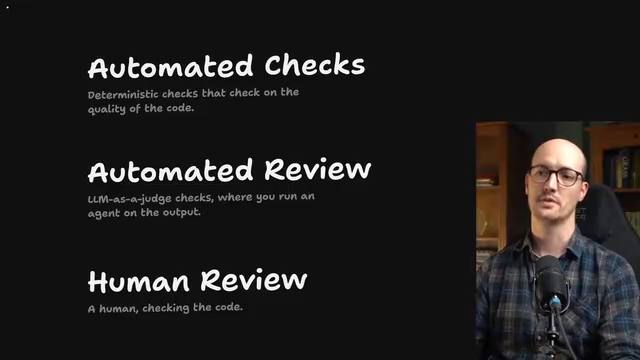

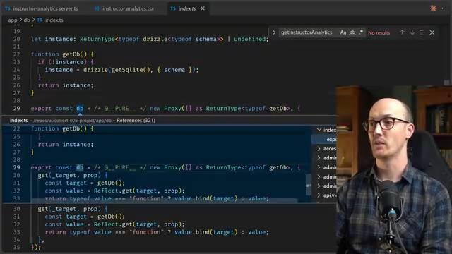

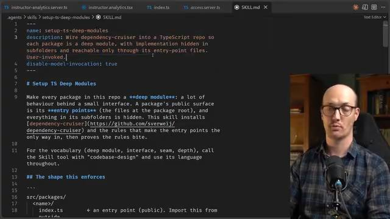

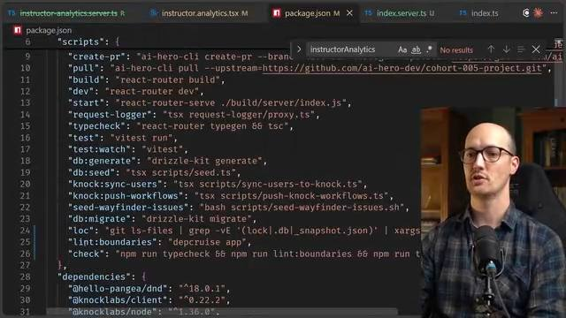

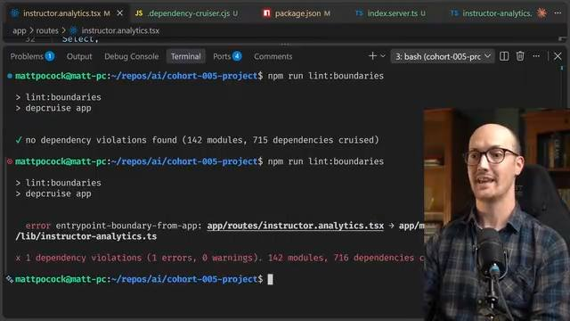

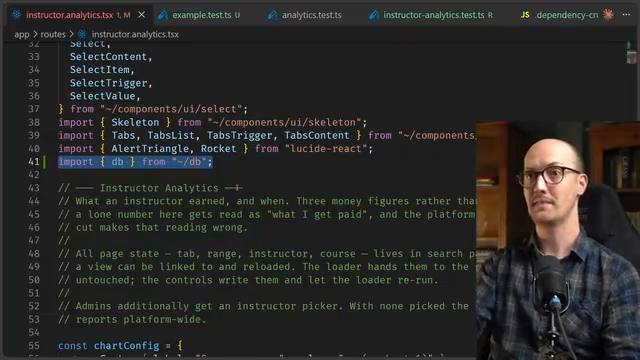

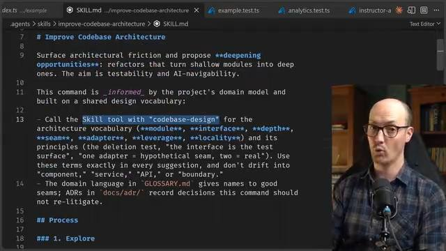

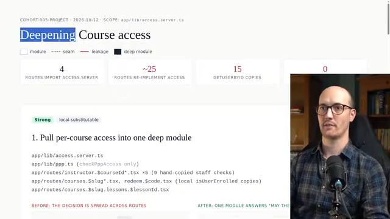

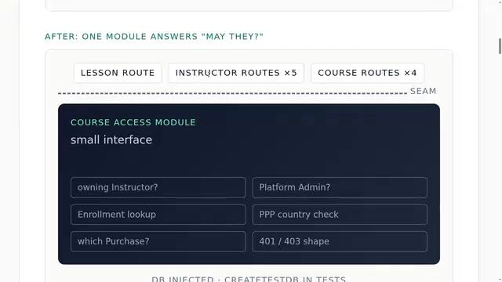

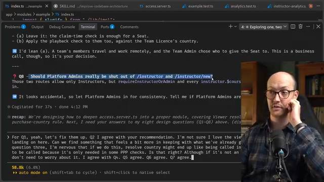

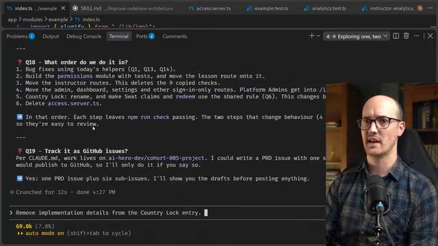

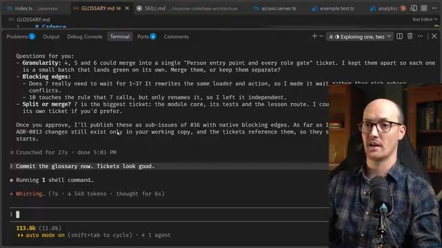