# Software Factories for Real Engineers part1（BV1dJsF6dEeR · P58–P64）复现文档

## 1. 这一节做什么

这一节补上 "软件工厂" 三层防线里的第三层：**automated checks（自动化检查）**，外加配套概念 **data sources**。前两层是 automated review（由 agent 做自动审查，非确定性）和 human review（人工审查）。讲师的目标是：先让确定性的机械检查把问题挡在 automated review 之前，再给 agent 提供更高质量的反馈信息，让它能自己验证、自己纠偏。

具体在 P58–P64 这七集里，要动手完成四件事：

1. 把臃肿的 `coding standards.md`（现场是 421 行）逐条过一遍，每条规则二选一：删掉，或转成 automated check。最终瘦身到约 111 行，并把推荐 lint 规则清单存进 secret gist 备用。
2. 搭起 `pre-commit` hook：Prettier format check + 自定义的 5,000 token 单文件上限检查，并给 hook 设定 3 秒时间预算。
3. 给 hook 加速：Prettier → Biome、TypeScript 升到 7、检查并行化，把测试从 pre-commit 挪去 CI。
4. 用 Oxlint 写一条自定义 lint 规则，堵住 `courses.tsx` 里 `SQL.Raw` 导致的 SQL 注入——这是 `npm run check` 抓不到的真实安全漏洞。

做完之后，读者手上的仓库应该具备：能拦超限文件的 pre-commit hook、能拦 SQL 注入的 lint 规则、一条从 `coding standards.md` 沉淀出来的可执行规则链。

## 2. 讲师原话

关于「确定性优先」：

> "when you have a choice between deterministic and non-deterministic, you should pretty much always choose determinism... automated checks will behave exactly the same way every single time." —— p059 [00:00]

关于 retro 的非常规用法：

> "we're specifically going to tell it, okay, we've got a bunch of coding standards. I want to turn these into automated checks or delete them... because we're going against the skill a little bit, you might want to say that in your initial prompt too." —— p059 [01:31]

关于 pre-commit hook 为什么优于「每次编辑就跑检查」：

> "the agent is going to be editing tons and tons of these files in a single session... if you run these checks, not only is it going to run slower, it's also going to be pretty noisy and token inefficient for the agent... I much prefer telling my agents to commit and when they commit, then you can run your pre-commit hooks." —— p061 [00:29]

关于限制单文件 token 数：

> "as your code base gets bigger, agents will tend to want to build these enormous files. And a file that's 10,000 tokens on its own is actually quite hard for the agent to navigate... the simplest way around this is just to restrict my agents to create smaller files." —— p061 [02:25]

关于 pre-commit 的时间预算：

> "the pre-commit hook is not the last chance to catch things before they go into production... So I recommend keeping pre-commit to under around three seconds." —— p062 [03:01]

关于 pre-commit 不是硬门禁：

> "agents can cheat on the pre-commit hooks here. So the pre-commit hook is not a hard gate... The CI is the only real hard stop." —— p062 [06:05]

关于加速检查的价值：

> "something that people massively underestimate with automated checks is the way they slow down the agent as it's running. I've ended up seeing huge benefits when I've invested time in making my automated checks run faster." —— p063 [00:00]

关于 SQL 注入练习的意图：

> "there is a critical security failure in this application. And if we open up the terminal and run npm run check, then this is not going to find it. All the tests pass, everything seems fine." —— p064 [01:20]

## 3. 从零复现

### 3.0 前置环境

- Node.js + npm（课里所有命令都是 `npm run ...`，说明是 npm 管理的 JS/TS 仓库；版本号课里没具体讲）
- git（pre-commit hook 是 git hook）
- 一个可用的 AI coding agent 宿主，能调用讲师提到的 `retro` 技能、能创建 secret gist（具体宿主软件课里没点名）
- VS Code 或等价 IDE（P62 的失败演示是在 Source Control 面板做的）

项目根目录里应存在这些关键文件（来自讲师演示）：`coding standards.md`、`package.json`、`courses.tsx`、`scripts/` 目录。课里还提到一个 npm script `db seed`，用于往数据库灌演示数据。

### 3.1 阶段一：给 coding standards 做体检并瘦身

**第 1 步：还原到「臃肿」起点。**

```bash
npm run reset
npm run seed
```

讲师的口播是 "我们将运行 npm，运行 reset seed"（p059 [00:19]），并在 p059 [00:41] 提到 "重置当前分支"。复原后 `coding standards.md` 会膨胀到 **421 行**。

**第 2 步：召唤 retro。** 打开 agent 会话，显式调用 retro 技能，并说明"这次不是做常规 retrospective"。讲师的理由（p060 [04:11]）：retro 自带一套"规则反思"的参考材料，我们借的是参考材料（怎么判断规则是否可机械化、什么是 no-op 等），不是它执行步骤。

**第 3 步：投喂 prompt。** 讲师在 p060 [00:00] 里逐句念过：

- 我有一个巨大的 `coding standards.md`，是同事们长期累积下来的；
- 每条规则要么删除，要么转成 automated check；
- 不要理会 previous sessions，只看当前仓库；
- 结束时给我一份 lint 规则清单。

**第 4 步：读 retro 的体检报告。** 讲师现场拿到的结论（p060 [00:29] 起）：

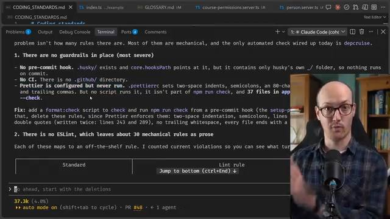

- 仓库里**没有任何 automated check**：没有 pre-commit hook，没有 CI。
- Prettier 配了但从没跑过。
- 没有 linter；automated review 里约 **30 条机械规则**可以转成 automated check，其中 `no-explicit-any`、`no-non-null-assertion` 在 TypeScript ESLint 里是内置的（讲师说 agent "它已经不见了，而且我们确实检查过了"——去查了每条规则的对应实现）。
- 有规则 **stale / 自相矛盾 / 重复**：line 187 "优先使用接口" vs line 326 "component props should be a type"；"Avoid N+1" 和 "不要在循环中读取数据库" 其实是同一件事。

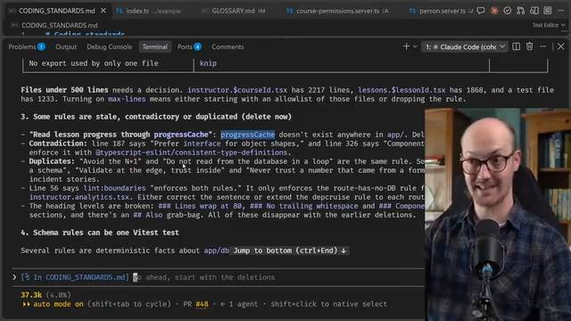

- 一类规则适合做成**单元测试**而不是 lint 规则（关于 schema、drizzle 的确定性事实）。
- 一类 **process rules** 不属于 code review 文件。
- 一批 **no-ops**
（续上文断点）

——它们要么在描述模型本来就会做的事，要么含糊到无法判定，所以删掉后模型的输出不会有任何可观测的变化。讲师现场点名的例子有 `measure before you optimize`、`mobile first`、`lazy load before the fold`、`debounce keystrokes` 这类。
- 还有一份**「应该保留」清单**：`fail with a thrown response`（失败要 throw，而不是返回错误值）、`arrange test through the module under test`、`wrap related writes in a transaction`（相关写操作包进一个事务）。

**第 5 步：让 agent 动手删，并把 lint 规则存进 gist。** 讲师在 p060 [03:57] 说这是他自己常用的一个「trick」：agent 会话里产出的、将来还要用的东西，直接存成 **secret gist**，下一个会话再丢回去当上下文。

Prompt 大意（p060 [04:03]）：

- 把 `coding standards.md` 砍到你建议的体量；
- 把刚才推荐的 lint 规则全部写进一个 secret gist，我后面单独开会话应用。

**第 6 步：验收。** 文件从 421 行降到 **111 行**；剩下的条目是「fail with a thrown response」「pass untrusted input through a schema at the edge」「check permission in the action」这类**模糊到没法写成自动检查、但确实需要人/agent 判断**的规则。讲师的评价是 "太模糊、太棘手，没法为此编写自动检查"，所以保留是对的。同时 gist 里躺着约 30 条待落地的 lint 规则清单。

这一步的产出物不是代码，而是**两份输入**：一份瘦身后的 `coding standards.md`，一份 lint 规则 gist。后面三个阶段都在消费它们。

### 3.2 阶段二：搭 pre-commit hook（format check + 文件体积上限）

**第 1 步：确认技术选型。** 讲师在 p061 [01:13] 说 ESLint "我们将在后续课程中实现这个代码检查器"，但紧接着强调：**不要以为自动化检查必须依赖现成 linter**。他自己每个仓库都用的一条检查就完全不用 linter，而且极其简单——**限制单个文件的体积**。

为什么要限制（p061 [02:25]）：仓库变大后 agent 倾向于写巨型文件；一个 10,000 token 的文件 agent 根本不会整个读进上下文，而是靠 grep 在文件里翻找，效率骤降。所以最省事的办法是从源头逼它写小文件。

**第 2 步：投喂 prompt。** 讲师在 p061 [02:54] 念的 prompt 要点：

1. 建一个 pre-commit hook，里面跑 Prettier 的 format check；
2. 同一个 hook 里写一个自定义脚本，检查**本次 staged 的文件**，任何文件超过 5,000 tokens 就报错；
3. 报错信息必须给出**怎么拆文件**的指导；
4. token 数用廉价估算即可，例如 **bytes ÷ 4**；
5. 整个 hook 控制在 **3 秒**以内。

> 注意一个口播细节：讲师在 p061 [02:25] 说过一次 "5,500 tokens"，随后在 [03:24] 和 p062 的报错输出里都是 **5,000**。以 5,000 为准，别把两个数字混着用。

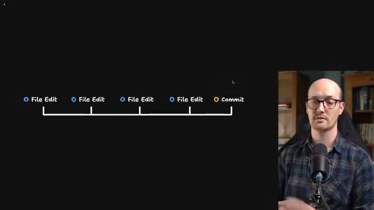

**第 3 步：看 agent 装了什么。** p062 [00:09]：

- `husky`：管理 git hook 的便捷封装，讲师说这是 "JavaScript 特有的内容"，你完全可以用裸的 git hook 代替；
- `lint-staged`：只对**已暂存**文件跑命令的 CLI。

**第 4 步：确认 `lint-staged` 配置。** `package.json` 里新增的 `lint-staged` 段用通配符匹配所有文件，跑两条命令：`node scripts/check-file-tokens.js` 和 `prettier --check --ignore-unknown`。

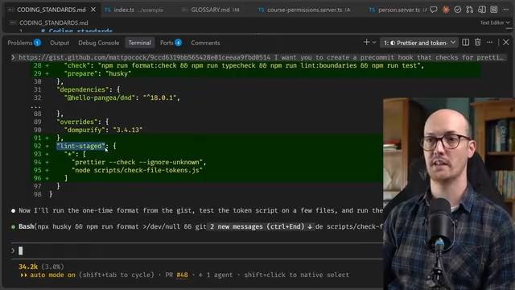

**第 5 步：确认自定义脚本的行为。** p062 [01:08] 起：

- 脚本内部有**忽略清单**：`package-lock.json` 这类天然巨大的文件、以及 drizzle 的 migrations 目录；
- 报错信息写得非常细，等于一份"按需加载的 `agents.md`"：告诉 agent 根模块怎么拆（保留 loader action 和 page component，业务逻辑挪进 `app modules`，子组件挪进 `app components`），测试怎么拆（按被测行为拆，一个区域一个文件），以及"做完跑 `npm run check` 再 commit"。

**第 6 步：接受"存量文件先不管"这个事实。** agent 调研发现约 **15 个文件**已经超限，最大的 `app routes / instructor / course id` 约 **18k tokens**。但检查只看 staged 文件，所以这些存量文件**只在下次被编辑时才被拦**。讲师认为这正好是 pre-commit 的另一个优势（p062 [02:08]）：我们看到的正是"即将被改的东西"，于是可以现在就 adoption，之后谁碰谁拆。

**第 7 步：修掉 agent 的过度设计。** 打开 `.husky/pre-commit` 会发现 agent 顺手把整套 `npm run check` 也塞了进去：再跑一遍 format check、type check、lint boundaries、整个测试套件。讲师的处理是给一个硬约束："pre-commit 最多 3 秒，把无法纳入预算的内容全部移除，先不要放进 CI"

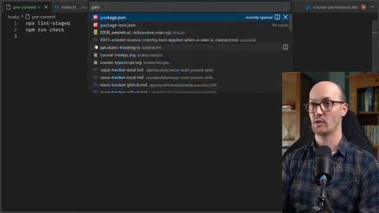

agent 回了一张耗时表：测试只要 2 秒，而 type check 要 **7.8 秒**。于是砍掉 type check、boundaries、tests，只留 lint-staged 里的两条。

**第 8 步：亲自看它失败一次。** 因为 Prettier 顺手格式化了整个仓库，一次性 diff 很大（`seed` 脚本已经 23k tokens），agent 建议这一次用 `HUSKY=0` 跳过 hook 提交"纯格式化"的改动。讲师接受，但**坚持要演示失败**：

在 Source Control 面板里随便提交一次 → 点 "显示命令输出" → 输出里出现 `fail to run tasks for staged files`，以及那条给 agent 看的提示：这些文件超过 5,000 tokens，提交前先拆分，并附上怎么拆。

这一步的教学意义是：**pre-commit hook 不是硬门禁**。agent 可以 `HUSKY=0`，也可以 `--no-verify`。真正拦得住的是 CI。

### 3.3 阶段三：给 hook 加速（目标：3 秒内塞进更多检查）

**第 1 步：先量基线。** 拿到耗时表后，讲师的态度是：很多人看到 10 秒以内就觉得"能忍"，但自动化检查真正贵的地方在于**它拖慢 agent 的每一轮循环**。

**第 2 步：投喂优化 prompt。** p063 [01:01]，两个方向：

1. 用更快的实现替换现有检查——Prettier 换 **Biome**，TypeScript 上 **7**（讲师说新版本用原生代码重写，通常快 10 倍）；
2. 把能并行的检查**并行**跑，因为在 3 秒预算下串行等于浪费。

讲师特别说明这次**不需要 skill、不需要 grilling**，因为改动不大、目标明确。

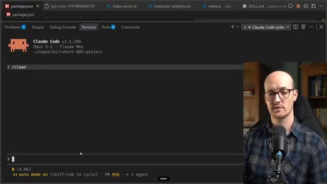

**第 3 步：处理兼容性坑。** TypeScript 7 让类型检查从 8 秒掉到 1.4 秒，但 **dependency-cruiser 加载不了 TS 7 的 API，而且它静默通过（silently pass）**——这是最危险的一种"优化"：检查看起来还在跑，实际上什么都没查。agent 的绕法是**同时装两个 TypeScript**：用 5.9 供 dependency-cruiser 用，用 7 做类型检查。

**第 4 步：看格式化的收益。** Biome 检查 **144 个文件用 28 毫秒**，Prettier 是 **2.6 秒**。

**第 5 步：并行 + 缓存。** 全并行后总耗时约 3 秒，仍略超预算，于是继续榨：dependency-cruiser 开缓存、TS 7 开 incremental、vitest 用 threads pool。

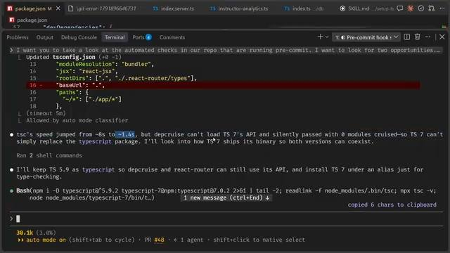

最终数字（讲师口播）：

| 检查 | 优化前 | 优化后 |
|---|---|---|
| format check | 2.6s | 0.03s |
| type check | ~8s（TS 5.9） | 0.2s（TS 7 + incremental） |
| dependency-cruiser（boundaries） | 2s | 0.45s |
| tests | 2s | 基本不变，成了最慢的一步 |

**第 6 步：把测试移出 pre-commit。** 讲师判断：仓库测试还少，测试只会越加越多，是**必然**会撑爆预算的那一项。所以测试从 hook 移走，但**保留在 `npm run check` 里**。最终 hook = lint-staged + type check + boundaries 并行，小规模提交下 **1 秒以内**。

**第 7 步：接受一次性格式化 diff。** Biome 的格式化结果和 Prettier 有细微差异，于是又出现"hook 拦住自己"的局面（`quizzes` 和 `request logger agents` 两个文件超限），agent 再次给出三个选项，讲师选第一个（临时跳过 hook 提交纯格式化）。格式化落地后，此后每次新改动都会被体积检查覆盖。

### 3.4 阶段四：用 Oxlint 写自定义规则，堵 SQL 注入

**第 1 步：切到练习分支并装依赖。**

```bash
npm run reset      # 口播是 "reset search built with SQL raw"，即 reset 到该分支
npm install        # 新装的包是 oxlint
```

讲师改用 **Oxlint**（"比 ESLint 快得多得多"），理由是它能塞进上一节定下的时间预算。

**第 2 步：确认 Oxlint 接进 lint-staged。** `lint-staged` 里多了一条针对 js/ts 文件的命令，形如 `oxlint --config .oxlintrc.json --no-error-on-unmatched-pattern`（讲师原话是 "我不确定「no error on unmatched pattern」是什么意思，但我觉得没问题"）。

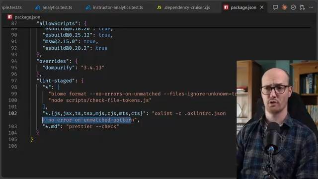

`.oxlintrc.json` 里，gist 那 30 条规则中能机械化的部分已经被落成配置项。讲师说这一步**闭合了整个循环**：`coding standards.md` 从又大又虚，变成一组可执行检查。

**第 3 步：确认常规检查抓不到问题。**

```bash
npm run check
```

测试全绿、格式与类型都没问题。然后灌数据：

```bash
npm run db seed
```

数据里 4 门课是 public，1 门不是（Kubernetes 那门）。

**第 4 步：手工复现漏洞。** 进到应用的 `search courses` 页面：

- 直接搜那门非公开课 → 搜不到；
- 在搜索框里输入一串"看起来很奇怪的字符"（讲师原话 "这串看起来相当奇怪的字符"）→ "Shipping with Docker and Kubernetes" 直接出现在结果里。

这就是 **SQL injection**：写进搜索框的 SQL 把不该看到的行查了出来。讲师强调的一点是：**`npm run check` 全绿、测试全过，什么都发现不了**。

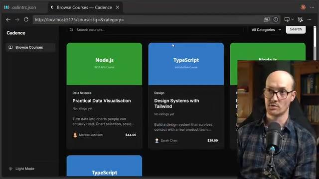

**第 5 步：定位到一行代码。** 在 `courses.tsx` 里：如果存在 search，就走 `sql.raw(...)`，而这个调用把用户输入拼进了 SQL 字符串。Drizzle 这类 ORM 本来会尽力阻止这类错误，但它**暴露了 `sql.raw` 这个不做转义的口子**。

正确/错误的边界（p064 [02:41]）：

- `sql.raw('...')` 里是**纯静态字面量**，没有任何动态部分 → 合法用法；
- 一旦出现**字符串插值或拼接** → 就是漏洞。

**第 6 步：确认 linter 配不出来。** 讲师明确说 Oxlint 虽然可配置性不错，但**没法**表达"只禁止 `sql.raw` 接动态字符串"这条规则。

**第 7 步：让 agent 写自定义 lint 规则。** 打开 agent，调用 **retro**，三条约束说清楚：

1. 有一个安全漏洞要修；
2. **不要**在代码库里彻底禁用 `sql.raw`；
3. 要禁止的是 **`sql.raw` 与动态字符串一起使用**；
4. retro 需先查清楚"怎么写一条 lint rule"，再写。

讲师对这一步的判断是："智能体在创建代码检查规则方面强得令人难以置信" P58–P64 到此结束，**规则的最终代码在下一集**，本集只到"布置任务"为止。

## 4. 完整代码

> 说明：`scripts/check-file-tokens.js` 和 `.oxlintrc.json` 讲师只展示了片段/描述；下面按逐字稿描述**重建为完整可运行文件**。自定义 lint 规则在 P58–P64 **没有给出源码**（讲师把它留到下一集），所以下面那份标注为「课里没有代码，以下为示意」，只用于让你今天就能跑通，不代表讲师原实现。

### 4.1 目录结构

```
koho-05/
├── .husky/
│   └── pre-commit
├── .oxlintrc.json
├── oxlint-plugins/
│   └── no-sql-raw-dynamic.js
├── scripts/
│   ├── check-file-tokens.js
│   └── reset.js
├── src/
│   └── ...
├── package.json
└── coding standards.md
```

### 4.2 `scripts/check-file-tokens.js`（完整文件）

```js
#!/usr/bin/env node
// 5,000 token per-file budget, checked only on staged files.
// Token count is a cheap estimate: bytes / 4 (see lesson prompt).

import { readFileSync, existsSync } from "node:fs";

const TOKEN_LIMIT = 5000;
const BYTES_PER_TOKEN = 4;

// Files we never police: generated or append-only.
const IGNORED = [
  /(^|\/)package-lock\.json$/,
  /(^|\/)pnpm-lock\.yaml$/,
  /(^|\/)drizzle\/migrations\//,
];

const GUIDANCE = `
Some staged files are over ${TOKEN_LIMIT} tokens. Split each file before you commit.

How to split:

- Route modules: keep the loader/action and the page component in the route file.
  Move business logic into a module under app/modules/.
  Move sub-components into their own files under app/components/.
- Tests: split by the behaviour under test, one file per area.
- A file that is mostly types or fixtures can usually be split by domain.

When you are done, run \`npm run check\` and commit again.
`.trim();

function estimateTokens(text) {
  return Math.ceil(Buffer.byteLength(text, "utf8") / BYTES_PER_TOKEN);
}

const files = process.argv.slice(2);
const offenders = [];

for (const file of files) {
  if (IGNORED.some((re) => re.test(file))) continue;
  if (!existsSync(file)) continue; // deleted / renamed-away files

  const source = readFileSync(file, "utf8");
  const tokens = estimateTokens(source);
  if (tokens > TOKEN_LIMIT) {
    offenders.push({ file, tokens });
  }
}

if (offenders.length > 0) {
  console.error("");
  for (const { file, tokens } of offenders.sort((a, b) => b.tokens - a.tokens)) {
    console.error(`  ${file}  ~${tokens} tokens`);
  }
  console.error("");
  console.error(GUIDANCE);
  console.error("");
  process.exit(1);
}
```

### 4.3 `.husky/pre-commit`（完整文件，加速后的最终形态）

```sh
#!/bin/sh
# Budget: under 3 seconds. Slow checks (tests) live in CI, not here.

npx lint-staged & LINT_STAGED=$!
npm run typecheck & TYPECHECK=$!
npm run boundaries & BOUNDARIES=$!

wait "$LINT_STAGED"
wait "$TYPECHECK"
wait "$BOUNDARIES"
```

被 agent 写坏、需要回退的版本长这样（仅作对照，**不要用**）：

```sh
#!/bin/sh
# 错误示范：把整套 check suite 塞进 pre-commit（约 13 秒以上）
npx lint-staged
npm run format:check
npm run typecheck
npm run boundaries
npm run test
```

### 4.4 `package.json`（完整文件）

```json
{
  "name": "koho-05",
  "private": true,
  "type": "module",
  "scripts": {
    "reset": "node scripts/reset.js",
    "db:seed": "node scripts/db-seed.js",
    "format": "biome format --write .",
    "format:check": "biome format .",
    "typecheck": "tsc --noEmit --incremental",
    "boundaries": "depcruise src --config .dependency-cruiser.cjs",
    "lint": "oxlint --config .oxlintrc.json --no-error-on-unmatched-pattern",
    "test": "vitest run",
    "check": "npm run format:check && npm run lint && npm run typecheck && npm run boundaries && npm run test"
  },
  "lint-staged": {
    "*": [
      "node scripts/check-file-tokens.js",
      "biome format --write --no-errors-on-unmatched"
    ],
    "*.{js,jsx,ts,tsx}": [
      "oxlint --config .oxlintrc.json --no-error-on-unmatched-pattern"
    ]
  },
  "devDependencies": {
    "@biomejs/biome": "latest",
    "dependency-cruiser": "latest",
    "husky": "latest",
    "lint-staged": "latest",
    "oxlint": "latest",
    "typescript": "latest",
    "vitest": "latest"
  },
  "dependencies": {
    "drizzle-orm": "latest"
  }
}
```

> 两个注意点：① `lint-staged` 里跑的是 `biome format --write`，因为讲师用它替代了 `prettier --check`——Biome 在本仓库里承担"格式化并写回"，而 `npm run check` 里的 `format:check` 才负责"只检查不写"。② 口播里 `npm run db seed` 如果在你仓库里是 `npm run db:seed`，照仓库来，不要照抄这段。

### 4.5 `.oxlintrc.json`（完整文件，由 gist 规则落地）

```json
{
  "plugins": ["typescript"],
  "categories": {
    "correctness": "error"
  },
  "rules": {
    "typescript/no-explicit-any": "error",
    "typescript/no-non-null-assertion": "error"
  },
  "ignorePatterns": [
    "drizzle/migrations/**",
    "node_modules/**",
    "dist/**"
  ]
}
```

> 课里只有"gist 里的规则被塞进了这个配置文件"这一句话，具体 rule id 以 Oxlint 官方文档和你的实际配置为准。至少 `no-explicit-any` / `no-non-null-assertion` 是讲师点名提到有内置实现的。

### 4.6 `oxlint-plugins/no-sql-raw-dynamic.js`（**课里没有代码，以下为示意**）

```js
// 课里没有给出这条规则的实现（讲师把它留到下一集）。
// 下面是为了让你能先跑通流程而写的示意版，语法按 ESLint 风格插件组织。

const noSqlRawDynamic = {
  meta: {
    type: "problem",
    docs: {
      description:
        "Disallow sql.raw() with a dynamically built string (SQL injection risk).",
    },
    schema: [],
    messages: {
      dynamic:
        "sql.raw() must receive a static string literal. Dynamic input belongs in sql`` with bound parameters.",
    },
  },
  create(context) {
    function isSqlRawCall(node) {
      const callee = node.callee;
      return (
        callee.type === "MemberExpression" &&
        !callee.computed &&
        callee.object.type === "Identifier" &&
        callee.object.name === "sql" &&
        callee.property.type === "Identifier" &&
        callee.property.name === "raw"
      );
    }

    function isStaticString(node) {
      if (!node) return false;
      if (node.type === "Literal" && typeof node.value === "string") return true;
      // sql.raw(`...`) with no ${} is still static
      if (node.type === "TemplateLiteral" && node.expressions.length === 0) {
        return true;
      }
      return false;
    }

    return {
      CallExpression(node) {
        if (!isSqlRawCall(node)) return;
        const first = node.arguments[0];
        if (isStaticString(first)) return;
        context.report({ node, messageId: "dynamic" });
      },
    };
  },
};

export default {
  rules: {
    "no-sql-raw-dynamic": noSqlRawDynamic,
  },
};
```

漏洞侧的代码形态（用于自测，**示意，不是仓库原文件**）：

```tsx
// 会被规则拦下
if (search) {
  const rows = await db.execute(
    sql.raw(`select * from courses where title like '%${search}%'`)
  );
}

// 不会被拦下：静态字符串，讲师明确说是合法用法
const rows = await db.execute(sql.raw("select 1"));
```

## 5. 逐行解释

**`const TOKEN_LIMIT = 5000;` / `const BYTES_PER_TOKEN = 4;`**
这两个数字直接对应讲师的口播。`bytes / 4` 是"廉价估算"，不追求精确——它只要能把 18k token 那种巨型文件拦住就够了。为什么不用真正的 tokenizer？因为在 pre-commit 这个 3 秒预算里，装一个 BPE 分词器纯属浪费；而且估算**误判的代价极低**（大不了拆小一点）。注意这个估算对中文偏保守：中文一个字符 3 字节 → 约 0.75 token，实际中文语料往往接近 1 token/汉字，所以中文内容会被**低估**约 25%。如果你仓库里有大量中文注释/文案，把 `BYTES_PER_TOKEN` 调成 3 更安全。

**`const IGNORED = [...]`**
`package-lock.json`、`pnpm-lock.yaml`、`drizzle/migrations/` 这三类永远不该被体积检查管：前两者是包管理器生成的，后者是 append-only 的迁移历史。讲师在 p062 [01:08] 只点名了 lock 文件和 drizzle 迁移，这里照着扩了一行 pnpm lock，属于同类。

**`process.argv.slice(2)`**
这是理解整个设计的钥匙：脚本**不自己去问 git 有哪些文件**，而是接收 `lint-staged` 通过命令行传进来的路径。谁触发、传哪些文件，全由 `lint-staged` 决定。这就是"只看 staged 文件"的实现方式，也是讲师说的"存量超限文件只在被编辑时才拦"的机制来源。在 Node 里对应 `process.argv`；如果你写的是 shell 脚本，就是 `$@`。

**`if (!existsSync(file)) continue;`**
`lint-staged` 会把被**删除**的文件也传进来。读取不存在的文件会抛异常，整个 hook 直接崩，报错信息还会误导 agent。这一行是防止"删除一个文件导致 pre-commit 挂掉"。

**`const tokens = estimateTokens(source);` 后排序输出**
按超限量从大到小排，是因为 agent 改造时的性价比不同：18k 的文件拆一次收益最大。讲师在 p062 [02:03] 提到 `instructor/course id` 那个 18k 文件，就是这个量级。

**`console.error(GUIDANCE)` + `process.exit(1)`**
这是整段代码**最重要**的部分，也是讲师唯一夸了"很酷"的设计（p062 [01:23]）：报错不只是"你错了"，而是"你错了，并且这样做"——告诉 agent 拆到哪里、测试怎么拆、拆完跑 `npm run check` 再提交。讲师把它类比成"**按需加载的 `agents.md`**"：`agents.md` 平时占上下文，这份指导只在违规时才出现，token 效率高得多。`process.exit(1)`
的作用不只是让 hook "失败"，而是让 `lint-staged` 报告失败。讲师在 p062 [06:44] 演示时看到的原文是 `fail to run tasks for staged files`，紧接着才是我们自己打的报错正文。也就是说：**退出码是唯一被上游识别的信号，stderr 只是给人/agent 读的信息**。如果你写 `process.exit(0)` 或者干脆忘了 exit（Node 默认 0），报错信息照样会打印到终端里，但 hook 会放行——这是最容易踩的一个坑，因为"看起来报了错却没拦住"。

**`.husky/pre-commit` 里的 `&` / `$!` / `wait`**
这三件东西合起来就是 shell 的并行原语。`cmd &` 把命令丢到后台，`$!` 拿到它的 PID，`wait "$PID"` 阻塞到它结束。讲师在 p063 [03:48] 说最终形态是"lint-staged、类型检查和 boundaries 并行运行，小提交时可在 1 秒内完成"，对应的就是这个写法。

对前端读者，最贴切的类比是 Node 里的 `Promise.all`：三个不互相依赖的检查没有理由串行。但要意识到这**不是** `Promise.allSettled`——下面 7.2 会讲这里的退出码陷阱。

另外注意 `.husky/pre-commit` 开头必须是 `#!/bin/sh`，并且这个文件要可执行（`chmod +x`）。课里没讲权限这一步，但 husky 初始化时会自动做；如果你是手写这个文件，忘了 chmod 就是 `hint: hook was ignored because it's not executable`。

**`package.json` 里的 `"type": "module"`**
`check-file-tokens.js` 用了 `import` 语法，所以要么加这一行，要么把文件名改成 `.mjs`。课里 agent 生成的脚本用的是 ESM，但讲师没专门解释这一行——它是 Node 的模块解析开关，不加会直接 `SyntaxError: Cannot use import statement outside a module`。

**`"typecheck": "tsc --noEmit --incremental"`**
`--noEmit` 是"只检查类型、不产出 js"，这是 CI 里做类型检查的标准姿势。`--incremental` 是讲师在 p063 [03:18] 点名要加的优化之一（"TypeScript 7 有一个增量标志"）：它会写一份 `.tsbuildinfo` 缓存，下次只重算变化的文件。副作用是你得把 `*.tsbuildinfo` 加进 `.gitignore`，否则它会被 lint-staged 当普通文件处理，还可能触发体积检查。

**`"check": "npm run format:check && npm run lint && npm run typecheck && npm run boundaries && npm run test"`**
这一条是理解"两套检查"的关键：`npm run check` 是**全量**（整个仓库、包括测试），给人和 CI 用；`pre-commit` 是**增量**（只碰 staged 文件、砍掉测试），给 agent 的快速反馈用。讲师在 p063 [04:18] 说测试从 hook 移走但"仍然通过 `npm run check` 运行"，就是这个分工。你把两者搞混，就会出现"我在本地全绿、提交却被拦"或者反过来。

**`lint-staged` 的两段配置**
第一段 `"*"` 匹配**所有** staged 文件，跑体积检查和 `biome format --write`；第二段 `"*.{js,jsx,ts,tsx}"` 只对 JS/TS 跑 Oxlint。为什么体积检查用 `*` 而不是限定 ts？因为巨型文件未必是代码——一个 200k 的 JSON fixture 一样撑爆上下文。

`biome format --write` 带 `--write`，意味着**它会改文件并把改动一起带进这次提交**（lint-staged 会自动 `git add` 回去）。这跟 `format:check`（只检查、不改）是两种策略：hook 里用 write 是为了"顺手修好，别挡路"，`npm run check` 里用 check 是为了"确保仓库已格式化"。讲师在 p062 [01:10] 描述的 dry run + 顺手格式化全仓，就是 `--write` 的副作用。

**`--no-error-on-unmatched-pattern`**
讲师原话是 "我不确定「no error on unmatched pattern」是什么意思，但我觉得没问题"（p064 [00:29]）。它的作用是：当传入的路径匹配不到任何目标文件时不要报错退出。这在 lint-staged 场景下很有必要——比如这次提交只改了一个 `.md`，`*.ts` 那段拿到空列表，不加这个 flag 就会失败。**这是讲师的猜测留白，flag 名字以你所用 Oxlint 版本的实际输出为准。**

**`.oxlintrc.json` 的 `categories`**
`"correctness": "error"` 是整类开启，比逐条 `rules` 更省事。课里只说了"gist 里的内容被塞进了这个配置"，没有逐条展示，所以具体 rule id 请以 `npx oxlint --rules` 之类的实际输出为准，别照抄我这份示意。

**自定义规则的 `MemberExpression` 判断**
`sql.raw(...)` 在 AST 里是 `CallExpression`，其 `callee` 是 `MemberExpression`：`object` 是 `sql`，`property` 是 `raw`。`!callee.computed` 是为了排除 `sql["raw"](...)` 这种写法被误判成同名（严格说它也该被拦，但那是另一种匹配；课里没讲这个边界）。这套 AST 遍历的写法跟 Babel 插件、ESLint 插件完全一致——你可以理解成"给每种节点类型注册一个回调"，思路和 `addEventListener` 一样，只是事件名换成了节点类型。

**`isStaticString` 为什么放行 `TemplateLiteral` 且 `expressions.length === 0`**
因为 `` sql.raw(`select 1`) `` 虽然用了反引号，但没有 `${}`，运行期就是个常量字符串，没有注入面。讲师在 p064 [02:41] 划的线正是这条：**"raw 里是纯静态 SQL" 合法，"出现插值或拼接" 非法**。一旦 `expressions.length > 0`，用户输入就可能进入 SQL 文本，必须报错。这也是为什么不能简单地"全局禁用 `sql.raw`"——讲师在 prompt 里专门写了"我们不想在代码库中彻底禁用 sql.raw"（p064 [03:06]），因为合法用法存在。

**`context.report({ node, messageId: "dynamic" })`**
只报节点、不自动修（没有 `fix`）。这是故意的：SQL 注入的修法不是机械替换，得由人或 agent 判断"这里应该改成参数化查询还是静态常量"，误自动修会引入更难查的 bug。

## 6. 复现检查清单

按顺序过一遍，每步都有可观测的判据。任何一步对不上，就停在那里排查，别往下走。

**阶段一：coding standards 瘦身**

- [ ] `npm run reset` + `npm run seed` 之后，`coding standards.md` 的行数是 **421 行**左右。
- [ ] 打开 agent 会话，prompt 里**明确写了**"这次不看 previous sessions，只看当前 repo"，且**明说了**"我们是在非常规使用 retro"。
- [ ] 返回的报告里至少出现这四类结论：无 pre-commit / 无 CI、Prettier 配置了没跑、约 30 条规则可机械化、存在 stale/矛盾/重复规则。
- [ ] 返回的报告里能指出至少一组矛盾（课里的例子是 line 187 `prefer interface` vs line 326 `component props should be a type`）。
- [ ] 瘦身后行数降到 **110 行左右**（课里是 111 行）。
- [ ] 保留项里有 `fail with a thrown response` 这类模糊规则——如果全被删成 0 行，说明 agent 削过头了。
- [ ] secret gist 已创建，内容是一份 lint 规则清单，可访问。

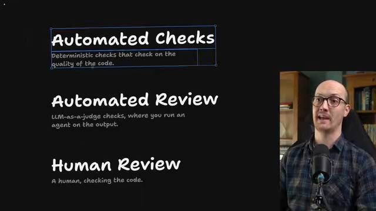

**阶段二：pre-commit 落地**

- [ ] `package.json` 的 `devDependencies` 里出现 `husky` 和 `lint-staged`。
- [ ] `.husky/pre-commit` 存在。**先看它的内容**，如果里面出现了 `npm run test` 或 `npm run typecheck` 之外的整包 `npm run check`，按 4.3 改掉。
- [ ] `lint-staged` 配置里同时有"体积检查脚本"和"格式化"两条。
- [ ] `scripts/check-file-tokens.js` 的忽略清单里至少有 `package-lock.json` 和 drizzle migrations。
- [ ] 手动制造一次超限：往任意文件里粘一大段（>5000 token ≈ 20000 字节）文本，`git add` 后 `git commit`，能看到文件列表 + 拆分指导 + `fail to run tasks for staged files`，且**提交被拦下**。
- [ ] 把那段文本删掉再提交，能通过。
- [ ] 用 `git log` 确认：格式化的那次提交是单独一条，没有和功能改动混在一起。

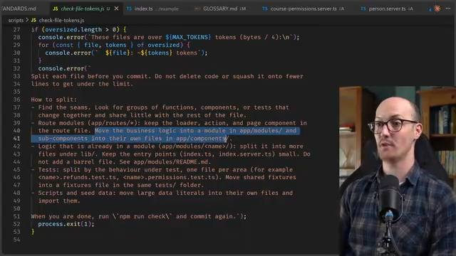

**阶段三：加速**

- [ ] 优化前先自己记一份基线：`time npm run format:check`、`time npm run typecheck`、`time npm run boundaries`、`time npm run test`。**没有基线就没法判断 agent 的优化是真有效还是碰巧。**
- [ ] `time git commit` 一次小改动，总耗时 **< 3 秒**（课里最终是 1 秒以内）。
- [ ] 专门验证 dependency-cruiser 没有"静默通过"：故意写一条跨层的 import，跑 `npm run boundaries`，**必须报错**。如果它一声不响地过了，说明 TS 7 的 API 兼容问题以另一种形式复发了。
- [ ] `npm run test` 仍然可跑（测试只是从 hook 移走，不是删掉）。
- [ ] 确认仓库里同时存在两个 TypeScript 版本时，`tsc --version` 和 dependency-cruiser 实际加载的版本是两个不同的号——这条课里没讲怎么验，见 7.4。


**阶段四：SQL 注入**

- [ ] `npm install` 之后，`oxlint` 出现在 devDependencies 里，`lint-staged` 里出现了 oxlint 那一条。
- [ ] `npm run check` **全绿**——这一步必须绿，否则你复现的不是讲师那个场景（"所有检查都过了，但漏洞还在"）。
- [ ] `npm run db seed` 之后，`search courses` 页面上：直接搜 Kubernetes 搜不到；输入那串奇怪字符后，"用 Docker 和 Kubernetes 发布" 出现。
- [ ] 定位到 `courses.tsx`（或你仓库里对应文件）的 `sql.raw` 调用点，能指出插值发生在哪一行。
- [ ] 把该文件改成静态字符串形式（或临时注释掉 search 分支），再搜同样的字符，非公开课**不再出现**——证明你找对了注入点。
- [ ] 自定义规则写好并在配置里注册后，用 4.6 结尾那段"会被拦下"的代码做正样本、`sql.raw("select 1")` 做负样本，各跑一次，结果必须是 1 报错 + 1 通过。
- [ ] 规则跑在 `npm run lint` 里（而不是只在编辑器插件里），这样 CI 才拦得住。

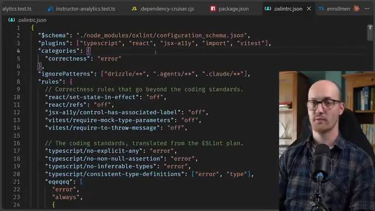

## 7. 课里没讲但你会撞上的

### 7.1 husky 的安装与初始化
课里只说了"agent 装了 husky"。你从零搭的时候必须自己跑初始化（`npx husky init` 或等价的 prepare 脚本），否则 `.husky/` 目录不会被 git 识别为 hooks 路径——表现是"文件明明在，提交时一点反应都没有"。husky 不同大版本之间初始化命令变过，**以你装的版本的实际文档为准**，别照抄网上的旧教程。

### 7.2 pre-commit 并行写的退出码陷阱（最容易出人命的一条）
4.3 那段里三个 `wait` 是顺序写的，但**shell 脚本的最终退出码取自最后一条命令**。也就是说：如果 type check 失败、而最后 `wait` 的 boundaries 成功，整个 hook 会**返回成功**，提交照样过。你等于悄悄废掉了一条检查，而且它平时是绿的，你根本发现不了。

修法（课里没讲，但这是并行化的必要补丁）：

```sh
#!/bin/sh
set -u
fail=0
npx lint-staged & LINT_STAGED=$!
npm run typecheck & TYPECHECK=$!
npm run boundaries & BOUNDARIES=$!
wait "$LINT_STAGED" || fail=1
wait "$TYPECHECK" || fail=1
wait "$BOUNDARIES" || fail=1
exit "$fail"
```

对前端读者：这就是 `Promise.allSettled` 之后再统一判失败，而不是 `Promise.all` 的"第一个 reject 就抛"。**并行 + 汇总失败**必须成对出现，只并行不汇总，就等于随机丢检查。

### 7.3 两个检查会互相打架
`biome format --write` 会改文件，`check-file-tokens.js` 读的是**改之前**的大小。极端情况下格式化把文件撑大了，第一次提交过、第二次被拦。这不是 bug，是顺序问题；真要较真就把体积检查放在格式化之后跑（lint-staged 数组里的顺序就是执行顺序，但每个任务拿到的文件内容取决于前一个任务是否回写）。课里没讨论这个顺序，你自己调一次就知道了。

### 7.4 "pin 一个 TypeScript 5.9"到底怎么 pin
讲师说 agent "锁定一个 TypeScript 5.9 版本，并保留另一个版本用于检查代码"（p063 [02:38]），但没说语法。npm 里的做法是别名安装，形如 `"typescript5": "npm:typescript@5.9.x"`，然后让 dependency-cruiser 指向那个包名（**具体要改哪份配置，以 dependency-cruiser 的文档为准，课里没讲**）。验证方法：故意写一条跨层 import，看它是否报错——见检查清单阶段三那一项。这种"两份同名依赖"是 JS 生态里的常规操作，Node 的 `node_modules` 嵌套解析天然支持；在 Python 里你就得靠 venv 或 Poetry 的 `markers` 了，属于"知道即可"。

### 7.5 静默失败比报错危险十倍
`dependency-cruiser can't load TypeScript 7's API and silently pass`（p063 [02:12]）——这条请当成规律记住：**任何"优化"之后，只要某条检查的耗时出现断崖式下降（8s → 0.2s），你都必须先怀疑它没在干活**。类型检查从 8 秒到 0.2 秒，可能是真的快了 40 倍，也可能是它压根没检查。验证手段只有一个：造一个已知错误，看它抓不抓。

### 7.6 中文仓库里 `bytes / 4` 会低估
估算公式是讲师为英文代码库设的。中文一个汉字 3 字节，`3/4 ≈ 0.75`，而实际中文 token 往往接近 1 字 1 token，低估约 25%。你有中文注释、中文 i18n 文案、中文 README 时，把分母从 4 调到 3，或者对 `*.md` 单独放宽阈值。**课里没考虑多语言，这是你必然会遇到的偏差。**

### 7.7 pre-commit 可以被合法绕过，且 agent 会主动这么做
讲师在 p062 [06:05] 明确说了："智能体可以在这里骗过 pre-commit 钩子……CI 才是唯一真正强制拦截的环节" 绕过方式就是 `HUSKY=0` 或 `--no-verify`。你的应对不是"禁止绕过"（做不到，也不该做——纯格式化提交确实该跳过），而是：

- 把 CI 当成唯一门禁，hook 只当"快速反馈"；
- 如果某类检查绝对不能漏，就**同时**放进 CI，别只在 hook 里有。

### 7.8 自定义 Oxlint 规则怎么加载
4.6 那份是标准 ESLint 风格的插件对象，但 **Oxlint 加载自定义 JS 规则的方式课里没讲**（下一集才展开）。你要么等下一集，要么照 Oxlint 官方文档配 `jsPlugins` 一类的入口。别假设 ESLint 的 `plugins: ["./xxx.js"]` 数组写法能原样搬过来——两个工具虽然规则 API 相似，加载机制并不通用。**这条以你实际版本的文档为准。**

### 7.9 写了 lint 规则 ≠ 修好了漏洞
这是本集最容易误解的一点：P64 的任务是"写一条规则防止未来再犯"，**不是**"修掉当前这个注入点"。你复现时如果只写规则、不改 `courses.tsx`，漏洞仍然存在。正确顺序是：先修当前调用点（把用户输入变成绑定参数，别拼进 SQL 文本），再让规则挡住回归。至于 `sql.raw` 该换成什么——**课里没讲具体修法**，你需要在 Drizzle 的文档里找参数化查询/`sql` 模板标签的用法。

### 7.10 事务那条规则为什么留在"人工"里
瘦身后保留的 `wrap related writes in a transaction`，正是"没法机械判定"的典型：静态分析很难知道两次写操作在业务上是否必须原子。在 JS/Node 里它对应 `db.transaction(async (tx) => { ... })`——多个写操作共享同一个 `tx` 才能保证原子性（这是你的实现知识，**课里没讲事务细节**）。同一段逻辑在并发下会不会出问题（两个请求同时读-改-写），是 lint 规则永远回答不了的问题，只能留在 code review 和测试里。这也解释了讲师的取舍逻辑：**能机械化的下沉到 checks，剩下的必须保留给人看**，一味追求"全自动化"反而会把这类规则删掉，那才是真正的损失。

### 7.11 3 秒预算会随时间失效
讲师在 p063 [03:48] 提醒要"今后要仔细监控这一点"，但没给出监控手段。你自己至少做两件事：① 在 CI 里给 `pre-commit` 这套命令加计时并打印，超过阈值就告警；② 心里清楚"测试是第一个会爆的"——所以它从一开始就不该在 hook 里。仓库长到一定程度后，type check 也会爆（哪怕用了 TS 7 + incremental），那时候正确的动作是**继续往 CI 挪**，而不是把预算从 3 秒改成 10 秒。预算一旦可协商，就等于没有预算。

### 7.12 `npm run reset` 会毁掉你的工作区
阶段一和阶段四都以 `npm run reset` 开头，讲师还提到 "重置当前分支"（p059 [00:41]）。这个脚本的真实行为课里没给源码，但从名字和上下文看，它至少会切/重置分支。**在跑它之前先 `git status` 确认没有未提交改动**，或者先 `git stash`。这是复现这套课程时最容易丢东西的一步，而且没有任何提示。