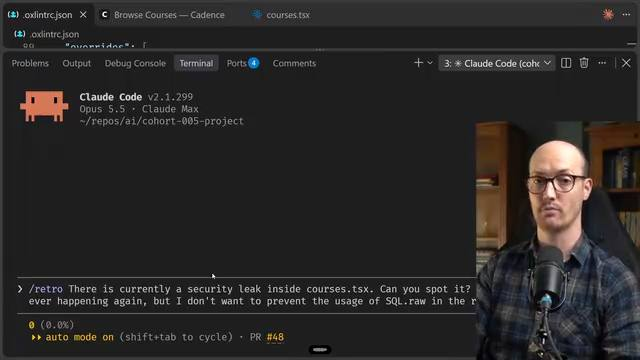
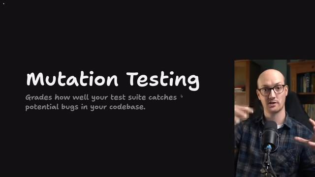
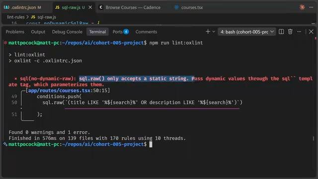
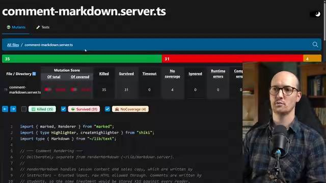
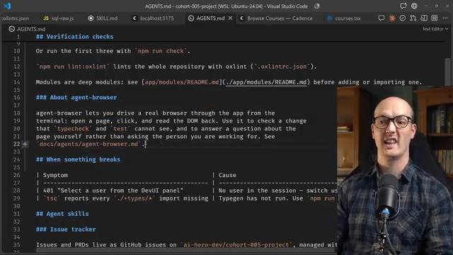
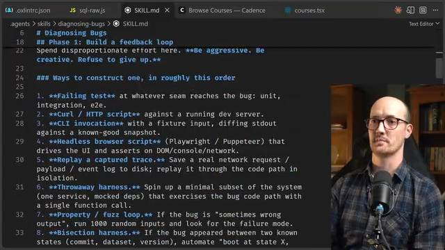
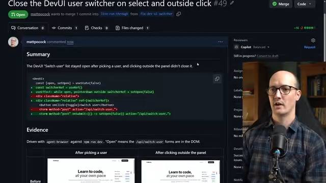

# Software Factories for Real Engineers part1（P65–P73）复现文档

## 1. 这一节做什么

这一节不是单独讲几个概念，而是把「给 agent 加刹车，再加证据，最后再加速」串成一条可落地的工程流水线。你最终要在自己的课程仓库里做出下面这些产物：

1. **一个高度针对性的自定义 lint 规则**：不是全仓禁用 `SQL.raw`，而是只禁止把动态字符串传给 `SQL.raw`。静态字符串仍然允许；动态值必须走 `sql` 模板标签参数化。规则生成后，`npm run lint` 要能把它报出来，并且错误消息要能直接指导修复。
2. **一次变异测试（mutation testing）闭环**：用 StrykerJS 跑测试，默认只针对 staged 文件的 hunk，避免全仓跑几个小时。跑完打开 `reports/mutation/mutation.html`，让 agent 读报告、找 surviving mutants、补测试，再复跑看分数是否上升。
3. **把浏览器控制台接给 agent**：通过 Playwright / agent-browser 打开真实页面，读 browser console，复现「顶部选择器不工作、底部选择器工作、暗色模式切换失效」这类只看代码很难判断的前端 bug。
4. **一个 `diagnosing-bugs` 纪律**：症状 → 找反馈循环 → 一次验证一个假设 → 找到根因 → 修复 → 加 regression guard。课程里 agent 最后用 `lint boundaries` / dependency-cruiser 把「app components 运行时导入 app DB」禁掉，并验证规则在 buggy 代码上红、在修复上绿。
5. **PR 里的 before/after 截图证据**：用 agent-browser 复现「选择用户后面板不关闭、点击外部也不关闭」，修完后生成 before/after 截图，放进 PR body。这样人类 reviewer 不只看「after 能跑」，还看「before 确实复现了 bug」。
6. **一张 trust ladder / HITL→AFK 的流程表**：哪些阶段必须 human in the loop，哪些可以 away from keyboard，哪些小 blast radius 的 PR 可以自动 merge。课程没有给完整自动化实现，但给了判断标准。

这一节结束后，你的仓库至少应该多出这些文件或目录：

```text
repo/
├─ agents.md
├─ docs/
│  └─ agent-browser.md
├─ prompts/
│  ├─ 065-lintraw.md
│  ├─ 069-diagnose-bug.md
│  └─ 072-browser-pr.md
├─ scripts/
│  ├─ reproduce-course.sh
│  └─ verify-factory.mjs
├─ skills/
│  └─ diagnosing-bugs/
│     └─ SKILL.md
├─ lintraws/                  # 由 agent 生成，课程里出现
├─ reports/
│  └─ mutation/
│     └─ mutation.html        # 由 StrykerJS 生成
└─ package.json
```

注意：逐字稿没有给 `lintraws` 的源码、Stryker 的完整配置、agent-browser 的实现源码，也没有给依赖版本。因此本文不会伪造这些源码；本文给的是**可直接保存执行的复现脚本、提示词、文档模板和检查器**，真正的 lint 规则由 agent 按提示词在你的仓库里生成，再用 `npm run lint` 验证。



## 2. 讲师原话（带「—— pNNN [MM:SS]」）

> “There is currently a security leak inside courses.tsx. Can you spot it? I want to prevent this ever happening again, but I don't want to prevent the usage of SQL.raw in the repo. Instead, I want a highly targeted lintraw that prevents any dynamic strings being passed in to SQL.raw.”
>
> —— p065 [00:00]

> “sql.raw only accepts a static string, pass dynamic values through the sql template tag which parameterizes them.”
>
> —— p065 [00:50]

> “Mutation testing is able to look at your test suite and look at your code base and see how much coverage you actually have on your code base to see if any potential bugs could sneak through.”
>
> —— p066 [00:26]

> “It is very, very, very slow. If you run it on your entire code base, then it is gonna take probably hours to complete... we're only gonna do it on staged files, only on the stuff that we're actually modifying... we're only going to mutate the hunks that we actually ended up changing.”
>
> —— p066 [01:56]

> “The mutation score for comment markdown.server.ts went from 55.56 to 100%.”
>
> —— p067 [00:25]

> “The environment an agent operates in is full of these data sources, things that it can tap for information... an agent that only has access to the file system and your tests is essentially blind, whereas an environment rich in data is an incredibly productive place for an agent to work in.”
>
> —— p068 [00:48]

> “The theory behind this skill is it creates a feedback loop... the success or failure of this diagnosing bug's feedback loop is does it have access to the right data?”
>
> —— p069 [00:29]

> “What Playwright does is it basically uses Chrome to debug the application, to open it in a real browser and click around... and crucially, it then has access to the browser console.”
>
> —— p070 [00:55]

> “Agent browser lets you drive a real browser through the app from the terminal. It's actually quite a thin wrapper over a tool that the agent had used already in the previous lesson, which is playwright.”
>
> —— p071 [00:29]

> “We want screenshots of the before and after interaction here so that we know just from a glance looking at the PR that the thing has been fixed.”
>
> —— p072 [01:26]

> “All of these phases so far, what I'm going to call HITL, or human in the loop... what if we change some of these to be AFK instead, away from keyboard, with no human involved at all?”
>
> —— p073 [02:31]

## 3. 从零复现

下面按「准备仓库 → 自定义 lint → 变异测试 → 接浏览器数据源 → 诊断 bug → 做 PR 证据 → 设计自动化等级」推进。命令以你的课程仓库实际 `package.json` 为准；逐字稿是口述命令，字幕里出现过 `npm run test mutation`、`npm run reset diagnosing bugs` 这类写法，实际 npm 脚本名可能是 `test:mutation`、`reset` 加参数，先打开 `package.json` 确认。

### 3.1 准备仓库与端口

```bash
cd <你的课程仓库>
npm install
npm run dev
```

讲师在 p070 说自己 dev server 跑在 `localhost:5175`，并说默认通常是 `5173`。你以终端输出为准。不要假设环境变量名；逐字稿没有给 `.env` 变量名，按仓库 `.env.example` 或 README 配。



### 3.2 复现自定义 lint：禁止动态字符串进 `SQL.raw`

目标不是「全仓 ban `SQL.raw`」，而是「`SQL.raw` 只接受静态字符串」。课程里 agent 生成了 `lintraws` 文件夹里的规则，并让 `npm run lint` 报出：

```text
sql.raw only accepts a static string, pass dynamic values through the sql template tag which parameterizes them.
```

操作顺序：

1. 确认 `courses.tsx` 里存在安全泄漏：某处把动态值传进 `SQL.raw`，例如模板字符串或变量。
2. 把 `prompts/065-lintraw.md` 交给 agent，要求它只新增针对性规则，不禁止整个仓库使用 `SQL.raw`。
3. 检查 agent 是否在 `lintraws/` 下新增规则文件，并修改 lint 配置或 `package.json` 脚本，让 `npm run lint` 能加载。
4. 运行：

```bash
npm run lint
```

预期看到上面的错误消息。然后让 agent 修 `courses.tsx`：动态值改走 `sql` 模板标签参数化。修复后再跑 `npm run lint`，应不再报该处；同时用原来的注入输入验证「不再生效」。



### 3.3 复现 mutation testing：只变异 staged hunk，再读 HTML 报告

讲师的做法是：

```bash
npm run reset -- relative-comment-links --unstaged
npm install
```

逐字稿口述为 `npm run reset`、两个连字符、`relative comment links`、`--unstaged`；按 npm 传参惯例写成上面的形式。`npm install` 是为了装 StrykerJS 相关包。然后查看 `package.json`，找到 mutation 脚本，逐字稿口述为 `npm run test mutation`，实际很可能是：

```bash
npm run test:mutation
```

跑完后打开：

```text
reports/mutation/mutation.html
```

报告里会列出被变异的文件、具体行、killed / survived。课程里第一次小 diff 的结果是 `comment markdown.server.ts` 的 mutation score 从 `55.56` 到 `100%`；后来对整个文件跑，出现 `31` 个 surviving mutants、`35` 个 killed，agent 补测试后分数从 `50%` 到 `90%`。你不需要强求 100%，课程明确说 mutation testing 更适合作为给 agent 的信息输入，而不是必须让 CI 红的确定性检查。

如果只想跑某个文件，讲师说「passing in the file name」：

```bash
npm run test:mutation -- path/to/comment-markdown.server.ts
```

参数名以你的脚本为准；逐字稿只说了「传入文件名」。



### 3.4 接浏览器数据源：Playwright / agent-browser

课程里 agent 先用 Playwright 打开真实 Chrome，读 browser console；后来仓库里加了 `agent-browser`，作为 Playwright 的薄封装，让 agent 从终端驱动浏览器。逐字稿提到的动作包括：

```text
agent browser open
agent browser snapshot
click
fill with text
get text
screenshot the page
```

具体参数名课里没讲，以实际 CLI 为准。你要做的是：

1. 确认 `agents.md` 里有 Agent Browser 段，指向 `docs/agent-browser.md`。
2. 启动 dev server，确认端口，例如 `http://localhost:5175`。
3. 让 agent 先读 `agents.md` 和 `docs/agent-browser.md`，再执行 `open → snapshot → click/fill → get text → screenshot`。
4. 复现 bug 时先截 before，修完再截 after。



### 3.5 复现 `diagnosing-bugs`：从症状到回归 guard

课程里的 bug 症状是：

- 顶部 dev UI selector 不工作；
- 底部 selector 工作；
- 暗色模式切换不工作；
- dev server 日志没有有用信息；
- browser console 里有 page error：server-only code 泄漏进 client bundle，破坏 hydration，导致只有非 JS 控件还能用。

复现步骤：

1. 重置到诊断分支：

```bash
npm run reset -- diagnosing-bugs
npm install
npm run dev
```

如果仓库脚本接受空格参数，可能是逐字稿口述的 `npm run reset diagnosing bugs`；以 `package.json` / README 为准。

2. 把 `prompts/069-diagnose-bug.md` 交给 agent，明确告诉它「先连接 browser console」，并给端口。
3. 观察 agent 是否调用 `diagnosing-bugs` 纪律：构造失败测试、HTTP 脚本、CLI 调用或浏览器操作作为反馈循环；一次一个假设，失败就换假设。
4. 找到根因后，要求它加 regression guard：课程里用的是 `lint boundaries` / dependency-cruiser，规则内容是「禁止 app components 运行时导入 app DB」。
5. 验证 guard 在 buggy 代码上红、在修复上绿。



### 3.6 用 agent-browser 做 before/after 截图 PR

讲师在 p071–p072 的 bug 是：选择用户后，用户选择面板不关闭；点击面板外部也不关闭；必须回到 switch user 才能关。修完后 PR body 里要有 before/after：

- before：选用户后列表仍打开；点击外部后列表仍打开。
- after：选用户后列表关闭；点击外部后列表关闭。

操作：

```bash
npm run reset -- agent-browser
npm install
# 逐字稿提到 db migrate，但完整命令未给，按仓库 README/package.json 执行
npm run dev
```

然后把 `prompts/072-browser-pr.md` 交给 agent。要求它：

1. 先读 `agents.md` 的 Agent Browser 段和 `docs/agent-browser.md`；
2. 用 agent-browser 复现 bug；
3. 修复；
4. 生成 before/after 截图；
5. 创建 PR，PR body 带截图证据；
6. 说明 blast radius 只在 dev UI。



### 3.7 设计 HITL / AFK 与 trust ladder

课程最后把流程拆成：explore → approve → implement → review → merge。当前全是 HITL；可以逐步把 implement、review、部分 explore 改成 AFK；小 blast radius、two-way door、无数据迁移的 PR 可以尝试自动 merge。你要产出一张表，写清楚每个阶段谁负责、失败时怎么回滚、什么条件下允许 AFK。课程没有给自动 merge 的实现代码，不要伪造。


## 4. 完整代码

> 说明：逐字稿没有给出 lintraw 源码、Stryker 配置、agent-browser 实现源码、数据库迁移命令和环境变量名。下面每个文件都是完整可保存的文件；其中提示词和文档是复现课程行为所必需的，`reproduce-course.sh` 和 `verify-factory.mjs` 可直接运行。不要把我没写的包名、版本、字段名当成课程内容。

### 4.1 `prompts/065-lintraw.md`

```markdown
# 任务：阻止 SQL.raw 接收动态字符串

仓库里 `courses.tsx` 存在安全泄漏：动态字符串被传入了 `SQL.raw`。
目标不是禁止整个仓库使用 `SQL.raw`，而是新增一个高度针对性的自定义 lint 规则。

## 必须满足
1. 只在 `lintraws/` 下新增规则，不改动无关业务代码。
2. 规则只拦截 `SQL.raw` 的动态参数：
   - 允许：`SQL.raw("static string")`
   - 禁止：`SQL.raw(\`...${value}\`)`
   - 禁止：`SQL.raw(variable)`
   - 禁止：`SQL.raw(anyExpression)`
3. 不要全仓禁用 `SQL.raw`。
4. 错误消息必须为：
   `sql.raw only accepts a static string, pass dynamic values through the sql template tag which parameterizes them.`
5. 修改 lint 配置或 `package.json` 脚本，使 `npm run lint` 能加载该规则。
6. 修复 `courses.tsx` 中的泄漏：动态值改走 `sql` 模板标签参数化。
7. 输出：改动文件列表、运行命令、漏洞复现输入、修复后验证结果。
```

### 4.2 `prompts/069-diagnose-bug.md`

```markdown
# 任务：诊断 dev UI bug

## 症状
- 顶部 dev UI selector 不工作。
- 底部 selector 工作。
- 暗色模式切换不工作。
- dev server 日志没有明显有用信息。

## 数据源
- dev server：`http://localhost:5175`（如果你的端口是默认值，用 `http://localhost:5173`）。
- 必须先连接 browser console。
- 可以使用 Playwright 或 agent-browser 打开真实浏览器。

## 要求
1. 自动采用 `diagnosing-bugs` 纪律。
2. 构造可重复反馈循环：失败测试、HTTP 脚本、CLI 调用、浏览器操作都可以。
3. 一次只验证一个假设；假设失败要记录并换下一个。
4. 找到根因后修复。
5. 加 regression guard：使用 lint boundaries / dependency-cruiser，禁止 app components 运行时导入 app DB。
6. 验证 guard 在 buggy 代码上红、在修复上绿。
7. 输出：console 报错、根因、修复、guard 红绿证据。
```

### 4.3 `prompts/072-browser-pr.md`

```markdown
# 任务：用 agent-browser 修 dev UI selector 并创建 PR

## Bug
选择用户后，用户选择面板不关闭；点击面板外部也不关闭。必须回到 switch user 才能关闭。

## 要求
1. 先读 `agents.md` 的 Agent Browser 段和 `docs/agent-browser.md`。
2. 用 agent-browser 的 open/snapshot/click/fill/get text/screenshot 动作复现。
3. 修复 bug，blast radius 只允许在 dev UI。
4. 创建 PR，PR body 必须包含 before/after 截图：
   - before：选用户后列表仍打开；点击外部后列表仍打开。
   - after：选用户后列表关闭；点击外部后列表关闭。
5. 输出 PR 链接、截图路径、验证命令。
```

### 4.4 `docs/agent-browser.md`

```markdown
# Agent Browser 使用说明

来源：根据课程讲师口述整理。动作名和参数以仓库实际 CLI 为准。

## 前置
- dev server 已启动。默认 `http://localhost:5173`；课程示例使用 `http://localhost:5175`。
- 执行任何浏览器操作前，先读本文件。
- 操作失败时，把失败命令和输出记录到本文件末尾。

## 动作
- `agent browser open <url>`：打开页面。
- `agent browser snapshot`：获取页面可操作快照。
- `click`：点击元素。
- `fill with text`：向输入框填文本。
- `get text`：读取文本。
- `screenshot the page`：截图。

> 以上是讲师口述的动作；具体参数名、选择器格式、截图参数课里没讲，以实际 CLI 为准。

## 证据规范
- 截图文件名使用 `before-*.png` / `after-*.png`。
- 每张截图在 PR body 中写明操作步骤。
- before 必须能看出 bug；after 必须能看出修复。
- 不要把生产数据、token、用户隐私截进图里。
```

### 4.5 `agents.md`

```markdown
# Agent Notes

## Agent Browser
在运行任何浏览器操作前，先读 `docs/agent-browser.md`。

- dev server 默认 `http://localhost:5173`；如果端口不同，以终端输出为准。
- 复现 bug 时先 snapshot，再 click/fill。
- 修完后必须用 screenshot 生成 before/after 证据。
- 如果 agent browser 会话失败，把失败命令和输出记录到本文件下方。

## Diagnosing Bugs
遇到难 bug，先找反馈循环：失败测试、HTTP 脚本、CLI 调用、浏览器操作。
一次只验证一个假设。修完后必须加 regression guard。
```

### 4.6 `skills/diagnosing-bugs/SKILL.md`

```markdown
# Diagnosing Bugs

## 使用时机
当 bug 难以只靠读代码定位，或需要真实运行环境数据时使用。

## 纪律
1. 复述症状，不急着猜根因。
2. 找反馈循环：失败测试、HTTP 脚本、CLI 调用、浏览器操作。
3. 一次只验证一个假设；失败就记录并换假设。
4. 优先接入正确数据源：dev server 日志、browser console、只读数据库、日志系统。
5. 找到根因后修复。
6. 加 regression guard，并验证它在 buggy 代码上红、在修复上绿。

## 输出
- 复现步骤
- 使用的数据源与关键报错
- 根因
- 修复
- regression guard 的红绿证据
```

### 4.7 `scripts/reproduce-course.sh`

```bash
#!/usr/bin/env bash
set -euo pipefail

ROOT="$(cd "$(dirname "${BASH_SOURCE[0]}")/.." && pwd)"
cd "$ROOT"

stage="${1:-help}"

case "$stage" in
  reset-lint)
    npm run reset -- relative-comment-links --unstaged
    npm install
    ;;
  lint)
    npm run lint
    ;;
  mutation)
    npm run test:mutation
    ;;
  mutation-file)
    file="${2:?用法: $0 mutation-file <相对路径>}"
    npm run test:mutation -- "$file"
    ;;
  diagnose)
    npm run reset -- diagnosing-bugs || npm run reset diagnosing bugs
    npm install
    ;;
  browser)
    npm run reset -- agent-browser || npm run reset agent browser
    npm install
    ;;
  dev)
    npm run dev
    ;;
  verify)
    node scripts/verify-factory.mjs
    ;;
  *)
    cat <<'EOF'
用法:
  scripts/reproduce-course.sh reset-lint
  scripts/reproduce-course.sh lint
  scripts/reproduce-course.sh mutation
  scripts/reproduce-course.sh mutation-file <相对路径>
  scripts/reproduce-course.sh diagnose
  scripts/reproduce-course.sh browser
  scripts/reproduce-course.sh dev
  scripts/reproduce-course.sh verify
EOF
    ;;
esac
```

### 4.8 `scripts/verify-factory.mjs`

```javascript
import { existsSync, readFileSync } from "node:fs";
import { join } from "node:path";

const root = process.cwd();
const results = [];

function check(name, fn) {
  try {
    const detail = fn();
    results.push({ ok: true, name, detail });
  } catch (error) {
    results.push({ ok: false, name, detail: error.message });
  }
}

check("package.json 存在", () => {
  if (!existsSync(join(root, "package.json"))) {
    throw new Error("找不到 package.json");
  }
  return "ok";
});

check("存在 lint 脚本", () => {
  const pkg = JSON.parse(readFileSync(join(root, "package.json"), "utf8"));
  const scripts = pkg.scripts ?? {};
  const names = Object.keys(scripts);
  const hit = names.find((name) => /^lint($|:)/i.test(name));
  if (!hit) throw new Error(`现有脚本: ${names.join(", ")}`);
  return hit;
});

check("存在 mutation 相关脚本", () => {
  const pkg = JSON.parse(readFileSync(join(root, "package.json"), "utf8"));
  const scripts = pkg.scripts ?? {};
  const names = Object.keys(scripts);
  const hit = names.find((name) => /mutation/i.test(name));
  if (!hit) throw new Error(`现有脚本: ${names.join(", ")}`);
  return hit;
});

check("agents.md 包含 Agent Browser 段", () => {
  const file = join(root, "agents.md");
  if (!existsSync(file)) throw new Error("找不到 agents.md");
  const text = readFileSync(file, "utf8");
  if (!/agent\s*browser/i.test(text)) {
    throw new Error("agents.md 中没有 agent browser 相关内容");
  }
  return "ok";
});

check("docs/agent-browser.md 存在", () => {
  const file = join(root, "docs", "agent-browser.md");
  if (!existsSync(file)) throw new Error("找不到 docs/agent-browser.md");
  return "ok";
});

check("mutation 报告存在", () => {
  const file = join(root, "reports", "mutation", "mutation.html");
  if (!existsSync(file)) throw new Error("找不到 reports/mutation/mutation.html");
  return "ok";
});

for (const item of results) {
  console.log(`${item.ok ? "PASS" : "FAIL"}  ${item.name}: ${item.detail}`);
}

if (results.some((item) => !item.ok)) {
  process.exitCode = 1;
}
```

## 5. 逐行解释

### 5.1 为什么 lint 规则要「高度针对性」

课程原文不是「禁止 `SQL.raw`」，而是「阻止任何动态字符串被传进 `SQL.raw`」。这是一个关键取舍：

- 全仓 ban `SQL.raw` 会误伤静态 SQL 片段，团队会为了绕规则写例外，最后规则失效。
- 只 ban 动态参数，规则小、误报少、错误消息能直接告诉开发者「用 `sql` 模板标签参数化」。
- 这种规则适合「只看代码本身就能判断」的问题。课程 p065 明确说，自定义 lint 规则在「detect just by looking at the code itself」时非常强。

`prompts/065-lintraw.md` 里把允许/禁止写清楚，是为了让 agent 不要自由发挥成全仓 ban。错误消息固定成课程里出现的那句，是为了让终端输出和课程截图对得上，也方便你检查 agent 是否真的生成了同类规则。

### 5.2 为什么 mutation testing 只跑 staged hunk

讲师说得很直白：全仓跑 mutation testing 可能要几个小时，因为它要一遍遍重跑测试。课程策略是：

1. 先跑测试拿 baseline；
2. 只对 staged 文件做变异；
3. 再进一步，只变异本次 diff 的 hunk；
4. 看到 surviving mutant 就补测试，直到分数上升。

这不是为了「好看」，而是为了让 mutation testing 能进日常工作流。`scripts/reproduce-course.sh mutation` 只调用仓库已有的 mutation 脚本，不替你决定是 staged 还是全文件；`mutation-file` 分支对应讲师后来「传入文件名跑整个文件」的演示。你第一次跑建议先用 staged 模式，确认报告能生成，再跑整文件。

在 JS/Node 里，如果 Stryker 并行跑多个测试 worker，要小心测试数据库互相污染；课程没讲这一点，但你很可能会撞上。对应做法是每个 worker 用独立 schema，或者每个测试用事务回滚。这里只是 Node 侧的工程提醒，不是课程内容。

### 5.3 为什么 browser console 是「数据源」

课程把 agent 的环境从「代码库」扩展到「数据源」。只给 agent 文件系统和测试，它基本是盲的；给它 dev server 日志、生产日志、browser console、只读数据库、issue tracker，它才能验证自己的判断。

p069–p070 的 bug 是典型例子：dev server 日志没有有用信息，但 browser console 里有 page error，指出 server-only code 泄漏进 client bundle，破坏 hydration。底部 selector 不需要 JS 所以还能用，顶部 selector 需要 JS 所以坏了。没有 browser console，agent 只能猜；有了 browser console，它能直接定位。

`docs/agent-browser.md` 和 `agents.md` 的作用不是「写文档好看」，而是给 agent 一个稳定的上下文入口：先读文档，再执行 `open/snapshot/click/fill/get text/screenshot`。课程说这比让 agent 去读外部 docs 更好，因为你可以把「本项目专属」的信息写进去，比如端口、选择器约定、截图规范。

### 5.4 为什么 PR 要 before/after 两张图

讲师在 p072 特别强调：很多人只说「我要看它工作」，但 before 也很重要，因为 before 证明 agent 正确识别了 bug。`prompts/072-browser-pr.md` 要求 before 和 after 都截：

- before 选用户后列表仍打开；
- before 点击外部后列表仍打开；
- after 选用户后列表关闭；
- after 点击外部后列表关闭。

这样人类 reviewer 一眼就能判断「bug 真的存在过，修复真的解决了它」。课程还提到有人把截图做成视频加 TTS  narration，但课里没有给实现，不要伪造。

### 5.5 为什么要有 regression guard

p070 里 agent 修完 bug 后没有停在「能跑」，而是加了 `lint boundaries` / dependency-cruiser 规则，禁止 app components 运行时导入 app DB，并验证规则在 buggy 代码上红、在修复上绿。这是「诊断 bug 的纪律」里最重要的一步：修一个 bug，同时让同类 bug 不再发生。`skills/diagnosing-bugs/SKILL.md` 把这一步写成硬性输出，就是防止 agent 只做表面修复。

### 5.6 为什么 HITL/AFK 要分阶段

p073 把流程拆成 explore、approve、implement、review、merge。当前全是 HITL；implement 和 review 已经接近 AFK；explore 可以让 agent 自主找 bug、验证 feature request；merge 可以先自动合并 two-way door、小 blast radius、无数据迁移的 PR。`trust ladder` 不是让你第一天就 50 个 agent 全自动，而是随着证据、检查、回滚能力增加，逐步把人类从某些检查点拿掉。课程说得很清楚：没有刹车，这种工厂很容易变成 slop cannon。

## 6. 复现检查清单

- [ ] `npm install` 成功，`package.json` 中存在 lint 脚本和 mutation 相关脚本。
- [ ] `agents.md` 有 Agent Browser 段，且指向 `docs/agent-browser.md`。
- [ ] `prompts/065-lintraw.md` 已交给 agent，`lintraws/` 下出现规则文件。
- [ ] `npm run lint` 能报出 `sql.raw only accepts a static string, pass dynamic values through the sql template tag which parameterizes them.`
- [ ] 静态字符串 `SQL.raw("...")` 不被误报；动态模板字符串、变量、表达式被报。
- [ ] `courses.tsx` 的泄漏已修，原来的注入输入不再生效。
- [ ] 跑过 `npm run test:mutation`，生成 `reports/mutation/mutation.html`。
- [ ] 报告里能看到 mutated 文件、行、killed / survived；小 diff 至少看到分数上升。
- [ ] 如果需要跑整文件，使用 `npm run test:mutation -- <相对路径>`，参数以实际脚本为准。
- [ ] dev server 启动，端口与 agent 被告知的一致（默认 5173，课程示例 5175）。
- [ ] agent 能通过 Playwright / agent-browser 打开页面并读取 browser console。
- [ ] 能复现「顶部 selector 不工作、底部工作、暗色切换不工作」。
- [ ] `diagnosing-bugs` 被触发，输出根因：server-only code 泄漏进 client bundle，破坏 hydration。
- [ ] 修复后加 regression guard，并验证 buggy 代码红、修复代码绿。
- [ ] 用 agent-browser 复现「选用户后面板不关闭、点击外部不关闭」。
- [ ] PR body 含 before/after 四张截图或等价证据。
- [ ] PR 的 blast radius 说明只在 dev UI。
- [ ] `node scripts/verify-factory.mjs` 全部 PASS。
- [ ] 没有把生产数据库写权限、生产 token、用户隐私截图交给 agent。

## 7. 课里没讲但你会撞上的

1. **依赖版本和包名**：逐字稿只说 StrykerJS（字幕写成 striker js），没有给 npm 包名和版本；也没有给 oxlint 自定义规则 API、lintraws 加载机制、Stryker 配置文件名。不要凭印象写 `@stryker-mutator/core@x.y.z` 这类版本；以仓库 `package-lock.json` / `pnpm-lock.yaml` 为准。
2. **npm 脚本名**：讲师口述 `npm run test mutation`、`npm run reset diagnosing bugs`，实际很可能是 `test:mutation`、`reset -- diagnosing-bugs`。先打开 `package.json`，不要盲