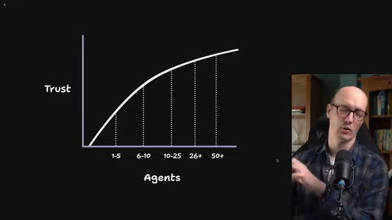
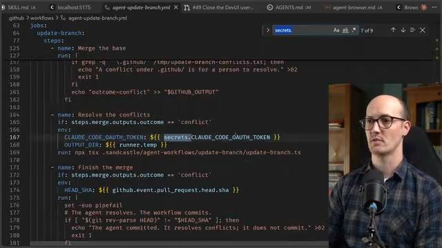
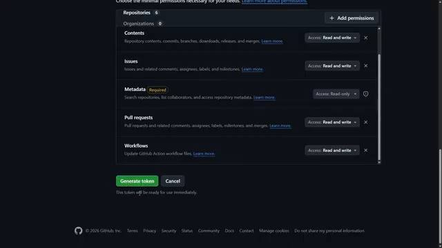
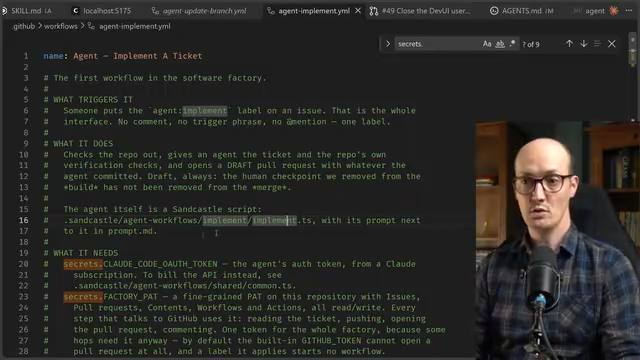
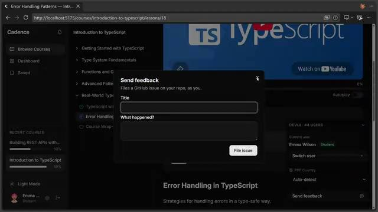
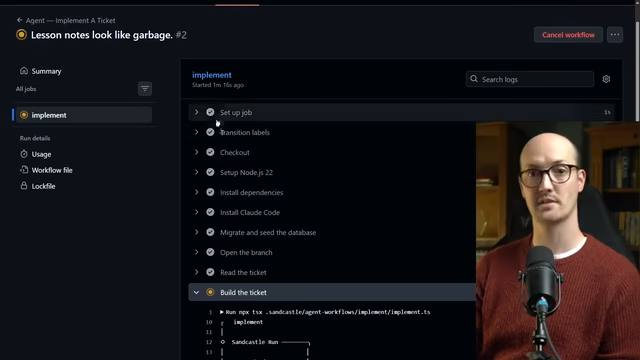
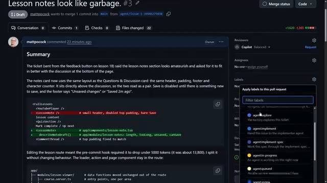
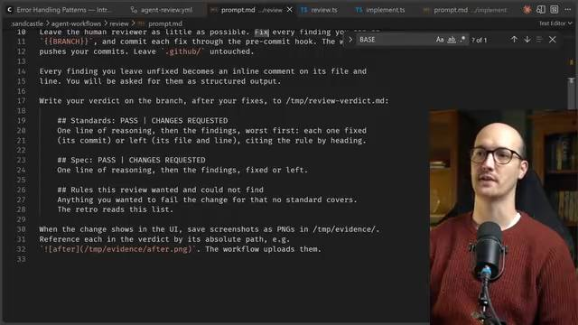
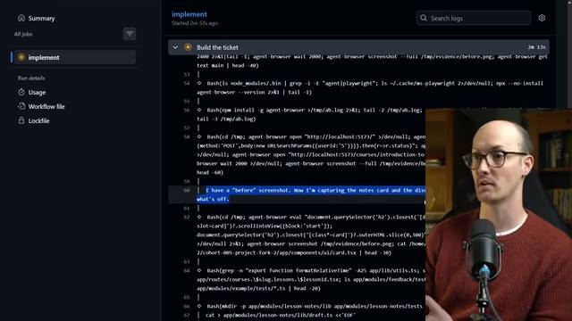

## 1. 这一节做什么

这一节把编码 Agent 从「在我本机跑」推进到「在远程沙箱里跑」，并用 GitHub Actions 做一个最小可用的 Software Factory。

最终要得到的效果是：

1. 仓库里有 Factory 需要的一组 GitHub Actions workflow，放在 `.github/workflows/`。
2. 仓库里配置好两个核心 secret：`FACTORY_PAT` 和模型供应商的 token。
3. Agent 的选择集中放在 `.sandcastle/common.ts`，不需要每个 workflow 各改一遍。
4. 用一个 GitHub issue 模拟用户反馈，给 issue 打上 `agent:implement` 标签，触发远程 Agent 实现代码并开 draft PR。
5. 给 draft PR 打上 `agent:review` 标签，触发代码审查 Agent，让它在分支上继续修问题、输出结构化 review comments，并把 PR 推进到可人工 review 的状态。
6. 全程可以在 GitHub Actions 页面看到每一步；Agent 生成的截图证据放在 `temp/evidence`，由 workflow 上传并被 PR/issue 引用。

这一节不是「本地开发替代课」。讲师明确说本地仍然适合原型和紧的人机协作，但远程沙箱是扩大 Agent 数量的关键基础设施。

---

## 2. 讲师原话（带「—— pNNN [MM:SS]」）

> "它们既可以在你的电脑上本地运行……我们也可以远程运行智能体。此时智能体运行在远程服务器上，通常处于沙箱环境中。"
> —— p074 [00:29]

> "每个智能体对应一台远程服务器……你可以按需启动更多服务器和沙箱，并在智能体完成工作后关闭它们。"
> —— p074 [00:59]

> "GitHub Actions 对公开仓库其实是免费的。"
> —— p074 [02:20]

> "Factory PAT 指的是 Factory 个人访问令牌。"
> —— p075 [00:37]

> "普通 GitHub 令牌绝对无法做到的一件事，就是触发另一个动作。"
> —— p075 [01:09]

> "在终端中运行 `claude setup-token`。这会设置一个有效期为一年的长期身份验证令牌。"
> —— p075 [03:47]

> "`npm run reset` 会重置整个仓库并删除所有现有更改，而 `npm run cherry pick` 只会把最新更改拣选到该分支，并保留现有工作。"
> —— p076 [03:01]

> "当更改显示在界面中时，将前后截图保存为 PNG，放在临时证据目录中。"
> —— p078 [02:04]

> "我们可以在其中看到 base ref、分支和拉取请求编号。这样就能使用参数化提示词。"
> —— p080 [00:51]

> "output.object……我们实际上是在要求智能体传入一个 comments XML 标签，并遵循特定模式。"
> —— p080 [01:07]



---

## 3. 从零复现

下面按「拿到一个已初始化的课程仓库」来写。逐字稿没有给出完整仓库初始化过程，所以这一步以你手头课程仓库为准；从 P74–P80 开始，仓库根目录至少要有 `package.json`，并且能运行 npm scripts。

### 3.1 前置条件

- 一个 GitHub 仓库，默认分支是 `main`。
- 仓库最好是 public。讲师选择 GitHub Actions 的核心原因是：public repo 的 Actions 免费。
- 本地有 Node.js。workflow 里明确使用 Node.js 22，所以本地也建议用 Node 22，避免本地生成和远端不一致。
- 你使用 Claude Code 订阅，或者准备改用 API key / Codex / 其他 Sandcastle 支持的 harness。
- 你能进入 GitHub 仓库的 Settings、Actions、Issues、Pull requests 页面。

### 3.2 拉取 Factory workflows

视频里的口语是：运行 reset 命令，把课程提交 `add factory workflows` 带进来。不同仓库的 npm script 参数写法可能不同，常见写法是：

```bash
npm run reset -- add-factory-workflows
```

如果这条命令没有把参数传进去，打开 `package.json` 看 `reset` 脚本要求什么格式；提交名要用课程给的那个 `add factory workflows`，不要自己改名。

执行后检查：

```bash
ls -1 .github/workflows
```

你应该看到类似这些 workflow：

```text
.github/workflows/agent-explore.yaml
.github/workflows/agent-implement.yaml
.github/workflows/agent-review.yaml
.github/workflows/agent-update-branch.yaml
```

逐字稿提到 workflow 从 explore、implement、review 到 update branch；实际文件名以模板生成结果为准。每个 YAML 里都有大段注释解释它做什么，这些注释要读，不要只看文件名。



> 重要：从这一节开始，仓库里会有你想保留的改动。后面不要随手 `npm run reset`。讲师明确说：`npm run reset` 会重置整个仓库并删除已有改动；要保留工作就用 `npm run cherry-pick`。逐字稿里口语说成 “npm run cherry pick”，实际命令名以 `package.json` 为准。

### 3.3 创建 Factory PAT

为什么不能只用 GitHub Actions 自带的 `GITHUB_TOKEN`？因为普通 token 不能触发另一个 action。GitHub 故意这样设计，防止 action 互相无限触发。但我们的 Factory 恰恰需要：implement 完成后自动触发 review，所以需要自己的 Personal Access Token。

在 GitHub 网页操作：

1. 右上角头像 → Settings。
2. 左侧最下面 → Developer settings。
3. Personal access tokens → Fine-grained tokens。
4. Generate new token。
5. 名称例如 `cohort factory token`。
6. Expiration 设为 90 days（讲师的选择，你可以按团队策略改）。
7. Only select repositories，选择你的课程项目仓库。
8. 权限：
   - Actions：Read and write
   - Issues：Read and write
   - Pull requests：Read and write
   - Contents：Read and write
   - Workflows：Read and write
   - 其他全部 No access
9. Generate token，复制 token。



然后回到仓库：

1. Settings → Secrets and variables → Actions。
2. Repository secrets → New repository secret。
3. 名称用 `FACTORY_PAT`。视频口述是 “factory + 下划线 + PAT”，并且强调必须和 YAML 里引用的名字完全一致；如果你的模板里写的是别的形式，以 YAML 中 `${{ secrets.XXX }}` 为准。
4. 粘贴 token，Add secret。

### 3.4 配置模型 token

如果你用 Claude Code 订阅：

在终端运行：

```bash
claude setup-token
```

按提示登录，拿到长期 token。讲师特别提醒：token 很长，可能超出终端显示，复制时不要带入意外换行。

然后到仓库 secrets：

- Name：`CLAUDE_CODE_OAUTH_TOKEN`
- Value：刚拿到的 token

如果你用 Anthropic API key：

- 把 workflow 和 `.sandcastle` 里所有 `CLAUDE_CODE_OAUTH_TOKEN` 替换成 `ANTHROPIC_API_KEY`。
- 在仓库 secrets 里创建 `ANTHROPIC_API_KEY`。

如果你用 Codex：

- 把 `.sandcastle/common.ts` 里的 agent 从 `sandcastle.claudeCode` 改为 `sandcastle.codex`，模型换成你 Codex 使用的模型。
- 把 workflow 里“安装 Claude Code”的步骤改为安装 OpenAI Codex。
- 把 `CLAUDE_CODE_OAUTH_TOKEN` 替换为 `OPENAI_API_KEY`。
- 在仓库 secrets 里创建 `OPENAI_API_KEY`。

Sandcastle 支持 Copilot、Claude Code、Codex、OpenCode、Pi。切换 harness 的通用顺序是：先确认需要哪些环境变量，再改 `common.ts`，再改 workflow 的安装步骤，最后改 workflow 的环境变量和仓库 secrets。

### 3.5 检查 `.sandcastle/common.ts`

逐字稿说，Agent 的“秘密源”在 `.sandcastle/common.ts`。这里指定使用哪个 agent、哪个模型、哪个 environment。这个文件是唯一集中修改点，不要在十几个 workflow 里分散改模型。

你需要确认：

- agent 是 `sandcastle.claudeCode`、`sandcastle.codex` 或其他受支持 harness。
- model 是你实际有权限使用的模型。
- environment 与 workflow 注入的环境变量名一致。
- 如果你换 harness，安装步骤和 secret 名也同步换掉。



### 3.6 推送到 main

GitHub Actions 从默认分支运行。讲师明确说：这些 workflow 都从默认分支跑，所以测试前要确保你推到 GitHub 的内容是最新的。

先看当前状态：

```bash
git status
git branch --show-current
```

如果当前不是 `main`，切回 `main`。如果远端落后于本地很多，讲师演示了：

```bash
git push --force-with-lease
```

注意：`--force-with-lease` 会覆盖远端分支，但比裸 `--force` 安全一点。只在确认远端没有你要保留的别人的提交时使用。正常协作仓库不要随便 force push。

推送后，在 GitHub 仓库确认 `.github/workflows/` 里已经有刚生成的 workflow。

### 3.7 创建测试 issue 并打标签

讲师在 dev UI 里加了一个 “send feedback” 按钮，点击后创建一个 GitHub issue。你可以用这个表单，也可以直接在 GitHub 手动建 issue。

示例 issue 标题：

```text
lesson notes look like garbage
```

正文模拟外部用户/讲师反馈：

```text
The lesson notes section looks like hot garbage. I don't know how this got approved. It looks amateurish and gives a bad impression to students. Maybe it could be more integrated with the bit at the bottom.
```

创建后，给 issue 打上 `agent:implement` 标签。视频里口语说 “agent implement”，review 环节明确说 “agent colon review”，所以你的仓库 label 名称必须和 workflow 的触发条件完全一致。如果模板里是 `agent:implement`，就用这个。



打标签后会发生：

- Actions 页面出现 `agent-implement` 运行。
- issue 上出现 `agent:in-progress` 之类的进行中标签，便于同时跑多个 issue 时观察状态。
- workflow 依次执行：transition labels、setup Node.js 22、install dependencies、install Claude Code、migrate and seed database、ticket reading、build ticket。
- 最关键一步是运行 `npx tsx` 执行 `implement.ts`，里面调用 `sandcastle.run`，传入 Claude agent 和 prompt 文件。
- Agent 在分支上 commit，workflow 负责 push 并打开 PR。



### 3.8 观察 implement 运行

进入 Actions，点进 `agent-implement` 这次运行，再点 job 里的 implement 步骤。你会看到类似 Claude Code 的工具调用日志，例如读取 lesson page notes section、跑测试、截图。

讲师特别强调 prompt 里有一条：

```text
when the change shows in the UI, save a before and after screenshot as PNGs in temp evidence
```

后面的 workflow 会读取 `temp/evidence` 里的文件并上传，这样 PR 里可以直接看到 before/after 截图，不需要人工把分支拉下来跑。

### 3.9 给 draft PR 加 review 标签

implement 完成后会开一个 draft PR。为什么是 draft？因为自动检查过了，但自动 review 还没做，所以还不算 ready for human review。

给这个 draft PR 打上 `agent:review` 标签。



这会触发 `.github/workflows/agent-review.yaml`。它和 implement workflow 结构基本一样，只是 prompt 不同。review prompt 大致做这些事：

- 使用 code review skill 审查代码。
- 尽量把能修的 finding 直接在分支上修掉，让人类 reviewer 少做事。
- 接收 prompt args：base ref、branch、PR number。
- 对修不了的 finding，用 Sandcastle 的 `output.object` 输出结构化 comments，schema 包含 path、line、body，方便 workflow 转成 GitHub inline comments。
- 允许附加截图。

### 3.10 阅读 review 结果

review 结束后，PR 上会出现：

- 一段 review summary。
- 已经修掉的问题说明。
- 未修掉、留给人类的问题。
- 文件/行级别的 inline comments。
- review 过程中产生的 commit。



讲师演示的 review 发现包括：root 不应该直接 `db.select`，而应该用模块拥有的 `getQuizForLesson`；应该走 Zod schema 而不是 `number` 强转；新模块没有测试；有 scope creep；review 还顺手找到并修了两个 React 状态 bug。最后 review 还输出“它想要但代码规范里没有的规则”，例如新文件不能加入 lint exemption、新模块必须带测试、模块必须把 database 作为参数传入、受控表单字段要按实体 key。

---

## 4. 完整代码

逐字稿没有贴出 `.github/workflows/*.yaml` 和 `.sandcastle/common.ts` 的完整源码，只描述了文件名、步骤和 prompt 行为。所以这里不伪造课程 YAML；复现时以 `npm run reset` 生成的模板文件为准。下面给出两个东西：

1. 你应当从模板得到的完整文件清单。
2. 一个可直接保存运行的检查脚本，用来确认你有没有漏文件、漏 secret 引用、漏 workflow。

### 4.1 模板生成后的文件清单

按逐字稿，至少检查这些路径：

```text
.github/workflows/agent-explore.yaml
.github/workflows/agent-implement.yaml
.github/workflows/agent-review.yaml
.github/workflows/agent-update-branch.yaml
.sandcastle/common.ts
```

prompt 文件在 implement/review 相关目录下。逐字稿提到 implement.ts 旁边的 prompt 文件，以及 review 目录下的 `prompt.md`。实际文件名和目录以模板为准。

### 4.2 完整检查脚本

把下面内容保存为仓库根目录的 `scripts/check-factory-setup.sh`，然后运行：

```bash
mkdir -p scripts
cat > scripts/check-factory-setup.sh <<'EOF'
#!/usr/bin/env bash
set -euo pipefail

errors=0

note() {
  printf '%s\n' "$*"
}

fail() {
  printf 'FAIL: %s\n' "$*" >&2
  errors=$((errors + 1))
}

note "== Factory setup preflight =="

if [ ! -f package.json ]; then
  fail "缺少 package.json：请在仓库根目录运行"
fi

if [ ! -d .sandcastle ]; then
  fail "缺少 .sandcastle 目录"
fi

if [ ! -f .sandcastle/common.ts ]; then
  fail "缺少 .sandcastle/common.ts"
fi

if [ ! -d .github/workflows ]; then
  fail "缺少 .github/workflows 目录"
fi

for name in agent-explore agent-implement agent-review agent-update-branch; do
  if [ -f ".github/workflows/${name}.yaml" ] || [ -f ".github/workflows/${name}.yml" ]; then
    note "OK workflow: ${name}"
  else
    fail "缺少 workflow: ${name}.yaml 或 ${name}.yml"
  fi
done

if grep -R "CLAUDE_CODE_OAUTH_TOKEN" .github/workflows .sandcastle >/dev/null 2>&1; then
  note "检测到 CLAUDE_CODE_OAUTH_TOKEN 引用；请确认仓库 secret 同名"
fi

if grep -R "ANTHROPIC_API_KEY" .github/workflows .sandcastle >/dev/null 2>&1; then
  note "检测到 ANTHROPIC_API_KEY 引用；请确认仓库 secret 同名"
fi

if grep -R "OPENAI_API_KEY" .github/workflows .sandcastle >/dev/null 2>&1; then
  note "检测到 OPENAI_API_KEY 引用；请确认仓库 secret 同名"
fi

if grep -R "FACTORY_PAT" .github/workflows >/dev/null 2>&1; then
  note "检测到 FACTORY_PAT 引用；请确认仓库 secret 同名且 PAT 权限正确"
fi

if git rev-parse --is-inside-work-tree >/dev/null 2>&1; then
  branch="$(git branch --show-current)"
  note "当前分支: ${branch}"
  if [ "${branch}" != "main" ]; then
    note "注意：GitHub Actions 从默认分支运行；请确认默认分支是否为 main"
  fi
fi

if [ "${errors}" -gt 0 ]; then
  printf '\n%d 项检查失败。\n' "${errors}" >&2
  exit 1
fi

note "基础文件检查通过。GitHub 仓库 secrets 只能在网页里确认。"
EOF

chmod +x scripts/check-factory-setup.sh
./scripts/check-factory-setup.sh
```

这个脚本不会读取你的 GitHub secrets，也不会上传任何东西；它只做本地文件和工作流引用检查。

---

## 5. 逐行解释

### 5.1 为什么是远程沙箱，不是本地堆 Agent

讲师在 P74 的取舍很清楚：

- 本地跑适合 human-in-the-loop：Agent 就在你机器上，你可以立刻打断、问问题、改 prompt。
- 远程跑适合 AFK：Agent 在远程服务器里，通常 sandboxed，你不需要盯着。
- 本地扩展性差：多个 Agent 抢你的 CPU，还要管理多个 work tree。
- 远程扩展性好：one remote server per agent，需要时开，完成后关。
- 安全性更好：一个 Agent 发疯，最多影响一个 server；本地发疯可能把本地环境和别的 Agent 进度一起毁掉。
- 协作更好：远程 sandbox 全队可见、可观察、可贡献。

这也是为什么这一节用 GitHub Actions：它不是唯一方案，但 public repo 免费，适合课程演示。你完全可以用 AWS EC2、Kubernetes、Daytona、E2B、Vercel 等，只要有一个远程 server 能跑 Agent。

### 5.2 为什么需要 Factory PAT

普通 `GITHUB_TOKEN` 不能触发另一个 action。GitHub 这样设计是为了防止 action 无限循环。但 Factory 的核心就是让 action 接力：

```text
issue label -> implement action -> PR -> review label -> review action
```

所以需要一个 fine-grained PAT，并且给它 Actions read/write 权限。没有这个权限，workflow 可能能跑，但不能启动后续 action。

权限表里每一项都有原因：

- Actions：启动/触发 workflow。
- Issues：读 issue、回 comment、改 label。
- Pull requests：读 PR、回 review、创建 inline comment。
- Contents：让 Agent 能 push 到仓库分支。
- Workflows：让 Agent 能更新自己的 workflow。

其他权限保持 No access，是最小权限原则。

### 5.3 为什么 token 要放
在仓库 secrets，而不是代码里

当 Agent 跑在你本机时，你只需要在终端里 `claude` 登录一次，登录态留在本机磁盘上，代码里不需要出现任何 token。但 GitHub Actions 的 runner 是一个全新的、一次性的远程机器，它上面没有你的登录态。所以 workflow 必须把 token 以环境变量的形式注入进去，Agent 才能联系模型提供方。

这与前端同学熟悉的一点点差别在于：本地开发你写 `.env`，`.env` 不进 git；CI 里没有「本机的 .env」，只能用平台提供的 secrets 机制，运行时展开成环境变量。逐字稿里的说法是「we need to make sure it has an environment variable containing the right token」，落到代码里就是 workflow 里类似 `env: CLAUDE_CODE_OAUTH_TOKEN: ${{ secrets.CLAUDE_CODE_OAUTH_TOKEN }}` 的写法（具体写法以模板 YAML 为准）。

推论有三条，都在复现时会咬人：

1. **secret 名字必须和 YAML 里引用的名字一字不差。** 讲师对 `factory PAT` 特意强调「It has to be this exact casing with the exact underscore」。同理，`CLAUDE_CODE_OAUTH_TOKEN` 写成 `CLAUDE_CODE_OAUTH` 不会报「名字错了」，只会在运行时表现为空字符串，然后 Agent 认证失败。
2. **本地能跑不代表远端能跑。** 本地你已登录，所以本地 `npm run ...` 调用 Agent 成功，并不能证明远端 secrets 配对了。第一次真正被测试的地方就是 P77 打标签那一刻，讲师原话说这是「the first place where that's gonna be tested out」。
3. **不要在代码里硬编码 token。** 一旦 push 到 public repo，等于公开泄露，需要立刻到 GitHub 撤销并重新生成。

### 5.4 为什么用 `claude setup-token` 而不是普通登录

普通交互式登录会拿到短期凭证、并且依赖本机状态。远程 runner 没人坐在前面点登录，所以需要长期凭证。讲师的做法是运行 `claude setup-token`，得到的是一年有效期的长期认证 token，登录流程在浏览器里完成，然后把 token 复制回终端/粘贴到 secrets。

讲师特意提醒了一个很具体的坑：token 太长，会溢出终端显示，复制时容易带上意外换行。这种错误的表现不是「token 无效」，而是认证莫名其妙失败，非常难查。复制后建议先粘到纯文本编辑器里，确认是一整行没有折行，再粘进 GitHub secrets 输入框。

这一段还有一个信息要记住：**换订阅制/换 API key 会影响 secret 名字和 workflow 引用**。用订阅就是 `CLAUDE_CODE_OAUTH_TOKEN`；用 Anthropic API key 就是 `ANTHROPIC_API_KEY`，并且要改遍每一个 workflow。这不是可选优化，是必须全局一致。

### 5.5 为什么把 Agent 选择集中到 `.sandcastle/common.ts`

讲师的说法是「the secret source lives in the dot soundcastle file and inside common dot t」（口述里的 “soundcastle” 是语音识别把 Sandcastle 听错了）。这个文件负责三件事：用哪个 agent（`sandcastle.claudeCode` 等）、用哪个 model、用哪个 environment。

为什么必须集中？因为讲师点开代码后发现同一个 Claude agent 被 `build`、`explore`、`implement` 等**多个地方**使用。如果每个 workflow 各写一份 agent 配置，你换一次模型就要改十几个地方，漏一个就会出现「implement 用新模型、update branch 还在用旧模型」这种诡异不一致——而且这种不一致往往不报错，只是行为不一致，排查成本极高。

从前端视角打个比方：这相当于把 fetch 的 baseURL 和 auth header 抽到一个 `apiClient` 里，而不是每个组件自己拼一遍。集中之后，切换 harness 是一次修改，而不是一次 grep-and-replace 赌博。

### 5.6 为什么切换 harness 是固定四步

逐字稿给的顺序很明确，值得当成检查表：

1. **先搞清楚这个 harness 需要哪些环境变量。** 这是信息收集，不是改代码。
2. **改 `.sandcastle/common.ts`**：换 agent（例如 `sandcastle.codex`）、换 model。
3. **改 workflow 的安装步骤**：现在模板里装的是 Claude Code，Codex 就要改装 OpenAI Codex。这里最容易残留——你只改了 `common.ts`，但 runner 上装的根本不是你要的那个 CLI，Agent 起不来。
4. **改 workflow 的环境变量 + 改仓库 secrets**：`CLAUDE_CODE_OAUTH_TOKEN` → `OPENAI_API_KEY`，两边同时改。

第 4 步的「两边同时改」是关键。只改 workflow 不改 secrets，运行时报空值；只改 secrets 不改 workflow，workflow 引用的旧名字永远是空的。

如果你想用的 harness Sandcastle 还不支持，讲师给的路子是给 Sandcastle 提 PR 实现自己的 agent provider，做扎实了可以进 main。这条对前端同学其实是可选项，不是必修。

### 5.7 为什么从这一节起必须用 cherry-pick 而不是 reset

这是全篇最容易被忽略、代价最大的一条。

`npm run reset` 的语义是：把仓库重置到基准状态，**删掉所有已有改动**。讲师原话是它「resets your entire repo and deletes any existing changes」。所以在 P74–P75 阶段用 reset 拉模板是安全的，因为你还没写任何东西。但从你开始配置 secrets 引用、改 `common.ts`、切 harness 之后，仓库里就有「你想保留的成果」了，此时 reset 等于自毁。

`npm run cherry-pick` 的语义是：只把某个分支/某次改动挑过来，保留你其他已有工作。讲师明确说这个词的口语是 “npm run cherry pick”，实际 script 名以 `package.json` 为准。

如果你在 cherry-pick 时撞到冲突，讲师给的方案不是自己硬解，而是「ask your agent to resolve any merge conflicts」——让 Agent 去解冲突，因为它是上下文最全的那个。这条对前端同学挺反直觉（我们习惯自己看 diff），但在这个工作流里是合理的：冲突往往发生在 Agent 刚生成的文件上，让同一个 Agent 处理一致性最好。

### 5.8 为什么 implement workflow 是这些步骤、按这个顺序

从讲师点开 `agent-implement.yaml` 的描述可以还原执行链：

```text
transition labels
setup Node.js 22
install dependencies
install Claude Code
migrate and seed database
ticket reading
build ticket  ← 这里跑 npx tsx implement.ts
```

顺序不是随便排的，每一步都在为下一步准备前提：

- **transition labels 放第一步**，因为它要在最早期就把 issue 从「待办」挪到「进行中」，这样即使后面某步失败，你在 issue 列表上也能看出「这条已经被领走了但没跑完」，而不是看起来像没人管。讲师把状态标签当成「同时跑多个 issue 时的可视化面板」。
- **Node.js 22 明确写在 workflow 里**，不依赖 runner 默认版本。这意味着你本地用 Node 18 跑出来的结果可能与远端不同，所以本地也建议对齐 22。
- **install dependencies** 是让 `npx tsx` 能跑起来的前提。
- **install Claude Code** 是 harness 安装步骤，也是切换 harness 时要改的那一处。
- **migrate and seed database** 说明 Agent 在这套课程里需要能访问一个真实的数据库。这是为什么后面 review 会挑出「root 直接 `db.select`」——因为数据库是真实存在的，Agent 才能在远端跑测试、跑 UI。
- **ticket reading** 是先把 issue/ticket 内容读成结构化输入，再交给 Agent。顺序上它在 build 之前，说明 prompt 里的 ticket 内容不是让 Agent 自己去 GitHub API 抓的。
- **build ticket** 才是真正调 Agent 的地方：`npx tsx` 执行 `implement.ts`，里面 `sandcastle.run` 传入 agent 和 prompt 文件。

这也解释了为什么 「Agent 在 Sandcastle 里跑」和「workflow 在 GitHub 上跑」是两层：Sandcastle 是包住 CLI 的 TypeScript 层，GitHub Actions 是提供机器的那一层。讲师的原话是 Sandcastle 「lets us run coding agents inside TypeScript」，并且「wraps all of the CLIs we might use」。

### 5.9 implement prompt 的每一句为什么这么写

讲师说这个 prompt 相对短，但每句话都在约束 Agent 的行为边界，不是随口写的：

**「我们只在当前分支上用 git commit 提交」** —— 这是把「提交」这个动作限定在 workflow 已经准备好的分支上。如果 Agent 自己切分支、自己 rebase，workflow 后续的 push 目标就对不上了。

**「告诉它不要用 no-verify」** —— 这一句非常关键，也直接引出后面 P78 的精彩片段。`--no-verify` 会跳过 pre-commit hook。如果允许跳过，Agent 就会绕过你所有的自动检查，直接推一堆不合规代码上来。禁止之后，Agent 必须真正通过 hook：讲师演示里它先撞上「文件超过 token 限制」的 hook，然后自己把代码拆小，再跑 `npm run test mutation`，报告「everything passes and every mutant was killed」，然后把路由降到大约 4,100 tokens 才过。

这里值得停一下，因为这是整节课最有说服力的地方：**人类在遇到硬性 pre-commit 限制时，往往会想方设法绕过去；Agent 被禁止绕过之后，反而老老实实做了重构。** 讲师自己也说，他不确定自己在同样的 5,000 token 硬限制下会不会回头再跑一遍浏览器验证，而 Agent 做了。

**「我们不碰 `.github`」** —— 防止 Agent 在实现业务需求时顺手改自己的 workflow。这是自我修改的边界：让 Agent 有 Workflows 权限是为了让它能维护 workflow，但不等于这次实现任务应该动它。少了这句，一次 UI 修复可能变成一次 workflow 改写，风险和 review 成本都爆炸。

**「告诉它自己在 workflow 里的位置：它至少要产出一个 commit 就结束，然后由 workflow 去 push 并开 PR」** —— 这是职责分离。Agent 负责改代码 + 提交；workflow 负责推送 + 开 PR。为什么不给 Agent 开 PR 的职责？因为 PR 标题、draft 状态、关联 issue、上传证据这些是机械流程，交给确定性的 YAML 比交给模型更可靠。

**「当改动体现在 UI 上时，把 before/after 截图保存为 PNG 放到 `temp/evidence`」** —— 这是远程环境下的反馈闭环。Agent 在远端 runner 上，你和它都不在同一个浏览器前，所以它必须自己驱动页面、自己截图。后面 workflow 会把 `temp/evidence` 里的东西上传，PR 里就能直接看到 before/after，人类不用把分支拉下来跑一遍。



### 5.10 为什么 PR 是 draft

draft 的含义是「还不接受人类 review」。为什么？讲师说得很直接：自动检查过了，但自动 review 还没做，「so it's not ready for human review」。

这是一个很清晰的状态机：

```text
issue + agent:implement  → 代码 + draft PR（自动检查已过，自动 review 未过）
draft PR + agent:review  → 自动 review 完成、能修的已修 → 交给人
```

把 draft 当闸门，人类 reviewer 打开 PR 时看到的就已经是「检查通过 + 机器 review 过 + 明显问题已修」的状态。如果没这道闸门，人类会在一个半成品上开始 review，然后被 lint 错误和明显 bug 淹没。

对前端同学：这就是 CI 里的 required checks 思路，只不过这里的「check」是一个会改代码的 Agent。

### 5.11 为什么 review prompt 要参数化、要结构化输出

**参数化**：讲师展示了 prompt 里的 handlebars 写法，`base ref`、`branch`、`pr number` 是通过 prompt args 传进去的。为什么需要？因为 review 必须知道「跟什么比」。`base ref` 决定 diff 的起点，`pr number` 决定 review comment 挂在哪。这些值每次运行都不同，硬编码进 prompt 就废了。这跟前端模板字符串插值是一个思路：prompt 是模板，参数是运行时数据。

**结构化输出**：讲师说 review 里用了 Sandcastle 的 `output.object`，本质是「asking the agent to pass us an xml tag of comments with a certain schema」，schema 里是 path、line、body。为什么必须是这个形状？因为 GitHub 要把 finding 变成 inline comment，需要的正是「文件路径 + 行号 + 评论正文」这三个字段。让 Agent 自由写一段 markdown，还得再写一个脆弱的解析器；让它按 schema 输出对象，workflow 就能直接映射。

讲师也坦白了成本：review 的这段代码比 implement 复杂，因为对 `output.object` 加了一点错误处理来提升可靠性。这是所有结构化输出的通病——你换来了机器可读性，代价是要处理模型偶尔输出不合 schema 的情况。

**「leave the human reviewer as little as possible to do」+「fix every finding you can on the branch」**：这两句定义了 review Agent 的双重职责——能修的修，修不了的留下。这也是为什么最后 PR 上既有 commit 又有 comment。

### 5.12 为什么 review 既产出 commit 又产出 comment

这是设计上很聪明的一点，值得单独说。

如果 review 只产出评论，人类还是得自己改；如果 review 只改代码不解释，人类不知道它改了什么、为什么改。所以分工是：

- **能修的 finding → 变成分支上的 commit。** 讲师演示里，它加了 key 到 lesson notes 组件、修了客户端与服务端草稿文本不同步的 bug、补了几个测试、把裸 `db.select` 换成 `getQuizForLesson`、加了 Zod schema 让 quiz id 走校验而不是 `number` 强转。
- **修不了的 finding → 变成结构化 comment。** 讲师列的「left by the review」包括 scope creep（这个 PR 本该拆成两个）、未被要求的行为（字符计数器、未保存状态、save gating、把 text error 从 6 行缩到 4 行、把 last edited 改成 save）。
- **还有一类特别的输出：「Rules this review wanted but could not find」。** 讲师说这几乎是在边 review 边 retro，把这次想要的规范吐出来给下一次用：新文件不许加入 lint exemption 列表、新模块必须带测试、模块必须把 database 作为参数传入、受控表单字段要按实体 key。这几条正好对应它这次发现的具体问题，所以不是泛泛而谈。

注意其中一条特别有意思：review 指出 implement 新增的 `lesson viewer` 模块**不是** deep module——「四个入口 re-export 了 17 个 thin queries，而且没有 test folder」。也就是说它形式上放进了 `app/modules`，实质上只是一层薄壳。这种「形式上做了、实质上没做」的问题，恰好是最适合自动 review 抓的。

### 5.13 review 抓到的那个 React bug，前端同学要看懂

讲师演示里 review 修掉的两个状态 bug 是这一段最有教育意义的收获，因为它是**通过真的点页面**发现的，不是读代码猜的。

问题描述：notes 输入框保留了上一课的文本。PR 把 textarea 改成了受控组件，结果你点 PREV / NEXT 或侧边栏链接切到另一课，A 课的草稿还留在框里，于是 B 课页面上显示的是 A 课内容，「one click on save overrode B's note」——点一次保存就把 B 的笔记覆盖了。

这是 React 里经典的「受控组件 + 组件复用」竞态：React 认为同一位置的 `<textarea>` 是同一个组件实例，于是保留它的内部状态/受控值，除非你给它换 `key`。因此 review 想要的规则是「A controlled form field is keyed by the entity being edited」——受控表单字段必须按被编辑的实体加 key。讲师在 review 的 commit 里能看到「the key that got added onto the lesson notes component」。

对前端读者，这里有两个可迁移的结论：

1. 这类 bug 靠读 diff 很难发现，靠**驱动软件**很容易发现。所以 review Agent 有浏览器能力不是锦上添花，是它比人类快的地方。
2. 自动 review 找到的 bug 会反过来变成「编码规范里缺的一条规则」。这就是为什么这门课把 review 和 retro 连在一起看。

### 5.14 为什么 `temp/evidence` 是远程工厂的关键零件

本地开发时，改完 UI 你自己打开浏览器看一眼就行。远程 Agent 没有「你自己看一眼」这个环节。所以证据必须由 Agent 生产、由 workflow 搬运、由 PR 展示。

链路是：

```text
prompt 要求截 before/after PNG → 存到 temp/evidence → 后续 workflow 读取并上传
→ PR/issue 里引用 → 人类在不拉分支的情况下看到视觉差异
```

讲师对这一步的评价是：虽然跑在远端，但「our agent has access to all the data sources it needs in order to get the feedback loops working」。这就是远程工厂能成立的前提——**远程不等于瞎跑**，它仍然能拿到浏览器、数据库、测试、截图这些反馈源。

顺带一个细节：讲师说 PR 标题是拿原始 issue 的 comment 拼的，「This could maybe be improved」。也就是说这里模板生成的行为并不完美，属于你知道就好、后续可以自己改的点。

---

## 6. 复现检查清单

按顺序勾。任何一项不过，先修它，不要往下走。

**A. 代码与文件**

- [ ] 仓库根目录有 `package.json`，能运行 npm scripts。
- [ ] `.github/workflows/` 下存在 explore / implement / review / update branch 四个 workflow（扩展名可能是 `.yaml` 或 `.yml`，以模板为准）。
- [ ] `.sandcastle/common.ts` 存在，且里面的 agent 是你真的要用的那个。
- [ ] `.sandcastle/common.ts` 里的 model 是你账号确实有权限的 model。
- [ ] `scripts/check-factory-setup.sh` 运行无 FAIL。
- [ ] 本地 Node 版本对齐 workflow 里声明的 Node.js 22。

**B. GitHub secrets**

- [ ] 仓库 Settings → Secrets and variables → Actions → Repository secrets 里能看到 `FACTORY_PAT`（名字与 YAML 引用完全一致）。
- [ ] 模型 token 的 secret 存在，且名字与 workflow 引用完全一致（订阅：`CLAUDE_CODE_OAUTH_TOKEN`；Anthropic API：`ANTHROPIC_API_KEY`；Codex：`OPENAI_API_KEY`）。
- [ ] token 粘贴时没有带入换行（粘到纯文本编辑器确认是一整行）。
- [ ] 如果你换了 harness，仓库里**没有**残留的旧 secret 名引用（用 `grep -R` 查一遍 `.github/workflows` 和 `.sandcastle`）。

**C. PAT 权限**

- [ ] Actions：Read and write。
- [ ] Issues：Read and write。
- [ ] Pull requests：Read and write。
- [ ] Contents：Read and write。
- [ ] Workflows：Read and write。
- [ ] 其他权限：No access。
- [ ] 只授权了当前这个仓库（Only select repositories）。
- [ ] 记下了过期时间（讲师设的 90 天），到期前要重新生成并更新 secret。

**D. 分支与推送**

- [ ] `git branch --show-current` 是默认分支（通常是 `main`）。
- [ ] 本地改动已推送到远端默认分支（Actions 从默认分支读 workflow）。
- [ ] 在 GitHub 网页上能看到 `.github/workflows/` 里的文件。
- [ ] 如果用了 `git push --force-with-lease`，确认没有覆盖掉别人要保留的提交。

**E. 仓库安全设置**

- [ ] 知道谁能给 issue/PR 打标签：triage 角色或以上。不要让不受信任的人能打标签，因为打标签等于触发 Agent 跑代码。
- [ ] public 且非真开源的仓库：Issues 里限制为仅 collaborators 可创建 issue。
- [ ] Pull requests 里同样限制为仅 collaborators 可创建 PR，避免随手来的 Agent 刷一堆 issue/PR。

**F. 第一次触发 implement**

- [ ] 创建了测试 issue，标题/正文模拟外部反馈。
- [ ] 打上了 `agent:implement`（与你 workflow 触发条件完全一致的那个名字）。
- [ ] Actions 页面出现运行记录。
- [ ] issue 上出现了「进行中」类标签（逐字稿口述是 “agent in progress”，确切写法以模板为准）。
- [ ] 运行日志里能看到 Agent 的工具调用，例如读取 lesson page notes section。
- [ ] 运行结束后出现 draft PR，PR 里有 before/after 截图（来自 `temp/evidence`）。
- [ ] PR 处于 draft 状态（说明它在等自动 review，而不是等你）。

**G. 第一次触发 review**

- [ ] 给 draft PR 打上 `agent:review`。
- [ ] Actions 里出现 review 运行，且能看到结构化输出（comments 标签 + JSON 列表）。
- [ ] PR 上出现 review summary。
- [ ] PR 上有文件/行级 inline comment。
- [ ] PR 上有 review 过程中产生的 commit。
- [ ] 能从 commits 里看出「能修的修了、修不了的留成 comment」这两类。

**H. 状态与保留**

- [ ] 你清楚这一节之后不要用 `npm run reset`；要拿新改动用 `npm run cherry-pick`。
- [ ] 如果 cherry-pick 冲突，先让 Agent 处理，再自己复查。

---

## 7. 课里没讲但你会撞上的

以下都是逐字稿里没有展开、但你按这份文档动手时大概率会遇到的东西。列出来是为了让你撞上时不至于以为自己做错了。

**1. 文件名到底 `.yml` 还是 `.yaml`。** 逐字稿口述是 `.yaml`，但 GitHub 两种都认。如果 `ls` 看不到 `.yaml`，先看是不是 `.yml`。检查脚本里已对两种都做了判断。

**2. workflow 改了但不生效。** 讲师点明 Actions 都从默认分支运行。这意味着：你在本地分支改 workflow、不 push 到 `main`，你在 GitHub 上触发的是**旧的** workflow。这类「明明改了却没变化」的困惑，绝大多数是这个原因。

**3. label 名字差一个冒号就跑不起来。** 视频里 implement 那边口述像 “agent implement”，review 那边明确是 “agent colon review”。workflow 的触发条件是精确匹配的，所以一切以你仓库 YAML 里的 `on: issues: types: [labeled]` 加 `if` 判断为准。打错了不会报错，只是**什么都不发生**。这种情况先去 Actions 看有没有运行记录，没有就回来查 label 名。

**4. secrets 名字错不会有友好报错。** 引用不存在的 secret，GitHub 不报「你写错了」，只会展开成空串，然后在 Agent 认证阶段失败。看到莫名其妙的认证错误，第一反应应该是 grep 一遍 secret 名。

**5. PAT 会过期。** 讲师选了 90 天。过期那天不会有人提醒你，表现为「昨天还好好的，今天 action 不触发了」。建议在团队日历里记一笔。

**6. private repo 的账。** 讲师推荐 GitHub Actions 的理由是 public repo 免费，所以「we can just use as much as we want」。**private repo 的计费方式课里没讲**，如果你把项目放在 private repo，先去 GitHub 的 billing 页面搞清额度，再决定要不要跑一堆 Agent。

**7. fork 出来的仓库里 secrets 不共享。** 如果你是 fork 的课程仓库，upstream 的 secrets 你拿不到，必须在你自己的仓库里重新建。很多人第一次跑失败就是这个。

**8. 把 token 提交进 git 是最贵的错误。** 一旦进 public repo，视为泄露，立即撤销重发。所以改完 secrets 相关文件后，提交前扫一眼 diff 里有没有 token 字面量。

**9. Agent 撞 pre-commit hook 会反复重试。** 讲师演示里它撞了 token 限制 hook 好几次，一路把代码拆小，最后降到约 4,100 tokens 才过。这是**正常现象**，不是卡死。但如果你看日志发现它在同一个文件上无限循环，那就该中断去看 hook 规则是不是不可满足。另外，`npm run test mutation` 这类检查会显著拉长运行时间，这也是正常的。

**10. Agent 顺手做的重构可能远超你的 issue。** 讲师明确点评了这次：一个很小的 issue 变成了 22 个文件改动，拆出了若干 lesson 组件，还新建了 `app/modules/lesson viewer`。review 也把它标成 scope creep，认为「这个 PR 本该是两个 PR」。所以第一次跑完先别急着 merge，先看 diff 规模是不是你想要的那种。

**11. `temp/evidence` 的产物要不要进版本库，课里没讲。** 你只知道 prompt 让 Agent 往这里存 PNG、workflow 会读取上传。至于这个目录是 ignore 掉还是提交，请按模板里 workflow 的实际读取方式和你的 `.gitignore` 现状决定。拿不准就先把它的处理方式固定下来，别让它在 `git status` 里一直晃。

**12. 并发多个 issue 时的状态可视化。** 讲师提到状态标签的用途就是「同时跑很多 issue 时能看出各自在什么状态」。但**同一分支上的并发执行**课里没讲怎么隔离——按讲师的架构，每个 Agent 应该各自在自己的 sandbox/服务器上跑，所以分支隔离要靠 workflow 自己保证。如果你把两个 `agent:implement` 同时打在同一批文件上，后续 cherry-pick / merge 冲突会显著变多。这一点在 JS/Node 世界里的对应物就是：不要以为「大家一起写同一个文件」能靠 git 自动合并解决，冲突多了还是得串行化。

**13. 卡片式 UI 的 key 问题会以别的形式再来一次。** 这次 review 抓到的是 textarea 保留上一课内容。同样的模式在任何「同一组件位置渲染不同实体」的地方都会复发：列表项、编辑器、表单、路由切换后的容器。所以那条「受控表单字段按实体加 key」的规则值得直接抄进你的编码规范，而不是当成一次性修复。

**14. review 的 inline comment 位置可能对不准。** structured output 里给的是 path + line + body，如果 Agent 用的是改动前的行号，评论可能挂到错行。这种「评论位置漂移」属于结构化输出落到具体平台时的常见摩擦，课里没讲怎么处理，你遇到时按实际 PR 表现判断即可，不要以为是自己配置错了。

**15. 这不是终点，只是第一个加速器。** 讲师在结尾说这一节是「the first of the accelerators」，并且承认 review 并不完美——「I wouldn't necessarily say it was a perfect review」，下一节会继续改进。所以如果你跑出来的 review 只抓到一半问题，那是符合预期的，不是复现失败。判断复现是否成功，看的是**链路是否通了**：label 触发 → Agent 在远端跑 → 有截图证据 → draft PR → review 标签 → 有 commit + 有结构化 comment。链路通了，调优是后面的事。