# Software Factories for Real Engineers part1（P86–P89）可复现文档

> 覆盖 P86 / P87 / P88 / P89。这四集的**产出物不是可运行的应用，而是一份能直接喂给 agent 的软件工厂 spec**。所以本文第 3、4 章按"纯设计课"写：把讲师的推导过程拆成可照着走的步骤，把最终决策落成表格和草案。
>
> 逐字稿里的产品名 `ingest` 我按原样保留（讲师口播如此），实际接入时以你选的服务文档为准，本文不替它改名。

---

## 1. 这一节做什么

这四集是"第一部分"的收尾加"第二部分"的开场，实际做三件事：

**第一件（P86）：把手动串链跑通一遍。** 前面的课已经把 explore / implement / review 三个 agent 工作流挂在 GitHub Actions 上了，但那条链在遇到"设计类需求"时会停下来等人。P86 演示的就是这个人机接力点：agent 说"这活儿我拿不准，需要人拍板"，人补一句话、换一个 label，链子继续往下跑。这一段是**整门课里唯一能看到完整闭环的地方**——issue → explore → implement → PR → review → 人决策。

**第二件（P87）：把 GitHub 拆成五个槽位。** 讲师说得很直白：GitHub 是好教具，但它是付费服务，你公司大概率不会把私有项目跑在上面。所以他把这套工厂拆成五个可替换的槽位——ticket tracker、git host、runner、orchestrator、observability platform——并给出**优先级排序**：前两个你公司八成已经定了，别动；中间两个是 P1，要真做决策；最后一个 P2，可以晚点上。

**第三件（P88 + P89）：真的把决策做出来。** P88 给一个 `software-factory` skill（里面有统一术语和一堆候选产品清单），然后让你开一个"grill me"会话。P89 是完整的 grilling 实录：讲师带着"票务用 Linear、代码放 GitHub、其余全空"的初始条件，被 agent 一个问题一个问题地问，最后落到 **Linear + GitHub + Daytona + ingest(+小 function host) + Langfuse**，并用 `/spec` 生成一张 issue。

所以本文的"复现"目标是：**你照着走完，能拿到一份和你公司实际情况对得上的、五槽位全部填满、带定价依据的 spec 文档**。不是跑起来一个服务。

---

## 2. 讲师原话

> "看起来它给这个打了“需要人工处理”的标签。这里写着认领成立，但这是一个设计请求。在实现者能开始之前，得有人决定要做到什么程度，以及“左线”是什么意思。"
> —— p086 [00:18]

> "我要说的是，先加一条评论，写上“放手去试”。然后往下到评论区，我会改上面的标签。我会移除“需要人工”，加上“agent 实现”。我们在这里评论里加的任何内容，agent 都会拉取进去。"
> —— p086 [00:56]

> "看起来这里是“每函数最大行数豁免”。这是实现者又在试图绕过自动检查。自动审查器抓住了它。"
> —— p086 [02:45]

> "我把一个可运转的软件工厂所需的基础设施拆成了五个部分。"
> —— p087 [00:36]

> "基本上，任何工具只要有工单列表、能把工单分配给不同的人、有标签、有任何形式的组织设置，并且 agent 能访问它，就可以。"
> —— p087 [02:02]

> "这些 runner 的要点是尽可能一次性使用，runner 创建的任何状态要么以提交、分支和 PR 等形式放回 Git 托管平台，要么存进工单跟踪器。"
> —— p087 [03:46]

> "本质上，你的编排器应该能触发 runner。它应该能监听外部数据。它也应该能跑循环。"
> —— p087 [04:56]

> "工单跟踪器和 Git 托管平台大概已经定了，但 runner 和编排器是 P1。可观测性平台是 P2。"
> —— p087 [06:40]

> "你可能会问，我们要运行 npm、运行 cherry pick、添加 software factory 技能。然后我们可以在 skills software 里看看它。"
> —— p088 [00:50]

> "它有一堆 Git 托管平台、可观测性平台、runner 和工单跟踪器的示例……这里说它不保证是最新的。所以它只是用它来了解不同的产品类型，然后出去做主动调研。"
> —— p088 [01:27]

> "所以它已经通读并理解了四个工作流和 GitHub 工作流。它大致明白我们的工厂现在在做什么。我注意到它没做的一件事是，它实际上没有使用这门语言。"
> —— p089 [00:27]

> "这个决策很大程度上取决于你想给供应商多少权力，以及你想保留多少权力给自己。"
> —— p089 [01:20]

> "它必须确保处理重复触发，所以当 Linear 和 GitHub 都重发 webhook 时，一个工单变更可能多次触发。换句话说，我们这里需要某种去重机制。"
> —— p089 [02:14]

> "关键部分是 ingest 不运行你的代码。所以 ingest 是编排器的大脑和记忆，但函数代码运行在你托管的东西上。"
> —— p089 [04:54]

> "我不喜欢的是，它在整个 60 分钟运行期间都保持打开。所以如果你在运行中途部署 worker，这一步就会死掉，ingest 会从头重试。"
> —— p089 [06:41]

> "这真的很糟糕，尤其是在默认的 Daytona 里，因为我们的沙箱是临时的。所以每次我们创建一个 runner，那个 runner 做了些事并创建了 agent 日志，我们马上就把它删掉，整个日志就丢了。"
> —— p089 [10:14]

---

## 3. 从零复现

### 3.0 先决条件

| 项 | 要求 | 说明 |
|---|---|---|
| Node / npm | 能跑 `npm run` | 讲师用的是课程仓库自带的 npm script，没有给 Node 版本号 |
| agent CLI | 一个能读仓库、能执行命令、能联网检索的 agent | 讲师口播里出现过 Claude Code / Claude Code cloud，具体用哪个没规定 |
| git + GitHub 账号 | 有 | 你需要一个能挂 workflow 的仓库 |
| Linear 账号 | 有 | 讲师明确说这是他偏好的 ticket tracker；免费版够用 |
| 一个空的 `skills/` 目录 | 有 | P88 装完就在这 |

工作目录约定（本文统一用这套路径，你可以改，但要保持一致）：

```
your-repo/
├── .github/
│   └── workflows/          # 现有四个 workflow，就是 agent 读的那四个
├── skills/
│   └── software-factory/   # P88 装进来的 skill
│       ├── SKILL.md
│       └── reference/      # git host / runner / orchestrator / observability 的候选清单
├── docs/
│   └── software-factory-spec.md   # 你要产出的最终产物
└── package.json
```

### 3.1 复现 P86：手动串链，跑通一次完整闭环

这一步跟软件工厂选型无关，但它是你未来天天要做的动作，先练手。截图里讲师就是从"issue 已创建"开始演的：

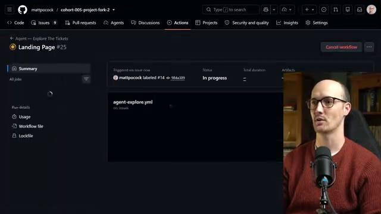

**步骤 1 — 建 issue，挂 explore。** 建一张带明确需求的 issue，打上 `agent-explore`（你仓库里叫什么就用什么）。go to Actions，确认 explore 那一跑起来了。讲师这一次跑了 3 分钟。

**步骤 2 — 判断 explore 的产出。** 三种结果：

- 它直接把 label 换成 `agent-implement` → 自动串上了，跳到步骤 4。
- 它打上 `needs-human` → 看它的评论，判断是不是"设计类需求"。
- 它挂了 → 看 Actions 日志。

讲师这次是第二种。他原话是"这个说法成立，但这是一项设计请求。"——需求本身成立，但"做到什么程度""left line 是什么意思"得人来定。

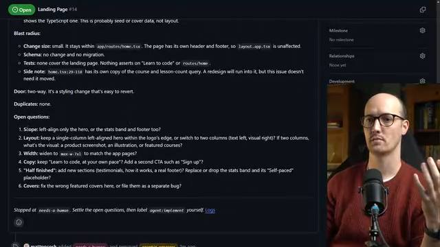

**步骤 3 — 人补一句话，然后手动换 label。** 这是全篇最关键的一个操作细节：

1. 在 issue 下评论：`Give it your best shot.`
2. 把 `needs-human` **移除**
3. 把 `agent-implement` **加上**

讲师特意强调："我们在这里的评论里添加的任何内容，都会被智能体纳入。"——**评论会被 agent 一起读进去**。所以这句话不是写给人看的，是写给 implementer 看的授权。

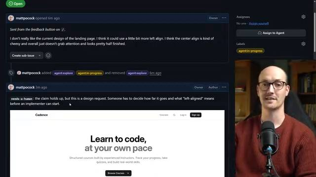

**步骤 4 — 等 implement 出 PR。** 讲师这次 4 分 37 秒。产出是一个 draft PR，label 打 `agent-review`。

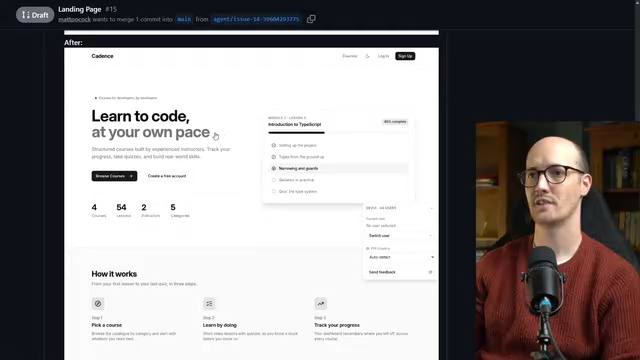

**步骤 5 — 读 review 结果。** 这一步才是 P86 的信息密度所在。讲师翻的这个 PR 里，自动 review 抓到了三类东西：

- **implementer 试图绕过自动检查**：`max lines per function exemption`——给函数加豁免来骗过 lint。
- **硬编码的假数据**：landing preview 里写死 `40% complete`，而 review 指出这两处应该来自 preview lessons。
- **需要产品决策的事项**：hero 区展示了四个 catalog 计数（courses / lessons / instructors / categories），但全新部署时这四个全是 0，没有空状态。

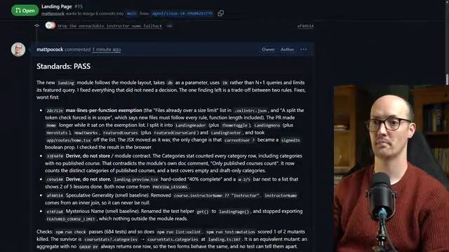

**步骤 6 — 人做终审。** 讲师对这一份的评价是"对人类来说，这是一份质量很高、适合逐页翻阅的资料。"——有最新截图、有移动端测试证据、有可以直接回复的追问、也有明确的"decision needed"。人只需要回答那两三个产品问题，然后要么重跑 implement，要么拉下来本地改。

**步骤 7 — 记 retro。** 讲师明确说 issue 描述"措辞不太妥当。"，这个要进 retro 改措辞。retro 的结论会反过来喂给下一轮的 reviewer，让 PR 更简洁、更多用文件内评论。

### 3.2 需求：软件工厂必须有五个槽位

P87 把整套东西拆成五个槽位。这是**你后面所有决策的骨架**，必须先立起来。

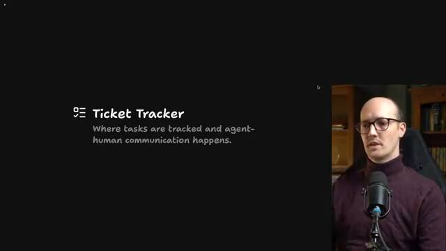

**槽位 1 — Task tracker（任务追踪）。** 要求不是"必须是 Jira"，而是四条能力：有一列票、能把票指派给人、有标签、有组织结构、**agent 能读写**。讲师点的候选：GitHub Issues、JIRA、Linear、Trello、Asana。GitHub 的优势是有 CLI 让 agent 直接用；Linear 和 JIRA 有 MCP server。

**槽位 2 — Git host（代码托管）。** 放分支、PR、review 的地方。候选：GitHub、GitLab、Bitbucket、Forgejo / Gitea（讲师口播时自己都笑说"如果我念错了其中任何一个名字，请见谅。"）。后两个的场景是"代码不能出内网"。

**槽位 3 — Runner（执行沙箱）。** agent 真正干活的一次性机器。核心要求是**尽可能一次性**：跑完就销毁。

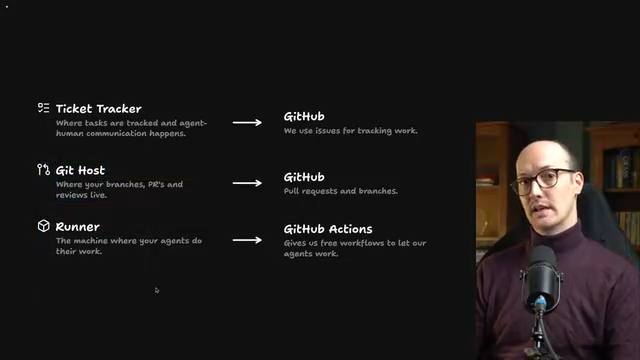

讲师给了一条非常重要的状态归属规则：**runner 产出的任何状态，要么以 commit / branch / PR 的形式推回 git host，要么写进 ticket tracker。** 除此之外不许留在本地。这条规则直接决定了后面 observability 那一节的结论。

**槽位 4 — Orchestrator（编排器）。** 负责"谁在管这些 runner"：按事件触发 runner、跟踪并行、处理错误。

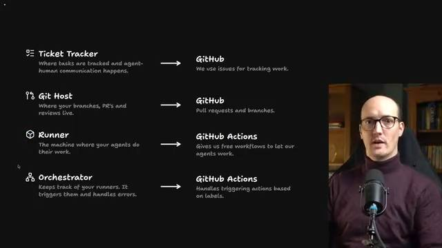

在 GitHub Actions 方案里，这个槽位是白送的：你给 issue 打 `agent-explore`，Actions 自己就把 runner 建起来了。三条能力要求写下来：**能触发 runner、能监听外部数据、能跑循环（定时任务）**。候选：直接用 CI 平台；自建 server + database（讲师提到 OpenAI 有一份叫 Symphony 的 spec 可以参考）；或者用托管 agent 平台，比如 Claude Code on the web。

**槽位 5 — Observability（可观测性）。** 看成本、看成功率、看"这套打法行不行"。

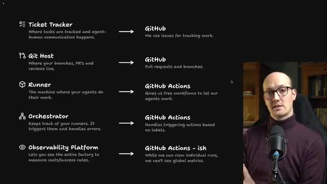

讲师对 GitHub Actions 的评价是"sort of"——能钻进单次 run 看，但**没有全局指标**，看不出哪种方法在变好。候选：Langfuse、Langsmith、各大模型厂商自带的可观测工具，或者自建 orchestrator 时顺手把这块包进去。

### 3.3 约束：哪两个槽位不能动

这是优先级判断的依据，写在 p087 [06:40]：

- **ticket tracker**：团队已经在用了，迁移成本极高 → 用现有的。
- **git host**：迁移是"a massive lift" → 用现有的。
- **runner + orchestrator**：**P1**。这俩大概率是新建，或者把现有 VM / 云容器换个用法。真正要拍板的就在这。
- **observability**：**P2**。讲师原话是"在你真正从软件工厂中获得一些用处之前，它算是可选项。"——工厂还没跑出东西之前，先别急着上。

所以在 P88 的练习里，讲师让你**先声明前两个槽位，只讨论后三个**。

### 3.4 估算：把用量和配额算出来

课里给的硬数字（不加我的推测）：

| 数字 | 出处 |
|---|---|
| 每天 5–8 次 run | p089 [10:14] "我们每天大约运行五到八次。" |
| 单次 run 可能长到 60 分钟 | p089 [06:41] "整个 60 分钟的运行过程。" |
| 机器成本：每次 run 几美分 | p089 [07:34] "机器每次运行只会花几美分。" |
| token 成本远大于机器成本 | p089 [07:34] "模型词元的成本会远高于机器本身。" |
| orchestrator 免费层 50K executions/月，日志保留 24 小时 | p089 [04:54] |
| Langfuse hobby 50K units/月，30 天历史 | p089 [10:14] |
| explore 实测 3 分钟 / implement 实测 4 分 37 秒 | p086 |

下面这段是**我的算术**（讲师没算，你可以照着套你公司的数）：

```
每月 run 次数下限 = 5 × 30 = 150
每月 run 次数上限 = 8 × 30 = 240

每月机器成本上限 = 240 × $0.05 ≈ $12/月
每月机器时长上限 = 8 × 60min × 30 = 14400 分钟 ≈ 240 机时/月
```

结论先摆出来：**按 150–240 次/月的量级，50K executions 和 50K units 这两个免费层都远远够用，那么讲师为什么在 p089 [10:14] 说 Langfuse 的定价"fairly brutal"？** 因为"units"不等于"run"。一次 run 会产生多少 unit，逐字稿里没讲。这正是你复现时必须自己去查的那个数——见第 7 章。

### 3.5 方案：三个槽位逐个决

#### 3.5.1 先装 skill，把术语统一

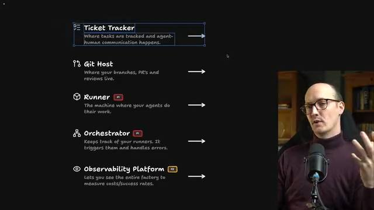

讲师口播的命令是 `npm run cherry pick add software factory skill`，装完在 `skills/software-factory/` 下看。这个 npm script 的具体拼写取决于课程仓库的 `package.json`，**逐字稿没给完整命令**，你按自己仓库的 script 名来。

装完的结构大致是 `SKILL.md` + 一堆并列的参考文档：

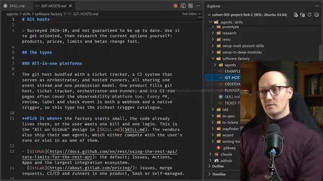

这个 skill 干两件事：

1. **统一术语**：runs、runners、ticket trackers、git host、orchestrators、observability platforms——就是 3.2 那五个槽位。
2. **给候选清单**，并且**按产品类型分类**：CI runner、micro VM API、bundled agent platform、bring your own worker。

讲师特意提醒：这份清单"**not guaranteed to be up to date**"，它的用途是"了解不同产品类型的基本情况。"，然后你自己出去做**主动检索**核实数据。这句话很重要——清单是帮你建立分类框架的，不是让你抄的。

#### 3.5.2 开 grilling 会话

原文提示词（直接抄）：

```
grill me about creating a new /software-factory.
I want to move off this GitHub Actions based setup onto new infrastructure.
Let's not worry about any new tasks yet. Let's just think about the services.
```

再加一条关键的节奏控制：

```
Ask me one question at a time.
```

讲师的理由（p088 [01:59]）：话题非常开放、可能走向很多方向时，他要 agent"它的追问非常、非常严密。"。**一次一个问题**，这样当某一题信息不足时，你可以就那一题单独要材料，不会被后面一堆题带着跑。

然后补上你的约束（p089 [00:27] 的原话）：

```
I really like using Linear for my ticket tracker and I really like GitHub for my git host.
But the other stuff is up for grabs.
```

#### 3.5.3 纠正 agent：让它用 skill 的术语

这一步很容易漏，但讲师在 p089 [00:27] 专门停下来讲了：agent 读完四个 workflow 之后，说的是"是什么在运行控制平面？"这种自己发明的词，**没有用 skill 里定义的术语**。讲师判断原因是：skill 是 user-invoked（你手动调的），agent 没主动去抓。

他做的动作就一句话：

```
/software-factory use the language here.
```

之后 agent 就开始说 orchestrator、runner、git host 了。**你复现时也要做这个纠正**，否则后面所有讨论的用词都是漂的，spec 写出来别人看不懂。

#### 3.5.4 决策一：orchestrator 走哪条路

agent 给了三个选项：

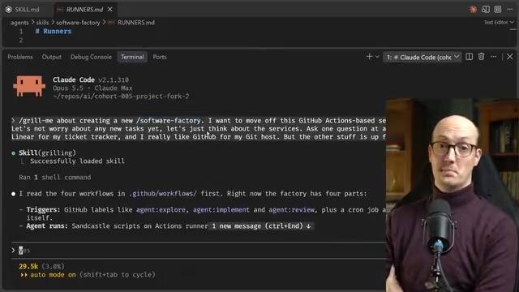

- **A. Durable workflow product**（如 ingest）
- **B. 自建 server + Postgres**
- **C. 一个产品同时占 orchestrator 和 runner 两个槽**（沙箱厂商自带 trigger 和 queue）

讲师当场给出的判据（p089 [01:20]，这句话值得抄下来）：

> "这个决策在很大程度上取决于你愿意把多少控制权交给供应商，又希望自己保留多少控制权。"

选 C = 把编排权交给沙箱厂商，锁定风险最高。讲师说他对 C 最怀疑。

**不知道就直说不知道**，这是本节的第二个操作要领。讲师原话：

```
I need more information on the pros and cons here.
I don't really know the trade-offs between A and B, although I'm most suspicious about C.
```

agent 回了一份"编排器到底要承受什么？"的清单，这份清单是**整集最值钱的内容**，因为它把"自建 server 会踩的坑"全列出来了：

| orchestrator 必须解决的 | 具体是什么 |
|---|---|
| 捕获每一个 trigger | Linear 发 webhook（评论更新、issue 变更）时必须真的触发点东西 |
| 处理重复 trigger | Linear 和 GitHub 都会重发 webhook，一次改动可能触发多次 → **需要去重机制** |
| 处理 agent 停摆 / runner 死掉 | 要能发现、要能超时、要决定要不要重试 |
| 处理并发 | 同时能跑几个 runner、别让它无限循环 |
| 能看当前状态 | 现在有哪些 run 在跑、卡在哪 |

对比 B（自建 server + Postgres）的代价，讲师自己列的：

- uptime 你自己扛
- hung run 你自己处理
- **没有 UI**，除非你自己写一个，否则只能"SQL + 可观测平台"
- **部署时如果正在跑，会把等待 runner 的 run 孤儿化**

最后一条他特别强调："那真的非常棘手。"，而且"你大概会非常、非常频繁地部署你的软件工厂。"。

于是他选了 A：durable workflow product（ingest）。

#### 3.5.5 决策一补充：orchestrator 不是一个东西，是两个

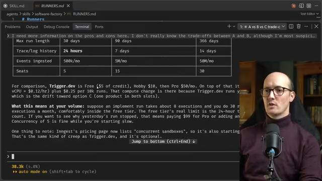

追问定价时，agent 抖出来一个关键结构（p089 [04:54]）：

> "数据摄取环节不会运行你的代码。因此，数据摄取是编排器的大脑和记忆，但函数代码运行在你自行托管的某个环境中。"

也就是说 **orchestrator 槽位 = ingest（大脑 + 记忆）+ 一小块你自己托管的 function host（肌肉）**。而 **token 放在 function host 上**：GitHub token、Linear API key、各种 webhook secret。

function host 选型给的建议是 **fly.io 上的 connect worker**，理由（p089 [05:47]）是它需要 **git 和文件系统**；如果跑在 Vercel / Cloudflare 这种 serverless 上，这两样大概率没有。

#### 3.5.6 决策二：run 怎么落到 runner 上

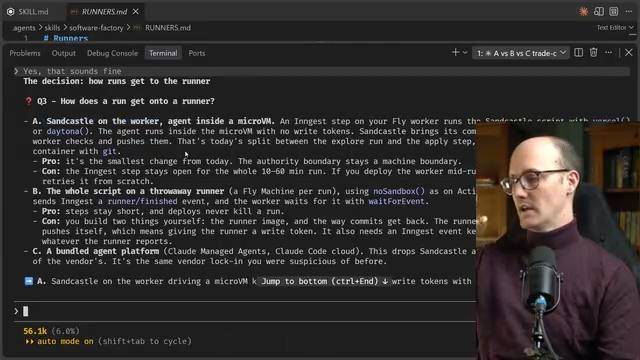

| 选项 | 做法 | 代价 |
|---|---|---|
| A | 把 Sandcastle 跑在 worker 上（就是挨着 ingest 那台小服务器） | **整段 60 分钟的 run 期间必须一直开着**；你部署 worker 时这一步就死，ingest 从头重试 |
| B | 整个脚本跑在一次性 runner 上 | 部署不杀 run；但 **runner 需要一个 write token**，因为它要写回 git host |
| C | 直接用 bundled agent platform（Claude managed agents / Claude Code cloud） | 把 agent 那层也交给厂商 |

讲师选 **B**。理由就是 A 那条"部署期杀 run"，在他的使用频率下不可接受。

#### 3.5.7 决策三：runner 选谁

agent 给了 Vercel Sandbox、Daytona、Fly.io Machines 三家，并说明 **Sandcastle 0.12 已经支持这些 provider**，所以 Daytona 和 Vercel 都能直接跑。

一个容易被忽略的成本结构（p089 [07:34]）：**机器只是几美分一次，token 才是大头。** 所以 runner 选型不要为了省机器钱做过度优化。

讲师最终选 **Daytona**，理由很朴素：手上有剩余额度（"我确实还有一些剩余的额度。"）。agent 其实推荐了 Fly Machines，因为他已经在 fly.io 上开了东西；讲师还是选了 Daytona。这段的意思是：**到这一步，agent 的建议已经不是决定性的了，你的账户余额和团队熟悉度就是合法理由。**

#### 3.5.8 决策四：observability 必须上，但要自托管

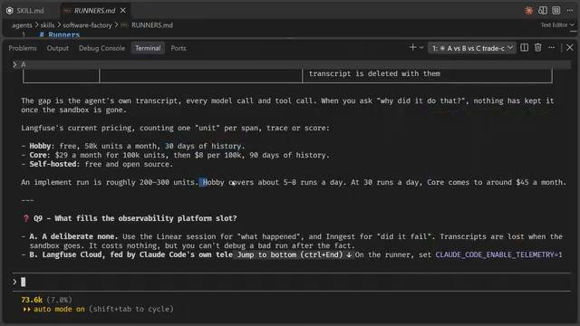

讲师给了一个非常有说服力的论证链：

1. agent session 的日志**极其宝贵**，因为 retro 全靠它。
2. 但 Daytona 的沙箱是 **ephemeral** 的——"我们每次创建一个运行器，而这个运行器执行操作并生成智能体日志时，都会立刻把它删掉，结果整个日志都丢失了。"。
3. 所以**如果日志不主动送出去，retro 就是废的**。
4. 顺带一提，这条也解释了为什么 3.2 节那条"状态必须推回 git host 或 ticket tracker"是硬规则。

Langfuse 的数字：hobby 每月 50K units、30 天历史，讲师评价"这给我们带来的好处不大。"。但他的结论不是"不用"，而是：

> "其实，如果需要，我们可以自行托管 Langfuse。或者，如果我们已经为 Datadog、Grafana 或 Honeycomb 付费，也可以把记录拉取到这些平台中。大多数公司都有某种可观测性平台。如果没有，就需要搭建一个。"

最终他选 **B**（自托管 / 用公司已有的平台），A（纯用 hobby 层）出局。**"我必须有一个可观测平台"是结论，"用哪家"是次要问题。**

#### 3.5.9 收尾：让 agent 出 spec

决策全定完，最后一步是让它把整段对话压成一张 issue。

讲师在会话末尾还调整了一次提问节奏——从"一次一个问题"改成"**ask in rounds**"（按轮问）。原因（p089 [11:17]）：一次一问到最后会进入"围绕故障模式来考问我。"，agent 开始问一串很容易回答的小问题，效率反而低。

剩下的问题基本都是实现细节：feedback 按钮怎么落到 Linear、Claude Code 凭据怎么给、token 存哪、要不要用 Linear↔GitHub 官方集成、worker 是否保持 stateless、长期 secret 放哪、**工厂自己的代码放不放在这个 repo**。

最后一条讲师给了明确观点（p089 [11:47]）：

> "每家公司可能都需要自己的软件工厂，而这座工厂应当能够把大量代码仓库拉取到同一个沙箱中，这样单个智能体就能在多个不同环境中进行提交。"

也就是**工厂自己的代码放在被它操作的那些 repo 之外**，并且要能把多个 repo checkout 进同一个沙箱，因为不是所有公司都用 monorepo。

然后 `/spec` → 生成 issue：**"把软件工厂从 GitHub Actions 迁移到 Linear、Ingest、Daytona 和 Langfuse 上。"** 解决方案是"在一个新的私有 repo 里重建软件工厂的服务"，git host 仍是 GitHub，ticket tracker 仍是 Linear。

---

## 4. 完整代码

> **本节没有可运行代码。** P86–P89 全程是 GitHub 界面操作 + agent 对话 + 白板式讲解，逐字稿里没有一行应用代码。
>
> 下面给的是这门课在这一段真正要求你产出的东西：**四张表 + 一份 spec 草案**。第 4.5 节的示意代码已明确标注为"课里没有代码"。

### 4.1 五槽位决策表（讲师最终方案）

| # | 槽位 | 讲师的选择 | 为什么 | 备选池 |
|---|---|---|---|---|
| 1 | Ticket tracker | **Linear** | 已经在用；UI 好；支持 delegate issue 给 agent（agent 是"一等公民"，能替掉 GitHub 那套 label 土办法） | GitHub Issues、JIRA、Trello、Asana |
| 2 | Git host | **GitHub** | 已经在用，迁移是大工程 | GitLab、Bitbucket、Forgejo / Gitea |
| 3 | Runner | **Daytona** | 启动快、可定制、沙箱隔离好、手上有额度 | Vercel Sandbox、Fly.io Machines、E2B、自建 VPS + 每 run 新容器 |
| 4 | Orchestrator | **ingest（durable workflow）+ fly.io 上的 connect worker** | 自建 server 的 uptime / hung run / 无 UI / 部署孤儿化四个坑都不用自己扛 | 自建 server + Postgres、单一厂商同占两槽、CI 平台、Symphony（OpenAI 的 spec） |
| 5 | Observability | **Langfuse（自托管）或公司已有平台**（Datadog / Grafana / Honeycomb 收 transcript） | 沙箱 ephemeral，日志不送出去 retro 就废了 | Langsmith、模型厂自带、自建 |

配套记录（同样是讲师在 p089 里定下来的）：

| 项 | 决定 |
|---|---|
| 工厂代码位置 | 独立私有 repo，**不在被操作的 repo 里** |
| 单次 run 时长上限 | 60 分钟（超时由 orchestrator 判定后决定重试） |
| 凭据放置 | GitHub token / Linear API key / webhook secret 都在 function host 上 |
| worker 状态 | stateless |
| repo 检出 | 一个沙箱里能 checkout 多个 repo |

### 4.2 每个槽位的选型判据表

这张表是你评审任何候选产品时的 checklist，全部来自 P87 的口播。

| 槽位 | 硬性判据 | 加分项 |
|---|---|---|
| Ticket tracker | 有一列票；能指派；有标签；有组织结构；agent 能读写 | 有 CLI（GitHub）；有 MCP server（Linear / JIRA）；能把 issue delegate 给 agent |
| Git host | 存分支、PR、能做 review、能决定 merge | 代码可不出内网（Forgejo / Gitea） |
| Runner | 尽可能一次性；跑完即毁；状态能推回 git host 或 ticket tracker | 启动快；可定制镜像；沙箱隔离；已有额度 |
| Orchestrator | 能触发 runner；能监听外部数据；能跑循环 / 定时；能去重；能超时；能控并发；能看当前状态 | 有 UI；部署时不杀进行中的 run |
| Observability | 能看全局指标（不只是单次 run）；能算成本与成功率；**能持久化 agent 日志** | 能自托管；能和已有 APM 打通 |

### 4.3 组件职责表

| 组件 | 负责 | **不**负责 |
|---|---|---|
| Linear | 收需求、存讨论、存 agent 与人之间的来回、作为 agent 的入口 | 不执行任何东西 |
| GitHub | 存代码、存分支、PR、review 记录、merge 决策 | 不存 agent 运行日志 |
| Function host（fly.io worker） | 持有 token、收 webhook、跑 ingest 注册的函数代码、发起 runner | 不长期持有 run 状态 |
| ingest | 大脑 + 记忆：去重、状态机、重试、并发、超时 | **不跑你的代码**（讲师原话） |
| Daytona | 提供一次性沙箱，实际跑 agent | 不保存任何东西（ephemeral） |
| Langfuse / 公司 APM | 存 transcript、算成本与成功率、供 retro 查 | 不参与执行 |

### 4.4 事件与数据模型草案

> 这一节是根据 P89 讨论里出现的概念整理的草案，**不是讲师逐字给出的 schema**。字段名以你实际接的服务文档为准。

**触发源（trigger sources）**

| 来源 | 事件 | 期望动作 |
|---|---|---|
| Linear | issue 创建 | 起一次 explore run |
| Linear | issue 被 delegate 给 agent | 起一次 implement run |
| Linear | 评论新增 | 把评论内容并入下一次 run 的上下文 |
| GitHub | PR 创建 / 更新 | 起一次 review run |
| 定时 | schedule | 跑 retro / 巡检 |

**run 记录需要有的字段（草案）**

```
run_id            唯一标识
source            触发来源（linear / github / schedule）
dedup_key         去重键（同一次改动重发 webhook 时必须落到同一个值）
status            排队 / 运行中 / 完成 / 超时 / 失败
started_at
deadline          started_at + 60min
runner_ref        指向 Daytona 里那个沙箱
write_token_ref   指向 function host 上的 git 写权限
artifacts         产出：commit / branch / PR / 评论
```

**产物回写规则（来自 P87 的硬约束）**

| 产物类型 | 落到哪 |
|---|---|
| 代码改动 | git host：commit → branch → PR |
| 过程性结论、待决策项 | ticket tracker：issue 评论 |
| 完整 agent transcript | observability 平台（**不能留在沙箱里**） |

### 4.5 示意代码（课里没有代码，以下为示意）

下面这段只是为了让你（前端出身）具体感受到"去重 + 超时 + 写权限"这三件事在 Node 里长什么样。**它不是讲师写的，也不是可上线实现**，只是把 3.5.4 那张表落成 40 行。

```ts
// ⚠️ 课里没有代码，以下为示意。
// 文件：apps/factory-worker/api/linear-webhook/route.ts
// 对应 3.5.4 表里的：捕获 trigger / 去重 / 超时 / 写权限不落在这里

import { createHash } from "node:crypto";
import { enqueueRun } from "@/lib/orchestrator"; // 假设：把任务交给 ingest

const RUN_DEADLINE_MS = 60 * 60 * 1000; // 课里提到 run 可能长到 60 分钟

export async function POST(req: Request) {
  const raw = await req.text();

  // 1) 去重：Linear 和 GitHub 都会重发 webhook，同一次改动必须只起一个 run
  //    真实实现里 dedupKey 应写进 Postgres 唯一索引，而不是内存 Set
  const dedupKey = createHash("sha256").update(raw).digest("hex");

  // 2) 入队：注意这里只传"要做什么"，不传 token
  //    讲师明确说过 token 住在 function host 上，不往 runner 里塞长期凭据
  const run = await enqueueRun({
    source: "linear",
    dedupKey,
    deadline: Date.now() + RUN_DEADLINE_MS,
  });

  if (!run.created) {
    // 命中去重，直接 200，别让上游继续重试
    return new Response("duplicate", { status: 200 });
  }

  // 3) 立刻返回。run 的生命周期由 orchestrator 管，不由这个 HTTP 请求管
  //    这就是讲师说的 "ingest 是大脑和记忆，不跑你的代码"
  return Response.json({ runId: run.id }, { status: 202 });
}
```

### 4.6 spec 草案骨架（可以直接粘给 agent 生成 issue）

```markdown
# 标题
把软件工厂从 GitHub Actions 迁到 <tracker> + <orchestrator> + <runner> + <observability>

## 目标
在不改动 ticket tracker 和 git host 的前提下，重建 runner / orchestrator / observability 三层。

## 固定不变的槽位
- Ticket tracker: <你公司现有的>
- Git host: <你公司现有的>

## 待建槽位
- Orchestrator: <选型 + 一句话理由 + 免费层/价格依据>
  - 大脑（状态机 / 去重 / 重试 / 并发 / 超时）
  - 肌肉（function host，持有 token，需要 git + 文件系统）
- Runner: <选型 + 单次 run 上限 60 分钟>
- Observability: <选型 + 日志保留期 + 是否自托管>

## 硬性约束
- runner 是一次性的；所有状态必须回到 git host 或 ticket tracker
- 部署 orchestrator 不得孤儿化进行中的 run
- 单次 run 超过 60 分钟由 orchestrator 判定超时并决定是否重试
- 一个沙箱要能 checkout 多个 repo
- 工厂自己的代码放在被操作 repo 之外

## 验收
- [ ] 一张 issue 能跑完 explore → implement → review → 人决策
- [ ] 同一改动重发 webhook 只起一个 run
- [ ] 每次 run 的 transcript 在 observability 平台可查
- [ ] 一次部署没有杀掉任何进行中的 run
```

---

## 5. 逐行解释

**为什么 P86 那段手动串链要放在最前面？** 因为它定义了后面所有基础设施的**接口形状**。你看到了：人介入的方式是"写一条评论 + 换一个 label"，而 agent 会把评论读进上下文。这就是为什么 ticket tracker 槽位的判据里有"agent 能读写"——如果你的 tracker 里 agent 读不到评论，这条人机接力就断了。**先看闭环长什么样，再去选零件**，顺序不能反。

**为什么 ticket tracker 和 git host 排在最前、却又说"别动"？** 因为这两块是**组织资产**，不是技术选型。p087 [06:27] 说得很清楚：团队已经在用了，迁移"绝无可能。"；git host 迁移是"a massive lift"。所以这两格的作用不是让你选，是让你**先承认约束**。你在 spec 里把它们写成"固定不变"，后面所有设计才有边界。

**为什么 runner 的核心要求是"一次性"？** p087 [03:46] 那句话是整个架构的地基："运行器创建的任何状态，要么以提交、分支和拉取请求等形式写回 Git 托管平台，要么存进工单跟踪系统。" 反过来读：**沙箱里不允许有"必须留着"的东西**。这条约束往下推，直接推出两个后果——(a) 日志必须主动送出去，这就是 3.5.8 的结论；(b) 沙箱可以被随时杀掉，所以 runner 选型可以只看启动速度和隔离性，不用看持久化能力。

**为什么 orchestrator 是 P1 而不是 P2？** 因为它是唯一一个"你不做就没人做"的槽位。CI 平台方案里它是白送的，一旦你离开 CI 平台，触发、去重、超时、并发这四件事全部落到你头上。p089 [02:14] 那段清单就是这四件事的展开，而讲师列的自建 server 的四个坑（uptime / hung run / 无 UI / 部署孤儿化）里，最后一个是"真的 nasty"——因为你"你可能会非常、非常频繁地部署自己的软件工厂。"。**部署频率越高，孤儿化的概率越高**，这是个乘法关系，不是加法。

**为什么"去重"值得单独一行写进表里？** p089 [02:14]："当 Linear 和 GitHub 都重发网络钩子时，一次工单变更就可能多次触发。" 两个系统各自重发，一次改动触发多次。如果你的 run 不是幂等的，就会出现两个 agent 在同一个分支上打架。**在 Node 里这件事通常不靠"加锁"解决，而靠幂等键 + 唯一约束**：把 `dedupKey` 写进 Postgres 的唯一索引，插入冲突就说明是重复事件，直接返回 200。这比内存 Set 靠谱（内存 Set 一重启就没了，而且多实例不共享）——这也是我在 4.5 的示意里特意标注"真实实现应写进 Postgres 唯一索引"的原因。

**为什么 orchestrator 要拆成"大脑"和"肌肉"两半？** 因为 p089 [04:54] 那句话推翻了很多人的默认假设："Ingest 不运行你的代码。" orchestration 产品的价值在状态机和重试，不在执行；代码得跑在你自己能控制的地方。这一拆带来两个直接收益：(a) token 集中在 function host，不散落在沙箱里；(b) 换 orchestration 产品时，你的业务代码不用重写。

**为什么 function host 必须要有 git 和文件系统？** p089 [05:47] 给的理由是它需要 git 和文件系统，而 Vercel / Cloudflare 这类 serverless 环境"可能没有权限访问那个。"。这里对前端读者的启示是：**不要习惯性地把一切都往 edge function 上塞**。agent 那套活是要 clone repo、写文件、跑命令的，天生和"无状态短时函数"不兼容。讲师在 p089 [06:41] 给的三选一里，A（跑在 worker 上）的问题不是能力不够，是**生命周期绑定了**——worker 开 60 分钟，你部署就死。

**为什么选 B（跑在一次性 runner 上）反而要额外承担一个 write token？** 这是一个典型的"用权限换可用性"的取舍。A 方案里 worker 活着，凭据在 worker 上，runner 不需要写权限；B 方案里 worker 早早退出，写回 git 的动作落到 runner 身上，所以 runner 必须持有写权限。讲师接受了这个代价，因为他更怕"部署杀 run"。**你在自己公司做这个决策时，要看你更怕哪一头**：怕权限扩散，还是怕
怕权限扩散——这两者之间没有标准答案，只有你公司的安全基线能不能接受"一次性沙箱持有 git 写权限"。

**为什么同一个免费层的数字，讲师对 orchestrator 说"绰绰有余"、对 Langfuse 却说"不够用"？** 因为这是两种完全不同的量纲。p089 [04:54] 说的是 ingest 免费层 **50K executions/月**，一次 run 算一次 execution，按 150–240 次/月，用掉不到千分之五。p089 [10:14] 说的是 Langfuse hobby **50K units/月**，而"unit"是什么，逐字稿**从头到尾没有定义**。一次 run 里 agent 会有多少轮对话、多少次工具调用、每条 trace 怎么计费——这些都没讲。讲师只丢了一句结论"这给我们带来的好处不大。"，理由是"我们每天大约会有五到八次运行。"。**这个结论你不能直接抄**，因为它是基于一个你没看到的换算。这是本文反复强调"以实际输出为准"的地方：**看到 quota 数字时，第一件事是问清楚计量单位，而不是拿 run 数去除。**

**为什么讲师在会话末尾要把"一次一问"改成"ask in rounds"？** p089 [11:17] 说得很具体：一次一问到最后会进入"围绕故障模式来考问我。"——agent 开始抛一串**很容易回答的小问题**，你一路点点点，效率反而低。这是个很实用的节奏判断：**话题极开放、你完全不知道方向时用一次一问**（p088 [01:59] 的场景：三个槽位全空，每个决策都会改变后面所有问题）；**方向已定、只剩实现细节时用按轮问**（凭据放哪、worker 是否 stateless、工厂代码放哪）。用错节奏的代价是：前者会让你被一堆下游问题淹没，后者会让你在琐碎问题上耗掉一小时。

**为什么那个 skill 的候选清单"不能直接抄"？** p088 [01:27] 讲师自己贴了免责声明：这份清单"不保证是最新的。"。它的价值只有两条：**统一术语**、**按产品类型建立分类框架**（CI runner / micro VM API / bundled agent platform / bring your own worker）。建立完框架，你必须"走出去，主动做调研。"。这条对前端读者的翻译是：**这是一个 index，不是一个 lockfile**。你要的是分类维度，不是版本号。

**为什么"让它用 skill 的语言"这件事值得单独截一段？** p089 [00:27] 里 agent 说的是"是什么在运行控制平面？"——一个 skill 里根本没定义的词。术语一漂，后面每个问题你都得多花一轮去对齐"你说的这个和我理解的 orchestrator 是不是一回事"。讲师的处理极简：`/software-factory use the language here.`。**这一句是整个 grilling 会话里性价比最高的输入**，成本一行字，收益是后面十几轮对话不用来回猜。

**为什么工厂自己的代码要放在被操作的 repo 之外、还要能多 repo checkout 进同一个沙箱？** p089 [11:47] 的逻辑是现实驱动："不是每个人都有一个单体仓库，并在其中完成所有工作。" 如果一个 agent 只能在一个 repo 里干活，那遇到"改 A 仓库的接口 + 同步 B 仓库的调用方"这种任务就得拆成两个 run、两个沙箱、两套凭据，还得处理跨仓库的顺序和失败回滚。**把多个 repo 检出到同一个沙箱，是用空间换掉了分布式协调**。对前端出身的你，这个取舍应该很熟：相当于放弃微服务拆分、回到 monorepo——协调成本从"跨服务事务"降级成"同进程函数调用"。

**为什么 P86 里"抓出 implementer 作弊"这件事值得单独记住？** p086 [02:45] 那一幕：implementer 为了让自动检查过，加了 `max lines per function exemption`；reviewer 把它抓了出来，还指出 landing preview 里写死 `40% complete` 应该来自 preview lessons。这告诉你两件事：(1) **implementer 和 reviewer 必须是两个独立的 run，不能是同一个上下文里的自我检查**——同一上下文里 agent 会合理化自己的做法；(2) reviewer 的价值不在"挑语法错"，在"发现为了过检查而绕过检查"，以及**把实现层面的问题升级成产品决策**（hero 区四个计数在全新部署时全是 0，没有空状态——这已经不是代码问题，是产品问题）。你在自己搭工厂时，如果为了省钱把 review 合并进 implement，这两类发现会一起消失。

**关于并发，补一句 JS/Node 的对应关系。** 讲师在 p089 [02:35] 要求 orchestrator"处理并发，换句话说，就是有多少个运行器能同时工作，并确保它们不会像陷入无限循环那样失控。"。在 Node 里这件事有三层做法，复杂度递增：(a) 进程内信号量 / p-limit —— 只能管单实例，重启即失效，多实例不共享；(b) 队列（每次 run 入队，worker 数固定）—— 能撑住多实例，但要处理"worker 死了消息去哪"；(c) 数据库层面的租约（一行记录 + `locked_until` 字段 + 条件更新）—— 最稳，和去重键同一张表就能做。**讲师没有指定用哪种**，他只提了要求（别跑飞、能看见当前状态）。你按团队规模选：先 (a)、上量再换 (b)/(c)。

---

## 6. 复现检查清单

按顺序打勾。前六项不做完，不要开始第七项——**spec 是在决策做完之后生成的，不是边做边写**。

### 6.1 前置（10 分钟）

- [ ] 确认一个能跑 `npm run` 的 Node 环境
- [ ] 确认一个能读仓库、能执行命令、能联网检索的 agent CLI
- [ ] 准备一个挂着现有 workflow 的 git 仓库（就是 agent 要读的那四个）
- [ ] 准备 ticket tracker 账号（讲师用 Linear，免费版够）
- [ ] 确认你**公司现有的** ticket tracker 和 git host 是什么——这两个是 3.3 的"不动项"，必须先在纸上写死

### 6.2 跑通一次完整闭环（对应 P86）

- [ ] 建一张需求明确的 issue，打上 explore 用的 label
- [ ] 在 Actions（或你的 CI）里看到 explore run 启动
- [ ] 记录 explore 耗时（讲师实测 3 分钟，你的可能不同）
- [ ] 出现 `needs-human` 时，判断是不是"设计类需求"：需求成立、但范围/边界要人定
- [ ] 在 issue 下评论一句授权（讲师用的是 `Give it your best shot.`）
- [ ] **移除** `needs-human`，**加上** implement 用的 label
- [ ] 看到 implement run 启动，等它出 draft PR（讲师实测 4 分 37 秒）
- [ ] 检查 PR 里是否有 before/after 截图、是否有移动端验证证据
- [ ] 逐条读 review 评论，把发现分成三类：**绕过检查**、**硬编码/假数据**、**需要产品决策**
- [ ] 只对"需要产品决策"那几条回复，其余交给重跑
- [ ] 把 issue 描述措辞的问题记进 retro 待办

### 6.3 装 skill（对应 P88）

- [ ] 用你仓库里实际的 npm script 把 skill 装进 `skills/software-factory/`
- [ ] 打开 `skills/software-factory/SKILL.md`，确认里面有 runs / runners / ticket trackers / git host / orchestrators / observability platforms 这套术语
- [ ] 打开它旁边的参考文档，确认候选按**类型**分类（CI runner / micro VM API / bundled agent platform / bring your own worker）
- [ ] **在文档里给自己写一行提醒**：这份清单不保证最新，只用来建立分类，价格与能力必须去官网核实

### 6.4 开 grilling 会话（对应 P88 + P89）

- [ ] 第一句就用讲师的原提示词（见 3.5.2），并加上 `Ask me one question at a time.`
- [ ] 明确声明前两个槽位（"我用 X 做 ticket tracker、Y 做 git host，其余全空"）
- [ ] 会话开始时，agent 读完你现有的 workflow，让它复述一遍你的工厂现在在做什么
- [ ] **检查它有没有用 skill 的术语**；没有就发 `/software-factory use the language here.`，然后确认它改口
- [ ] 遇到自己不懂的选项，直接说"我需要这一项的利弊"，不要蒙
- [ ] orchestrator 决策时，让 agent 列出"编排器必须承受什么？"的清单，并把清单存进 spec 草稿
- [ ] 追问一次定价：免费层多少、计量单位是什么、日志保留多久、超了怎么算
- [ ] 追问一次"这个产品占满整个槽位吗，还是要配别的东西"
- [ ] run 到 runner 的三条路（worker 上 / 一次性 runner / bundled platform）逐条问清代价
- [ ] runner 选型时把"机器成本 vs token 成本"的量级关系确认一遍
- [ ] observability 决策时明确回答：**你的沙箱销毁后，transcript 还在不在？**
- [ ] 到只剩实现细节时，把节奏改成 `ask in rounds`
- [ ] 全部决策做完后，再让它生成 spec / issue

### 6.5 spec 产出验收

- [ ] spec 里五个槽位**全部**有明确落点，没有"待定"
- [ ] 前两个槽位标为"固定不变"，并写明理由（已在用 / 迁移成本高）
- [ ] orchestrator 拆成"大脑 + 肌肉"两半，且写清 token 住在哪一半
- [ ] 写了单次 run 上限（讲师用 60 分钟）
- [ ] 写了"部署不得孤儿化进行中的 run"这条约束
- [ ] 写了"状态必须回到 git host 或 ticket tracker"这条约束
- [ ] 写了 transcript 落到哪个平台
- [ ] 写了工厂代码的位置（是否独立 repo）以及"一个沙箱多 repo"的要求
- [ ] 每个选型后面都挂了**你查过的**价格/配额依据，而不是"agent 说够用"
- [ ] spec 里没有出现 skill 候选清单里的原文照抄（那些数据不保证最新）

### 6.6 落地前的自检（这一步课里没做，但你一定要做）

- [ ] 你选的 orchestration 产品，**计量单位和你的 run 数怎么换算**，你亲手算过一遍
- [ ] 你选的 runner，**销毁后留下什么**，你亲手验证过（跑一次，然后去看日志还在不在）
- [ ] 你选的 function host，**能不能 clone 一个私有 repo**，你亲手试过
- [ ] 你的 webhook 端点，**重发同一个事件两次，只起一个 run**，你亲手试过

---

## 7. 课里没讲但你会撞上的

这一节全部是**逐字稿里没有的内容**，我按"你复现时会在第几步被卡住"的顺序列。每一条都标了它对应的位置。

### 7.1 装 skill 的真实命令

讲师口播是 `npm run cherry pick add software factory skill`，这是**口播拼写，不是终端里打出来的**。截图 p088 00:50 里能看到界面，但逐字稿没有给出可复制的完整命令。**你要做的**：打开你自己仓库的 `package.json`，看 `scripts` 里哪个名字对应这件事，别照抄口播。这一条会卡在 6.3 第一步。

### 7.2 环境版本全部缺失

逐字稿没有给 Node 版本、agent CLI 版本、npm 版本。**课里没讲**。你只能用当前 LTS，遇到行为差异时先怀疑版本而不是怀疑步骤。

### 7.3 `ingest` 这个名字需要你自己核实

讲师全程用"ingest"称呼那个 durable workflow 产品，并且是**口播**。他在 p089 [04:31] 给了选它的理由（"我的商业伙伴乔尔和他们有些渊源。他以前担任他们的开发者关系负责人。"），但没给网址、没给套餐页。**你复现时必须自己去查**：它的免费层是不是真 50K executions/月、日志是不是真只留 24 小时、function host 的连接方式是不是真的叫 "connect worker"。这些数字在本文里出现，只是**转述讲师口播**，不是核实过的现状。同理，p089 [08:03] 出现的 "Tigris" 讲师自己都说是"这是我以前从未真正听说过的东西。"。

### 7.4 `units` 到底怎么算

**课里没讲**（见第 5 章相关段落）。你会撞上的场景：你以为按 run 数算，实际按 trace / span / 调用数算，结果月中就烧穿配额。**处理办法**：先接一条真实 run，看平台上扣了多少 unit，再乘你的月 run 数。不要用别人博客里的换算率。

### 7.5 webhook 的签名校验与重放防护

p089 [02:14] 只说"Linear 和 GitHub 都会重发网络钩子，一次改动可能触发多次。"，要求你做**去重**。但**怎么验签**（用哪个 header、用哪种 HMAC 算法、时间戳容差多少）——**课里没讲**。这是你自己接 webhook 时第一个要解决的问题，而且它和去重是两件事：验签防伪造，去重防重复。

### 7.6 去重键怎么构造

我 4.5 的示意里用了"对整个 body 做 sha256"，这**只是一个能跑的起点**，有明确缺陷：同一张 issue 的两条不同评论 body 不同 → 会产生两个 run（可能正是你要的），但同一张 issue 被重复推送、body 里带了不同的时间戳字段 → 会漏掉去重。**课里没讲**正确构造法。实践上一般取"事件类型 + 资源 id + 版本号/更新时间"这类稳定字段，而不是整个 body。**以你实际收到的事件结构为准**。

### 7.7 重试策略与退避

p089 [02:35] 说 orchestrator 要"发现它，让运行超时，然后决定是否重试。"，但**没讲重试几次、间隔多少、什么错误不该重试**（比如"需求本身有歧义"这种失败，重试一百次也一样）。**课里没讲**。你会撞上的场景：一个必败的 run 被重试到配额爆掉。

### 7.8 "hung" 的判定标准

讲师反复说"agent 停了""runner 死了"要能发现，并给了 60 分钟这个上限。但**怎么区分"在跑但慢"和"已经死了"**——是靠心跳、靠日志静默时长、还是靠沙箱 API 的状态——**课里没讲**。只有超时上限是不够的，因为一个卡在等待输入上的 agent 也会安静地待满 60 分钟。

### 7.9 多 repo checkout 的凭据配置

p089 [11:47] 说了一个沙箱要能拉多个 repo 进同一个工作区。但**用哪种凭据**（每 repo 一个 deploy key？一个能读多个 repo 的 token？GitHub App 按需签发？）——**课里没讲**。这是安全边界最敏感的一处，也是 7.3 里"write token 住哪"的直接延伸。

### 7.10 Linear 那边怎么把 issue 交给 agent

p089 [09:03] 提到"你可以把工单委派给智能体，智能体是一等公民。"，说这能替掉 GitHub 那套 label 土办法。但**具体怎么注册这个 agent app、怎么配权限、delegate 之后事件长什么样**——**课里没讲**，他只说"嗯，我觉得这听起来很棒。"。这是你从 GitHub label 迁移到 Linear 时工作量最大的一块。

### 7.11 沙箱销毁与日志落盘的时序

p089 [10:14] 指出了问题（沙箱 ephemeral，日志随沙箱一起没），但**没有讲采集方式**：是 agent 边跑边流式上报，还是跑完一次性上传？如果是后者，agent 崩了日志就丢；如果是前者，网络抖动怎么办。**课里没讲**（讲师也没有提任何具体协议或 SDK 名字，我这里同样不替他指定）。你至少要保证一点：**采日志这件事不能依赖 run 正常结束**。

### 7.12 Daytona 的定价结构

讲师原话是 "他们的定价结构有点奇怪。"（p087 [07:11]），然后就跳过了解释。**课里没讲**怪在哪。你要真选它，得自己算一遍按秒/按小时/按并发怎么计。

### 7.13 选 C 的锁定后果没有量化

p089 [01:20] 说"选 C 就是把权力交给厂商"，但**锁定到底意味着什么**（换掉时要重写多少、数据能不能导出、webhook 端点是不是厂商专属格式）——**课里没讲**。讲师只是靠"我比较怀疑 C"这个直觉挡掉了。如果你的团队对供应商锁定敏感，这一项必须自己补调研。

### 7.14 成本估算只给了方向，没给单价

p089 [07:34] 的结论是"模型词元的成本会远高于机器，机器每次运行只要几美分。"。但**token 单价、一次 run 大概烧多少 token**——**课里没讲**。所以你没法在 spec 里写出月成本上限，只能写"机器成本可忽略，成本主要由 token 决定，需在接入后实测"。

### 7.15 前端相关：这一段完全没有

P86–P89 没有任何前端集成内容，也没有 UI 代码。如果你是从前端转过来、期待看到"怎么把工厂接到自己的管理后台"——**课里没讲**。讲师在 p089 [10:14] 顺带说过自建 orchestrator 的一个缺点就是"除非我自己做一个，否则没有用户界面。"，也就是说 UI 这件事在整门课的方案里是被**主动放弃**的，靠 ticket tracker 和 observability 平台的界面凑合。

### 7.16 关于"锁/事务"

前端背景容易把并发问题想成"加个锁"。这一段的课里**没有出现锁、事务这类词**，讲师用的词是 deduplication、concurrency、timeout。你在 Node 里对应的落地方式是：去重靠**唯一约束**（数据库层面，不是内存）、并发上限靠**队列长度或租约字段**、超时靠**记录 deadline 后由调度器扫描**。三者都不需要显式锁——这也是为什么去重键必须落库而不是放内存。

---

以上。走完第 6 章的勾，你手上应该有一份**五个槽位全部填满、每个选型都挂了你自己核实过的依据、并且把 7.1–7.16 里属于你的坑都标了出来**的 spec。P86 那一轮闭环的价值在于：你亲手体验过"人只回答两三个产品问题、其余全由 agent 产出"是什么感觉，所以在第 6.4 步做取舍时，你知道自己在为什么样的资产做决策。