# Software Factories for Real Engineers part1 · P009–P013：用 grill with docs 把语言钉死，再让代码跟着改

> **本节可复现的产物**：一份 `glossary.md`、四个 `docs/adr/*.md`、以及一轮把代码统一到术语表的改动（含一次数据库迁移）。
> **不能复现的部分**：讲师用的项目 Cadence 的完整源码、依赖版本、启动命令。这三样逐字稿里一个字都没讲，下文会逐处标明「课里没讲」，请不要自己脑补后当成课程内容。

---

## 1. 这一节做什么

这五集（P009–P013）不是教你写一个新功能，而是教你**在写功能之前先把"词"定下来**，然后让 AI agent 按这份词表去改代码。

起因很具体：Cadence 这个项目里，同一个东西在四个地方叫了四个名字。学员在课程页看到按钮叫「cancel my purchase」，确认邮件里叫「reversal」，设置页面叫「pending chargeback」，而数据库 schema、commit message、root file 里又叫「refund」，另外还混进来一个不听话的「cancel」。这就是讲师说的「同一个实体、四套语言」。用户看不懂，agent 也读不懂，代码越写越糊。

所以这五集的真实工作流是三步：

1. **P009**：布置任务——进仓库，找出那个"正确的词"，然后用 `glossary.md` 把应用统一到这个词上。注意讲师在这里点了一个坑：项目里**根本没有 glossary.md**，所以你不是改一个词，你是要顺手把它周边一圈相关的词一起定义出来，否则这一个词条根本读不通。
2. **P010**：完整实操第一轮——用 grill with docs 把 `refund` / `refund request` 拆开，做 scenario testing（场景测试），定出退款生命周期，改界面文案，最后落到代码：`schema.ts` 的 enum 改名 + 数据库迁移 + `settings` 路由 + `courses.slug.ts`。
3. **P011**：讲 ADR（Architectural Decision Record，架构决策记录）是什么、为什么需要、以及**什么情况下才配写一条**（三条门槛）。核心比喻：代码是答案，ADR 是被擦掉的演算过程。
4. **P012**：布置第二轮任务——做"退款审批界面"，同时决定"批准退款后学员的课程进度怎么办"，这是一个碰钱、碰用户数据、很难回退的决定，天然是 ADR 的候选。
5. **P013**：第二轮实操——用上一轮已经定好的 glossary 词汇去写 prompt，一路挖出 `platform admin` / `team admin`、`individual purchase` / `team license`、`seat` / `claimed seat` / `unclaimed seat` 这些词，最后产出四条极短的 ADR。

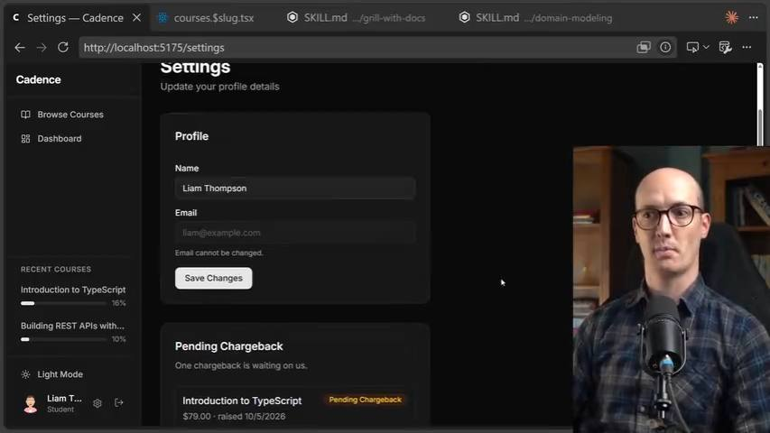

对前端转 AI 应用工程师的人来说，这五集的真正价值不在于"知道 glossary 和 ADR 这两个名词"，而在于**你学会了一套可复用的 prompt 与验收流程**：怎么写第一句话、怎么在 agent 给出结论后逼它做场景测试、怎么在它产出文档后做人工审稿（删词）、怎么把决定沉淀成不会过期的文档。这套流程换成任何仓库都能跑。

---

## 2. 讲师原话

下面按工作流顺序摘，不按集数顺序。

**关于任务本身**：

> "你在这里的第一项工作，就是进入这个应用，找到正确的词，然后围绕这个词把整个应用统一起来。"
> —— p009 [00:00]

> "在项目发展到当前阶段时，我们根本没有任何 glossary.md。这意味着，当我们创建术语表时，不只是要为这个实体创建一个词，很可能还需要定义另外几个词，才能让这条术语表条目说得通。"
> —— p009 [00:21]

**关于 agent 一上来就给你四个名字**：

> "实际上代码里有四个名字，因为在代码本身中，我们用的是 refund……但在课程页面按钮和表单里是 cancel my purchase，确认邮件里是 reversal，设置页面里是 pending charge back，我们甚至还有一个不守规矩的 cancel……错误消息在这里绝对算数。"
> —— p010 [00:24] – [00:46]

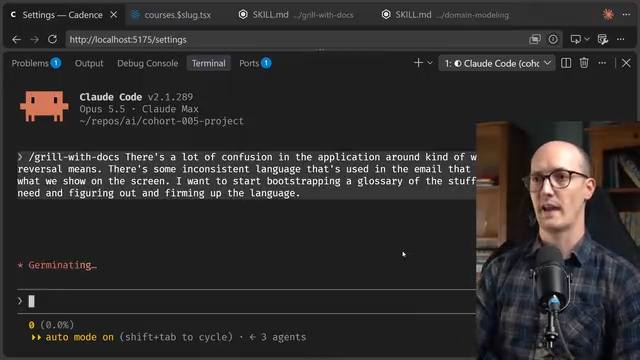

**关于"一个词还是两个词"必须先做场景测试**：

> "在我拍板说“好，就用两个术语”之前，我想先做一些场景测试。给我一些针对 refund request 和 refund 的场景测试，因为即使这两个术语彼此也相当相似。"
> —— p010 [01:55] – [02:05]

> "你可以看到，这种场景测试如何让功能在语言层面变得非常具体。我们能够用语言来思考这些边界情况。其理念是：如果你能谈论这些边界情况，就意味着你能在代码中轻松地对它们建模。"
> —— p010 [03:22] – [03:49]

**关于退款生命周期怎么被"试"出来**：

> "退款在周一获批。支付处理方在周四确认。那 Liam 在周二看到的是什么？如果我们只有 refund 这个词，那在三天里那就是一个谎言。"
> —— p010 [05:46] – [05:59]

> "批准一个退款请求会创建一个退款，该退款先处于 pending 状态，然后变成 issued 或 failed。而退款请求自始至终保持 approved 状态。"
> —— p010 [06:28] – [06:37]

**关于要不要动用 implement skill**：

> "我可以用 implement 技能，但我觉得这次并不需要代码审查。所以我干脆直接让它继续。"
> —— p010 [09:22]

**关于 ADR 为什么存在（本节最重要的一句）**：

> "代码能告诉你最终得到了什么，但它无法告诉你……所有你决定不采用的东西、你没有走的路。换句话说，代码就像是被擦掉了全部推导过程的答案。而那个推导过程，正是 ADR（架构决策记录）存在的意义。"
> —— p011 [00:39] – [00:46]

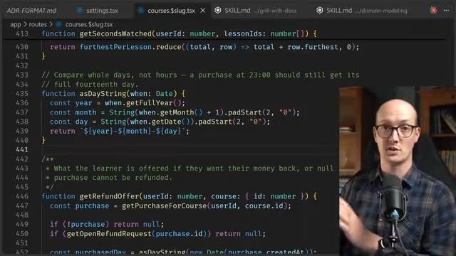

**关于 ADR 的三条准入门槛（照抄，别改）**：

> "要克制地提供 ADR。这个决策必须难以逆转，必须在没有上下文时令人意外，而且必须是真正权衡的结果。"
> —— p011 [01:55] – [02:00]

**关于二级文档的风险**：

> "对于在仓库里加入任何描述代码做什么的 markdown 文件，我通常都非常非常紧张……ADR 的用途只是填补那些你从代码里看不到的空白。它并不是要成为代码应该做什么的新的真相来源。"
> —— p011 [04:08] – [04:47]

**关于"读不懂"就是触发器**：

> "一旦我在 agent 的输出中发现某句话难以理解，我就会立刻开始想：我需要对它做场景测试。"
> —— p013 [04:49]

> "当你感到困惑时，就把这种感觉当作一个触发点，去更新术语表、改进语言。"
> —— p013 [05:37]

**关于人工审稿、删掉你不喜欢的词**：

> "我不喜欢你加了 access 这个词，我也不认为我们需要为 void seat 设一个术语。而且 void seat 本身就是一堆很糟糕的词。你可以用自己的品味……如果里面有个词就是让你不舒服，那就别用它，或者直接拒绝它。"
> —— p013 [09:14] – [09:35]

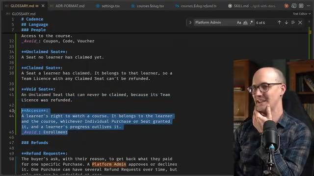

---

## 3. 从零复现

这一节是**你可以照着敲的操作序列**。每步都写清：你在哪儿、敲什么、看到什么算通过。

### 3.0 前置条件（先看清哪些是课里有的、哪些是我补的）

| 项 | 状态 |
|---|---|
| 一个**已经存在**的业务仓库（课里叫 Cadence） | 课里有，但源码不在课程里 |
| 仓库里有一个 `schema.ts`（数据库 schema 定义） | 课里有，p010 [09:34] 明确提到 |
| 仓库里有一个 `courses.slug.ts`（含 `getRefundOffer` 之类函数） | 课里有，p011 [02:22] |
| 仓库里有 `settings` 路由 | 课里有，p010 [09:34] |
| Claude Code（讲师原话就是 "我这边已经把 Claude Code 配置好了。"） | 课里有，p013 [00:00] |
| 两个 skill：`domain modeling`、`grilling` | 课里有，p010 [00:24] 说"两个 skill 加载成功" |
| 一个可选的 `implement` skill（带 code review） | 课里有，p010 [09:22] |
| Node / 包管理器版本、`package.json` 内容、启动命令、环境变量名 | **课里没讲**，一个都没讲 |
| 数据库是 Postgres 还是 SQLite、ORM 是 Prisma 还是 Drizzle | **课里没讲**，只能说有 "数据库迁移" 和 `schema.ts` |

> 因为第 7 行和第 8 行缺失，下文所有命令里凡是涉及"装依赖 / 起服务"的地方，我都写成 `# 课里没讲：你的项目自己的启动方式`。**不要**去网上找一份别人 Cadence 的配置抄进来，那会引入课程里根本不存在的假设。

### 3.1 建目录骨架

在仓库根目录建两个位置（路径依据：p011 [03:38] 说 ADR 放在"全局文档，ADR 文件夹在顶层。"；`glossary.md` p010/p013 里讲师都是直接在仓库里打开，没说子目录）：

```bash
cd <你的仓库根>
touch glossary.md
mkdir -p docs/adr
```

预期结构：

```
your-repo/
├── glossary.md                     # 术语表，仓库根
├── docs/
│   └── adr/                        # 架构决策记录
│       └── （先空着，3.8 再填）
├── schema.ts                       # 课里提到，已存在
├── courses.slug.ts                 # 课里提到，已存在
└── ...
```

### 3.2 第一轮 grill：写开场 prompt

这一步的关键不是 prompt 写得多漂亮，而是**三件事必须同时说清**：① 哪里乱了；② 我要建一份 glossary；③ 我要你把这个领域将来的词一起想清楚。讲师的原话是按口述讲的，我把它落成可直接粘贴的版本（**这是按讲师意图重写的，不是逐字原文**）：

```text
这个应用里关于 pending chargeback / reversal / 退款这件事，语言非常混乱：
我们发给用户的邮件里用的词，和屏幕上显示的词，不一致。

我想开始 bootstrap 一份 glossary，把这块可能用到的术语先定下来，
并且把语言固定住。

请先读 refund 相关代码，然后以编号问题的形式问我，一次只问一轮。
不要直接写文件，等我逐条回答。
```

发出去后，**第一件要检查的事**是 skill 是否真的加载了。p010 [00:24] 讲师看到的是"两个 skill 已成功加载：domain modeling 和 grilling"。如果你没看到类似回执，先解决 skill 加载，再往下走——不然后面所有"让 agent 自己去找词"的动作都不会发生。

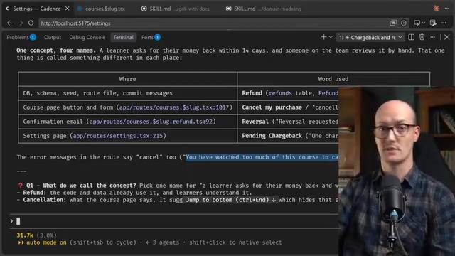

**通过标准**：agent 回你一份"我在 refund 代码里找到了 N 个名字"的清单，并且把它们按位置列出来（代码 / 数据库 schema / commit message / 页面按钮 / 表单 / 确认邮件 / 设置页 / 错误文案）。p010 [00:24]–[01:02] 讲师拿到的是四个名字 + 一个"不听话的 cancel"，并且特别强调了一句：**错误文案也算数**。

### 3.3 逐个回答问题，但拒绝"直接下结论"

agent 会给你一堆编号问题（讲师这一轮碰到了 Q1 到 Q12）。回答的正确姿势是：

- **Q1「这个概念叫什么」**：讲师选 `refund`，理由是站在学员视角——你要的不是 cancel your purchase，你要的是 refund your purchase。→ 回「同意 refund」。
- **Q2「一个词还是两个词」**：这是整节的分水岭。**不要直接答**。先回一句：
  ```text
  先别定。给我一些 scenario testing，对比 refund request 和 refund 两种命名下，
  同一个场景分别会怎么说。注意这两个词本身也很像。
  ```
- **Q3「真实 chargeback（银行发起）在不在范围内」**：讲师选择**排除**。"这已经属于“你根本用不上”的范畴了。"。→ 回「chargeback 出范围」。
- **Q4「能不能部分退款」**：讲师选「先只做全额」。
- **Q5「被拒之后能不能再申请」**：可以再申请。
- **Q6「approved 是不是等于钱已经退回」**：不是。因为没有接 Stripe 之类的支付服务，所以只有 refund request 和 refund 两个概念；但**一旦接支付**，就必须区分 pending refund 和 issued refund。→ 这里也要追加一次场景测试：
  ```text
  虽然我们暂时不接支付平台，但请给我一些 scenario testing，围绕 Q6 展开。
  ```
- **Q7～Q12**：分别处理"页面和路由的 eligibility 不一致（先放着，另开一节）"、"退款金额用 amount paid"、"refund request 的初始状态叫什么（最终选 `open`，因为 `requested refund request` 读起来打结）"、"failed refund 是原地重试还是替换（出范围）"、"界面文案三件套"、"退款是否改变 purchase 本身（后面再做）"。

**通过标准**：agent 给你一张**两列表格**——左边是场景，右边分别是"用两个词会怎么说"和"用一个词会怎么说"。p010 [02:41] 那张表就是这一节的产出物。

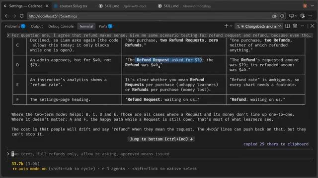

### 3.4 从场景表里读出结论（这一步必须人来读）

表格里几个决定性场景，值得逐条念一遍，因为它们直接决定了数据模型：

| 场景 | 两个词的说法 | 一个词的说法 |
|---|---|---|
| Liam 申请退 $79，还没人处理 | Liam 有一个 **open refund request** | Liam 有一个 requested refund |
| 管理员拒绝 | refund request 被 declined，且**没有 refund 被发出** | refund 被 declined |
| 被拒后 Liam 再申请一次 | 他有**两个 refund request** | 一次 purchase，两次 refund，但一次都没退成 |
| 管理员批了，但只退 $40 | refund request 是 $79，实际 **refund** 是 $40 | 需要再造"申请金额"和"实退金额"两个概念 |

最后一行是压死骆驼的稻草：如果只用一个词，你必须凭空造两个金额概念；如果用两个词，$79 天然属于 refund request，$40 天然属于 refund。→ **结论：用两个词。**

### 3.5 逼出生命周期（本节最值钱的一步）

p010 [05:46] 那一段是纯推理，你照着复述给 agent 就行：

```text
场景：退款周一被批准，支付处理方周四才确认。
问题：周二 Liam 在界面上应该看到什么？

如果只有一个 refund 词，周二就显示 refunded —— 这是撒谎，撒三天。
场景二：处理方因为 Liam 的卡已注销而拒绝。
这时 request 是 approved，但 refund 是 failed。
```

由此得到的结论（p010 [06:28] 讲师原话）：**批准一个 refund request 会创建一条 refund，refund 从 `pending` 开始，然后变成 `issued` 或 `failed`；而 refund request 全程保持 `approved`。**

注意这句话的分量：它意味着**两个对象各有自己的状态机**，不是一个对象挂三个状态。这就是为什么后面 `schema.ts` 里要动 enum。

### 3.6 审稿：把 agent 自己加进来的词删掉

agent 写完第一版 `glossary.md` 后，做了两件讲师不满意的事：

1. **擅自加了 `chargeback`**（p010 [05:19]）。→ 下一轮 prompt 第一句就是：
   ```text
   我没让你加 chargeback。它不属于我们的 glossary。
   ```
2. **第一轮**还漏答了 Q9。→ 补一句「Q9 没问题，语言可以」。

这是本节最容易被忽略、但最该学的动作：**glossary 是要给人看的，不是给 agent 刷字数的**。你读着别扭的词，就删。

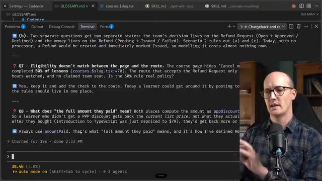

### 3.7 让 agent 落代码

glossary 定稿后，直接说「implement the code changes」。讲师明确说了**不走 implement skill**，因为这次改动他不需要 code review（p010 [09:22]）。

然后逐项核对改动（这是"从零复现"的验收环节，别跳过）：

| 文件 | 改了什么 | 依据 |
|---|---|---|
| `schema.ts` | 新增 `refundStatus`；把数据库里的 enum 值改成 `open`（原先是 `requested`） | p010 [09:34] |
| 数据库迁移 | 迁移脚本里把 `status = requested` 的旧数据改成 `open` | p010 [09:34]——"这会导致把 status 为 requested 的退款状态设成 open。" |
| `settings` 路由 | `pending chargebacks` → `open refund requests`；局部变量 `openRefundRequests`、`openRefundRequest.length`；文案 "有一个退款请求正等着我们处理。" | p010 [09:56] |
| `courses.slug.ts` | `getRequestedRefund` → `getOpenRefundRequest`；注释里 `getCancellationOffer` → `getRefundOffer` | p010 [10:33] |

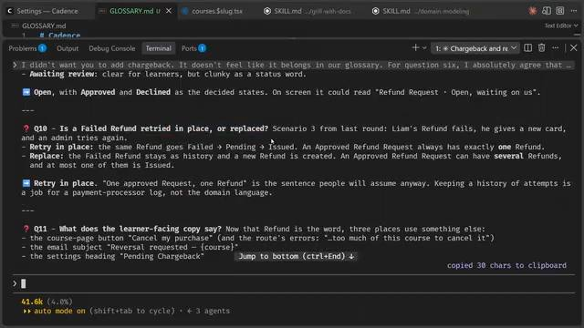

### 3.8 第二轮：先读 glossary，再用 glossary 的词汇写 prompt

P012 的任务是「做退款审批界面」，但真正要决定的是：**批准退款之后，学员在课程里的进度怎么办**——删掉？保留？保留 N 天？这碰钱碰数据，天然是 ADR 的料。

进第二轮前先做一件事：`cat glossary.md`。讲师 p013 [00:00] 就是这么开场的（"我这边已经打开了 glossary.md。"），因为他要**用里面已经定好的词去写 prompt**。

第二轮 prompt 要点（按讲师口述重写）：

```text
在我们的应用里，目前没有办法批准一个 open refund request。
我们需要一个界面，让 platform admin 登录后能看到所有可用的 refund request、
看到对方在这些课程上的进度，然后决定是否批准。

注意：refund 被批准之后发生什么，先按 out of scope 处理，这一轮只做到"批准"。

但是：open refund request 一旦被批准，我们要决定
学员对课程的访问权什么时候失效，以及要不要删掉他的课程进度。
```

关键词是 `open refund request`、`platform admin`、`progress`——这些词全部来自 glossary，所以 agent 不需要猜。

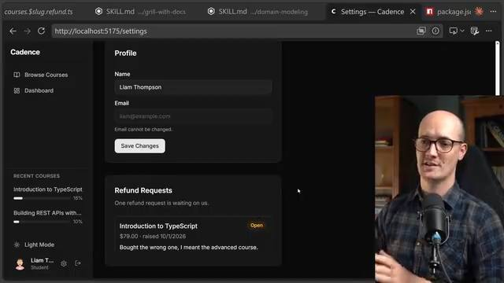

### 3.9 第二轮的三次关键追加

**(a) 命名冲突 → 直接定名**

agent 发现 `admin` 在这个 schema 里指两个东西：一种是平台级 admin 用户，一种是 team member admin。→ 讲师的选择：**叫 `platform admin` 和 `team admin`**，"我觉得这里我更倾向于后一种，感觉更清楚。"。同时定：**只有 platform admin 能批退款**。

**(b) 出现"句子读不懂"→ 立刻做场景测试**

agent 在讨论"团队许可证的退款获批后，无人认领的座位怎么办？"时说了一句 `Approval voids every unclaimed seat code`。讲师的反应（p013 [04:49]）：

> "我个人觉得这一点其实非常含糊。只要我在智能体的输出里发现有一句话难以理解，我就会立刻认为需要对它做场景测试。"

于是追加：

```text
Q1 那段我感觉很糊，像是 glossary 里有空洞导致沟通不清。
能不能对这块做一些 scenario testing？
```

这一轮场景测试挖出了：`individual purchase` vs `team license`、`seat` / `claimed seat` / `unclaimed seat`，以及一个真实的 bug——agent 读代码发现「refund 流程总是挑学员最近一次 purchase，某个场景下会退错 purchase」（p013 [05:59]）。

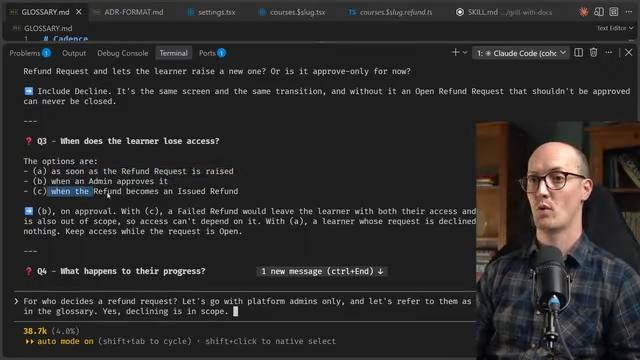

**(c) 让 agent 做 ADR，但先被拒绝了 → 要求 second pass**

agent 第一次说「我不建议写 ADR，这些决定都不满足"难以回退 + 真实取舍"这两条同时成立」。

讲师不同意（p013 [10:03]）：

> "我们处理的可是别人的钱。我希望你把这些 ADR 再过一遍……我不希望在后续推进中丢掉其中任何内容。"

第二次跑，agent 说「四条通过了三道测试」，产出四个 ADR。

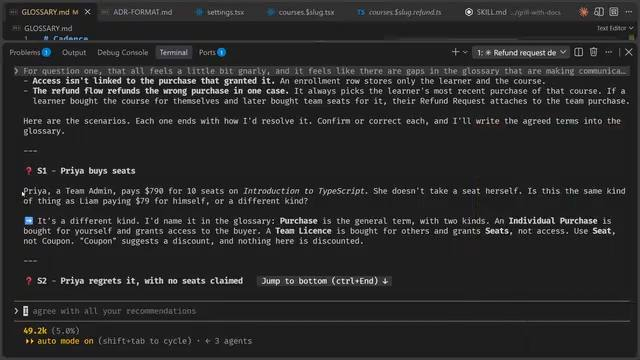

### 3.10 第二轮代码落地

P013 [12:05] 讲师明确说**这一轮不演示实现过程**，只给了 commit。「你可以 reset 到对应 commit 自己看」。所以这一步你的验收方式只能是：自己 review 改动是否与 glossary 和 ADR 一致。

---

## 4. 完整代码

> ⚠️ **重要声明**：P009–P013 **没有给出任何一行应用源码**。讲师全程在演示 prompt 与审稿。下面第 4.1–4.4 节的三个文件（`glossary.md`、ADR 模板、四个 ADR）是**按逐字稿里明确提到的词条、状态、结论重建的可直接保存版本**，措辞是我写的，不是逐字抄讲师的；第 4.5 节是示意代码，见该节头注明。

### 4.1 `glossary.md`（仓库根，完整文件）

```markdown
# Glossary

本文件定义 Cadence 领域内的规范术语。代码、界面文案、邮件、错误消息、commit message
都必须使用这里的词。若某个概念不在此表中，请先补进本表再写代码。

## 人

### Learner
购买课程并使用课程的人。本表统一使用 learner，不使用 user / student。

### Platform Admin
平台级管理员。**唯一有权限批准或拒绝 refund request 的角色。**

### Team Admin
购买了 team license（团队授权）的人。team admin 不是 platform admin，
不能批准退款。注意：在旧代码中 `admin` 一词同时指这两种角色，现已废弃。

## 购买

### Purchase
泛指一次购买行为。是 individual purchase 与 team license 的上位概念。

### Individual Purchase
买给自己的一次购买。购买者本人即使用者。

### Team License
买给别人的一次购买。一次 team license 包含若干 seat。
team license 本身不等于课程访问权。

### Seat
team license 包含的一个名额。分两种状态：

- **Unclaimed Seat**：尚未被认领的名额。
- **Claimed Seat**：已被某个 learner 认领的名额。认领后该 learner 获得课程访问权。

**规则**：一个 refund request 处于 open 状态期间，该 purchase 下的 seat 不可被认领。

## 退款

### Refund Request
学习者或 team admin 提出的退款申请。它是一个"请求"，本身不移动任何钱。

状态：
- **Open**：已提出，等待 platform admin 决定。
- **Approved**：platform admin 已批准。批准后立即创建一个 Refund。
- **Declined**：platform admin 已拒绝。此时**没有任何 Refund 被创建**，学习者保留课程访问权。

**规则**：被 declined 之后，学习者可以再次提出新的 refund request。
**规则**：一个 refund request 只针对一个 purchase。
**规则**：退款金额始终为该 purchase 的 amount paid（暂不支持部分退款）。

### Refund
真正移动的钱。一个 refund 只能由"批准一个 refund request"产生。

状态：
- **Pending**：已批准，但支付处理方尚未确认。
- **Issued**：支付处理方确认，钱已退回。
- **Failed**：支付处理方拒绝（例如卡已注销）。

**关键关系**：批准一个 refund request 会创建一个 refund；refund 从 pending 开始，
变为 issued 或 failed；而 refund request 全程保持 approved。

## 明确不在范围内（Out of Scope）

### Chargeback
由银行发起的强制退款。本应用不处理 chargeback，暂不定义。

## 界面文案对照（原词 → 新词）

| 位置 | 旧文案 | 新文案 |
|---|---|---|
| 课程页按钮 / 表单 | cancel my purchase | request a refund |
| 确认邮件标题 | reversal | Refund requested |
| 设置页标题 | pending chargebacks | Refund requests |
| 设置页计数 | — | one refund request is waiting on us |
| 退款申请状态展示 | — | Refund request open — waiting on us |
| 错误消息 | （与领域语言不一致） | 必须使用本表中的术语 |
```

### 4.2 ADR 模板（`docs/adr/_template.md`）

逐字稿 p011 [01:16] 说模板放在 domain modeling skill 里，格式极短、"1 到 3 句"，可选 `considered options` 与 `consequences`。重建如下：

```markdown
# NNNN. <一句话标题，用领域术语>

## Decision

<我们决定了什么，为什么。1–3 句。>

## Considered Options（可选）

- <被放弃的选项>：<为什么放弃>

## Consequences（可选）

- <这个决定会带来的后果，尤其是代码层面的>
```

### 4.3 四条 ADR（`docs/adr/`，完整文件）

依据 p013 [10:46]–[11:43]，agent 判定通过三道测试的四条：

```markdown
# 0001. 批准退款申请保留学习者的课程进度

## Decision

platform admin 批准一个 refund request 时，购买者失去课程访问权，但保留其课程进度
（lesson progress、watch history、quiz attempts）。进度不随退款删除。

## Consequences

- 进度按 learner + lesson 存储，与 purchase 解耦，因此退款不需要级联删除。
- 学习者日后再次获得该课程访问权时，可以接着上次的进度继续。
```

```markdown
# 0002. 课程访问权在退款申请被批准时结束

## Decision

学习者的课程访问权在 refund request 被 platform admin **批准**时结束，
而不是在提出申请时、也不是在退款真正 issued 时结束。

## Considered Options

- 提出申请时即收回访问权：被拒绝的购买者会被白白锁在门外，不采用。
- 等 refund 变成 issued 才收回：pending 期间学习者仍可使用已付费课程，不采用。

## Consequences

- 退款被 declined 时，学习者访问权不受任何影响。
```

```markdown
# 0003. team license 的退款是全有或全无，且申请期间冻结 seat

## Decision

一个 team license 的 refund request 只能整体退款，不能按 seat 部分退款。
该 refund request 处于 open 期间，其下的 seat 不可被认领。

## Considered Options

- 允许在 open 期间认领 seat、之后按认领情况部分退款：会让金额与名额状态互相纠缠，不采用。

## Consequences

- 认领 seat 的操作需要检查该 purchase 上是否存在 open 的 refund request。
```

```markdown
# 0004. 一个学习者在每门课上只有一个"位置"，且不记录来源

## Decision

一个 learner 在每门课上只有一个位置（place），无论它来自 individual purchase
还是来自某个 team license 的 claimed seat。这个位置不记录自己是由哪一种方式获得的。

## Consequences

- 退款代码不能通过"位置"反查 purchase。refund request 必须显式绑定到购买者的
  该课程最新一次 purchase。
- 现有代码"总是挑选最近一次 purchase"的行为在这个决定下是符合预期的，
  但也意味着同一课程存在多次 purchase 时需要额外校验。
```

### 4.4 两个对象的状态机（数据模型草案）

逐字稿 p010 [06:28] 明确给出了这两个状态机的形状，直接落表：

| 对象 | 字段 | 取值 | 说明 |
|---|---|---|---|
| RefundRequest | `status` | `open` / `approved` / `declined` | 初始 `open`；批准后**永久** `approved` |
| Refund | `status` | `pending` / `issued` / `failed` | 由批准动作创建，初始 `pending` |

转换规则：

```
RefundRequest: open ──(platform admin 批准)──> approved
               open ──(platform admin 拒绝)──> declined
               declined ──(learner 再申请)──> 新建一条 open（旧记录不变）

Refund:        (由 approved 动作创建) pending ──> issued
                                      pending ──> failed
```

> `approved` 的 refund request 是**终态**，它下面挂着的 refund 才在动。这是本节最容易搞错的一点，也是为什么 `settings` 页要显示 `open refund requests` 而不是 `pending refunds`。

### 4.5 示意代码（⚠️ 课里没有代码，以下为示意）

下面这段**不是**课程内容，只是把 4.4 的表翻译成 TypeScript 联合类型，方便前端背景的读者理解"状态"应该怎么表达。真实项目用的是 `schema.ts` + 数据库 enum，具体写法课里没讲。

```ts
// ⚠️ 课里没有代码，以下为示意
// 用 TS 的 const tuple 表达 enum，避免字符串散落各处
export const REFUND_REQUEST_STATUSES = ['open', 'approved', 'declined'] as const;
export type RefundRequestStatus = (typeof REFUND_REQUEST_STATUSES)[number];

export const REFUND_STATUSES = ['pending', 'issued', 'failed'] as const;
export type RefundStatus = (typeof REFUND_STATUSES)[number];

// 在 JS/Node 侧，这等价于 zod:
// z.enum(['open', 'approved', 'declined'])
// 如果你用 Prisma，它对应 schema.prisma 里的 enum 块；
// 如果用 Drizzle，对应 pgEnum。课里没说是哪个。
export interface RefundRequest {
  id: string;
  purchaseId: string;
  status: RefundRequestStatus;
}

export interface Refund {
  id: string;
  refundRequestId: string;
  status: RefundStatus;
  amountPaid: number; // 课里说金额用 amount paid
}
```

### 4.6 代码侧改动清单（验收用）

| 文件 | 改动 | 逐字稿依据 | 状态 |
|---|---|---|---|
| `glossary.md` | 新建，含 refund / refund request / 状态 / 角色 / purchase 层级 | p010 全文 | 课里有 |
| `schema.ts` | 新增 `refundStatus`；enum 值 `requested` → `open` | p010 [09:34] | 课里有 |
| 迁移脚本 | 回填旧数据：`refund set status = open where status = requested` | p010 [09:34] | 课里有 |
| `settings` 路由 | `pending chargebacks` → `open refund requests`，变量与文案同步 | p010 [09:56] | 课里有 |
| `courses.slug.ts` | `getRequestedRefund` → `getOpenRefundRequest`；`getCancellationOffer` → `getRefundOffer` | p010 [10:33] | 课里有 |
| `docs/adr/0001..0004` | 四个 ADR | p013 [10:46]–[11:43] | 课里有 |
| 审批界面 | platform admin 可见的 refund request 列表 + 进度展示 | p012 [00:20] | 课里说了要做，**没演示实现** |
| server action 里的 50% 校验 | 页面隐藏按钮但 server action 不校验，可被 curl 绕过 | p013 [01:53] | **课里明确说另开一节，本课没修** |

---

## 5. 逐行解释

**为什么第一步是"找词"而不是"改代码"。** 讲师的开场顺序是有讲究的：先找出正确的词，再用这个词去统一应用。如果反过来，你会得到一堆改了名但语义仍然矛盾的代码——比如把 `cancel` 改成 `refund`，但按钮背后实际上只是标记一个状态，那这次重命名只是让错误更难被发现。

**为什么 `refund` 而不是 `cancel`。** 讲师的判断标准是**站在使用者视角造句**：「你不想 cancel 你的购买，你想 refund 你的购买。」这条判据可以用在任何项目上：把这个词塞进一句用户会说的话里，读不通就是错的。同理，`reversal` 这个词是银行侧/支付侧的语言，不是学习者语言，所以被淘汰。

**为什么必须造第二个词 `refund request`。** 三个证据，缺一不可：
1. 「refund 被拒绝，所以什么都没退」——同一个词在句子里出现两次、意思相反，读不通。
2. 被拒后再申请，会出现「两个 refund 但一次都没退成」——名词数量对不上事件数量。
3. 管理员批 $79 但只退 $40——一个词承担不了两个金额。

这三条其实都是同一件事：**词的数量必须等于领域里"事件"的数量**。refund request 是"人做出的动作"，refund 是"钱发生的动作"，它们是两个事件，就必须是两个词。

**为什么 `open` 而不是 `requested`。** 这是纯语言品味，但讲师给出了理由：`requested refund request` 读起来打结（p010 [07:45]）。而 `open refund request` 顺口，并且能和 `approved` / `declined` 组成一组"决定状态"。注意这里有个隐藏收益：`open` 天然能接 `waiting on us` 这句界面文案，于是**屏幕上的每个词都变成 glossary 里的一个词条**（p010 [08:22] "这样一来，屏幕上的每个词都会成为术语表条目。"）。这就是术语表真正的用法——它不只是给开发者看的，它是**界面文案的唯一来源**。

**为什么退款需要生命周期，而不是一个 approved 布尔值。** p010 [05:46] 那个"周二到底显示什么"的推演，本质是在问：你的状态机是否覆盖了**所有时间点**。如果只有一个 `approved`，周一到周四这三天界面上会撒谎。加上 `pending` 之后，周二的正确显示是"退款请求已批准，退款正在处理中。"。这条推理可以直接迁移到任何异步外部依赖上（支付、发货、审核、模型推理）。

**为什么 `chargeback` 要删掉。** 讲师的理由是「you're not gonna need it territory」。glossary 不是维基百科，**定义你没做的事是纯负债**：agent 会读到它，然后开始围绕它做假设。同样被删的还有 P013 里的 `access` 和 `void seat`——前者"太模糊，本来就很清楚"，后者"这个词组合本身就很难听"。这里有个方法论：**glossary 的准入标准不是"这个词存在"，而是"这个词会引起歧义"**。

**为什么 ADR 要短到 1–3 句。** 讲师对二级文档（secondary source）的警惕是本节最有价值的观点：代码是 primary source，任何描述代码的 markdown 都是 secondary source，而 secondary source **会过期**。字数越多，过期的概率越大，误导 agent 的概率越大。所以 ADR 只写"代码解释不了的东西"——也就是决定背后的取舍。反过来，如果你的 ADR 开始描述"这个函数做什么"，就该删了，因为那是代码的活。

**为什么 ADR 要过三道门槛。** `hard to reverse` + `surprising without context` + `real trade-off`，三条是**与**关系。用讲师的两个例子检验：
- 用 `recharts` 画图、用 `sonar` 做 toast → 换成别的库半天的事，**可逆**，→ 不写 ADR。
- 从 React 换到 Vue → 几十上百小时，**不可逆**，→ 值得写 ADR。
- "退款按整天算而不是按小时算" → 表面上可逆，但它**没有上下文就很意外**（为什么不是精确到小时？），而且是个**真实取舍**（用户多拿一大块时间 vs 精确性）。→ 值得写 ADR。

第三条（整天 vs 小时）是讲师特意挑的例子，因为它藏在 `courses.slug.ts` 的 `asDayString` 函数里，代码只能告诉你"它按天算"，永远不能告诉你"为什么不用小时"。这正是 ADR 存在的唯一理由。

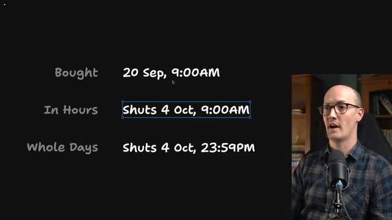

**为什么第二轮要先读 glossary 再写 prompt。** 讲师开场第一件事是打开 `glossary.md`。原因很实际：prompt 里的词汇越精确，agent 需要猜的地方就越少。第一轮你用"退款那件事"，agent 得自己去代码里考古；第二轮你用 `open refund request` + `platform admin`，agent 直接就能定位。讲师称之为 glossary 的"bonus"：**你的 prompting 会变得更好、更精确**（p012 [00:50]）。

**为什么"读不懂"是最可靠的触发器。** p013 [04:49] 那句是整节的操作核心。人类读技术文档时遇到"这句话有点绕"通常会硬着头皮往下读，但讲师把它当成**信号**：读不懂 = glossary 有洞 = 该做场景测试。这条判据的可贵之处在于它不需要你懂领域，只需要你诚实承认"我没读懂"。

**为什么 `platform admin` / `team admin` 要拆。** 因为 schema 里 `admin` 同时指两种角色，而这两者的权限完全不同（只有 platform admin 能批退款）。这是一个**命名冲突导致的潜在越权**：如果代码里写 `if (user.isAdmin)`，team admin 也能批退款。这类问题在 glossary 阶段就能拦下来，成本几乎为零。

**为什么 `place`（课程位置）不记录来源。** ADR 0004 说一个 learner 在每门课上只有一个位置，不管它来自 individual purchase 还是 claimed seat。这条决定的直接后果写在了 ADR 里：**退款代码不能通过"位置"反查 purchase**，必须显式绑定到购买者的最新一次 purchase。而 agent 在 P013 场景测试里发现的问题正是这个——"退款流程在某种情况下会退错购买记录。它总是选取该学员最近一次购买该课程的记录。" 也就是说，这条 ADR 不是凭空写的，它是**从一个真实 bug 倒推出来的决定**。

**关于并发（讲师只在问题里提了一句，没给方案）。** P013 里 agent 问了 "如果两个平台管理员同时审批同一个请求，会怎样？"，讲师评价是 "Lovely"，但**没有回答技术上怎么办**。如果你要真做，在 JS/Node 里对应的是：把"读 refund request 状态 → 校验是 open → 改成 approved → 创建 refund"放进**同一个数据库事务**；或者在 `refund_request` 上加一个 `version` 字段做乐观锁（更新时 `where id = ? and version = ?`，影响行数为 0 就说明被别人抢先了）；或者给 `refund.refundRequestId` 加**唯一索引**，让第二次插入直接失败。三条都是标准做法，但**课里没讲任何一条**，你要自己选。

---

## 6. 复现检查清单

按顺序打勾，任何一项没打勾都别进下一步。

**准备**

- [ ] 仓库根有 `glossary.md`（可以是空文件）
- [ ] 有 `docs/adr/` 目录
- [ ] `domain modeling` 与 `grilling` 两个 skill 已加载，并且 agent 有回执
- [ ] 明确知道本项目的启动命令 / 数据库迁移命令（**课里没讲，你得自己确认**）

**第一轮 grill**

- [ ] 开场 prompt 同时包含"哪里乱"+"我要建 glossary"+"先提问、别写文件"
- [ ] agent 列出了同一概念在代码 / DB / commit / 页面 / 邮件 / 设置页 / 错误文案里的全部名字，**数量 ≥ 3**
- [ ] 在决定"一个词还是两个词"之前，先要了一张场景对比表
- [ ] 场景表里包含"退款被拒"、"被拒后再申请"、"批 $79 只退 $40"三个场景
- [ ] 场景表里包含"周一批准 / 周四确认 / 周二显示什么"这个时间场景
- [ ] 结论写成了两个状态机（request: open/approved/declined；refund: pending/issued/failed），而不是一个
- [ ] 你删掉了 agent 自己加的 `chargeback`（或任何你没要求它加的术语）
- [ ] 界面文案三件套已定：`request a refund` / `Refund requested` / `Refund requests`

**代码落地**

- [ ] `schema.ts` enum 里 `requested` 改成 `open`
- [ ] 迁移脚本里有旧数据回填（`where status = 'requested'`），并且你**在本地跑过一遍**
- [ ] `settings` 路由里的 `pending chargebacks` 全部消失
- [ ] `courses.slug.ts` 里 `getRequestedRefund` → `getOpenRefundRequest`、`getCancellationOffer` → `getRefundOffer`
- [ ] 全仓库搜 `cancel`、`reversal`、`chargeback`，除了 glossary 的 out-of-scope 条目外**没有残留**

**第二轮**

- [ ] 写 prompt 前 `cat glossary.md`，prompt 里用的是 `open refund request` / `platform admin` 这些已定义词
- [ ] `admin` 已拆成 `platform admin` + `team admin`，并明确"只有 platform admin 能批退款"
- [ ] 至少因为"某句话读不懂"而追加过一次场景测试
- [ ] 显式要求过 ADR 的 **second pass**（agent 第一次大概率会说"不需要"）
- [ ] `docs/adr/` 下有 4 个文件，每个都不超过一屏
- [ ] 每个 ADR 都能对应上"难以回退 / 无上下文则意外 / 真实取舍"三条

**收尾**

- [ ] glossary 里的每个词，你都能在代码里找到对应的标识符或文案
- [ ] 代码里的每个面向用户的字符串，都能在 glossary 里找到出处
- [ ] `docs/adr/` 里没有一条在描述"代码做了什么"（那是代码的活）

---

## 7. 课里没讲但你会撞上的

**1. 项目怎么跑起来——完全没讲。**
讲师从头到尾没提 Node 版本、包管理器、`package.json`、启动命令、环境变量名。逐字稿里只出现了 `schema.ts`、`database migration`、`settings route`、`courses.slug.ts` 这几个名字。你如果要用真实的 Cadence 仓库，**去讲师给的 commit**；如果要在自己仓库复现，就用自己的启动方式，别去搜"Cadence 怎么启动"，那会给你一套课上不存在的假设。特别注意：**任何环境变量名（数据库连接串等）课里都没出现过，不要凭空写 `DATABASE_URL` 然后声称来自课程。**

**2. 两个 platform admin 同时点"批准"会怎样。**
agent 在 P013 提了这个问题，讲师说 "Lovely" 然后跳过了。这是个真实的竞态：两个请求同时读到 `status = open`，都通过校验，都写 `approved`，都创建一条 refund → **退两次钱**。JS/Node 里的标准解法见第 5 节末尾（事务 / 乐观锁版本号 / 唯一索引），**课里一条都没讲**，属于必须自己补的功课。

**3. 那个 50% 的洞，课里明确说了"另开一节"，所以没修。**
P013 [01:53] 讲师原话：课程页在学员完成 50% 以上课程后隐藏退款按钮，但**server action 里没有做同样的校验**，"学员有可能通过 curl 调用接口，直接发起退款请求。"。这是典型的**只在前端做了权限控制**。修法很简单（在 server action 里重算一遍完成率），但课里把这件事挪到后面去了，本节不要以为已经解决。

**4. 迁移的回滚没人提。**
`requested` → `open` 这个 enum 改名，讲师只说了正向迁移会"修复数据库中的所有退款记录。"。**回滚怎么办？** 如果你 down migration 里把 `open` 改回 `requested`，那些本来就是 `approved` / `declined` 的行不受影响，看起来安全——但如果你之后又加了 `open` 之外的新状态，就会炸。课里没讨论，实际项目里要写。

**5. glossary 会跟代码漂移，课里没有防漂移机制。**
讲师反复强调"二级文档会过期"，但他给的解法是"把 ADR 写得很短"，**没有**给 CI 校验（比如从 glossary 生成 TS 常量、或者用测试断言所有 enum 值都在 glossary 里出现过）。这是你可以自己加的改进。

**6. 一次 grilling 会 mint 太多词。**
P013 里 agent 一次性把 `purchase`、`individual purchase`、`team license`、`seat`、`unclaimed seat`、`claimed seat`、`access`、`void seat` 全塞进 glossary 了。讲师手动砍掉两个。这意味着**每轮 grilling 之后都必须人工过一遍术语表**，否则 glossary 会在几次迭代后膨胀成没人读的文档——而 agent 会把它当权威。

**7. ADR 的生命周期课里没讲。**
四个 ADR 是新建的，但**ADR 被推翻时怎么办**（标 superseded？直接改？保留旧文件加链接？）、编号规则、放在 `docs/adr/` 还是 `docs/decisions/`，课里都没说。只有一点是明确的：放仓库顶层的 `docs/adr`，这样 agent 容易找到（p011 [03:38]）。

**8. 团队协作时的 glossary 冲突。**
这套流程默认"一个人在会话里把词定完"。如果三个人同时往 `glossary.md` 加词，语义冲突几乎必然发生。课里是单人演示，没涉及。

**9. 成本与时长。**
P013 单集 12 分 54 秒，实际会话轮次非常多（讲师自己说 "这次会话已经持续很久了。这是一节很长的课。"）。你要给自己留出**至少一小时**做一次完整的领域建模，别指望三分钟搞定。

**10. "退款是否改变 purchase 本身"被推迟了。**
P010 [08:22] 讲师把这个 Q12 标成 out of scope："退款发生后，学员会失去该课程的访问权限吗？那这笔购买之后叫什么？已退款的购买吗？" 注意这个决定在 P013 被部分回答了（访问权在**批准**时结束，而不是 issued 时），但"purchase 本身是否需要改名"始终没答。如果你照着 4.1 的 glossary 写代码，会发现 purchase 表里没有任何字段表示"已退款"——这是有意的，别自己加。