# Software Factories for Real Engineers part1（P90–P100）复现文档：用白板设计软件工厂任务流

> 本文的复现对象不是一段可运行代码，而是一套**可以照着画出来、可以评审、可以当作后续实现规格**的软件工厂任务流设计。课里没有给出 orchestrator 的具体代码，也没有记录 TLDraw 模板的固定 URL；因此凡是逐字稿没讲的地方，本文会明确写「课里没讲」。  
> 读者照着本文，应当能在 TLDraw 里复现 P90–P100 的白板设计过程，并得到五个可落地的任务流：改进代码库架构、lint 规则棘轮、自动 rebase、慢查询治理、原型迭代。

## 1. 这一节做什么

这一节从 P90 到 P100，核心不是写某个业务功能，而是**设计软件工厂要跑哪些任务、每个任务从哪里触发、在哪个组件上执行、什么时候停下来、什么时候交给人**。讲师先把术语固定下来：runner 是「一次性机器」，run 是「在 runner 上执行一次任务」，task 是「runner 真正要执行的事情」，例如 explore、implement、review。随后用 TLDraw 白板把每个任务拆成「步骤 + 执行位置」的流程图。

本节最终要复现出五个流程：

1. **改进代码库架构**：orchestrator 每天循环一次，runner 运行 `improve codebase architecture`，把候选改进变成带标签的 ticket，交给人评审；也可以走更激进的分支，让 runner 直接判断哪些候选可以立即实现并开 PR。
2. **lint rule ratchet**：每天找一个失败的 lint 规则，修一个实例并开 PR；当某个规则不再失败时，把它「毕业」进 strict lint 集合，逐步收紧仓库规则。
3. **Auto Rebase**：每天固定时间找出与 base 分支过期的 PR，先用脚本确定性 rebase；只有出现冲突才叫 agent；成功则 force push with lease，失败或 PR 已被取代则建 ticket 并给 PR 打 blocked 标签。
4. **慢查询治理**：外部慢查询监控把告警放进队列，orchestrator 每天拉取；runner 先对告警分组、去重、做严重度判断，再为每组建 ticket；只对严重且没有 PR 的 ticket 启动修复 runner。
5. **原型迭代**：feature explore 多出第三个 verdict「需要原型」；prototype runner 创建或更新原型，把原型代码放 draft PR，把评论发回 ticket tracker；人类在 ticket tracker 里评论并显式 tag agent，orchestrator 再启动下一轮 prototype runner。

这一节的设计原则可以概括成四句话：  
- **先慢后快**：一开始把循环频率、停止条件、人工评审都调保守，确认刹车有效再加速。  
- **能确定性解决就不要先上 agent**：Auto Rebase 先用脚本，冲突才叫 agent。  
- **用标签和停止条件防重复、防爆炸**：ticket/PR 要带来源标签，超过阈值就停。  
- **ticket tracker 是人机通信界面**：人类不是只在最后看代码，而是在 ticket、评论、标签上介入。

术语表：

| 术语 | 在本节中的含义 | 设计时要注意 |
|---|---|---|
| runner | 执行一次 run 的一次性机器 | 可以按任务创建，也可以一个 runner 内跑多个子 agent |
| run | 一次任务执行 | 需要知道触发来源、输入、输出、停止条件 |
| task | runner 要执行的具体工作 | explore、implement、review、improve、rebase、prototype 等 |
| orchestrator | 调度器 | 能跑循环、能接收 ticket/Git host 事件、能创建 runner |
| ticket tracker | 人和 agent 共用的任务/沟通界面 | 标签、评论、状态要与 Git host 同步 |
| Git host | 代码托管与 PR 所在处 | PR、分支、merge、force push、label 都在这里 |
| human review | 人类评审 | 不是可选项，是安全阀和加速器的调节点 |

## 2. 讲师原话

下面按设计逻辑引用关键原话。引用保留英文，后面用中文说明它在流程里的作用。

**① runner、run、task 的定义**

> "我们有运行器，也就是一次运行所执行的一次性机器。运行器上会执行一次运行。所以，这就是在运行器上执行一个任务。接下来我们要弄清楚的是，这些运行器实际要执行的任务是什么。"
> —— p090 [00:18]

这句话把后面所有流程图的基本单位定死了：白板上的每个步骤不仅要写「做什么」，还要写「在哪个位置做」。runner 不是长期服务，而是可丢弃的执行机器。

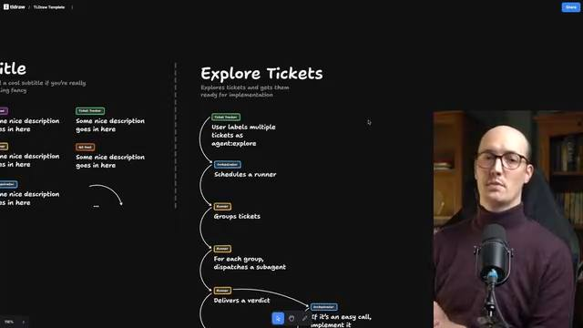

**② ticket tracker 是触发源**

> "第一步发生在我们的工单跟踪系统中。这有点像后续所有流程的触发器：用户会把多个工单或单个工单标记为 agent: explore。"
> —— p090 [02:34]

这说明工厂不是从「人写代码」开始，而是从 ticket 上的标签开始。标签是事件，也是过滤条件。

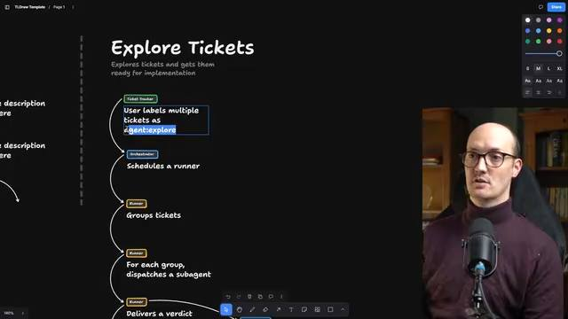

**③ orchestrator 能跑循环**

> "我们的编排器可以运行循环。换句话说，编排器的职责之一是：每天一次、每小时一次、每分钟一次——频率我也说不准——它可以启动一些进程，这些进程会去调度运行器，或者去工单跟踪系统里做点什么，或者发起拉取请求并提交到 GitHub。"
> —— p091 [00:16]

这一段是 P91–P100 的总开关：orchestrator 不只是被动接收事件，还能按时间循环主动发起任务。后面所有「每天一次」「midnight」都属于这个能力。

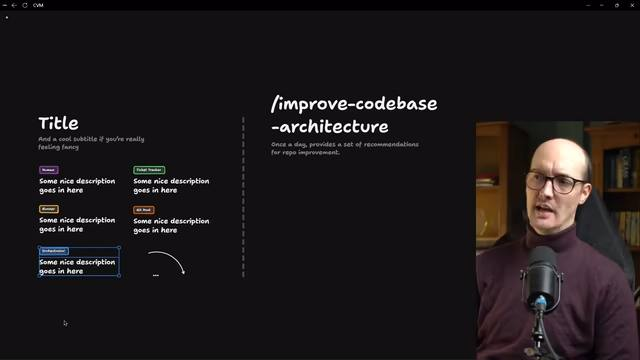

**④ 改进代码库架构要防重复、防上下文失控**

> "我们需要确保这个运行器拥有正确的上下文，这样改进后的代码库架构就不会一次又一次地给你同一张工单的无尽版本。换句话说，我们需要确保有一种方法，把工单筛选到只剩与代码库架构相关的那些。"
> —— p092 [01:18]

> "我们还应该在这里加一个步骤：如果现有工单超过五张，就停止。"
> —— p092 [01:47]

> "这里写着要把候选方案以 HTML 报告的形式呈现。换句话说，这里不是只有一个候选方案，而是有多个候选方案。因此，在这个运行器内部，可能值得把它筛选到只剩一个候选方案。"
> —— p092 [02:01]

这里出现了两个安全阀：**标签过滤**和**stop condition**。讲师还指出 `improve codebase architecture` 输出的是多个候选的 HTML 报告，因此要么在 runner 里收窄成一个候选，要么为每个候选建 ticket，但后者要把停止阈值从 5 提到 20。

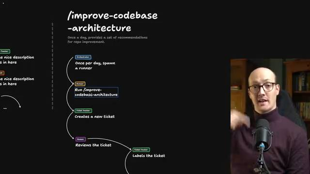

**⑤ lint rule ratchet 的定义**

> "每天一次，我们会找出一条未通过的 lint 规则，并发起一个拉取请求来修复该规则的一个实例。最后我们会安排人工审核，而且这应该相对简单。"
> —— p093 [00:28]

讲师把做法命名为 ratchet：棘轮只能往一个方向转，随着每天修一个实例，规则会越来越安全，最后完全进入严格集合。

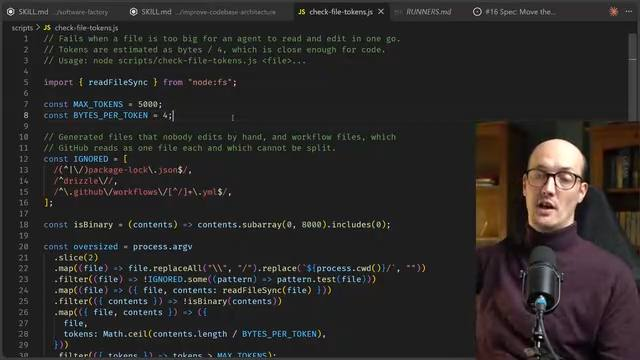

**⑥ lint all 与 lint strict 的毕业机制**

> "我们这里有一个严格版本 npm run lint strict，它本质上只运行那些我们预期会通过的检查。这个棘轮机制的全部意义在于，我们把 lint 规则从一个桶移到另一个桶，所以我们要让这两边保持等价。"
> —— p094 [02:15]

课里把 `npm run lint all` 和 `npm run lint strict` 作为概念举例：前者包含已知会失败的规则，后者只跑预期能过的规则。ratchet 的目标是让两个集合逐渐等价，最后可以删掉 `lint all`。

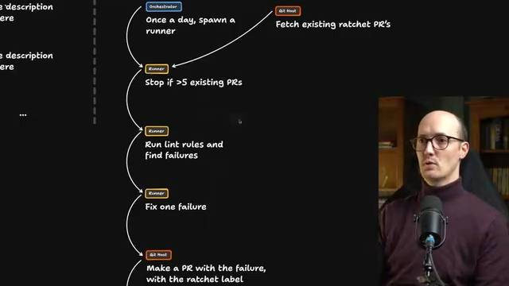

**⑦ Auto Rebase 要先确定性、再 agent**

> "通过 rebase，你可以在智能体真正介入之前，先确定性地尝试一次。"
> —— p095 [00:41]

> "如果存在冲突，那么我们需要在那一刻启动一个智能体来修复这些冲突。"
> —— p096 [01:07]

> "这里的强制推送始终使用 force-with-lease。"
> —— p096 [01:36]

Auto Rebase 的顺序很重要：脚本先试，成功就省 token；只有冲突才叫 agent。推送必须用 force with lease，避免覆盖别人刚推上去的内容。

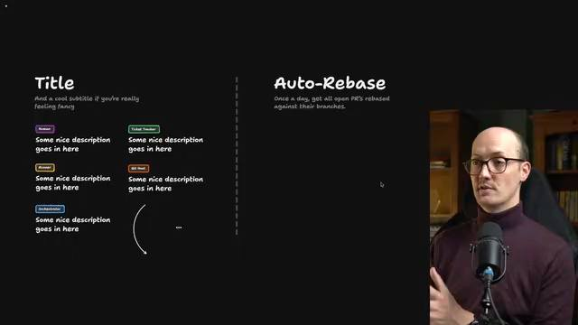

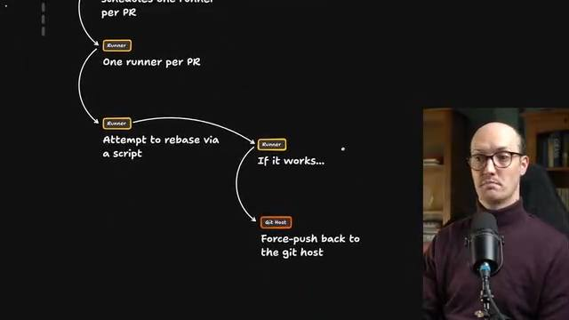

**⑧ 慢查询告警要用队列/拉取，而不是直接 push 给 orchestrator**

> "我们假设某种慢查询监控已经接入我们的编排器。换句话说，只要数据库中出现慢查询，我们的编排器就会收到某种告警。"
> —— p097 [00:40]

> "我认为合理的做法是，把告警放入某种队列，然后让我们的编排器每天一次从队列中取出这些告警。"
> —— p098 [00:59]

讲师的判断是：如果 orchestrator 被外部告警直接 push，它控制不了节奏；100 条告警就会变 100 个 runner。改成队列或第三方 API 的 pull 模式，节奏就回到工厂手里。

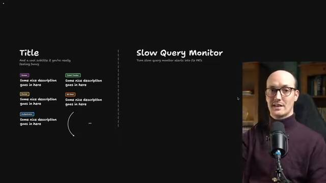

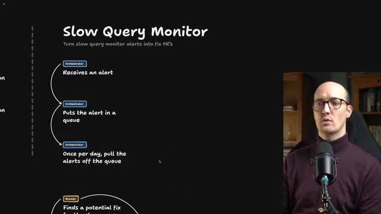

**⑨ 原型需要迭代回路**

> "原型需要迭代。因此，我们需要让编排器能够获取针对原型发表的评论，然后把这些评论转化为对原型的更新。"
> —— p099 [01:17]

> "人类对原型做出反应，发布一条后续评论，并明确标记智能体。这样我们就能启动另一个原型运行器。"
> —— p100 [01:30]

原型流程的难点不是「生成一个原型」，而是「让非技术同学通过 ticket tracker 评论来迭代」。评论就是对话历史，orchestrator 要能识别已有原型并启动 update runner。

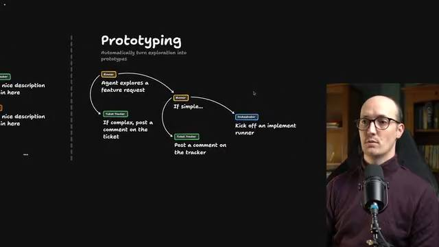

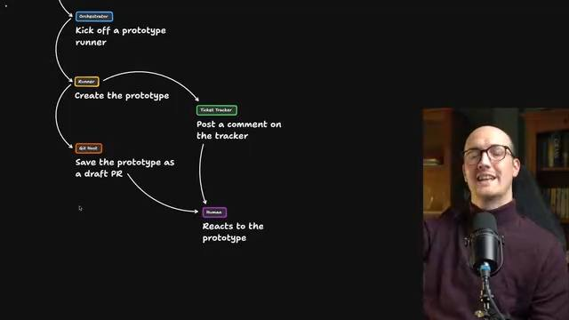

## 3. 从零复现

这一节按「准备画板 → 总需求与约束 → 容量估算 → 五个流程逐个画」复现。注意：这是纯设计课，课里没有可运行代码；下面给的是设计产物的目录、环境、依赖和操作步骤。凡是课里没给的，我会明确标注。

### 3.1 准备画板环境

讲师用的工具是 TLDraw。逐字稿说课程页面下方有一个链接，会打开一个 TLDraw 模板；模板是只读的，可以复制但不能移动；然后点左上角三个点，选择 `copy to my workspace`，把它复制到自己的 TLDraw 工作区。过程中可能需要注册 TLDraw，课里说它是免费的。具体模板 URL 逐字稿没有记录，所以本文不编造链接，你应使用课程页面提供的那个链接。

操作步骤：

1. 在浏览器打开课程页面下方的 TLDraw 模板链接。
2. 确认模板处于只读状态。
3. 点左上角三个点，选择 `copy to my workspace`。
4. 如果提示登录/注册，按 TLDraw 页面提示完成；课里说免费。
5. 复制成功后，在自己的 workspace 里打开副本。
6. 用讲师示范的快捷键：按住 `Ctrl/Cmd` 配合缩放来放大缩小；按住空格拖动画布；选中对象后按住 `Alt` 点击拖动来复制/移动对象。
7. 从左侧组件区把「步骤块」拖到右侧画布；每个步骤块旁边写上执行位置：ticket tracker、orchestrator、runner、Git host、human、queue/API。

建议把设计产物保存成下面这个目录结构。**这是我建议的保存结构，不是讲师指定的目录**：

```text
software-factory-design/
├── README.md
├── flows/
│   ├── 01-improve-codebase-architecture.md
│   ├── 02-lint-rule-ratchet.md
│   ├── 03-auto-rebase.md
│   ├── 04-slow-query.md
│   └── 05-prototype-loop.md
├── data/
│   └── events.json
└── assets/
    └── screenshots/
```

环境与启动信息：

| 项目 | 值 |
|---|---|
| 依赖 | 无 npm 依赖；使用浏览器访问 TLDraw 在线模板 |
| 依赖版本 | 课里没给版本；使用你打开模板时的在线版本 |
| 环境变量名 | 无；课里没有要求 API key 或环境变量 |
| 启动命令 | 无（N/A）；不需要启动本地服务，直接在浏览器打开模板并 `copy to my workspace` |
| 文件路径 | 设计文档建议放在 `software-factory-design/`，流程图可导出到 `assets/screenshots/` |
| 运行前提 | 能访问 TLDraw、能登录自己的 workspace；如果使用其他绘图工具，课里允许你替换，但本文按 TLDraw 写 |

### 3.2 总需求与约束

先把所有流程的共同需求写出来：

- orchestrator 要能按时间跑循环，例如每天一次、每小时一次；课里没有规定具体调度实现。
- orchestrator 要能接收来自 ticket tracker 和 Git host 的事件，例如 ticket 被打标签、PR 被打标签、PR merge、评论 tag agent。
- 每个 runner 要有明确输入：ticket、PR、告警、已有原型、评论历史等。
- 每个 runner 要有明确输出：ticket、PR、评论、标签、部署链接、verdict。
- 每个流程都要有 stop condition，防止工厂生产过多待评审物。
- 每个流程都要有去重/过滤机制，通常用标签。
- 每个流程都要有人类接手点，不能默认 agent 永远正确。
- 涉及 Git 写入时要考虑安全，例如 Auto Rebase 使用 force with lease。

共同约束：

- 不能把外部告警直接无节制地 push 成 runner；讲师明确说这会烧 token。
- 不能让同一个问题反复生成重复 ticket/PR；需要用标签和已有 ticket/PR 查询来过滤。
- 不能让 refactor 类任务无限扩上下文；讲师提到大改动 context hungry，可能进入「dumb zone」。
- 不能让人类评审成为看不见的瓶颈；停止条件就是给人类 SLA 兜底。
- ticket tracker 与 Git host 的状态要尽量同步；如果两者是不同系统，容易出现「ticket 说已处理、PR 还开着」这类不一致。
- 原型不是生产代码；课里说它更像详细 spec，仍要经过正式代码评审、grilling 或 wayfinding。

### 3.3 容量估算

下面算式是把讲师给的变量写出来。**具体数值是复现时的估算，不是课里给出的生产容量报告**。

| 流程 | 讲师给的变量 | 估算算式 | 结论 |
|---|---|---|---|
| 改进代码库架构 | 每天循环一次；stop if >5 existing tickets；也可 >20；报告可能有多个候选 | 保守：候选收窄为 1，则新增 ≈1 ticket/天；第 6 天 backlog 超过 5 触发停止。激进：3–6 ticket/天，阈值 20，约 3–6 天堆满 | 先保守，单候选 + 5 阈值；要提速再提高候选数和阈值 |
| lint rule ratchet | 每天一次；stop if >5 existing PRs；可 4 次/天、>10 PR、每次修 5 个失败 | 默认新增 PR/天 = 1×1 = 1；加速理论上限 = 4×5 = 20 PR/天；但 open PR >10 就停，实际受人类合并速度限制 | 频率、每次修复数、PR 上限是三个加速器 |
| Auto Rebase | 每天 midnight；一个 runner 处理一个 PR；100 个 PR 可能同时要处理 | runner 数 = 未阻塞且过期 PR 数；100 PR → 100 runners；脚本成功不花 token，冲突才叫 agent | 用脚本路径压成本；1 PR : 1 runner 简单但峰值高 |
| 慢查询治理 | 外部告警频率未知；队列；每天拉取；可按 >40 alerts 触发；分组、严重度过滤 | 朴素 push：runner 数 = alert 数；队列设计：runner 数 ≈ 1 个分组 runner + S 个严重且无 PR 的修复 runner；ticket 数 ≈ G 个告警组 | 队列/拉取把不可控 push 变成可控 pull |
| 原型迭代 | 每次带 agent tag 的评论触发一次 update runner；评论形成历史 | runner 数 = 1 次首次创建 + N 次带 tag 评论；上下文随 N 增长 | 没有固定迭代上限，课里没讲；需要自己加预算/轮次上限 |

### 3.4 五个流程逐个复现

#### 流程 A：改进代码库架构

**需求**：每天或每隔一段时间，给仓库产出一组改进建议，最终让
流程 A 的完整画法与决策：

**输入**：目标仓库；ticket tracker 中已经存在的、与代码库架构相关的 ticket。

**触发**：orchestrator 定时循环，默认一天一次。

**步骤**：

1. orchestrator 从 ticket tracker 拉取所有带「代码库架构」来源标签的 ticket。
2. 如果已有 ticket 数 > 5，直接停止本轮，不创建 runner。
3. 否则创建一个 runner，在 runner 上执行 `improve codebase architecture`。
4. 该 skill 产出的是 HTML 报告，报告里可能包含多个候选改进。
5. 在 runner 内收窄成一个候选；或者反过来，为每个候选各建一个 ticket，但此时要把停止阈值从 5 提高到 20。
6. orchestrator 在 ticket tracker 创建 ticket，并打上来源标签。
7. 人类评审 ticket。人类可以打标签触发后续 implement runner；这条下游流程在本节只画到「人类打标签 → orchestrator → implement agents」的入口，讲师明确说再往下就超出本节范围。
8. 画一个省略号，表示流程在这里接上已有的 explore/implement/review 流程。

**激进分支**（讲师在 p092 后半段试的版本）：同一个 runner 在跑完 `improve codebase architecture` 后给出 verdict，判断哪些候选 ready for implementation。所有候选仍然建带标签的 ticket 以便留档；需要人类确认的候选留在 ticket 等 review；ready 的候选直接在同一个 runner 的子 agent 里实现，并在 Git host 为每个 ticket 开 PR，人类改为评审 PR。讲师对这一支的担忧是 refactor 非常吃上下文，容易撞 context window 上限或在「dumb zone」里做大量工作，所以它被标成「更激进、风险更高」的方案 B。

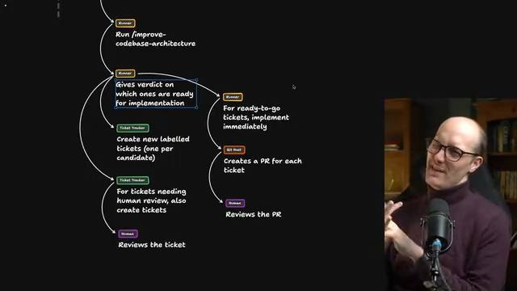

**加速器**：循环频率（一天一次 → 一天多次）、停止阈值（5 → 20）、候选数量（单候选 → 多候选）、候选质量门槛（只要强候选）。减速就是把同样几个旋钮往反方向拧。

#### 流程 B：lint rule ratchet

**需求**：把一条新 lint 规则从「只在 staged files 上偶然被 agent 撞见」推广到「整个仓库都被这条规则覆盖」，并且推广过程可评审、可回滚、不重复劳动。

**输入**：Git host 上带 ratchet 标签的 PR；仓库当前的 strict lint 结果。

**触发**：orchestrator 每天循环一次。

**步骤**：

1. orchestrator 从 Git host 拉取所有与 ratchet 相关的 PR。
2. 如果已有 PR 数 > 5，停止本轮。
3. 否则创建 runner，在 runner 内运行 strict lint 规则集，收集所有失败。
4. 选一个失败，修掉它。
5. 在 Git host 开 PR，打上 ratchet 标签。标签的目的有两个：人类能按标签筛出这批 PR；下一轮拉取时能用标签去重。
6. 人类评审并合并 PR。

**毕业步骤**：如果跑 strict lint 时某条规则没有任何失败，说明它已经可以进入 strict 集合。此时开一个 graduation PR，把该规则从 `lint all` 挪到 `lint strict`，人类合并后棘轮就紧一格。长期目标是 `lint all` 与 `lint strict` 等价，最后删掉 `lint all`。

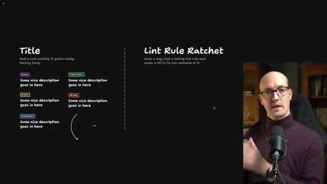

**加速器**：循环频率（一天一次 → 一天四次）、PR 上限（5 → 10）、每次修复的失败数（1 → 5，每个失败单独开 PR、单独评审）、把 PR merge 事件接成第二个触发器，合并后立刻再跑一轮。

**去重**：靠 ratchet 标签拉取已有 PR；如果同一个规则已经有开放 PR，就不要再开第二个。

**人类不评审怎么办**：PR 会堆到上限，达到上限后循环自动停。这就是讲师的刹车。

#### 流程 C：Auto Rebase

**需求**：每天固定时间把与 base 分支过期的 PR 全部 rebase 一遍，让开发者早上打开 PR 列表时看不到 merge conflict。

**输入**：Git host 上被标记为与 base 有过期/冲突的 PR。

**触发 1**：orchestrator 每天 midnight 循环。讲师假设 midnight 对同一时区的团队是安全窗口，CI 也比较空闲；他也说如果设计得足够安全，白天跑也可以。

**触发 2**：给某个 PR 打标签，orchestrator 收到后为该 PR 调度 runner。这样开发者不必等到 midnight。

**步骤**：

1. orchestrator 从 Git host 拉取过期 PR。
2. orchestrator 计数，并为每个未阻塞的 PR 调度一个 runner。
3. runner 内先用脚本做确定性 rebase，此阶段不涉及 agent。
4. 如果脚本成功，直接 force push with lease 回 Git host，流程结束，不消耗 token。
5. 如果脚本出现冲突，在同一 runner 内启动 agent 修冲突。
6. agent 修好后，同样 force push with lease。
7. 如果 agent 也修不好，或者判断 PR 已被 main 上的新工作取代，就在 ticket tracker 建 issue 交给人类，同时在 Git host 给该 PR 打 blocked 标签。
8. orchestrator 下一轮只调度 unblocked 的 PR。

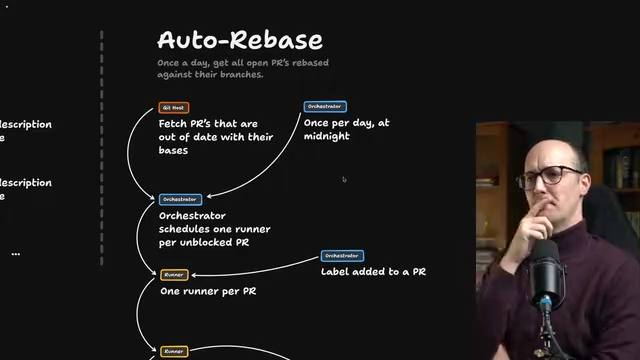

**为什么一个 PR 一个 runner**：讲师说即使只跑脚本 rebase，也需要把代码取下来才能验证 rebase 是否成立；runner 本身很便宜，所以选了「一个 PR 一个 runner」这个简单做法，并自称是「lazy man's thing」。

**加速/减速**：循环频率（每天 → 每几天/每周）、启动条件（比如只有积压到一定数量才跑）、每轮拉取的 PR 数量上限。讲师认为这个流程的调速旋钮主要就是循环频率和拉取数量。

#### 流程 D：慢查询治理

**需求**：把数据库慢查询监控的告警接进工厂，自动分组、去重、评级，并对严重问题提出修复 PR。

**输入**：慢查询监控产生的外部告警。

**触发**：orchestrator 每天从队列拉取告警，或者直接调第三方服务的 API 拉取最近的慢查询；也可加「积压 > 40 条告警」作为启动条件。

**步骤**：

1. 告警先进入某个队列，而不是直接 push 给 orchestrator。队列可以是数据库，也可以是第三方服务自己的存储；讲师举例说如果用 PlanetScale，可以直接调它的 API 问最近有哪些慢查询。这里的关键是**pull 而不是 push**。
2. orchestrator 按节奏从队列/API 拉取告警。
3. 创建一个 runner，对告警做分组，找出可能是同一底层问题的告警。
4. 同一个 runner 或后续步骤里拉取已有的慢查询 ticket，用于去重：已经有 ticket 的告警不再重复建。
5. 对每个告警组在 ticket tracker 建 ticket，并打标签。
6. 分组 runner 把结果报回 orchestrator。
7. orchestrator 对每个「还没有 PR」的 ticket 启动修复 runner；修复 runner 找到修复方案、开 PR，并更新已有 ticket，而不是再建一个新 ticket 解释修复。
8. 可选加入 severity verdict：分组 runner 给每组一个 severe 或 mild 的判断；orchestrator 只对 severe 的 ticket 启动修复 runner。这样 ticket tracker 不会被大量无关紧要的慢查询塞满。

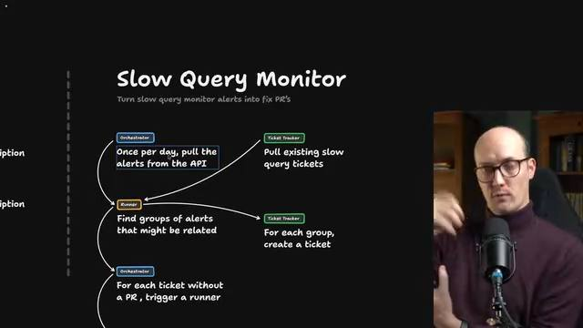

**加速器**：拉取频率（一天一次 → 一天两三次）、积压阈值（> 40 条告警才启动）、severity 门槛（mild 不修）。**去重**：已有慢查询 ticket 参与过滤；标签用于按来源筛 ticket。

#### 流程 E：原型迭代

**需求**：让非技术同事通过 ticket tracker 就能反复迭代一个可点击的原型，最终把原型作为详细 spec 交给工程流程。

**入口 1**：explore runner 在探索 feature request 时给出第三个 verdict「需要原型」。原来的两个 verdict 是「简单，直接 implement」和「复杂，发评论等人类输入」；现在多出「需要视觉原型才能把讨论推进下去」。

**入口 2**：人类在 ticket tracker 给某个 issue 打 `needs prototype` 标签。讲师加这个 watcher 的原因是：不能只允许 agent 决定要不要原型，人类也要有直接入口。

**步骤**：

1. orchestrator 识别上述两种信号之一，启动 prototype runner。
2. prototype runner 执行 create 或 update 原型。runner 名字里带「create/update」，因为它可能是在改已有原型。
3. 原型需要部署到某个可访问的地方，否则非技术同事看不了。部署这一步是讲师明确提出的。
4. 原型代码放在 draft PR 里，并打上特定标签，提醒大家不要直接合并。
5. 只有原型真正创建成功后，才在 ticket tracker 发评论，附上原型链接。顺序不能反：先有产物，再通知人。
6. 人类打开部署好的原型点击体验，在 ticket tracker 里发后续评论，并显式 tag agent。
7. orchestrator 收到带 tag 的评论，启动下一轮 prototype runner。
8. 下一轮 runner 的输入包括：已有原型、目前为止的所有评论。评论串就是对话历史，也是重建/修改原型的依据。
9. 循环直到人类满意；满意的原型作为 spec 进入正式开发流程。

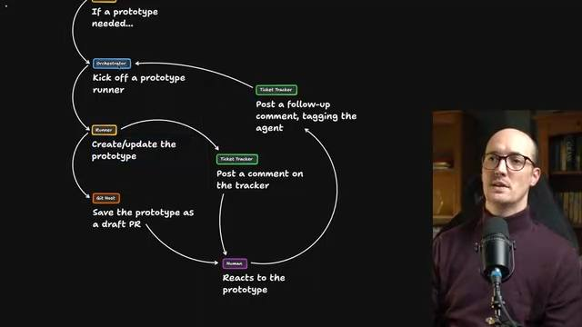

**orchestrator 需要区分的两种信号**：ticket 上完全没有原型 → 走 create；ticket 上已有原型和评论 → 走 update。讲师说这需要 orchestrator 稍微聪明一点，但他自己实现过几次，认为并不难。

**边界**：原型不是生产代码。讲师明确说它更像「非常详细的 spec」，应当经过正式 code review，必要时做 grilling 或 wayfinding，不能直接进生产。

## 4. 完整代码

> 说明：P90–P100 是纯设计课，逐字稿里没有业务代码，也没有给出 orchestrator 的实现。因此本章**不提供生产代码**，而是把讲师的设计落成四类可直接使用的产物：设计决策表、组件职责表、接口/数据模型草案、容量估算表。最后附一个完整可运行的示意文件，用来验证「停止条件 + 标签过滤」这两个贯穿全节的核心逻辑。该文件标注为「课里没有代码，以下为示意」，其中的字段名是本文为了表达设计而起的，不是课程里出现过的字段名。

### 4.1 设计决策表

| 编号 | 流程 | 决策 | 替代方案 | 为什么不选替代方案 | 依据 |
|---|---|---|---|---|---|
| D1 | 全部 | 每个步骤都标注执行位置（ticket tracker / orchestrator / runner / Git host / human / queue） | 只画动作、不画位置 | 不标位置就无法判断哪一段要消耗 runner、哪一段要走 API、哪一段要人 | p090 [02:34] |
| D2 | 改进架构 | 用来源标签拉取已有 ticket 做去重 | 用关键词搜索已有 ticket | 标签是稳定的结构化信号，关键词会误伤也会漏 | p092 [01:18] |
| D3 | 改进架构 | 默认 stop if > 5 existing tickets | 不设上限 | 人类一旦没空评审，工厂会无限产 ticket，重复同一建议 | p092 [01:47] |
| D4 | 改进架构 | 默认把多候选收窄成单候选 | 每个候选各开一个 ticket | 多候选会让 ticket 量翻几倍；讲师给的替代做法是把阈值提到 20 | p092 [02:01] |
| D5 | 改进架构 | 保守方案：人类先评审 ticket 再实现 | 激进方案：runner 给 verdict 后直接实现开 PR | 激进方案吃上下文，refactor 容易在 dumb zone 里做大量工作 | p092 [03:40] |
| D6 | lint ratchet | 每天只修一个失败、开一个 PR | 一次修一批 | 小 PR 好评审、好回滚，符合「先慢后快」 | p093 [00:28] |
| D7 | lint ratchet | 维护 `lint all` 与 `lint strict` 两个集合 | 一个集合直接全开 | 新规则还不能全仓通过时，全开会让 CI 永远红 | p094 [02:15] |
| D8 | lint ratchet | 规则零失败时开 graduation PR 把它挪进 strict | 手动改配置 | 毕业也需要评审记录，PR 是最自然的审计线索 | p094 [02:43] |
| D9 | Auto Rebase | 先脚本 rebase，冲突才叫 agent | 直接叫 agent | 确定性路径能省 token，很多 PR 只需要脚本 | p095 [00:41]、p096 [01:07] |
| D10 | Auto Rebase | force push with lease | 普通 force push | 只有在该 PR 自本轮读取后没人推过时才落地，避免覆盖别人的提交 | p096 [01:36] |
| D11 | Auto Rebase | 一个 PR 一个 runner | 一个 runner 处理多个 PR | 需要代码在本地验证 rebase；runner 便宜；一对一简单 | p096 [03:49] |
| D12 | Auto Rebase | 失败时建 ticket + 给 PR 打 blocked | 只在 PR 上留言 | 双写状态，人在两个界面都能看到；orchestrator 也能用 blocked 过滤 | p096 [02:52] |
| D13 | 慢查询 | 告警先进队列，orchestrator pull | orchestrator 被 push 告警 | push 模式下工厂控制不了节奏，100 条告警就是 100 个 runner | p098 [00:29] |
| D14 | 慢查询 | 先分组再建 ticket，并查已有 ticket 去重 | 每条告警建一个 ticket | ticket tracker 会被同一问题的几十条告警塞满 | p098 [01:26] |
| D15 | 慢查询 | 分组 runner 给 severity verdict，只修 severe | 所有 ticket 都修 | 数据增长会让很多慢查询变严重，mild 的先观察即可 | p098 [03:12] |
| D16 | 原型 | 原型代码放 draft PR 并打「不要合并」标签 | 直接开普通 PR | 原型是 spec，不是生产代码，必须显式阻止误合并 | p100 [00:32] |
| D17 | 原型 | 人类评论必须显式 tag agent | 任何评论都触发 runner | 不 tag 就无法区分闲聊和修改指令，会烧掉大量 token | p100 [01:30] |
| D18 | 原型 | orchestrator 要区分「无原型」和「已有原型」两种信号 | 统一走 create | update 需要把已有原型和评论历史一起作为输入 | p100 [01:51] |
| D19 | 全部 | 每个流程都留人类评审点 | 全自动 | 人类是安全阀；停止条件失效时，人是最后一道闸 | p091 [01:12]、p096 [04:38] |
| D20 | 全部 | 用循环频率 + 停止阈值作为加速/减速旋钮 | 只改代码逻辑 | 这两个参数不需要改流程结构，调数字就能调速 | p092 [02:49]、p094 [00:35] |

### 4.2 组件职责表

| 组件 | 职责 | 输入 | 输出 | 典型失败模式 |
|---|---|---|---|---|
| ticket tracker | 人机任务与对话界面；触发源；去重依据 | 人类打的标签、评论、agent 写的评论 | 标签事件、评论事件、ticket 状态 | 与 Git host 状态不同步；标签命名不统一 |
| orchestrator | 跑定时循环；接收 ticket/Git host 事件；调度 runner；执行停止条件；把结果写回 ticket/Git host | 时间、标签事件、评论事件、merge 事件、runner 回报 | runner 调度、ticket、PR、标签 | 事件重复触发；停止条件算错；状态回写失败 |
| runner | 一次性执行机器；跑具体 task | 代码、ticket、PR、告警、已有原型、评论历史 | verdict、报告、PR、评论、部署链接 | 上下文超限；任务中途失败；产出无人接收 |
| Git host | PR、分支、merge、force push、label 的所在处 | runner 推送的分支与 PR 操作 | PR 状态、merge 事件、label 事件 | force push 覆盖他人提交；label 与 ticket 不一致 |
| queue / 第三方 API | 缓冲突发外部告警，提供 pull 接口 | 监控系统写入的告警 | 按需拉取的告警批次 | 队列积压；重复告警；第三方限流 |
| human | 评审 ticket/PR；给原型反馈；决定是否加速 | ticket、PR、原型部署链接 | 标签、评论、merge/reject | 响应慢导致 backlog 打满停止条件 |
| prototype 部署环境 | 让非技术同事能看到可点击原型 | 原型代码 | 可访问链接 | 权限、链接过期、部署失败但评论已发出 |

### 4.3 接口与数据模型草案

> 以下类型是本文为表达设计而写的草案，**不是课程里给出的字段名**；真实接入时以各平台 API 文档为准。

```ts
// 课里没有代码，以下为示意：软件工厂设计草案的类型定义
// 文件建议路径：software-factory-design/flows/types.ts

type FlowId =
  | "improve-codebase-architecture"
  | "lint-rule-ratchet"
  | "auto-rebase"
  | "slow-query"
  | "prototype-loop";

type TriggerKind = "schedule" | "ticket-label" | "pr-label" | "pr-merge" | "comment-tag";

interface Trigger {
  kind: TriggerKind;
  // schedule 用 cron 字符串或间隔描述；课里没讲具体调度实现
  schedule?: string;
  label?: string;
}

interface StopCondition {
  // 例：已有带某标签的 ticket 数 > 5 就停
  resource: "tickets" | "pull-requests" | "alerts";
  label: string;
  max: number;
}

interface FlowSpec {
  id: FlowId;
  triggers: Trigger[];
  stopConditions: StopCondition[];
  // 每一步写清执行位置，对应白板上的「步骤 + 位置」
  steps: Array<{
    name: string;
    where: "ticket-tracker" | "orchestrator" | "runner" | "git-host" | "queue" | "human";
durch  }>;
}

interface RunnerResult {
  flowId: FlowId;
  verdict?: "simple" | "complex" | "needs-prototype" | "severe" | "mild" | "ready" | "blocked";
  createdTickets?: string[];
  createdPullRequests?: string[];
  comment?: string;
  error?: string;
}
```

上面这段 TS 里有几处**故意留空或未定**的地方需要说明：`steps` 数组的每一项只要求 name 和 where，因为课里没有规定步骤之间的数据结构；`RunnerResult.verdict` 把所有流程可能用到的 verdict 放在一个联合类型里，是本文的简化，真实实现应按流程拆成不同结果类型。示意代码不追求编译通过，只追求把设计说清楚。

### 4.4 容量估算表

| 流程 | 默认配置 | 加速配置 | 一天最多新增 | 积压上限 |
|---|---|---|---|---|
| 改进架构（保守） | 1 次/天，1 候选/次，>5 ticket 停 | 多次/天，多候选，>20 停 | 1 ticket | 5 |
| 改进架构（激进） | — | 3–6 候选/天 | 6 ticket 或 6 PR | 20 |
| lint ratchet | 1 次/天，修 1 个，>5 PR 停 | 4 次/天，修 5 个/次，>10 PR 停 | 1 PR | 5（加速后 10） |
| Auto Rebase | midnight 1 次，全部过期 PR | 加 PR label 触发 | 过期 PR 数（100 PR 即 100 runners） | 无固定上限，靠 blocked 标签收敛 |
| 慢查询 | 1 次/天 pull，>40 告警才启动 | 2–3 次/天 | 1 个分组 runner + 严重组的修复 runner 数 | ticket 数 ≈ 告警组数 |
| 原型 | 每次带 tag 评论触发 | 无（人类节奏决定） | 评论数 | 课里没讲，建议自己设轮次上限 |

### 4.5 示意文件：orchestrator 循环骨架

> **课里没有代码，以下为示意。** 这段代码不接任何真实 API，只用内存中的数据模拟五个流程的「停止条件 + 标签过滤 + 决策输出」，目的是让你把设计落成一个能跑的对象，验证自己对阈值的理解。真实 orchestrator 需要接 ticket tracker、Git host、队列，这些接口课里没讲，需要你自己选。

保存为 `software-factory-design/orchestrator-demo.mjs`，用 `node orchestrator-demo.mjs` 运行，无第三方依赖。

```js
// software-factory-design/orchestrator-demo.mjs
// 课里没有代码，以下为示意：用内存状态模拟 P90–P100 的五个流程决策。
// 字段名是本文为表达设计而起的，不是课程里出现过的字段名。

const flows = [
  {
    id: "improve-codebase-architecture",
    trigger: { kind: "schedule", every: "1d" },
    stop: { resource: "tickets", label: "arch-improvement", max: 5 },
    candidatesPerRun: 1,
  },
  {
    id: "lint-rule-ratchet",
    trigger: { kind: "schedule", every: "1d" },
    stop: { resource: "pull-requests", label: "ratchet", max: 5 },
    fixesPerRun: 1,
  },
  {
    id: "auto-rebase",
    trigger: { kind: "schedule", every: "1d" },
    stop: null, // 讲师没有给固定停止阈值，靠 blocked 标签和拉取数量收敛
    runnersPerPullRequest: 1,
  },
  {
    id: "slow-query",
    trigger: { kind: "schedule", every: "1d", alsoWhenAlertsGt: 40 },
    stop: null,
    severityGate: "severe",
  },
  {
    id: "prototype-loop",
    trigger: { kind: "comment-tag" },
    stop: null, // 人类节奏决定，课里没讲上限
    modes: ["create", "update"],
  },
];

// 模拟 orchestrator 看到的当前状态。真实实现里这些数字来自 API 查询。
const state = {
  tickets: {
    "arch-improvement": 2,
    "slow-query": 7,
  },
  pullRequests: {
    ratchet: 4,
    blocked: 1,
  },
  alerts: 12,
  openPullRequestsOutOfDate: 3,
};

function countLabeled(kind, label) {
  if (kind === "tickets") return state.tickets[label] ?? 0;
  if (kind === "pull-requests") return state.pullRequests[label] ?? 0;
  return 0;
}

function decide(flow) {
  if (flow.stop) {
    const count = countLabeled(flow.stop.resource, flow.stop.label);
    if (count > flow.stop.max) {
      return { action: "stop", reason: `已有 ${count} 个带 ${flow.stop.label} 标签的 ${flow.stop.resource}，超过上限 ${flow.stop.max}` };
    }
  }
  switch (flow.id) {
    case "improve-codebase-architecture":
      return { action: "spawn-runner", task: "improve codebase architecture", createTickets: flow.candidatesPerRun };
    case "lint-rule-ratchet":
      return { action: "spawn-runner", task: "strict-lint-and-fix", fixCount: flow.fixesPerRun };
    case "auto-rebase":
      return {
        action: "spawn-runners",
        onePerPullRequest: true,
        count: Math.max(0, state.openPullRequestsOutOfDate - state.pullRequests.blocked),
        firstStep: "script-rebase",
        fallback: "agent-fix-conflicts",
        push: "force-with-lease",
      };
    case "slow-query":
      return {
        action: "pull-then-spawn-runner",
        source: "queue-or-api",
        groupAlerts: true,
        dedupeAgainstTicketsLabeled: "slow-query",
        severityGate: flow.severityGate,
      };
    case "prototype-loop":
      return { action: "wait-for-tagged-comment", modes: flow.modes };
    default:
      return { action: "noop" };
  }
}

for (const flow of flows) {
  const result = decide(flow);
  console.log(flow.id, "=>", JSON.stringify(result));
}
```

运行输出（字段名是上面这份示意代码自己定义的，不是课程里的字段）：

```text
improve-codebase-architecture => {"action":"spawn-runner","task":"improve codebase architecture","createTickets":1}
lint-rule-ratchet => {"action":"spawn-runner","task":"strict-lint-and-fix","fixCount":1}
auto-rebase => {"action":"spawn-runners","onePerPullRequest":true,"count":2,"firstStep":"script-rebase","fallback":"agent-fix-conflicts","push":"force-with-lease"}
slow-query => {"action":"pull-then-spawn-runner","source":"queue-or-api","groupAlerts":true,"dedupeAgainstTicketsLabeled":"slow-query","severityGate":"severe"}
prototype-loop => {"action":"wait-for-tagged-comment","modes":["create","update"]}
```

这份输出可以直接拿来对照你的白板：如果某个流程的白板上没有写 stop condition、没有写 queue、没有写 force-with-lease，那就说明画漏了。

## 5. 逐行解释

### 5.1 设计决策逐条解释

**D1 每个步骤标注执行位置。** 因为「在 runner 上做」意味着要起机器、要拉代码、要花 token；「在 ticket tracker 上做」意味着调用工单 API；「在 human 上做」意味着流程会暂停。不标位置，画出来的图看着完整，实际无法估算成本和延迟。讲师在 p090 示范 explore 流程图时，每个框都对应一个位置，这是本节的画法基础。

**D2 用来源标签去重。** 改进架构的 skill 每次都会重新分析仓库，如果不告诉它「哪些建议已经提过」，它就会换个措辞再提一遍。标签是结构化、稳定、可查询的；用自然语言相似度去重既不精确也不可靠。这条同样适用于 lint ratchet 的 PR 去重和慢查询的 ticket 去重。

**D3 默认阈值为 5。** 讲师原话是 stop if there are greater than five existing tickets。这个数字不是魔法数字，它的含义是「一个人一天能认真评审的 ticket 大概就是这个量级」。超过就说明人在掉队，此时继续生产只会制造垃圾 backlog。把阈值设小，是为了先观察工厂是否正常工作；等人类跟得上，再调大。

**D4 多候选收窄成单候选。** `improve codebase architecture` 按 skill 描述输出的是多个候选的 HTML 报告。如果照原样每个候选开一个 ticket，一天的产出可能是 3–6 个 ticket，5 的阈值三四天就打满。收窄成一个候选是最保守的起点；如果选择多候选，就必须同时把阈值从 5 提到 20，否则流程第二天就停。

**D5 保守方案优先。** 激进方案让 runner 自己判断 ready 并直接实现，省掉了人类评审 ticket 的一步，但 refactor 类改动通常很大、很吃上下文。讲师明确担心 context window 限制和 dumb zone。保守方案把「判断是否值得做」交给人，把「怎么做」交给 agent，这样每一段都在各自擅长的范围内。

**D6 每天只修一个失败。** lint ratchet 的价值在于「棘轮只能往一个方向转」：每天紧一格，规则迟早覆盖全仓。一次修一大批会让 PR 巨大、评审困难、冲突概率上升，反而不容易合并。小步快跑是这类推广工作的通用做法。

**D7 维护两个 lint 集合。** 新规则刚引入时全仓大概率有几百个失败，直接塞进 CI 会让所有人的 PR 都红。分成 `lint all`（包含已知失败）和 `lint strict`（只跑预期能过的）之后，CI 保持绿色，同时棘轮有明确的迁移目标：把规则从 all 搬到 strict。

**D8 毕业也要开 PR。** 规则从 all 挪到 strict，本质上是修改 lint 配置。配置变更是代码变更，应该有 diff、有评审、有回滚点。如果让脚本直接改配置，出问题时很难知道是哪一天、哪一条规则导致的。

**D9 脚本优先。** Auto Rebase 里大量 PR 只是分支落后于 base，脚本 rebase 就能解决，完全不需要 agent。讲师的原则是「有确定性方案就先试确定性方案」。这既省钱，也降低不确定性：脚本的行为是可预测的，agent 的行为不是。

**D10 force with lease。** rebase 之后必须改写分支历史，普通 force push 会无条件覆盖远端。如果在你读取 PR 之后、推送之前，别人往这个分支推了提交，普通 force push 会把他的提交抹掉。force with lease 把「我读到的远端版本」作为前提，版本变了就拒绝推送。在前端/Node 语境里，这等价于乐观锁：先读 version，再带 version 写回，版本不匹配就失败重试。数据库里对应 `UPDATE ... WHERE version = ?`。

**D11 一个 PR 一个 runner。** 讲师说即使只跑脚本也需要代码在机器上，才能验证 rebase 是否成立；runner 很便宜，所以没必要为了省机器把多个 PR 塞进一个 runner 再引入并发和隔离问题。代价是 100 个过期 PR 会起 100 个 runner，峰值高，但每个 runner 的生命周期很短。

**D12 失败时双写状态。** 只在 PR 上打 blocked，ticket tracker 里的人看不到；只在 ticket tracker 建 issue，扫 PR 列表的人看不到。两边都写，人才不会漏；orchestrator 也能用 blocked 标签做过滤，避免每轮重复处理同一个失败 PR。讲师还提醒：如果 ticket tracker 和 Git host 是两个系统，状态同步本身就是一个要专门处理的问题。

**D13 告警先入队。** 这是全节最重要的架构判断之一。push 模式下，外部系统的告警频率决定 runner 数量，工厂没有任何刹车；pull 模式下，工厂自己决定什么时候拉、拉多少、要不要按积压阈值启动。讲师甚至说，如果第三方服务本身提供 API，可以完全不要队列，直接定时调 API 拉最近的慢查询。

**D14 先分组再去重再建 ticket。** 慢查询告警的特点是同一个 SQL 可能每分钟报一次。如果一条告警一个 ticket，ticket tracker 当天就被淹没。分组把「同一底层问题」合并成一个 ticket；查已有 ticket 则跨天去重，避免昨天建过今天再建。

**D15 severity verdict。** 数据量增长会让一些原本 mild 的慢查询变 severe，所以评级应该在每次分组时重新做，而不是建 ticket 时定死。orchestrator 只对 severe 启动修复，等于给工厂加了一层按业务影响排序的过滤器。这和 explore 流程里的 verdict 是同一个模式：runner 不只产出动作，还产出判断。

**D16 draft PR + 禁止合并标签。** 原型代码是给人看的，不是给人 merge 的。draft 状态和标签是两个冗余的保护，任何一个生效都能阻止误合并。讲师强调原型更像详细 spec，正式实现仍要走正常流程。

**D17 评论必须显式 tag。** 原型 ticket 下的评论可能是「好看」「再大一点」「我先想想」这种不需要动作的内容。如果每条评论都触发 runner，成本和噪声都不可控。显式 tag 相当于一个明确的行为信号：这条评论要求 agent 动手。

**D18 create 与 update 分开。** 首次创建原型的输入是 feature 描述；更新原型的输入是已有原型加评论历史。两者上下文不同，prompt 也应该不同。讲师把这个区分称为 orchestrator 需要「稍微聪明一点」的地方，但也说实现起来并不难。

**D19 人类评审点。** 五个流程没有一个允许 agent 直接合并到 main。改进架构要人评审 ticket 或 PR；lint ratchet 要人合并 PR；Auto Rebase 失败要人处理 ticket；慢查询的修复 PR 要人看；原型要人点击体验。人类不是流程外的旁观者，而是流程内的一个执行位置。

**D20 加速旋钮。** 讲师反复用「turn up / turn down」描述调速，说明他刻意把速度做成参数而不是逻辑分支。参数化的好处是不改流程结构就能试：今天嫌快就把阈值调小，明天嫌
慢就把循环频率调高、把阈值调大；发现 backlog 卡住不动，就加人类入口、降低每次产出。反过来说，如果速度是写死在逻辑里的，每次调速都要改流程本身、重新评审一遍流程，那「先慢后快」就变成一句口号。本节的五个流程都刻意把速度留在 trigger 和 stop condition 这两个位置，就是为了让调速不碰流程主干。

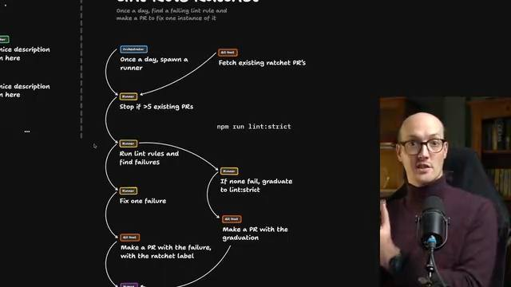

### 5.2 示意代码逐行解释

这段代码只是第 4 章那个 demo，**它不是课程产物**，逐行解释的目的是让你在抄自己版本时知道哪些行是有设计依据的、哪些行是我为了把 demo 跑起来补的。

**`const flows = [ ... ]`**

整份文件把五个流程写成一份声明式数组，而不是五段 if/else 业务代码。对应 D20：速度参数化。每个对象的字段在一开始就暴露出来——`trigger`、`stop`、以及各自的旋钮（`candidatesPerRun`、`fixesPerRun`、`runnersPerPullRequest`、`severityGate`、`modes`）。如果你把阈值写进某个函数深处，调阈值就等于改代码；写成字段，调阈值只是改一个数字。

**`id: "improve-codebase-architecture"` 与 `stop: { resource: "tickets", label: "arch-improvement", max: 5 }`**

这三个字段对应讲师在 p092 给的三要素：查的是哪种资源（ticket 还是 PR）、按什么标签筛、上限多少。讲师原话是 "如果现有工单超过五个，就停止。"，所以资源是 tickets、上限是 5。`label: "架构改进"` 是我起的标签名（课里只说「应该打一个标签，说明它来自 improved codebase architecture 流程」，没给具体字符串），你复现时换成自己团队的命名即可，但**一旦定了就不要中途改**，因为去重完全依赖它。

**`candidatesPerRun: 1`**

对应 D4。讲师说这个 skill 输出的是多个候选的 HTML 报告，保守做法是收窄成一个。写成一个字段而不是注释，是为了让「我今天想试多候选」变成改数字，同时提醒你要一起改 `stop.max`（5 → 20）。

**`id: "lint-rule-ratchet", stop: { ..., label: "ratchet", max: 5 }, fixesPerRun: 1`**

`label: "ratchet"` 来自讲师说的「PR 带上 ratchet 标签，这样它就能出现在 runner 的拉取结果里」。`max: 5` 对应讲的 "如果现有 PR 超过五个，就停止。"。`fixesPerRun: 1` 是 D6 的「每天只修一个失败」。

**`id: "auto-rebase", stop: null`**

这里我**故意没有填数字**。讲师在 p096 讨论加速时说这个流程能调的「主要就是循环频率和拉取数量」，并没有给出一个类似「超过 N 个就停」的硬阈值，他说的是「只 fetch 一定数量的相关 PR」，那算是刹车，但不是 ticket/PR 计数意义上的 stop condition。所以 demo 里留 null，并在注释里写明「靠 blocked 标签和拉取数量收敛」。这是本文对「不许编造」这条规则的具体执行：讲师没给的数字，我不替他发明一个好看的默认值。

**`id: "slow-query", trigger: { kind: "schedule", every: "1d", alsoWhenAlertsGt: 40 }, severityGate: "severe"`**

`alsoWhenAlertsGt: 40` 直接来自 p098 [02:02] 的 "也许是在告警超过 40 条的时候。"。`severityGate: "severe"` 来自 D15：orchestrator 只对 severe 启动修复。注意这里没有 `stop` 字段——讲师对慢查询流程的刹车是「severity 过滤 + 拉取频率 + 积压阈值」，不是「ticket 数超了就停」，所以硬塞一个 max 反而不忠于原设计。

**`id: "prototype-loop", trigger: { kind: "comment-tag" }, stop: null, modes: ["create", "update"]`**

`comment-tag` 对应「人类在评论里显式 tag agent」。`stop: null` 因为课里确实没讲迭代轮次上限——这是第 7 章要提醒你补的地方。`modes` 两个值对应讲师说的「orchestrator 要能接收两种信号：已有原型和完全没有原型」。

**`const state = { ... }`**

真实实现里这三块 state 都应该来自 API 查询：`tickets` 来自 ticket tracker，`pullRequests` 来自 Git host，`alerts` 来自队列或第三方 API，`openPullRequestsOutOfDate` 来自 Git host 的 PR 列表。demo 写成常量是为了让文件零依赖、可反复运行、结果可手算验证。`"架构改进": 2` 表示当前积压 2 个，还没到 5，所以应该放行；`"ratchet": 4` 同理放行；`blocked: 1` 表示有 1 个 PR 被标成 blocked。

**`function countLabeled(kind, label)`**

把「不同资源怎么计数」集中到一个函数里，是为了让 `decide` 保持纯决策。`state.tickets[label] ?? 0` 里的 `?? 0` 不是可选的：如果某个标签从来没出现过，直接拿 `undefined` 去和 `max` 比较，`undefined > 5` 会得到 false，看起来「恰好正确」，但只要逻辑改成 `>=` 或者取反，就会静默出错。显式归零是让这类边界错误变成不可能。

**`function decide(flow)`**

第一个分支永远是 stop condition，这是刻意的顺序：讲师在每个流程里都把「拉取已有产物 → 判断是否超限 → 才起 runner」放在最前面。如果先起 runner 再判断超限，你已经付了 token 才发现该停，等于刹车装在油门上。

**`if (count > flow.stop.max)`**

用的是严格大于，不是大于等于。因为讲师原话是 "超过五个"，所以 5 个仍然放行，第 6 个才停。这是全套代码里最容易写错的一个符号：写成 `>=` 就等于把阈值从 5 悄悄改成 4，而你的白板上还写着 5。这个边界值得单独写一条测试。

**每个 `case` 只 `return` 一个 action 对象，不做实际执行**

`decide` 不创建 runner、不调 API、不写 ticket，只输出「应该做什么」。这样你可以把它当纯函数做表驱动测试：喂一组 state，断言输出。真正的执行层（起 runner、调 ticket tracker、调 Git host）被隔离在外面，课里没讲这层怎么写，但这样分层至少让决策部分变得可验证。

**`count: Math.max(0, state.openPullRequestsOutOfDate - state.pullRequests.blocked)`**

对应 D12 里 orchestrator「只调度 unblocked 的 PR」。用 `Math.max(0, ...)` 是因为 3 个过期 PR 里有 1 个 blocked、剩 2 个，但如果某天 blocked 数大于过期数（比如 blocked 是历史累计、过期是当次筛选），减法会得出负数，负数 runners 会在下游变成「什么都不做」或者更难查的报错。夹到 0 是廉价的防御。

**`push: "force-with-lease"`**

把安全要求写进决策对象，而不是写在文档的注意事项里。写成字段的意义是：执行层拿到这个对象时，推送方式不是一个可以自由发挥的参数，而是决策的一部分。讲师说 "这次强制推送始终使用 --force-with-lease。"，这个 always 就值得占一个字段。

**`case "slow-query"` 里的 `dedupeAgainstTicketsLabeled: "slow-query"`**

D14 的落点。它明确告诉执行层：建 ticket 之前先按这个标签查已有 ticket。如果只写 `groupAlerts: true` 而不写去重依据，实现者很可能只做了「组内去重」，漏掉「跨天去重」，于是同一个问题每天一个新 ticket。

**`case "prototype-loop"` 返回 `wait-for-tagged-comment`**

这一条和另外四条形态不同：它不是「到点了就起 runner」，而是「等一个带 tag 的评论事件」。把它也放进同一个 `decide` 里，是为了让读者看到 orchestrator 的两种驱动方式（定时循环 vs 事件驱动）可以共存于同一份流程清单。真实实现里这两类通常走不同的代码路径，课里没讲怎么组织。

**最后的 `for` 循环与 `console.log`**

没有任何副作用，只是把每个流程的决策打出来。这样你可以在没接任何 API 的情况下，先验证「阈值写对了没」。输出里 `auto-rebase` 的 `count: 2`（3 个过期减 1 个 blocked）是可以从 state 手算出来的——如果你改了 state 却发现输出对不上，说明 `countLabeled` 或 `decide` 写错了。

**这段 demo 故意没做的事**（这些都在第 7 章展开）：没有幂等、没有并发控制、没有重试与退避、没有真实 API 调用、没有把失败写回 ticket、没有记录每次 stop 的判定依据。它只验证一件事：**五个流程的刹车和标签过滤，在一份可运行的清单里是否说得通**。

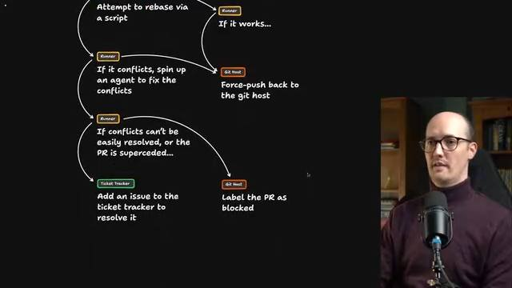

## 6. 复现检查清单

### 6.1 画板环境

- [ ] 从课程页面下方的链接打开了 TLDraw 模板，并确认它是只读的（能复制、不能移动）。
- [ ] 点了左上角三个点，选择了 `copy to my workspace`，副本出现在自己的 workspace 里。
- [ ] 如果过程中要求注册，已完成；课里说 TLDraw 免费。
- [ ] 试过 `Ctrl/Cmd` + 缩放、按住空格拖动、选中后按住 `Alt` 拖动复制这三个操作。
- [ ] 画布上区分了「步骤块」和「执行位置」两类信息，不是只写动作。
- [ ] 没有使用被墙/无法访问的链接；本文没有给出模板 URL，因为逐字稿没记录，你用的是课程页面提供的那一个。

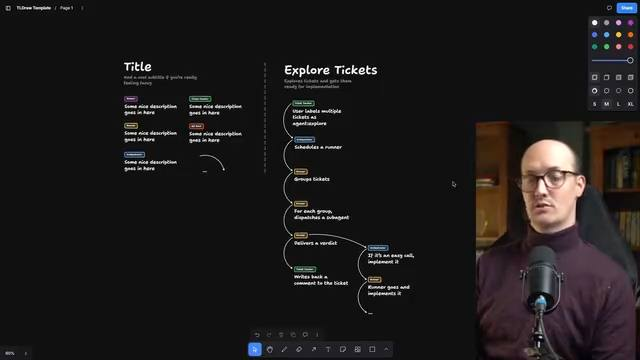

### 6.2 目录与文件

- [ ] 建了 `software-factory-design/` 目录，内含 `README.md`、`flows/`、`data/`、`assets/screenshots/`。
- [ ] `flows/` 下有五个文件：`01-improve-codebase-architecture.md`、`02-lint-rule-ratchet.md`、`03-auto-rebase.md`、`04-slow-query.md`、`05-prototype-loop.md`。
- [ ] 每个流程文件都至少写了六项：触发源、执行位置序列、stop condition、去重依据、人类接手点、加速旋钮。
- [ ] `orchestrator-demo.mjs` 与第 4 章代码逐字一致（包括 `>` 而不是 `>=`）。
- [ ] 从画板导出的图存进了 `assets/screenshots/`，文件名能对应到流程编号。

### 6.3 五个流程各自的检查项

**改进代码库架构**

- [ ] 触发写成「orchestrator 定时循环，默认一天一次」。
- [ ] 第一步是去 ticket tracker 拉带来源标签的已有 ticket。
- [ ] 有 `> 5` 的停止条件；若选多候选方案，阈值同步改为 `> 20`。
- [ ] runner 内写了「收窄成一个候选」或「每候选一 ticket」二者之一，没有两头都写。
- [ ] 画了 human review ticket 这一步，以及人类打标签后接回 implement 流程的入口。
- [ ] 下游用省略号收尾，没有把 implement 全流程画进本节。
- [ ] 如果画了激进分支，明确标了它的风险：refactor 吃上下文、dumb zone。

**lint rule ratchet**

- [ ] 触发是每天一次。
- [ ] 先拉带 ratchet 标签的已有 PR，再判 `> 5` 停止。
- [ ] runner 内先跑 strict 集合收集失败，再修一个。
- [ ] 开出的 PR 带 ratchet 标签，并说明这个标签同时承担「让人筛选」和「下一轮去重」两个作用。
- [ ] 画了 graduation 分支：某规则零失败时开 PR 把它挪进 strict。
- [ ] 写明长期目标是 `lint all` 与 `lint strict` 等价，最后可删 `lint all`。
- [ ] 写了「人类不合并时 PR 会堆到上限、循环自动停」这个兜底。

**Auto Rebase**

- [ ] 主触发是每天 midnight，并注明「同一时区团队 + CI 较闲」这个前提。
- [ ] 第二个触发是给 PR 打标签。
- [ ] runner 内顺序明确：先脚本确定性 rebase，冲突才起 agent。
- [ ] 两条成功路径都写了 force push with lease。
- [ ] 画了非 happy path：冲突修不掉 / PR 已被取代 → ticket tracker 建 issue + PR 打 blocked。
- [ ] 写清 orchestrator 下一轮只调度 unblocked 的 PR。
- [ ] 写了一个 PR 一个 runner 的理由：验证 rebase 需要代码落地，runner 便宜。

**慢查询治理**

- [ ] 入口画成队列或第三方 API，明确是 pull 不是 push。
- [ ] 写了「朴素 push 会 100 告警变 100 runner」这个反例。
- [ ] orchestrator 按节奏拉取，并有「积压 > 40 告警」这类启动条件。
- [ ] runner 内做了分组 + 查已有慢查询 ticket 去重。
- [ ] 每组建一个带标签的 ticket。
- [ ] 画了 severity verdict（severe / mild），且 orchestrator 只对 severe 起修复 runner。
- [ ] 修复 runner 更新已有 ticket，而不是新建一个「解释修复」的 ticket。

**原型迭代**

- [ ] 画了 explore runner 的第三个 verdict「需要原型」，并说明它与「简单 / 复杂」两个既有 verdict 并列。
- [ ] 画了人类入口：给 issue 打 `needs prototype` 标签。
- [ ] prototype runner 名字是 create **或** update，不是只写 create。
- [ ] 写了原型要部署到可访问位置，非技术同事才看得到。
- [ ] 原型代码放 draft PR，并带「不要合并」类标签。
- [ ] 顺序正确：先创建/部署成功，再在 ticket tracker 发带链接的评论。
- [ ] 人类评论必须显式 tag agent 才触发下一轮。
- [ ] 下一轮 runner 的输入写明「已有原型 + 至今全部评论」。
- [ ] 明确写了原型是 spec 不是生产代码，仍要走正式评审。

### 6.4 示意代码运行检查

- [ ] `node orchestrator-demo.mjs` 能直接跑通，无需安装依赖。
- [ ] 输出五条，顺序与 `flows` 数组一致。
- [ ] `auto-rebase` 的 `count` 等于 `openPullRequestsOutOfDate - blocked`，且不小于 0。
- [ ] 把 `state.tickets["架构改进"]` 改成 6，重跑，第一条应变成 `"action":"stop"`（因为 6 > 5）；改成 5 则应放行。
- [ ] 把 `state.pullRequests.ratchet` 改成 6，重跑，第二个流程应变成 stop；改成 5 应放行。
- [ ] 确认代码里用的是 `>`（严格大于），不是 `>=`。

### 6.5 截图与术语

- [ ] 文档里插入了 ≥ 6 张截图，且每张的 alt 都含 `pNNN` + `MM:SS` + 说明。
- [ ] 截图都来自清单里的帧号，没有自己编帧号。
- [ ] 全文没有把 `runner`、`run`、`task` 三个词混用：runner 是机器，run 是一次执行，task 是执行内容。
- [ ] 没有把课里没提过的工具或字段名安到讲师头上；本文自造的字段都在文中标注了「本文为表达设计而起的」。

## 7. 课里没讲但你会撞上的

这一节列的都是**课程没有覆盖**的内容。逐字稿里讲师只画流程、只讲设计，下面这些是实现阶段必然会碰到的问题，提前知道能少踩一半。

### 7.1 orchestrator 本体没有任何代码

课里反复说「orchestrator 能跑循环」「orchestrator 能监听事件」，但 P90–P100 没有给出 orchestrator 的实现、语言、框架或数据结构。你会撞上的第一个问题就是：这份设计要怎么变成能跑的东西。可行的最小路径是先把 `decide` 这类决策逻辑做成纯函数（第 4 章 demo 就是雏形），再在外面套一层调度的壳。课里没讲这层壳怎么写，需要你自己选。

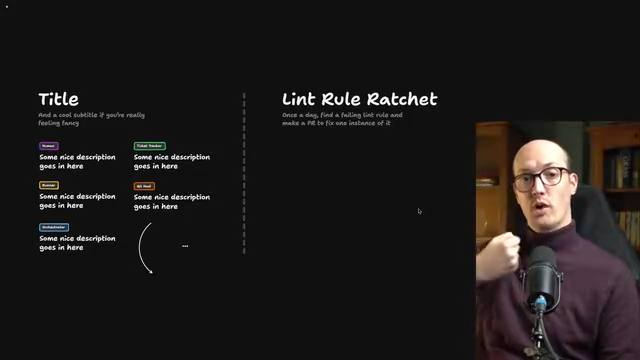

### 7.2 多实例会把「一天一次」跑成两次

课里的图默认只有一个 orchestrator。真实部署里如果有两个副本，两个都会在 midnight 触发，于是同一天开两个 PR、建两批 ticket。这在 JS/Node 里对应的就是分布式锁——单进程内可以用一个模块级标志做单飞（single-flight）防止重入，跨进程就得靠外部锁。课里没讲这一层，但你的停止条件会因此提前打满，看起来像「阈值设错了」，实际是重复触发。

### 7.3 幂等：标签去重挡不住重复投递

课里的去重靠「拉取已有带标签的 ticket/PR」。但事件可能被投递两次：评论事件重发、webhook 重试、runner 失败后重跑。如果你只用「有没有带标签的产物」判断，在「已决定要建、但还没建成」的那个窗口里，第二次触发也会通过检查，于是重复建。常见做法是引入幂等键（例如 flowId + ticketId + 目标对象 id），同一键只处理一次。课里没讲幂等键，node 里比较省事的做法是把键写进一张本地表，写入成功才继续。注意这里说的是「常见做法」，不是讲师讲过的东西。

### 7.4 force with lease 会被分支保护挡住

讲师说 Auto Rebase 的推送「always force with lease」。但如果仓库开了分支保护、禁止 force push，或者 runner 用的 token 没有权限，这条路径会直接失败。课里没讲权限模型和失败后的落点。你需要把「推送被拒绝」也归到非 happy path：建 ticket、打 blocked，而不是让 runner 静默失败——否则第二天早上你会以为一切都 rebase 好了。

### 7.5 显式 tag 的解析规则没定义

「人类在评论里 tag agent」听起来简单，实际要定：tag 的确切写法、大小写是否敏感、一条评论 tag 两个 agent 怎么办、编辑旧评论会不会重触发、非本流程成员 tag 是否生效。前端同学容易低估这块，因为它本质是一个文本协议加权限判断。课里只给了「显式 tag」这个意图，规则要你自己定，并且最好写进流程文档，否则同一个 ticket 下会出现「有人 tag 了但没反应」的困惑。

### 7.6 ticket tracker 与 Git host 的状态同步

讲师在 Auto Rebase 收尾时明确说：如果 ticket tracker 和 Git host 是两个系统（他举了 Linear 和 GitLab 的例子），状态不同步会让人很抓狂。但他没给同步方案。你会撞上的具体情形是「ticket 已经关了，PR 还开着」或者「PR 已 merge，ticket 还在等评审」。你需要先决定谁是 source of truth（通常 PR/merge 是事实源，ticket 是视图），再定补偿逻辑。这一步不做，前面所有 blocked/ratchet/slow-query 标签都会逐渐失真。

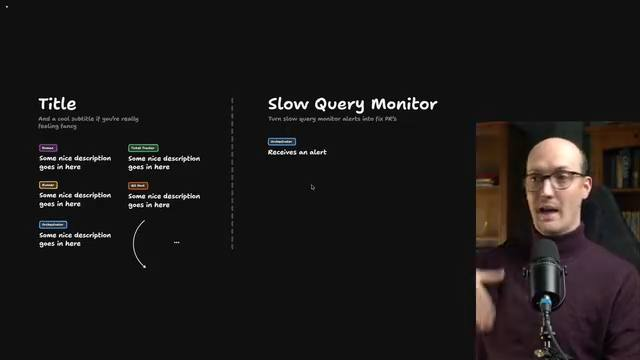

### 7.7 队列的具体形态没定

讲师说队列「可以是数据库，也可以是第三方服务」，还说如果用 PlanetScale 可以直接调 API。但没给 schema、保留期、去重窗口、积压告警的读取量上限。你会撞上两个问题：队列无限增长，以及同一告警在时间窗口边界上被算两次。最小可行方案是给每条告警一个稳定的指纹（同一 SQL + 同一调用点算一条），按指纹在窗口内去重。这部分课里没讲，属于实现细节。

### 7.8 severity 判定会抖动

severity verdict 由 runner 给出，同一组告警今天判 mild、明天判 severe 完全可能，导致 ticket 在「修 / 不修」之间来回跳，甚至同一问题被反复起 runner。课里没讲怎么稳定。可行的做法是把判定标准写进 prompt 并留下每次的判定理由，或者对已经被人钉住严重度的 ticket 跳过自动重判。前端视角可以把它想成「同一个输入要得到同一个输出」，做不到就要加缓存和版本号。

### 7.9 上下文预算没有任何数字

讲师说 refactor 类工作很吃上下文、容易在 dumb zone 里做大量工作，但没有给 token 预算或文件数上限。你会撞上「一个 ticket 要改 40 个文件」这种任务。需要自己定：单 runner 最多碰多少文件、超过就拆成多个 ticket、拆不动就交给人。这条对「改进架构」的激进分支尤其致命，因为它是唯一一个允许 runner 直接实现并开 PR 的流程。

### 7.10 原型的部署是空白

课里说「理想情况下把它部署到某处」，让非技术同事能点开看。但没讲部署到哪、用什么鉴权、链接有效期多久、内网环境外部同事能不能访问。你会撞上的现实问题是：链接发出去了，人点不开。顺序上讲师强调先创建成功再发评论，这个顺序本身就是为部署失败留的余地——部署失败就不该发「来看」的评论。

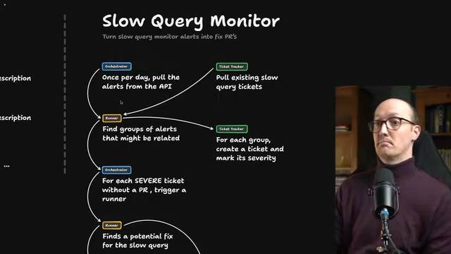

### 7.11 速率限制与成本

课里没讲 Git host API 的速率限制、模型调用配额、失败重试退避。Auto Rebase 的「一个 PR 一个 runner」在 100 个过期 PR 时就是 100 个并发 runner，同时打 Git host API，很容易被限流；限流之后部分 runner 失败，如果没有重试策略，PR 会被漏掉。至少要有并发上限和指数退避，并且把「因限流失败」和「因冲突失败」区分开，它们的处理路径完全不同。

### 7.12 可观性：你怎么知道今天为什么停了

课里所有停止条件都只说了「停」，没说停的时候记录什么。真实运行时，你第二天发现没新 ticket，需要立刻回答：是没到点、是超阈值、是 runner 失败、还是拉取结果为空。建议每次判定都把依据落盘（资源数、标签、阈值、判定结果）。第 4 章 demo 里 `stop` 分支特意带了 `reason` 字段，就是这个意思——课里没讲，但少了它排障会非常痛苦。

### 7.13 测试策略

课里没讲怎么测这些流程。好消息是这些流程的大部分逻辑都是「计数 + 比较 + 分支」，可以做成纯函数测试。必测的边界就是阈值两侧：5 放行、6 停止；10 放行、11 停止。再测 blocked 过滤（过期 3、blocked 1 → 应得 2）和标签缺失（未出现过的标签应视为 0）。把这几条固定下来，你以后调阈值时才有底气。

### 7.14 权限与最小授权

课里没有讨论 agent 应该拿什么权限。现实中这些流程需要：读 ticket、写评论、打标签、建 PR、push 分支、force push、读 PR 列表。全部给最高权限是最省事的做法，也是最危险的。至少要区分「只读的 explore 类 runner」和「能写的 implement/rebase runner」，并让 force push 权限只出现在需要它的流程里。课里没讲，但这是把工厂跑在生产仓库上的前提。

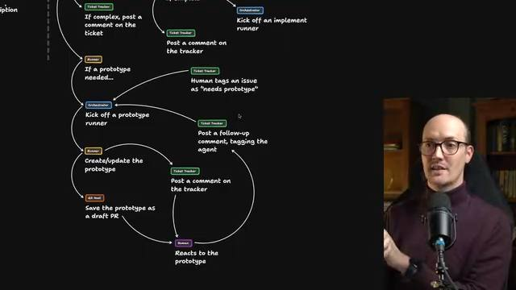

### 7.15 这套设计的边界

最后提醒一件事：P90–P100 全部是**设计**，没有一行 orchestrator 代码，也没有一次真实运行。所以本文能保证的是「你照着能把这五个流程图和那份决策清单复现出来」，不能保证「照着就能得到一个生产可用的软件工厂」。讲师自己在 P90 收尾时也说了，要想象你上一步provision 的基础设施，把流程落到具体组件上，设计才会显得具体——那份基础设施的搭建在别的章节，不在这一段。你要做的下一步，是把第 6 章检查清单里每一条都变成自己仓库里的一个真实标签、一条真实停止条件、一个真实的人类接手人。