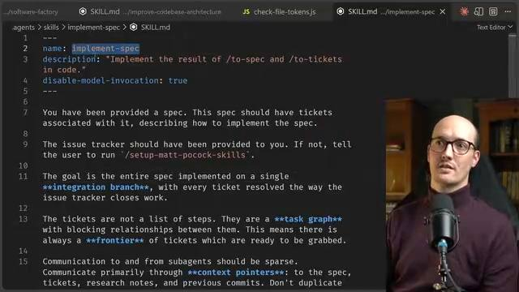
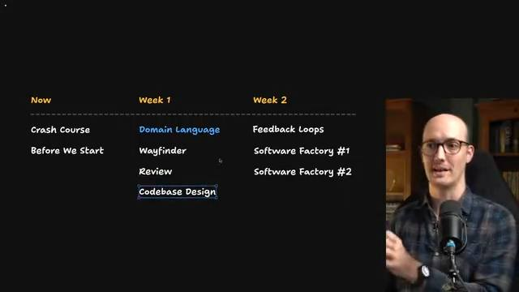
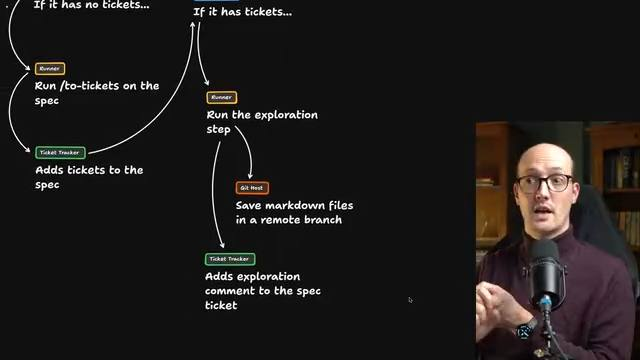
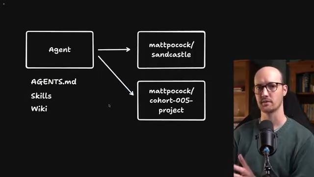
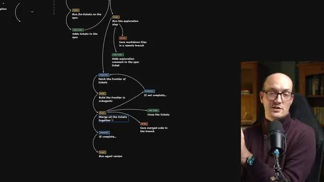
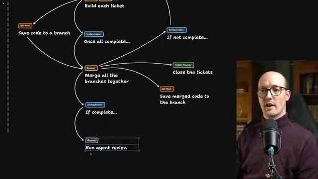
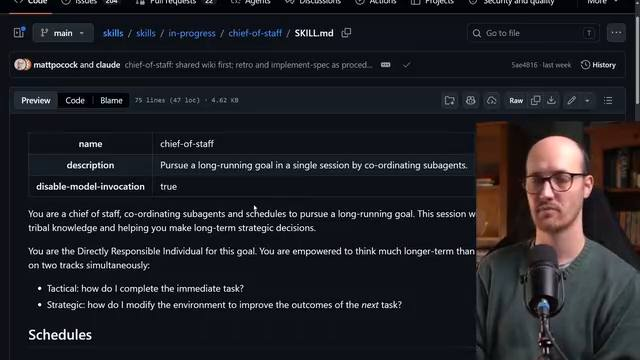

# Software Factories for Real Engineers part2（P1–P4）复现文档：把 implement spec 做成软件工厂流水线

> 范围说明：P1–P4 里，P1 提出“把 implement spec 的文本流程变成确定性 runners”，P2 给出两种编排方案，P3 是课程总结，P4 是问答。**课里没有给出可运行仓库、依赖版本或完整源码**，所以本文不是“复制一个现成项目”，而是把讲师的设计落成一套可照着搭的实施手册：目录结构、组件职责、接口草案、容量估算、配置草案和检查清单。文中出现的 YAML、TypeScript 类型、环境变量名均为**示意**，不是讲师原始代码；每个示意块都会标注。课里没讲的具体平台 API、锁、事务、镜像构建、鉴权等，统一放在第 7 节。

---

## 1. 这一节做什么

这一节要做的，是把 `implement spec` 从一段“写在 markdown 里的流程说明”，变成软件工厂里可重复执行的流水线：一个 orchestrator 接收 spec，必要时先让 agent 自己补 tickets，然后跑 exploration，把探索笔记存到所有未来 sub-agent 都能访问的地方；接着按 ticket 之间的 blocking relationships 算出 frontier，并行启动 runner 建票，把每张票的代码保存到 remote branch，再由合并 runner 合入 integration branch；如果还有未关闭的 ticket，就回到 frontier 继续循环；全部关闭后跑 agent review，最后进入人工 review。讲师的最终目标不是“让 agent 写一点代码”，而是得到一台能接收 spec、按需 fan out 多个 runner、最终产出 reviewed PR-ready 变更的机器。



课程开头把这件事的难度说得很清楚：这是目前最 ambitious 的一节，因为它要把文本逻辑变成 deterministic runners，还要处理 task graph、并行 runner、探索笔记存储和合并。P1 给的是问题定义；P2 给的是两版编排草图；P4 补充了多仓库、可观测性、wiki、retro、团队协作等工程取舍。P3 则把整门课串起来：crash course 建立 human-in-the-loop 的基本功，domain language 建立人和 agent 的共同语言，Wayfinder 是规划加速器，review 是质量闸门，code base design 和 feedback loops 让自动化检查成为可能，software factory 是把这些能力加速放大的地方。讲师在 P3 里说 review 可能是整门课最有影响的章节，因为大家都在问“human review 到底怎么办”；软件工厂不是替代 review，而是把 review 之前的工作做得更可验证。



这一节的交付物可以概括为五样：

1. 一个 **agent repo**：放 `agents.md`、`skills/`、`wiki/`、工厂配置和运行手册；多仓库时它是中心，链接或按需 clone 其他 repo。
2. 一条 **implement-spec 流水线**：触发 → 补票 → 探索 → 算 frontier → 并行建票 → 合并 → 循环 → agent review。
3. 一套 **状态存储约定**：spec 在 ticket tracker；exploration markdown 在 remote branch，并在 spec 上留评论指针；每张票的代码在 remote branch；合并结果在 integration branch。
4. 一份 **配置草案和接口草案**：让 orchestrator、runner、合并器和 review 阶段的职责边界清楚。
5. 一张 **检查清单**：让你在没有讲师源码的情况下，仍然能一项项搭起来、跑通、发现缺口。

---

## 2. 讲师原话（带「—— pNNN [MM:SS]」）

> “We are essentially trying to take the logic that's in text inside implement spec and turn it into a deterministic set of runners.” —— p001 [00:22]

> “instead of doing to spec and to ticket as the input, let's try doing just to spec. In other words, the agent is going to create its own tickets in the ticket tracker, which it's then going to follow.” —— p001 [00:22]–[00:50]

> “the tickets are not just a linear list of steps. They are a task graph.” —— p001 [00:50]

> “This means that it implements everything on the frontier at the same time, and it merges everything into the integration branch with sub-agents.” —— p001 [01:00]

> “I prefer just putting them in a remote branch that we will intend to clean up at some future stage long after the spec is gone.” —— p002 [01:17]

> “for each unblocked ticket, then trigger ... a whole bunch of runners” —— p002 [02:09]

> “you could probably get away with if you've got a really powerful runner
that can run five versions of your app at once, five of your test suite at once.” —— p002 [03:26]–[03:53]

> “these runners are usually not that powerful. You probably just want to spec your runner so that it can run just one of your apps.” —— p002 [03:53]

> “each ticket saves its code to a branch, certainly a remote branch in the git host. Because then we're gonna have another runner come in, it's gonna receive all of the branches and it's gonna merge all of them together.” —— p002 [04:18]–[04:48]

> “you've got to be really careful where we store our state, especially storing branches and also code information that doesn't really belong on tickets, such as the exploration step up there.” —— p002 [05:28]

> “the first thing that we added, which was this to tickets loop here, is basically totally unnecessary. We could just delete all of this ... But it is really nice just having this extra little button we can press.” —— p002 [05:28]–[05:53]



> “it's a single software factory which knows about the repositories.” —— p004 [00:00]

> “I will have one repository, which is like the agent repository. And inside this agent repository, I will have all of my skills that I want that agent to have, all of the agents.md stuff lives inside here.” —— p004 [00:27]

> “you should have an implementer agent implementing the thing, and then you should get another agent to review the thing. And then only once you've got the agent that's reviewed the thing, the automated review, you then go to human review.” —— p004 [26:23]

> “the way that you avoid cognitive debt is with planning and with domain modeling.” —— p004 [10:39]



---

## 3. 从零复现

这一节按“能动手搭”的顺序写：先定目录和状态放哪，再定触发方式，然后逐个阶段实现。**所有目录名、文件名、字段名都是本文为了落地而拟的草图，不是讲师仓库里的原样**；讲师只给了流程图和口头描述，没有给仓库。凡是讲师没提到的（具体 ticket tracker 的 API、鉴权方式、镜像、并发上限），第 7 节统一列出。

### 3.1 前置条件

你需要准备好四类东西，缺任何一类这条流水线都跑不起来：

1. **一个 ticket tracker**，能存 spec、能存 tickets、**tickets 之间能表达 blocking relationship**，并且能用 label 或 assignee 触发。讲师在 P2 开头设定的场景就是“有人给 spec 打了 `agent implement` 之类的 label，或者把 spec 分配给 agent，无论哪种方式，orchestrator 被唤醒了”（—— p002 [00:00]）。
2. **一个 git host**，能推 remote branch、能开 PR。这是 P2 反复强调的：exploration 的 markdown 放 remote branch，每张票的代码放 remote branch，合并结果推 integration branch。
3. **一个能跑 agent 的 sandbox runner**，数量按你的预算定。讲师在 P2 中段明确说，一般 runner 没那么强，“你大概只想把 runner 规格定成能跑你自己一个应用”（—— p002 [03:53]）。
4. **一个 orchestrator 进程**：它本身不需要很强的算力，主要是调度、轮询、记录状态。它可以是本地常驻脚本，也可以是 CI 里的定时任务。

课里**没有**给出以上任何一项的具体产品名和版本号。ticket tracker 是什么、runner 是什么镜像，全部由你自己选。

### 3.2 目录结构：先建 agent repo

按 P4 的说法，多仓库工作流的中心是一个 **agent repository**：`agents.md`、skills、steering 文件、以及一个 wiki 都在里面；其他业务 repo 通过“你可以 clone 这些 repo”的方式被引用（—— p004 [00:27]–[01:21]）。所以第一步不是建流水线，而是建这个 repo 的骨架。

示意结构（课里没有这个目录，以下是按 P2／P4 描述整理的）：

```
agent-repo/
├── agents.md                     # 给 agent 的总入口，短、可审计
├── coding-standards.md           # 自动化 review 的判据来源
├── factory.config.yaml           # 工厂配置：分支命名、并发、轮次上限
├── factory/
│   ├── types.ts                  # 流程中的数据结构
│   ├── frontier.ts               # 纯函数：算 frontier，可离线单测
│   ├── orchestrator.ts           # 主循环骨架
│   └── fixtures/
│       └── tickets.sample.json   # 离线跑 frontier 用的假数据
├── skills/
│   ├── to-spec/
│   ├── to-ticket/
│   ├── implement-spec/
│   ├── exploration/
│   ├── merge-branches/
│   ├── agent-review/
│   └── retro/
└── wiki/                         # 跨 session 的历史记录，见 P4
```

关键点：**流水线的代码和上下文放在一起**。P4 在讲团队协作时说得很直白：跑工厂的代码要么放在 agent repo 里，要么放在它旁边的一个子 repo 里（—— p004 [35:38]）。这样 orchestrator 启动时天然能读到 `agents.md` 和 skills，不用再做一次路径拼接。

### 3.3 定触发方式与“补票按钮”

P2 给出的入口是：spec 上有 label／assignee 变化 → orchestrator 被唤醒。你不需要实现一个完整的事件总线，最小可行版本是**轮询**：orchestrator 每隔一段时间查一次“带 `agent implement` label 且尚未开始处理的 spec”，取到就进入流水线。

同时要留一个“补票按钮”，也就是 P2 里说的那个可选前置循环：如果 spec 上**一张票都没有**，就先调度一个 `to-ticket` runner 去生成 tickets，然后回到主流程（—— p002 [00:22]–[01:17]）。讲师对这个按钮的态度很明确：严格来说它可以整个删掉，因为主流程只要“有票就实现”就够了；但保留它能让人类少做一次无意义的搬运（—— p002 [05:28]–[05:53]）。所以实现上它是**可开关的可选分支**，不是主线依赖。

### 3.4 探索阶段：笔记存哪里

这是 P2 里信息量最大的一段。exploration runner 去读 spec、读 repo，产出一批 markdown 笔记。讲师否决了“开一个 draft PR 再关掉”的做法，选择**把笔记推到一个 remote branch**，这个分支打算在 spec 结束很久之后再清理；同时在 spec 上留一条评论，指向这些 markdown 文件（—— p002 [01:17]–[02:09]）。

为什么这样做很关键：后面的每一个 runner 都会拿到“整个 spec + 自己那张票 + 这组 exploration markdown”，而它们**通过 spec 上的评论知道这组文件在哪**。这就是一个不依赖 orchestrator 内存的指针。orchestrator 崩了、sandbox 换了、session 被 compact 了，指针还在 ticket tracker 上。

落地要点：
- 分支命名固定，例如 `factory/<spec-id>/exploration`，让“推”和“读”两侧都能靠命名算出来，不必额外查表。
- spec 上只留**一条**评论，内容是可复现的路径清单 + 生成时间。每次都追加新评论会让后续 agent 读到一堆过期指针。
- 笔记里凡是关于代码的判断，按 P4 对 wiki 的要求处理：**标注日期，并引用当时为真的 commit**（—— p004 [18:53]–[19:21]）。这条要求来自讲师讲 wiki 的部分，我把它同样用在 exploration 笔记上，因为二者面临同一个“内容会过期”的问题。课里没有明确说 exploration 笔记也要按这个格式写，这是本文的合理延伸，标注为延伸。

### 3.5 算 frontier：这一步不用 agent

P2 里讲师明确说，算 frontier 可能根本不需要 agent，因为 blocking relationship 是确定性的（—— p002 [02:09]–[02:38]）。这是整条流水线里唯一应该写成**纯函数 + 单测**的部分。四步：

1. 拉取 spec 下所有 tickets，以及它们之间的 blocking 关系。
2. 过滤掉已经关闭的票。
3. 一张票“可开工”＝ 它自己没关闭，且**所有阻塞它的票都已关闭**。
4. 剩下的就是 frontier；如果 frontier 为空但还有未关闭的票，说明图里存在环或悬挂依赖，这是**错误状态**，不能当作“已完成”。

第 4 步是很容易被忽略的：很多实现只判断“frontier 空了就结束”，结果遇到循环依赖时会静默地提前收工。

### 3.6 选并行方案：单 runner 还是多 runner

P2 花了几分钟专门比较两种方案，这是本节最重要的架构决策。

**方案 A：一个 runner 建完整个 frontier。** orchestrator 起一个 runner，这个 runner 在内部把 frontier 上的票分给 sub-agents，都干完后在同一个 sandbox 里把所有分支合并（—— p002 [02:38]–[03:26]）。优点是分支都在本地，合并简单；缺点是对 runner 规格要求高，得能同时跑好几份应用和测试。

**方案 B：每张票一个 runner，另一个 runner 专做合并。** orchestrator 为 frontier 上每张票各起一个 runner，各自推自己的 remote branch；全部完成后，起一个合并 runner 收所有分支合到一起；然后走和方案 A 相同的后续逻辑（—— p002 [04:18]–[05:00]）。

讲师的选择是 B，理由是“更复杂，但对单个 runner 的压力肯定更小”，并说如果让他选，他会选 B（—— p002 [05:00]）。



复现时请注意方案 B 带来的一个强制结果：**每张票必须推 remote branch**。因为在方案 B 里，合并 runner 和建票 runner 不是同一个进程、甚至不是同一台机器，除了 git host 没有别的共享介质。

### 3.7 合并与循环

合并 runner 的职责有三件，P2 都点到了：把各票分支合入 integration branch；确保合并后的代码被推上去；在 ticket tracker 里**把已完成的票关掉**（—— p002 [02:56]–[03:26]）。

然后是循环判定：合并完成后重新算 frontier。还有未关闭的票 → 回到 3.5，再起一轮；全部关闭 → 进入 agent review。



这里必须设两个硬上限，否则你会烧钱：**最大轮次**（防止某张票永远关不掉）和**最大并发 runner 数**（防止一次 frontier 太大把配额打爆）。这两个值 P2 没给数字，放在配置里由你定。

### 3.8 agent review 与人工 review

全部票关闭后跑 agent review，然后进人工 review。P4 把这个顺序讲得很清楚：先由 implementer agent 实现，再由**另一个** agent review，只有过了 automated review 才轮到人类 review；这样人看到的东西质量最高（—— p004 [26:23]）。同一段里他还提到可以让 agent 去点应用、替人做掉一部分手工 QA，人只做 spot check。



人工 review 的取舍标准，P4 给了一对概念：**one-way door** 与 **two-way door**。能轻易回滚的改动属于 two-way door，可以只做抽查；涉及迁移、删数据、短时间内暴露安全漏洞的属于 one-way door，走不回来（—— p004 [24:59]–[25:55]）。所以流水线的输出不该是一句笼统的“PR ready”，而应该在 PR 描述里标出这次改动是不是碰了 one-way door。

### 3.9 多仓库怎么接

P4 的做法是：一个 software factory 知道多个 repo；agent repo 里写清“你可以 clone 这些 repo”，sandbox 里把 agent repo 放到位，剩下的 clone 交给 agent 按需做（—— p004 [00:00]–[01:21]）。他提到自己用这套在二十来个 repo 上跑得不错；真正撑不住的是几百个 repo，因为那时 `agents.md` 里要给每个 repo 一条导航指针，决策量太大，需要做 progressive disclosure，也就是按业务域分层放 repo 索引（—— p004 [01:50]–[02:18]）。

复现建议：**先把单 repo 跑通再谈多 repo**。多 repo 只改两处——exploration 阶段要 explore 哪些 repo，以及合并阶段的分支属于哪个 repo。

### 3.10 容量与成本估算

P2 没有给数字，但结构化估算能帮你定配置。假设一次 spec 拆出 T 张票，最大并行度 P，每票平均耗时 t 分钟，合并与 review 各 s 分钟：

- 轮数下界 ≈ ⌈T / P⌉（frontier 足够宽时）
- 单轮墙钟时间 ≈ t + s
- 总裁 ≈ ⌈T / P⌉ × (t + s) + 探索时间 + review 时间

若 T=24、P=4、t=15、s=3：轮数 6，单轮 18 分钟，约 108 分钟 + 探索 + review。这张估算表比任何“并行度调到最大”的口号都有用：**P 从 4 提到 8 只把轮数从 6 降到 3，但每一步的失败概率和合并冲突概率都上去了**，而讲师在 P2 里已经提醒单个 runner 通常扛不住多份应用。

多 repo 的成本还要乘一个系数：clone 成本与磁盘。P4 提到二十来个 repo 尚可，这就是上限的体感来源（—— p004 [01:50]）。

---

## 4. 完整代码

**声明：课里没有代码，以下全部为示意。** 目标是把第 3 节的决策落成可直接保存、可离线验证的产物。其中 `frontier.ts` 是**真的能直接 `node` 跑通的**（纯函数 + 自带 fixture，无外部依赖）；`orchestrator.ts` 是骨架，凡是需要接 ticket tracker／git host／sandbox 的地方都留成显式接口，不假装能跑。

### 4.1 目录与运行方式

```
agent-repo/factory/
├── types.ts
├── frontier.ts
├── orchestrator.ts
├── factory.config.yaml
└── fixtures/tickets.sample.json
```

`frontier.ts` 用 Node 18+ 直接跑：`node --experimental-strip-types frontier.ts`（Node 22+ 可省 flag），或先 `npx tsc` 再 `node dist/frontier.js`。具体 Node 版本要求课里没讲，按你环境定。

### 4.2 `factory/types.ts`

```ts
// 示意，非讲师原始代码
export type TicketId = string;
export type BranchName = string;

export interface Ticket {
  id: TicketId;
  title: string;
  /** 阻塞这张票的其他票；全部 closed 才能开工 */
  blockedBy: TicketId[];
  status: "open" | "closed";
}

export interface SpecRef {
  id: string;
  /** 触发用：例如 agent implement */
  label: string;
  /** 指向 exploration 笔记 remote branch 的分支名 */
  explorationBranch?: BranchName;
  /** spec 上那条指路评论的 id */
  explorationCommentId?: string;
}

export interface TicketBuildResult {
  ticketId: TicketId;
  branch: BranchName;
  /** runner 是否成功退出（字段名以你实际 runner 输出为准） */
  ok: boolean;
  summary: string;
}

export interface FrontierResult {
  frontier: Ticket[];
  blocked: Ticket[];
  /** frontier 空但仍有 open 票，说明有环或悬挂依赖 */
  stalled: boolean;
}
```

### 4.3 `factory/fixtures/tickets.sample.json`

```json
{
  "tickets": [
    { "id": "T1", "title": "脚手架与配置", "blockedBy": [], "status": "open" },
    { "id": "T2", "title": "数据模型", "blockedBy": ["T1"], "status": "open" },
    { "id": "T3", "title": "接口层", "blockedBy": ["T1"], "status": "open" },
    { "id": "T4", "title": "页面接入", "blockedBy": ["T2", "T3"], "status": "open" },
    { "id": "T5", "title": "端到端测试", "blockedBy": ["T4"], "status": "open" }
  ]
}
```

### 4.4 `factory/frontier.ts`（可直接运行）

```ts
// 示意，非讲师原始代码。纯函数 + 自带断言，node 直接跑
import { readFileSync } from "node:fs";
import type { Ticket, FrontierResult } from "./types.ts";

export function computeFrontier(tickets: Ticket[]): FrontierResult {
  const byId = new Map<string, Ticket>();
  for (const t of tickets) byId.set(t.id, t);

  const open = tickets.filter((t) => t.status === "open");

  const frontier: Ticket[] = [];
  const blocked: Ticket[] = [];

  for (const t of open) {
    const deps = t.blockedBy
      .map((id) => byId.get(id))
      // 依赖指向不存在的票：视为未满足，让 stalled 检查暴露它
      .filter((d): d is Ticket => d !== undefined);

    const missing = t.blockedBy.some((id) => !byId.has(id));
    const allDone = deps.every((d) => d.status === "closed");

    if (!missing && allDone) frontier.push(t);
    else blocked.push(t);
  }

  return {
    frontier,
    blocked,
    stalled: frontier.length === 0 && open.length > 0,
  };
}

// ---- 自测 ----
if (process.argv[1]?.endsWith("frontier.ts")) {
  const raw = JSON.parse(
    readFileSync(new URL("./fixtures/tickets.sample.json", import.meta.url), "utf8")
  ) as { tickets: Ticket[] };

  const r = computeFrontier(raw.tickets);
  console.log("frontier:", r.frontier.map((t) => t.id), "blocked:", r.blocked.map((t) => t.id), "stalled:", r.stalled);

  const assert = (cond: boolean, msg: string) => {
    if (!cond) throw new Error("ASSERT FAILED: " + msg);
  };

  assert(r.frontier.length === 1 && r.frontier[0].id === "T1", "首轮应只有 T1");
  assert(r.stalled === false, "首轮不应 stalled");

  // 模拟 T1 完成后，T2、T3 同时进入 frontier
  const afterT1 = raw.tickets.map((t) => (t.id === "T1" ? { ...t, status: "closed" as const } : t));
  const r2 = computeFrontier(afterT1);
  assert(r2.frontier.map((t) => t.id).sort().join(",") === "T2,T3", "T1 关闭后应并发 T2,T3");

  // 循环依赖必须被识别为 stalled，而不是“已完成”
  const cyc: Ticket[] = [
    { id: "A", title: "a", blockedBy: ["B"], status: "open" },
    { id: "B", title: "b", blockedBy: ["A"], status: "open" },
  ];
  assert(computeFrontier(cyc).stalled === true, "环应判定为 stalled");

  console.log("all assertions passed");
}
```

### 4.5 `factory/orchestrator.ts`（骨架，示意）

```ts
// 示意，非讲师原始代码。所有 *_API 都是待你实现的适配器
import type { SpecRef, Ticket, TicketBuildResult, BranchName } from "./types.ts";
import { computeFrontier } from "./frontier.ts";

interface TrackerAPI {
  listSpecsWithLabel(label: string): Promise<SpecRef[]>;
  listTickets(specId: string): Promise<Ticket[]>;
  closeTicket(ticketId: string): Promise<void>;
  ensureExplorationComment(specId: string, branch: BranchName, paths: string[]): Promise<string>;
}

interface GitAPI {
  pushBranch(repo: string, branch: BranchName): Promise<void>;
  listRemoteBranches(repo: string, prefix: string): Promise<BranchName[]>;
  openPR(repo: string, head: BranchName, base: BranchName, body: string): Promise<string>;
}

interface RunnerAPI {
  /** 起一个 sandbox runner 执行命名 skill，返回它推上来的分支 */
  runSkill(opts: {
    skill: string;
    specId: string;
    ticketId?: string;
    inputs: Record<string, string>;
  }): Promise<TicketBuildResult>;
}

interface FactoryConfig {
  repo: string;
  integrationBranch: BranchName;
  explorationBranchPrefix: string;
  ticketBranchPrefix: string;
  maxConcurrency: number;
  maxRounds: number;
  allowAutoTicketing: boolean;
}

export async function implementSpec(
  spec: SpecRef,
  cfg: FactoryConfig,
  tracker: TrackerAPI,
  git: GitAPI,
  runner: RunnerAPI
): Promise<{ prUrl: string; rounds: number }> {
  // 阶段 0：补票（可选按钮）
  let tickets = await tracker.listTickets(spec.id);
  if (tickets.length === 0) {
    if (!cfg.allowAutoTicketing) throw new Error(`spec ${spec.id} 无票且未开启自动补票`);
    await runner.runSkill({ skill: "to-ticket", specId: spec.id, inputs: {} });
    tickets = await tracker.listTickets(spec.id);
    if (tickets.length === 0) throw new Error("补票后仍无票，人工介入");
  }

  // 阶段 1：exploration，笔记推到 remote branch，并在 spec 上留指针
  const explorationBranch = `${cfg.explorationBranchPrefix}${spec.id}`;
  const exp = await runner.runSkill({
    skill: "exploration",
    specId: spec.id,
    inputs: { branch: explorationBranch },
  });
  if (!exp.ok) throw new Error(`exploration 失败：${exp.summary}`);
  await tracker.ensureExplorationComment(spec.id, explorationBranch, ["NOTES.md"]);

  // 阶段 2：循环 frontier
  for (let round = 1; round <= cfg.maxRounds; round++) {
    tickets = await tracker.listTickets(spec.id);
    const { frontier, stalled } = computeFrontier(tickets);

    if (stalled) throw new Error(`frontier 为空但仍有 open 票（环或悬挂依赖），round=${round}`);
    if (frontier.length === 0) break; // 全部关闭

    // 阶段 3：按并发上限切片建票
    const built: TicketBuildResult[] = [];
    for (let i = 0; i < frontier.length; i += cfg.maxConcurrency) {
      const slice = frontier.slice(i, i + cfg.maxConcurrency);
      const results = await Promise.all(
        slice.map((t) =>
          runner.runSkill({
            skill: "implement-spec-ticket",
            specId: spec.id,
            ticketId: t.id,
            inputs: { explorationBranch, outBranch: `${cfg.ticketBranchPrefix}${spec.id}/${t.id}` },
          })
        )
      );
      built.push(...results);
    }

    const failed = built.filter((b) => !b.ok);
    if (failed.length > 0) {
      throw new Error(`本轮有 ${failed.length} 张票失败：${failed.map((f) => f.ticketId).join(",")}`);
    }

    // 阶段 4：合并 runner
    const branches = await git.listRemoteBranches(cfg.repo, `${cfg.ticketBranchPrefix}${spec.id}/`);
    const merged = await runner.runSkill({
      skill: "merge-branches",
      specId: spec.id,
      inputs: { branches: branches.join(","), target: cfg.integrationBranch },
    });
    if (!merged.ok) throw new Error(`合并失败：${merged.summary}`);

    // 阶段 5：关票
    for (const b of built) await tracker.closeTicket(b.ticketId);
  }

  // 阶段 6：agent review → 开 PR
  const review = await runner.runSkill({ skill: "agent-review", specId: spec.id, inputs: {} });
  if (!review.ok) throw new Error(`agent review 未通过：${review.summary}`);

  const prUrl = await git.openPR(
    cfg.repo,
    cfg.integrationBranch,
    "main",
    `Automated implementation for spec ${spec.id}\n\nReview focus: one-way door / two-way door（见课程 review 一节）`
  );
  return { prUrl, rounds: 0 };
}
```

### 4.6 `factory/factory.config.yaml`（草案）

```yaml
# 示意，非讲师原始配置。数值由你按预算和 runner 规格定
repo: "your-org/your-app"
integration_branch: "factory/spec-integration"
exploration_branch_prefix: "factory/"
ticket_branch_prefix: "factory/ticket-"
max_concurrency: 4         # 与 runner 配额对齐；方案 B 下就是同时起几个 sandbox
max_rounds: 12             # 防止某张票永远关不掉
allow_auto_ticketing: true # 对应 P2 的可选“补票按钮”
runner:
  image: ""                # 课里没讲，填你自己的 sandbox 镜像
  timeout_minutes: 30      # 课里没讲，自行压测后定
skills:
  to_ticket: "skills/to-ticket"
  exploration: "skills/exploration"
  implement: "skills/implement-spec"
  merge: "skills/merge-branches"
  review: "skills/agent-review"
```

### 4.7 `agents.md` 草案（短，可审计）

```markdown
# agents.md（示意）

## 工厂约定
- 状态存放：spec 与 tickets 在 ticket tracker；exploration 笔记在 remote branch，
  指针写在 spec 的评论里；每张票的代码推自己的 remote branch；合并结果推 integration branch。
- 不要修改 integration branch 以外的长期分支。

## 禁止
- 不做 one-way door 类改动（数据迁移、删数据、放宽鉴权）除非票里明确要求并标注。

## 质量
- 提交前跑仓库里已有的 lint / typecheck / test；不要新增未运行的检查。
- coding-standards.md 是 review 判据，不在此重复。

## 笔记
- 关于代码的任何结论必须带日期，并引用当时为真的 commit。
```

---

## 5. 逐行解释

**`computeFrontier` 为什么是纯函数。** 它不读网络、不读时钟、不写状态，只吃 `Ticket[]` 吐结果。这不是洁癖：frontier 是整条流水线唯一的判定点，判错了要么漏票（永远不完成）要么重复开工（分支冲突）。纯函数让你能用 fixture 把“首轮”“多票并发”“环”三种情形全部离线测掉，不需要起一个真实 sandbox 去验证调度逻辑。P2 说这一步不需要 agent，本质原因也在这：确定性的事交给确定性代码。

**为什么 `blockedBy` 要区分“不存在”和“未关闭”。** 如果依赖指向一张已被删掉的票，单纯的 `every(d => d.status === "closed")` 在空数组上返回 `true`，这张票会被当成可开工——依赖凭空消失了。所以先算出 `missing`，一旦有悬挂依赖就把它归到 `blocked`，从而让 `stalled` 有机会暴露它。

**`stalled` 为什么不能省。** 循环依赖 A↔B 时两张票互相阻塞，frontier 永远是空，但票没关。没有 `stalled`，主循环会以为“全部完成”直接跳到 review，产出一个什么都没实现的 PR。这个坑在真实图里很常见，因为依赖关系是 agent 生成的，而 agent 会写出环。

**为什么 `maxRounds` 和 `maxConcurrency` 必须写进配置而不是代码。** 它们和你的钱包、你的 runner 规格直接绑定。第 3.10 节的估算表明，把 `maxConcurrency` 从 4 提到 8 只把轮数减半，但每轮同时起来的 sandbox 翻倍。把它放配置里，改它是一次显式的成本决策，不是一次隐式的调参。

**为什么方案 B 里每张票必须推 remote branch。** 合并 runner 是另一个进程，它拿不到建票 runner 本地工作区的引用。P2 原话是“每张票把代码存到一个分支，肯定是 git host 上的 remote branch，因为接着会有另一个 runner 进来，收取所有分支然后合到一起”（—— p002 [04:18]–[04:48]）。如果你的合并 runner 和建票 runner 恰好同机，你可以优化成本地分支，但那就退化成方案 A 了。

**为什么 exploration 用分支 + 评论，而不是 draft PR。** draft PR 有两个副作用：它占用 PR 列表、需要关闭，而且会被 review 流程误认为“待审变更”。分支 + spec 上一条评论的组合把“笔记在哪儿”这个信息放进 ticket tracker，而所有未来的 runner 本来就都会读 spec 和票。P2 说得很清楚：“每一个未来的 runner 都会拿到整个 spec、自己那张票，以及这组 exploration markdown；通过评论，它们就知道这组文件在哪”（—— p002 [01:17]–[02:09]）。

**为什么注释里要写“字段名以实际输出为准”。** 我全程没有编造 runner 的输出结构。`TicketBuildResult.ok` 是我自己定义的类型，不是你看到的某个真实 CLI 输出。真正接 runner 时，它的成功标志可能是退出码、可能是状态字段、可能是日志里的一行文本；课里没讲，只能以你实际选用的 runner 的输出为准。

**`agents.md` 为什么要短。** P4 讲 retro 时给了一个很实用的判据：自动化检查只花 CPU，可以堆几百个；而自动化 review 花 token，`agents.md` 一长，就变成成本上升、可靠性下降的负担。他还点名要警惕 know-op（写了但不改变输出的指令，比如“make no mistakes”）和 sediment（以前有用、现在没用的沉淀）（—— p004 [30:36]–[32:23]）。所以草案里只放不可协商的约定，把风格细则放 `coding-standards.md`。

**为什么 PR 描述里要点出 one-way door。** 人工 review 的强度应该由可回滚性决定，而不是由 diff 大小决定。P4 的定义是：合并即不可轻易回滚（迁移、删数、一段时间内暴露安全漏洞）属于 one-way door（—— p004 [24:59]–[25:55]）。把这一判断放在 PR 描述里，review 的人一打开就知道该细看还是抽查，这比给整个工厂设一条“所有 PR 都要人审”的规则有效得多。

---

## 6. 复现检查清单

按顺序勾，勾不上的就是你卡住的地方。

**仓库与上下文**
- [ ] 有一个独立 agent repo，含 `agents.md`、`skills/`、`wiki/`
- [ ] `agents.md` 在一屏内能读完，没有“make no mistakes”这类 know-op
- [ ] 业务 repo 的引用方式已确定（clone 源或路径）
- [ ] 若涉及多 repo，已确认 repo 数量在你能维护导航指针的范围内

**状态存储**
- [ ] spec 与 tickets 在 ticket tracker，且 tickets 能表达 blocking relationship
- [ ] exploration 笔记的目标分支命名规则已固定
- [ ] spec 上只有一条指向 exploration 笔记的评论，且重复触发不会追加第二条
- [ ] 每张票的分支命名规则已固定，能与 spec id 对上
- [ ] integration branch 已建好，且不在保护分支冲突名单里

**frontier**
- [ ] `computeFrontier` 是纯函数，无网络、无时钟、无写操作
- [ ] 三种情形都有断言：首轮单票、多票并发、循环依赖 → stalled
- [ ] 悬挂依赖（指向不存在的票）会进 blocked，而不是被当作已满足
- [ ] frontier 为空且仍有 open 票时，流水线**报错**而不是前进

**编排**
- [ ] 触发方式已实现（label 轮询或事件），且有去重，同一 spec 不会跑两份
- [ ] 补票分支是可开关的，关掉后“有票即实现”仍能独立工作
- [ ] `maxConcurrency` 与 runner 配额一致
- [ ] `maxRounds` 已设置
- [ ] 选了方案 A 或方案 B，并在文档里写明理由
- [ ] 选方案 B 时，合并 runner 只通过 git host 读取分支

**失败处理**
- [ ] 单票 runner 失败时会中止本轮，不会带着失败分支去合并
- [ ] 合并失败有明确报错，不会静默关票
- [ ] runner 超时时间已设

**review 与出口**
- [ ] agent review 与实现使用不同的 runner／session
- [ ] PR 描述里标注了是否触及 one-way door
- [ ] 人工 review 的抽查范围已按 two-way door 定义清楚

**可观测性**
- [ ] 能看到“当前有哪些 runner 在跑”
- [ ] 能看到历史趋势（花了多少、失败率、平均轮数）
- [ ] 每轮 frontier 的输入输出有日志，便于事后复盘

---

## 7. 课里没讲但你会撞上的

以下问题逐字稿里没有答案。标“课里没讲”的地方请当成待定项，不要当成讲师的推荐。

**1. 并发写的互斥。** 同一张票被两个 orchestrator 实例同时捡走，会产生两条分支、两次合并。课里没讲怎么防。在 Node 里对应的做法是：给 spec/ticket 加一个“租约”字段（带过期时间），抢到租约的实例才能推进；或者用平台的原子 assign 接口。这属于“锁”，在 JS/Node 世界里就是**一条带条件的 UPDATE**，而不是内存里的 flag——内存 flag 在多进程下等于没有。

**2. 合并的原子性。** 合并 runner 合到一半失败，integration branch 会处于半合状态。课里没讲。最简单的做法是合并前先建一个临时分支，全部合成功再 fast-forward 到 integration；失败就丢弃临时分支。这在数据库里叫事务，在 git 里就是“在临时引用上做，成功后一次性推”。

**3. 幂等与重试。** runner 超时后重跑，会不会重复推分支、重复关票、重复追加 spec 评论？课里没讲。三个地方要显式做幂等：分支推送（同名分支直接覆盖需谨慎）、关票（关已关的票应无害）、spec 评论（按固定 marker 查找并更新而非追加）。

**4. exploration 分支的清理。** P2 只说“打算在 spec 结束很久之后清理”，没说谁清理、什么时候清理。你需要一条独立的清理任务，判据是 spec 关闭时间 + 保留期，别指望主流程顺手做。

**5. branch 冲突本身。** 方案 B 下多张票并行改同一文件，合并必冲突。课里没说怎么处理。可选：让 frontier 的票按模块分区以减少重叠、或让合并 runner 在冲突时把冲突文件列表回写到票上再触发修复轮。这需要你在 frontier 之外多一层“文件级互斥”的考虑，课里完全没有。

**6. 成本与配额。** P2 反复说并行打满很贵，但没给数字。第 3.10 节的估算表是你的起点；真实值要压测。注意 agent review 是 token 大户，不要把它和建票 runner 放同一个无限重试的循环里。

**7. 可观测性工具。** P4 明确提到需要 observability 工具、并点名了 Langfuse 这类平台，也说了可以自建（—— p004 [10:15]–[10:39]）。但具体接法、指标定义、采样策略课里没讲。最小可用版：每个 runner 记录 spec id、票 id、轮次、起止时间、token 消耗、是否成功，落一张表就够做趋势图。

**8. 质量指标。** P4 对这个问题的回答是“没有新鲜答案”：code coverage、deep module 的数量与接口比都可能被扭曲，把 metric 直接当目标会跑偏（—— p004 [03:10]–[04:04]）。所以别指望这份文档给你一个阈值。可行做法是先堆自动化检查（lint、typecheck、test，只在 CPU 上跑），再谨慎加自动化 review 的条目。

**9. retro 的效果验证。** P4 提到有人做了 retro 改动是否有益的研究，结论不够清晰（—— p004 [29:13]–[29:42]）。他的经验是：自动化检查可以大量堆，因为便宜；自动化 review 的改动要克制，因为花 token 且可能变成 know-op 或 sediment。所以 retro 产出的 PR 需要有“这条改动是否有可测效果”的判据，课里没给具体方法。

**10. 团队协作下的 grilling。** P4 给了一个不在课程里的建议：**grill where your team already is**，也就是把和 agent 的对齐讨论放到团队本来就在的地方（Slack／Teams／Discord），这样需要别人回答时可以 @ 人，而不是把人拉进你的 agent session（—— p004 [36:34]–[37:55]）。这条对单人开发者无所谓，但对团队是硬需求，而且它决定了你的工厂从哪里开始——不是从代码开始，是从对齐开始。

**11. 时间受限项目不要上工厂。** P4 明确说：软件工厂是长期投资，在 hackathon 或极紧的 deadline 下，你大概不应该折腾工厂，因为它短期不回报（—— p004 [33:45]–[34:12]）。这条值得写进你的运行手册，作为“什么时候不启动这条流水线”的判据。

**12. 安全边界。** P4 提到 one-way door 里包含“短时间内暴露安全漏洞”，但没有展开如何在流水线里自动识别这类改动。课里没讲。至少要做的：把迁移、鉴权、密钥相关路径列为需要人工 always-review 的路径清单，在 PR 描述里自动标注。