# Software Factories for Real Engineers（part 2）· P005 问答专场：TDD、可验证性、Ratchet 迁移与 Glossary 修剪

> 覆盖范围：P005（00:00–35:01），单集问答专场。
> 读者定位：前端转 AI 应用工程师。
> 说明：这一集逐字稿里**没有新建项目、没有业务代码**。它是讲师回答学员提问的 office hours。因此本文按「纯讲解课」的结构写：第 3 节把讲师的推导过程拆成可复现的步骤，第 4 节把结论落成可直接抄走的产物（决策表、职责表、文件草案、估算表）。凡是逐字稿里没有的代码，一律标注「课里没有代码，以下为示意」。

---

## 1. 这一节做什么

P005 不是教学章节，是一场问答。学员把在真实项目里撞到的问题抛上来，讲师逐条回答，回答里散落着大量「我实际怎么做」的操作细节。

这一集真正能**照着做**的东西有两件：

1. **用 ratchet（棘轮）做 linter 迁移**。讲师给了一条完整的、可以从 ESLint 迁到 OXLint 的路径：两套 linter 并行跑、把新 linter 的失败数锁死成基线、每一轮循环修掉固定数量的错误、基线归零后删掉旧 linter。这是本集唯一一段带命令的实操内容（`npm run lint legacy` / `npm run lint new`）。
2. **给 `glossary.md` 做体检和修剪**。讲师当场演示了他自己那个 4000 commits 的项目里的 glossary：先量（多少术语、多少条描述超长），再诊断（哪条写成了 spec、哪条像运维手册），再删（哪些是 common sense），最后重写。732 行压到 531 行。

其余的问答——TDD 对 agent 还有没有意义、怎么让 agent 的输出「fully verifiable」、要不要引入代码图谱工具、上下文窗口该怎么控——都是**判断类**内容。它们不能「跑起来」，但能变成你项目里的一张决策表。第 4 节就是把它们变成表。

前端读者的心理准备：这一集没有后端概念，不涉及锁、事务、并发。最接近「工程习惯」的部分是 CI 和 lint，这两块你在前端项目里天天见。

---

## 2. 讲师原话

关于 TDD 的定位，讲师把话说得很直：

> "红绿重构的设计初衷是，在红绿重构循环的任何时刻，你都可以去喝杯咖啡，或者被打断。它本质上是一种优化方式，针对的是人类工作记忆非常非常有限这一事实。"
> —— p005 [00:53]

> "TDD 的作用是，用一种非常节省 token 的方式让智能体关心测试。"
> —— p005 [02:47]

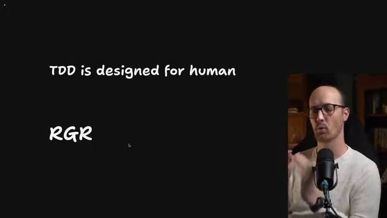

关于 grilling 为什么会问出一堆「答案显而易见」的问题，讲师归因到初始 prompt 里缺了 why：

> "我们意识到，我们初始提示词之间的差异在于我给了它那个 Y，对吧？我基本上是说，好吧，管理员目前无法看到系统中流转数据的整体视图……我有一个解决方案的想法。"
> —— p005 [03:43]

> "你这个人负责主持拷问环节。你可以说，好吧，我不关心那些问题，你自己想办法找出答案。"
> —— p005 [05:10]

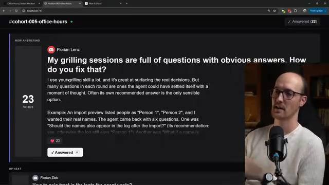

关于「测试能不能替代验证」，讲师的态度是否定的：

> "有一种想法是，好吧，我们可以完全依赖测试。这可以追溯到很久以前……我不认为这曾经成立过。所以你需要做的是，你需要看到智能体给你的证据，来检查这个改动是否真的有效。"
> —— p005 [07:22]

> "如果你告诉它让改动完全可验证，那它就会拼命抓取它能找到的每一个数据源来测试这个改动。"
> —— p005 [08:19]

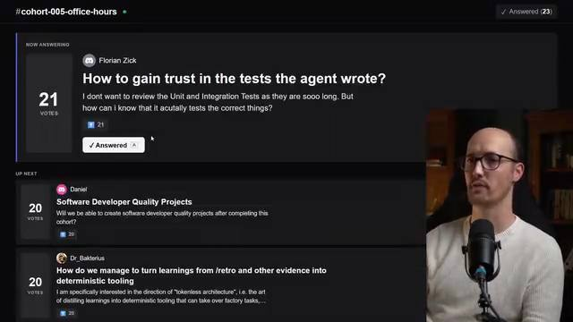

关于 retro 的产出该怎么用：

> "自动化检查在未来不会消耗你的 token。它们只是 lint 规则、类型检查，你知道的，就是我们长期以来用来约束代码仓库的那些标准东西。"
> —— p005 [09:15]

> "如果 Retro 给我这个确定性工具，让我检查它不会让我的 CI 运行太久、不会让我的流水线太长。嗯，我想我就直接用了。"
> —— p005 [09:43]

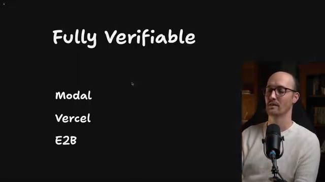

关于代码库质量对 agent 的影响：

> "不只是你的提示词，不只是你的引导文件……还有你的代码库。如果你的代码库里充满了变通方案和低质量的东西，那么被复制的就是那些东西。"
> —— p005 [10:40]

> "我从没见过哪个智能体想要革命，对吧？智能体很乐意只是重复现状。如果现状是垃圾，那你只会得到更多垃圾。"
> —— p005 [11:08]

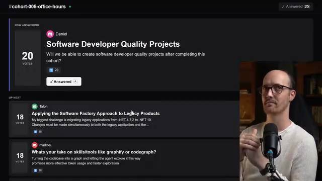

ratchet 的完整定义：

> "所以要从一个迁移到另一个，你会说，好吧，我们有我们的 ESLint 规则……然后我们有另一条规则或另一个脚本，写着 npm run lint new。"
> —— p005 [13:24]

> "棘轮的想法基本上是，你想说，好吧，任何新代码，我们不会增加这个数字。所以我们永远不会超过 200。"
> —— p005 [13:53]

> "随着时间推移，你通过一个软件工厂来逐步偿还这笔债，每个循环修复五个错误，对吧？最终这个数字降到 20，然后降到 10，然后降到零。然后你删掉 lint legacy，这就变成了普通的 lint，你的 CI 又绿了。"
> —— p005 [14:23]

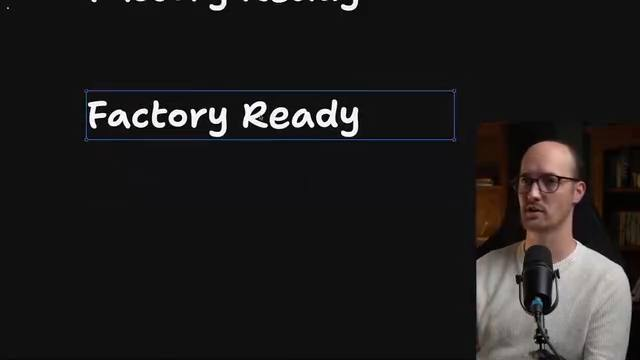

关于 glossary 的体检指令，讲师是当场这么问的：

> "你能给我一些关于 glossary.md 文件的统计数据吗？里面有多少个术语？还有告诉我有多少术语的描述超过了，比如说 100 个字符。比如说两句话就够了，再多就不好了。"
> —— p005 [16:11]

> "我们在 25 个子节里有 170 个术语。这太多了，对吧？太多了吗？你脑子里装不下 170 个术语。"
> —— p005 [17:34]

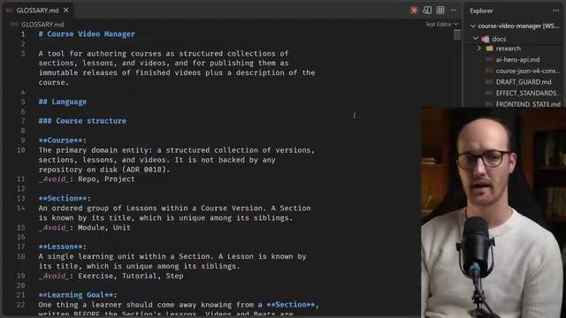

关于单文件 glossary 还是拆成多个：

> "在领域建模技能中，有一个选项可以有类似术语表映射的东西，在一个系统内有多个术语表，但在我看来，这只有在你有人在做不同事情的情况下才可行。"
> —— p005 [18:30]

关于 ADR 的生命周期：

> "ADR 应该留在仓库里，因为所有这些都在解释代码库中某些不明显的东西。"
> —— p005 [20:37]

> "当某个 ADR 所属的功能被完全删除时，我们应该删除这个 ADR 吗？是的，我认为这是个好主意。"
> —— p005 [21:06]

> "如果你做了一个与某个 ADR 相矛盾的改动呢？你会创建一个反向 ADR 吗？是的，你会。你基本上是说，好吧，在第一个 ADR 中，你可以删掉它，或者说它已被新的 ADR 取代。"
> —— p005 [21:29]

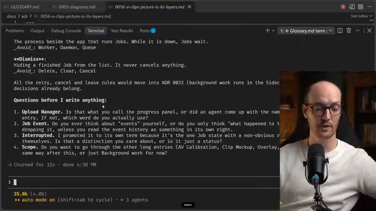

关于代码图谱工具（graphify / code graph）：

> "图有好有坏。并不是说你有了一张图，你的代码库就容易导航了，这两者不一定相关。"
> —— p005 [24:07]

> "图其实就像是一种对文件系统建模的替代方式……而且因为你的代码库变化很大，所以你每次重新索引时都必须重新支付这个成本。"
> —— p005 [26:02]

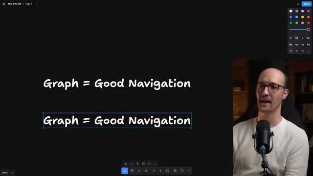

关于上下文预算：

> "我觉得 150k 仍然是我开始紧张的地方。"
> —— p005 [27:01]

> "所以对我来说，我总是觉得待在聪明区、待在便宜区更高效，我想，因为你不会花掉所有这些 token。"
> —— p005 [28:29]

> "而且你还会得到更慢的响应，并且会花更多钱。"
> —— p005 [29:25]

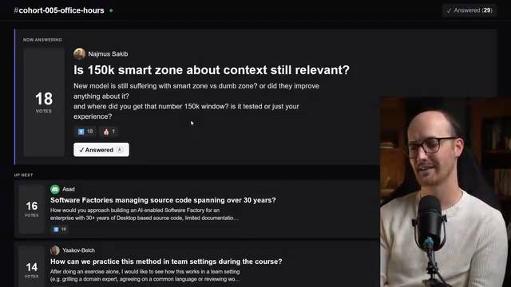

关于遗留系统：

> "你会遇到很多切斯特顿栅栏。切斯特顿栅栏是一道你遇到的栅栏……你完全不知道它为什么在那里。你拿这道栅栏怎么办？你要拆掉它吗？不。你先弄清楚这道栅栏为什么在那里。"
> —— p005 [30:51]

> "一旦你有了这些，一旦你理解了所有代码为什么在那里，那么剩下的就变得微不足道了。"
> —— p005 [31:46]

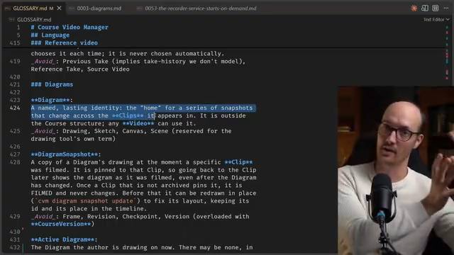

---

## 3. 从零复现（按推导过程）

这一节把讲师在问答里给出的判断，还原成五条可以自己走一遍的推导链。每条都按「需求 → 约束 → 估算 → 方案 → 取舍」写。

### 3.1 任务 A：判定你的项目是否 factory ready

**需求**：你所在的组织已经表态「要多自动化一些工作、相信 agent 的输出、已经爬完信任阶梯」，你想知道自己的代码库能不能进这条流水线。

**约束（讲师给的硬条件）**：

- 能不能把代码放进 sandbox 是门槛。原话：「if the language that you're using can't be put inside a sandbox, let's say, which, I would say, is essential for being a factory」。
- 代码库本身是 agent 的输入之一，不只是 prompt 和 steering 文件。
- agent 不会主动改革，它只会复制现状；现状是垃圾就复制垃圾。

**估算**：这一步没有数字可算。讲师给的是定性判断：先确定「为什么现在不行」，再谈速度。原话：「you need to focus on quality before you can focus on speed」。

**方案**：产出一张一页的自检表（第 4 节表 1 的第 1、2 行就是这张表的两个来源）。三个问题：能不能 sandbox？代码库里有几处 workaround？有没有 deterministic 检查（lint / type check）在跑？

**取舍**：讲师自己也承认，有些语言/框架短期内 sandbox 化「might have to be hacky for a while」（p005 [12:05]）。他给的方向是「你反正是在 server 上跑这段代码，所以 surely has to be aware of doing it」，但没有给具体做法。**具体怎么 hack，课里没讲。**

### 3.2 任务 B：配置一次「带 why 的 grilling」

**需求**：你跑 grilling（讲师的一个 skill），一轮下来十几个问题里有一半是 agent 自己想一下就能定的小事，白白消耗你的注意力。

**约束**：讲师明确指出，你是这场 grilling 的主持人。原话：「you the person are in charge of the grilling session」。你不需要回答每一个问题。

**估算**：讲师没给数字，只给了对比现象：同样的 harness、同样的模型、同样的环境，只有初始 prompt 不同，效果差很多。差别就是他的 prompt 里有 why。

**方案**：初始 prompt 写成三段：

1. **Why / 现状**：现在管理员看不到什么。（讲师的原例：管理员看不到整体数据视图，看不到 purchases、看不到 revenue、看不到不同老师的横向对比。）
2. **Idea**：我有个初步想法——一个带图表和筛选器的 admin analytics 页面。
3. **留给 agent 的部分**：具体的图表数量、筛选器个数，让它自己定。

**取舍**：写 why 需要你先想清楚问题，这比「我要一个 analytics 面板」费劲。好处是 agent 拿到 why 之后，能自己判断哪些问题不必问。反过来，如果你只给 what，agent 就只能盯着「怎么把你要的东西做出来」，不会去想「为什么」。

### 3.3 任务 C：把一次改动做成「fully verifiable」

**需求**：你不想逐行 review 单元测试和集成测试（太长），但你需要知道测试真的测了该测的东西。

**约束**：

- 「测试会覆盖我们」这个假设，讲师明确否掉：「I don't think that's ever been true」。
- agent 不是恶意作弊。讲师的判断是：「the agent is just looking to figure out what you care about when you ship code」。它在猜你在乎什么。

**估算**：没有数字。这里只能定性判断投入产出：给 agent 下游服务的访问权，会抓到 bug，但可能要花钱。

**方案**：三步。

1. 在指令里明确写「make the change fully verifiable」。讲师说这一句话就能让 agent「grab every data source it can in order to test that change out of the Wazoo」，顺带把单元测试也喂饱。
2. 给它**好数据**。原话：「the agent probably needs some really good data to run on」。
3. 给它**所有下游服务的访问权**，形式可以是 mock，也可以是真 key。讲师举的例子是 Sandcastle：它接了三家 sandbox provider——model、Vercel、E2B。他一开始没给 agent 这些 key，所以 Sandcastle 不是 fully verifiable；给了之后，「it found a bunch of bugs」。

**取舍**：真 key 会打真实付费服务，会有成本和风险；mock 则可能测不出真实集成问题。讲师的说法是「maybe in some cases you do」——有些场景就是该给真 key，但**哪些场景该给、key 怎么管，课里没讲**。

### 3.4 任务 D：设计一次 ratchet 迁移（本集唯一带命令的部分）

**需求**：把项目从 ESLint 迁到 OXLint。两者都是 JS/TS linter，OXLint 更现代、更快、用 native code 写。

**约束**：两者对某些规则的处理方式略有不同，所以不能一次性切完。

**估算**（讲师口述的数字，我把它算完）：

- `lint new` 假设起始有 200 个错误，`lint legacy` 是 0 个错误（绿的）。
- 每轮循环修 5 个 → 200 ÷ 5 = **40 轮**。
- 讲师的路径是 200 → 20 → 10 → 0。若按每轮 5 个算，200 到 20 需要 36 轮，20 到 10 需要 2 轮，10 到 0 需要 2 轮，合计仍是 40 轮。
- 如果一轮 = 一次完整的 agent session（比如 20 分钟），纯执行时间约 13 小时；如果一天跑一轮，约 40 个工作日。这两个时长是我按 20 分钟/轮假设推出来的，**课里没给单轮耗时**。

**方案**：五步。

1. `package.json` 里加两个脚本：`lint:legacy` 指向 ESLint，`lint:new` 指向 OXLint。
2. 两个都跑，CI 只看 `lint:legacy` 是否绿（保证不阻塞现有开发）。
3. 把 `lint:new` 当前的全部失败**记录成基线**，锁死这个数字。讲师原话：「you keep track of all of the failures and you just keep them static」。
4. 每轮软件工厂循环修掉固定数量（讲师用的是 5 个）。新增代码不允许让数字变大。
5. 数字归零后，删掉 `lint:legacy`，把 `lint:new` 改名成 `lint`，CI 恢复单一 linter。

**取舍**：基线期间仓库里同时装两套 linter、跑两遍 lint，CI 时间是双份的。而且基线文件本身要被 review，否则容易变成「把新错误也塞进基线」的橡皮图章。讲师的处理方式是：只要求数字不增长，不要求立刻归零。

### 3.5 任务 E：给 `glossary.md` 做体检并修剪

**需求**：`glossary.md` 是你和 agent 之间的沟通工具，但它已经长到没人愿意读。

**约束**：

- 单文件还是多文件，取决于使用者。讲师的判断是：如果只有一个人类在说这套词，就单文件；只有「多个不同的人用不同方式讨论不同实体」时，才值得上 glossary map / 多 glossary（domain modeling skill 里有这个选项）。
- glossary 是给人和 agent 双方读的，所以可读性不能只按 token 效率优化。讲师回应「用指针拆大 glossary 提升上下文效率」时说的是：「I kind of want to make this easier for me to read, not only for the agent to consume」。

**估算**（讲师当场量出来的）：

- 起始：**732 行**，**170 个术语**，**25 个小节**。平均每个小节 170 ÷ 25 = 6.8 个术语。
- 第一轮修剪后：**531 行**，减少 201 行，降幅约 27.5%。
- 讲师的判断阈值：描述超过 100 字符（约两句话）就算超长。

**方案**：四步，每步都是一次对 agent 的提问。

1. **量**：让 agent 统计术语总数 + 描述超过 100 字符的条目数。
2. **诊断**：让它逐条说「这个条目有什么问题」。讲师得到的回答是：`job` 变成了 spec（列了每种 job、每种的重试规则、哪些可取消），`background work` 和 `sidecar` 读起来像运维手册。
3. **删**：让它找「common sense items」候选。讲师实际删掉的有：local only command、API token is good、global search、ISO week、optimistic clip。
4. **重写**：把实现细节和 spec 全部砍掉，目标是一行一个定义。讲师给的正例是 `diagram`（一张图跨多个 clip 快照的稳定身份）和 `diagram snapshot`（某个 clip 拍摄时刻的图的一份拷贝）。

配套的两条 ADR 规则：

- ADR **不因为「功能做完了」而退役**——它们解释的是代码库里非显然的东西。例：recorder service 按需启动、闲置 10 分钟后退出。不知道这件事的人会把它当 bug。
- 功能被**整个删掉**时，对应 ADR 可以删。改动作废了某条 ADR 时，新建一条 counter ADR，并在旧 ADR 上标注 superseded（或直接删旧 ADR）。

**取舍**：剪枝会丢掉一些你「其实以后可能用得上」的术语。讲师的处理依据是「I don't ever remember reviewing」——记不起来自己写过的条目，基本就是噪音。

---

## 4. 完整代码

> **这一集逐字稿里没有可运行的程序。** 下面是一份可以被直接抄进项目、并被 agent 读取的产物集合。凡是我构造出来的文件内容，均标注「课里没有代码，以下为示意」；凡是讲师原话里给出的名字/命令，标注出处。

### 4.1 表 1 · 设计决策表

| # | 决策点 | 讲师的选择 | 被明确否掉的做法 | 代价 / 风险 |
|---|---|---|---|---|
| 1 | agent 要不要走 red-green-refactor | 不强制（「I don't care anymore about wanting to get it to do Red Green Refactor」） | 把人类的 RGR 循环原样搬给 agent | 你得自己确认测试真的被写了 |
| 2 | TDD 这个词还留不留 | 留。把它当成「一个很省 token 的 prompt，用来让 agent 在乎测试」 | 因为「RGR 是为人类设计的」就整体弃用 TDD 这个提法 | 语义漂移：团队里有人会以为真的在跑 RGR |
| 3 | grilling 的初始 prompt 写什么 | 先给 why（现状 + 我的方案想法） | 只给 what（要几个 filter、几张图） | 写 why 更费脑 |
| 4 | 怎么相信 agent 写的测试 | 要求 `fully verifiable`，看证据 | 认为「测试会覆盖我们」 | 要给好数据 + 下游访问权，可能产生真金白银成本 |
| 5 | retro 的产出怎么落地 | 直接变成 deterministic tooling（lint 规则、类型检查） | 在 retro 之上再加一层思考流程 | 要先确认没把 CI 拖长 |
| 6 | 大迁移怎么做 | ratchet：双 linter 并行 + 锁死失败数 + 每轮修固定条数 | 一次性全量切换 | 基线期间 CI 跑两遍 |
| 7 | glossary 单文件还是多文件 | 单人项目就单文件 | glossary map / 多 glossary | 文件会变长 |
| 8 | ADR 什么时候删 | 功能整个删掉才删；矛盾时新建 counter ADR、旧的标 superseded | 功能做完就退役 ADR | 要维护 superseded 关系链 |
| 9 | 要不要上 graphify / code graph | 不上 | 把代码库转成图来辅助检索 | 你放弃了一种可能有用的检索方式 |
| 10 | 上下文放到多大 | 150k 开始紧张，主动拆任务 | 一路堆到 750k 还觉得「表现正常」 | 更频繁地开新 session，要自己维护接续信息 |

### 4.2 表 2 · 技能 / 产物职责表

> 下表的「技能」均指讲师口中的 skill：TDD skill、grilling skill、retro skill、domain modeling skill、Wayfinder。这些技能的**文件放在哪个目录、怎么写，课里没讲**。

| 名称 | 职责（讲师原话/原意） | 输入 | 输出 | 未来 token 成本 |
|---|---|---|---|---|
| TDD skill | 用很省 token 的方式让 agent 在乎测试 | 一句「just do TDD」 | 测试 | 每次调用都花 token |
| grilling skill | 把真实决策逼出来 | 带 why 的初始 prompt | 一轮问题 + 决策 | 每次调用都花 token |
| retro skill | 回看 agent session，做复盘，改善下次的环境 | 历史 agent session | 改进项，其中包含 automated checks | 每次调用都花 token |
| domain modeling skill | 产出 glossary、ADR | 领域讨论 | `glossary.md`、ADR | 每次调用都花 token |
| Wayfinder | 讲师提到它和 grilling 一样适合搬到团队沟通工具里 | — | — | 课里没细讲 |
| `glossary.md` | 人和 agent 之间的共同语言 | 修剪后的术语表 | 被 grilling / domain modeling 读取 | **不花 token**（静态文件按需读入） |
| ADR | 记录代码库里非显然的决定 | 一次决策 | 一条记录，可被 superseded | 不花 token |
| automated checks（lint / 类型检查） | 约束仓库，让代码只变好不变坏 | 代码 | 通过/失败 | **不花 token**（讲师原话：「they don't cost you tokens in the future」） |
| CI | 跑上面这些检查 | 一次 push | 绿/红 | 不花 token，但花**时间** |

### 4.3 表 3 · 容量与数字估算

| 量 | 数值 | 来源 |
|---|---|---|
| 上下文开始紧张的阈值 | 150k tokens | 讲师个人经验值，他自己也反问过「Where did you get that number? Is it tested?」 |
| glossary 术语数（修剪前） | 170 | 讲师现场统计 |
| glossary 小节数（修剪前） | 25 | 讲师现场统计 |
| glossary 行数（修剪前） | 732 | 讲师现场统计 |
| glossary 行数（第一轮修剪后） | 531 | 讲师现场统计 |
| glossary 行数降幅 | 201 行 / ≈27.5% | 由上两行相减算出 |
| 描述「太长」的判定线 | >100 字符（约两句话） | 讲师给 agent 的指令 |
| ratchet 起始失败数（举例） | 200 | 讲师假设值 |
| 每轮修掉的错误数 | 5 | 讲师设定 |
| 归零所需轮数 | 40 | 200 ÷ 5，由我推算 |
| 讲师项目提交数 | 4000 commits | 讲师原话 |

### 4.4 文件草案（课里没有代码，以下为示意）

**`package.json`（仅 scripts 部分）**

`lint:legacy` / `lint:new` 这两个名字来自讲师原话（他说的是 `NPM run lint legacy` / `NPM run lint new`）；具体 CLI 参数为我按 ESLint 与 OXLint 常规用法补全，属示意。

```json
{
  "scripts": {
    "lint:legacy": "eslint .",
    "lint:new": "oxlint .",
    "lint:new:check": "node scripts/ratchet.mjs",
    "lint": "npm run lint:legacy"
  }
}
```

**`.lint-baseline/oxlint-baseline.json`（示意）**

讲师只说了「keep track of all of the failures and you just keep them static」，**没有说基线文件长什么样、由哪个工具生成**。下面是示意结构：记录规则 id 与当前允许的失败条数。

```json
{
  "generatedAt": "2025-01-01T00:00:00.000Z",
  "maxTotal": 200,
  "perRule": {
    "no-unused-vars": 42,
    "no-explicit-any": 88,
    "no-console": 70
  }
}
```

**`docs/glossary.md`（示意，条目格式取自讲师认可的正例）**

```markdown
# Glossary

## Diagram

A stable, named, lasting identity — the home for a series of diagram snapshots
that change across the clips the diagram appears in.

## Diagram snapshot

A copy of a diagram's drawing at the moment a specific clip was filmed.

## Background work

Work the author starts and walks away from — such as export, render, poster
publish. Keeps going when the browser closes.
```

对照一下被删掉的写法（讲师现场点名的反例）：`job` 那条「lists every kind of job, the retry rule for each kind, which jobs can be canceled」——那就变成了 spec，定义应该只有一行。

**`docs/adr/0007-recorder-service-idles-out.md`（示意）**

```markdown
# 0007 Recorder service starts on demand and idles out

## Status

Accepted

## Context

The recorder is a separate sidecar service running on the author's desktop.
Starting it eagerly wastes resources when the video editor is never opened.

## Decision

The recorder service starts only when the video editor is opened. It holds for
10 minutes, then drops again.

## Consequences

Without this note, the idling looks like a bug. Any change that makes the
service always-on must supersede this ADR.
```

**ADR 矛盾时的写法（示意，规则来自讲师原话）**

```markdown
# 0012 Recorder service stays warm

## Status

Accepted — supersedes 0007

## Context

...
```

**glossary 体检 prompt（逐字稿原话整理，可直接粘贴使用）**

```text
Can you give me some stats on the glossary.md file? Just how many terms are in
there? And also tell me how many terms are like over, let's say 100 characters
in description. Let's say two sentences is good, anymore is bad.
```

**glossary 诊断 prompt（示意，按讲师当场的对话流程还原）**

```text
What's wrong with each entry? For each one, tell me if it has turned into a
spec, or if it reads like an operations manual. Then propose a rewrite that is
one line. Finally, look for candidates that are just common sense items and can
be deleted entirely.
```

**grilling 初始 prompt 模板（结构来自讲师的原例，措辞为示意）**

```text
Why: admins currently cannot see an overall view of the data going through the
system. They can't see purchases, they can't see revenue, they can't see how
different teachers are doing in comparison to each other.

Idea: an admin analytics page with graphs and filters.

What I want from this grilling round: the real decisions. If a question is
something you could settle yourself with a moment of thought, settle it and
state your reasoning — don't spend my attention on it.
```

---

## 5. 逐行解释

**表 1 第 1 行（不强制 RGR）**：RGR 的设计目标是「中途可以去拿杯咖啡、可以被中断也不丢上下文」，这是为短期记忆很小的人类优化的。讲师认为 agent 的短期记忆比人更大，能一次装更多东西，所以这个优化目标对 agent 不成立。这就是「不强制」的理由，而**不是**「测试不重要」。注意区分：他反对的是循环形式，不是反对测试。

**表 1 第 2 行（保留 TDD 这个词）**：讲师把 TDD 降级成一个 prompt 技巧——一句「just do TDD」成本极低，却能有效地让 agent 把注意力放到测试上。如果你把这一行理解成「TDD 没用」，就走反了；理解成「TDD 是个便宜的注意力开关」才对。

**表 1 第 3 行（grilling 先给 why）**：为什么给 why 就能减少废话问题？因为 agent 只有在理解问题背景时，才有依据判断「这个问题该由我定」。只给 what，它只能反过来问你所有 what 的细节。

**表 1 第 4 行（fully verifiable）**：这句话的作用是把 agent 的优化目标从「写出看起来对的代码」换成「证明这段代码能跑」。讲师的原话是它会「grab every data source it can」。所以这条指令的成本不在 token，而在**你要准备好数据源和访问权限**。

**表 1 第 5 行（retro → deterministic tooling）**：关键洞察是成本模型不同。skill 每调用一次花一次 token；lint 规则和类型检查跑一万次也不花 token。所以「把经验固化成检查」是唯一能让经验复利的方式。讲师额外只要求一个验收条件：不要拖长 CI。除此之外不需要再加一层流程。

**表 1 第 6 行（ratchet）**：棘轮的核心是「不可回退」，不是「快速修完」。所以基线的作用是**冻结现状**，让新代码不能增加失败数。为什么必须双 linter 并行？因为新 linter 一上来就有 200 个错误，直接切会让 CI 全红，团队没法干活。为什么最后要删 `lint:legacy`？因为留着两套 linter，规则会漂移，而且 CI 时间翻倍。

**表 1 第 7 行（glossary 单文件）**：判据是使用者数量。多 glossary / glossary map 的价值在于「不同的人用不同的词描述不同的实体」——这时拆开才能减少互相污染。单人项目拆开只会增加查找成本。

**表 1 第 8 行（ADR 生命周期）**：ADR 的存在理由是「解释代码里非显然的东西」。比如 recorder service 闲置 10 分钟自动退出——不看 ADR，这就是个 bug。所以只要代码还在，ADR 就该在。功能整个删了，ADR 就没有解释对象，可以删。改动作废了旧决策，就新建 counter ADR 并把旧的标 superseded——这样保留了「为什么当初这么定」的历史。

**表 1 第 9 行（不上代码图谱）**：讲师给了两条理由。第一，图有好有坏，「有图」和「好导航」不相关；好的文件系统本身就能提供好导航，图只是文件系统的另一种建模方式。第二，成本：代码库一直在变，每次 re-index 都要重付一次成本，即使便宜也是白花。他还提到 Claude Code 团队试过各种 semantic search（把代码切块、跑 embedding、按语义而非 grep 检索），结论是不如文件系统。

**表 1 第 10 行（150k）**：讲师反对「SmartZone / DumbZone」这个说法给人的暗示——好像过了某个点就断崖式变笨。真实情况是渐进退化，而且除了质量下降，还有两个更确定的代价：(a) 每个新 token 仍要基于前面所有 token 计算，所以响应更慢；(b) 长 session 的缓存会过期，重新计入时按原价付费。他举的例子是：750k 上下文可能「still performing fine」，但你依然更慢更贵。所以他把 150k 当成「开始紧张」的线，并主动拆任务。

**表 2（职责表）**：这张表最重要的列是最后一列。TDD / grilling / retro / domain modeling 四个 skill 都是**每次花 token** 的；`glossary.md`、ADR、automated checks 是**静态产物，读的时候才花 token**。所以软件工厂的经济学是：用前者的输出，去生产后者。

**表 3 里的 40 轮**：这个数字的意义不是精确工期，而是让你在动手前知道「这不是一次 sprint 的事」。40 轮意味着你需要一个能反复跑、每次只修一点的循环——这正是讲师说「migrations 是 software factory 的绝佳候选」的原因。

**`package.json` 那几行**：`lint:legacy` 保留原名 `lint` 的别名（最后一行 `"lint": "npm run lint:legacy"`），是为了让所有现有文档、IDE 配置、pre-commit hook 不用改。迁移完成后再把别名指向新命令，然后再删。

**`glossary.md` 那三条**：注意 `Diagram` 那条包含了一句「That's good. It's outside the core structure. Any video can use it.」——讲师夸它的点是：它既给了一行定义，又顺手告诉了 agent 一个重要约束（任何 video 都能用，不受核心结构限制）。这就是好的 glossary 条目的样子：短，但信息密度高。

**ADR 模板里的 `Status` 段**：这一段的唯一作用是让后来的人（和 agent）知道这条决策还有没有效。没有它，counter ADR 和原 ADR 会并存且互相矛盾。

---

## 6. 复现检查清单

**A. 项目就绪度**

- [ ] 我能说清楚这个项目的代码能不能进 sandbox；如果不能，我知道卡在哪
- [ ] 我知道代码库里有几处 workaround / 低质量片段（agent 会复制它们）
- [ ] 项目里已经有 deterministic 检查在 CI 上跑（lint、类型检查）

**B. grilling**

- [ ] 我的 grilling 初始 prompt 里有 why 段（现状 + 我的方案想法）
- [ ] prompt 里明确写了「能自己想明白的问题就自己定，不要消耗我的注意力」
- [ ] 我知道自己不必回答 grilling 提出的每一个问题

**C. 可验证性**

- [ ] 我的改动指令里写了「make the change fully verifiable」
- [ ] agent 有可用的测试数据
- [ ] 我确认过 agent 能访问它需要调用的下游服务（mock 或真 key），并接受了对应风险
- [ ] 我看的是 agent 给的**证据**，而不只是它说「测试通过」

**D. ratchet 迁移**

- [ ] `package.json` 里 `lint:legacy` 和 `lint:new` 两个脚本都能独立跑通
- [ ] 基线文件已生成，记录了当前失败总数和每条规则的失败数
- [ ] CI 现在只看 legacy 是否绿，新 linter 的数字只要不增长就不拦
- [ ] 每轮循环修固定条数（讲师用的是 5），修完更新基线
- [ ] 归零后：删 `lint:legacy`，把 `lint:new` 改名成 `lint`，别名一并清掉
- [ ] 迁移期间 CI 时间翻倍这件事，已经和团队对齐过

**E. glossary 与 ADR**

- [ ] 我跑过统计：术语总数、描述超过 100 字符的条目数
- [ ] 我让 agent 逐条指出「哪条写成了 spec」「哪条像运维手册」
- [ ] 我删掉了 common sense 条目（讲师删的例子：local only command、API token is good、global search、ISO week、optimistic clip）
- [ ] 每个条目现在是一行
- [ ] 我确认过 glossary 是单文件还是多文件，理由是「谁在用」，不是「token 效率」
- [ ] ADR 都还在，且每条都解释了一件非显然的事
- [ ] 被新决策作废的 ADR，已标 superseded；功能整个删掉的 ADR，已删

**F. 上下文预算**

- [ ] 我知道当前 session 大概多大
- [ ] 接近 150k 时我会主动拆任务 / 开新 session
- [ ] 我没有把「它现在表现还行」当成「继续堆上下文没问题」

---

## 7. 课里没讲但你会撞上的

1. **OXLint 与 ESLint 的规则不完全等价。** 讲师只说两者「handle certain rules」略有不同。你会遇到「这条 ESLint 规则 oxlint 里没有对应实现」或者「默认值不一样」的情况。基线里怎么表达「这条规则不存在」，课里没讲。

2. **基线文件由什么生成。** 讲师只说「you keep track of all of the failures and you just keep them static」。用哪个工具生成、JSON 还是文本、怎么在 CI 里比对增量，课里都没讲。本文的 `scripts/ratchet.mjs` 是占位，不是讲师给的。

3. **ESLint 的配置文件格式。** 现在 ESLint 有 flat config（`eslint.config.js`）和旧的 `.eslintrc` 两套体系，讲师没提用哪套。Lint 迁移前先把这一点定死，否则两个脚本可能加载不同的配置。

4. **OXLint 的安装与 Node 版本要求。** 课里没讲。它是 native code 实现，这意味着有平台相关的二进制包，CI 上不同 runner 可能有差异。

5. **给 agent 真 key 的密钥管理。** 讲师说他一开始「hadn't given all my agents keys」，后来给了就抓到 bug。但 key 怎么注入、怎么限制额度、怎么防止 agent 把 key 写进日志或提交，课里没讲。给之前先想清楚这几件事。

6. **glossary 拆多文件的具体做法。** 讲师明确说 domain modeling skill 里有 glossary map 这个选项，但他自己也说「I don't really get it」，理由是这需要多个人用不同词汇。真要拆的话怎么组织、怎么交叉引用，课里没讲。

7. **多个 agent 同时写 ADR 的编号冲突。** ADR 通常用递增编号，并行 session 会撞号。讲师提到了「pruning ADRs」这一课，但这里的并发问题课里没讲。

8. **grilling 搬到 Slack / Discord 的具体形态。** 讲师说「grilling sessions should be happening not in terminals, but in where you communicate anyway」，但没给工具链。你会立刻撞到的问题：聊天记录怎么喂给 agent、多人同时回答怎么收敛、权限怎么控。

9. **.NET 4.7 → .NET 10 这类迁移怎么 sandbox。** 讲师的态度是「I feel like there must be a way」，并承认「might have to be hacky for a while」。具体方案课里没讲。他给的替代路径是：把迁移本身当成 ratchet 来做，先找「这次迁移的棘轮是什么」。

10. **150k 这个数字本身没有实验支撑。** 讲师自己反问过「Where did you get that number? Is it tested?」。把你的实际数字当成假设，用自己项目的任务去测，别把它当常数。

11. **Chesterton's fence 在 30 年企业代码库里的执行成本。** 讲师说得很实：要弄清楚每道栅栏为什么立在那里，「that will take a long, long time，you might have to call some people out of retirement」。这一步没有工具能替，只能靠人和文档考古。他推荐的书是 Michael Feathers 的《Working Effectively with Legacy Code》——注意这是书名推荐，不是课程安装依赖。