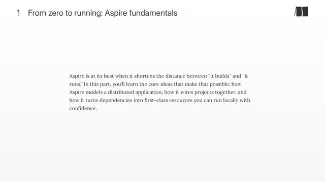
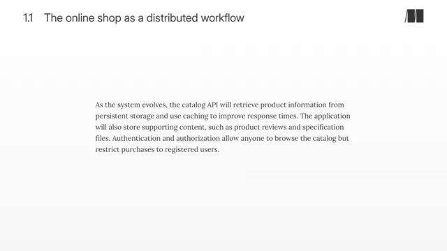
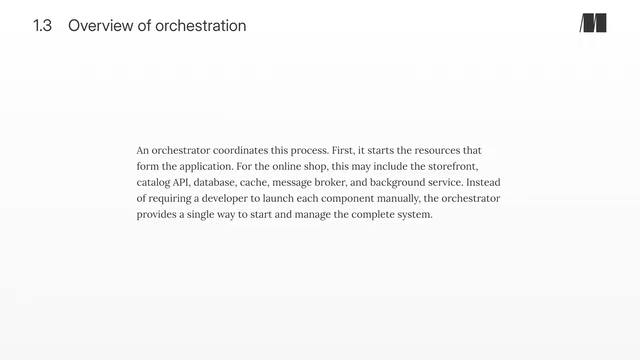
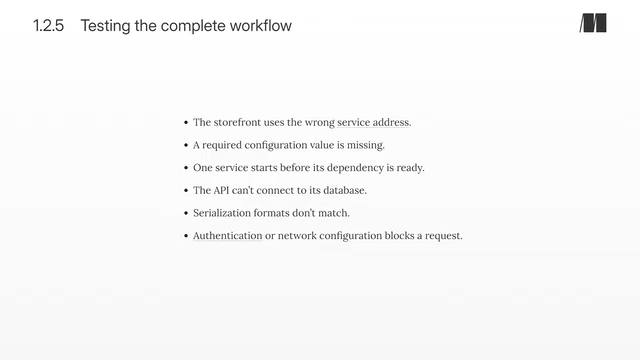
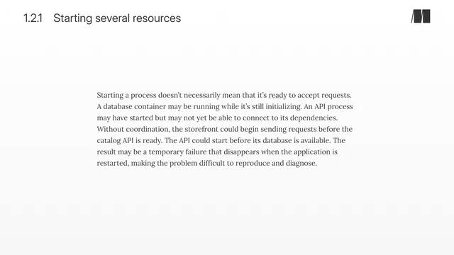
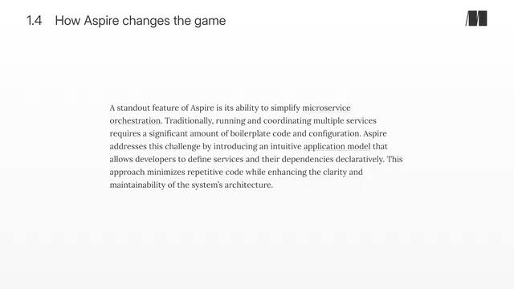
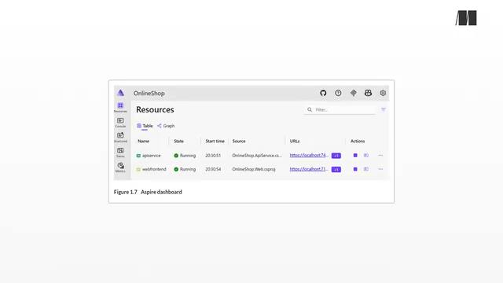
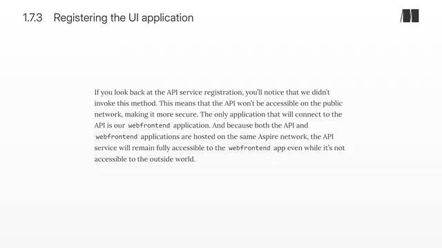
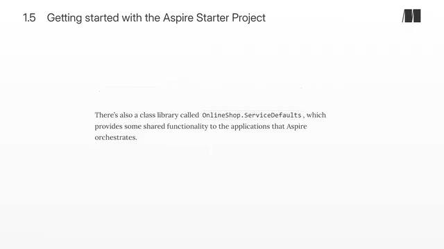
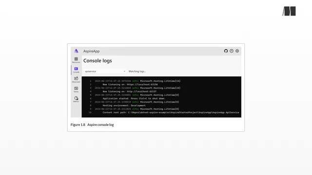

# 用 Aspire 把两个服务跑成一个系统：BV1qUWg6XE5z（P1–P8）复现手册

> 面向读者：会前端、正在转 AI 应用工程，没写过 .NET 后端也能照着做完。
> 本文覆盖 Part 1「From zero to running, Aspire Fundamentals」的 P1–P8。
> 做完你会得到一个 `OnlineShop` 解决方案：一条命令启动 Blazor 前端 + REST API，在 Aspire dashboard 里看到两个资源都是 Running，点开前端 Endpoint 能看到 Weather 页里显示从 API 取回的数据，而前端代码里**没有写死 API 的地址**。

---

## 1. 这一节做什么

这一段课程要交付的东西非常具体，不是概念课，是「把骨架搭起来并跑通」的第一段。

最终产物是一个 .NET 解决方案，名字叫 `OnlineShop`，包含四个项目：

| 项目 | 角色 | 是否被你手写 |
| --- | --- | --- |
| `OnlineShop.Web` | Blazor 前端，界面上有一个 Weather 页，数据来自外部 REST API | 模板生成，本段不改 |
| `OnlineShop.ApiService` | REST API，前端从这里取数据 | 模板生成，本段不改 |
| `OnlineShop.AppHost` | 编排器（orchestrator），唯一需要你写代码的项目 | **要写** |
| `OnlineShop.ServiceDefaults` | 类库，给被编排的应用提供共享功能 | 模板生成，本段不改 |

你要亲手完成的事只有三件：

1. 用 Aspire Starter 模板生成上面这个解决方案骨架；
2. 在 `OnlineShop.AppHost` 里用 C# 代码声明「这个系统由哪两个资源组成、它们之间什么关系」；
3. 只启动 AppHost 这一个进程，然后验收三件事：
   - dashboard 上两个资源都处于运行且健康的状态；
   - 点前端的 Endpoint 能打开页面，Weather 页里有 API 返回的数据；
   - 只有前端对外暴露端口，API 只在 Aspire 内部网络里可达。

这一段刻意**没有**数据库、没有缓存、没有消息队列、没有容器——那些是后面章节逐步加进来的。P1 的原话是这一段要「从最简单的搭建开始，然后不断加入真实感」：

> "We'll start with the simplest possible setup and then add realism, containers, integrations, and the kinds of infrastructure every serious app needs."
> —— p001 [00:25]
> **译**：我们将从最简单的搭建开始，然后加入真实感、容器、集成，以及每个严肃应用都需要的那些基础设施。



给前端同学一个心理映射，能省你很多时间：**AppHost 这个项目，约等于 `docker-compose.yml` + 启动脚本 + 依赖等待逻辑 + 服务发现 + 一个本地仪表盘，只不过它是用 C# 写成的、会被编译的代码**。你在 `docker-compose.yml` 里写 `depends_on`，在 Aspire 里写 `.WaitFor(...)`；你在 compose 里写服务名当主机名，在 Aspire 里写 `.WithReference(...)`。区别是 Aspire 的这套「组合描述」是被 IDE 和编译器认识的强类型对象，可以链式加方法，也可以被测试代码引用。

为什么值得单独造这么一层？因为讲师在 P3 花了整整十二分钟列「本地开发一个分布式系统到底难在哪」，那六条痛点就是这一层的需求文档。先把这六条记住，后面每一行代码都是在回应其中一条：

1. **要启动的资源不止一个**，而且启动顺序有讲究；
2. **地址和配置要同步**，端口一变、换台机器就全乱；
3. **调用跨了网络边界**，会超时、会连不上、会部分可用；
4. **故障定位跨了多个组件**，症状在前端、病因在数据库；
5. **整个工作流没法单独测**，每个服务自己测都过，合起来就是不通；
6. 所以需要一种**开发期编排（development-time orchestration）**。



P4 把「编排」定义清楚了，并且划了一条重要边界：Aspire 在本课程里扮演的是**开发期**编排器，不是生产环境那套东西。

> "ASPIRE's immediate role is development time orchestration. It helps you describe the application's resources and relationships, start them together, supply configuration, assess their health, and inspect them through a shared dashboard."
> —— p004 [02:24]
> **译**：ASPIRE 的直接角色是开发期编排。它帮助你描述应用的资源与关系、把它们一起启动、提供配置、评估它们的健康状况，并通过一个共享的仪表盘检查它们。



还有一条边界同样重要：Aspire **不会**把你的多个服务合并成一个可执行文件，服务始终是独立进程，只是被统一管理。

> "The individual services remain independent applications. Aspire doesn't merge them into one executable and it doesn't replace the production platform on which they'll eventually run."
> —— p002 [02:19]
> **译**：各个服务仍然是独立的应用。Aspire 不会把它们合并成一个可执行文件，也不会取代它们最终运行所在的生产平台。

---

## 2. 讲师原话

这一节把课程里最关键的几句原话按主题列出来。英文是逐字稿原文，中文只做翻译。

**关于 Aspire 是什么、App Host 是什么**

> "This tool is Aspire, formerly known as .NET Aspire. Aspire is designed to make this development experience more manageable. It provides a code-first application model for describing the services and infrastructure resources that form a distributed application. The central project in this model is the App Host."
> —— p002 [01:26]
> **译**：这个工具是 Aspire，以前叫 .NET Aspire。Aspire 的设计目标是让这种开发体验更易管理。它提供一个代码优先的应用模型，用于描述构成分布式应用的服务与基础设施资源。这个模型中的中心项目是 App Host。

> "You declare the resources in the system and describe the relationships between them. Then Aspire can use that model to do the following. Start the application's resources together. Supply configuration and connection information. Coordinate dependencies among resources. Enable services to locate one another through service discovery. Display resource state and telemetry in a shared dashboard."
> —— p002 [01:52]
> **译**：你声明系统中的资源并描述它们之间的关系。然后 Aspire 可以用这个模型做以下事情。把应用的资源一起启动。提供配置和连接信息。协调资源之间的依赖。让服务通过服务发现相互定位。在一个共享仪表盘中显示资源状态和遥测数据。

**关于「为什么本地开发这么难」——六条需求的原始清单**

> "Developers need a reliable way to do the following. Describe which resources belong to the application. Start those resources together. Express dependencies among the resources. Supply addresses and connection information. Determine whether each resource is ready and healthy. Collect diagnostic information in one place. Reproduce the same application topology during integration testing."
> —— p003 [11:18]
> **译**：开发者需要一种可靠的方式来做以下事情。描述哪些资源属于这个应用。把这些资源一起启动。表达资源之间的依赖。提供地址和连接信息。判定每个资源是否就绪、是否健康。把诊断信息集中到一处。在集成测试时复现相同的应用拓扑。



**关于「启动 ≠ 就绪」**

> "Starting a process doesn't necessarily mean that it's ready to accept requests. A database container may be running while it's still initializing."
> —— p003 [05:07]
> **译**：启动一个进程并不必然意味着它已经准备好接受请求。一个数据库容器可能已经在运行，但仍在初始化中。



**关于可观测性**

> "Aspire integrates with tools such as OpenTelemetry to provide comprehensive tracing, logging, and metrics capabilities out of the box."
> —— p005 [02:17]
> **译**：Aspire 与 OpenTelemetry 之类的工具集成，开箱即用地提供全面的追踪、日志和指标能力。



**关于怎么启动这个分布式应用**

> "To launch the distributed application hosted in Aspire, we have to launch the host application, called onlineshop.apphost in our example. The host application launches all other applications."
> —— p007 [00:00]
> **译**：要启动托管在 Aspire 中的分布式应用，我们必须启动宿主应用，在我们的示例中它叫 onlineshop.apphost。宿主应用会启动所有其他应用。

> "If we were to run the host application under an HTTP profile rather than an HTTPS profile, we'd see only one endpoint for each service rather than two. But this scenario applies only to a local development environment."
> —— p007 [00:29]
> **译**：如果我们用 HTTP 配置文件而不是 HTTPS 配置文件来运行宿主应用，我们会看到每个服务只有一个端点而不是两个。但这种情况只适用于本地开发环境。



**关于 Host 的启动代码**

> "We start by instantiating the host builder, but this is a special host builder used by Aspire. It comes from the distributed application class, which is used specifically for building host applications."
> —— p008 [01:48]
> **译**：我们首先实例化宿主生成器，但这是 Aspire 使用的一种特殊宿主生成器。它来自 distributed application 类，该类专门用于构建宿主应用。

**关于那个「凭空出现」的泛型类型**

> "This type doesn't exist anywhere in any of our projects. It's auto-generated and constructed from the name of one of our projects. This type has all the code necessary to register that project as an app that the host can orchestrate."
> —— p008 [02:46]
> **译**：这个类型在我们任何一个项目里都不存在。它是自动生成的，由我们某个项目的名称构造而来。这个类型拥有把该项目注册为宿主可编排应用所需的全部代码。

**关于「只有前端对外」和「服务发现」**

> "This is necessary because by default, the services hosted by Aspire are accessible only through Aspire's own internal network."
> —— p008 [03:43]
> **译**：这是必要的，因为默认情况下，Aspire 托管的服务只能通过 Aspire 自己的内部网络访问。

> "Therefore, we invoke the with reference method and insert the previously registered API service reference into it so that the Blazor UI application can refer to the API application via service discovery. We also have the wait for method, which ensures that the front-end service starts only after the API service is fully ready."
> —— p008 [04:12]
> **译**：因此，我们调用 with reference 方法，并把先前注册的 API 服务引用插入其中，以便 Blazor UI 应用可以通过服务发现引用该 API 应用。我们还有 wait for 方法，它确保前端服务仅在 API 服务完全就绪之后才启动。



---

## 3. 从零复现

下面每一步都是可以直接粘贴执行的。凡是课程没交代、但你必须做的动作，我会明确标「课里没讲」。

### 步骤 0：环境

课程在 P6 开头说环境搭建放在附录里（`The appendix explains how.`），也就是说**正文没讲版本号和安装步骤**。你需要的最小集合是 .NET SDK（版本以你安装的 Aspire 模板包要求为准，课里没给具体数字）。

```bash
# 确认 SDK 存在，并且能列出已安装的模板
dotnet --info
dotnet new list aspire
```

如果第二条命令输出里没有 `aspire-starter`，说明模板包没装（Visual Studio 的安装器通常会自动装）。补装：

```bash
# 课里没讲这条命令；模板缺失时才需要
dotnet new install Aspire.ProjectTemplates
```

### 步骤 1：生成解决方案骨架

课程里说「基于 Aspire Starter Project 模板创建了一个新的 .NET 解决方案，命名为 online shop」。课里没给命令行，在 IDE 里就是新建项目 → 选 Aspire Starter Application → 名字填 `OnlineShop`。CLI 的等价做法：

```bash
dotnet new aspire-starter -o OnlineShop
cd OnlineShop
```

生成后目录长这样（这就是 P6 的 Figure 1.6 描述的结构）：

```
OnlineShop/
├── OnlineShop.sln
├── OnlineShop.AppHost/
│   ├── OnlineShop.AppHost.csproj
│   └── Program.cs
├── OnlineShop.ApiService/
│   ├── OnlineShop.ApiService.csproj
│   └── Program.cs
├── OnlineShop.ServiceDefaults/
│   └── OnlineShop.ServiceDefaults.csproj
└── OnlineShop.Web/
    ├── OnlineShop.Web.csproj
    ├── Program.cs
    └── Components/
```



动手前先确认这个判断：**只有 AppHost 是你要改的**。Web 和 API 的代码本段一行都不用动。

### 步骤 2：确认 AppHost 的 `.csproj`

课程说可以通过 `.csproj` 里的一个 opening tag 认出 Aspire 宿主项目（`You can identify the Aspire host project by the following opening tag in its .csproj file.`）。课里没念出这个 tag 的具体文本，你打开文件自己看一眼即可。同时课程强调宿主必须引用它要编排的所有项目：

> "The host application also has to reference all the applications that it's going to orchestrate. In our case, there are two."
> —— p008 [00:53]
> **译**：宿主应用还必须引用它将要编排的所有应用。在我们的例子里，有两个。

打开 `OnlineShop.AppHost/OnlineShop.AppHost.csproj`，确认 `ItemGroup` 里有两条 `ProjectReference`，分别指向 Web 和 ApiService。第三节末尾给出的完整文件可供对照。

### 步骤 3：写 AppHost 的启动代码

打开 `OnlineShop.AppHost/Program.cs`（课程里把它称为 `apphost.cs` 文件，指的就是 AppHost 项目的入口文件），替换成第 4 节给出的完整代码。

这一步只做四件事，按课程 P8 的顺序：

1. 用 `DistributedApplication.CreateBuilder(args)` 建宿主；
2. `AddProject<...>` 注册 API，并给它挂一个 `/health` 健康检查（`WithHttpHealthCheck("/health")`）；
3. `AddProject<...>` 注册前端，链上 `WithExternalHttpEndpoints()`、`WithReference(apiService)`、`WaitFor(apiService)`；
4. 启动。

### 步骤 4：只启动 AppHost

```bash
# 在 OnlineShop 目录下
dotnet run --project OnlineShop.AppHost
```

课程 P7 强调的就是这一条：**分布式应用靠启动宿主应用来启动**，宿主再去启动所有其他应用。你不需要另开两个终端去 `dotnet run` Web 和 API。

第一次运行会编译三个项目，比较慢；控制台最后会打印出 dashboard 的地址（形如 `https://localhost:17xxx`，端口每次可能不同，以你实际输出为准）。浏览器会自动打开。

### 步骤 5：在 dashboard 上验收

dashboard 上应该出现两行，课程 P7 说明每行包含这几列信息：

> "The dashboard contains the following information for each service. Service type. Unique name used in the context of the Aspire environment. State, which tells us whether the service is running and healthy. Source, which points us to the project that represents the service. Service endpoint, if the service has one. Service logs. Details of the service."
> —— p007 [00:29]
> **译**：仪表盘为每个服务包含以下信息。服务类型。在 Aspire 环境上下文中使用的唯一名称。状态，它告诉我们该服务是否正在运行且健康。来源，它指向代表该服务的项目。服务端点，如果该服务有端点的话。服务日志。服务的详细信息。

验收点：

- 两行资源的名称与你注册时传入的字符串一致（模板默认是 `apiservice` 和 `webfrontend`；课程正文里把它们称作 “API service” 和 “Web front-end”，那只是称呼，dashboard 显示的是你传进去的字符串）；
- State 列显示为运行中且健康；
- **前端那一行有端点，API 那一行没有对外端点**——这是 `WithExternalHttpEndpoints()` 只加在前端身上的直接结果；
- 如果启动时用的是 HTTP profile 而不是 HTTPS profile，每个服务只会看到一个端点而不是两个（P7 原话）。

### 步骤 6：点开前端端点，看到 API 的数据

点前端那行的 Endpoint URL，打开 Blazor 页面，切到 Weather 标签。页面上应该出现一张天气表。**这张表的数据不是前端写死的，是前端通过 HTTP 调 API 拿到的**——这就是「服务发现生效了」的证据。

课程对这一刻的描述：

> "This should open a Blazor UI application, where we can navigate to the Weather tab. This tab contains data that the Blazor application retrieved from the API."
> —— p007 [01:52]
> **译**：这应该会打开一个 Blazor UI 应用，我们可以在其中导航到 Weather 标签。这个标签包含 Blazor 应用从 API 检索到的数据。



### 步骤 7：反向验证「服务发现」和「就绪等待」真的起作用

光看到页面还不够，做两个破坏性验证，你才算真的理解了这两行代码：

**验证 A —— 地址确实没写死。** 关掉所有进程，重新 `dotnet run --project OnlineShop.AppHost`。由于端口可能被重新分配，如果你在 Web 里写死了 `https://localhost:7243`，这次就会 502/连接失败。实际结果是页面照常出数据，因为地址是运行时注入的。

**验证 B —— 顺序确实被强制了。** 在 `WaitFor(apiService)` 这一行前面加 `//` 注释掉，重启，然后在 dashboard 里观察前端和 API 的启动时序：不再有「等 API 健康」这层约束。这个实验只用于理解，做完记得改回来。

---

## 4. 完整代码

### 4.1 `OnlineShop.AppHost/OnlineShop.AppHost.csproj`

```xml
<Project Sdk="Aspire.AppHost.Sdk/9.0.0">

  <PropertyGroup>
    <OutputType>Exe</OutputType>
    <TargetFramework>net9.0</TargetFramework>
    <ImplicitUsings>enable</ImplicitUsings>
    <Nullable>enable</Nullable>
    <IsAspireHost>true</IsAspireHost>
  </PropertyGroup>

  <ItemGroup>
    <PackageReference Include="Aspire.Hosting.AppHost" Version="9.0.0" />
  </ItemGroup>

  <ItemGroup>
    <ProjectReference Include="..\OnlineShop.ApiService\OnlineShop.ApiService.csproj" />
    <ProjectReference Include="..\OnlineShop.Web\OnlineShop.Web.csproj" />
  </ItemGroup>

</Project>
```

说明：`Sdk="Aspire.AppHost.Sdk/9.0.0"` 就是课程说的「用这个 opening tag 认出 Aspire 宿主项目」。**版本号请以你模板实际生成的结果为准**，课里没讲版本号；如果你装的模板是 9.1.x，这里会是 `9.1.x`。不要手抄版本号覆盖模板生成的，除非你确认本机装的就是这个版本。

### 4.2 `OnlineShop.AppHost/Program.cs`（本段唯一需要你写的文件）

```csharp
var builder = DistributedApplication.CreateBuilder(args);

// 注册 API 服务。
// "apiservice" 是资源名，也是服务发现在运行时使用的键；
// Web 项目的 HttpClient BaseAddress 就是按这个名字配的，不要随意改。
var apiService = builder.AddProject<Projects.OnlineShop_ApiService>("apiservice")
    .WithHttpHealthCheck("/health");

// 注册前端：
//   WithExternalHttpEndpoints() -> 只有它对外暴露端口
//   WithReference(apiService)   -> 通过服务发现把 API 的地址注入给前端
//   WaitFor(apiService)         -> API 完全就绪后，前端才启动
builder.AddProject<Projects.OnlineShop_Web>("webfrontend")
    .WithExternalHttpEndpoints()
    .WithReference(apiService)
    .WaitFor(apiService);

builder.Build().Run();
```

注意两点，避免踩坑：

- `Projects.OnlineShop_ApiService` 和 `Projects.OnlineShop_Web` 这两个类型**在你的解决方案里搜索不到**，它们是编译期根据项目名生成的（课程 P8 专门解释了这一点）。所以 `Projects.` 后面能点出什么，取决于你 `ProjectReference` 了哪些项目。
- 最后一行 `builder.Build().Run();` 课程没有单独念出来，但模板里有它，没有它程序不会启动。

### 4.3 Web 与 API 项目

这两个项目由模板生成，**本段不需要你写任何代码**。课程也只描述了它们的职责，没有展示内部实现：

> "OnlineShop.Web, a Blazor web application with a user interface that pulls data from an external REST API endpoint. OnlineShop.API service, the REST API application from which the Blazor application pulls data."
> —— p006 [00:27]
> **译**：OnlineShop.Web，一个带用户界面的 Blazor Web 应用，它从外部 REST API 端点拉取数据。OnlineShop.API service，Blazor 应用从中拉取数据的 REST API 应用。

`OnlineShop.ServiceDefaults` 同理，课程只说它是「为被编排的应用提供一些共享功能的类库」，**具体内容课里没讲**。

如果你想确认前端到底怎么消费这个引用，去看 `OnlineShop.Web/Program.cs` 里注册 HttpClient 的那一行，它的 base address 是一个形如 `https+http://apiservice` 的服务发现地址——这段代码是模板自带的，**课里没讲**，你也不需要改。只要 AppHost 里的资源名保持 `apiservice`，它就能解析。

### 4.4 一键启动脚本（方便反复实验）

```bash
#!/usr/bin/env bash
# run.sh —— 放在 OnlineShop 目录下，课里没有这个脚本，纯本地便利
set -euo pipefail
dotnet run --project OnlineShop.AppHost
```

---

## 5. 逐行解释

这一段逐条解释上一节的每个决策「为什么这样定、不这样会怎样」。

**`DistributedApplication.CreateBuilder(args)`**
这是 Aspire 专用的宿主生成器，来自 `DistributedApplication` 类。和普通 ASP.NET Core 的 `WebApplication.CreateBuilder` 不同，它建出来的 builder 上有一批专门用于「加资源」的方法（`AddProject`、后续章节的 `AddContainer`、`AddDatabase` 等）。如果你图省事用了普通 builder，`AddProject` 根本不存在，编译就过不去。课程把这一点单独讲了一句：

> "We start by instantiating the host builder, but this is a special host builder used by Aspire."
> —— p008 [01:48]
> **译**：我们首先实例化宿主生成器，但这是 Aspire 使用的一种特殊宿主生成器。

**`builder.AddProject<Projects.OnlineShop_ApiService>("apiservice")`**
两个参数分别是「类型」和「名字」，缺一不可。

- 泛型参数告诉 Aspire「去启动哪个项目的进程」。这个类型是自动生成的，课程强调它有「把该项目注册为宿主可编排应用所需的全部代码」——翻译成前端能懂的话：它是编译期生成的一份「启动说明书」，里面写好了项目的程序集路径、启动方式等，所以你在源码里搜不到它。
- 字符串参数是资源名。这个名字会出现在 dashboard 上，更重要的是会变成注入给其他服务的**服务发现地址里的主机名**。所以它不是一个随便取的美术字，它是运行时的寻址键。改这个字符串而不同步改 Web 侧的 base address，前端就会解析不到 API——这也是本文坚持沿用模板默认 `apiservice` 的原因。

**`.WithHttpHealthCheck("/health")`**
给这个资源挂一个健康检查路径，编排器据此判断服务是否真的「就绪」，而不只是「进程还在」。这直接回应了 P3 里的那条痛点：

> "The orchestrator can use health information to determine when a resource is ready and delay dependent services until the resources they require are available."
> —— p004 [01:55]
> **译**：编排器可以使用健康信息来判定一个资源何时就绪，并把依赖它的服务延迟到它所需的资源可用之后。

**不写这一句会怎样？** `WaitFor` 会失去判断依据，退化成「进程起来了就算好了」，于是你又会遇到「API 已经启动但还没法处理请求，前端先发请求然后报错」的经典时序 bug。

需要提醒：`/health` 这个路径必须真的由 API 项目提供。课程没有解释这个端点是谁注册的；如果你用的是 Aspire Starter 模板，`ServiceDefaults` 里已经带了健康检查端点的映射，正常情况下你不用动。如果访问 `/health` 返回 404，见第 7 节。

**`.WithExternalHttpEndpoints()` 只加在前端**
这是本段最容易被忽略、但信息量最大的一行。课程解释得很直白：

> "This is necessary because by default, the services hosted by Aspire are accessible only through Aspire's own internal network."
> —— p008 [03:43]
> **译**：这是必要的，因为默认情况下，Aspire 托管的服务只能通过 Aspire 自己的内部网络访问。

也就是说：**默认全封闭，需要外网可达的才显式开**。课程特意指出 API 的注册里没有调这个方法，它因此不对外暴露，只在 Aspire 网络内部可达，而前端和它在同一个网络里，所以前端照常能访问它。这是一个「默认安全」的设计决策，也是你日后加数据库、加消息队列时应该沿用的一贯做法：**只有需要人用浏览器打开的，才开外网端点**。

**`.WithReference(apiService)`**
把 API 资源的连接信息注入到前端。课程的原话是「以便 Blazor UI 应用可以通过服务发现引用该 API 应用」。

这一行的效果是：运行时给前端进程注入一份「`apiservice` 现在在哪个 host:port」的配置，前端用逻辑名 `apiservice` 去发请求，由框架解析成真实地址。**所以前端代码里永远不出现 `localhost:7243` 这种字符串**——这就是 P3 里「地址和配置必须同步」那条痛点的解法。

**不写这一句会怎样？** 前端进程拿不到任何关于 API 的信息，服务发现解析失败，Weather 页会报错或空白。

**`.WaitFor(apiService)`**
启动顺序约束：前端要等 API 完全就绪才启动。课程的原话是「它确保前端服务仅在 API 服务完全就绪后才启动」。

注意区分它和 `WithReference` 的职责：`WithReference` 解决「怎么找到」，`WaitFor` 解决「什么时候才开始找」。很多人第一次写会只写前者，然后抱怨「偶尔第一次启动失败、重启就好」——这正是 P3 描述的、最难复现的那类问题：

> "The result may be a temporary failure that disappears when the application is restarted, making the problem difficult to reproduce and diagnose."
> —— p003 [05:33]
> **译**：结果可能是一个在应用重启后就消失的临时性失败，使该问题难以复现和诊断。

**`builder.Build().Run();`**
把模型固化并运行。到这里，AppHost 进程会把声明的资源逐个拉起，并把遥测汇聚到 dashboard。

**CSProj 里的 `<ProjectReference>` 两条**
课程说宿主必须引用所有要编排的项目。原因很实在：`AddProject<T>` 的泛型参数 `T` 是由**被引用项目的名称**生成的。少一条引用，对应的 `Projects.XXX` 类型就不存在，`AddProject<...>` 直接编译失败。这是编译期就能拦截的错误，比运行时才发现好得多。

---

## 6. 复现检查清单

按顺序打勾，任何一项不过，先别往下走。

- [ ] `dotnet --info` 能正常输出，`dotnet new list aspire` 里能看到 `aspire-starter`。
- [ ] `OnlineShop/` 下有四个项目目录，且存在 `OnlineShop.sln`。
- [ ] `OnlineShop.AppHost/OnlineShop.AppHost.csproj` 的 `Sdk` 属性是 `Aspire.AppHost.Sdk/...` 形式。
- [ ] 该 csproj 里有两条 `ProjectReference`，分别指向 `OnlineShop.ApiService` 和 `OnlineShop.Web`，且路径拼写正确。
- [ ] `OnlineShop.AppHost/Program.cs` 中，`AddProject<Projects.XXX>` 能通过编译（即 `Projects.` 之后能用 IDE 补全出两个类型）。
- [ ] `dotnet run --project OnlineShop.AppHost` 能编译通过并打印出 dashboard 地址。
- [ ] dashboard 上有两行资源，State 均为运行中/健康。
- [ ] **前端那行有端点，API 那行没有对外端点。**
- [ ] 点前端端点能打开页面；Weather 标签里能看到数据。
- [ ] 在 dashboard 点进任意一个资源的 Console 标签，能看到该进程的日志输出。
- [ ] 停掉重跑一次（端口可能变化），Weather 页依然正常——证明没有硬编码地址。
- [ ] 把 `WaitFor(apiService)` 注释掉后重跑，能观察到启动时序变化；实验完恢复原样。

---

## 7. 课里没讲但你会撞上的

这一节全部是**课程正文没有覆盖**的内容，写在这里是因为你照做时大概率会遇上。

**1）SDK 与模板版本对不上。** 课程把环境搭建推到附录，正文没给版本号。如果你的 SDK 太旧，`Aspire.AppHost.Sdk/9.0.0` 会还原失败；如果模板包太新，生成的 csproj 里的版本号又和你手抄的不一致。**原则：以模板生成的文件为准，不要用本文的版本号去覆盖它。**

**2）HTTPS 开发证书没被信任。** `dotnet run` 后浏览器可能提示证书不受信任，dashboard 或前端页面打不开。这是 .NET 本地开发的常规坑，和课程内容无关。处理方式是信任开发证书（`dotnet dev-certs https --trust`），或者像课程提到的改用 HTTP profile——代价是每个服务只看到一个端点而不是两个。

**3）`/health` 返回 404。** 课程没有解释这个健康检查端点由谁提供。如果你从零手搭而不是用模板，就需要自己让 API 项目暴露这条路径，否则 `WithHttpHealthCheck("/health")` 永远等不到健康状态，`WaitFor` 会把前端一直卡住，表现为「dashboard 上前端长时间不启动」——非常像死锁，其实是健康检查没通过。

**4）改资源名导致前端 502。** 资源名是服务发现的寻址键。你把 `"apiservice"` 改成别的，就必须同步改 Web 侧 HttpClient 的 base address。课程没讲这个联动关系，但它是最常见的「照着抄却跑不通」的原因。

**5）端口被占用。** 重跑时如果上一次的进程没退干净，端口冲突会导致启动失败。dashboard 上看到的端点端口每次可能不同，这是正常的，也是「不要硬编码地址」这条原则的另一个理由。

**6）关于 Docker：本段不需要。** 课程的 P1 提到后面会引入 containers，但 P1–P8 这一段只有两个 .NET 项目，没有任何容器资源，所以**课里没讲这一段的 Docker 前置要求**。别提前去折腾容器运行时。

**7）给前端同学的 Node 对照。** 你在 Node 里等价的东西是：`docker-compose.yml`（声明有哪些服务）+ `concurrently` 或 npm scripts